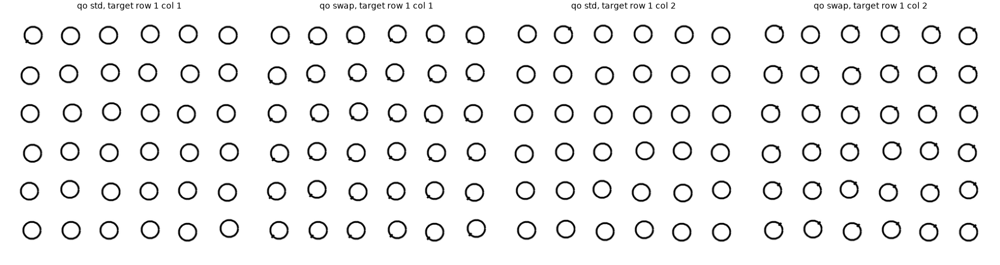
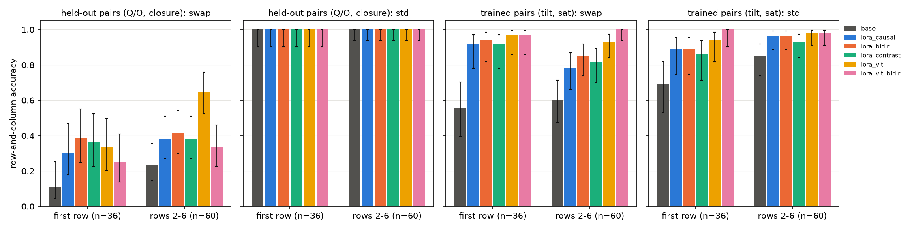
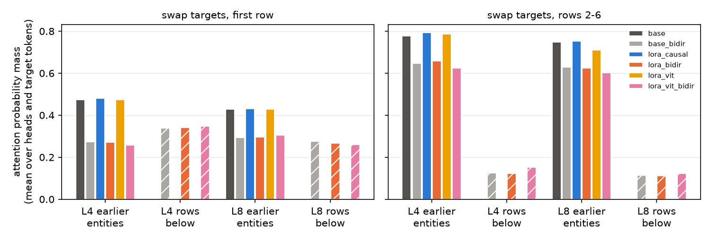
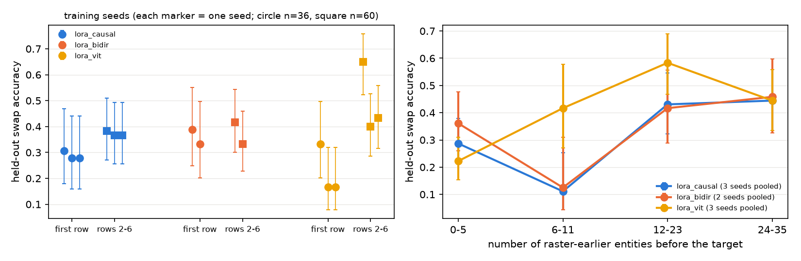
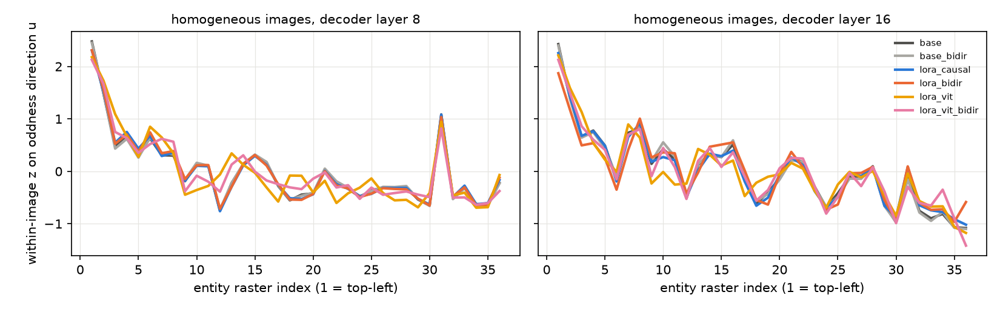
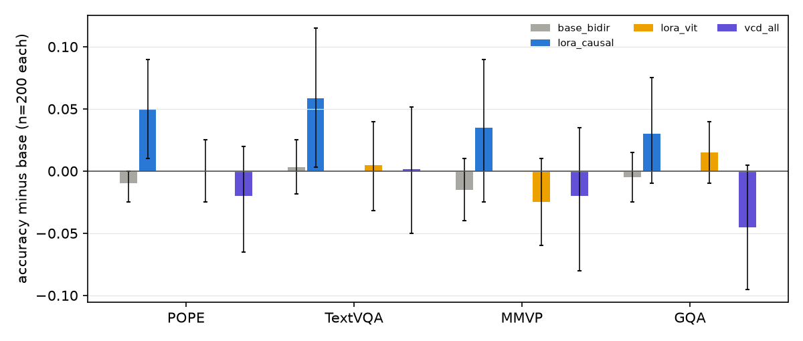
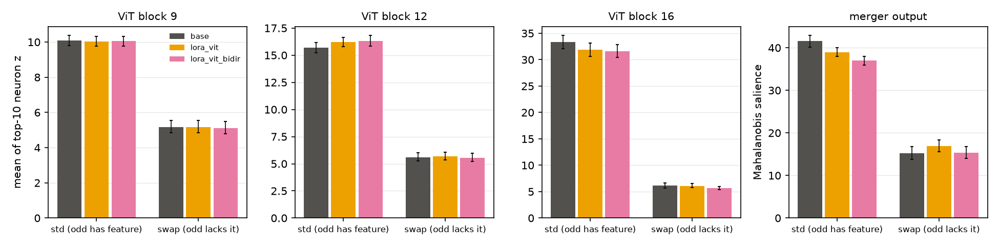

# 可解释性启发的模型优化：pilot 结果（实验 7.1）

## 通俗讲述

前六个研究问题给出了 Qwen3.5-9B 视觉失败的一批机理结论。其中最像“架构缺陷”的一条是：decoder 按光栅顺序（从左到右、从上到下）处理 visual tokens，而且是因果的，一个实体只能和排在它前面的实体比较。实验 2.6、2.7 发现，当异常实体的特征是“缺少某个部件”（例如一群 Q 中的一个 O）时，ViT 里没有任何 neuron 会因为“缺少”而激活，模型只能在 decoder 中把它与前面的实体比较才能发现它；于是位于第一行、前面几乎没有实体的这类目标几乎从不被找到。实验 2.7 第二轮把这一现象精确化为“需要大约 6 个以上的前文实体”，并发现 decoder 会把序列开头的实体本身当成“与众不同”（开头效应）。

由此产生的最直接的改进设想是：既然问题出在因果顺序，就让同一张图像内的 visual tokens 在 full attention 层中可以互相看见（方案 A，零新增参数）。与之并列的两个设想是：在视觉 token 上加一个“与邻域平均之差”的通道，把“缺少”变成一个正向信号（方案 E）；以及在解码时减去空白图像给出的先验（方案 C，无需训练）。为了把“改动本身的作用”与“用这批数据训练的作用”分开，每个训练方案都配有一个用同样数据、同样 LoRA、只是不加改动的对照。我们还按 2.7 的定位补做了一个只训练 ViT 中层 MLP 的 LoRA（约 96 万参数），以检验“在机理所在位置做局部调整”是否优于在整个 decoder 上做 LoRA。

结果否定了最初的主假设。双向 mask 确实被模型使用：第一行目标在第 4 层把 0.34 的 attention 质量放到下方各行的实体上，而且不经训练直接放开 mask 时通用能力不变；但无论是否训练，它都没有提高缺失目标的定位，两个训练 seed 的配对差异都不显著。因此，第一行失败的主要约束不是 full attention 的 mask，而是另外两件事：一是缺失特征的信号本身弱，二是开头效应和“前文数量依赖”产生在 Gated DeltaNet 的光栅递推中，而 DeltaNet 不受 mask 影响。均匀图像中的开头效应在放开 mask 后几乎不变，直接支持后一点。双向 mask 还有一个代价：在白底单目标图上，纵坐标整体下移，命中率由 32/57 降至 16/57，这与“纵坐标由目标之后的 tokens 携带”（第 31、38 条）一致。先验相减的解码在所有测试上都更差，它削弱了“答案恰好等于先验”的正确回答，例如第一行目标。ViT 定位的 LoRA 在训练过的特征上稳定优于 decoder LoRA（三个 seed 中两个显著），参数量只有后者的 4.4%，通用能力不变，计数提高；它在未训练特征上的迁移收益只在一个 seed 中显著，seed 间差异很大。综合来看，本轮没有一个方案达到“值得规模化”的标准；最有前景的方向是 ViT 定位的适配，而解决光栅依赖需要改动 DeltaNet 的扫描方式，单改 attention mask 不够。

## 1. 研究问题与主要结论

研究问题 7 要求在失败模式的机理位置做轻量、可推广的改动。本实验依据[设计文档](design_interp_guided_optimization.md)评估了五个候选方案，对其中三个（A、E、C）做了 pilot，并在执行中加入了 ViT 定位的 LoRA 与多 seed 重复。主要结论如下，每条都在第 3 节给出证据。

1. **图像片段内的双向 attention 被模型使用，但不改善缺失目标的定位（第 3.1、3.2 节）。**
2. **光栅依赖与开头效应位于 Gated DeltaNet 的递推中，full attention 的 mask 改动无法消除（第 3.3 节）。**
3. **双向 mask 与对比通道都会使白底图像上的纵坐标系统性下移（第 3.4 节）。**
4. **先验相减的解码在所有测试上不优于原模型（第 3.5 节）。**
5. **ViT 中层 MLP 的 LoRA 以 4.4% 的参数稳定地改善已训练特征的缺失搜索，对未训练特征的迁移不稳定（第 3.6 节）。**

## 2. 实验设计与执行

### 2.1 条件

全部训练条件使用同一份 2400 条训练数据（1200 条奇异实体搜索，特征对为倾斜、长度、弯曲、饱和度、大小；1200 条 TextVQA train 短答案问题），同一 LoRA 设置（秩 8，$\alpha = 32$，学习率 $10^{-4}$，150 步、每步 16 条），只改变表中“改动”一列。Q 与 O、开口与闭合两组特征对不进入训练。

| 条件 | 改动 | 训练参数 | seed |
| --- | --- | --- | --- |
| base | 无 | 0 | – |
| base_bidir | 图像片段内双向 mask（full attention 第 4、8、…、32 层），不训练 | 0 | – |
| lora_causal | decoder 全部线性层 LoRA（匹配对照） | 21.6M | 1、2、3 |
| lora_bidir | 同上，训练与推理均用双向 mask（方案 A） | 21.6M | 1、2 |
| lora_bidir_causaleval | lora_bidir 的 adapter 在 causal mask 下推理 | – | 1 |
| lora_contrast | lora_causal 加中心–周围对比通道（方案 E） | 21.6M + 0.79M | 1 |
| lora_vit | 只在 ViT 第 6–16 个 block 的 MLP 上做 LoRA | 0.96M | 1、2、3 |
| lora_vit_bidireval | lora_vit 的 adapter 在双向 mask 下推理 | – | 1 |
| lora_vit_bidir | lora_vit 在双向 mask 下训练与推理 | 0.96M | 1 |
| vcd_all / vcd_digit | 先验相减的解码（方案 C，$\alpha = 1$，$\beta = 0.1$），全部 token / 只对数字 token | 0 | – |

双向 mask、对比通道与先验相减的定义见设计文档第 3.1、3.5、3.3 节。“seed”同时改变 LoRA 初始化与训练样本顺序。

### 2.2 评测与输入示例

1. **机理探针**：6×6 网格，384 张图像。训练外特征对（Q 与 O、开口与闭合）与训练内特征对（倾斜、饱和度）各 96 张 std 与 96 张 swap；std 指异常实体多出该特征，swap 指异常实体缺少该特征。每组含每个单元格一次及额外 12 个第一行目标，因此 swap 中第一行目标 36 张、第 2–6 行 60 张。问法与实验 2.6、2.7 的直接作答问法相同。下图为 Q 与 O 的第一行示例（左两幅目标在第 1 行第 1 列，右两幅在第 1 行第 2 列）。

2. **计数**：实验 1.6 的 T0 变化数据集随机 120 张，回答网格的行数与列数。
3. **坐标**：实验 3.13 测试集的 267 题子集（白底单目标横向平移 57、10×10 网格 20、20×20 网格 40、RefCOCO 100、图表界面 50）。
4. **通用能力**：POPE、TextVQA、MMVP、GQA 各 200 题（与 3.13 相同的样本与评分），以及 45 道纯文本问题。
5. **统计**：比例报告分母与 Wilson 95% 区间；两条件在同一组题目上的比较使用精确 McNemar 检验，记作“前者错后者对 / 前者对后者错”；通用能力报告配对差值与 2000 次 bootstrap 区间。

### 2.3 机理测量

1. **目标的 attention 去向**：在 Q 与 O、开口与闭合的探针图像上，用 full attention 第 4、8 层的 query 与 key（LoRA 生效）按各条件实际使用的 mask 重算 softmax，统计目标 tokens 作为 query 时落在光栅顺序之前的实体与位于下方各行的实体上的概率质量，对 head 与目标 tokens 取平均。下方各行的全部 tokens 都在目标之后，causal mask 下该质量恰为 0。
2. **oddness 投影**：使用实验 2.7 第二轮在原模型上估计的留一法 oddness 方向 $u \in \mathbb{R}^{4096}$（每个特征对一个，由其余特征对估计）。实体 $e$ 的状态 $h_e$ 为其 tokens 上 decoder 第 $l$ 层输出的平均，分数 $s_e = (h_e - \operatorname{mean}_{e'} h_{e'})^{\top} u$ 在图像内标准化为 $z$。$z$ 越大，实体在“与众不同”这一共享方向上越突出；2.7 第二轮表明答案近似指向 $z$ 最大的实体。另生成每对 24 张不含异常实体的均匀图像，用于测量开头效应。
3. **ViT 内的突出度**：ViT 第 9、12、16 个 block 的 MLP 激活（linear_fc2 的输入）按实体平均后，计算每个 neuron 上目标相对其余实体的标准化偏差，取最大 10 个的平均（2.7 的度量）；以及 merger 输出上目标的 Mahalanobis 显著度。
4. **对比通道**：lora_contrast 中 $\lVert e_i \rVert$ 在目标实体上的图像内 $z$ 分数。

### 2.4 规模、耗时与检查

单张 A800 上训练一个 decoder LoRA 约 6.5 min，ViT LoRA 约 5.7 min；A40 上约 19–25 min。全部 GPU 运行（14 个条件的训练、评测与机理测量）约 4.5 GPU 小时，使用经 claim 工具申请的单卡。批量解码的 batch size 由 16000 个 padded tokens 的预算决定；20 道探针题与逐条 `generate` 的答案一致率为 15/20，不一致的 5 题均为相邻单元格之间的切换，属于 bf16 在不同 padding 下的数值差异，所有条件使用同一批量解码方式，因此不影响条件间比较。纯文本问题在全部条件下均为 43/45。

## 3. 结果

### 3.1 双向 mask 不改善缺失目标的定位

图中柱高为行列完全答对的比例（模型生成的答案按 2.6 的规则评分），误差线为 Wilson 95% 区间。深灰为原模型，蓝色为匹配对照 lora_causal，橙色为双向 mask 的 lora_bidir，青色为对比通道 lora_contrast，黄色为 ViT LoRA lora_vit，粉色为在双向 mask 下训练的 ViT LoRA（均为 seed 1）。

| 条件 | 训练外 swap 第一行（n=36） | 训练外 swap 第 2–6 行（n=60） | 第一行且不在第 1 列（n=30） | 答案为左上角实体的比例（n=96） | 训练内 swap 第一行 / 第 2–6 行 |
| --- | --- | --- | --- | --- | --- |
| base | 4 | 14 | 4 | 3 | 20 / 36 |
| base_bidir | 5 | 13 | 5 | 0 | 22 / 36 |
| lora_causal（seed 1 / 2 / 3） | 11 / 10 / 10 | 23 / 22 / 22 | 7 / 7 / 7 | 41 / 41 / 27 | 33 / 47 |
| lora_bidir（seed 1 / 2） | 14 / 12 | 25 / 20 | 11 / 10 | 11 / 19 | 34 / 51 |
| lora_bidir_causaleval | 12 | 26 | 9 | 14 | 33 / 53 |
| lora_contrast | 13 | 23 | 10 | 36 | 33 / 49 |
| lora_vit（seed 1 / 2 / 3） | 12 / 6 / 6 | 39 / 24 / 26 | 11 / 5 / 6 | 1 / 3 / 1 | 35 / 56 |
| lora_vit_bidireval | 9 | 34 | 8 | 1 | 35 / 57 |
| lora_vit_bidir | 9 | 20 | 8 | 1 | 35 / 60 |

训练内一列只列 seed 1。std（异常实体多出特征）在训练外特征对上所有条件均为 96/96，因此表中只列 swap。

**在同样的数据与 LoRA 下，双向 mask 与 causal mask 的缺失目标定位没有可分辨的差别。** 训练外 swap 的第一行，lora_bidir 对 lora_causal 在 seed 1 为 4/1（$p = 0.38$），seed 2 为 3/1（$p = 0.63$）；第 2–6 行分别为 2/0 与 1/3。双向 mask 的 adapter 放回 causal mask 推理后（lora_bidir_causaleval）也只改变 2–3 题。这说明 lora_bidir 并没有学到依赖向后读取的新比较方式；第一行准确率的提高（4/36 升至 10–14/36）在 causal 对照中同样出现，来自训练数据而非 mask。

**训练使模型在找不到异常时默认回答左上角实体，双向 mask 削弱了这一默认。** 第一行准确率需要结合答案分布解读：lora_causal 在训练外 swap 图像中有 27–41/96 的回答是第 1 行第 1 列，原模型只有 3/96。只看不在第 1 列的第一行目标，lora_causal 三个 seed 都是 7/30，lora_bidir 为 11/30 与 10/30（配对 3/0，$p = 0.25$），方向有利于双向 mask 但不显著。默认回答左上角是 2.7 第二轮“开头效应”的行为表现：不含异常时 decoder 把第 1 个实体当作最突出的实体；双向 mask 使第 1 个实体也能与其后的实体比较，相应的默认回答由 41/96 降为 11–19/96（解释）。

### 3.2 双向读取确实发生

图中数值由 full attention 第 4、8 层的 query 与 key 重算 softmax 得到（未经拟合），左图为第一行 swap 目标（n=36），右图为第 2–6 行（n=60）；实心柱为落在光栅顺序之前的实体上的质量，斜线柱为落在下方各行实体上的质量，颜色与上图相同，浅灰为 base_bidir。

**放开 mask 后，第一行目标立即把约三分之一的 attention 转向下方各行，且不需要训练。** base_bidir 中第一行 swap 目标在第 4 层放在下方各行上的质量为 0.34，第 8 层为 0.28，与 lora_bidir 几乎相同（0.34、0.27）；放在之前实体上的质量相应由 0.47 降至 0.27。因此 mask 改动在模型内部按预期生效，却没有转化为定位能力，这排除了“双向读取没有发生”的解释，失败只能来自读取之后的计算。

### 3.3 光栅依赖与开头效应来自 DeltaNet

实验 2.7 第二轮对方案 A 给出三项预测：前文数量依赖消失、开头效应减弱、缺失目标在 oddness 方向上的 $z$ 提前升高。

左图为每个训练 seed 的训练外 swap 准确率（圆点为第一行，方块为第 2–6 行，误差线为 Wilson 区间）；右图把各条件全部 seed 合并，按目标之前的实体数分组（每个 seed 的分母为 36、12、24、24）。

**前文数量依赖在双向 mask 下没有消失，并在缺失信号增强后更加明显。** 合并三个 seed 后，lora_vit 在之前有 0–5、6–11、12–23、24–35 个实体时的准确率为 0.22、0.42、0.58、0.44；lora_vit 的 adapter 在双向 mask 下推理时（lora_vit_bidireval，seed 1）依然为 9/36、6/12、17/24、11/24。lora_causal 与 lora_bidir 在 0–5 组较高，是 3.1 节左上角默认回答的产物，在 6–11 组都只有 0.11–0.13。也就是说，当 ViT LoRA 使缺失目标更容易被发现时，第一行的劣势反而清楚地显现出来，而双向 full attention 不能弥补。

图中数值为 48 张均匀图像中每个实体在 oddness 方向上的图像内 $z$（由实体状态与 2.7 第二轮的方向计算），横轴为光栅序号。

| 条件 | 第 8 层：第 1、2 个实体的 $z$ | 第 16 层：第 1、2 个实体的 $z$ | 第 16 层训练外 swap 目标 $z$（第 2–6 行） | 目标 $z$ 减其余实体最大 $z$（第 16 层，第 2–6 行） |
| --- | --- | --- | --- | --- |
| base | 2.48、1.48 | 2.43、1.40 | 0.45 | −1.84 |
| base_bidir | 2.45、1.48 | 2.40、1.38 | 0.42 | −1.86 |
| lora_causal | 2.30、1.53 | 2.26、1.43 | 0.66 | −1.62 |
| lora_bidir | 2.31、1.57 | 1.87、1.17 | 0.84 | −1.39 |
| lora_vit | 2.18、1.73 | 2.21、1.59 | 1.71 | −0.67 |
| lora_vit_bidir | 2.13、1.67 | 2.13、1.49 | 0.85 | −1.58 |

**均匀图像中的开头效应在第 8 层完全不受 mask 影响，只在训练后的第 16 层略有减弱。** base 与 base_bidir 第 1 个实体的 $z$ 为 2.48 与 2.45；锯齿形（每行行首的小峰）也保持不变。实验 2.7 第二轮与 3.10、3.14 把这种随光栅序号递减并在行首重置的模式归于 DeltaNet 的递推状态；DeltaNet 层不使用 attention mask，因此 mask 改动对它无效，这与观察一致。lora_bidir 在第 16 层把第 1 个实体的 $z$ 降到 1.87，并把训练外目标的 $z$ 由 0.66 提到 0.84，方向符合预测，但幅度远小于 lora_vit 带来的变化（目标 $z$ 1.71），且未转化为准确率。

由此得到对第 1 类瓶颈的修正判断（解释，中等置信度）：缺失目标的参照由浅层 DeltaNet 沿光栅顺序累积（2.7 第 3.6 节），full attention 第 4、8 层只是两条读取通路之一；只放开 full attention 的 mask，DeltaNet 中“参照尚未形成时的开头实体显得异常”的偏差依然写入每个实体的状态。若要消除光栅依赖，需要让 DeltaNet 对图像 tokens 也做双向扫描（例如对图像片段增加一次逆序递推并合并），这是比 mask 更大的结构改动，本轮未测试。

### 3.4 双向信息流使白底图像上的纵坐标下移

| 条件 | 白底单目标命中（n=57） | 纵坐标平均偏差（0–1000 单位） | 横坐标与真值的斜率 |
| --- | --- | --- | --- |
| base | 35 | +19 | 1.07 |
| base_bidir | 28 | +30 | 1.06 |
| lora_causal | 32 | +28 | 1.07 |
| lora_bidir | 16 | +70 | 1.05 |
| lora_contrast | 16 | +67 | 1.06 |
| lora_vit | 37 | +23 | 1.08 |

**把下方信息引入目标 tokens 的两种改动都使纵坐标整体下移，横坐标不受影响。** lora_bidir 与 lora_contrast 相对 lora_causal 的命中均为 0/16（$p < 10^{-4}$），base_bidir 相对 base 为 0/7（$p = 0.016$）；三者横坐标的斜率与误差均不变。白底图像中横坐标由目标 tokens 携带，纵坐标由目标所在行、光栅顺序在目标之后的 tokens 携带（第 31、38 条）。双向 mask 让目标之前的 tokens 也能读到下方内容，对比通道的 5×5 邻域平均同样把下方 tokens 混入每个 token，两者都破坏了“纵坐标只在目标之后”的不对称，读出的纵坐标随之偏向下方（解释）。RefCOCO、网格与图表界面上的差异不显著（lora_contrast 在图表界面上为 0/8，$p = 0.008$）。

### 3.5 先验相减的解码

| 条件 | 训练外 swap 第一行 / 第 2–6 行 | 训练内 swap 第一行 | 计数（n=120） | 白底单目标 480–520 吸附比例（n=14） | 白底单目标平均误差 |
| --- | --- | --- | --- | --- | --- |
| base | 4 / 14 | 20/36 | 89 | 0.86 | 52.6 |
| vcd_digit | 0 / 11 | 9/36 | 85 | 0.57 | 57.4 |
| vcd_all | 1 / 8 | 9/36 | 81 | 0.57 | 57.1 |

**先验相减去掉了 500 吸附，但没有把答案移向真值，并系统性地压低与先验一致的正确答案。** 吸附比例由 0.86 降至 0.57，与 3.12 的空白画布校准方向一致，但平均误差反而增大，与 3.12 第二轮“第二位数字读取首位数字的犹豫程度而非图像”相符：减去先验只能让答案离开 500，不能提供缺失的精度。空白图上的行列先验集中在第 1 行，相减后训练内第一行目标由 20/36 降至 9/36（0/11，$p = 0.001$）；通用基准差值为 −0.045 至 +0.002，GQA 下降最多。该方法还使推理计算加倍，不具备推广价值。

### 3.6 ViT 定位的 LoRA

图中为各条件相对原模型的配对准确率差（每个基准 200 题，误差线为 bootstrap 95% 区间），颜色同上，浅灰为 base_bidir，紫色为 vcd_all。

**只训练 ViT 第 6–16 个 block 的 MLP，就能在已训练特征上稳定超过 decoder 全部线性层 LoRA，且不改变通用能力。** 训练内 swap 第 2–6 行在三个 seed 中为 56、57、60/60，lora_causal 为 47、48、53/60（seed 2、3 的配对检验 $p = 0.035$ 与 $0.016$）。参数量为 0.96M，约为 decoder LoRA（21.6M）的 4.4%。通用基准差值在 −0.025 至 +0.015 之间，均不显著；decoder LoRA 的 +0.03 至 +0.06 主要来自截断减少（POPE 截断由 15 降为 0），这是 TextVQA 短答案训练带来的格式变化，ViT LoRA 不改 decoder，因而没有这一变化。网格计数由 89/120 升至 96、96、101/120（seed 1–3）。

**对未训练特征的迁移收益不稳定。** 训练外 swap 第 2–6 行，seed 1 为 39/60（对 lora_causal 18/2，$p < 0.001$），seed 2 与 3 只有 24 与 26/60（对同 seed 的 lora_causal 9/7 与 7/3，均不显著）。三个 seed 合并为 89/180（0.49），lora_causal 为 67/180（0.37），但单个 seed 的结果不足以支持“ViT 适配学到了通用的缺失检测”。

图中前三幅为 ViT MLP 激活中目标最大 10 个 neuron 偏差的平均，第四幅为 merger 输出上的 Mahalanobis 显著度（由激活计算，误差线为以图像为单位的 bootstrap 区间），深灰 base，黄色 lora_vit，粉色 lora_vit_bidir（均为 seed 1，n=96）。

**ViT LoRA 没有产生“缺少某部件”的专属 neuron，它改变的是分布式表示，使 decoder 的比较更容易。** swap 目标的最大 neuron 偏差在第 9、12、16 个 block 均不变（第 16 个 block 6.11 对 6.10），merger 显著度只由 15.2 [13.8, 16.8] 小幅升至 16.9 [15.6, 18.3]；但 decoder 第 16 层 oddness 方向上的目标 $z$ 由 0.45 升至 1.71，与其余实体最大 $z$ 的差由 −1.84 缩小到 −0.67。因此改进发生在“ViT 表示 → decoder 比较”的接口上，比较本身仍是光栅因果的，这解释了 3.3 节中 lora_vit 的前文数量依赖。

**ViT LoRA 若在双向 mask 下训练，迁移变差。** lora_vit_bidir 的训练外第 2–6 行只有 20/60（对 lora_vit 0/19，$p < 10^{-5}$），训练内仍为 60/60。一个可能的解释是双向 mask 下 decoder 能更容易地拟合训练特征，回传到 ViT 的梯度减少（推测，单 seed）。

### 3.7 对比通道

lora_contrast 在训练外 swap 上与 lora_causal 相同（13/36、23/60），对比通道输出范数在 swap 目标上的 $z$ 为 0.38（第 2–6 行），std 为 1.19，即该通道主要响应“多出来”的特征，未能把缺失转为正向信号；它还带来 3.4 节的纵坐标偏差与图表界面上的坐标损失。

## 4. 讨论

### 4.1 判定

| 方案 | 机理预测是否成立 | 是否优于匹配对照 | 通用能力 | 判定 |
| --- | --- | --- | --- | --- |
| (A) 图像片段内双向 attention | 读取发生；前文依赖与开头效应未消除 | 否（两个 seed） | 不变 | 不值得以当前形式推广 |
| (E) 中心–周围对比通道 | 未产生缺失信号 | 否 | 不变 | 放弃 |
| (C) 先验相减的解码 | 只去吸附，不提精度 | 劣于原模型 | 下降 | 放弃 |
| ViT 定位 LoRA（D 的 ViT 版本） | 改善 decoder 中的 oddness | 训练内稳定优于；训练外不稳定 | 不变 | 最有前景，需扩大数据后复验 |
| (B) 二维绝对位置编码 | 未测 | – | – | 维持设计文档的低优先级 |

**本轮最重要的结论是一个否定结果：第一行缺失目标的失败是结构性的，但结构原因在 Gated DeltaNet 的光栅递推，而非 full attention 的 causal mask。** 这一判断有三方面证据：放开 mask 后 attention 确实转向下方（3.2 节），但开头效应在第 8 层不变（3.3 节）；增强缺失信号后前文数量依赖更明显（3.3 节）；mask 的效果在 adapter 迁回 causal mask 后几乎不变（3.1 节）。它把设计文档中第 1 类瓶颈的位置由“causal mask”收窄为“DeltaNet 的单向扫描”。

### 4.2 参数问题与架构问题

1. **训练过的特征上，第一行缺失目标可以被 causal 模型找到（参数问题，确定性高）。** lora_causal 在训练内特征对的第一行为 32–33/36，lora_vit 为 31–35/36，均不需要改结构。
2. **未训练特征上的缺失检测取决于 ViT 表示能否迁移（参数与数据问题，确定性中等）。** ViT LoRA 的迁移在一个 seed 中显著、在两个 seed 中不显著，说明 5 组特征对的训练数据不足以学到通用的“缺失”表示。
3. **光栅依赖（架构问题，确定性中等）。** 在缺失信号增强后依然存在，且对 full attention 的 mask 不敏感，指向 DeltaNet。

### 4.3 与其他实验的一致与冲突

1. **与 2.7 第二轮一致。** 开头效应在本实验的均匀图像中以相同幅度复现（第 1、2 个实体 $z$ 2.48、1.48，2.7 第二轮为 2.64、1.40），前文数量依赖在 lora_vit 中复现；2.7 第二轮给出的三项方案 A 预测中，前两项在本实验中不成立，第三项只在第 16 层出现小幅变化。
2. **与 3.14 一致。** 3.14 区分了 causal mask 与 DeltaNet 递推的作用并把行方向载体的不对称归于后者；本实验从干预角度得到同样的划分。
3. **与 3.13 一致并补充。** 3.13 发现有效的参数改变位于读取之前；本实验在另一类任务上发现最有效的局部改变位于 ViT，两者都指向“改善进入读出电路的表示”优于改动读出电路本身。
4. **与 Pei et al.（2025）一致。** 未训练地放松 visual-to-visual mask 不损害通用基准；本实验补充了它对坐标纵轴的副作用。

## 5. 限制

1. 每格样本量较小（第一行 36 张），方案 A 的效应若小于约 0.15 则无法检出；双向 mask 只有两个 seed，对比通道与 lora_vit_bidir 只有一个 seed。
2. 训练数据只有 5 组特征对与 TextVQA，规模为 2400 条；迁移结论可能随训练特征的多样性改变。
3. oddness 方向在原模型上估计，LoRA 之后的方向可能偏移，因此投影值只作为相对比较。
4. 只测试了 6×6 合成网格，自然图像中的缺失检测未测。
5. 未测试 DeltaNet 的双向扫描，4.1 节关于其必要性的判断属于推断。

## 6. 由结果导出的下一项实验

1. **图像片段的双向 DeltaNet 扫描。** 对图像 tokens 增加一次逆序递推（共享或复制权重），与正向输出相加后再进入 full attention 层，在相同数据与 LoRA 下与 lora_causal 比较；预测是开头效应与前文数量依赖消失，同时需要监测纵坐标。
2. **ViT 定位适配的数据扩展。** 用更多特征对（含 2.7 第二轮的新特征对）训练 ViT 第 6–16 个 block 的 LoRA，以留出特征对为测试集、至少 3 个 seed，检验迁移是否稳定；同时在 POPE、TextVQA、MMVP、GQA 与 BabyVision 找不同子集上评测。

## 7. 运行与产物

1. 代码：`analysis_tools/application/interp_opt.py`、`interp_opt_run.py`、`interp_opt_analysis.py`；测试：`tests/analysis/application/test_interp_opt.py`。
2. 入口：`scripts/analysis/application/interp_opt.sh`（参数在脚本顶部，按 CONDITION 与 STAGES 运行）。
3. 产物：`$WORK_DIR/analysis/application/2026-11-03_interp_guided_optimization/`，其中 `eval/<条件>/` 为各条件逐题结果，`adapters/` 为 adapter 与训练日志，`results.json` 为本文全部统计。
