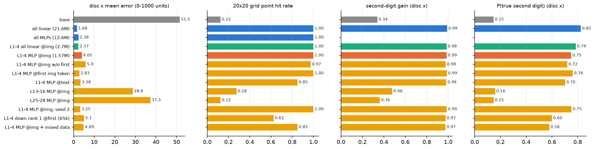
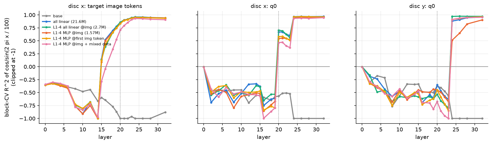
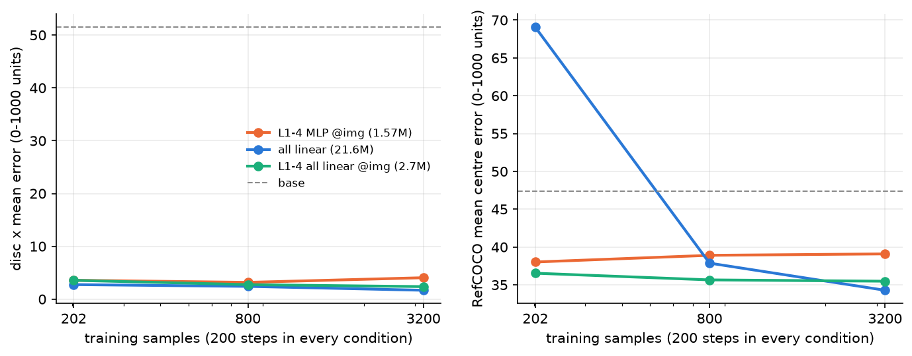
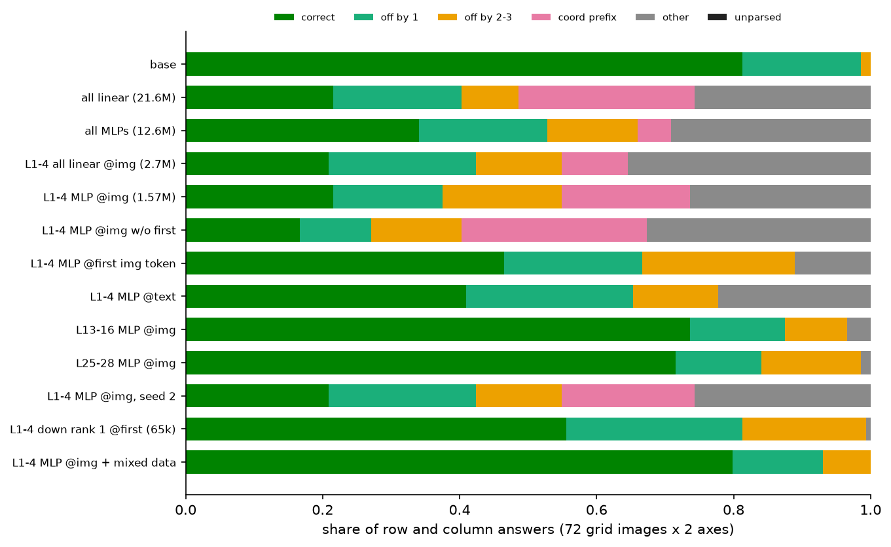

# 先验定位的坐标微调（实验 7.2）

实验日期：2026-11-05 至 2026-11-06。本文属于[研究问题 7](plan.md)，检验[实验 3.16](../position/results_2026-11-05_readout_prior_localization.md)在训练之前写定的定位与预测。主模型为 Qwen3.5-9B，bfloat16、SDPA，thinking off，direct-answer 提示；训练与评测协议沿用[实验 3.13 第二轮](../position/results_2026-11-03_targeted_finetune_r2.md)。3.16 第 6 节的预测已在训练开始前冻结（冻结副本与 sha256 见“实验产物”），本文只把结果与之对照，不修改预测。

## 通俗讲述

Qwen3.5 写坐标时只有首位数字可靠。实验 3.16 只看原模型就推出了缺陷所在：第 20 层从图像 token 读取目标时，图像 token 上只有“标尺”式的位置信息，没有文本数字那种周期为 100 的数值编码，而第 21–32 层的读出电路只要收到这种编码就能写对第二位数字。据此 3.16 预注册了一个方案：只训练第 1–4 层的 MLP，且只在图像 token 上生效（157 万参数），并对层位置、token 位置与数据量给出了可证伪的预测。本文按预注册方案和对照条件实际训练，检验哪些预测成立。

层的定位成立。只训练第 1–4 层 MLP 的图像 token 更新，画布 x 误差由 51.5 降到 4.1（第二个 seed 3.2），第二位数字的增益由 0.34 升到 0.99，20×20 网格命中率由 0.12 升到 1.00；纯文本输出与原模型逐字相同，四个通用基准无显著下降。同样参数量放在第 13–16 层只得到部分改善（误差 28.8），放在第 20 层读取之后的第 25–28 层几乎无效（误差 37.3，增益 0.36）。训练后的模型在预测的位置出现了预测的表示：目标图像 token 在第 15–20 层出现周期编码，$q_0$ 在第 20 层由负转正，百位偏置由 0.90 降到 0.11。

token 层面的三条预测没有成立。第一，只在第一个图像 token 上训练同样的 MLP（只改一个 token）与训练全部图像 token 同样有效（误差 2.8，增益 0.99），超出预测的“部分有效”；甚至只给第 1–4 层的 down_proj 加一个秩为 1 的更新、只作用于第一个图像 token（6.6 万参数），也能把增益提到 0.97。第一个图像 token 在 DeltaNet 递推中的强写入使它成为改写全部图像 token 的入口，3.16 测到了这一杠杆，却低估了它的充分性。第二，只在文本 token 上训练也有效（误差 3.4，增益 0.98）。第二轮（[7.2 第二轮](results_2026-11-11_located_finetune_r2.md)）表明，这一效果几乎全部来自图像之前的 4 个模板 token：它们与第一个图像 token 同处图像片段的开头，问题文本 token 不承担任何作用。第三，数据效率方面，定位方案在 202 与 800 条样本上并不优于全部线性层 LoRA（2.8–3.6 与 2.4–2.8），但全部线性层 LoRA 在 202 条样本时把 RefCOCO 误差从 47.3 推高到 69.1，定位方案保持在 38.0。

修复带来一个必须正视的副作用：直接问“红色图形在第几行第几列”时，原模型 72 题答对 48 题，主方案只答对 6 题。错误分类显示，约五分之一的行列答案正是该目标坐标的前两位数字（例如第 14 列答成 67，对应 x 坐标 675），说明图像 token 上新出现的数值编码在“写一个关于目标的数”时被直接取用。由于图像 token 位于问题之前，只改图像 token 的适配器看不到问题是在问坐标还是问行列；在训练数据中混入 300 条行列问答和 1671 条自蒸馏指令样本后，同一位置的适配器把行列准确率恢复到 44/72（与原模型无显著差别），坐标误差 4.9。BabyVision 找不同类网格上的结果与此一致：给目标点坐标的准确率由 0.17 升到 0.99，但答行列的准确率由 0.30 降到 0.05，混合数据只恢复到 0.12；BabyVision 原题从 5/16 降到 0/16，混合数据恢复到 4/16。

结论是：先验定位能可靠地给出“在第 20 层读取之前的浅层修改上游表示”这一层级判断，并正确预测训练后的表示变化；但它在 token 层面的判断过于保守，模型存在比预测更多、更省参数的入口（第一个图像 token、图像之前的模板 token，二者同处图像片段的开头）。定位微调在参数量上节省 93%，在训练时间上没有节省，因为浅层 LoRA 的梯度仍需反传过全部 32 层。

## 1. 假说与主要结论

| 编号 | 假说（来自 3.16 第 6 节） | 检验 | 结论 |
| --- | --- | --- | --- |
| H1 | 第 1–4 层 MLP 的图像 token 更新足以修复数字读出，且不损害纯文本与通用能力 | 主方案与两个 seed（第 4.1 节） | 支持（误差阈值 4 处于两个 seed 之间） |
| H2 | 修复应发生在第 20 层读取之前的浅层 | 第 13–16、25–28 层的等参数对照（第 4.1 节） | 支持 |
| H3 | 修复必须作用于图像 token，第一个图像 token 必要但不充分 | 去掉第一个图像 token、只用第一个图像 token、只用文本 token（第 4.2 节） | 否定 |
| H4 | 训练后第 20 层读取的源 token 出现周期编码，$q_0$ 在第 20 层跃升，百位偏置消失 | 整百留出交叉验证与 $m$ 分解（第 4.3 节） | 支持 |
| H5 | 定位方案在少量数据时不劣于全部线性层 LoRA | 202 / 800 / 3200 条样本（第 4.4 节） | 画布误差上否定；RefCOCO 上定位方案更稳 |

主要结论：

1. **只训练第 1–4 层 MLP 的图像 token 更新（157 万参数）就能修复第二位数字，修复位置必须在第 20 层读取之前（第 4.1 节，图 1）。** 主方案画布 x 误差 4.1 / 3.2（两个 seed），增益 0.99，第二位真值概率 0.75；等参数的第 13–16 层误差 28.8、增益 0.48，第 25–28 层误差 37.3、增益 0.36。这说明 3.16 的层级推断成立：读出电路无需改动，所需的上游表示必须在第 20 层之前写成，而且越早写入、留给后续非线性层的重编码深度越多，效果越好。
2. **训练后的表示变化与预注册预测一致（第 4.3 节，图 2）。** 目标图像 token 的周期编码可解码性在第 14 层仍为 −1.17，第 15 层 0.09，第 20 层 0.83；$q_0$ 由第 19 层的 −0.67 跃升到第 20 层的 0.54；画布 y 的 $q_0$ 在第 24 层为 0.51；百位偏置占比由 0.90 / 0.91 降到 0.11 / 0.07。修复后的模型在图像任务中复现了文本数值通路的时序，即第 20 层把周期编码带入 $q_0$。
3. **第一个图像 token 是充分的入口，文本 token 也是可行的入口（第 4.2 节）。** 只训练第一个图像 token：误差 2.8，增益 0.99，目标 token 的周期编码曲线与主方案几乎重合；只训练文本 token：误差 3.4，增益 0.98，其效果来自图像之前的模板 token 上的更新（第二轮表 1）。3.16 关于 token 位置的三条预测均不成立，原因在第 4.2 节逐条分析。
4. **定位方案节省参数而不节省训练计算，少量数据时在自然图像上更稳（第 4.4 节，图 3）。** 参数量为全部线性层 LoRA 的 7%，同一 GPU 上训练时间相同（A40 上约 1400–1760 s）；202 条样本时全部线性层 LoRA 的 RefCOCO 误差升到 69.1，定位方案为 38.0。
5. **坐标训练损害直接的行列序号作答，损害来自图像 token 上的数值编码被行列答案直接取用；混合数据可修复合成网格上的损害（第 4.6 节，图 4）。** 主方案行列准确率 6/72（原模型 48/72），19% 的行列答案落在目标坐标前两位数字的 ±1.5 以内；混合数据训练后为 44/72（McNemar p = 0.54），坐标误差 4.9。
6. **BabyVision 找不同类网格上，坐标作答大幅改善，行列作答与原题作答变差（第 4.7 节）。** 着色目标的坐标命中率 0.17 → 0.99；行列准确率 0.30 → 0.05（混合数据 0.12）；原题 5/16 → 0/16（混合数据 4/16）。

## 2. 方法

### 2.1 位置受限的 LoRA

对一个线性层 $W \in \mathbb{R}^{d_{\text{out}} \times d_{\text{in}}}$，第 $i$ 个 token 的输入记为 $x_i \in \mathbb{R}^{d_{\text{in}}}$，输出为

$$
y_i = W x_i + \mu_i \, \frac{\alpha}{r} \, B A x_i ,
$$

其中 $A \in \mathbb{R}^{r \times d_{\text{in}}}$、$B \in \mathbb{R}^{d_{\text{out}} \times r}$ 是 LoRA 的两个低秩矩阵，$r = 8$，$\alpha = 32$；$\mu_i \in \{0, 1\}$ 是位置掩码，决定第 $i$ 个 token 是否使用更新。掩码按 input_ids 计算，有四种取值：全部图像 token（image）、除第一个以外的图像 token（image_nofirst）、第一个图像 token（first）与全部非图像 token（text）。采用位置掩码的原因是 3.16 的定位同时给出了“改哪些层”和“改哪些 token”两个判断，只有把更新限制在指定 token 上才能分别检验。

图像 token 位于问题文本之前，因而在因果模型中，image、image_nofirst 与 first 三种掩码的适配器对图像 token 状态的改动与问题内容无关。生成阶段的每个新 token 都不是图像 token，所以这三种掩码在生成阶段使用原权重；纯文本输入不含图像 token，输出与原模型逐字相同是构造上的保证。text 掩码在纯文本输入与生成阶段都使用更新。

### 2.2 训练与条件

训练数据为 3.13 的 3200 条精确坐标样本（合成画布、网格、图表界面与 RefCOCO 等），每步 16 条，200 步，学习率 $10^{-4}$，余弦退火，只对答案 token 计算交叉熵。MLP 条件对 gate_proj、up_proj 与 down_proj 同时加 LoRA，每层 393,216 个参数。

**表 1：训练条件。** “预注册”指 3.16 第 6 节写定的条件；对照条件 all_linear、mlp_all 与 early1_4_img 的适配器直接取自 3.13 及其第二轮。

| 条件 | 层与模块 | token 掩码 | 参数量 | 来源 |
| --- | --- | --- | --- | --- |
| mlp1_4_img（主方案） | 第 1–4 层 MLP | image | 1.57 M | 预注册 |
| mlp1_4_img_s2 | 同上，seed 2 | image | 1.57 M | 重复 |
| mlp1_4_nofirst | 第 1–4 层 MLP | image_nofirst | 1.57 M | 预注册 |
| mlp1_4_first | 第 1–4 层 MLP | first | 1.57 M | 预注册 |
| mlp1_4_text | 第 1–4 层 MLP | text | 1.57 M | 预注册 |
| mlp13_16_img | 第 13–16 层 MLP | image | 1.57 M | 预注册 |
| mlp25_28_img | 第 25–28 层 MLP | image | 1.57 M | 预注册 |
| all_linear | 全部 32 层的全部线性层 | 全部 | 21.6 M | 3.13 |
| mlp_all | 全部 32 层 MLP | 全部 | 12.6 M | 3.13 |
| early1_4_img | 第 1–4 层全部线性层 | image | 2.7 M | 3.13 第二轮 |
| 数据效率 | mlp1_4_img、all_linear、early1_4_img 各在 202 / 800 条样本上训练 200 步（16 / 4 个 epoch） | 同上 | 同上 | 预注册 |
| down1_4_first_r1 | 第 1–4 层 down_proj，秩 1 | first | 65.5 k | 追加 |
| mlp1_4_img_fix | 同主方案，训练数据为 3200 条坐标 + 300 条网格行列问答 + 1671 条自蒸馏指令样本，1 个 epoch（323 步） | image | 1.57 M | 追加 |

mlp1_4_img_fix 的行列问答样本由 3.13 训练集中每张网格图像各生成一条，答案为原模型使用的纯 JSON 格式；自蒸馏指令样本为 3.13 第二轮中原模型对通用问题的 greedy 输出。

### 2.3 评测

1. **坐标**：3.13 的 997 条留出测试题，按族报告平均误差（0–1000 坐标单位）与命中率。画布 x / y（disc_x、disc_y）是单目标画布上沿一个轴扫描的目标，20×20 网格（grid20）中目标格宽为 50 个单位。
2. **数字读出**：3.12 与 3.16 的数字分解，在画布 x（sweep_h）、画布 y（sweep_v）与 RefCOCO 上报告第二位数字的增益（期望第二位数字对组内偏移的斜率，理想值为 1）、第二位真值概率 $P_1$ 与 $m$ 的百位偏置占比（定义见 3.16 第 2.1、4.1 节）。
3. **通用能力**：POPE、TextVQA、MMVP、GQA 各 200 题（与原模型的配对差及 McNemar 或符号检验 p 值），45 条纯文本题（准确率与逐字相同的比例）。
4. **行列序号**：3.13 测试集中的 72 张网格图像（6×6、10×10、20×20），提示为“给出红色图形所在的行和列，只输出 JSON”。严格解析要求原模型的 JSON 格式，宽松解析容忍括号错配等格式漂移。
5. **BabyVision**：1.3 标注的 16 道“找不同”网格题。除原题（official，含推理，最多 1024 个 token）外，构造四种 direct-answer 任务：奇异实体的行列（odd_rowcol）与坐标（odd_point）；以及在每张图上把 6 个网格单元依次涂成与背景及前景颜色差别最大的纯色（红、绿或蓝），分别问该单元的坐标（red_point）与行列（red_rowcol），共 96 题。

### 2.4 表示检验

在主方案、mlp1_4_first、mlp1_4_img_fix、all_linear 与 early1_4_img 上重复 3.16 第 3.2 节的测量：对目标图像 token 与 $q_0$ 的逐层 residual，以整百为留出折做 ridge 回归，报告周期编码 $(\cos(2\pi x/100), \sin(2\pi x/100))$ 的交叉验证 $R^2$。该量大于 0 表示存在对所有百位通用的周期编码。

## 3. 预测与结果对照

**表 2：预注册预测与实测（3.16 表 4、表 5）。** “成立”按预注册的数值阈值判断；画布误差为 disc_x 平均误差，括号内为 95% bootstrap 区间。

| 条件或测量 | 预测 | 实测 | 判定 |
| --- | --- | --- | --- |
| mlp1_4_img：画布误差 | ≤ 4 | 4.05 [3.7, 4.4]；seed 2 为 3.2 [3.1, 3.4] | 处于阈值边界 |
| mlp1_4_img：增益、$P_1$、20×20 命中 | ≥ 0.95、≥ 0.70、≥ 0.95 | 0.99、0.75、1.00 | 成立 |
| mlp1_4_img：纯文本、通用基准 | 45/45 相同；无显著下降 | 45/45 相同；四项 p ≥ 0.14 | 成立 |
| mlp1_4_img：与 all_linear、early1_4_img 相差 ≤ 2 | ≤ 2 | 与 all_linear 相差 2.4（seed 2 为 1.5），与 early1_4_img 相差 1.7 | 部分成立 |
| mlp1_4_nofirst | 增益 ≤ 0.90 或误差 ≥ 8 | 增益 0.98，误差 5.9 | 不成立（方向正确：误差高于主方案） |
| mlp1_4_first | 增益 0.40–0.90，误差高于主方案 | 增益 0.99，误差 2.8 | 不成立（完全有效） |
| mlp1_4_text | 误差 ≥ 30，增益 ≤ 0.6 | 误差 3.4，增益 0.98 | 不成立 |
| mlp13_16_img | 误差 8–30，劣于主方案 | 误差 28.8，增益 0.48 | 成立 |
| mlp25_28_img | 与原模型无显著差别，误差 ≥ 40 | 误差 37.3 [32.5, 42.2]（原模型 51.5），增益 0.36，20×20 命中 0.12 | 基本成立（误差略低于阈值） |
| 数据效率 | 主方案在 202、800 条上误差不高于 all_linear | 3.6 对 2.8，3.2 对 2.4 | 不成立 |
| $q_0$ 第 20 层周期编码（画布 x） | ≥ 0.5，并在第 20 层跃升 | 第 19 层 −0.67，第 20 层 0.54 | 成立 |
| 目标 token 周期编码（第 16–20 层） | 由负转正，最大值 ≥ 0.5 | 第 16 层 0.50，第 20 层 0.83 | 成立 |
| $q_0$ 第 24 层周期编码（画布 y） | ≥ 0.5 | 0.51 | 成立 |
| 百位偏置占比（x / y） | ≤ 0.3 | 0.11 / 0.07 | 成立 |

预注册的三条失败判据中，“主方案误差 > 8 或增益 < 0.90”未触发，“mlp13_16_img 与主方案无显著差别”未触发，“mlp1_4_text 有效”被触发。因此“第 1–4 层足以完成重编码”与“偏向早层”两项推断保留，“只需改动图像 token”的推断被否定。

## 4. 结果

### 4.1 层位置：修复必须在第 20 层读取之前

**图 1：主要条件的实测结果。** 从左到右依次为画布 x 平均误差、20×20 网格命中率、画布 x 上第二位数字的增益与第二位真值概率 $P_1$。灰色为原模型，蓝色为 3.13 的全模型 LoRA，青色为 3.13 第二轮的 early1_4_img，橙色为本文主方案，黄色为预注册对照，其余为追加条件。mlp_all 未做数字分解，后两列空缺。

**表 3：坐标与数字读出（实测）。** 误差单位为 0–1000 坐标；增益与 $P_1$ 取画布 x。

| 条件 | 参数量 | 画布 x / y 误差 | 20×20 命中 | 图表界面误差 | RefCOCO 误差 | 增益 | $P_1$ | RefCOCO 增益 |
| --- | --- | --- | --- | --- | --- | --- | --- | --- |
| 原模型 | 0 | 51.5 / 44.4 | 0.12 | 61.4 | 47.3 | 0.34 | 0.15 | 0.51 |
| all_linear | 21.6 M | 1.7 / 2.2 | 1.00 | 5.9 | 34.3 | 0.99 | 0.82 | 0.75 |
| mlp_all | 12.6 M | 2.4 / 2.3 | 1.00 | 9.1 | 36.5 | — | — | — |
| early1_4_img | 2.7 M | 2.4 / 2.4 | 1.00 | 7.8 | 35.5 | 0.98 | 0.79 | 0.72 |
| mlp1_4_img | 1.57 M | 4.1 / 2.6 | 1.00 | 14.3 | 39.1 | 0.99 | 0.75 | 0.69 |
| mlp1_4_img_s2 | 1.57 M | 3.2 / 2.4 | 1.00 | 12.3 | 41.1 | 0.99 | 0.75 | 0.69 |
| mlp1_4_nofirst | 1.57 M | 5.9 / 2.7 | 0.97 | 27.9 | 38.4 | 0.98 | 0.72 | 0.69 |
| mlp1_4_first | 1.57 M | 2.8 / 2.8 | 1.00 | 8.9 | 41.5 | 0.99 | 0.76 | 0.71 |
| mlp1_4_text | 1.57 M | 3.4 / 4.1 | 0.85 | 6.9 | 34.4 | 0.98 | 0.70 | 0.72 |
| mlp13_16_img | 1.57 M | 28.8 / 21.7 | 0.28 | 42.0 | 43.4 | 0.48 | 0.16 | 0.66 |
| mlp25_28_img | 1.57 M | 37.3 / 37.2 | 0.12 | 58.3 | 48.0 | 0.36 | 0.15 | 0.53 |
| down1_4_first_r1 | 65.5 k | 5.1 / 4.9 | 0.62 | 22.6 | 46.7 | 0.97 | 0.60 | 0.54 |
| mlp1_4_img_fix | 1.57 M | 4.9 / 3.7 | 0.85 | 16.4 | 36.6 | 0.97 | 0.58 | 0.67 |

1. **同样 157 万参数，越靠后越无效。** 第 1–4 层把增益修到 0.99；第 13–16 层只到 0.48，画布 y 的偏置占比仍为 0.81；第 25–28 层的增益 0.36 与原模型的 0.34 相当，20×20 命中率与原模型同为 0.12，误差的下降（51.5 → 37.3）来自首位读出的少量校正，第二位数字没有改善。这一梯度与 3.16 的两条论证一致：第 20 层会从图像 token 重新读取并覆盖 $q_0$，所以第 20 层之后的修改无法改变读入的格式；所需格式约 16 维，需要多层非线性计算从标尺重编码得到，第 13–16 层之后只剩 3–6 层，深度不足。
2. **第 1–4 层的 MLP 与全部线性层效果相近。** 主方案与 early1_4_img（参数多 72%）的画布误差相差 1.7，与 all_linear（参数量为其 14 倍）相差 2.4（seed 2 为 1.5）；两者的增益都已接近 1，剩余差距主要体现在图表界面（14.3 对 5.9–7.8）等含多个元素的图像上。
3. **RefCOCO 的改善小于合成图像。** 所有有效条件把 RefCOCO 误差从 47.3 降到 34–42，区间彼此重叠（例如主方案 [31.2, 48.3]，all_linear [28.2, 41.4]）；RefCOCO 的增益只到 0.69–0.75。第 4.3 节显示，RefCOCO 上 $q_0$ 在任何条件下都没有出现周期编码，这与 3.16 中“RefCOCO 的 $m$ 散布主要来自图像内容噪声”一致：自然图像中目标位置本身的不确定性限制了第二位数字。

### 4.2 token 位置：第一个图像 token 与问题文本

1. **只更新第一个图像 token 就足够。** mlp1_4_first 只改变每个样本中一个 token 在第 1–4 层的 MLP 输出，但画布误差 2.8、增益 0.99、图表界面误差 8.9，均不劣于更新全部图像 token 的主方案。图 2 中 mlp1_4_first 的目标 token 周期编码曲线与主方案几乎重合，说明第一个 token 的改变传播到了全部图像 token。传播途径与 3.16 第 4.7 节测到的结构一致：第一个图像 token 是图像片段在 Gated DeltaNet 递推中的第一次写入，写入强度 $\beta$ 为 0.60–0.79，是其余图像 token 的 2–4 倍；在第 4 层 full attention 中，图像 token 平均把 0.14 的 attention 给它。改变这一个 token 的状态，等于改变此后每个图像 token 在递推状态与 attention 中读到的公共内容。3.16 测到了它在第 1–4 层的单 token 梯度杠杆与其余 255 个图像 token 合计相当，但据此只预测“部分有效”；实测表明这一杠杆在训练中是充分的。
2. **去掉第一个图像 token 仍然有效，只是略差。** mlp1_4_nofirst 的增益 0.98，画布 x 误差 5.9（主方案 4.1 / 3.2），图表界面误差 27.9（主方案 14.3）。第一个图像 token 因此是高效入口而非唯一入口：其余图像 token 合计的杠杆与它相当（3.16 第 4.6 节），去掉它后训练仍能经由其余 token 完成重编码，代价是在多元素图像上更差。
3. **只更新文本 token 也有效，效果来自图像之前的模板 token。** mlp1_4_text 的画布误差 3.4、增益 0.98，但 20×20 命中率只有 0.85（误差 10.9），是有效条件中最低的。把训练好的适配器在评测时只保留在答案前缀之前的全部非图像 token 上（这组 token 包含图像之前的 4 个模板 token 与图像之后的问题文本），增益 0.98、$P_1$ 0.68；只保留在答案前缀 token 上，增益 0.34、$P_1$ 0.14，与原模型相同。第二轮把前一组进一步拆开：只保留图像之前的 4 个模板 token 时 $P_1$ 为 0.66，只保留问题文本时为 0.14；问题文本 token 的状态在任一层恢复为原模型值或替换为另一张图的值都不改变第二位。因此 mlp1_4_text 的作用入口与 mlp1_4_first 相同，都在图像片段的开头（第二轮第 3 节）。
4. **文本更新不改变纯文本输出。** mlp1_4_text 的更新在纯文本输入与生成阶段都生效，但 45 条纯文本题的输出与原模型逐字相同，POPE 准确率还由 0.85 升到 0.90（p = 0.042）。低秩更新的读取方向 $A$ 只在坐标问题的文本上产生显著响应，对一般文本几乎为零。

### 4.3 表示变化

**图 2：周期编码可解码性的逐层曲线（实测，整百留出交叉验证 $R^2$，低于 −1 的值截断为 −1）。** 左：画布 x 的目标图像 token；中：画布 x 的 $q_0$；右：画布 y 的 $q_0$。虚线为第 20 层。

1. **目标图像 token 的编码在第 15–20 层形成。** 全部五个训练条件的目标 token 曲线在第 14 层及以前与原模型同为负值；其中四个条件在第 15 层越过 0，mlp1_4_img_fix 在第 16–18 层之间越过 0；到第 20 层五个条件达到 0.71–0.86。训练只改动第 1–4 层，编码却出现在第 15 层以后，说明适配器写入的是供后续层重编码的输入，周期编码本身由原模型第 5–19 层的计算产生；这与 3.16 第 4.5 节“现有组件特征中没有可线性改写的周期成分，必须改变非线性组件的输入”的推断一致。
2. **$q_0$ 的跃升层与文本数值通路相同。** 画布 x 的 $q_0$ 在第 20 层跃升（主方案 0.54，all_linear 0.67），画布 y 在第 24 层跃升（主方案 0.51，其余条件 0.88–0.97），与 3.11、3.16 测得的 x、y 读取层一致。主方案的 y 编码在第 24 层之后继续上升到 0.90，比其他条件慢，与其画布 y 的 $P_1$（0.76）低于 all_linear（0.87）相符。
3. **混合数据保留了编码，但形成更晚。** mlp1_4_img_fix 的目标 token 编码在第 15 层为 −0.28，第 20 层为 0.71，$q_0$ 第 20 层为 0.46；其 $P_1$ 也降为 0.58。行列数据对同一组参数施加了相反方向的约束（第 4.6 节），使数值编码弱化但保持可用。
4. **自然图像中没有出现周期编码。** RefCOCO 上 $q_0$ 与目标 token 的可解码性在全部条件中都保持为负（第 32 层最高 0.02）。RefCOCO 增益的提高（0.51 → 0.69–0.75）因此不来自周期编码，而来自 $m$ 的校准（偏置占比本来就只有 0.07）与首位读出的改善。

### 4.4 资源与数据效率

**图 3：训练样本数与误差（实测）。** 每个条件固定 200 步，样本少时重复多个 epoch。左：画布 x 平均误差；右：RefCOCO 平均中心误差。虚线为原模型。

**表 4：数据效率与训练时间（实测）。** 时间为单卡 200 步训练的 wall-clock 秒数。

| 条件 | 202 条 | 800 条 | 3200 条 | RefCOCO（202 / 800 / 3200） | 训练时间 |
| --- | --- | --- | --- | --- | --- |
| mlp1_4_img | 3.6 | 3.2 | 4.1 | 38.0 / 38.9 / 39.1 | A800 624–1345 s |
| early1_4_img | 3.6 | 2.7 | 2.4 | 36.5 / 35.7 / 35.5 | A800 635 s，A40 1213 s |
| all_linear | 2.8 | 2.4 | 1.7 | 69.1 / 37.9 / 34.3 | A40 1618–1642 s |

1. **202 条样本已足够修复合成图像上的数字读出。** 三个条件在 202 条时的画布误差均已低于 4，增益 0.98–0.99。缺陷修复所需的信息量很小，与 3.16 中“读出阶段完好、只缺一个约 16 维的上游格式”的判断相符。
2. **全部线性层 LoRA 在少量数据时损害自然图像。** all_linear 在 202 条（16 个 epoch）时 RefCOCO 误差 69.1、命中率 0.89，都劣于原模型（47.3、0.96）；定位方案在同样数据下为 38.0、0.95。全部线性层 LoRA 可以改动读出阶段与文本处理，在重复训练少量合成数据时过拟合到合成图像的输出分布；定位方案只能改动浅层的图像表示，读出阶段保持原样，因而更稳。
3. **参数节省没有带来训练计算的节省。** 浅层 LoRA 的梯度必须从答案 token 反传过全部 32 层，前向与反向计算量由 9B 主干决定。同在 A40 上，mlp1_4_* 条件为 1410–1760 s，all_linear 为 1618–1642 s。定位微调的收益在于更新参数少（便于存储、组合与审计）以及对未训练能力的扰动更小，而不在于训练速度。

### 4.5 通用能力与格式

**表 5：通用基准（实测，各 200 题；p 为与原模型的配对检验）。** 纯文本列为 45 条纯文本题中与原模型逐字相同的条数。

| 条件 | POPE | TextVQA | MMVP | GQA | 纯文本相同 |
| --- | --- | --- | --- | --- | --- |
| 原模型 | 0.850 | 0.723 | 0.740 | 0.355 | — |
| all_linear | 0.895 (p 0.064) | 0.732 | 0.735 | 0.385 | 44/45 |
| early1_4_img | 0.900 (p 0.013) | 0.750 | 0.750 | 0.395 | 45/45 |
| mlp1_4_img | 0.880 (p 0.14) | 0.725 | 0.715 (p 0.30) | 0.385 | 45/45 |
| mlp1_4_first | 0.865 | 0.708 | 0.740 | 0.355 | 45/45 |
| mlp1_4_text | 0.900 (p 0.042) | 0.705 | 0.750 | 0.355 | 45/45 |
| mlp1_4_img_fix | 0.880 (p 0.15) | 0.723 | 0.735 | 0.345 | 45/45 |

1. **没有条件显著降低通用基准。** 显著的变化只有 POPE 的提高（early1_4_img、mlp1_4_text）。POPE 问“图中是否有某物”，坐标训练可能提高了模型对目标是否存在的判断，但 200 题的样本量不足以确定。
2. **格式漂移局限于坐标与行列的 JSON 输出。** 主方案在行列与 BabyVision 的 direct-answer 题上常把答案写成训练模板的形式（以代码块包裹、以 `]` 结束 JSON 对象），96 道 red_rowcol 题中 32 道不能被严格解析，宽松解析后准确率只由 0.04 变为 0.05，说明行列准确率的下降主要来自答案数值本身，格式漂移的影响很小。mlp1_4_img_fix 消除了这一漂移，但在大部分回答末尾多输出一个空行，这使其通用基准的回答与原模型逐字相同的比例很低（GQA 为 0），准确率不受影响。

### 4.6 行列序号的损伤与修复

**图 4：72 张网格图像上行与列答案的分类（实测，共 144 个答案）。** 绿色为正确；青色与黄色为偏差 1 与 2–3；粉色为“坐标前缀”，即答案落在目标中心 0–1000 坐标除以 10 的 ±1.5 以内（只在坐标 ≥ 100 时判定，且排在近似误差类之后）；灰色为其余错误。

**表 6：行列准确率（宽松解析，72 题，实测）。**

| 条件 | 6×6 | 10×10 | 20×20 | 全部 | 坐标前缀答案（/144） |
| --- | --- | --- | --- | --- | --- |
| 原模型 | 1.00 | 0.95 | 0.42 | 48/72 | 0 |
| all_linear | 0.25 | 0.25 | 0.00 | 8/72 | 37 |
| early1_4_img | 0.25 | 0.10 | 0.00 | 5/72 | 14 |
| mlp1_4_img | 0.25 | 0.15 | 0.00 | 6/72 | 27 |
| mlp1_4_nofirst | 0.08 | 0.15 | 0.00 | 4/72 | 39 |
| mlp1_4_first | 0.17 | 0.25 | 0.23 | 16/72 | 0 |
| mlp1_4_text | 0.25 | 0.40 | 0.12 | 16/72 | 0 |
| down1_4_first_r1 | 0.25 | 0.45 | 0.28 | 23/72 | 0 |
| mlp13_16_img | 1.00 | 0.90 | 0.28 | 41/72 | 0 |
| mlp25_28_img | 1.00 | 0.95 | 0.25 | 41/72 | 0 |
| mlp1_4_img_fix | 0.75 | 0.75 | 0.50 | 44/72 | 0 |

1. **只用坐标数据的有效修复都损害行列序号。** 只用坐标数据训练、且把增益修到 0.97 以上的条件，行列准确率都降到 4–23/72；第 13–16、25–28 层的条件几乎不修复数字，行列准确率也基本保持（41/72，mlp13_16_img 的 McNemar p = 0.016）。
2. **损伤的一部分是坐标数字被当作行列号写出。** 更新图像 token 内容的条件（all_linear、early1_4_img、mlp1_4_img 的两个 seed 与 mlp1_4_nofirst）中有 10–27% 的行列答案落在目标坐标前两位的 ±1.5 以内，mlp_all 为 5%。按 1–99 的随机两位数估计，偶然落入这一区间的概率约为 3%。例如 20×20 网格第 6 行第 14 列的目标（中心 x = 675）被答成第 14 行第 67 列，第 15 行第 18 列的目标（中心 y = 725、x = 875）被答成第 71 行第 87 列。原模型的错误全部是偏差 1–3 的近似错误。对此的机理解释是：训练使目标图像 token 在第 20 层以后携带数值格式的坐标编码（第 4.3 节）；由于图像 token 位于问题之前，这一编码对坐标问题与行列问题完全相同；第 20 层的读取 head 在文本中正是运送数值的 head（3.16 第 4.4 节），在“写一个关于目标的数”这一位置上，数值格式的坐标比由计数得到的序号更容易被直接取用。这一解释与另一事实一致：只改第一个图像 token 或只改文本 token 的条件同样修复了坐标，却没有任何坐标前缀答案，它们的行列错误以偏差 1–3 为主。目标 token 的周期编码在 mlp1_4_first 中同样存在（图 2），所以坐标前缀的出现还取决于全部图像 token 上被直接改写的内容，本文的测量不能进一步区分。
3. **混合数据在同一位置修复了行列序号。** mlp1_4_img_fix 只在图像 token 上更新，看不到问题内容，却把行列准确率恢复到 44/72（与原模型的 McNemar p = 0.54），没有坐标前缀答案，同时保持画布误差 4.9、增益 0.97。这说明存在一种图像 token 表示，同时满足坐标读出与行列计数两种读取；单一格式的训练数据使适配器收敛到只服务于坐标读出的表示。代价是 $P_1$ 由 0.75 降到 0.58，20×20 命中率由 1.00 降到 0.85。

### 4.7 BabyVision

**表 7：BabyVision 找不同类网格（实测）。** official 为原题含推理作答（16 题，宽松解析，最多 1024 个 token）；其余为 direct-answer 构造任务。“无法看清”为 official 回答中声称图像不清楚或无法分辨的条数。

| 条件 | official | 无法看清 / 截断 | odd_rowcol | odd_point | red_point | red_rowcol |
| --- | --- | --- | --- | --- | --- | --- |
| 原模型 | 5/16 | 5 / 4 | 0.19 | 0.12 | 0.17 | 0.30 |
| all_linear | 2/16 | 1 / 4 | 0.12 | 0.38 | 0.97 | 0.05 |
| early1_4_img | 1/16 | 5 / 5 | 0.00 | 0.44 | 0.99 | 0.03 |
| mlp1_4_img | 0/16 (p 0.06) | 9 / 8 | 0.06 | 0.44 | 0.99 | 0.05 |
| mlp1_4_first | 2/16 | 6 / 4 | 0.12 | 0.44 | 0.98 | 0.06 |
| mlp1_4_img_fix | 4/16 | 4 / 3 | 0.12 | 0.31 | 0.98 | 0.12 |

1. **给出目标位置的坐标几乎完全修复。** 着色单元的坐标命中率由 0.17 升到 0.97–0.99（主方案 McNemar p = 3e−24），中位误差由 65 降到 3–6 个坐标单位。原模型在这类图像上已经能找到着色目标，失败来自坐标数字的写出，这正是本文修复的缺陷。
2. **奇异实体的坐标命中率由 0.12 升到 0.31–0.44，但仍远低于着色目标。** 奇异实体任务的瓶颈在于发现差异，修复写出精度只能解决发现之后的一步。
3. **行列作答变差，混合数据只部分恢复。** red_rowcol 由 0.30 降到 0.03–0.06，混合数据后为 0.12；行准确率由 0.69 降到 0.42（混合数据）。与合成网格不同，BabyVision 网格上的错误以偏差 3 以上的大错误为主，坐标前缀的比例很低，混合数据中的 300 条合成网格行列样本没有覆盖这类图像（BabyVision 网格为 7–28 行列的非方形排布、带实物图案）。
4. **原题的推理作答变差。** 主方案 0/16，“无法看清”的回答由 5 条增至 9 条，截断由 4 条增至 8 条；混合数据恢复到 4/16。原题要求先发现差异再写出行列号，修复后的模型在推理中更多地输出坐标或反复比较，表明坐标训练改变了模型对网格图像的推理行为。样本量只有 16 题，这一下降的统计证据有限（p = 0.06）。

## 5. 其他可解释性导出的方向

1. **第一个图像 token 上的秩 1 向量。** down1_4_first_r1 只在第 1–4 层 down_proj 上各加一个秩 1 更新，只作用于第一个图像 token，共 65,536 个参数（主方案的 4%）。它把画布增益修到 0.97 / 0.98、画布误差修到 5.1 / 4.9，行列准确率 23/72，是所有有效条件中损伤最小的；但 20×20 网格命中率只有 0.62，RefCOCO 误差 46.7 与原模型相当。第一个图像 token 通常位于图像左上角的背景区域，其 MLP 中间激活在不同图像间变化不大，因此秩 1 更新近似于向图像片段开头注入一个固定向量，作用类似于 visual prompt。这一结果说明，读出格式的切换可以由一个与图像内容基本无关的“模式信号”触发；需要定位密集网格中的目标时，这一信号不足，必须由依赖内容的更新补充。
2. **图像片段开头的入口。** 第一个图像 token 与图像之前的模板 token 都能作为修复入口，且这两类适配器都没有坐标前缀答案（第 4.6 节）；第二轮表明它们依赖训练时的提示布局（问题放在图像之前时变差）。
3. **数据混合是必要的组成部分。** 第 4.6 节表明，定位只决定“在哪里改”，单一格式的训练数据仍会损害共用同一表示的其他读取。以可解释性分析找出共享同一表示的能力（本例为行列序号与坐标数值共享第 20 层的读取 head 与目标 token），并把这些能力的数据混入训练，是定位微调中不可省略的一步。

## 6. 讨论

**先验定位的准确程度。** 3.16 的定位由三部分组成：读出阶段足够（移植实验）、所需格式必须在第 20 层之前出现在被读取的 token 上（移植层扫描与读取 head 分析）、修改应在早层的非线性组件上（可改写性与梯度杠杆）。前两部分推出的层级判断与表示变化预测全部成立，且都基于因果干预；第三部分中关于 token 的判断以一阶梯度杠杆和“现有读取来源”为依据，两者都只描述原模型在一个点上的局部性质，不能预言训练会利用多大的杠杆、会不会创造新的读取来源。因此，因果干预得到的结论可以直接用于选择训练位置，基于局部梯度与现有路由的推断只能用于排序，不能用于排除。

**与 3.13 第二轮的关系。** 3.13 第二轮在训练之后发现第 1–4 层图像 token 的更新足以修复读出；本文在训练之前由原模型推出同一层级，并把参数进一步限制到 MLP（参数减少 42%），表现相近。第一个图像 token 的充分性是本文新增的发现，它把 2.7 的“开头效应”与 3.16 的 DeltaNet 强写入联系起来：图像片段开头的一个 token 可以经由递推状态调制整个图像片段的表示。

## 7. 限制

1. **mlp1_4_text 的机理在本文中只有拼接实验的证据**，直接测量见第二轮。
2. **主方案的画布误差阈值处于两个 seed 之间**，其余条件只有一个 seed；seed 间差异约 1 个坐标单位，小于本文讨论的条件间差异，但不足以区分 mlp1_4_first（2.8）与主方案。
3. **mlp1_4_img_fix 与主方案的训练步数不同**（323 对 200），行列数据只有合成网格。
4. **BabyVision 原题只有 16 题**，构造任务的着色方式与原题图像有差异。
5. **评测部分阶段在其他用户之后启动的进程与本实验共用 GPU 时运行**（见“实验产物”中的运行记录）；生成采用 greedy 解码，结果不受并发影响，但计时不可严格比较。

## 实验产物

路径相对于 `$WORK_DIR`（另注 `DATA_DIR` 者除外）。程序为 `analysis_tools/application/coord_locate.py`、`coord_locate_run.py`、`coord_locate_analysis.py`，入口为 `scripts/analysis/application/coord_locate.sh`，测试为 `tests/analysis/application/test_coord_locate.py`。运行目录记为 `R = analysis/application/2026-11-05_located_finetune`。

| 内容 | 路径 | 产生阶段 |
| --- | --- | --- |
| 预注册预测的冻结副本（3.16 第 6 节）与 sha256 | `R/preregistration_3.16_section6.md`、`R/preregistration.sha256` | 训练前 |
| 训练数据 | `R/train.jsonl`、`R/test.jsonl`（链接到 3.13）、`R/train_n200.jsonl`、`R/train_n800.jsonl`、`R/train_fix.jsonl` | link、fixprep |
| 适配器与训练日志（表 1、表 4） | `R/adapters/<条件>.pt`、`R/adapters/<条件>_log.jsonl`；all_linear、mlp_all、early1_4_img 为指向 3.13 与 3.13 第二轮运行目录的链接 | train |
| 表 3、图 1（坐标） | `R/eval/<条件>/coord.jsonl`，汇总于 `R/summary.json` 的 `coord` | coord |
| 表 3、表 2（数字读出与 $m$ 分解） | `R/eval/<条件>/digits.jsonl`，汇总于 summary.json 的 `digits` | digits |
| 第 4.2 节（文本更新的拼接） | `R/eval/mlp1_4_text/digits_question.jsonl`、`digits_prefix.jsonl`，汇总于 summary.json 的 `digits_splice` | digits（eval-positions） |
| 表 5（通用基准、纯文本） | `R/eval/<条件>/general.jsonl`、`text.jsonl`，汇总于 summary.json 的 `general` | general |
| 表 6、图 4（行列序号与错误分类） | `R/eval/<条件>/ordinal.jsonl`，汇总于 summary.json 的 `ordinal` 与 `ordinal_errors` | ordinal |
| 表 7（BabyVision） | 构造的题目与图像 `R/babyvision/cases.jsonl`、`R/babyvision/images/`；回答 `R/eval/<条件>/babyvision.jsonl`；汇总于 summary.json 的 `babyvision` | bvprep、babyvision |
| 图 2（表示检验） | 汇总于 summary.json 的 `clock`；原始 residual 为 `DATA_DIR` 下 `scratch/analysis/application/2026-11-05_located_finetune/capture/<条件>.npz` | capture |
| 图 3（数据效率） | summary.json 的 `coord` 中 `*_n202`、`*_n800` 条件 | coord |
| 运行记录与计时 | `R/experiment.json`、`R/stage_seconds.jsonl`、`R/run_*.log` | 全部 |

## 修改记录

- 2026-11-12：第二轮（[results_2026-11-11_located_finetune_r2.md](results_2026-11-11_located_finetune_r2.md)）表明，第 4.2 节“问题文本”拼接所用的掩码（3.13 的 question 掩码）是答案前缀之前的全部非图像 token，包含图像之前的 4 个模板 token；把更新精确限制在问题文本上时没有效果，限制在图像前模板 token 上时恢复全部效果。据此修改了通俗讲述第三、四段、主要结论第 3 条、第 4.2 节第 3 条、第 5 节第 2 条与第 7 节第 1 条，删除了“问题文本 token 成为第 20 层读取的新数值来源”的解释。

