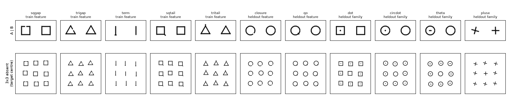
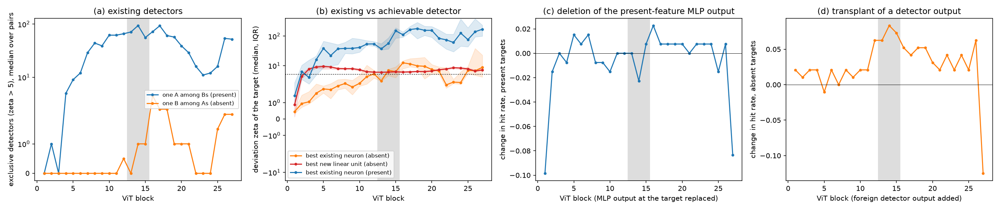
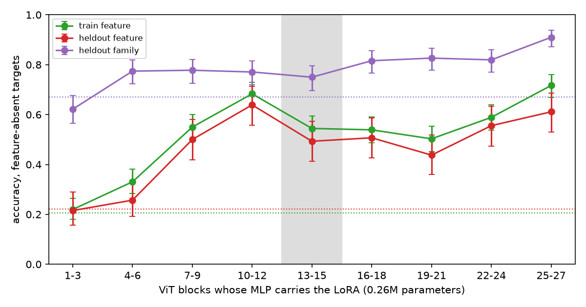
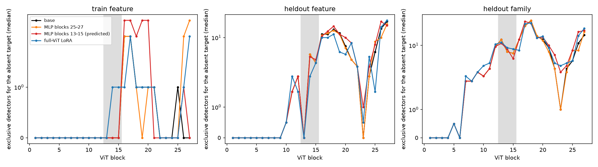
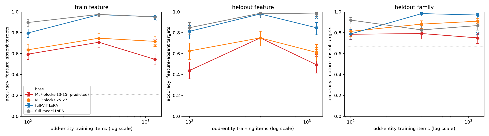
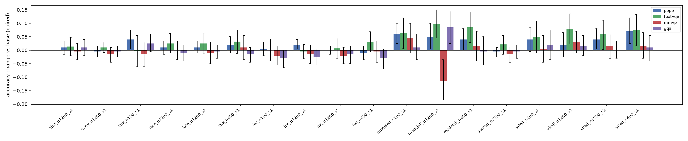
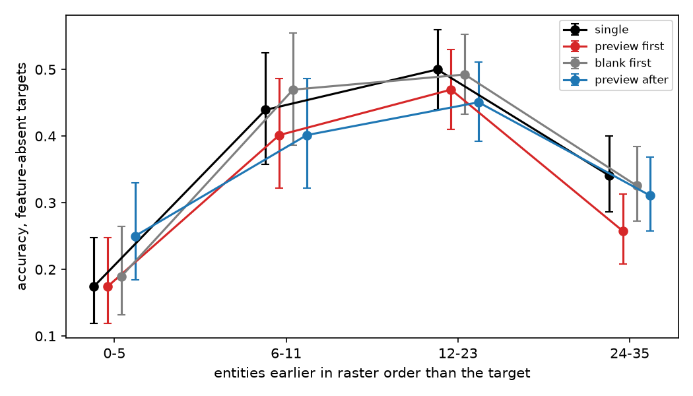

# 定点 ViT 微调与其他可解释性指导的优化（实验 7.3）

实验日期：2026-11-05。本文属于[研究问题 7](plan.md)，承接[实验 7.1](results_2026-11-03_interp_guided_optimization.md)与[实验 2.7 第二轮](../representation/results_2026-11-03_search_asymmetry_r2.md)。主模型为 Qwen3.5-9B，bfloat16，thinking off，奇异实体问法与 2.6、2.7 的直接作答问法相同。第 2 节的定位分析与预测在任何训练开始之前完成并写入本文，训练之后未作改动。第二轮（[实验 7.3 第二轮](results_2026-11-11_vit_detector_formation.md)）给出了能解释位置扫描结果的训练前判据（跨特征通用的目标差别信号），并以新增神经元、全量微调与高秩 LoRA 检验了检测器能否形成；第 2 节判据与第 4.3 节机理解释的修订见该文。

## 0. 通俗讲述

实验 2.7 第二轮发现，ViT 的 MLP 神经元像一组经过整流的“检测器”：它们只在看到某个部件时放电，看不到时停在 GELU 的下限。在一群闭合圆中找一个开口圆很容易，因为缺口处有只对开口放电的神经元；反过来，在一群开口圆中找一个闭合圆很难，因为没有任何神经元只在“没有缺口”时放电，模型只能在 decoder 中把每个实体与光栅顺序在前的实体逐一比较。由此得到一个具体的优化设想：既然缺的是检测器，就在 ViT 中“该有检测器的地方”补上它，只训练那里的少量参数，只用少量合成数据，并在训练外的特征与特征族上检验是否学到了通用的“缺失”信号。

我们先在原模型上回答“该在哪里补”。对 13 组图形、ViT 的全部 27 个 block，我们测量了三件事：已有检测器在哪些 block 形成；若在某个 block 新增一个读取 MLP 输入的线性整流单元，它最多能把缺失目标与干扰项分开到什么程度；以及把另一种特征的检测器输出移植到缺失目标上时，哪个 block 的写入最能让模型找到它。图景是：特征存在的检测器从第 4–7 个 block 开始大量出现，缺失目标在第 1–12 个 block 中没有任何检测器；从第 3 个 block 起 MLP 的输入已经含有足以构造检测器的线性信息；移植在第 12–15 个 block 最有效。按事先写好的规则，我们预测在第 13–15 个 block 的 MLP 上训练（约 26 万参数）最合适，并预测训练后这里会出现新的缺失检测器。

结果对这一预测给出了分层的回答。只训练这 3 个 block 的 MLP，训练外特征（Q 中找 O、开口圆中找闭合圆）的缺失目标准确率由 32/144 升到 71–108/144（随数据规模与 seed 变化），纯文本输出与原模型逐字相同，其余通用基准与坐标输出均无显著下降。但三条更精细的预测没有成立。第一，把同样大小的 LoRA 放在 9 个不同位置上扫描，第 1–6 个 block 几乎无效，第 7–27 个 block 都有效且彼此差别不超过 seed 之间的波动，第 25–27 个 block 在训练外特征族上稳定地更好；因此定位分析能划出“检测器形成之后”这一有效区域，却不能在区域内排出最优的 3 个 block。第二，训练后没有任何条件出现新的整流检测器神经元；适配器从它所在的第一个 block 起写入一个只在缺失目标上出现的分布式信号，并一直保持到 ViT 末端。第三，训练全部 ViT 线性层（约 400 万参数）的 LoRA 只需 100 条奇异实体样本就超过任何 3 个 block 的局部 LoRA，但它使合成图像上的坐标输出显著变差；把 LoRA 扩展到语言模型还会破坏坐标的输出格式、纯文本问答与 MMVP。

由此得到的工程结论是：缺失特征这一类视觉缺陷应当只在 ViT 中、在检测器形成之后的 block 里修复，不必也不应改动语言模型；局部的小 LoRA（全模型 LoRA 参数量的 1%）以 100–400 条合成样本取得大部分收益而不带来可测的副作用，全 ViT LoRA 收益更大但开始损害坐标任务。机理上，“补一个整流检测器”的设想被否定，模型学到的是对已有表示的分布式线性改写。附带的一个零训练 pilot 表明，在图像之前放一张低分辨率预览图不能消除 decoder 的开头效应。

## 1. 假说与主要结论

| 编号 | 假说 | 检验 | 结论 |
| --- | --- | --- | --- |
| H1 | 缺失目标在 ViT 中缺少专属检测器，但 MLP 输入中已有足够信息，局部训练即可修复 | 原模型的检测器计数与线性可达偏差（第 2 节）；定点 LoRA（第 4.1 节） | 支持 |
| H2 | 最有效的位置是定位分析预测的第 13–15 个 block 的 MLP | 9 个位置的同参数量扫描、attention 与分散对照、第二个 seed（第 4.2 节） | 部分否定：预测正确排除浅层，未能在第 7–27 个 block 中选出最优 |
| H3 | 训练后在预测位置形成整流的缺失检测器 | 检测器计数、适配器写入的目标特异性、fc1 与 fc2 路径（第 4.3 节） | 否定：改变是分布式线性信号 |
| H4 | 只改 ViT 的局部微调以少量参数与数据取得主要收益且不损害通用能力 | 数据规模曲线、通用基准、坐标输出（第 4.4、4.5 节） | 支持；全 ViT 与全模型 LoRA 收益更大但有副作用 |

主要结论：

1. **缺失特征的缺陷可以只在 ViT 中、用约 26 万参数修复一部分，且不改变语言能力（第 4.1 节）。**
2. **在检测器形成之前的第 1–6 个 block 做局部微调无效，之后各位置的效果在 seed 波动范围内相近（第 4.2 节）。**
3. **微调没有形成新的整流检测器，而是从第一个被训练的 block 起写入只在缺失目标上出现的分布式信号（第 4.3 节）。**
4. **100 条合成样本已足以取得大部分收益；覆盖全部 ViT 的 LoRA 迁移最好，但损害合成图像上的坐标输出，扩展到语言模型还会破坏输出格式与纯文本问答（第 4.4、4.5 节）。**
5. **在图像之前放一张低分辨率预览图不能消除开头效应（第 5.2 节）。**

## 2. 训练之前的定位：在哪里补上缺失的检测器

### 2.1 模型组件

ViT 第 $k$ 个 block 的计算为

$$
\begin{aligned}
u &= x + \operatorname{Attn}_k(\operatorname{LN}_1(x)), \\
y &= u + W_2^{(k)} \, \operatorname{GELU}\!\left(W_1^{(k)} \operatorname{LN}_2(u) + b_1^{(k)}\right) + b_2^{(k)},
\end{aligned}
$$

其中 $x, u, y \in \mathbb{R}^{1152}$ 是一个 $16 \times 16$ pixel patch 的残差状态，$W_1^{(k)} \in \mathbb{R}^{4304 \times 1152}$（linear_fc1）的每一行定义一个 MLP 神经元读取的方向，$W_2^{(k)} \in \mathbb{R}^{1152 \times 4304}$（linear_fc2）把 4304 个神经元的激活写回残差。GELU 在负输入上接近 0，因此一个神经元只在输入与其读取方向足够一致时放电，这就是 2.7 所说的整流检测器。“补一个检测器”在这一计算中的含义是：让 $W_1^{(k)}$ 的某些行指向“缺失目标有、干扰项没有”的方向，并让 $W_2^{(k)}$ 把它写出。LoRA 把 $W$ 替换为 $W + \frac{\alpha}{r} B A$，$A \in \mathbb{R}^{r \times d_{\text{in}}}$，$B \in \mathbb{R}^{d_{\text{out}} \times r}$，本实验在 fc1 与 fc2 上取 $r = 8$、$\alpha = 32$，每个 block 新增

$$
2 \times 8 \times (1152 + 4304) = 87{,}296
$$

个参数。

### 2.2 刺激与特征族

每组图形由 $A$（带有某个部件）与 $B$（缺少该部件）组成。特征存在目标是一个 $A$ 在一群 $B$ 中，特征缺失目标是一个 $B$ 在一群 $A$ 中。本实验新增 6 组图形，并与 2.7 的图形一起按“缺少什么”分成四个特征族：

| 特征族 | 训练特征 | 训练外特征 | 缺失目标缺少的部件 |
| --- | --- | --- | --- |
| 缺口 | 方框缺口（sqgap）、三角缺口（trigap） | 圆缺口（closure） | 轮廓上的缺口 |
| 外接笔画 | 端点短横（term）、方框角尾（sqtail）、三角顶尾（tritail） | Q 与 O（qo） | 附着在轮廓外的短笔画 |
| 内部标记（整族留出） | – | 方框内点（dot）、圆内点（circdot）、圆内短横（theta） | 轮廓内的点或短横 |
| 旋转（留出） | – | 旋转与直立十字（plusx） | 15° 的旋转 |

另以 2.7 中两个方向都有检测器的弯曲线与倾斜线作为定位分析的对照。下图第一行为每组图形的 $A$ 与 $B$（subtle 水平），第二行为 $3 \times 3$ 的特征缺失示例（目标在中心）。

### 2.3 三项定位度量

定位分析使用每组图形 12 组 $6 \times 6$ 图像（subtle 水平），每组含共享目标位置、朝向与抖动的 std（特征存在）、swap（特征缺失）、homA（全为 $A$）与 homB（全为 $B$）四幅图。实体 $e$ 覆盖 16 个 patch，记其 patch 集合为 $P_e$。

1. **已有检测器。** 记神经元 $j$ 在实体 $e$ 上的响应为 $a_{e,j} = \max_{p \in P_e} \operatorname{GELU}(\cdot)_{p,j}$，$\mu_{A,j}, \sigma_{A,j}$ 为其在 homA 全部实体上的均值与标准差，$\mu_{B,j}, \sigma_{B,j}$ 同理。“一个 $B$ 在一群 $A$ 中”的预期偏差为

$$
\zeta^{B \mid A}_j = \frac{\mu_{B,j} - \mu_{A,j}}{\sigma_{A,j} + 0.01}.
$$

$\zeta > 5$ 的神经元为专属检测器（2.7 第二轮第 2.3 节的定义），$\zeta^{A \mid B}$ 交换 $A$、$B$ 即得。

2. **新单元的线性可达偏差。** 一个新的整流单元读取 $\operatorname{LN}_2(u_p)$ 并在实体内取最大值。为了估计它最多能达到多大的偏差，在 8 幅 homB 与 8 幅 homA 图像的 patch 上拟合 shrinkage LDA 方向

$$
w = \left(\Sigma + \lambda \tfrac{\operatorname{tr}\Sigma}{d} I\right)^{-1} (m_B - m_A), \qquad \lambda = 0.1,
$$

其中 $m_B, m_A \in \mathbb{R}^{1152}$ 为两类 patch 的均值，$\Sigma$ 为类内协方差，$d = 1152$；再在其余 4 + 4 幅图像上计算实体响应 $s_e = \max_{p \in P_e} w^{\top} \operatorname{LN}_2(u_p)$ 的偏差 $(\bar s_B - \bar s_A) / \operatorname{sd}(s_A)$，记作 $\zeta_{\text{lin}}$。它衡量的是“该 block 的输入是否已经含有足以构造缺失检测器的信息”：若 $\zeta_{\text{lin}} \ge 5$ 而已有神经元的最大 $\zeta$ 远小于 5，则信息存在、检测器缺失，正是局部训练最可能奏效的情形。

3. **因果作用。** 删除：在 std 图像中，把第 $k$ 个 block 的 MLP 输出在目标 16 个 patch 上替换为同一组 homB 图像中的值（相当于去掉该 block 对多出部件的响应），测量模型 teacher forcing 下行列数字的 argmax 是否仍然正确。移植：在 swap 图像中，把另一组图形在第 $k$ 个 block 的“检测器输出”加到缺失目标的 16 个 patch 上；检测器输出为该组图形 std 与 homB 图像之间目标 patch 上 MLP 输出差的平均（缺口族与外接笔画族分别用 Q 与 O、开口圆与闭合圆作供体，避免同族）。移植的命中增益回答“若第 $k$ 个 block 有一个检测器为缺失目标放电，模型能否据此找到它”。

### 2.4 定位结果

图中数值均由原模型的激活计算（未经训练）。(a) 专属检测器数在各组图形上的中位数，蓝色为特征存在方向，橙色为 8 组缺失方向缺少检测器的图形的缺失方向；(b) 深橙色为已有神经元的最大 $\zeta^{B \mid A}$，红色为线性可达偏差 $\zeta_{\text{lin}}^{B \mid A}$，蓝色为已有神经元的最大 $\zeta^{A \mid B}$，阴影为四分位区间，虚线为阈值 5；(c) 删除单个 block 的 MLP 输出后特征存在目标的命中率变化（11 组图形 × 12 幅）；(d) 移植后特征缺失目标的命中率变化（8 组 × 12 幅）。灰色带为预注册选出的第 13–15 个 block。纵轴 (a)(b) 为对称对数坐标。

| block | 1–3 | 4–6 | 7–9 | 10–12 | 13–15 | 16–18 | 19–21 | 22–24 | 25–27 |
| --- | --- | --- | --- | --- | --- | --- | --- | --- | --- |
| 存在方向检测器数（中位数） | 0–1 | 5–12 | 29–44 | 62–66 | 56–94 | 61–93 | 29–57 | 11–16 | 16–54 |
| 缺失方向检测器数（中位数） | 0 | 0 | 0 | 0–0.5 | 0–1 | 2.5–4.5 | 1 | 0 | 1.5–2 |
| 已有神经元最大 $\zeta^{B \mid A}$ | 0.5–1.1 | 1.6–1.8 | 2.0–2.5 | 2.5–5.2 | 3.0–7.0 | 9.8–12.5 | 6.5–9.5 | 2.2–2.8 | 6.7–8.7 |
| 线性可达 $\zeta_{\text{lin}}^{B \mid A}$ | 0.9–7.7 | 9.0–9.4 | 7.9 | 6.0–7.3 | 6.0–6.2 | 6.0–6.3 | 6.3–7.3 | 7.7–8.5 | 6.5–7.8 |
| 移植命中增益 | 0.01–0.02 | −0.01–0.02 | 0.00–0.02 | 0.02–0.06 | 0.06–0.08 | 0.04–0.05 | 0.02–0.05 | 0.02–0.04 | −0.12–0.06 |

**缺失目标在第 1–12 个 block 中没有任何检测器，但从第 3 个 block 起，MLP 的输入已经足以支撑一个偏差超过 5 的新单元。** 这是 H1 的直接证据：已有神经元在缺失方向上的最大偏差在第 1–9 个 block 只有 0.5–2.5，而同一位置一个线性整流单元可达 7–9。第 16–19 个 block 中缺失方向出现了少量弱检测器（最大 $\zeta$ 约 10–12），说明 ViT 的 attention 把邻域信息汇集到目标之后，原模型自己会部分地形成缺失信号，但为时已晚、强度不足。

**单个 block 的 MLP 输出对特征存在目标是冗余的，移植在第 12–15 个 block 最有效。** 删除任一单个中间 block 的 MLP 输出几乎不改变命中率（−0.02 至 +0.02），只有第 1 与第 27 个 block 例外；连续删除第 1–3 个 block 使命中率下降 0.77，第 13–15 个 block 下降 0.18。移植的命中增益很小（最大 0.08，每个 block 96 幅图），但答案对数概率的增益在第 12–15 个 block 最大（+0.27 至 +0.41 nat），第 27 个 block 为负。

### 2.5 预注册的预测

选择规则在定位分析运行之前写入代码（located_finetune_analysis.choose_window）：在“$\zeta_{\text{lin}}^{B \mid A} \ge 5$ 的缺失方向图形比例不低于 0.75”的 block 中，取 3 个连续 block，使特征缺失目标上的移植命中增益之和最大。该规则给出第 13–15 个 block。由此写下的预测为：

1. 训练位置：ViT 第 13、14、15 个 block 的 MLP（fc1 与 fc2），LoRA 秩 8，参数量 3 × 87,296 = 261,888，约为全 ViT LoRA（3,993,344）的 6.6%、全模型 LoRA（25,632,512）的 1.0%。
2. 训练后，第 13–15 个 block 中出现缺失目标的专属检测器，且在训练外特征上同样出现（H3）。
3. 同样参数量下，第 1–3 个 block 或第 25–27 个 block 的 MLP、第 13–15 个 block 的 attention 均不如第 13–15 个 block 的 MLP（H2）。
4. 第 13–15 个 block 的 MLP LoRA 在训练外特征上接近全 ViT LoRA，且通用能力不变（H4）。

## 3. 训练与评测

### 3.1 训练数据与条件

训练数据为奇异实体搜索（5 组训练特征，网格 4–8，部件尺寸在 subtle 与 salient 水平之间均匀抽取，75% 为特征缺失目标）与 7.1 使用的 TextVQA 短答案问题，二者条数相同。数据规模 $N$ 指奇异实体条数，取 100、400、1200，较小规模是较大规模的前缀。所有条件均训练 150 步、每步 16 条（2400 次样本访问），学习率 $2 \times 10^{-4}$，余弦衰减，答案 token 上的交叉熵；因此不同规模之间只改变不重复样本的数量，不改变计算量。

| 条件 | 训练位置 | 秩 | 参数量 |
| --- | --- | --- | --- |
| loc | ViT 第 13–15 个 block 的 MLP（预测位置） | 8 | 261,888 |
| 窗口扫描 | ViT 第 1–3、4–6、…、25–27 个 block 的 MLP（含 loc） | 8 | 261,888 |
| attn | ViT 第 13–15 个 block 的 attention（qkv 与 proj） | 13 | 269,568 |
| spread | ViT 第 7–27 个 block 的 MLP | 1 | 229,152 |
| vitall | ViT 全部线性层与 merger | 8 | 3,993,344 |
| modelall | vitall 加 decoder 全部线性层 | 8 | 25,632,512 |

attn 的秩取 13 以使参数量与 loc 相当；spread 的 $\alpha$ 取 4，使 $\alpha / r$ 与秩 8 的条件相同。窗口扫描只评测奇异实体探针。

### 3.2 评测

1. **奇异实体探针**：11 组图形的 $6 \times 6$ 网格，subtle 水平（比训练中的平均部件更小），每组 72 幅特征缺失图像（每个单元格 2 次）与 36 幅特征存在图像，共 1188 幅。按训练特征（360 幅缺失）、训练外特征（144 幅）、训练外特征族（288 幅）汇总。
2. **BabyVision 细粒度子集**：Find the different（16 题）与 Find the same（17 题），原题问法，答案按“Final answer”严格匹配。
3. **坐标与计数**：7.1 使用的 3.13 坐标子集（含 RefCOCO 100 题）与网格计数 120 题。
4. **通用能力**：POPE、TextVQA、MMVP、GQA 各 200 题与 45 道纯文本问题（与 3.13、7.1 相同的样本与评分）。
5. **统计**：比例给出 Wilson 95% 区间；同一题目上的条件比较使用精确 McNemar 检验，记作“前者错后者对 / 前者对后者错”；通用能力为配对差值与 2000 次 bootstrap 区间。

## 4. 结果

### 4.1 预测位置上的局部微调有效

| 条件（$N = 1200$） | 训练特征（n=360） | 训练外特征（n=144） | 训练外特征族（n=288） | 特征存在（n=396） |
| --- | --- | --- | --- | --- |
| base | 74 | 32 | 193 | 379 |
| loc，seed 1 / 2 | 196 / 261 | 71 / 87 | 216 / 227 | 392 / 392 |
| late（第 25–27 个 block），seed 1 / 2 | 258 / 244 | 88 / 94 | 262 / 259 | 385 / 388 |
| vitall，seed 1 / 2 | 343 / 335 | 122 / 136 | 279 / 228 | 396 / 395 |
| modelall | 342 | 141 | 250 | 395 |

表中为特征缺失目标（最后一列为特征存在目标）的严格答对数，模型生成的答案按 2.6 的规则评分。

**只训练第 13–15 个 block 的 MLP，三类缺失目标都显著改善，特征存在目标不受损。** 相对原模型的配对检验（seed 1）为：训练特征 128/6（$p < 10^{-30}$），训练外特征 45/6（$p = 2 \times 10^{-8}$），训练外特征族 40/17（$p = 0.003$）。训练外特征中开口圆里找闭合圆由 21/72 升至 50–67/72，Q 中找 O 由 11/72 升至 21–41/72；训练外特征族中方框内点由 39/72 升至 52–59/72。这说明 5 组训练特征教会模型的是一种缺失信号，它可以迁移到同族的新图形，并部分迁移到异族图形。

**seed 之间的差异与条件之间的差异处于同一量级。** loc 的两个 seed 在训练特征上相差 65 题（75/10，$p < 10^{-12}$），vitall 的两个 seed 在训练外特征族上相差 51 题，几乎全部来自旋转十字（64/72 对 12/72）。因此下文比较位置时以多个 seed 或多个数据规模上一致的差异为准，单个 seed 的排序只作参考。

### 4.2 有效区域与预测位置

图中每个点为一次训练（秩 8、0.26M 参数、$N = 1200$、seed 1）在探针上的准确率，误差线为 Wilson 95% 区间；绿色为训练特征，红色为训练外特征，紫色为训练外特征族，同色虚线为原模型，灰色带为预测位置。

| 条件（0.23–0.27M 参数） | 训练特征 | 训练外特征 | 训练外特征族 |
| --- | --- | --- | --- |
| MLP 第 1–3 个 block | 79 | 31 | 179 |
| MLP 第 4–6 个 block | 119 | 37 | 223 |
| MLP 第 7–9 个 block | 198 | 72 | 224 |
| MLP 第 10–12 个 block | 246 | 92 | 222 |
| MLP 第 13–15 个 block（预测，seed 1 / 2） | 196 / 261 | 71 / 87 | 216 / 227 |
| MLP 第 16–18 个 block | 194 | 73 | 235 |
| MLP 第 19–21 个 block | 181 | 63 | 238 |
| MLP 第 22–24 个 block | 212 | 80 | 236 |
| MLP 第 25–27 个 block（seed 1 / 2） | 258 / 244 | 88 / 94 | 262 / 259 |
| attention 第 13–15 个 block（秩 13） | 234 | 90 | 224 |
| MLP 第 7–27 个 block（秩 1） | 218 | 90 | 232 |

**第 1–6 个 block 的局部微调几乎无效，这与定位分析中“检测器尚未形成”的区域一致。** 第 1–3 个 block 与原模型没有差别（训练特征 20/15，$p = 0.5$），第 4–6 个 block 只有小幅提升；从第 7 个 block 起，训练特征准确率跃升到 0.50 以上。第 2.4 节显示，特征存在的检测器在第 4–6 个 block 只有 5–12 个，到第 7–9 个 block 才达到 29–44 个。一个解释是（推断）：适配器表达“缺少某部件”的最直接方式是读取“该部件的检测器在这里沉默、在邻近实体上放电”，因此只有在这些检测器形成之后，局部改写才有可用的原料。

**在第 7–27 个 block 之间，预测位置并非最优，但位置之间的差异大多不超过 seed 波动。** 单个 seed 下第 25–27 与第 10–12 个 block 显著优于第 13–15 个 block（训练外特征 28/11，$p = 0.01$；32/11，$p = 0.002$），但 loc 的第二个 seed 与第 25–27 个 block 的第二个 seed 在训练特征与训练外特征上没有显著差别（36/53，$p = 0.09$；20/13，$p = 0.3$）。唯一在两个 seed 与 $N = 400$ 上都一致的差别是训练外特征族：第 25–27 个 block 分别以 48/2、43/11、34/8 优于第 13–15 个 block（$p \le 10^{-4}$），其中主要贡献来自旋转十字（45–58/72 对 21–34/72）。同参数量的 attention 与跨 21 个 block 的秩 1 LoRA 也不差于预测位置。因此预注册预测 3 不成立：移植增益在第 12–15 个 block 最大，并不意味着在那里训练最有效。

### 4.3 表示的改变：分布式线性信号，而非新的整流检测器

图中数值为微调后（与原模型）每个 block 中缺失目标的专属检测器数（$\zeta^{B \mid A} > 5$，第 2.3 节定义，由 homA、homB 图像的激活计算），按三类特征取中位数；黑色为原模型，红色为 loc，橙色为第 25–27 个 block，蓝色为 vitall（均为 $N = 1200$、seed 1），灰色带为预测位置。纵轴为对称对数坐标。

**微调后没有任何位置出现新的缺失检测器。** loc 在第 13–15 个 block 上缺失方向的检测器数与原模型完全相同（训练特征中位数为 0），训练外特征与特征族的曲线与原模型重合；vitall 与第 25–27 个 block 的 LoRA 也是如此。预注册预测 2 因此被否定。

为了找到真正改变了的东西，我们直接测量适配器对 ViT 各 block 输出的改动。对特征缺失探针图像，记第 $k$ 个 block 输出在实体 $e$ 上（16 个 patch 平均）的改动为

$$
D_{e}^{(k)} = h^{(k)}_{e,\text{tuned}} - h^{(k)}_{e,\text{base}} \in \mathbb{R}^{1152},
$$

在偶数号图像上估计方向 $v_k = \operatorname{mean}\big(D_t^{(k)} - \operatorname{mean}_{e \neq t} D_e^{(k)}\big)$（$t$ 为目标），再在奇数号图像上计算目标投影相对干扰项投影的标准化偏差 $\zeta_{\text{write}}^{(k)}$。它回答“适配器是否向缺失目标写入了一个干扰项上没有的成分，以及从哪个 block 开始”。

| block | 1 | 7 | 10 | 12 | 13 | 14 | 15 | 17 | 20 | 24 | 26 | 27 | merger |
| --- | --- | --- | --- | --- | --- | --- | --- | --- | --- | --- | --- | --- | --- |
| loc | 0 | 0 | 0 | 0 | 1.6 | 2.5 | 2.1 | 2.0 | 2.1 | 1.8 | 1.8 | 0.2 | 0.9 |
| attention 第 13–15 个 block | 0 | 0 | 0 | 0 | 1.2 | 3.1 | 2.6 | 2.2 | 2.0 | 1.6 | 2.0 | 0.0 | 0.6 |
| 第 25–27 个 block | 0 | 0 | 0 | 0 | 0 | 0 | 0 | 0 | 0 | 0 | 1.1 | 0.2 | 2.1 |
| vitall | 0.1 | 0.7 | 1.2 | 1.6 | 2.0 | 3.0 | 3.6 | 4.8 | 4.4 | 4.3 | 4.5 | 0.1 | 2.3 |

表中数值为 $\zeta_{\text{write}}$ 在 216 幅测试图像上的中位数（6 组图形的缺失探针），由激活直接计算。第 27 个 block 输出的数值接近 0，可能与该层的高范数 token 主导 patch 平均有关（推测）。

**适配器在它所在的第一个 block 就写入目标特异的成分，该成分随后被保持而不被放大。** loc 在第 13 个 block 写入 $\zeta_{\text{write}} = 1.6$，此后保持在 1.8–2.5；attention 的写入几乎相同。vitall 的写入从第 7 个 block 开始可见，在第 12–17 个 block 增长最快（1.6 升至 4.8）。这一点值得注意：即使允许修改全部 block，学到的目标特异信号也主要在第 12–17 个 block 形成，与定位分析中移植最有效的位置一致；定位分析指出的是“信号在哪里形成”，而决定迁移效果的是能用多少参数去形成它。

**fc1 与 fc2 两条路径各承担约一半的收益。** 只保留 loc 的 fc1 LoRA 时三类缺失目标为 137、51、202 题，只保留 fc2 LoRA 时为 133、46、205 题，两者都约为完整适配器（196、71、216）收益的一半。fc2 路径在目标上的输出差（以已有激活为输入）不超过把 $BA$ 的列随机置换后的零分布（第 13 个 block 0.16 对 0.14 ± 0.02），说明 fc2 并没有专门读取少数检测器；收益来自许多神经元上小幅的协同改变。合在一起，适配器实现的是一个分布在许多神经元上的线性“缺失”成分，而不是 2.7 意义上的整流检测器。

### 4.4 数据规模

图中每个点为一次训练（seed 1）的探针准确率，误差线为 Wilson 95% 区间，叉号为 seed 2；红色为预测位置的 MLP LoRA，橙色为第 25–27 个 block 的 MLP LoRA，蓝色为 vitall，灰色为 modelall，黑色虚线为原模型。所有条件训练 2400 次样本访问，横轴只改变不重复的奇异实体样本数。

| 条件 | 参数量 | $N = 100$ | $N = 400$ | $N = 1200$ |
| --- | --- | --- | --- | --- |
| loc | 0.26M | 214 / 63 / 226 | 255 / 108 / 228 | 196 / 71 / 216 |
| 第 25–27 个 block | 0.26M | 229 / 90 / 234 | 269 / 108 / 254 | 258 / 88 / 262 |
| vitall | 3.99M | 287 / 117 / 227 | 350 / 141 / 283 | 343 / 122 / 279 |
| modelall | 25.63M | 323 / 122 / 265 | 351 / 142 / 238 | 342 / 141 / 250 |

每格依次为训练特征（/360）、训练外特征（/144）、训练外特征族（/288）的答对数。

**100 条合成样本已经取得大部分收益，$N = 400$ 与 $N = 1200$ 之间没有进一步提高。** loc 在 $N = 100$ 时训练特征由 74 升至 214，训练外特征由 32 升至 63（37/6，$p = 2 \times 10^{-6}$）；第 25–27 个 block 在 $N = 100$ 时训练外特征已达 90。四种条件都在 $N = 400$ 时最好，$N = 1200$ 时持平或下降，这一非单调性小于 seed 之间的差异，不足以支持“数据越多越差”，但说明在这一任务上数据量不是瓶颈。

**参数覆盖范围比参数数量更决定迁移，但它与副作用同时增长。** vitall 只用 100 条样本就在训练外特征上达到 117/144，高于任何 0.26M 局部 LoRA 在任何规模上的结果；modelall 在训练外特征上与 vitall 相当（141–142/144），在训练外特征族上并不更好。第 4.5 节表明，这种更强的改写同时带来副作用。

### 4.5 通用能力与副作用

图中为各条件相对原模型的配对准确率差（每个基准 200 题，误差线为 2000 次 bootstrap 的 95% 区间），蓝、绿、红、紫依次为 POPE、TextVQA、MMVP、GQA；横轴条件名的含义见第 9 节末尾。

| 条件 | POPE | TextVQA | MMVP | GQA | 纯文本（/45） | 合成图坐标命中（/157） | RefCOCO 命中（/100） |
| --- | --- | --- | --- | --- | --- | --- | --- |
| base | 0.850 | 0.723 | 0.745 | 0.360 | 43 | 87 | 93 |
| loc（$N = 1200$） | +0.020 | −0.005 | −0.015 | −0.025 | 43 | 92 | 94 |
| loc（$N = 400$） | −0.010 | +0.030 | −0.005 | −0.030 | 43 | 90 | 91 |
| 第 25–27 个 block（$N = 1200$） | +0.010 | +0.025 | 0.000 | −0.010 | 43 | 86 | 91 |
| attention 第 13–15 个 block | +0.010 | +0.013 | −0.005 | +0.010 | 43 | 91 | 93 |
| vitall（$N = 100$） | +0.040 | +0.050 | +0.005 | +0.020 | 43 | 70 | 93 |
| vitall（$N = 1200$） | +0.020 | +0.080 | +0.030 | +0.015 | 43 | 66 | 93 |
| modelall（$N = 400$） | +0.040 | +0.085 | +0.015 | −0.005 | 43 | 33（121 条无效） | 91 |
| modelall（$N = 1200$） | +0.050 | +0.097 | −0.115 | +0.085 | 34 | 39（99 条无效） | 91 |

合成图坐标为 7.1 坐标子集中的白底单目标平移、10×10 与 20×20 网格、图表界面四类（157 题），命中指预测点落在目标框内（3.13 的评分）；“无效”指答案无法解析为坐标。

**0.26M 的局部 LoRA 不带来可测的副作用。** 所有 ViT 局部条件的通用基准差值都在 −0.03 至 +0.03 之间（loc 在 $N = 1200$ 与第 25–27 个 block 在 $N = 100$ 时 POPE 小幅上升，区间不含 0；其余区间均含 0），合成图坐标命中与原模型的配对差异不显著（如 loc 8/3，$p = 0.23$），RefCOCO 不变。由于 decoder 未被修改，所有 ViT 条件在纯文本问题上的输出与原模型逐字相同（43/45），这一点由结构保证。

**全 ViT LoRA 损害合成图像上的坐标输出，全模型 LoRA 进一步破坏输出格式与纯文本能力。** vitall 在三种数据规模上都使合成图坐标命中由 87 降至 64–70（$N = 1200$ 时 10/31，$p = 0.002$），其中图表界面由 39/50 降至 27/50，20×20 网格由 5/40 降至 0/40；它在 TextVQA 上的 +0.08 来自训练混合中的 TextVQA 短答案数据。modelall 在 $N \ge 400$ 时有 99–121 条坐标答案格式无效（模型改用训练数据的行列格式作答），$N = 1200$ 时纯文本由 43/45 降至 34/45、MMVP 下降 0.115。全 ViT LoRA 之所以伤害坐标而局部 LoRA 不伤害，一种解释是：前者改动了第 1–6 个 block，即 3.7、3.13 所说的位置信息写入 visual tokens 的区域（推测，本实验未直接检验）。

### 4.6 缺失目标的光栅依赖

训练外特征中，按目标之前的实体数分为 0–5、6–11、12–23、24–35 四组（分母 24、24、48、48），原模型为 4、2、16、10，loc 为 5、11、29、26，第 25–27 个 block 为 11、17、30、30，vitall 为 17、22、39、44。**ViT 中的缺失信号足够强时，光栅开头的目标也能被找到。** loc 主要改善了之前实体较多的目标，开头 6 个实体中的目标几乎不变（4 对 5）；vitall 把这一组提高到 17/24。这与 2.7 第二轮的解释一致：特征存在目标靠 ViT 中已有的强 oddness 压过 decoder 的开头效应；缺失目标只要在 ViT 中获得足够强的信号，同样可以不依赖 decoder 的光栅比较。这一结果把“第一行缺失目标的失败”进一步归为表示强度问题（参数问题，中等确定性），与 7.1 中“改变 attention mask 无效”的结论相互印证。

## 5. 其他由可解释性结论导出的优化点

### 5.1 候选方案

坐标数值读出的微调由 3.16 与 7.2 负责，本节不重复；图像片段内双向 attention、DeltaNet 光栅限制的架构改动、PE 与 RoPE 缩放、缓存重读与 DeepStack 已关闭或暂停，不再列入。

| 方案 | 依据的结论 | 精确作用部位 | 代价 | 状态 |
| --- | --- | --- | --- | --- |
| (1) ViT 检测器形成之后的局部 LoRA | 2.7 第二轮：缺失目标无整流检测器；本文第 2、4 节 | ViT 第 7–27 个 block 中的 3 个 block 的 MLP（或 attention），秩 8 | 0.26M 参数，100–400 条合成样本，单卡约 5 分钟 | 本文完成；推荐以第 25–27 个 block 为默认位置 |
| (2) 图像之前的低分辨率预览 | 2.7 第二轮 H4 与 7.1 第 3.3 节：开头效应来自 DeltaNet 递推中参照的缺失 | 输入顺序（不改参数） | 增加约 44% 的视觉 tokens（$6 \times 6$ 网格） | 零训练 pilot 否定（第 5.2 节） |
| (3) DeltaNet 计数门控的定点微调 | 3.10：行列计数由第 9–16 层 105 个长记忆 head 的累积完成，噪声随实例数增长 | 第 9–16 层 Gated DeltaNet 的 $\alpha$、$\beta$ 门控投影（in_proj_a、in_proj_b），仅图像 token | 约 0.5M 参数（秩 8） | 未做；与本文同样的“先定位后训练”流程可直接复用 |
| (4) oddness 读出 head 的定点微调 | 2.7 第二轮 H3：第 16、20 层 6 个 head 读取共享的 oddness 方向 | 这 6 个 head 的 query 与 key 投影 | 约 0.1M 参数 | 低优先级：本文第 4.6 节表明瓶颈在 ViT 的信号强度，读出不是瓶颈 |
| (5) ViT register tokens | 第 20 条：高范数 token 是 ViT 内部的 attention sink，由少数 register neurons 写入空白 patch | ViT 输入端增加少量可学习 token（Darcet et al., 2024） | 需要 ViT 继续预训练 | 未做；收益需先以 2.2 的距离读出验证 |

### 5.2 预览图 pilot

**设计。** 方案 (2) 的设想是：开头效应来自 DeltaNet 在序列开头尚无“典型实体”的参照（2.7 第二轮第 7.2 节），若在图像之前先给出同一图像的低分辨率版本，递推状态在读到原图第一个实体时已含有参照。在全部 792 幅特征缺失探针图像上比较四种输入：原图（single）；预览图在前（preview_first，问法前加“第一幅图是第二幅图的低分辨率预览，请回答第二幅图”）；同样问法但第一幅为纯色空白图（blank_first）；预览图在后（preview_after，问法相应改写）。预览图边长为原图的一半，不小于 256 pixels。

图中为按目标之前的实体数分组的准确率（Wilson 95% 区间），黑色为原图，红色为预览图在前，灰色为空白图在前，蓝色为预览图在后。

| 输入 | 全部（/792） | 之前 0–5 个实体（/132） | 之前 6–11 个实体（/132） | 相对原图（前错后对 / 前对后错） |
| --- | --- | --- | --- | --- |
| single | 303 | 23 | 58 | – |
| preview_first | 268 | 23 | 53 | 42/77，$p = 0.002$ |
| blank_first | 303 | 25 | 62 | 37/37，$p = 1$ |
| preview_after | 287 | 33 | 53 | 23/39，$p = 0.06$ |

**预览图在前不改善开头的缺失目标，反而降低总体准确率。** 之前 0–5 个实体的目标在原图与预览在前两种输入下都是 23/132；空白图在前与原图相同，排除了问法与 token 数量的作用。预览图在后时这一组升至 33/132，但总体不显著。因此“先给参照”在不训练时不能消除开头效应；结合第 4.6 节，较可行的途径是增强 ViT 中缺失目标的信号，方案 (2) 不再推进。

## 6. 讨论

### 6.1 可解释性结论对优化的指导作用

本实验按照“原模型上的机理结论 → 精确位置 → 训练 → 检查表示是否按预测改变”的链条执行，四个环节的结果如下。

1. **机理结论在“修哪一部分”这一层级上是正确的。** 2.7 把缺失目标的失败归因于 ViT 的整流编码，本文据此只训练 ViT，在训练外特征与特征族上都得到显著收益，且语言能力不变；扩展到语言模型的 LoRA 没有带来更好的迁移，却损害了格式与纯文本能力。
2. **定位分析在 block 层级上部分正确。** 它准确地排除了检测器形成之前的第 1–6 个 block，并正确指出目标特异信号形成于第 12–17 个 block（vitall 自发地在这里写入最多）；但它没有预测出“在哪里训练最有效”：在第 7–27 个 block 中训练效果相近，后段 block 在训练外特征族上更好。
3. **机理形式的预测被否定。** 2.7 的整流检测器图景暗示新增检测器神经元，训练实际得到的是分布式线性成分；整流检测器是原模型表示“特征出现”的方式，并不是梯度下降修复“特征缺失”时选择的方式。
4. **参数问题与架构问题的划分得到加强。** 缺失目标的失败（包括光栅开头的失败）在 ViT 信号足够强时显著减轻，属于参数与数据问题；7.1 中的 attention mask 与本文的预览图都不能替代这一点。

### 6.2 与其他实验的一致与冲突

1. **与 2.7 第二轮一致并修正。** 本文复现了缺失目标在 ViT 中没有专属检测器的结论（第 1–12 个 block 中位数为 0），并补充：第 16–19 个 block 中缺失目标会出现少量弱检测器（最大 $\zeta$ 约 10–12），说明 ViT 后段已有部分基于上下文的缺失表示；2.7 只在第 9 个 block 计数，因而未观察到这一点。
2. **与 7.1 一致。** 7.1 的 ViT 第 6–16 个 block MLP LoRA 同样没有产生专属神经元、对训练外特征迁移不稳定；本文以更多特征族、第二个 seed 与位置扫描确认了 seed 波动大、位置不敏感这两个原因。
3. **与 2.7 第三轮一致。** 2.7 第三轮发现，原模型中比较类目标的“标记”主要由 decoder 第 9–15 层的 DeltaNet 与第 8–15 层的 MLP 在目标 token 上写入，decoder 输入（ViT 与 merger）只贡献很小一部分。本文的 ViT 微调相当于把这一信号的一部分提前到 ViT 中写入（第 4.3 节 merger 上的 $\zeta_{\text{write}}$ 为 0.9–2.3），这解释了它为何能减轻依赖 decoder 光栅比较的开头效应（第 4.6 节，解释）。
4. **与 3.13 第二轮的对照。** 3.13 发现坐标缺陷的有效修复位于语言模型第 1–4 层的图像 tokens，而非机理所指的读出层；本文在视觉搜索上得到相似的模式：有效修复区域比机理定位更宽，且需要位于信息形成之后、读出之前。

## 7. 限制

1. 窗口扫描每个位置只有一个 seed，而 seed 之间的差异与位置之间的差异同量级；第 4.2 节关于位置的结论只采用在两个 seed 或两个数据规模上一致的差异。
2. 所有条件使用相同的学习率与步数，未对参数量不同的条件分别调参；attention 条件的 $\alpha / r$（32/13）与其余条件（4）不同。
3. 训练与评测均为 $6 \times 6$ 及相近大小的合成网格；BabyVision 细粒度子集只有 33 题，原模型 3/33，各条件 1–5/33，无法据此判断收益是否迁移到真实题目。
4. 线性可达偏差是单个线性单元的上界估计，用 8 + 8 幅图像拟合、4 + 4 幅图像检验，数值的绝对大小受拟合样本量影响，只用于 block 之间的相对比较。
5. $\zeta_{\text{write}}$ 只度量投影在单一方向上的目标特异性，不排除适配器还写入了其他方向上的成分。
6. 7.1 讨论过的图像片段内双向 attention 与 DeltaNet 逆序扫描已由 PI 关闭，本文未再测试。

## 8. 运行规模与检查

GPU 用量约 7.7 GPU 小时（一张 A800 约 6.2 小时、一张 A40 约 1.5 小时，均经 claim 工具申请的空闲卡）：定位分析 7.5 min；24 次训练，每次 5–15 min（0.26M 局部 LoRA 在 A800 上 5–7 min、在 A40 上约 10 min，vitall 7–15 min，modelall 9–12 min）；完整评测每个条件约 10 min。批量解码的 batch size 由 16000 个 padded tokens 的预算决定（与 7.1 相同，7.1 报告的批量与逐条解码答案一致率为 15/20）。所有失败样本与无效答案均保留在分母中。

## 9. 实验产物

以下路径均相对于 `$WORK_DIR/analysis/application/2026-11-05_located_vit_finetune/`。

| 内容 | 路径 | 生成脚本 |
| --- | --- | --- |
| 第 2.4 节定位剖面、表格与预注册选择 | `locate/detectors.json`、`locate/causal.jsonl`、`locate/delta.npz`、`locate/summary.json` | `located_finetune.sh`（STAGES=locate；analysis） |
| 训练与探针数据 | `train_odd.jsonl`、`train_vqa.jsonl`、`probe.jsonl`、`images/` | STAGES=prepare |
| 第 4.1–4.5 节全部准确率、配对检验与通用能力 | `results.json`（键 `_paired_vs_base`）；逐题结果 `eval/<条件>/probe.jsonl`、`general.jsonl`、`coord.jsonl`、`count.jsonl`、`text.jsonl`、`babyvision.jsonl` | STAGES=train,eval；analysis |
| 第 4.3 节检测器计数 | `eval/<条件>/detectors.json` | STAGES=detect |
| 第 4.3 节 $\zeta_{\text{write}}$ 与 fc2 路径分析 | `eval/<条件>/write.json`、`write_contrib.pt`、`eval/loc_n1200_s1/neuron_zeta_base.npz` | STAGES=write、verify |
| 第 4.3 节 fc1 / fc2 路径 | `eval/loc_n1200_s1/verify.json`（键 `paths`） | STAGES=verify |
| 第 5.2 节预览图 pilot | `eval/base_preview/preview.jsonl` | STAGES=preview |
| 训练参数量与耗时 | `adapters/meta.json`、`adapters/<条件>_log.jsonl` | STAGES=train |
| 保留的 adapter（文中引用） | `adapters/loc_n1200_s1.pt`、`loc_n1200_s2.pt`、`loc_n400_s1.pt`、`late_n1200_s1.pt`、`late_n400_s1.pt`、`vitall_n400_s1.pt`、`vitall_n1200_s1.pt` | STAGES=train |
| 图 | 仓库 `docs/analysis/application/figures/located_vit_finetune/` | STAGES=analysis |

条件名与正文的对应：loc = MLP 第 13–15 个 block，late = MLP 第 25–27 个 block，early = MLP 第 1–3 个 block，w04 … w22 = 以该 block 起始的 3 个 block 的 MLP，attn = attention 第 13–15 个 block，spread = MLP 第 7–27 个 block 秩 1，vitall、modelall 见第 3.1 节；后缀 `n<N>_s<seed>`。代码为 `analysis_tools/application/located_finetune.py`、`located_finetune_run.py`、`located_finetune_analysis.py`，入口 `scripts/analysis/application/located_finetune.sh`，测试 `tests/analysis/application/test_located_finetune.py`。

## 修改记录

- 2026-11-12：在文首说明处增加指向实验 7.3 第二轮的一句话。原因：第二轮表明第 2 节的定位判据（已有检测器数与移植增益）与训练结果的秩相关接近 0，缺失信息以跨特征通用的线性方向存在于第 7 个 block 以后，并以新增神经元、全量微调与高秩 LoRA 检验了检测器的形成；读者需要据此理解第 2.5 节与第 4.3 节的结论。正文其余内容未改动。
