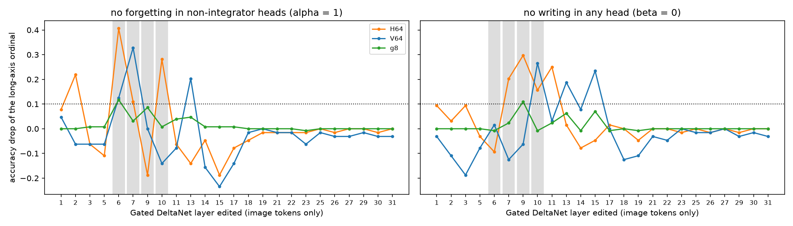
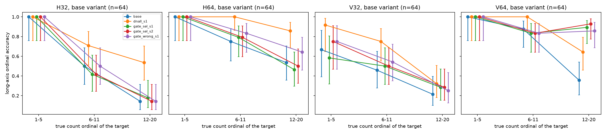

# 计数门控的定点微调（实验 7.3 第 C 部分）

实验日期：2026-11-06。本文属于[研究问题 7](plan.md)，是[实验 7.3](results_2026-11-05_located_vit_finetune.md)第 5.1 节候选方案 (3) 的 pilot，依据[实验 3.10](../position/results_2026-10-20_rowcol_mechanism.md)、[1.5](../behavior/results_2026-10-16_ordinal_mechanism.md)与[3.15](../position/results_2026-11-03_ordinal_vs_coordinate.md)的机理结论。主模型为 Qwen3.5-9B，bfloat16，thinking off。第 2 节的定位分析与预测在任何训练开始之前完成并写入本文，训练之后未作改动。坐标数值读出的微调由 3.16 与 7.2 负责，本文只处理序号与计数状态。

## 0. 通俗讲述

Qwen3.5 数网格中的行与列，靠的是 Gated DeltaNet 层中的“累加器”：每读到一条新的图形线，一些 head 先遗忘、再写入，长记忆 head 把增量累积下来（实验 3.10）。每个 head 在每个 token 上遗忘多少、写入多少，只由两个很小的线性投影（in_proj_a 与 in_proj_b，每层各 4096 × 32）决定。这引出一个非常轻量的优化设想：只调整承担计数的那几层的这两个投影，并且只在图像 token 上生效，让计数更准，同时保证模型处理文字的方式完全不变。

我们先在原模型上逐层回答“哪几层的门控在数数”。每次只在一个 DeltaNet 层的图像 token 上关掉遗忘或关掉写入，看行列序号的正确率掉多少。结果很集中：第 6、7、9、10 层影响最大（单层编辑使正确率下降 0.12–0.22），第 17 层之后的门控对序号没有任何作用。按事先写好的规则，我们在这 4 层上训练门控 LoRA（约 26 万参数），并预测：长轴序号在计数较大处变准、跨空白时不再从头数、思维链同样受益，而同样大小的 LoRA 放在不承担计数的层上则无效。

结果只部分支持这一预测。在训练外模板的 1.5 槽位网格上，门控 LoRA 使总体序号正确率由 825/1600 升至 892–900/1600，提升集中在竖直长轴（21 行）的后段目标：V64 base 变体由 43/64 升至 57–58/64，原因是“多数一”的回答由 17 个降至 1–2 个；水平长轴与空白后的重新计数几乎没有变化；纯文本输出与原模型逐字相同，通用基准不变。但关键的位置对照没有支持“定位”：同样大小的 LoRA 放在逐层扫描中效应最小的第 3、5、18、21 层，得到几乎相同的提升（901/1600）。表示层面，目标格上的运行计数在训练前后几乎相同，门控在图形线起点处的选择性也没有改变，适配器只是整体平移了被训练层的门控。也就是说，这类小 LoRA 修正的是读出前的一个系统性偏差（多数一），并不改变累加器检测新图形线的方式；在逐层扫描效应最小的第 18、21 层同样能做到，第二轮进一步表明，这一修正只要求修改发生在答案位置读出图像 tokens 之前，读出之后的层无效。作为对照，覆盖全部 DeltaNet 投影的常规 LoRA（710 万参数，作用于全部位置）提升更大（1223/1600，水平轴与重新计数也被修正），但它同时改变了通用基准上的作答格式，且把竖直短网格的误差从多数一变成了少数一。

## 1. 假说与主要结论

| 编号 | 假说 | 结论 |
| --- | --- | --- |
| C1 | 计数门控集中在少数可定位的 DeltaNet 层 | 支持：第 6–11 层（第 2.2 节） |
| C2 | 只调这些层的门控投影即可提高序号准确率，且不影响文字处理 | 部分支持：竖直长轴显著提高，水平长轴与空白重新计数不变（第 4.1 节） |
| C3 | 同参数量放在不承担计数的层上无效 | 否定：第 3、5、18、21 层得到同样的提升（第 4.2 节） |
| C4 | 改进来自累加器精度（运行计数误差下降、门控起点选择性改变） | 否定：运行计数的精度与门控选择性不变，改变的是计数量的比例（第 4.3 节；比例的度量见第二轮） |

主要结论：

1. **行列计数的门控集中在 DeltaNet 第 6–11 层，第 17 层之后的门控与序号无关（第 2.2 节）。**
2. **26 万参数、只作用于图像 token 的门控 LoRA 修正了竖直长轴上的多数一偏差，纯文本与通用基准不变（第 4.1、4.4 节）。**
3. **这一修正不依赖于定位分析选出的层，也不改变累加器本身，它是对读出前系统偏差的校准（第 4.2、4.3 节）。**
4. **常规的全 DeltaNet LoRA 提升更大，但改变了通用任务的作答方式，并在短网格上引入少数一（第 4.1、4.4 节）。**

## 2. 训练之前的定位

### 2.1 计数失败的机理

Gated DeltaNet 第 $l$ 层的第 $h$ 个 value head 在 token $t$ 处更新状态 $S_t \in \mathbb{R}^{128 \times 128}$：

$$
S_t = \alpha_t S_{t-1}\left(I - \beta_t k_t k_t^{\top}\right) + \beta_t v_t k_t^{\top}, \qquad
\alpha_t = \exp\!\left(-e^{A_h}\,\operatorname{softplus}(a_t + d_h)\right), \qquad \beta_t = \sigma(b_t),
$$

其中 $k_t, v_t \in \mathbb{R}^{128}$ 为该 token 的 key 与 value，$\alpha_t \in (0, 1)$ 为衰减（遗忘）系数，$\beta_t \in (0, 1)$ 为写入强度，$A_h, d_h$ 为每个 head 的标量参数。$a_t = W_a x_t$ 与 $b_t = W_b x_t$ 分别由 in_proj_a 与 in_proj_b 从当前 token 的残差 $x_t \in \mathbb{R}^{4096}$ 线性算出（$W_a, W_b \in \mathbb{R}^{32 \times 4096}$，每层 32 个 head）。因此“何时遗忘、何时写入”完全由这两个投影决定。

3.10 的结论是：行与列的序号由 DeltaNet 中的累加器在 prefill 中给出，带遗忘的 head 在每条新的图形线处检测到“新的一条线”，长记忆 head（integrator）把增量累积起来；累加器的读出噪声随已累积的实例数增大，因此前几个实例精确、之后误差增大（1.5 中 base 变体的计数命中只有 0.34–0.69）；列方向在空白列之后还会部分复位（H 条件 14%–24% 的回答从空白之后重新计数）。思维链复述的是同一个计数，不能绕开它（3.10 第 3.5 节、3.15 第 1 条）。由此提出的假说是：在承担计数的层中调整门控投影，可以让每条线的增量更清楚、跨空白时不复位，从而提高长轴序号的准确率，而不需要改动读出或语言能力。

### 2.2 逐层定位

3.10 的干预覆盖第 9–16 层的整体，不能说明哪一层承担计数。我们在原模型上逐层做了门控编辑：每次只在一个 DeltaNet 层、只在图像 token 上，(i) 令非 integrator head 不遗忘（$\alpha = 1$），或 (ii) 令全部 head 不写入（$\beta = 0$），测量长轴序号的正确率（1.5 的 H64 与 V64 base 图像各 64 张，3.8 的 $8 \times 8$ 网格 64 张取行列平均）。层的效应定义为两种编辑中正确率下降较大者在三组图像上的平均。

选择规则在运行之前写入代码（counting_gate_run.choose_layers）：效应不小于 0.10 的层按效应排序取至多 4 层（不足 2 层时取前 2 层）；错误位置对照取效应最小的同样数目的层。

| 层 | 6 | 7 | 10 | 9 | 11 | 13 | 15 | 2 | 1 | 第 17–31 层 | 3 | 5 |
| --- | --- | --- | --- | --- | --- | --- | --- | --- | --- | --- | --- | --- |
| 效应 | 0.22 | 0.16 | 0.14 | 0.12 | 0.10 | 0.09 | 0.09 | 0.05 | 0.04 | −0.02–0.00 | −0.03 | −0.04 |

图中数值为单层编辑后正确率相对原模型的下降（由模型生成的答案计算），橙色为 H64，蓝色为 V64，绿色为 $8 \times 8$ 网格；左图为非 integrator head 不遗忘，右图为全部 head 不写入；灰色带为选中的层，虚线为阈值 0.10。

**承担计数的门控集中在第 6–11 层，第 17 层之后的门控对序号没有作用。** 第 6 层不遗忘使 H64 由 0.69 降至 0.28、平均误差由 +0.28 变为 +0.98；第 7 层不遗忘使 V64 降至 0.31；第 9、10 层不写入分别使 H64 与 V64 少计（平均误差 −0.67 与 +1.30 的方向不同，说明这两层分别服务于不同的轴）。第 17–31 层的任何单层编辑都不改变答案。值得注意的是，某些编辑反而提高了正确率：第 15 层不遗忘使 H64 与 V64 都升至 0.88，第 3 层不写入使 V64 升至 0.83。这说明原模型的计数误差中有一部分来自个别层的门控“多做了”事情，可由门控调整消除。

### 2.3 预注册的预测

1. 训练位置：DeltaNet 第 6、7、9、10 层的 in_proj_a 与 in_proj_b，LoRA 秩 8，更新只作用于图像 token。参数量为 $4 \times 2 \times 8 \times (4096 + 32) = 264{,}192$。
2. 对照：同参数量的第 3、5、18、21 层（效应最小）；全部 24 个 DeltaNet 层全部投影（in_proj_qkv、in_proj_z、in_proj_a、in_proj_b、out_proj）的 LoRA，秩 8，7,090,176 个参数，作用于全部位置。
3. 行为预测：在训练外模板（训练只用 star 与 house，评测为 person、ring、square、arrow）的 1.5 槽位网格上，长轴序号正确率提高，提高集中在计数 $k \ge 6$ 的目标；H 条件 insL 与 delL 中“从空白重新计数”的比例下降；think 问法同样提高（计数在 prefill 中完成）；错误位置对照不提高；纯文本输出与原模型逐字相同（更新只作用于图像 token）。
4. 表示预测：目标格上的运行计数（第 8、16、24 层残差的 ridge probe）在 $k \ge 12$ 的读出误差下降，H 条件的重新计数权重下降；选中层的门控在图形线起点 token 与其余图形 token 之间的差别（$\alpha$ 与 $\beta$）发生改变，未选中层的门控不变。

## 3. 训练与评测

### 3.1 训练

训练数据为 1200 张随机生成的 1.5 式槽位网格（长轴 21 个槽位，其中 10–21 条线存在、0–3 条内部空白，H 与 V 两种方向，单元 32 或 64 pixels，模板只用 star 与 house，答案为按存在线计数的行列号）与 1200 条 7.1 的 TextVQA 短答案问题。所有条件训练 150 步、每步 16 条，学习率 $2 \times 10^{-4}$，秩 8，$\alpha = 32$。原模型在训练数据上的初始损失已经很低（第 0 步序号数据的平均损失为 0.020 nat/token），说明随机网格中的多数目标原模型已能数对，训练信号主要来自少数难例。

| 条件 | 训练位置 | 生效位置 | 参数量 | seed |
| --- | --- | --- | --- | --- |
| gate_sel | 第 6、7、9、10 层 in_proj_a 与 in_proj_b（预注册） | 图像 token | 264,192 | 1、2 |
| gate_wrong | 第 3、5、18、21 层 in_proj_a 与 in_proj_b（效应最小） | 图像 token | 264,192 | 1 |
| dnall | 全部 24 个 DeltaNet 层的全部投影 | 全部 token | 7,090,176 | 1 |

### 3.2 评测

1. **序号**：1.5 的全部 direct 案例（H32、H64、H96、V32、V64，每个条件 5 种变体 × 64 张，共 1600 张，模板 person、ring、square、arrow，均未用于训练），评分为长轴答案等于按存在线的计数；insL 与 delL 另统计“从空白之后重新计数”的比例。think 问法（先说明如何确定行列，thinking off，上限 768 tokens）取 H64 与 V64 的 base 与 insL 各 32 张。
2. **其他**：3.8 的 $8 \times 8$ 网格 128 张；7.1 的网格计数 120 张；7.1 的坐标子集（合成图 167 题、RefCOCO 100 题）；POPE、TextVQA、MMVP、GQA 各 200 题与 45 道纯文本问题；BabyVision Find the different 16 题。
3. **表示**：目标格 tokens 上第 8、16、24 层残差的平均，用 128 个主成分上的 ridge 回归预测计数（按 base 图像分组 5 折交叉验证，只用目标之前无空白的变体），报告 $k \ge 12$ 时的读出误差标准差与 insL、delL 上的重新计数权重（预测值对 $k$ 与 $k_{\mathrm{gap}}$ 回归时后者的相对系数）；以及 H64、V64 的 base 与 insL 图像上每个 DeltaNet head 在图形线起点 token、其余图形 token 上的平均 $\alpha$ 与 $\beta$。

## 4. 结果

### 4.1 序号

| 条件 | 1.5 全部（/1600） | H64 / V64 base（/64） | V64 base 中 $k \ge 12$（/28） | H64 insL / delL 重新计数（/64） | think：H64 base、H64 insL、V64 base、V64 insL（/32） |
| --- | --- | --- | --- | --- | --- |
| base | 825 | 45 / 43 | 10 | 11 / 9 | 21、9、27、22 |
| gate_sel（seed 1 / 2） | 900 / 892 | 44 / 57；45 / 58 | 25 / 26 | 9 / 6；9 / 6 | 25、14、28、22；23、11、31、24 |
| gate_wrong | 901 | 50 / 56 | 24 | 9 / 7 | 26、11、30、19 |
| dnall | 1223 | 60 / 54 | 18 | 0 / 0 | 23、27、17、21 |

V64 base 变体 64 张中有 28 张的目标计数 $k \ge 12$。“重新计数”为回答等于从空白之后数起的值的张数。

图中为四个条件的 base 变体按目标真实计数分组的长轴序号正确率（Wilson 95% 区间，由模型生成的答案计算），每条线一个训练条件，名称见第 3.1 节。

**门控 LoRA 的收益几乎全部来自竖直长轴后段目标上“多数一”的消失。** 两个 seed 相对原模型在 1600 题上的配对差异（原模型错而微调后对 / 原模型对而微调后错）为 151/76 与 129/62（McNemar 检验 $p \le 1.5 \times 10^{-6}$）。V64 base 变体中回答为 $k + 1$ 的张数由 17 降至 2 与 1，平均误差由 +0.41 降至 −0.05 与 −0.06，同时出现了 5 个“少数一”（原模型为 0）；V32 中多数一几乎不变（20 对 21），但多数二及以上由 16 降至 6–7。H64 与 H32 的正确率与多数一都不变（H64 多数一 18 对 19）。H 条件 insL 与 delL 的重新计数比例只由 11、9 降至 9、6，未达到预测的“跨空白不复位”。think 问法在 H64 base 上由 21/32 升至 23–25/32，四个子集合并（128 题）的配对差异为 19/9（$p = 0.087$）与 15/5（$p = 0.04$），与“计数在 prefill 中完成”一致，但幅度很小。

### 4.2 位置对照

**同参数量的门控 LoRA 放在逐层扫描效应最小的层上，得到与预测位置相同的提升。** gate_wrong 的总体正确率为 901/1600（对原模型 114/38），V64 base 56/64，多数一由 17 降至 5；它与 gate_sel 在各个子集上的差别都小于 gate_sel 两个 seed 之间的差别。因此预注册预测 C3 不成立：逐层门控编辑揭示了“哪一层在数”，但修正多数一偏差并不需要改动数数的那一层。一个解释是（推断）：3.10 已发现多数一不在图像 token 的运行计数中，而是在之后的读出阶段加上的；只要在图像 token 的某处对状态做一个系统平移，后续读出就能吸收这一校准，这在第 3、5 层或第 18、21 层都可以做到。

### 4.3 表示的变化

| 条件 | 运行计数误差标准差，$k \ge 12$：H / V（第 16 层） | 重新计数权重：H（第 16 / 24 层） |
| --- | --- | --- |
| base | 0.65 / 0.72 | 0.24 / 0.37 |
| gate_sel（seed 1） | 0.68 / 0.77 | 0.23 / 0.35 |
| gate_wrong | 0.65 / 0.71 | 0.24 / 0.35 |
| dnall | 0.58 / 0.70 | 0.22 / 0.25 |

表中数值由残差激活上交叉验证的 ridge probe 计算（第 3.2 节）。

**门控 LoRA 没有让目标处的运行计数更精确，也没有改变门控在图形线起点处的选择性。** gate_sel 在第 16 层 $k \ge 12$ 的读出误差标准差与原模型相当（0.68 对 0.65、0.77 对 0.72），重新计数权重不变。门控统计显示，被训练的第 6–10 层中每个 head 的 $\alpha$ 与 $\beta$ 平均改变 0.01–0.05，但“起点 token 减其余图形 token”的差别前后相同（例如第 7 层 V64 上，各 head 平均的起点减其余 $\alpha$ 差值由 −0.019 变为 −0.023，$\beta$ 差值由 +0.054 变为 +0.051；第 10 层 V64 上 $\beta$ 差值由 +0.058 变为 +0.060）；未被训练的层的门控平均变化不超过 0.007。gate_wrong 的门控改变幅度并不更小（第 18 层 $\beta$ 平均改变 0.13），但同样不改变起点对比。也就是说，适配器整体平移了被训练层的门控，并没有让检测“新的一条线”变得更清楚。预注册预测 C4 不成立。需要说明的是，表中的 probe 对每个模型分别拟合，计数量比例的整体变化会被重新拟合吸收；用原模型拟合的 probe 原样作用于 gate_sel 的激活时，V64 中 $k \ge 12$ 的目标位置读出在第 16、24 层比原模型低约 0.5 个实例，即适配器缩小了计数量的比例，这一度量与机理解释见[第二轮](results_2026-11-11_counting_gate_r2.md)第 3.3、5 节。只有 dnall 使水平方向的读出误差与第 24 层的重新计数权重下降（0.65 降至 0.58，0.37 降至 0.25），与它在 H 条件与重新计数上的行为收益一致。

### 4.4 通用能力与副作用

| 条件 | POPE | TextVQA | MMVP | GQA | 纯文本（/45） | 合成图坐标（/167） | RefCOCO（/100） | $8 \times 8$（/128） | 网格计数（/120） | BabyVision 找不同（/16） |
| --- | --- | --- | --- | --- | --- | --- | --- | --- | --- | --- |
| base | 0.850 | 0.723 | 0.745 | 0.360 | 43 | 87 | 93 | 127 | 89 | 3 |
| gate_sel（seed 1 / 2） | +0.010 / +0.015 | 0.000 / 0.000 | −0.020 / −0.010 | −0.005 / 0.000 | 43 / 43 | 91 / 91 | 92 / 92 | 126 / 125 | 89 / 94 | 3 / 3 |
| gate_wrong | +0.005 | +0.003 | −0.010 | +0.005 | 43 | 93 | 93 | 127 | 89 | 2 |
| dnall | +0.055 | +0.087 | +0.040 | +0.075 | 43 | 82 | 91 | 128 | 90 | 2 |

**图像 token 上的门控 LoRA 不带来可测的副作用。** 所有通用基准差值的 bootstrap 区间都包含 0，纯文本输出因更新只作用于图像 token 而与原模型逐字相同；1.5 网格中短轴答案的正确数由 1589/1600 略降至 1572 与 1578（gate_wrong 1587），说明长轴的校准对短轴有轻微的牵连；合成图坐标的变化不显著（7/3，$p = 0.34$）。dnall 在通用基准上的提升（TextVQA +0.087、GQA +0.075）来自训练混合中的 TextVQA 短答案，它改变了模型在这些基准上的作答格式，不代表能力提升；它在 V32 base 变体上把误差从多数一（原模型 20 张）变为少数一（24 张），在 V64 上产生 10 个少数一。BabyVision 找不同在所有条件下都是 2–3/16，无法判断迁移。

## 5. 讨论

1. **与 3.10 一致并细化。** 逐层编辑把 3.10 中“第 9–16 层”的计数区缩小到第 6–11 层，且第 6、7 层（3.10 未单独检验）效应最大；第 15 层不遗忘与第 3 层不写入反而提高正确率，说明原模型的门控中存在可被调整的系统偏差。
2. **与 3.10 第 3.2 节第 4 条一致。** 3.10 发现多数一不在图像 token 的计数中；本文的门控 LoRA 消除了竖直方向的多数一而不改变图像 token 上的运行计数，与“偏差在计数之后加上”相符；它在任意几层都能消除这一偏差，也与“偏差不属于某个计数层”相符。
3. **与 7.3 第 A 部分的共同模式。** 两部分都发现：机理分析能指出“缺陷在哪个模块”（ViT、DeltaNet 门控），局部的小参数更新能以很少数据修复一部分缺陷且没有副作用；但机理所指的精确层只是多个有效训练位置之一，训练学到的是对已有表示的分布式校准，机理所设想的改变（新检测器、更清楚的计数增量）没有出现。
4. **参数问题与架构问题。** 多数一偏差可以由很小的参数改变消除，属于参数问题（高确定性）；累加器精度随计数下降、水平方向跨空白复位在门控 LoRA 下不变，dnall 能部分改善，说明它们也不是严格的架构限制，但需要更大范围的参数改变（中等确定性）。

## 6. 限制

1. gate_wrong 与 dnall 各只有一个 seed；gate_sel 两个 seed 的差异小于条件间差异。
2. 训练数据中原模型已能数对的目标占多数，训练信号有限；未尝试只用难例训练。
3. think 评测只有每格 32 张；BabyVision 找不同只有 16 题。
4. 运行计数 probe 只读目标格，读出的是位置与计数的混合量（3.10 第 3.2 节），对累加器精度的度量是间接的。
5. 未测试“只调第 9–16 层门控”的对照，因此无法区分第 6、7 层与 3.10 原定计数区的作用差别。

## 7. 运行规模

逐层扫描约 36 min；4 次训练（每次约 6 min，dnall 约 12.5 min）与 5 个条件的完整评测（每个约 16 min），合计约 2.9 GPU 小时（A800 与 A40 各一张，经 claim 工具申请的空闲卡）。一次在 GPU 7 上启动的训练因其他用户的进程先于本实验的模型进程出现而被立即停止、释放并重新排队，所报告的结果都来自重新运行。

## 8. 实验产物

以下路径均相对于 `$WORK_DIR/analysis/application/2026-11-06_counting_gate_finetune/`。

| 内容 | 路径 | 生成方式 |
| --- | --- | --- |
| 第 2.2 节逐层扫描与选择 | `sweep/sweep.jsonl`；`results.json` 的 `sweep` 键 | `counting_gate.sh`（STAGES=sweep；analysis） |
| 训练数据 | `train_odd.jsonl`、`train_vqa.jsonl`、`images/` | STAGES=prepare |
| 第 4.1、4.4 节全部数值与配对检验 | `results.json`（键 `_paired_vs_base`）；逐题结果 `eval/<条件>/ord.jsonl`、`think.jsonl`、`g8.jsonl`、`count.jsonl`、`coord.jsonl`、`general.jsonl`、`text.jsonl`、`babyvision.jsonl` | STAGES=train,eval；analysis |
| 第 4.3 节运行计数 probe | `eval/<条件>/probe.npz`；`results.json` 的 `probe` 键 | STAGES=eval；analysis |
| 第 4.3 节门控统计 | `eval/<条件>/gatestat.json` | STAGES=gatestat |
| 参数量与训练时间 | `adapters/meta.json`、`adapters/<条件>_log.jsonl` | STAGES=train |
| 保留的 adapter | `adapters/gate_sel_s1.pt`、`adapters/gate_wrong_s1.pt` | STAGES=train |
| 图 | 仓库 `docs/analysis/application/figures/counting_gate_finetune/` | STAGES=analysis |

代码为 `analysis_tools/application/counting_gate.py`、`counting_gate_run.py`、`counting_gate_analysis.py`，入口 `scripts/analysis/application/counting_gate.sh`，测试 `tests/analysis/application/test_counting_gate.py`。

## 修改记录

- 2026-11-12：第 4.3 节补充一句说明，指出本文的 probe 对每个模型分别拟合，会吸收计数量比例的整体变化，并给出用原模型拟合的 probe 测得的比例下降（约 0.5 个实例）及第二轮文档的链接；第 1 节表格 C4 行的结论措辞相应改为“改变的是计数量的比例”。第 0 节最后一段中“它在哪几层都能做到”改为“在第 18、21 层同样能做到……读出之后的层无效”。原因：第二轮实验（results_2026-11-11_counting_gate_r2.md）发现，固定原模型的读出方向后，门控 LoRA 确实改变了图像 token 上的计数量，原措辞“运行计数不变”只对精度成立、对比例不成立；第二轮的单层全量微调与偏置实验表明读出之后（第 27 层及以后）的门控修改无效，且错误位置适配器的竖直方向修正来自其第 18、21 层部分。
