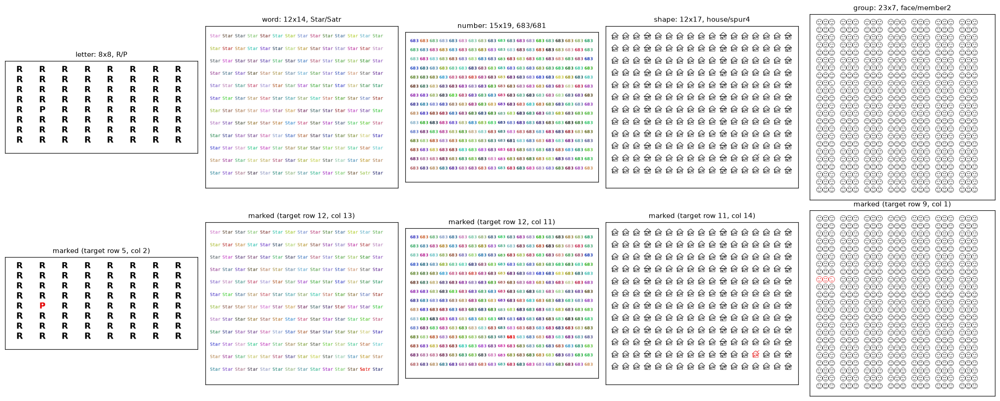
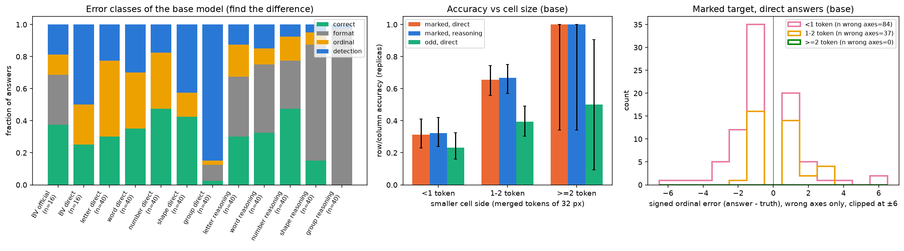
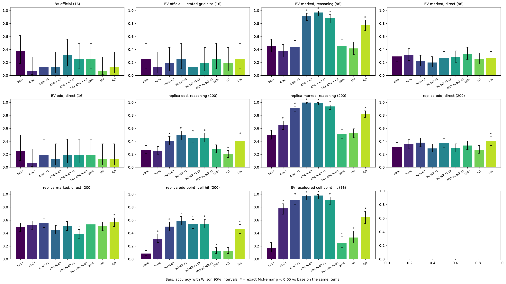
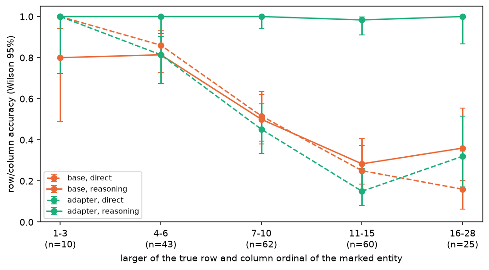
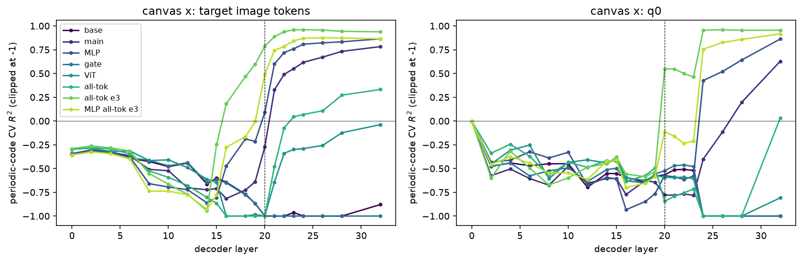
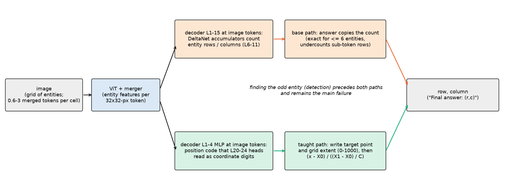

# 面向 BabyVision 行列找不同的定点混合数据微调（实验 7.4）

实验日期：2026-11-11 至 2026-11-12。本文属于[研究问题 7](plan.md)。主模型为 Qwen3.5-9B，bfloat16、SDPA，thinking off。第 2 节的失败诊断与第 3 节的预注册方案在任何训练开始之前写入本文（冻结副本与 sha256 见“实验产物”），训练之后未作改动。

## 通俗讲述

BabyVision 的“找不同”题给出一张网格图像，例如 11 行 28 列的字母 C，其中一个字母略有不同，要求回答它在第几行第几列。Qwen3.5 回答这类问题要经过三步：先在网格中找到不同的那个实体，再把它的位置变成行号与列号，最后按要求的格式写出答案。我们先在原模型上把这三步拆开测量。办法是对同一张网格问两个问题：一个是原题，另一个是把不同的实体涂成红色后问“红色的实体在第几行第几列”。后一个问题告诉了模型目标在哪里，因此只检验第二步。

诊断发现第二步本身就很不可靠：即使目标已经涂红，模型也只答对一半。错误的规律很清楚，目标越靠后越容易错，前 6 个实体之内几乎全对，第 16 个之后几乎全错。这与我们以前对机理的分析完全吻合。Qwen3.5 得到行号与列号的方式，是在读入图像 token 的过程中，由 Gated DeltaNet 层里的计数状态逐行、逐列地往上累加；这个累加只对前几个实体精确，之后误差越积越大，而且这是 DeltaNet 按光栅顺序递推的结构性质，调小参数改不了它。BabyVision 的网格每个方向有 7–28 个实体，正好落在计数最不可靠的区间；加上很多单元比一个图像 token 还小，一个 token 里挤着两行实体，计数还会漏行。让模型“先推理再回答”也没有用：原模型的推理是把整个网格逐行复述一遍，复述读到的是同一个计数，而且常常写到一半就超出长度。

前面的实验同时给出了一条不需要计数的路。模型写坐标数值的能力原本有缺陷（第二位数字是随机的），但实验 7.2 已经证明，这是只需训练第 1–4 层 MLP 就能修好的参数问题：这几层的更新让图像 token 在第 16–20 层带上一种周期为 100 的数值编码，第 20–24 层的读取 head 据此写出精确的坐标；而模型在文本中做算术是精确的。于是我们教模型“用测量代替数数”：在推理中先写出目标中心的坐标和整个网格的范围，再用题目给出的行数与列数做一次除法，得到行列号。我们用 2000 条小数据（坐标、行列与通用指令三类混合，没有任何 BabyVision 图像）训练了一个只有 210 万参数的适配器，它只改动机理指向的位置：第 1–4 层 MLP（修坐标）、第 6–10 层的计数门控和 ViT 的第 25–27 个 block。

结果分两半。第一半符合机理的预测：训练后的模型在推理中确实写出坐标并做除法，答案就是它写出的算式的结果；目标涂红时，复刻网格上答对 199/200，BabyVision 涂红的单元由 44/96 升到 88–93/96，而且准确率不再随目标位置靠后而下降。表示上，图像 token 在第 16–20 层出现了周期编码，计数门控的行为保持原样，说明模型的计数精度没有变化，收益来自绕开计数。纯文本输出与原模型逐字相同，通用基准没有下降。第二半没有达到目标：BabyVision 的 16 道原题没有提高。原因有三个：16 道题里有 12 道不告诉模型网格有几行几列，模型只好自己数，又回到了计数的老问题；原题的措辞和训练中的问法差别较大，模型很少在原题上用出新学的写法；剩下的主要失败发生在第一步，模型没有找到那个不同的实体，这一步的改进需要另外的数据与分析。训练还带来一个副作用：标准合成网格上直接回答的行列号变差了，因为直接回答仍要计数，而计数被复刻网格的数据校准偏了。

本实验共使用约 9.4 GPU 小时（A800 与 A40），训练与评测都通过共享 GPU 申请工具在空闲卡上运行。

## 1. 研究问题

BabyVision 的 Find the different 子集共 16 道题，每道题是一张网格图像，网格中只有一个实体与其余实体不同，题目说明网格的行数与列数，要求以 (行, 列) 的形式回答该实体的位置。原模型在原题问法（允许先推理再作答）下答对 5/16（实验 7.2）。本文要回答三个问题：

1. 原模型在这类题目上的失败由哪一步造成：没有找到不同的实体，找到了但写错行列号，还是格式与拒答；
2. 以前面实验在原模型上得到的机理结论为依据，能否只训练少量、位置明确的参数，用少量“坐标 + 行列 + 指令”的混合数据提高 BabyVision 行列找不同的准确率；
3. 训练是否只改变了机理所预测的那一步，同时不损害通用能力。

## 2. 训练之前的失败诊断

### 2.1 题目的图像特征

表 1 列出 16 道题的网格规模与单元尺寸。Qwen3.5 的视觉编码以 16 pixels 为 patch，相邻 2×2 个 patch 合并为一个送入 decoder 的图像 token，因此一个图像 token 覆盖 32×32 pixels，本文称之为一个 merged token。处理器不缩放图像，单元尺寸除以 32 即为每个单元在每个方向上所占的 merged token 数。

**表 1：BabyVision 找不同题目的网格（来自实验 1.3 的人工标注）。** 单元尺寸为像素与 merged token 数（宽 × 高）。

| taskId | 网格（行 × 列） | 实体 | 单元（pixels） | 单元（merged token） |
| --- | --- | --- | --- | --- |
| 445 | 7 × 7 | tiger | 81 × 58 | 2.53 × 1.81 |
| 464 | 25 × 10 | word | 53 × 20 | 1.66 × 0.62 |
| 507 | 11 × 28 | letter | 19 × 23 | 0.59 × 0.72 |
| 525 | 19 × 10 | word | 48 × 26 | 1.50 × 0.81 |
| 534 | 13 × 20 | lock | 28 × 36 | 0.88 × 1.12 |
| 638 | 18 × 22 | letter | 23 × 23 | 0.72 × 0.72 |
| 779 | 16 × 10 | group of three hands | 58 × 34 | 1.81 × 1.06 |
| 879 | 14 × 9 | word | 56 × 33 | 1.75 × 1.03 |
| 910 | 16 × 8 | group of three faces | 65 × 31 | 2.03 × 0.97 |
| 984 | 10 × 16 | letter | 39 × 51 | 1.22 × 1.59 |
| 986 | 15 × 7 | group of three faces | 94 × 47 | 2.94 × 1.47 |
| 988 | 14 × 10 | number | 63 × 42 | 1.97 × 1.31 |
| 4152 | 8 × 13 | tree | 39 × 55 | 1.22 × 1.72 |
| 6161 | 16 × 8 | group of three faces | 65 × 31 | 2.03 × 0.97 |
| 6164 | 17 × 9 | group of three fruits | 59 × 29 | 1.84 × 0.91 |
| 6165 | 10 × 10 | animal | 60 × 45 | 1.88 × 1.41 |

这些网格与前面实验使用的合成网格有两点不同。第一，每个方向有 7–28 个实体，而实验 1.5、3.10 与 7.3C 发现行列序号由 Gated DeltaNet 中的计数状态给出，这一计数只对前几个实体精确，实体越多误差越大。第二，8 道题的单元至少有一边小于一个 merged token，即一个图像 token 内包含不止一个实体行或实体列；前面实验的合成网格单元为 64 pixels（2 个 merged token）。

### 2.2 复刻网格

16 道原题不足以给出统计结论。为此本文从零绘制了 BabyVision 风格的复刻网格（没有使用任何 BabyVision 图像或其裁剪）。每张复刻网格只有一个不同的实体，网格每个方向 7–28 个实体，单元 19–94 pixels，图像边长 270–900 pixels，与表 1 的范围一致。按实体内容分为五个族：

1. letter：同一字母重复，不同实体为形状相近的另一字母（例如 O 与 Q）；
2. word：同一个四字母单词重复，不同实体交换了两个相邻的内部字母（例如 Snow 与 Sonw）；
3. number：同一个 2–3 位数重复，不同实体改变了一位数字；
4. shape：实验共享刺激集的线条图形（stimuli-v1 模板），不同实体带缺口、多一笔、旋转或镜像；
5. group：每个单元是三个并排的小图形（评测集中为简笔笑脸），不同单元中有一个成员发生变化（例如少一只眼睛）。

字体从 5 种 DejaVu 字体中随机选取，颜色为黑色、同一深色或每个实体随机深色。每个族都有互不相交的训练内容与评测内容（字母对、单词表、模板与组成员不同），number 族只用于评测，作为训练中完全没有出现过的族。评测集每族 40 张，共 200 张。每张复刻网格还生成一张“标记版”：只把不同实体的前景重新着色为红、绿或蓝色（取与实体颜色差别最大者）。标记版告诉模型目标在哪里，因而只检验行列号的写出。

**图 1：五个族的评测复刻网格（上）与对应的标记版（下）。** 图像由本实验的生成程序绘制，标题给出网格规模、相同与不同的内容和目标的行列号。

### 2.3 失败的三种类型与判定规则

对同一张网格，本文同时询问四个问题：不同实体的行列号（找不同问题），标记实体的行列号（标记问题），不同实体的中心点坐标（点问题），以及同一找不同问题的 BabyVision 式推理问法。行列问题各有两种问法：direct 问法要求只输出 JSON；推理问法沿用 BabyVision 原题的措辞，允许先写推理，最后一行写 “Final answer: (r,c)”。

一个答错的找不同答案按以下顺序归入三类之一：

1. **格式与拒答（format）**：回答被 token 上限截断、声称看不清或无法看到图像，或者没有可解析的行列号；
2. **序号错误（ordinal）**：模型找到了目标但写错了行列号。满足以下任一条件即判为此类：答案在两个方向上都与真值相差不超过 1；答案与模型在同一网格标记问题上的错误答案完全相同；点问题的答案落在目标单元或其相邻单元内（行与列的差都不超过 1）；
3. **未找到目标（detection）**：其余错误，即答案远离目标，且没有证据表明模型找到了目标。

这一规则以配对证据为依据，不需要人工判读。它有一个已知的偏差：模型找到目标但行列号相差 2 以上、且点答案也偏离 1 个单元以上时，会被判为未找到目标。第 2.4 节用标记问题的准确率单独估计这一偏差的大小。

### 2.4 诊断结果

**图 2：原模型的失败诊断（由模型生成的答案按第 2.3 节规则分类）。** 左：各组答案的类别占比，绿色为正确，灰色为格式与拒答，黄色为序号错误，蓝色为未找到目标；BV 为 BabyVision 原题（official 为原题推理问法，direct 为 JSON 问法），其余为复刻网格的五个族。中：复刻网格按单元较短边所占 merged token 数分组的行列准确率（Wilson 95% 区间），橙色为标记问题 direct，蓝色为标记问题推理，绿色为找不同 direct；单元不小于 2 个 merged token 的复刻网格只有 2 张。右：标记问题 direct 答案中答错方向的有符号误差（答案减真值）分布，粉色为单元小于 1 个 merged token，黄色为 1–2 个。

**表 2：原模型的主要准确率（复刻网格 200 张，BabyVision 原题 16 道、着色单元 96 个）。**

| 任务 | direct | 推理问法 |
| --- | --- | --- |
| BabyVision 原题（找不同） | 4/16 | 6/16（截断 3，声称看不清 2） |
| BabyVision 着色单元的行列 | 28/96 | 44/96（截断 14，声称看不清 19） |
| BabyVision 着色单元的坐标点命中 | 16/96 | — |
| 复刻网格找不同 | 63/200 | 54/200（截断 96，声称看不清 16） |
| 复刻网格标记实体 | 98/200 | 100/200（截断 27，声称看不清 37） |
| 复刻网格不同实体的点答案落在目标单元 | 17/200 | — |

**表 3：标记实体 direct 答案的准确率随目标序号的变化（复刻网格，按行与列分别统计）。**

| 目标序号 | 1–3 | 4–6 | 7–10 | 11–15 | 16–28 |
| --- | --- | --- | --- | --- | --- |
| 行（答案数） | 0.98（51） | 0.94（53） | 0.56（52） | 0.49（35） | 0.33（9） |
| 列（答案数） | 0.98（52） | 0.88（50） | 0.51（43） | 0.31（39） | 0.06（16） |

诊断给出四条结论。

1. **即使告诉模型目标在哪里，行列号也只有一半正确，错误由计数长度决定。** 标记问题的 direct 准确率为 98/200，且准确率随目标序号单调下降：前 6 个实体之内为 0.88–0.98，第 7–10 个降到 0.51–0.56，第 16 个之后只有 0.06–0.33（表 3）。这与实验 1.5、3.10 的机理一致：行列号由 Gated DeltaNet 中逐行逐列累加的计数状态给出，计数只对前几个实体精确，之后误差随累加次数增大。实验 3.14 把这一性质归因于 Gated DeltaNet 的光栅递推结构，实验 7.3C 发现只调整门控投影只能消除系统性的多数一，不能让累加器本身更精确。因此本文判断，direct 问法下的序号错误主要是结构性的计数长度限制，用小参数量的 LoRA 难以消除。
2. **单元小于一个 merged token 时，序号错误显著增多，且以少计为主。** 单元较短边小于 1 个 merged token 的复刻网格上，标记问题 direct 准确率为 31/99，1–2 个 merged token 时为 65/99；前者答错的行中少计 33 次、多计 6 次（图 2 右）。把图像放大 2 倍（每个单元所占的 merged token 数加倍，网格内容不变）后，复刻网格标记问题由 98/200 升至 137/200，找不同由 63/200 升至 117/200，BabyVision 着色单元由 28/96 升至 59/96（McNemar $p \le 3 \times 10^{-5}$）。这说明相当一部分失败来自输入分辨率：一个 merged token 内含有两个实体行时，逐 token 的计数会漏掉实体行。这一部分属于输入采样密度问题，本文的训练不改变分辨率，第 5 节在原分辨率上评测，并单独报告放大 2 倍后的结果。
3. **推理问法本可以帮助计数，但多数回答在写出答案之前就失败了。** BabyVision 着色单元的推理问法比 direct 多答对 16 个（44/96 对 28/96），但复刻网格上推理问法有 112/200 个回答属于格式与拒答：96 个在 768 个 token 内被截断（模型逐行逐列地复述整个网格），16 个声称看不清图像；group 族 39/40 被截断。实验 1.7 已发现推理阶段逐行列举读取的是 prefill 中写入图像 token 的计数标记，因此逐行复述既慢，也不能纠正计数。
4. **没有找到目标的错误集中在 direct 问法与 group 族。** 复刻网格找不同 direct 答案中，79/200 被判为未找到目标，54/200 为序号错误；group 族 34/40 未找到目标。BabyVision 原题 direct 问法 8/16 为未找到目标、4/16 为序号错误；推理问法 6 对、5 道格式与拒答、2 道序号错误、3 道未找到目标。原模型的点答案本身不准（BabyVision 着色单元的坐标命中只有 16/96，实验 7.2 已证明这是坐标数字写出的缺陷），因此“未找到目标”中混有找到目标但点答案偏离的情况，这一类的比例是上限估计。

## 3. 预注册的训练方案

### 3.1 由诊断导出的思路

诊断表明，失败按出现顺序可以拆成三步：先在网格中找到不同的实体，再把它的位置变成行列号，最后以要求的格式写出答案。其中第二步有一个结构性的瓶颈：靠逐个累加实体得到序号，超过约 6 个实体就不可靠。前面的实验同时给出了一条不经过计数的通路：实验 3.15 发现坐标与序号共享第 9–16 层的纵向位置编码，坐标以连续的方式读取这一编码；实验 7.2 证明坐标数值的写出缺陷是参数问题，只训练第 1–4 层 MLP 在图像 token 上的更新（157 万参数），20×20 网格的坐标命中率就由 0.12 升到 1.00；实验 1.7 与 3.15 发现，写在文本中的数值可以被模型精确地做算术。由此得到本文的方案：教模型在推理中先写出目标的坐标与整个网格的范围，再用题目给出的行数与列数做除法得到行列号，用“测量”代替“计数”。

记目标中心的坐标为 $(x, y)$，整个网格（全部实体的外接框）的范围为 $[X_0, Y_0, X_1, Y_1]$，均为 0–1000 归一化坐标；题目给出的行数与列数为 $R$ 与 $C$。行列号为

$$
c = \left\lfloor \frac{x - X_0}{(X_1 - X_0)/C} \right\rfloor + 1, \qquad
r = \left\lfloor \frac{y - Y_0}{(Y_1 - Y_0)/R} \right\rfloor + 1 .
$$

式中分母是一列（一行）在坐标上的宽度，分子是目标到网格左（上）边缘的距离，二者之比的整数部分加 1 就是目标所在的列（行）。这一换算只需要三个坐标数值与一次除法，误差只来自坐标的精度：目标中心与网格边缘的坐标误差都小于半个单元宽度时，答案就是正确的。当题目给出行数与列数时，这一方法不需要数数；BabyVision 的 16 道原题中只有 4 道（445、464、507、534）在题目中给出行数与列数，其余 12 道需要模型自己确定网格规模（第 5.4 节）。它是一种通用的数据层面的推理方式，适用于任何已知行列数的规则排列（表格、座位图、键盘等），不向模型添加任何返回网格单元的工具或结构。

### 3.2 训练位置

| 部分 | 位置 | 生效 token | 参数量 | 依据 |
| --- | --- | --- | --- | --- |
| 坐标写出 | decoder 第 1–4 层 MLP（gate_proj、up_proj、down_proj） | 图像 token | 1,572,864 | 3.16 在原模型上的定位与 7.2 的验证：第 20 层从图像 token 读取坐标时缺少周期编码，第 1–4 层 MLP 的更新足以补上 |
| 计数门控 | DeltaNet 第 6、7、9、10 层 in_proj_a、in_proj_b | 图像 token | 264,192 | 7.3C 在原模型上的逐层门控编辑：计数门控集中在第 6–11 层；该 LoRA 可消除多数一 |
| 缺失特征检测 | ViT 第 25–27 个 block 的 MLP（linear_fc1、linear_fc2） | 全部 patch | 约 0.26 M | 7.3：缺失型差异在 ViT 中没有排他检测器；block 窗口扫描中第 25–27 个 block 对训练外族迁移最好 |

LoRA 秩 8，$\alpha = 32$。decoder 部分只作用于图像 token，因而纯文本输入的输出与原模型逐字相同（构造保证）。

### 3.3 训练数据

总计 2000 条，1 个 epoch（125 步，每步 16 条），学习率为第 1–4 层 MLP $10^{-4}$、门控与 ViT $2 \times 10^{-4}$（沿用 7.2、7.3C、7.3 的设置），余弦退火。复刻网格全部使用训练内容集，与评测集的字母对、单词、模板、组成员互不相交，number 族不参与训练；没有任何 BabyVision 图像。

| 类别 | 条数 | 内容 |
| --- | --- | --- |
| 坐标 | 200 | 3.13 的精确坐标样本（RefCOCO 100、合成画布与网格 100），点与框各半 |
| 坐标 | 300 | 复刻网格：标记实体的中心点 200、不同实体的中心点 100 |
| 坐标 | 100 | 复刻网格：整个网格的外接框 |
| 行列 direct | 400 | 复刻网格：标记实体与不同实体各 200，答案为原模型使用的 JSON 格式 |
| 行列推理 | 400 | 复刻网格：标记实体与不同实体各 200，BabyVision 式问法，答案为第 3.1 节的坐标换算推理 |
| 指令 | 600 | 3.13 第二轮中原模型对通用问题（TextVQA、GQA、存在性判断、描述）的 greedy 输出 |

### 3.4 条件

| 条件 | 训练位置 | 数据 | seed |
| --- | --- | --- | --- |
| main | 第 3.2 节三部分 | 第 3.3 节 | 1、2 |
| mlp_only | 只训练第 1–4 层 MLP | 同上 | 1 |
| gate_only | 只训练门控 | 同上 | 1 |
| vit_only | 只训练 ViT 第 25–27 个 block | 同上 | 1 |
| main_nocot | 第 3.2 节三部分 | 400 条推理样本换成同一图像上的 direct 行列问答 | 1 |
| full_lora | decoder 全部 32 层全部线性层，全部 token（21.6 M） | 第 3.3 节 | 1 |

### 3.5 预测

以下预测在训练前写定，评测均在原分辨率的复刻网格（200 张）与 BabyVision 上进行。

1. **P1（序号，推理问法）**：main 的标记问题推理准确率不低于 0.75（原模型 0.50）；且目标序号不小于 7 的答案准确率与序号不超过 6 的答案相差不超过 0.15，即准确率不再随序号下降。这是“测量代替计数”的直接检验。
2. **P2（找不同，推理问法）**：main 的找不同推理准确率比原模型提高不少于 0.15（原模型 0.27）。
3. **P3（序号，direct 问法）**：main 的标记问题 direct 准确率提高不超过 0.10（原模型 0.49），因为 direct 问法仍依赖累加计数。
4. **P4（格式）**：推理问法下格式与拒答类回答不超过 10/200（原模型 112/200）。
5. **P5（找到目标）**：不同实体的点答案落在目标单元的比例不低于 0.40（原模型 0.085），其中坐标写出的修复贡献大部分。
6. **P6（BabyVision）**：原题推理问法不低于 8/16（原模型 6/16）；着色单元推理问法不低于 0.65（原模型 0.46）。16 道原题的统计功效有限，判断以着色单元与复刻网格为主。
7. **P7（组件归因）**：mlp_only 得到 main 在推理问法上的大部分收益（坐标精度是换算的瓶颈）；gate_only 在推理问法上无显著收益，在 direct 问法上至多消除多数一；vit_only 只可能提高点答案的找到率；main_nocot 在推理问法上无显著收益（数据中的换算示范是必要的）。
8. **P8（泛化）**：训练中未出现的 number 族在标记问题推理上的收益与训练族相当，因为换算与实体内容无关。
9. **P9（通用能力）**：POPE、TextVQA、MMVP、GQA 无显著下降；decoder 部分只作用于图像 token 的条件纯文本输出逐字相同；full_lora 可能出现作答格式漂移。
10. **P10（表示）**：main 与 mlp_only 的目标图像 token 在第 15–20 层出现周期编码，$q_0$ 在第 20 层跃升（7.2 的探针）；gate_only 与 vit_only 不出现。main 的门控在实体行起点 token 与其余 token 之间的 $\alpha$、$\beta$ 差别不变（7.3C）。推理回答中，最终答案与其写出的数值按第 3.1 节公式算得的行列号一致的比例不低于 0.9，即答案确实由写出的坐标决定。

### 3.6 训练后修订的预测（main 结果之后、新条件训练之前写定）

main 训练完成后检查其推理回答发现，复刻网格与 BabyVision 的全部推理回答（共 512 条）中没有一条写出第 3.1 节的坐标换算，模型只是把推理写得更短。原因可以由更新的作用范围直接推出：main 的 decoder 更新只作用于图像 token，而推理文本的每一个 token 都在图像之后的文本位置上生成，这些位置使用原模型的权重；图像 token 上的更新只能改变文本位置经由 attention 与 DeltaNet 状态读到的图像内容，不能改变模型在给定问题下“写什么样的推理”这一由文本位置计算的选择。原模型对这类问题的写法是逐行复述网格（第 2.4 节），因此 400 条换算示范无法被只作用于图像 token 的参数学会。第 3.5 节的 P1、P2、P10 依赖模型写出换算，在 main 上无法得到检验。

修订方案保持训练模块与数据不变，只把 decoder 部分的更新扩展到全部 token（条件 main_alltok，seed 1 与 2；只训练第 1–4 层 MLP 的 mlp_alltok 作为组件对照）。修订后的预测：

1. **P1′**：main_alltok 的推理回答中写出坐标换算的比例不低于 0.9；P1、P2、P4、P6、P8、P10 的阈值不变，适用于 main_alltok。
2. **P9′**：main_alltok 的纯文本输出不再有构造上的逐字相同保证，预测纯文本准确率与通用基准无显著下降（7.2 中只作用于文本 token 的第 1–4 层 MLP 更新未改变纯文本输出）。

### 3.7 第二次修订（main_alltok 结果之后、三个 epoch 的训练之前写定）

main_alltok 的推理回答以训练模板的第一句开头（例如 “The grid has 21 rows and 10 columns.”），随后直接写出行列号，跳过写坐标与做除法的步骤，200 条复刻网格推理回答中写出换算的仍为 0 条。训练损失在第 125 步时仍在下降（由 0.95 降至约 0.30），说明 1 个 epoch 中每条换算示范只出现一次，模型只学到了开头的措辞与“直接写答案”的捷径。修订方案把 main_alltok 的训练延长到 3 个 epoch（375 步，数据不变；条件 main_alltok_e3，seed 1 与 2），并以同样 3 个 epoch 训练只作用于图像 token 的 main_e3 与只训练第 1–4 层 MLP（全部 token）的 mlp_alltok_e3 作为对照。预测：main_alltok_e3 满足 P1′（写出换算的比例不低于 0.9）以及 P1、P2、P4、P6、P8、P10；main_e3 仍不写出换算（不高于 0.1），这检验第 3.6 节“只作用于图像 token 的更新不能改变写出的推理方式”的推断。

## 4. 训练与评测

### 4.1 实际训练的条件

第 3.4 节的条件之外，按第 3.6、3.7 节的修订追加了 main_alltok、main_e3、main_alltok_e3（seed 1、2）与 mlp_alltok_e3。预注册的 main_s2（只作用于图像 token、1 个 epoch 的第二个 seed）在第 3.6 节修订后没有运行，两个 seed 的要求由修订后的主条件 main_alltok_e3 满足。全部条件使用同一份 2000 条训练数据（main_nocot 除外），LoRA 秩 8。

**表 4：训练条件、参数量与训练时间（实测）。** 时间为单卡训练的 wall-clock 秒数，不含评测；“生效 token”为 decoder 部分更新的作用位置，ViT 部分总是作用于全部 patch。

| 条件 | 训练模块 | 生效 token | epoch（步数） | 参数量 | 训练时间 |
| --- | --- | --- | --- | --- | --- |
| main | L1–4 MLP + 门控 L6、7、9、10 + ViT 25–27 | 图像 | 1（125） | 2,098,944 | A40 809 s |
| mlp_only | L1–4 MLP | 图像 | 1 | 1,572,864 | A40 772 s |
| gate_only | 门控 L6、7、9、10 | 图像 | 1 | 264,192 | A800 383 s |
| vit_only | ViT 25–27 MLP | — | 1 | 261,888 | A800 389 s |
| main_nocot | 同 main，无推理样本 | 图像 | 1 | 2,098,944 | A40 706 s |
| main_alltok | 同 main | 全部 | 1 | 2,098,944 | A800 416 s |
| main_e3 | 同 main | 图像 | 3（375） | 2,098,944 | A800 1217 s |
| **main_alltok_e3**（seed 1、2） | 同 main | 全部 | 3（375） | 2,098,944 | A800 1211、1213 s |
| mlp_alltok_e3 | L1–4 MLP | 全部 | 3 | 1,572,864 | A800 1173 s |
| full_lora | decoder 全部线性层 | 全部 | 1 | 21,639,168 | A40 1047 s |

### 4.2 评测

1. **BabyVision**：16 道原题（原题问法，推理，上限 1024 tokens）；同一问题前加 “The grid has R rows and C columns.” 的诊断问法（official_dims，评测阶段追加，用于分离“网格规模未知”的影响）；不同实体的行列（direct）与点；96 个着色单元（7.2 构造，每张原图 6 个单元依次着色）的点、行列（direct）与 BabyVision 式推理问法（题目给出行列数）。
2. **复刻网格**：评测集 200 张（第 2.2 节），问题与第 2.3 节相同，推理问法上限 768 tokens。
3. **坐标**：3.13 的 997 道留出坐标题；**行列序号**：3.13 测试集的 72 张合成网格（6×6、10×10、20×20），direct 与推理两种问法。
4. **通用能力**：POPE、TextVQA、MMVP、GQA 各 200 题，45 道纯文本题（准确率与输出逐字相同的条数）。
5. **统计**：准确率附 Wilson 95% 区间；与原模型在相同题目上的配对差异用精确 McNemar 检验。生成为 left-padded 批量 greedy 解码（direct 批量 24、推理批量 16）；20 条抽查中 direct 答案与逐条解码 10/10 一致，推理答案 5/10 一致，长推理在 bf16 批量填充下会逐渐偏离，因此推理问法的逐题结果含有解码噪声，比较以配对检验与两个 seed 的一致性为准。

## 5. 结果

### 5.1 总览

**图 3：各条件在 BabyVision 与复刻网格上的准确率（由模型生成的答案计算）。** 柱高为准确率，误差线为 Wilson 95% 区间，星号表示与原模型在相同题目上的精确 McNemar 检验 $p < 0.05$；颜色按条件顺序取 viridis 色图，条件名的含义见表 4（all-tok e3 即 main_alltok_e3）。

**表 5：主要条件的准确率（实测）。** 括号内为与原模型配对的精确 McNemar $p$（只列出 $p < 0.05$ 者）；推理问法的 BabyVision 着色单元与复刻网格题目都给出行列数。

| 条件 | BV 原题（/16） | BV 着色单元，推理（/96） | BV 着色单元，direct（/96） | BV 着色单元点命中（/96） | 复刻标记，推理（/200） | 复刻找不同，推理（/200） | 复刻标记，direct（/200） | 复刻找不同点落在目标单元（/200） |
| --- | --- | --- | --- | --- | --- | --- | --- | --- |
| 原模型 | 6 | 44 | 28 | 16 | 100 | 54 | 98 | 17 |
| main | 1 | 36 | 30 | 75（$3 \times 10^{-18}$） | 130（$4 \times 10^{-5}$） | 51 | 104 | 63（$4 \times 10^{-11}$） |
| main_e3 | 2 | 42 | 21 | 88（$4 \times 10^{-22}$） | 181（$4 \times 10^{-20}$） | 81（$4 \times 10^{-4}$） | 111 | 100（$2 \times 10^{-25}$） |
| **main_alltok_e3** | 2 | 88（$8 \times 10^{-12}$） | 19 | 93（$1 \times 10^{-23}$） | 199（$3 \times 10^{-30}$） | 98（$1 \times 10^{-8}$） | 90 | 118（$3 \times 10^{-28}$） |
| **main_alltok_e3，seed 2** | 5 | 93（$4 \times 10^{-15}$） | 26 | 94（$7 \times 10^{-24}$） | 197（$4 \times 10^{-26}$） | 89（$4 \times 10^{-5}$） | 102 | 108（$2 \times 10^{-25}$） |
| mlp_alltok_e3 | 4 | 85（$8 \times 10^{-10}$） | 27 | 88（$4 \times 10^{-22}$） | 187（$2 \times 10^{-22}$） | 91（$8 \times 10^{-7}$） | 77（$4 \times 10^{-3}$，下降） | 109（$1 \times 10^{-26}$） |
| gate_only | 4 | 44 | 32 | 24（0.02） | 103 | 56 | 107 | 25（0.04） |
| vit_only | 1 | 40 | 24 | 32（$4 \times 10^{-4}$） | 105 | 40（0.02，下降） | 101 | 25 |
| main_nocot | 4 | 45 | 33 | 29（$4 \times 10^{-3}$） | 133（$1 \times 10^{-5}$） | 50 | 119（$3 \times 10^{-3}$） | 41（$7 \times 10^{-5}$） |
| full_lora（21.6 M） | 2 | 75（$2 \times 10^{-5}$） | 26 | 62（$3 \times 10^{-14}$） | 165（$9 \times 10^{-13}$） | 82（$9 \times 10^{-5}$） | 114（0.03） | 92（$1 \times 10^{-21}$） |

总的结果是：**以 210 万参数、2000 条混合数据、3 个 epoch 训练的定位适配器（main_alltok_e3）消除了“找到目标之后写错行列号”这一失败，复刻网格上的找不同推理准确率由 0.27 升到 0.45–0.49，但 BabyVision 原题没有提高（6/16 对 2/16 与 5/16）。** 前一半说明“测量代替计数”在机理上成立，后一半的原因在第 5.4 节逐项分析：原题中大部分题目不给出网格规模、原题措辞没有触发所学的推理方式，以及剩下的主要失败是没有找到目标。

### 5.2 测量代替计数：序号错误被消除

**图 4：复刻网格标记问题的准确率随目标序号的变化（由模型生成的答案计算，Wilson 95% 区间）。** 横轴为目标真实行号与列号中的较大者，括号内为题数；橙色为原模型，绿色为 main_alltok_e3（seed 1）；虚线为 direct 问法，实线为推理问法。

1. **推理问法下，准确率不再随序号下降。** main_alltok_e3 在标记问题推理上答对 199/200（seed 2 为 197/200），目标序号不超过 6 时为 1.00，不小于 7 时为 0.99（0.98）；原模型分别为 0.81 与 0.39（图 4）。direct 问法的曲线与原模型几乎重合（序号不小于 7 时 0.31 对 0.35）。这一对比是本文最直接的机理证据：同一个适配器、同一张图像，只要回答经过“写坐标、做除法”，序号就不再受累加长度的限制；只要回答直接写行列号，序号仍由 DeltaNet 的累加计数给出，误差与原模型相同。这说明适配器没有修好计数，而是让模型在推理中绕开了计数。
2. **模型确实使用了所教的换算，答案由写出的数值决定。** main_alltok_e3 的 200 条标记推理回答全部写出了目标坐标与网格范围，最终答案与按第 3.1 节公式由其写出的数值算得的行列号 200/200 一致；写出的目标点落在目标单元内 199/200，网格范围四个边的中位误差为 1.0–2.4 个坐标单位（0–1000 尺度）。BabyVision 着色单元上，96 条回答中 91 条写出换算，85 条答案与写出的数值一致，91 条的目标点落在目标单元内，准确率由 44/96 升到 88/96（seed 2 为 93/96）。
3. **收益迁移到训练中没有出现的 number 族。** number 族的标记推理由 15/40 升到 39/40 与 40/40。换算只依赖坐标，与实体是什么无关，因此预测 P8 成立。
4. **格式与拒答失败消失。** 推理问法下的截断与“看不清”由原模型的 112/200（复刻找不同）降到 0/200；找不同推理回答的平均长度由 545 个 token 降到 185–193 个 token。这一变化来自训练数据中的短推理示范，在只用 1 个 epoch 的 main 上已经出现（2/200）。

### 5.3 更新的作用位置与写出的推理方式

第 3.6 节曾推断“只作用于图像 token 的更新不能改变写出的推理方式”，这一推断被 main_e3 否定。main（1 个 epoch，图像 token）在 512 条推理回答中写出换算的为 0 条；同样只作用于图像 token、训练 3 个 epoch 的 main_e3 在复刻网格标记推理中有 194/200 条写出换算，准确率 181/200。生成的文本 token 虽然使用原权重，但它们在每一层都通过 full attention 与 DeltaNet 状态读取图像 token 的表示；图像 token 上的更新足够强时，就能改变文本位置“接下来写什么”的选择。这与 7.2 中“只改第一个图像 token 就能切换坐标读出格式”的结果一致：图像片段的表示可以充当一个由内容携带的模式信号。

两种作用位置的差别体现在对新图像的迁移上。main_e3 在真实的 BabyVision 着色单元上只有 34/96 条回答写出换算，准确率 42/96，与原模型相同；作用于全部 token 的 main_alltok_e3 为 91/96 条与 88/96。这一差别的解释（推断）是：只作用于图像 token 时，“切换到换算写法”的信号只能由图像特征触发，适配器学到的是“像复刻网格的图像”与换算写法之间的关联，BabyVision 的实物图案与之不同时信号减弱；作用于全部 token 时，问题文本 token（“Which row and column …”）也携带这一信号，它不随图像风格变化。纯文本输出在两种作用位置下都与原模型逐字相同（45/45），说明第 1–4 层 MLP 与第 6–10 层门控在全部 token 上的低秩更新只在图像相关的输入上产生明显响应。

1 个 epoch 不足以学会换算写法，这一点与作用位置无关：main_alltok（1 个 epoch，全部 token）的回答以训练模板的第一句开头，然后直接写行列号，写出换算的为 0/200；full_lora（1 个 epoch，2160 万参数）则 200/200 写出换算。小参数量的适配器需要更多次看到同一示范，才能学会一段多步的写法，而不是只学开头的措辞后走捷径。

### 5.4 BabyVision 原题为何没有提高

**表 6：BabyVision 原题的错误类型（第 2.3 节规则，16 道）。**

| 条件 | 正确 | 格式与拒答 | 序号错误 | 未找到目标 | 写出换算的回答 |
| --- | --- | --- | --- | --- | --- |
| 原模型 | 6 | 5 | 2 | 3 | 0 |
| main_alltok_e3 | 2 | 0 | 7 | 7 | 2 |
| main_alltok_e3，seed 2 | 5 | 1 | 3 | 7 | 2 |
| full_lora | 2 | 0 | 6 | 8 | 13 |

原题没有提高有三个原因，按它们在处理流程中出现的顺序排列。

1. **12/16 道原题不给出网格规模。** 换算需要行数与列数；只有 445、464、507、534 四道题在题目中写出它们，其余题目只说“找出不同的图案，答案格式为 (a,b)”。模型若要自己确定网格规模，就必须数完整的一行与一列（最多 28 个实体），这正是累加计数最不可靠的情形。例如 main_alltok_e3 在 638 题写出 “The grid has 20 rows and 17 columns”，真值为 18 × 22。
2. **原题的措辞没有触发所学的写法。** 即使在题目前补上网格规模（official_dims），main_alltok_e3 也只在 2/16 道题上写出换算，准确率 4/16 与 2/16，与原模型的 4/16 相同。训练中的推理问法只有 3 种措辞，BabyVision 原题的措辞（“Find the pattern that is different …”、“Answer format: Row a Column b”等）与之差别较大，适配器把换算写法与训练措辞绑定，没有迁移到新的措辞。full_lora 在 13/16 道原题上写出换算，说明更大容量的适配器把写法与“问行列”这一意图而非具体措辞关联起来，但它在原题上同样只答对 2/16，原因见下一条。
3. **剩下的主要失败是没有找到目标。** 三个训练条件在原题上都有 7–8 道被判为未找到目标；full_lora 写出换算的 13 道中，写出的目标点只有 4 道落在目标单元内。复刻网格上同样如此：main_alltok_e3 的找不同推理中，200 条有 101 条写出的点落在目标单元内，而一旦落在目标单元内，答案几乎总是正确的（标记问题 199/200）。number 族与 group 族的找不同推理没有提高（number 19/40 对 19/40 与 15/40，group 0/40 对 1/40），说明训练没有让模型学会发现训练中没有见过的差异类型。ViT 第 25–27 个 block 的 LoRA（vit_only）没有提高找到率（找不同点命中 25/200，与原模型的 17/200 差异不显著），7.3 中有效的缺失型差异训练数据在本文的混合数据中只占很小的比例。

### 5.5 组件归因

1. **坐标写出的修复来自第 1–4 层 MLP，而换算写法需要它。** mlp_alltok_e3（只训练第 1–4 层 MLP，157 万参数）达到 main_alltok_e3 的大部分收益：BabyVision 着色单元推理 85/96，复刻标记推理 187/200，找不同推理 91/200。只训练门控（gate_only）或只训练 ViT（vit_only）的条件在推理问法上与原模型没有差别（标记推理 103/200 与 105/200），坐标也没有修复（画布 x 误差 55.3 与 73.0，原模型 51.5）。预测 P7 的前两部分成立。
2. **门控 LoRA 只带来不显著的 direct 改善。** gate_only 的复刻标记 direct 为 107/200（原模型 98，$p = 0.15$），BabyVision 着色单元 direct 为 32/96（28，$p = 0.13$），方向与 7.3C 的“消除多数一”一致但不显著；BabyVision 网格上的主要序号错误是少计（第 2.4 节），多数一的校正对它帮助有限。
3. **推理示范是必要的数据成分。** main_nocot 不含推理样本，推理问法下没有写出换算的回答，复刻找不同推理 50/200 与原模型相同；但更多的 direct 样本使复刻标记 direct 升到 119/200（$p = 0.003$）。
4. **全部线性层的 LoRA 不如定位适配器。** full_lora 的参数量是 main_alltok_e3 的 10 倍，训练步数为其三分之一；它在 BabyVision 着色单元推理上为 75/96（定位适配器 88–93/96），坐标修复更弱（20×20 网格命中 7/40，定位适配器 40/40），并且纯文本输出逐字相同的为 0/45（定位适配器 45/45）。

### 5.6 副作用

**表 7：坐标、行列序号与通用能力（实测）。** 坐标为 3.13 测试集；行列序号为 3.13 的 72 张合成网格；通用基准各 200 题，括号内为配对检验 $p$（只列出 $p < 0.05$ 者）。

| 条件 | 画布 x 误差 | 20×20 命中（/40） | RefCOCO 误差 | 行列 direct（/72） | 行列推理（/72） | POPE | TextVQA | MMVP | GQA | 纯文本相同（/45） |
| --- | --- | --- | --- | --- | --- | --- | --- | --- | --- | --- |
| 原模型 | 51.5 | 5 | 47.3 | 48 | — | 0.850 | 0.765 | 0.740 | 0.355 | — |
| main | 39.5 | 4 | 45.8 | 58 | 50 | 0.840 | 0.770 | 0.730 | 0.305（0.04） | 45 |
| mlp_only | 4.7 | 3 | 43.8 | 60 | 57 | 0.870 | 0.790 | 0.750 | 0.335 | 45 |
| main_alltok_e3 | 2.8 | 40 | 44.7 | 30 | 36 | 0.895（0.02） | 0.740 | 0.745 | 0.325 | 45 |
| main_alltok_e3，seed 2 | 2.6 | 40 | 39.9 | 36 | 32 | 0.880 | 0.735 | 0.745 | 0.330 | 45 |
| mlp_alltok_e3 | 5.6 | 20 | 38.5 | 45 | 49 | 0.875 | 0.770 | 0.740 | 0.330 | 45 |
| full_lora | 12.4 | 7 | 38.5 | 53 | 38 | 0.890（0.04） | 0.775 | 0.770 | 0.315 | 0 |

1. **通用能力没有显著下降。** 主条件的四个通用基准中只有 POPE 显著变化且为提高；GQA 在 main 上下降 0.05（$p = 0.04$），在其余条件上不显著。纯文本输出在所有定位条件下与原模型逐字相同。
2. **主条件损害了标准合成网格上的 direct 行列序号。** main_alltok_e3 在 72 张 3.13 网格上的 direct 行列由 48/72 降到 30/72 与 36/72，6×6 网格由 12/12 降到 5/12 与 6/12。错误全部是相差 1–3 的近似错误（以多计为主），没有 7.2 中出现的“坐标前两位数字”答案。1 个 epoch 的条件没有这一损害（main 58/72，mlp_only 60/72），说明它来自 3 个 epoch 训练中对复刻网格 direct 计数的过度校准：复刻网格的 direct 训练样本使计数向复刻网格的版式（12 pixels 边距、非整数 token 对齐的单元）调整，在 64 pixels 单元、与 token 网格对齐的标准网格上转为多计。这一损害限于 direct 问法下的行列计数，坐标（20×20 网格命中 5/40 升到 40/40）与通用能力不受影响；在训练数据中混入标准网格的 direct 行列样本（7.2 的 mlp1_4_img_fix 使用过）是直接的补救，本文没有再训练验证。

### 5.7 分辨率

把图像放大 2 倍后，原模型的复刻找不同推理由 54/200 升到 80/200，标记推理由 100/200 升到 153/200；main_alltok_e3 在放大后的复刻找不同推理为 138/200，标记推理 197/200，BabyVision 原题 7/16，着色单元推理 89/96。标记问题在放大前已接近满分，放大带来的收益主要在找不同问题上（98 → 138），即放大帮助的是找到目标；换算已经消除了序号对分辨率的依赖。

## 6. 表示检验

### 6.1 坐标的周期编码

**图 5：画布 x 扫描中周期编码的逐层可解码性（实测，7.2 的探针）。** 对目标图像 token 的平均残差（左）与第一个坐标数字之前的位置 $q_0$ 的残差（右），以整百为留出折做 ridge 回归预测 $(\cos(2\pi x/100), \sin(2\pi x/100))$，纵轴为交叉验证 $R^2$（低于 −1 截断），$x$ 为目标的 0–1000 横坐标；颜色按条件顺序取 viridis 色图，虚线为第 20 层。$R^2 > 0$ 表示存在对所有百位通用的周期编码，这是第 20–24 层读取 head 写对第二位数字所需的格式（3.16）。

实验 3.16 与 7.2 的机理是：坐标的第二位数字只有在第 20 层读取时，图像 token 上已经存在周期为 100 的数值编码才能写对；第 1–4 层 MLP 的更新为后续层提供重编码的输入，编码本身在第 15–20 层形成。本文的结果与此一致。**训练第 1–4 层 MLP 的条件在第 16–20 层出现了周期编码，未训练这些层的条件没有。** main_alltok_e3 的目标 token 编码在第 14 层仍为 −0.94，第 16 层 0.18，第 20 层 0.79；$q_0$ 在第 20 层为 0.55（原模型 −0.57），第 24 层 0.95。mlp_alltok_e3 在第 20 层为 0.49；gate_only 与 vit_only 在全部层上与原模型相同（第 20 层 −1.01）。1 个 epoch 的 main 与 mlp_only 编码较弱（第 20 层 −0.27 与 0.09），与其坐标修复较弱（画布 x 误差 39.5 与 4.7、20×20 网格命中 4/40 与 3/40）一致。预测 P10 的第一部分成立。

### 6.2 计数门控

7.3C 发现，门控 LoRA 改变的是门控的整体水平，而不是“实体行起点 token 与其余 token 之间”的差别。本文在复刻网格的 100 张评测图像上测量第 6、7、9、10 层每个 head 的平均衰减系数 $\alpha$ 与写入强度 $\beta$（定义见 7.3C 第 2.1 节），按 token 是否位于实体行的起点分组。**门控的起点选择性在所有条件下保持不变。** 以 head 平均的“起点减其余”差值计，原模型第 7 层 $\beta$ 为 −0.016，gate_only 为 −0.016，main_alltok_e3 为 −0.011；第 6 层 $\alpha$ 分别为 −0.009、−0.009 与 −0.011。main_alltok_e3 的 $\beta$ 整体水平略有升高（第 10 层其余 token 由 0.204 升到 0.252）。这与 5.2 节的行为结论一致：direct 问法下的计数没有被修好，适配器的收益来自绕开计数。

### 6.3 换算的使用

第 5.2 节已给出行为层面的检验：在 main_alltok_e3 的推理回答中，最终答案与其写出的数值所蕴含的行列号一致的比例为 200/200（标记）与 181/195（找不同，写出换算者），满足 P10 的第三部分（不低于 0.9）。这说明在训练后的模型中，行列号的来源由 prefill 中的计数状态转移到了文本中写出的坐标数值，而实验 1.7、3.15 已证明文本数值的算术与抄写是精确的。

## 7. 讨论

### 7.1 预测与结果的对照

| 预测 | 条件 | 结果 | 判定 |
| --- | --- | --- | --- |
| P1 标记推理不低于 0.75，序号不小于 7 与不超过 6 相差不超过 0.15 | main_alltok_e3 | 0.995 / 0.985；1.00 对 0.99 | 成立 |
| P1′ 写出换算的比例不低于 0.9 | main_alltok_e3 | 200/200（复刻标记），91/96（BV 着色单元），2/16（BV 原题） | 复刻与着色单元成立，原题不成立 |
| P2 找不同推理提高不少于 0.15 | main_alltok_e3 | +0.22 / +0.18 | 成立 |
| P3 标记 direct 提高不超过 0.10 | main_alltok_e3 | −0.04 / +0.02 | 成立 |
| P4 推理问法格式失败不超过 10/200 | main_alltok_e3 | 0/200 | 成立 |
| P5 找不同点落在目标单元不低于 0.40 | main_alltok_e3 | 0.59 / 0.54 | 成立 |
| P6 BV 原题不低于 8/16；着色单元推理不低于 0.65 | main_alltok_e3 | 2/16、5/16；0.92 / 0.97 | 原题不成立，着色单元成立 |
| P7 组件归因 | 各单组件条件 | MLP 承担主要收益，门控与 ViT 无推理收益，无推理样本时无推理收益 | 成立 |
| P8 number 族收益与训练族相当 | main_alltok_e3 | 标记推理 15 → 39/40 | 成立（找不同推理不变） |
| P9 通用能力无显著下降 | 全部定位条件 | 无显著下降，纯文本逐字相同；标准网格 direct 行列下降 | 通用能力成立；行列 direct 出现未预测的损害 |
| P10 周期编码、门控选择性不变、答案由写出数值决定 | main_alltok_e3 等 | 均与预测一致 | 成立 |
| 第 3.6 节：只作用于图像 token 的更新不能学会写法（main_e3 写出比例不高于 0.1） | main_e3 | 194/200 | 不成立 |

### 7.2 可解释性结论对优化的指导作用

本文的优化链条是：原模型诊断指出，找到目标之后写错行列号的错误由累加计数的长度决定（第 2.4 节）；已有机理指出这一长度限制来自 DeltaNet 的光栅递推（3.10、3.14），门控 LoRA 不能修复累加器（7.3C），而坐标写出的缺陷是可由第 1–4 层 MLP 修复的参数问题（3.16、7.2），文本数值的算术精确（1.7、3.15）。由此选择“修坐标、教换算”的方案并预测其表示变化。训练后的结果在三个层面上与预测一致：行为上序号不再随累加长度下降；表示上周期编码在第 16–20 层出现、门控选择性不变；答案来源上最终答案由写出的数值决定。组件对照进一步说明收益来自机理所指的第 1–4 层 MLP，而不是门控或 ViT。

两处推断没有成立，值得记录。第一，第 3.6 节认为只作用于图像 token 的更新无法改变写出的推理方式，main_e3 否定了这一点：图像片段的表示可以通过 attention 影响后续文本位置的选择，这与 7.2 中第一个图像 token 的充分性属于同一现象；它的局限在于对图像风格的迁移。第二，诊断低估了 BabyVision 原题的异质性：原题的措辞多样，且多数不给出网格规模，这两点都没有在复刻网格的问法中体现。

### 7.3 与其他实验的关系

1. **与 7.2 一致**：第 1–4 层 MLP 修复坐标并在第 15–20 层形成周期编码；只作用于图像 token 的坐标训练会改变共享同一读取的行列序号（7.2 中为坐标前缀答案，本文为多计），混合数据只部分缓解。
2. **与 7.3C 一致**：门控 LoRA 的作用局限于 direct 问法下的小幅校正，门控选择性不变。
3. **与 7.3 部分不一致**：7.3 中 ViT 第 25–27 个 block 的 LoRA 对缺失型差异有效，本文的 vit_only 没有提高找到率。两者的训练数据不同（7.3 为 1200 条缺失型找不同样本，本文混合数据中找不同点样本只有 100 条且差异类型不同），本文不能据此否定 7.3 的结论。
4. **与 1.7 一致**：原模型的推理问法逐行复述网格，复述读到的是 prefill 中的计数，因此不改善序号；换算推理之所以有效，是因为它读取的是坐标而不是计数。

### 7.4 对 BabyVision 的下一步

剩下的两个瓶颈都可以用数据层面的方法处理，且有明确的检验对象：（1）推理问法需要覆盖更多措辞，并在题目不给出网格规模时教模型以坐标测量规模（例如写出相邻两个实体的中心坐标得到单元宽度，再用网格范围除以宽度得到行列数），这同样不需要数数；（2）找到目标需要覆盖更多差异类型的找不同数据，并以 7.3 的方式检验 ViT 中是否形成了相应的检测信号。

### 7.5 从输入到输出的处理过程

**图 6：BabyVision 行列找不同的处理流程示意（示意图，不是数据）。** 橙色为原模型给出行列号的通路，绿色为本文训练后使用的通路；斜体文字所指的“找到不同的实体”在两条通路之前，是剩下的主要失败。

1. **图像编码。** 网格图像被切成 16×16 pixels 的 patch，经 ViT 编码后每 2×2 个 patch 合并为一个 merged token 送入 decoder；BabyVision 的单元每边只占 0.6–3 个 merged token，即一个 token 内可能有两个实体行。
2. **找到不同的实体。** 在 decoder 的图像 token 上，目标与其余实体的差别被写成可被后续 attention 读取的信号（2.7、7.3）。这一步失败时，后面的两条通路都无从谈起；本文的复刻网格上约一半的找不同问题在这一步失败。
3. **原模型的行列通路（橙色）。** decoder 第 6–11 层的 Gated DeltaNet 在图像 token 上逐行逐列累加计数，目标所在的计数值被写进图像 token；回答时模型直接复制这一计数。计数在第 6 个实体之后不再可靠，在单元小于一个 token 时少计。
4. **训练后的行列通路（绿色）。** 第 1–4 层 MLP 的低秩更新改变图像 token 的早期表示，使其在第 16–20 层形成周期为 100 的数值编码；回答时第 20–24 层的读取 head 从目标与网格边缘的 token 读出精确坐标，模型把目标坐标 $(x, y)$ 与网格范围 $[X_0, Y_0, X_1, Y_1]$ 写成文本。
5. **文本中的换算。** 模型用题目给出的行数 $R$ 与列数 $C$ 计算一行与一列的坐标宽度，再把目标到网格边缘的距离除以宽度，取整数部分加 1 得到行列号（第 3.1 节公式）；文本数值的算术是精确的，最终答案抄写算得的结果。这一步要求题目给出 $R$ 与 $C$，并要求问法能触发这种写法。

## 8. 限制

1. **BabyVision 原题只有 16 道**，任何条件与原模型的差异都不显著；本文的统计结论以复刻网格与 96 个着色单元为准。着色单元是对原图的改造（把一个单元的前景重新着色），并在问题中给出行列数，与原题不同。
2. **推理问法的逐题结果含有批量解码噪声**（抽查 5/10 一致），本文以两个 seed 的一致性与配对检验为准；两个 seed 在 BabyVision 原题上的差异（2/16 对 5/16）在这一噪声范围之内。
3. **预注册方案经过两次修订**（第 3.6、3.7 节），每次修订都在新条件训练之前写定并冻结；修订本身由前一轮结果引起，因此主条件 main_alltok_e3 的选择不是完全事前的。原始预注册中的 main（1 个 epoch、只作用于图像 token）没有达到预测，它的结果在表 5 中如实报告。
4. **预注册版本的第 3.1 节写有“BabyVision 每道题都在题目中给出行数与列数”**，这一陈述有误（见冻结副本），正文已改正；它是第 5.4 节中原题没有提高的原因之一。
5. **标准网格 direct 行列的损害没有通过再训练验证补救办法**。
6. **复刻网格的单元较短边几乎都小于 2 个 merged token**（200 张中只有 2 张不小于 2），与 BabyVision 的分布一致，但不能代表单元更大的网格。
7. **没有在 Qwen3-VL-8B 上重复本实验。** 本文的机理链条依赖的组件（第 1–4 层 MLP 的周期编码前提、Gated DeltaNet 的累加计数）都是在 Qwen3.5 上定位的；Qwen3-VL 的 decoder 全部是 full attention，没有 DeltaNet 累加器，其行列序号由不同的机制给出（3.14 第三轮），本实验的定位方案不能直接移植，需要单独的定位分析。本实验只做了 Qwen3.5 的优化，没有做跨模型的能力比较。

## 实验产物

路径相对于 `$WORK_DIR`（另注 `DATA_DIR` 者除外）。程序为 `analysis_tools/application/bv_rowcol.py`（复刻网格、问题、换算答案、错误分类、条件表）、`bv_rowcol_run.py`（各阶段）、`bv_rowcol_analysis.py`（汇总与作图），入口为 `scripts/analysis/application/bv_rowcol.sh`，测试为 `tests/analysis/application/test_bv_rowcol.py`。运行目录记为 `R = analysis/application/2026-11-11_babyvision_rowcol`。

| 内容 | 路径 | 产生阶段 |
| --- | --- | --- |
| 预注册方案的冻结副本（第 2–3.5 节、第 3.6 节修订、第 3.7 节修订）与 sha256 | `R/preregistration_frozen.md`、`R/preregistration_revision_frozen.md`、`R/preregistration_revision2_frozen.md`、`R/preregistration.sha256` | 各轮训练前 |
| 复刻网格（图 1；评测 200 张、训练 1200 张）与元数据 | `R/replicas/eval/`、`R/replicas/train/`、`R/replicas/eval.jsonl`、`R/replicas/train.jsonl` | prep |
| 训练数据（第 3.3 节）与类别计数 | `R/train.jsonl`、`R/train_nocot.jsonl`、`R/train_counts.json` | prep |
| BabyVision 题目（原题、official_dims、着色单元；表 1 标注的链接） | `R/bv_cases.jsonl`、`R/bv_annotation.json`；着色单元图像取自 `analysis/application/2026-11-05_located_finetune/babyvision/images/` | prep |
| 表 4 中全部适配器与训练日志 | `R/adapters/<条件>.pt`、`R/adapters/<条件>_log.jsonl`（条件：main、mlp_only、gate_only、vit_only、main_nocot、main_alltok、main_e3、main_alltok_e3、main_alltok_e3_s2、mlp_alltok_e3、full_lora） | train |
| 表 2、表 3、图 2（诊断）；表 5、表 6、图 3、图 4 | `R/eval/<条件>/babyvision.jsonl`、`R/eval/<条件>/replica.jsonl`，汇总于 `R/summary.json` 的 `diagnosis` 与 `conds.<条件>.bv / rep / classes_* / bv_classes_* / bv_mediated` | bv、rep、analysis |
| 第 2.4、5.7 节（放大 2 倍） | `R/eval/base/babyvision_up2.jsonl`、`R/eval/base/replica_up2.jsonl`、`R/eval/main_alltok_e3/*_up2.jsonl`，汇总于 summary.json 的 `diagnosis.up2` | up2 |
| 批量解码抽查（第 4.2 节） | `R/eval/base/spotcheck.json` | spot |
| 表 7（坐标、行列序号、通用能力） | `R/eval/<条件>/coord.jsonl`、`ordinal.jsonl`、`ordinal_cot.jsonl`、`general.jsonl`、`text.jsonl`；原模型的坐标、通用与 direct 行列链接自 7.2；汇总于 summary.json 的 `conds.<条件>.coord / ordinal / general` | coord、ordinal、ordinal_cot、general |
| 图 5（周期编码） | 汇总于 summary.json 的 `clock`；原始 residual 为 `DATA_DIR` 下 `scratch/analysis/application/2026-11-11_babyvision_rowcol/capture/<条件>.npz`（base 链接自 7.2） | capture |
| 第 6.2 节（门控统计） | `R/eval/<条件>/gatestat.json`，汇总于 summary.json 的 `conds.<条件>.gate` | gatestat |
| 运行记录与计时（约 9.4 GPU 小时） | `R/experiment.json`、`R/stage_seconds.jsonl`、`R/run_*.log` | 全部 |

## 修改记录

- 2026-11-12：第 3.1 节中“BabyVision 每道题都在题目中给出行数与列数”改为“16 道原题中只有 4 道给出行数与列数”。原因：训练后检查原题措辞发现原陈述有误；预注册冻结副本保留原文，第 8 节第 4 条说明了这一差异。
