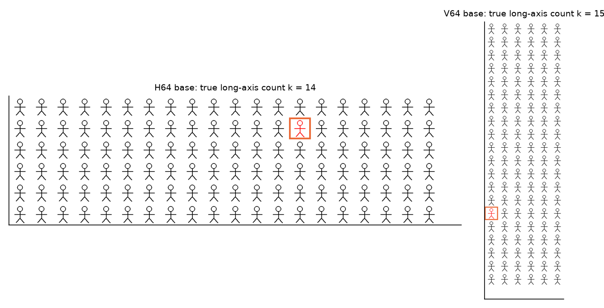
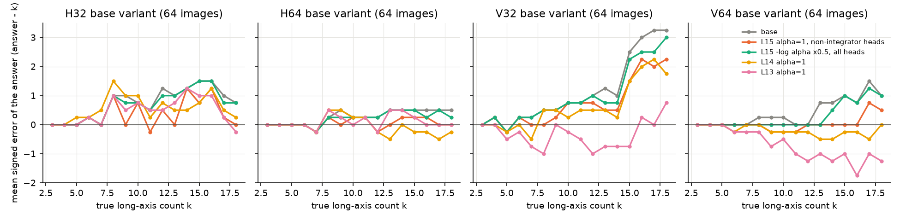
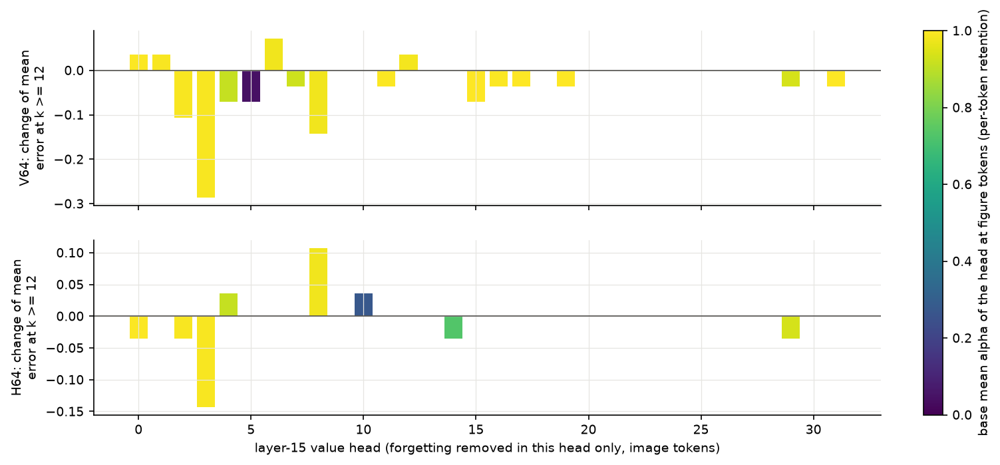
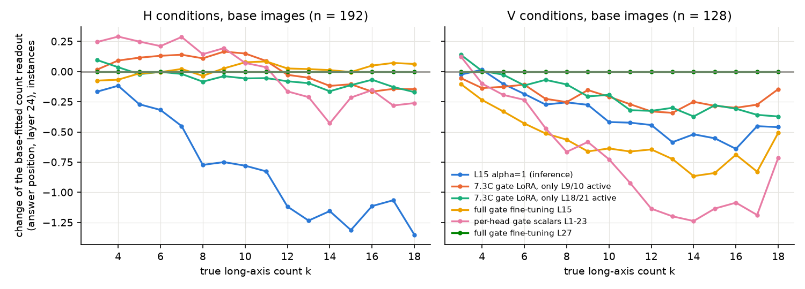
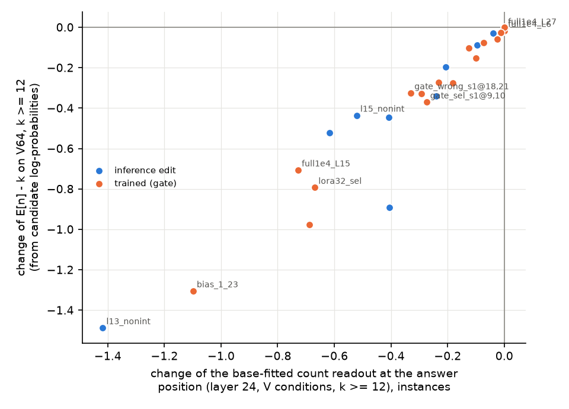
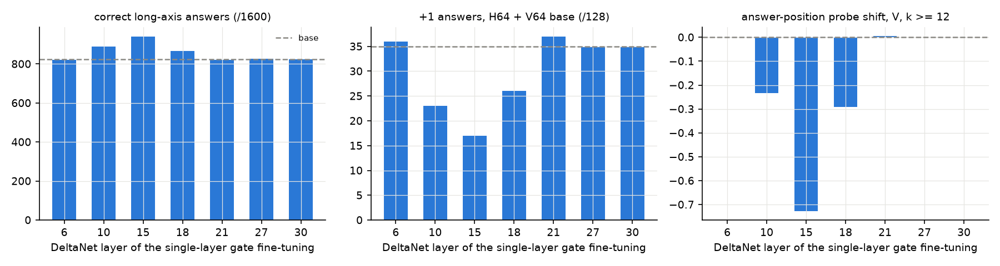
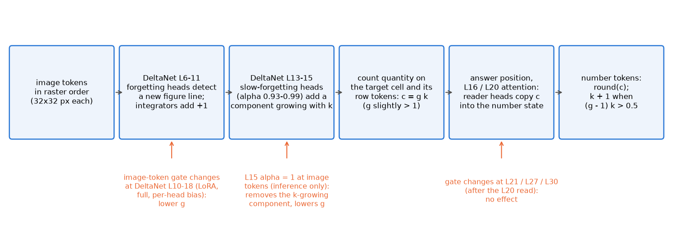

# 计数门控的修改方案与推理时编辑（实验 7.3 第 C 部分第二轮）

实验日期：2026-11-11 至 2026-11-12。本文属于[研究问题 7](plan.md)，是[计数门控的定点微调](results_2026-11-06_counting_gate_finetune.md)（下称 7.3C）的第二轮，依据[行列序号的统一机制](../position/results_2026-10-20_rowcol_mechanism.md)（3.10）与[行列序号的机理](../behavior/results_2026-10-16_ordinal_mechanism.md)（1.5）。主模型为 Qwen3.5-9B，bfloat16，thinking off；Qwen3-VL-8B-Instruct 只用于机理对照，不比较两个模型的能力。第 2 节的预注册在第二轮任何训练开始之前写入。

## 0. 通俗讲述

Qwen3.5 回答“红色目标在第几行、第几列”时，在读图的过程中数出目标之前有几条图形线，序号来自这个计数（1.5、3.10）。图像被切成 32 × 32 pixels 的 token，按从左到右、从上到下的光栅顺序送入解码器。解码器中的 Gated DeltaNet 层像一组带记忆的计数器：每个 head 维护一个记忆矩阵，在每个 token 处先按保留率把旧记忆淡化（遗忘），再按写入强度写入当前 token。在第 6–11 层，一部分遗忘较快的 head 在“又出现一条新的图形线”时发生明显的状态变化，长记忆 head 把这些变化逐条累积下来（实验 3.10、7.3C）。之后各层的 head 继续向图像 token 写入，扫描到目标时，目标单元及其所在行的 token 上已经形成一个随前面图形线条数增长的连续量，本文称为计数量。等模型开始写答案，答案位置上第 16、20 层全注意力层中的读出 head 回头读取目标附近 token 上的计数量，把它搬到答案位置，后续层把它变成数字 token，效果相当于取整。

本文的核心发现是：计数量的增长速度略快于一条线一个单位，多出的部分大约是每条线 4%。前几条线的多余部分不足半个单位，取整后答案仍然正确；数到十几条线时，多余部分累积超过半个单位，答案就变成 $k + 1$。这就是长轴序号中“多数一”的来源。它来自整个计数量的比例略大，个别样本的内部计数并没有读错：原模型中答 $k + 1$ 与答 $k$ 的样本在同一 $k$ 下内部计数几乎相同。计数量是许多层、许多 head 写入之和，其中第 13–15 层有一批遗忘很慢的 head（每个 token 保留 93%–99% 的旧记忆），它们的记忆只覆盖最近约 10–100 个图像 token，输出会随“已经扫描了多远”而系统地变化，从而也随条数增长，是这个和中的一项。

这一机理统一解释了上一轮留下的三个现象。第一，推理时在第 15 层的图像 token 上关闭遗忘，相当于让这些慢遗忘 head 的记忆覆盖整幅图像，它们的输出不再随扫描距离变化，计数量的增长速度随之下降，大计数处的 $+1$ 消失，小计数不变；它的代价同样来自“比例整体下降”：原本数对的少数大计数样本变成 $-1$，空白之后的重新计数变多。图像越短（只有一百多个 token），慢遗忘 head 本来就记得全部内容，关闭遗忘就越没有作用，实测正是如此。第二，7.3C 中放在“错误位置”的门控 LoRA 同样有效，是因为它的第 18、21 层部分仍在计数量被读出之前改变图像 token 上的门控，同样把计数量的比例调小；第 3、5 层的部分在计数开始之前，不起作用。第三，门控修改的位置并非任意：修改发生在第 20 层的读出之后（第 21、27、30 层的单层全量微调，或第 25–31 层的每个 head 偏置），答案完全不变。因此，“哪一层参与数数”与“哪一层可以修正多数一”是两个问题，后者的答案是“计数量形成过程中、第 20 层读出之前的图像 token 门控”。

在此基础上，我们比较了多种只作用于图像 token 的门控修改。单层门控投影的全量微调在第 10、15、18 层有效，第 15 层最好（1600 题正确数由 825 升至 941），在计数最先形成的第 6 层与读出之后的各层无效；只训练每个 head 的三个门控标量（第 1–23 层共 1,728 个参数）就能得到比 26 万参数 LoRA 更大的提升，并同时减少水平方向空白之后的重新计数；纯文本输出在所有只作用于图像 token 的条件下逐字不变，通用基准不变。作为机理对照，没有 DeltaNet 的 Qwen3-VL-8B 在目标 token 上同样形成精确的计数量，错误同样出现在读出时的整体比例上，只是方向为少计。

## 1. 假说与主要结论

| 编号 | 假说 | 结论 |
| --- | --- | --- |
| R1 | 原模型的 $+1$ 来自计数量比例略大于 1，可由读出之前图像 token 上的门控修改校准（H-gain） | 支持（第 4–6 节） |
| R2 | 第 15 层关闭遗忘通过降低计数量的比例起作用 | 支持；它是比例校准，同时引入少量 $-1$ 与更多重新计数（第 4 节） |
| R3 | 错误位置的适配器与预测位置的适配器改变了同一个下游状态 | 支持：竖直修正来自其第 18、21 层部分，答案位置状态变化方向相近（第 5 节） |
| R4 | 读出之后的门控修改无效 | 支持，且上界比预注册更早：第 21、27、30 层全量微调与第 25–31 层偏置均与原模型相同（第 6.1、6.3 节） |
| R5 | 单层全量微调在所有计数层与读出之前的层都有效 | 部分支持：第 10、15、18 层有效，第 6 层无效；单层 LoRA 无效，4 层 LoRA 的效果随秩增大（第 6.1、6.2 节） |
| R6 | 每个 head 的标量偏置足以完成校准 | 支持，且提升大于 LoRA；读出之后的偏置无效（第 6.3 节） |

主要结论：

1. **长轴序号的 $+1$ 是计数量比例的系统偏大（第 3–5 节）。** 答案层面的计数偏差随 $k$ 增长（$\mathbb{E}[n] - k$ 在 $k \ge 12$ 处，H64、V64、V32 为 +0.48 至 +0.81），同一 $k$ 下答对与答错样本的内部计数相同；所有有效的修改都按比例缩小原模型 probe 读出的计数量，读出变化与答案层面偏差的变化在全部条件上近似成正比。
2. **第 15 层图像 token 上关闭遗忘是一个无需训练的比例校准（第 4 节）。** 1.5 序号正确数由 825/1600 升至 918/1600，通用基准、纯文本与合成图坐标不变；它的效果只在图像长度超过慢遗忘 head 的记忆长度时出现，同时增加水平方向的重新计数，并略微增大 RefCOCO 的坐标误差。
3. **门控修改的有效位置是“计数量形成过程中、第 20 层读出之前的图像 token 门控”（第 5、6 节）。** 第 10–18 层有效，第 21 层及以后无效；7.3C 的错误位置适配器靠其第 18、21 层部分起作用。
4. **在只作用于图像 token 的前提下，每个 head 的门控标量偏置是最轻量且最有效的修改方案（第 6.3 节）。** 1,728 个参数把正确数提高到 962–995，并把水平方向的重新计数由 63 降至 19–34；学习率需要控制以避免竖直方向校准过头。

## 2. 预注册

本节在任何第二轮训练开始之前写入，训练之后未改动；第 2.4 节在第二批训练之前补充。推理时编辑（第 4 节）是对 7.3C 逐层扫描中已观察到现象的系统检验，不属于预注册的训练预测。

### 2.1 依据

1. 1.5 的拟合表明，长轴序号的回答可以描述为对一个连续计数量 $\hat c \approx g k$ 取整，其中 $k$ 为真实计数，比例 $g$ 比 1 大 3%–8%；$k$ 较大时 $g k - k$ 越过 0.5，回答变为 $k + 1$。
2. 7.3C 的逐层扫描中，第 13、14、15 层非 integrator head 不遗忘使 V64 的平均误差分别变为 $-0.78$、$-0.25$、$+0.02$（原模型 $+0.45$），且误差的减小随 $k$ 增大（第 15 层：$k \ge 16$ 时由 $+1.17$ 变为 $+0.33$，$k < 8$ 时不变）。这是比例 $g$ 下降的特征，单纯的常数平移不会随 $k$ 增大。
3. 用原模型激活拟合的计数 probe（目标格 tokens，第 16、24 层）作用于 7.3C 的适配器模型，gate_sel 使 V64 中 $k \ge 12$ 的读出比原模型低 0.5 个实例，gate_wrong 在第 24 层低 0.26；7.3C 第 4.3 节对每个模型分别拟合 probe，比例变化被重新拟合吸收，因此没有观察到。

### 2.2 假说

**H-gain：** 图像 tokens 上的计数量由第 6–15 层 DeltaNet 的写入逐步累积，答案位置的读出 head 在第 16–24 层读取目标附近 tokens 上的这一量并取整。原模型的 $+1$ 来自计数量的比例略大于 1。任何在读出发生之前、在图像 tokens 上把计数量的比例降低约 5% 的修改都会消除大 $k$ 处的 $+1$，而对小 $k$ 没有影响；因此有效的位置是“读出之前的图像 tokens 上的门控”，不限于承担计数的层。

### 2.3 预测（训练与编辑共用同一训练数据、同一评测）

1. **位置。** 单层门控全量微调（in_proj_a、in_proj_b 的稠密更新加每个 head 的 dt_bias、A_log、b 偏置，262,240 个参数，只作用于图像 tokens）在第 6、10、15、18、21 层上都把 V64 base 变体的 $+1$ 回答由 17 个降至不超过 7 个，1.5 全部 1600 题的正确数不低于 880；在第 27、30 层（读出之后）上 $+1$ 不少于 12 个、总正确数不高于 850。
2. **表示。** 在预测 1 中有效的条件下，用原模型拟合的 probe 在第 24 层目标格 tokens 上读出的计数在 V64 $k \ge 12$ 处下降至少 0.2；答案位置候选数字的期望值 $\mathbb{E}[n]$ 在 $k \ge 12$ 处下降。第 27、30 层的条件下第 24 层目标格读出不变（构造上如此），答案位置不变。
3. **全量与 LoRA。** 第 6 层的全量微调与同一层的秩 8 LoRA 在 V 方向上的效果相同（差别不超过 seed 间差异）；若全量微调能在水平方向（H64 base）比原模型多答对 5 题以上，说明低秩限制了水平方向的修正，否则水平方向的瓶颈不在门控投影的秩。秩 1、8、32 的 4 层 LoRA 在 V 方向上效果相同。
4. **每个 head 的标量。** 只训练每个 head 的 dt_bias、A_log、b 偏置（第 1–23 层的 18 个 DeltaNet 层，共 1,728 个参数）足以把 V64 base 的 $+1$ 降至不超过 7 个；只训练第 15 层每个 head 的 A_log（32 个参数）至少达到第 15 层非 integrator head 不遗忘编辑的 V64 正确率减 3 题。
5. **通用能力。** 只作用于图像 tokens 的条件下纯文本输出逐字不变；POPE、TextVQA、MMVP、GQA 的变化在 bootstrap 区间内包含 0。

### 2.4 预注册补充（2026-11-12，第二批训练之前写入）

6. 全量微调的学习率 $10^{-5}$ 下，稠密更新的 Frobenius 范数（每层约 0.06）只有 7.3C LoRA 等效更新（每个投影 0.25–0.51）的约八分之一，训练不足；主条件改用学习率 $10^{-4}$，$10^{-5}$ 的两次运行作为学习率对照保留。
7. 每个 head 的标量偏置放在读出之后的第 25–31 层（6 个 DeltaNet 层，576 个参数）时不改变序号回答：1.5 全部正确数与原模型相差不超过 20，V64 base 的 $+1$ 不少于 12 个。
8. 第 1–23 层标量偏置在学习率 $3 \times 10^{-4}$ 下的修正幅度小于学习率 $10^{-3}$，V64 base 的少数一（$-1$）少于后者。

## 3. 模型与度量

### 3.1 Gated DeltaNet 的门控

Qwen3.5-9B 的解码器有 32 层，其中第 4、8、…、32 层为全注意力层，其余 24 层为 Gated DeltaNet 层。第 $l$ 个 DeltaNet 层的第 $h$ 个 value head（每层 32 个）在 token $t$ 处维护记忆矩阵 $S_t \in \mathbb{R}^{128 \times 128}$：

$$
S_t = \alpha_t S_{t-1}\left(I - \beta_t k_t k_t^{\top}\right) + \beta_t v_t k_t^{\top}, \qquad o_t = S_t q_t .
$$

其中 $q_t, k_t \in \mathbb{R}^{128}$ 为经过 L2 归一化的 query 与 key，$v_t \in \mathbb{R}^{128}$ 为 value，三者由 in_proj_qkv 与一个长度为 4 的逐通道因果卷积从当前及前三个 token 的残差算出。第一项先把旧记忆整体乘以衰减系数 $\alpha_t \in (0, 1]$，再在 $k_t$ 方向上擦除比例 $\beta_t$ 的旧内容；第二项把 $v_t$ 以强度 $\beta_t$ 写到 $k_t$ 方向上。输出 $o_t \in \mathbb{R}^{128}$ 经过按 head 的 gated RMSNorm（除以自身的均方根，再乘以 $\operatorname{silu}(z_t)$，$z_t$ 由 in_proj_z 算出），32 个 head 拼接后经 out_proj（$4096 \times 4096$）加回残差流。两个门控由当前 token 的残差 $x_t \in \mathbb{R}^{4096}$ 决定：

$$
\alpha_t = \exp\!\left(-e^{A_h}\,\operatorname{softplus}(a_t + d_h)\right), \quad a_t = (W_a x_t)_h, \qquad
\beta_t = \sigma(b_t), \quad b_t = (W_b x_t)_h ,
$$

其中 $W_a, W_b \in \mathbb{R}^{32 \times 4096}$ 为 in_proj_a 与 in_proj_b，$A_h$（A_log）与 $d_h$（dt_bias）为每个 head 的标量。本文把 $\alpha$ 称为保留率：$\alpha = 1$ 表示不遗忘，$\alpha = 0$ 表示完全清空。若一个 head 在一段 token 上的保留率近似为常数 $\alpha$，$j$ 个 token 之前写入的内容在当前记忆中的权重为 $\alpha^{j}$，权重降到 $1/e$ 所需的 token 数为

$$
\tau = \frac{1}{-\ln \alpha} \approx \frac{1}{1 - \alpha},
$$

本文称 $\tau$ 为该 head 的记忆长度。$\alpha = 0.99$ 时 $\tau \approx 100$ 个 token，$\alpha = 0.93$ 时 $\tau \approx 14$。

### 3.2 门控修改的统一形式

本文所有修改都只改变 in_proj_a 与 in_proj_b 的输出，默认只在图像 token 上生效（文字 token 与生成阶段使用原权重，因此纯文本输出按构造不变）：

$$
\operatorname{softplus}(a'_t + d_h) = e^{\delta A_h}\,\operatorname{softplus}\!\left(a_t + (\Delta W_a x_t)_h + \delta d_h + d_h\right), \qquad
b'_t = b_t + (\Delta W_b x_t)_h + \delta b_h .
$$

这一写法与修改 $W_a, W_b, A_h, d_h$ 并给 $b$ 加偏置完全等价：$\Delta W_a, \Delta W_b \in \mathbb{R}^{32 \times 4096}$ 为稠密更新（全量微调）或秩 $r$ 的更新 $\frac{\alpha_{\mathrm{LoRA}}}{r} B A$（LoRA，本文 $\alpha_{\mathrm{LoRA}}/r = 4$）；$\delta A_h$ 把该 head 的 $-\ln \alpha_t$ 乘以 $e^{\delta A_h}$；$\delta d_h$ 与 $\delta b_h$ 分别平移遗忘与写入门控的输入。推理时编辑只使用固定的 $\delta A_h = \ln(1 - s)$：$-\ln \alpha_t$ 乘以 $1 - s$，记忆长度乘以 $1/(1 - s)$，$s = 1$ 时 $\alpha_t = 1$（不遗忘）。各条件的名称与参数量见第 6 节表格。

### 3.3 输入与计数量的度量

评测图像为 1.5 的槽位网格：长轴 21 个槽位、短轴 6 个，H 条件长轴水平（序号为列号），V 条件长轴竖直（序号为行号），单元 32、64 或 96 pixels，每个条件 64 张 base 图像及 shift、insL、delL、delR 四种变体，共 1600 张；模板 person、ring、square、arrow 均未用于训练。下图为两张 base 图像，橙色方框为目标单元。

1. **答案位置的候选概率。** 对 1.5 的 320 张 base 图像（H32、H64、H96、V32、V64 各 64 张），把模型自己的回答格式写到长轴数字之前（V 为 `{"row": `，H 为 `{"row": r, "column": `，$r$ 取真值），分别计算候选数字 $n \in \{k-2, \dots, k+2\}$ 加上其后一个字符的对数概率，归一化后得到期望 $\mathbb{E}[n]$。$\mathbb{E}[n] - k$ 是模型在答案层面的计数偏差，不依赖任何 probe。
2. **原模型拟合的计数 probe。** 在同一批图像上取两处的残差：目标单元 tokens 的平均（记为目标位置）与长轴数字之前的最后一个 token（记为答案位置），层为 4、8、…、32。在原模型的激活上，以真实计数 $k$ 为目标做 ridge 回归（128 个主成分，$\lambda = 10$，H 与 V 分开，按 base 图像分组 5 折交叉验证），得到读出方向；再把同一个读出方向原样作用于修改后模型的激活。修改后与原模型读出之差衡量计数量本身的变化。7.3C 第 4.3 节对每个模型重新拟合 probe，比例的整体变化会被重新拟合吸收，因此在那里观察不到。
3. **答案位置的状态变化。** 修改后模型与原模型在答案位置残差之差，在 V 条件 $k \ge 12$ 的样本上取平均，得到每层一个 4096 维向量；两个修改条件之间的余弦相似度衡量它们是否改变了同一个下游状态。

## 4. 第 15 层关闭遗忘

### 4.1 假说与推导

7.3C 的逐层扫描发现，在第 15 层非 integrator head 的图像 token 上令 $\alpha = 1$，H64 与 V64 的长轴正确率都由约 0.68 升至 0.88。第 2 节的依据 2 已经说明，这一提升随 $k$ 增大，形态上是比例下降。本节回答两个问题：这一编辑改变了哪个量，以及为什么只有完全关闭遗忘才有明显效果。

第 15 层非 integrator 的 14 个 head 中，有 8 个在图形 token 上的平均保留率为 0.97–0.99（H1、H2、H3、H6、H8、H12、H13、H20），3 个为 0.90–0.95（H4、H7、H29），H14 为 0.67–0.79，H5 与 H10 几乎每个 token 都清空（$\alpha$ 为 0.02–0.32）。按第 3.1 节，前两类 head 的记忆长度为约 10–100 个 token。1.5 的 V64 与 H64 图像都有 504 个图像 token（$42 \times 12$ 或 $12 \times 42$），目标位于第 $k$ 条线时，扫描到目标经过的 token 数随 $k$ 线性增长，并远大于这些 head 的记忆长度。

把第 3.1 节的递推展开（忽略 $\beta_t k_t k_t^{\top}$ 一项的擦除，它只在 key 相近时起作用），head 在目标 token $t$ 处的输出为

$$
o_t = \sum_{j \le t} \Big(\prod_{i=j+1}^{t} \alpha_i\Big)\, \beta_j\, (k_j^{\top} q_t)\, v_j .
$$

这是此前所有 token 的 value 的加权和，权重为“与当前 query 的匹配程度”乘以“从 $j$ 到 $t$ 的累积保留率”。gated RMSNorm 去掉 $o_t$ 的整体尺度，因此 head 写入残差流的方向由各 token 的相对权重决定。保留率小于 1 时，相对权重集中在最近约 $\tau$ 个 token 上，并且图像开始之前的文字 token（系统提示与图像起始标记）的权重以 $\alpha^{n}$ 的速度衰减，$n$ 为已扫描的图像 token 数；因此 head 输出在“图像前文字为主”与“最近图像内容为主”之间随扫描距离平滑过渡，这一过渡本身就是扫描距离（也就是 $k$）的单调函数。令 $\alpha = 1$ 后，图像前文字的权重不再衰减，所有已扫描的图像 token 权重相同，输出变为整段历史的平均，随扫描距离的变化变慢且形状改变。

由此得到三条可检验的预测：(1) 关闭遗忘应降低这些 head 写入目标 token 的、随 $k$ 增长的分量，从而降低计数量的比例；(2) 效果只在记忆长度短于图像扫描长度时出现，把 $-\ln \alpha$ 缩小一半（记忆长度加倍）几乎无效，只有记忆长度接近或超过整幅图像时才有明显效果；(3) 图像越短，效果越小：V32 与 H32 只有 126 个图像 token，与记忆长度约 100 的 head 相当，关闭遗忘应几乎不改变它们的 $+1$。

### 4.2 结果

| 条件 | 编辑的 head 与位置 | 1.5 全部（/1600） | H64 base（/64）：正确、$+1$、$-1$ | V64 base（/64）：正确、$+1$、$-1$ | V32 / H32 base 的 $+1$ | H 空白后重新计数（/384） |
| --- | --- | --- | --- | --- | --- | --- |
| 原模型 | 无 | 825 | 45、18、1 | 43、17、0 | 20 / 25 | 63 |
| $s = 0.25$ | 全部 32 个 head，图像 token | 845 | 46、17、1 | 44、16、0 | 19 / 26 | 65 |
| $s = 0.5$ | 同上 | 859 | 48、15、1 | 48、12、1 | 20 / 26 | 69 |
| $s = 0.75$ | 同上 | 892 | 49、13、2 | 51、11、1 | 21 / 23 | 79 |
| $s = 1$ | 同上 | 922 | 57、5、2 | 55、2、6 | 23 / 22 | 89 |
| $s = 1$ | 14 个非 integrator head，图像 token | 918 | 56、6、2 | 55、4、4 | 21 / 21 | 91 |
| $s = 1$ | 单头扫描前 4 个（H3、H2、H29、H8），图像 token | 900 | 51、12、1 | 57、5、1 | 18 / 25 | 78 |
| $s = 1$ | 前 8 个（再加 H5、H4、H7、H14），图像 token | 927 | 55、7、2 | 56、3、4 | 20 / 23 | 91 |
| $s = 1$ | 14 个非 integrator head，全部 token | 859 | 55、6、3 | 58、1、4 | 22 / 22 | 126 |

表中“重新计数”为 H32、H64、H96 的 insL 与 delL 变体（共 384 张）中回答错误且等于从空白之后数起的值的张数；$+1$ 与 $-1$ 为回答等于 $k+1$ 与 $k-1$ 的张数。所有数值由模型生成的答案计算（direct 问法，greedy）。

图中每条线为一个条件在 base 变体上按真实计数 $k$ 分组的平均有符号误差（回答减 $k$，由模型生成的答案计算），灰线为原模型，橙色为第 15 层非 integrator head 不遗忘，绿色为第 15 层全部 head 的 $-\ln\alpha$ 乘以 0.5，黄色与粉色分别为第 14、13 层非 integrator head 不遗忘；四个面板依次为 H32、H64、V32、V64。

**关闭第 15 层的遗忘整体降低计数量的比例。** 误差随 $k$ 的曲线整体变平：H64 与 V64 在 $k \ge 12$ 处的平均误差由 +0.46 与 +0.82 降至接近 0，$k < 6$ 处不变；答案位置的期望 $\mathbb{E}[n] - k$ 在 $k \ge 12$ 处由 H64 +0.48、V64 +0.69 降至 +0.06 与 +0.25；原模型拟合的 probe 在答案位置第 24 层的读出在 $k \ge 12$ 处下降 1.19（H）与 0.52（V），在 $k < 6$ 处只变化 −0.18 与 −0.04（第 3.3 节度量 1、2）。比例下降同时带来代价：V64 出现 4–6 个 $-1$，H96（$k$ 最大 21）的 $-1$ 由 5 增至 11–12，H 条件空白之后的重新计数由 63 增至 89–91。这说明这一编辑把“偏大”的计数量整体调小，原本已经正确的大计数样本被推过了另一侧的取整边界，空白后部分复位的列计数也因整体变小而更接近“从空白重新数”的值。

**效果只在记忆长度覆盖整幅图像时出现，与推导的预测 (2)、(3) 一致。** 把第 15 层全部 head 的 $-\ln\alpha$ 乘以 0.75、0.5、0.25（记忆长度乘以 1.33、2、4）只把正确数提高到 845、859、892，完全关闭遗忘才达到 922，提升随 $s$ 加速而非线性。对图像只有 126 个 token 的 V32 与 H32，完全关闭遗忘后 $+1$ 仍为 21–23 与 21–22（原模型 20 与 25）：保留率 0.99 的 head 在这些短图像上本来就几乎记得全部内容，关闭遗忘几乎不改变它们的输出。V32 与 H32 的 $+1$ 因此有另外的来源，不受第 15 层遗忘影响（解释为推断）。

**效果分布在少数几个慢遗忘 head 上，几乎完全清空的 head 不起作用。** 逐个 head 关闭遗忘时，最大的单头效应来自 H3（V64 $k \ge 12$ 的平均误差由 +0.82 降至 +0.54，H64 由 +0.46 降至 +0.32），其次为 H8、H2；H5（$\alpha \approx 0.05$）与 H10（$\alpha \approx 0.3$）的单头编辑几乎无效。前 4 个 head 一起关闭遗忘已达到 900/1600，V64 与全部 head 相当（57/64），H64 只恢复一半；前 8 个 head 达到 927/1600，与全部 14 个非 integrator head（918）相当。这些 head 的保留率都在 0.93–0.99，与推导中“记忆长度短于扫描长度、输出随扫描距离变化”的条件一致。

图中每根柱为只在第 15 层的一个 value head 上关闭遗忘（图像 token，$s = 1$）后，H64 或 V64 base 变体中 $k \ge 12$ 样本的平均误差相对原模型的变化（由模型生成的答案计算，每组 28 张），颜色为该 head 在原模型图形 token 上的平均保留率 $\alpha$（由激活计算，viridis，色标见右侧）。

**在水平方向，第 15 层 head 直接写入目标 token 的计数分量可以逐 head 拆开。** 由于 out_proj 是线性的，第 15 层 DeltaNet 写入残差流的向量可以精确拆成 32 个 head 各自的贡献 $W_{\mathrm{out}}^{(h)} \tilde o^{(h)}_t$，其中 $\tilde o^{(h)}_t \in \mathbb{R}^{128}$ 为 gated RMSNorm 之后的 head 输出，$W_{\mathrm{out}}^{(h)} \in \mathbb{R}^{4096 \times 128}$ 为 out_proj 中对应的列块。用原模型第 15 层输出残差拟合的计数读出方向 $w \in \mathbb{R}^{4096}$ 投影，每个 head 对目标位置计数读出的直接贡献为 $c_h = w^{\top} W_{\mathrm{out}}^{(h)} \tilde o^{(h)}_t$。H 条件（192 张 base 图像）中，32 个 head 的直接贡献合计随 $k$ 的斜率为 0.158（每增加一条线读出增加 0.158，占第 15 层输出读出总斜率 0.975 的 16%），其中 H29 一个 head 占 0.073；关闭遗忘后合计斜率变为 −0.009，H29 变为 −0.044，第 15 层输出处的读出斜率由 0.975 降至 0.805。V 条件中第 15 层 head 对目标 token 的直接贡献斜率为 0.285，关闭遗忘后不变（0.283），目标位置读出只整体平移 −0.2 至 −0.3；V 方向的行号信息分布在目标所在 token 行及其后的 token 上（3.10 第 4 节），目标单元 tokens 的平均不是 V 方向计数量的主要载体，因此 V 方向的比例变化只在答案位置（第 24 层 $k \ge 12$ 处 −0.52）上测到。

### 4.3 安全性

| 条件 | POPE | TextVQA | MMVP | GQA | 纯文本（/45，与原模型逐字相同） | 合成图坐标命中（/167） | RefCOCO 命中（/100） | 网格计数（/120） | think 序号（/128） | $6 \times 6$ / $10 \times 10$ / $12 \times 12$ 网格行列（/96 每种） | BabyVision 找不同（/16） |
| --- | --- | --- | --- | --- | --- | --- | --- | --- | --- | --- | --- |
| 原模型 | 0.850 | 0.723 | 0.745 | 0.360 | 43（—） | 87 | 93 | 89 | 79 | 96 / 94 / 95 | 3 |
| 第 15 层非 integrator，图像 token | +0.005 | −0.008 | −0.015 | −0.005 | 43（45） | 87 | 89 | 92 | 89 | 96 / 95 / 94 | 3 |
| 同上，全部 token | +0.040 | +0.010 | −0.040 | −0.040 | 43（45） | — | — | — | — | — | — |

通用基准各 200 题，差值为配对差，图像 token 条件的 bootstrap 95% 区间都包含 0；全部 token 条件下 POPE 与 GQA 的区间端点为 0（[0.00, 0.08] 与 [−0.08, 0.00]）。think 问法为 H64、V64 的 base 与 insL 各 32 张。

**只作用于图像 token 时，第 15 层关闭遗忘不影响通用基准、纯文本与合成图坐标，但略微增大自然图像的坐标误差。** 四个通用基准的差值在 −0.015 至 +0.005，纯文本输出逐字相同；合成图坐标命中前后都是 87/167（配对 8/8）；RefCOCO 命中由 93 降至 89（配对 0/4，$p = 0.125$），点坐标的平均误差增加 15.7 个单位（中位数 6.1，坐标范围 0–1000）。think 问法的序号正确数由 79 升至 89（配对 16/6，$p = 0.052$），与“计数在 prefill 中完成、推理文本复述同一计数”的结论一致（3.10 第 3.5 节）。3.15r2 报告在第 9–15 层同时关闭遗忘会使所有刺激的 y 坐标系统下移；只关闭第 15 层时这一副作用缩小到 RefCOCO 上的少量误差增加。把编辑扩展到全部 token（包括图像之前的文字）反而降低序号总正确数（859），因为 H 条件空白之后的重新计数增至 126，并使 POPE 与 GQA 出现方向相反的边缘变化。

## 5. 错误位置适配器改变了什么

### 5.1 假说

7.3C 中，预注册位置（第 6、7、9、10 层，下称 gate_sel）与逐层扫描效应最小的位置（第 3、5、18、21 层，下称 gate_wrong）上的同参数量门控 LoRA 得到相同的序号提升。按 H-gain，二者都应降低计数量的比例，并最终在答案位置写出同一个状态变化；区别只在于计数量在哪一层开始变小。gate_sel 改的是第 6–10 层，目标位置的读出应从第 8 层起下降；gate_wrong 中第 3、5 层的部分若不影响计数，目标位置的读出应在第 18 层之后才下降。

### 5.2 结果

| 条件 | 目标位置读出变化，V，$k \ge 12$：第 8 / 16 / 20 / 24 层 | 答案位置读出变化，第 24 层，$k \ge 12$：V / H | $\mathbb{E}[n] - k$，$k \ge 12$：V64 / H64 | 1.5 全部（/1600） | V64 base：正确、$+1$ | H64 base：正确、$+1$ |
| --- | --- | --- | --- | --- | --- | --- |
| 原模型 | 0 / 0 / 0 / 0 | 0 / 0 | +0.69 / +0.48 | 825 | 43、17 | 45、18 |
| gate_sel 全部（第 6、7、9、10 层） | −0.41 / −0.35 / −0.40 / −0.31 | — | — | 900 | 57、2 | 44、19 |
| gate_sel 只保留第 6、7 层 | −0.41 / −0.52 / −0.52 / −0.43 | −0.18 / +0.07 | +0.41 / +0.60 | 830 | 51、10 | 41、21 |
| gate_sel 只保留第 9、10 层 | 0.00 / +0.19 / +0.16 / +0.16 | −0.27 / −0.11 | +0.32 / +0.37 | 886 | 53、8 | 50、13 |
| gate_wrong 全部（第 3、5、18、21 层） | −0.06 / −0.14 / −0.50 / −0.37 | — | — | 901 | 56、5 | 50、13 |
| gate_wrong 只保留第 3、5 层 | −0.06 / −0.14 / −0.15 / −0.16 | −0.02 / 0.00 | +0.63 / +0.41 | 855 | 44、16 | 47、16 |
| gate_wrong 只保留第 18、21 层 | 0.00 / 0.00 / −0.36 / −0.22 | −0.33 / −0.12 | +0.37 / +0.46 | 866 | 54、8 | 46、17 |
| 第 18 层单层全量微调 | 0.00 / 0.00 / −0.31 / −0.19 | −0.29 / −0.11 | +0.36 / +0.46 | 868 | 54、8 | 45、18 |

“只保留”指加载 7.3C 训练好的适配器后，只让所列层的 LoRA 更新生效，其余层使用原权重（不重新训练）。读出变化为原模型拟合的 probe 在修改后模型与原模型之间的差（第 3.3 节度量 2，单位为实例），由激活计算。两个完整适配器的答案位置度量在运行时使用了与原模型不同的答案前缀（缺少原模型回答中的代码围栏），不可比较，因此表中留空；目标位置的度量位于答案前缀之前，不受影响。

**错误位置适配器对竖直方向的修正几乎全部来自第 18、21 层，第 3、5 层的部分不起作用。** 只保留第 18、21 层时 V64 由 43 升至 54、$+1$ 由 17 降至 8，目标位置的读出在第 18 层之后（第 20 层）才下降 0.36；只保留第 3、5 层时 V64 不变（44），目标位置读出只有 −0.06 至 −0.16，答案层面的偏差几乎不变（+0.63）。预测位置的适配器中，第 6、7 层与第 9、10 层各自提供一部分修正（V64 51 与 53），合在一起达到 57。第 3、5 层位于计数开始形成（第 6 层）之前，那里的门控改变不改变计数量的比例；第 18 层仍在第 20 层读出之前。第 21 层的单层全量微调无效（第 6.1 节），因此 gate_wrong 的竖直修正实际来自第 18 层。

**同一层上的不同训练方法写出几乎相同的答案位置状态变化，不同层的修改在后几层逐渐汇合。** 只保留 gate_wrong 第 18、21 层的 LoRA 与第 18 层的单层全量微调，在答案位置第 20、24、28、32 层的状态变化余弦相似度为 0.99、0.98、0.99、0.99，行为结果也完全相同（V64 54、$+1$ 8）；只保留 gate_sel 第 9、10 层的 LoRA 与第 10 层单层全量微调为 0.79–0.94。不同层之间的余弦相似度在第 20–24 层只有 0.1–0.5，到第 32 层升至 0.6–0.9（例如第 18 层与第 15 层全量微调由 0.16 升至 0.71，第 15 层关闭遗忘与第 15 层全量微调由 0.46 升至 0.85；余弦相似度为 V 条件 $k \ge 12$ 的 56 张图像上平均状态变化之间的余弦，4096 维中两个随机方向的余弦约为 0）。这说明每一层的门控只能沿该层写入的方向改变计数量，训练（不论 LoRA 还是全量微调）在给定层上找到的是同一个改变；不同层的改变在第 20 层读出时方向不同，在之后的层中被汇合到相近的“数字更小”方向上。错误位置的适配器之所以有效，是因为它的第 18 层部分恰好位于读出之前，训练在那里找到了与“第 18 层单层全量微调”相同的比例校准。

图中每条线为一个条件在 base 图像上按真实计数 $k$ 分组的答案位置读出变化（原模型拟合的第 24 层 probe，修改后减原模型，由激活计算），灰色水平线为原模型（变化为 0）；左图为 H 条件 192 张，右图为 V 条件 128 张。所有有效的修改都使读出随 $k$ 增大而下降，$k$ 很小时接近 0，即按比例缩小计数量；第 27 层全量微调（深绿）与原模型重合。

图中每个点为一个条件（蓝色为推理时编辑，橙色为训练得到的门控修改），横轴为答案位置第 24 层原模型 probe 在 V 条件 $k \ge 12$ 处的读出变化，纵轴为 V64 $k \ge 12$ 处 $\mathbb{E}[n] - k$ 相对原模型的变化（由候选数字的对数概率计算）。29 个条件上两者的 Pearson 相关为 0.96：probe 测得的计数量变化与答案层面的偏差变化近似成正比。

**第 15 层关闭遗忘与训练得到的修改只部分共享答案位置的状态变化。** 第 15 层编辑在 H 方向上的读出下降（−1.19）远大于各训练条件，在 V 方向上中等（−0.52）；它与第 15 层全量微调的状态变化余弦相似度在第 24 层为 0.60、第 32 层为 0.85，与其他层的训练条件为 0.2–0.3（第 24 层）。“缩小计数量”可以由不同的内部改变实现，最终在后几层汇合到一部分共同的方向上（解释为推断）。

### 5.3 对 7.3C 定位结论的修正

7.3C 的逐层门控编辑回答的是“哪一层的门控参与形成计数”，结论（第 6–11 层）仍然成立；但修正 $+1$ 所需要的是改变计数量的比例，而计数量是许多层写入之和，在读出之前改变图像 token 上的门控，就会改变这个和。因此修正位置的精确表述为“计数量形成过程中、第 20 层全注意力读出之前的图像 token 门控”：第 6.1 节的单层全量微调在第 10、15、18 层有效，在第 21、27、30 层无效，第 25–31 层的标量偏置也无效（第 6.3 节）；第 3、5 层（计数形成之前）与第 6 层的单层更新同样无效。

## 6. 训练方案的比较

所有训练沿用 7.3C 的数据与流程：1200 张训练外模板（star、house）的随机 1.5 式槽位网格与 1200 条 TextVQA 短答案，150 步、每步 16 条、AdamW、5% warmup 后余弦衰减、梯度裁剪 1.0、bfloat16 模型加 float32 更新参数；除特别说明外更新只作用于图像 token。每个条件一个 seed（7.3C 中 gate_sel 两个 seed 的 1600 题正确数相差 8，作为 seed 间差异的参考）。每个 head 的标量参数在实现中乘以 50 存储，使它们在同一学习率下移动得足够快。

### 6.1 单层全量微调的位置扫描

| 条件 | 层 | 学习率 | 1.5 全部（/1600） | V64 base：正确、$+1$、$-1$ | H64 base：正确、$+1$、$-1$ | H 空白后重新计数（/384） | 答案位置读出变化，第 24 层，V，$k \ge 12$ |
| --- | --- | --- | --- | --- | --- | --- | --- |
| 原模型 | — | — | 825 | 43、17、0 | 45、18、1 | 63 | 0 |
| 单层全量微调 | 6 | $10^{-4}$ | 822 | 43、16、1 | 43、20、1 | 55 | 0.00 |
| 单层全量微调 | 10 | $10^{-4}$ | 888 | 51、10、2 | 50、13、1 | 49 | −0.23 |
| 单层全量微调 | 15 | $10^{-4}$ | 941 | 57、1、6 | 47、16、1 | 58 | −0.73 |
| 单层全量微调 | 18 | $10^{-4}$ | 868 | 54、8、1 | 45、18、1 | 60 | −0.29 |
| 单层全量微调 | 21 | $10^{-4}$ | 822 | 41、19、0 | 45、18、1 | 62 | +0.01 |
| 单层全量微调 | 27 | $10^{-4}$ | 827 | 43、17、0 | 45、18、1 | 64 | 0.00 |
| 单层全量微调 | 30 | $10^{-4}$ | 824 | 43、17、0 | 45、18、1 | 64 | 0.00 |
| 单层全量微调 | 15 | $10^{-5}$ | 849 | 46、14、0 | 46、17、1 | 64 | −0.12 |
| 单层全量微调 | 27 | $10^{-5}$ | 825 | 44、16、0 | 45、18、1 | 64 | 0.00 |

每个单层条件训练 262,240 个参数（in_proj_a 与 in_proj_b 的稠密更新 $2 \times 32 \times 4096$，加 32 个 head 各 3 个标量）。读出变化的单位为实例（第 3.3 节度量 2）。

图中横轴为单层全量微调（学习率 $10^{-4}$）所在的 DeltaNet 层；左图为 1.5 全部 1600 题的正确数，中图为 H64 与 V64 base 变体中 $+1$ 回答的张数之和，右图为答案位置第 24 层原模型 probe 在 V 条件 $k \ge 12$ 处的读出变化；虚线为原模型（数值均由模型生成的答案或激活计算）。

**单层门控全量微调只在第 10–18 层有效，峰值在第 15 层；第 6 层与第 21 层及以后无效。** 学习率 $10^{-4}$ 下，第 15 层的单层全量微调（262,240 个参数）把 1.5 正确数提高到 941，高于 7.3C 的 4 层 LoRA（900），V64 的 $+1$ 由 17 降至 1；第 10、18 层分别为 888 与 868；第 21、27、30 层与原模型几乎逐题相同（822–827，V64 的 $+1$ 为 17–19）。第 20 层是全注意力层，其读出 head 在答案位置读取目标所在 token 行（3.10 中的 L20 H11、2.7r3 中的第 16、20 层读出 head），第 21 层及以后的 DeltaNet 只能改变已经被读取过的图像 token 状态，因此无效；这是“读出之后无效”的直接证据，也说明有效区间的上界是第 20 层的读出，早于预注册时假设的第 24 层（预注册预测 1 中第 21 层有效的部分不成立）。第 6 层是逐层扫描中计数最脆弱的层，但单层全量微调在这里无效（822），预注册预测 1 中第 6 层有效的部分也不成立：在计数刚开始形成的层，单层门控更新不能学到比例校准（同一层的 LoRA 同样无效，第 6.2 节），而 7.3C 的 4 层 LoRA 中第 6、7 层的部分与其他层一起训练时能提供一部分修正（第 5.2 节），其原因未进一步分析。

**答案位置的读出变化与行为一致，训练得到的门控改变与推理时编辑不同，但在答案位置汇合。** 读出变化在第 15 层为 −0.73，第 10、18 层为 −0.23 与 −0.29，第 6、21、27、30 层为 0。第 15 层全量微调在目标位置第 16 层就使 V 方向的读出下降 1.44，比第 15 层关闭遗忘（−0.18）大得多；被训练层的保留率没有向 1 移动（H8 由 0.98 降至 0.86，H29 由 0.92 降至 0.83，β 也有 ±0.15 的改变），但两者在答案位置第 32 层的状态变化余弦相似度为 0.85。第 15 层全量微调还使合成图坐标命中由 87 升至 99（配对 14/2，$p = 0.004$），RefCOCO 不变（92 对 93）。

**被训练层的门控“起点选择性”没有改变。** 与 7.3C 相同，第 15 层全量微调后各 head 在图形线起点 token 与其余图形 token 上的平均保留率之差前后相同（V64 −0.008 对 −0.008，H64 +0.012 对 +0.013）。全量微调没有让“检测新的一条线”变得更清楚，它改变的是写入计数量的比例，这与 H-gain 的预测一致，也说明 7.3C 中“累加器本身不变”的观察并非 LoRA 低秩的限制。

### 6.2 全量微调与 LoRA、秩与学习率

| 条件 | 训练位置 | 参数量 | 学习率 | 1.5 全部（/1600） | V64 base：正确、$+1$、$-1$ | H64 base：正确、$+1$、$-1$ | H 空白后重新计数（/384） | 短轴正确（/1600） |
| --- | --- | --- | --- | --- | --- | --- | --- | --- |
| 原模型 | — | 0 | — | 825 | 43、17、0 | 45、18、1 | 63 | 1589 |
| 第 6 层秩 8 LoRA | 第 6 层 | 66,048 | $2 \times 10^{-4}$ | 823 | 44、15、1 | 43、20、1 | 60 | 1588 |
| 第 6 层全量微调 | 第 6 层 | 262,240 | $10^{-4}$ | 822 | 43、16、1 | 43、20、1 | 55 | 1587 |
| 4 层秩 1 LoRA | 第 6、7、9、10 层 | 33,024 | $2 \times 10^{-4}$ | 845 | 47、14、1 | 45、18、1 | 61 | 1587 |
| 4 层秩 8 LoRA（7.3C gate_sel） | 同上 | 264,192 | $2 \times 10^{-4}$ | 900 | 57、2、5 | 44、19、1 | 42 | 1572 |
| 4 层秩 32 LoRA | 同上 | 1,056,768 | $2 \times 10^{-4}$ | 937 | 51、3、10 | 47、15、2 | 29 | 1546 |

LoRA 的缩放 $\alpha_{\mathrm{LoRA}}/r$ 在所有秩下固定为 4，因此秩越大，同一学习率下的等效更新越大。

**第 6 层的单层更新无论秩高低都无效，4 层 LoRA 的效果随秩增大。** 第 6 层的秩 8 LoRA（66,048 个参数，学习率 $2 \times 10^{-4}$）不改变序号（823），第 6 层的全量微调同样无效（822），说明第 6 层无效与秩无关。4 层 LoRA 的效果随秩单调增大（秩 1、8、32 为 845、900、937），预注册预测 3 中“秩 1、8、32 效果相同”不成立；秩 32 在竖直方向已经校准过头（V64 的 $-1$ 为 10），并使短轴答案正确数由 1589 降至 1546，说明更大的更新开始牵连不该改变的短轴计数。全量微调与 LoRA 的差别因此不在“是否低秩”，而在更新落在哪一层、幅度多大。学习率 $10^{-5}$ 的全量微调只移动了很小的范数（每个投影约 0.06，7.3C LoRA 的等效更新为 0.25–0.51），在第 15 层只提高到 849，说明全量微调需要与 LoRA 相当的更新幅度才起作用。

### 6.3 每个 head 的标量

| 条件 | 训练参数 | 参数量 | 学习率 | 1.5 全部（/1600） | V64 base：正确、$+1$、$-1$ | H64 base：正确、$+1$、$-1$ | H 空白后重新计数（/384） |
| --- | --- | --- | --- | --- | --- | --- | --- |
| 原模型 | — | 0 | — | 825 | 43、17、0 | 45、18、1 | 63 |
| 第 1–23 层偏置 | 18 个 DeltaNet 层每个 head 的 $\delta d$、$\delta A$、$\delta b$ | 1,728 | $10^{-3}$ | 995 | 45、0、18 | 56、6、2 | 19 |
| 第 1–23 层偏置 | 同上 | 1,728 | $3 \times 10^{-4}$ | 962 | 50、0、14 | 50、13、1 | 34 |
| 第 25–31 层偏置 | 6 个 DeltaNet 层每个 head 的 $\delta d$、$\delta A$、$\delta b$ | 576 | $10^{-3}$ | 831 | 44、16、0 | 45、18、1 | 65 |
| 第 15 层衰减标量 | 第 15 层每个 head 的 $\delta A$ | 32 | $10^{-3}$ | 841 | 45、15、0 | 45、18、1 | 59 |

**只训练门控标量偏置就得到所有只作用于图像 token 的条件中最大的提升，并且同时修正了水平方向的重新计数；同样的偏置放在读出之后无效。** 第 1–23 层的 1,728 个标量在学习率 $10^{-3}$ 下把正确数提高到 995/1600，H64 的 $+1$ 由 18 降至 6，H 条件空白之后的重新计数由 63 降至 19；代价是竖直方向被校准过头，V64 出现 18 个 $-1$，$\mathbb{E}[n] - k$ 由 +0.69 变为 −0.61。学习率 $3 \times 10^{-4}$ 时修正幅度变小（962/1600，V64 的 $-1$ 为 14，重新计数 34），与预注册预测 8 一致。同样的方案放在第 25–31 层（576 个参数）只得到 831/1600，V64 的 $+1$ 仍为 16，与预注册预测 7 一致。学到的标量分布在所有 18 层上（每层 $|\delta d|$、$|\delta A|$、$|\delta b|$ 的平均为 0.3–0.6，最大约 2），没有集中在某一层，与“计数量是许多层写入之和”一致。只训练第 15 层 32 个衰减标量没有学到关闭遗忘（$\delta A$ 最负的是 integrator head H1、H25、H28，约 −1.9，即 $-\ln\alpha$ 乘以 0.15；关键的 H3 几乎不变），正确数只有 841，预注册预测 4 的后半不成立：推理时编辑需要把 $\delta A$ 推到负无穷，而训练信号来自少数难例，梯度不足以把衰减标量推到这一极端。

### 6.4 通用能力

| 条件 | POPE | TextVQA | MMVP | GQA | 纯文本（/45，逐字相同） | 合成图坐标（/167） | RefCOCO（/100） | 网格计数（/120） | think 序号（/128） | BabyVision 找不同（/16） |
| --- | --- | --- | --- | --- | --- | --- | --- | --- | --- | --- |
| 原模型 | 0.850 | 0.723 | 0.745 | 0.360 | 43（—） | 87 | 93 | 89 | 79 | 3 |
| 第 15 层关闭遗忘（推理时） | +0.005 | −0.008 | −0.015 | −0.005 | 43（45） | 87 | 89 | 92 | 89 | 3 |
| 第 15 层全量微调 | −0.005 | −0.008 | −0.015 | 0.000 | 43（45） | 99 | 92 | 93 | 83 | — |
| 第 1–23 层偏置 | +0.030 | 0.000 | −0.015 | −0.020 | 43（45） | 89 | 91 | 87 | 87 | 3 |

差值为配对差（各 200 题），区间见第 8 节产物；所有 bootstrap 95% 区间都包含 0（第 1–23 层偏置的 POPE 区间为 [0.00, 0.06]）。

**所有只作用于图像 token 的门控修改都保持纯文本逐字不变，通用基准与坐标没有显著变化。** 合成图坐标与 RefCOCO 的配对差异均不显著（第 1–23 层偏置：12/10 与 0/2）。BabyVision 找不同在所有条件下都是 3/16，16 题无法判断迁移。

## 7. Qwen3-VL-8B 的对照

Qwen3-VL-8B 的解码器全部为全注意力层，没有 DeltaNet 的门控，因此本节只回答一个机理问题：在没有门控递推的模型中，长轴序号的错误出现在哪里。所用图像、问题与度量与 Qwen3.5 相同（1.5 全部 1600 张 direct；第 3.3 节的目标位置与答案位置 probe，层为 4、8、…、36；Qwen3-VL 的回答不带代码围栏，答案前缀相应去掉围栏）。按 Round 6 规则，本节不比较两个模型的正确率。

| 模型 | V64 base 按 $k$ 的平均有符号误差：$k = 6$–$11$ / $k \ge 12$ | 目标位置 probe 的交叉验证 $R^2$（各层） | 答案位置 probe 的 $R^2$：第 8 / 12 / 16 / 20 层 | 同一 $k$ 下 probe 残差与回答误差的相关（$k \ge 8$；目标位置各层 / 答案位置第 16 层及之后） |
| --- | --- | --- | --- | --- |
| Qwen3.5-9B | +0.13 / +0.82 | 0.92–0.98 | 0.10 / 0.85 / 0.98 / 0.99 | −0.03–+0.18 / +0.01–+0.15 |
| Qwen3-VL-8B | −1.1 / −3.1 | 0.95–0.99 | −0.01 / 0.28 / 0.81 / 0.97 | −0.17–−0.03 / +0.07–+0.23 |

表中误差由模型生成的答案计算，$R^2$ 与相关由激活上交叉验证的 ridge probe 计算（每个模型各自拟合）。

**Qwen3-VL 的目标 token 上同样形成精确的连续计数量，单个样本的内部计数同样没有读错，错误来自读出时的整体比例偏离；偏离方向与 Qwen3.5 相反，为随 $k$ 增大的少计。** Qwen3-VL 目标单元 tokens 上的计数从第 4 层起就可以线性读出（$R^2 \ge 0.95$），答案位置在第 16–20 层读入计数量，与 Qwen3.5 的读出层位相近；同一 $k$ 下，probe 残差与模型回答误差的相关不超过 0.23，即答错的样本在内部计数上与答对的样本几乎没有区别。两者的回答误差都随 $k$ 系统增长，Qwen3.5 为 $+1$ 方向（比例略大于 1），Qwen3-VL 为少计方向（V64 中 $k \ge 12$ 时平均少计 3.1，$+1$ 回答在每个条件中只有 2–6 张）。因此“目标处的计数量准确、读出时比例失准”这一结构不依赖 DeltaNet；DeltaNet 门控在 Qwen3.5 中的作用是为这个比例提供了一个可以低成本调节的位置（第 4、6 节），Qwen3-VL 中比例失准的来源需要在注意力读出中另行定位（未做）。

## 8. 讨论

1. **可解释性结论与优化结果的对应。** 7.3C 的定位分析（第 6–11 层门控参与计数）与“错误位置同样有效”的矛盾，来自把“哪一层参与形成计数”与“哪一层可以校准计数量的比例”当成了同一个问题。本轮先在原模型上建立比例模型（第 2 节依据 1–3），据此预测有效位置为“读出之前的图像 token 门控”、无效位置为读出之后的层；训练结果支持这一预测的主体（读出之后的第 21、27、30 层与第 25–31 层偏置无效，第 10–18 层有效，第 18 层的单层全量微调与错误位置适配器的第 18、21 层部分得到相同的竖直结果），并把读出边界精确到第 20 层。仍未对应的部分是：第 6 层的单层更新（全量与 LoRA）以及第 15 层的衰减标量都没有起作用，前者说明在计数刚开始的层，单层更新不能学到比例校准，后者说明梯度训练不会自发找到“完全关闭遗忘”这一极端解。
2. **参数问题与架构问题。** 竖直方向的 $+1$ 是计数量比例的参数问题（高确定性）：1,728 个门控标量、单层全量微调或一次推理时编辑都能消除它，且不改变累加器的结构。水平方向空白之后的重新计数也能被门控标量显著减少（63 降至 19），说明它同样主要是参数问题（中等确定性）；7.3C 中只有全 DeltaNet LoRA 能改善它，本轮表明这不需要改变 qkv 与输出投影。
3. **与其他实验的一致与冲突。** 与 3.10 一致：$+1$ 不能从单个样本的图像 token 状态中预测（本轮同一 $k$ 下答 $k+1$ 与答 $k$ 的样本，原模型 probe 读出之差为 −0.06–+0.18），因为偏差来自整个计数量的比例。与 1.5 一致：比例高估 3%–8% 的拟合得到了内部度量的支持（答案位置 $\mathbb{E}[n] - k$ 在 $k \ge 12$ 处 +0.48 至 +0.81）。与 3.15r2 一致并细化：在第 9–15 层同时关闭遗忘会移动所有刺激的坐标，只关闭第 15 层时坐标副作用缩小为 RefCOCO 上的少量误差增加，说明慢遗忘 head 对计数量比例与坐标读出都有贡献，第 15 层的贡献以计数为主（解释为推断）。7.4 计划在门控第 6、7、9、10 层上训练 BabyVision 行列数据；本轮结果提示，第 1–19 层的门控标量可能是更轻量的选择，且训练位置不应晚于第 20 层的读出。

## 9. 限制

1. 每个训练条件只有一个 seed；单层全量微调的层间差别（例如第 15 层 941 对第 18 层 868）大于 7.3C 的 seed 间差异（8），但相邻层的细小差别不可靠。
2. 训练信号来自少数难例（原模型在训练数据上的序号损失已很低），标量偏置在学习率 $10^{-3}$ 下校准过头，最佳学习率与早停尚未系统选择。
3. 第 4.1 节的推导忽略了 delta rule 的擦除项与 gated RMSNorm 中 $z$ 门的作用，“输出随扫描距离变化”的机制只在水平方向得到逐 head 的直接贡献验证，竖直方向只有答案位置的间接证据。
4. 原模型拟合的 probe 只能测量计数量的相对变化，不能单独给出原模型计数量的绝对比例；绝对比例由答案位置的候选概率给出。
5. BabyVision 找不同只有 16 题，网格计数与小网格行列接近天花板，对迁移的检验力有限。

## 10. 过程叙述

图为示意图（非数据），蓝框为模型从输入到输出的计算步骤，橙色文字为本文各种修改作用的位置与结果。

以一张 21 行 × 6 列、单元 64 pixels 的竖直网格为例（第 3.3 节输入示例中的右图），问题是“红色目标在第几行、第几列”，真实行号为 15。

1. **切分与排列。** ViT 把图像切成 32 × 32 pixels 的 token，每行 12 个、共 42 行，按光栅顺序排在问题文字之前送入解码器。每一条图形线（网格的一行）占 2 个 token 行、24 个 token。
2. **检测新的一条线（第 6–11 层）。** 在每个 DeltaNet 层中，每个 head 的记忆在每个 token 处先按保留率 $\alpha_t$ 淡化，再按写入强度 $\beta_t$ 写入当前 token。遗忘较快的 head 在一条新的图形线开始时状态发生明显变化，长记忆 head 把这些变化逐条累积（3.10、7.3C）。这一步决定计数在哪里加一。
3. **形成计数量（第 6–15 层，写入目标所在 token 行）。** 扫描到第 15 条线时，目标单元及其所在 token 行的残差流中已累积了来自许多 head 的写入，它们之和是一个随前面图形线条数增长的连续量。其中第 13–15 层保留率 0.93–0.99 的 head 记忆只覆盖最近约 10–100 个 token，它们的输出在“图像前文字为主”到“最近图像内容为主”之间随扫描距离过渡，因此也随条数增长，构成计数量的一部分。所有写入之和的增长速度比每条线一个单位略快，第 15 条线处约多出 0.7 个单位（答案位置 $\mathbb{E}[n] - k$ 在 $k \ge 12$ 处 +0.69）。
4. **读出（答案位置，第 16、20 层全注意力）。** 模型写到 `{"row": ` 时，答案位置上第 16、20 层的读出 head 读取目标所在 token 行上的计数量，把它写入答案位置的残差流；后续层把这一连续量转成数字 token，效果相当于取整。
5. **输出。** 多出的 0.7 个单位越过半个单位，取整后写出 16，即 $k + 1$。若目标在第 4 条线，多出的部分只有约 0.15，答案仍为 4。
6. **修改如何改变这一流程。** 在第 15 层的图像 token 上关闭遗忘后，第 3 步中慢遗忘 head 的记忆覆盖整幅图像，输出不再随扫描距离过渡，计数量的增长速度下降，第 15 条线处多出的部分降到 0.25 左右，取整后答对；但对原本已经接近正确的样本，计数量可能被调到 $k - 0.5$ 以下，变成 $k - 1$。门控 LoRA、单层全量微调或门控标量偏置在第 10–18 层改变图像 token 上的门控，同样在第 3 步缩小计数量；它们在不同的层开始起作用，却在第 4 步把答案位置推向相近的方向。若修改发生在第 20 层的读出之后（第 21、27、30 层），读出已经完成，答案不变。

## 11. 运行规模

全部 GPU 工作在一张经 claim 工具申请的空闲 A800 上顺序完成，约 7 GPU 小时：推理时编辑与逐 head 扫描约 2.5 小时（每个编辑条件 6–8 分钟，含 1600 题序号、答案位置度量），16 次训练各约 6 分钟训练加 7 分钟评测，安全性评测（通用基准、坐标、think、BabyVision）每个条件约 15–25 分钟，Qwen3-VL 约 9 分钟。生成使用左填充批量 greedy 解码（batch size 16，与 7.3C 相同；原模型 1600 题的结果与 7.3C 的逐题结果完全一致，825/1600）。一次在 GPU 6 上启动的运行因其他用户的进程先于本实验的模型进程出现而被立即停止并释放，所报告的结果都来自之后的运行。

## 12. 实验产物

以下路径均相对于 `$WORK_DIR/analysis/application/2026-11-11_counting_gate_r2/`（7.3C 的产物相对于 `$WORK_DIR/analysis/application/2026-11-06_counting_gate_finetune/`）。入口脚本为 `scripts/analysis/application/counting_gate_r2.sh`，代码为 `analysis_tools/application/counting_gate_r2.py`（门控修改 GateMod 与规格解析）、`counting_gate_r2_run.py`（各阶段）、`counting_gate_r2_analysis.py`（分析与图），测试为 `tests/analysis/application/test_counting_gate_r2.py`。

| 内容 | 路径 | 生成方式 |
| --- | --- | --- |
| 全部条件的汇总数值（第 4–6 节表格、配对检验、读出变化、$\mathbb{E}[n]$、余弦相似度） | `results.json`（键 `conditions`、`headsweep`、`delta_cos`） | STAGES=analysis |
| 逐题序号回答（第 4、5、6 节） | `eval/<条件>/ord.jsonl`；gate_sel、gate_wrong 的序号来自 7.3C 的 `eval/<条件>/ord.jsonl` | STAGES=eval，SETS=ord |
| 答案位置候选概率与 probe 特征（第 3.3 节度量 1–3） | `eval/<条件>/ansprobe.json`、`ansprobe.npz` | SETS=ansprobe |
| 第 15 层逐 head 关闭遗忘（第 4.2 节，图 l15_heads） | `headsweep/L15.jsonl`；原模型保留率取自 7.3C `eval/base/gatestat.json` | STAGES=headsweep |
| 第 15 层逐 head 直接贡献（第 4.2 节） | `eval/base/headout_L15.npz`、`eval/l15_nonint/headout_L15.npz`、`eval/out_proj_L15.npy` | SETS=headout |
| 门控统计（第 6.1 节起点选择性） | `eval/<条件>/gatestat.json` | SETS=gatestat |
| 安全性（第 4.3、6.4 节） | `eval/<条件>/general.jsonl`、`text.jsonl`、`coord.jsonl`、`count.jsonl`、`think.jsonl`、`g8.jsonl`、`gmulti.jsonl`、`babyvision.jsonl`；原模型取自 7.3C `eval/base/` | SETS=think,count,coord,general,gmulti,babyvision |
| Qwen3-VL 对照（第 7 节） | `eval/vl_base/ord.jsonl`、`probe.npz`、`ansprobe.*` | MODEL=Qwen3-VL-8B-Instruct NAME=vl_base |
| 训练日志与参数量 | `adapters/<条件>_log.jsonl` | STAGES=train |
| 保留的 checkpoint | `adapters/full1e4_L15.pt`（第 6.1 节最佳单层全量微调）、`adapters/bias_1_23.pt` 与 `adapters/bias_1_23_lr3e-4.pt`（第 6.3 节门控标量） | STAGES=train |
| 运行记录（含每次启动前后的 GPU 进程检查） | `experiment.json`、`run_<条件>_<阶段>.log` | — |
| 图 | 仓库 `docs/analysis/application/figures/counting_gate_r2/` | STAGES=analysis 与 `counting_gate_r2_analysis.py` 中的 fig_* 函数 |
