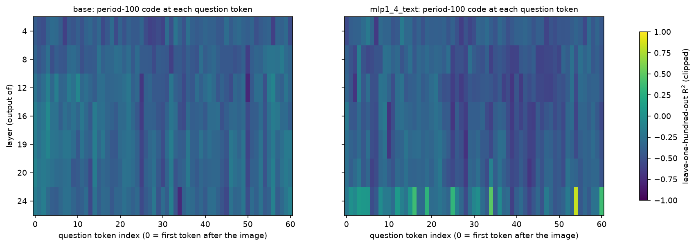
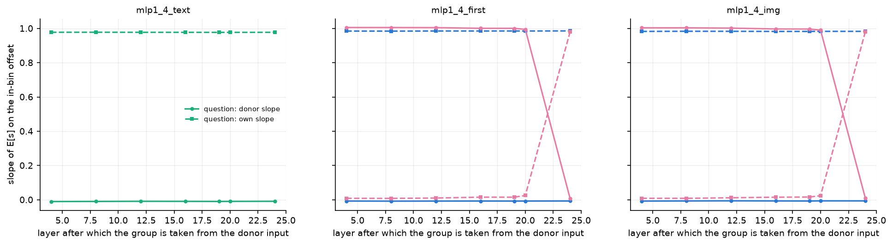
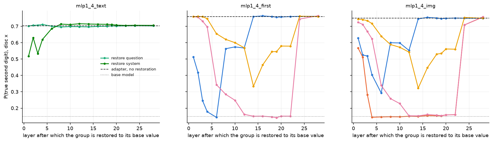
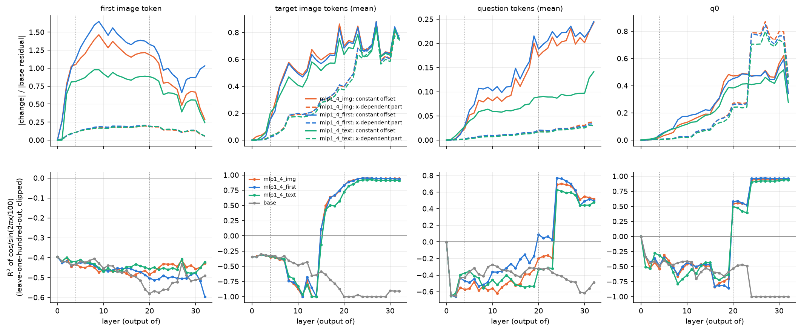
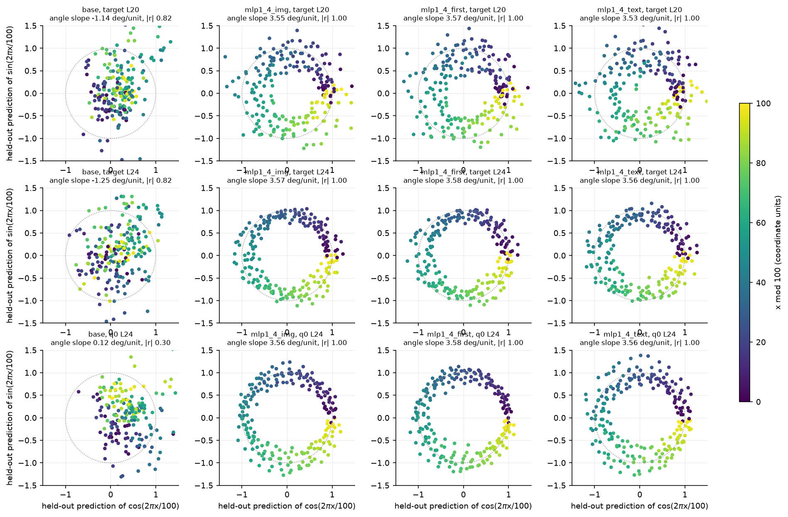
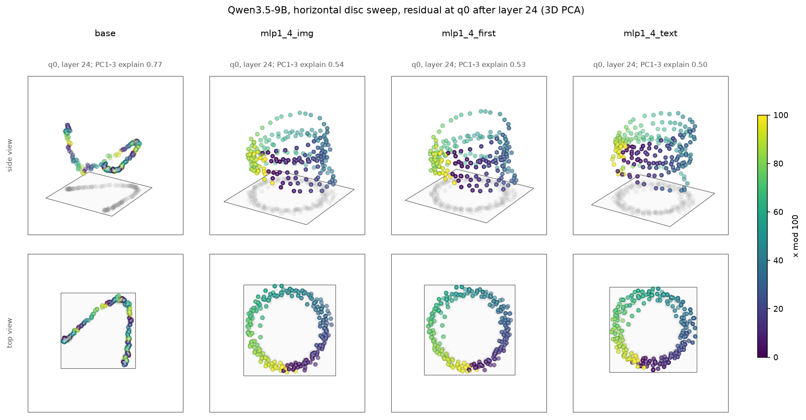
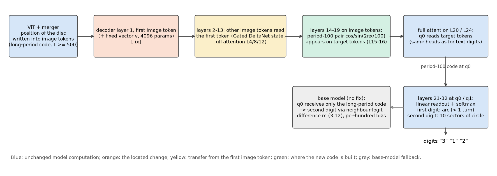

# 定点坐标微调的机理复核（实验 7.2 第二轮）

实验日期：2026-11-11 至 2026-11-12。本文属于[研究问题 7](plan.md)，复核[实验 7.2 第一轮](results_2026-11-05_located_finetune.md)（以下简称“第一轮”）的两项未解释结果，并检验[实验 3.16 第二轮](../position/results_2026-11-11_readout_prior_r2.md)在训练前预注册的精确定位。模型为 Qwen3.5-9B（bfloat16、SDPA，thinking off，direct-answer 提示），训练与评测协议沿用 3.13 与第一轮。

## 通俗讲述

第一轮发现，只在“文本 token”上训练第 1–4 层 MLP 的适配器也能修好坐标的第二位数字，并把原因归结为问题文本。本文表明这一归因有误。第一轮的“文本 token”掩码包含图像之前的 4 个模板 token（`<|im_start|>`、`user`、换行与 `<|vision_start|>`），而第一轮用来区分来源的“问题文本”拼接实际上也包含这 4 个 token。把更新精确地限制在不同的文本 token 上之后，结果很清楚：只保留图像之前这 4 个 token 上的更新，第二位真值概率为 0.66，与完整适配器（0.70）相当；只保留真正的问题文本或答案模板上的更新，结果与原模型相同（0.14）。把问题 token 的状态在任何一层换成原模型的状态或另一张图的状态，第二位数字都不变。问题 token 从未成为坐标的来源。

因此，三种有效的适配器在机理上是同一件事。修改图像之前的模板 token、修改第一个图像 token、修改全部图像 token，作用都落在图像片段的开头。图像片段的开头是 Gated DeltaNet 递推的起点，其后的每个图像 token 都在这个起点写入的状态上继续递推，并在 full attention 中读取它。开头处的一个与坐标无关的改变，使原模型第 5–19 层在每个图像 token 上执行不同的计算：目标 token 在第 15–16 层出现周期为 100 的坐标分量 $\cos(2\pi x/100)$、$\sin(2\pi x/100)$，第 20 与第 24 层的读取把它带到答案前的 token $q_0$，读出阶段原样把它写成十位数字。训练前后的表示对比直接显示了这一过程：在 $q_0$ 第 24 层的三维主成分空间中，原模型的点沿一条平滑曲线按坐标排列；三种适配器下，点排成一个随百位逐层上升的螺旋，俯视为一个圆环，环上的角度就是坐标的后两位。第二轮之前观察到的“时钟”就是这个圆环，它与周期 100 的正余弦特征是同一个对象。

按 3.16 第二轮的预注册，本文训练了两个更精确的条件：一个只含 4096 个参数的向量，加在第一个图像 token 的第 1 层输出上；以及只在第一个图像 token 上更新的第 1 层 MLP。只训练这一个向量就足以修复坐标数字：画布 x 误差由 51.5 降到 3.8，第二位增益 0.98，20×20 网格误差由 179.9 降到 9.5，而可训练参数只有 4096 个，是第一轮主方案的 0.26%。按预注册设置（学习率 $10^{-3}$）训练时向量没有长到所需的大小（范数 2.3，原模型上的逐层干预表明需要约 9.5），修复不完全；预注册的失败判据被触发后，本文在保持位置不变的前提下先登记补充条件、再把学习率提高到 $10^{-2}$，向量范数达到 10.0，全部数值预测成立。只在第一个图像 token 上训练第 1 层 MLP 的条件同样成立（画布 x 误差 3.8）。两者的行列序号作答都仍然变差（22/72 与 15/72，原模型 48/72），说明“只改图像片段开头”并不能避免坐标训练对行列作答的影响；变差的答案以偏差 1–3 的近似错误为主，没有坐标前缀答案。

这一入口的代价是对提示布局敏感。把问题放到图像之前时，图像片段开头的上下文改变，只修改模板 token 的适配器在 20×20 网格上的误差由 10.9 升到 148.1，只修改第一个图像 token 的适配器由 7.6 升到 57.2；修改全部图像 token 的适配器只由 5.7 升到 12.4。换一种英文措辞或改用中文指令则对所有适配器都没有影响。

## 1. 问题与主要结论

本文研究两个问题：只更新问题 token 为什么也有效、会带来什么副作用；表示变化发生在哪些层、如何可视化，以及它与“时钟”和周期 100 编码的关系。结论如下。

1. **“只更新问题 token 有效”是掩码定义造成的误读；有效的是图像之前的 4 个模板 token（第 3.1 节，表 1）。** mlp1_4_text 的更新只保留在图像前模板 token 上时 $P_1 = 0.66$、增益 0.98；只保留在问题 token 或答案模板 token 上时 $P_1 = 0.14$、增益 0.34–0.35，与原模型相同。问题 token 的状态恢复为原模型值或替换为供体图像的值，在第 1–28 层的任何一层都不改变第二位（$P_1$ 0.70–0.71；对供体偏移的斜率 −0.01）。确定性：高。
2. **三种入口共享同一机理：图像片段开头的一个与坐标无关的改变（第 3.2–3.3 节，图 1–3）。** 第一个图像 token 的状态换成另一张图的值不影响第二位（对自身偏移的斜率 0.98–0.99，对供体 −0.01）；其余图像 token 换成供体值时，第二位在第 4–20 层完全跟随供体（斜率 0.99–1.01），在第 24 层之后不再受影响。第一个 token 的修改在第 7–13 层被其余图像 token 读取：在第 6 层恢复它即完全消除效果（$P_1$ 0.14），在第 8–12 层恢复保留 0.56–0.57，第 14 层以后恢复无影响。确定性：高。
3. **表示变化按层分为三个阶段（第 4.1 节，图 4）。** 第 1–4 层：第一个图像 token 上出现与坐标无关的大幅偏移（mlp1_4_first 第 4 层为该 token 范数的 1.13 倍，随坐标变化的部分只有 0.11 倍）；第 5–14 层：偏移传到其余图像 token，目标 token 的改变以常量为主，周期 100 编码仍为负；第 15–24 层：目标 token 的周期 100 编码出现并增强（$R^2_{100}$ 第 15 层 0.10–0.12，第 16 层 0.42–0.50，第 20 层 0.72–0.83，第 24 层 0.92–0.95），$q_0$ 在第 20 层跃升（0.49–0.58）、第 24 层达到 0.90–0.96。确定性：高。
4. **训练后出现的“时钟”就是周期 100 编码张成的平面（第 4.2 节，图 5–6）。** 用留一百位交叉拟合的 $\cos/\sin(2\pi x/100)$ 读出把每个输入投到二维平面上，三种适配器下目标 token 第 20 层与 $q_0$ 第 24 层的角度随坐标每单位转 3.53–3.58°（理想值 3.6°），与坐标的线性相关 $|r| = 1.00$；原模型为 −1.25 至 0.12°，$|r| \le 0.82$。$q_0$ 第 24 层的前两个主成分直接呈现这个圆环。确定性：高。
5. **预注册的精确定位成立：第一个图像 token 第 1 层输出上的单个向量（4096 个参数）足以修复第二位数字（第 6 节，表 5）。** vec_first_L1_lr1e2 的画布 x / y 误差 3.8 / 3.5，增益 0.98 / 0.98，$P_1$ 0.67 / 0.74，20×20 网格误差 9.5；目标 token 的 $R^2_{100}$ 第 16 层 0.34、第 20 层 0.75、第 24 层 0.93，与预测一致。按预注册学习率 $10^{-3}$ 训练的 vec_first_L1 欠拟合（向量范数 2.3，增益 0.87，触发失败判据），这是训练设置而非位置的问题。mlp1_first（第 1 层 MLP、第一个图像 token，39.3 万参数）画布 x 误差 3.8、增益 0.99，也在预测范围内。确定性：高（合成图像）；RefCOCO 误差 57.1，高于原模型的 47.3，自然图像未改善。
6. **副作用：依赖图像片段开头的入口对提示布局敏感（第 5 节，表 4）。** 问题放在图像之前时，20×20 网格误差：mlp1_4_text 10.9 → 148.1，mlp1_4_first 7.6 → 57.2，mlp1_4_img 5.7 → 12.4（原模型 179.9 → 171.0）。英文改写与中文指令对所有条件影响不超过 7 个单位。确定性：中（每种变体 203 题）。

## 2. 方法

### 2.1 位置受限的更新与分析掩码

第一轮的位置受限 LoRA 为 $y_i = W x_i + \mu_i \frac{\alpha}{r} B A x_i$，$\mu_i \in \{0, 1\}$ 为第 $i$ 个 token 的掩码（定义见第一轮第 2.1 节）。本文在评测时改变 $\mu$，把训练好的更新限制在更细的 token 组上。一个输入的 token 依次为：

1. **图像前模板 token**（4 个）：`<|im_start|>`、`user`、换行、`<|vision_start|>`。Qwen3.5 在 thinking off 且无 system 提示时，用户消息由这几个 token 开头，图像紧随其后。
2. **第一个图像 token** 与 **其余图像 token**（共 256 个，16×16 网格）。
3. **问题 token**：图像之后到用户消息结束之前的提示文本（约 63 个）。
4. **答案模板 token**：用户消息结束符、助手消息头与答案前缀（含 $q_0$ 与 $q_1$）。

第一轮 mlp1_4_text 的训练掩码为“全部非图像 token”，即第 1、3、4 组的并集；第一轮第 4.2 节的“问题文本”拼接使用 3.13 的 question 掩码，它等于“答案前缀之前的全部非图像 token”，即第 1 组与第 3 组以及部分第 4 组，并不只含问题文本。

### 2.2 恢复与供体替换

两种干预都作用于某一 token 组在第 $\ell$ 层输出的 residual，其余计算不变，首位强制为真值，在水平与竖直扫描（各 108 张）上读出第二位。

1. **恢复**：在加载了适配器的运行中，把该组 token 第 $\ell$ 层输出的 residual 替换为原模型对同一输入在同一位置的 residual。若替换后效果消失，说明适配器的作用在第 $\ell$ 层之后仍需经由这组 token 传递；若不变，说明作用已经离开这组 token。对 $\ell \le 4$，适配器在后续层仍会作用于该组 token，结果需相应解读。
2. **供体替换**：把该组 token 第 $\ell$ 层输出的 residual 替换为同一适配器在另一张图上的值，供体与本图首位相同、组内偏移相差约 5 个十位；回归 $\mathbb{E}[s] = a + b_{\text{own}}\, o_{\text{own}} + b_{\text{donor}}\, o_{\text{donor}}$。若这组 token 携带坐标值并被读取，第二位跟随供体（$b_{\text{donor}} \approx 1$）；若它只携带与坐标无关的信号，第二位跟随本图（$b_{\text{own}} \approx 1$）。

### 2.3 表示检验：周期 100 编码的岭回归

对某一位置（目标 token 平均、$q_0$ 等）与层，$N$ 个输入的 residual 组成 $X \in \mathbb{R}^{N \times 4096}$，目标为 $Y = [\cos(2\pi x_i/100), \sin(2\pi x_i/100)]_{i=1}^{N}$。

1. 交叉验证的折为整百：$\lfloor x/100 \rfloor$ 相同的输入构成一折，依次留出一折。
2. 在训练折上把 $X$ 中心化（减去训练折均值 $\mu$），并除以训练折的均方根行范数 $c = \sqrt{\frac{1}{N_{\text{tr}}}\sum_i \lVert x_i - \mu\rVert^2}$，得到 $Z = (X_{\text{tr}} - \mu)/c$。
3. 以罚项 $\alpha = 0.1$ 求 ridge 回归。由于 $N \ll 4096$，使用核形式：$A = (ZZ^\top + \alpha I)^{-1}(Y_{\text{tr}} - \bar{Y}_{\text{tr}})$，读出矩阵为 $W = Z^\top A \in \mathbb{R}^{4096 \times 2}$，留出输入的预测为 $\hat{Y}_{\text{te}} = \frac{X_{\text{te}} - \mu}{c} W + \bar{Y}_{\text{tr}}$。
4. 合并全部留出折，计算两列合并的决定系数

$$
R^2_{100} = 1 - \frac{\sum_i \lVert \hat{Y}_i - Y_i \rVert^2}{\sum_i \lVert Y_i - \bar{Y} \rVert^2} .
$$

$R^2_{100} > 0$ 表示存在一组线性读出，在没见过的百位上也能给出正确的相位，这正是十位数字读出所需的性质（3.16 第二轮第 2 节）。

**时钟平面。** 第 3 步的 $W$ 的两列张成 residual 空间中的一个二维平面，留出预测 $\hat{Y}_i = (\hat{p}_{i,1}, \hat{p}_{i,2})$ 就是输入 $i$ 在这个平面上的位置。若表示含有半径为 $r$ 的圆 $r[\cos(2\pi x/100)\, a + \sin(2\pi x/100)\, b]$，$\hat{Y}_i$ 落在单位圆附近，角度 $\theta_i = \operatorname{atan2}(\hat{p}_{i,2}, \hat{p}_{i,1})$ 随 $x$ 每单位转 3.6°；$\operatorname{atan2}(p_2, p_1)$ 返回点 $(p_1, p_2)$ 相对第一坐标轴的方向角。本文报告展开后的 $\theta$ 对 $x$ 的斜率与线性相关。所有投影都用交叉拟合的读出计算：$N \ll 4096$ 时，在样本内拟合的平面能把任何目标拟合成圆，不能说明表示中存在圆。

**主成分可视化。** 对水平扫描 215 张图在某一位置与层的 residual 做中心化后的主成分分析，取前三个主成分作三维散点（侧视与俯视），颜色为 $x \bmod 100$ 或 $x$。主成分分析不使用坐标标签，若圆环出现在前几个主成分中，说明周期 100 编码是该位置方差最大的结构之一。

**改变的分解。** 在同一输入上，适配器运行与原模型运行在某一位置与层的 residual 之差 $\Delta_i$ 分解为常量部分 $\bar{\Delta} = \frac{1}{N}\sum_i \Delta_i$ 与随输入变化的部分 $\Delta_i - \bar{\Delta}$，分别以 $\lVert \bar{\Delta} \rVert$ 与 $\sqrt{\frac{1}{N}\sum_i \lVert \Delta_i - \bar{\Delta} \rVert^2}$ 除以原模型该位置的平均范数报告。

## 3. 只更新文本 token 为什么有效

### 3.1 有效的是图像之前的模板 token

**表 1：mlp1_4_text 的更新限制在不同 token 组上（水平扫描，首位强制）。**

| 保留更新的 token | 增益 | $P_1$ |
| --- | --- | --- |
| 全部非图像 token（训练时的掩码） | 0.98 | 0.70 |
| 只图像前模板 token（4 个） | 0.98 | 0.66 |
| 只问题 token | 0.34 | 0.14 |
| 只答案模板 token（含 $q_0$、$q_1$） | 0.35 | 0.14 |
| 原模型 | 0.34 | 0.15 |

**mlp1_4_text 的效果几乎全部来自图像之前的 4 个模板 token。** 这 4 个 token 位于图像之前，与第一个图像 token 一样处在图像片段的开头：在因果模型中，它们的状态被此后每一个图像 token 读取，而它们本身看不到图像。按层分解，这个适配器同样以第 1 层为主（只保留第 1 层 $P_1 = 0.51$，第 2 层或第 4 层 0.16），与 mlp1_4_img、mlp1_4_first 的分解一致（3.16 第二轮表 3）。

**问题 token 既不携带坐标，也不传递适配器的作用。** 问题 token 的状态在第 1–28 层任一层恢复为原模型值，$P_1$ 保持 0.70–0.71；替换为供体图像的问题 token 状态，第二位跟随本图（$b_{\text{own}} = 0.98$，$b_{\text{donor}} = -0.01$）。问题 token 上的周期 100 编码在第 4–20 层为负（最大 −0.12），只在第 24 层出现（0.82，图 3），这是第 24 层读取图像之后的结果，不在因果链上。$q_0$ 在第 20 层给问题 token 的 attention 也由 0.058 降到 0.021，给目标 token 的由 0.16 升到 0.32。

*图 3：每个问题 token 在各层的 $R^2_{100}$（留一百位交叉验证，截断到 $[-1, 1]$，由模型激活计算）。左：原模型；右：mlp1_4_text。横轴为问题 token 序号（0 为图像之后的第一个 token），纵轴为层。*

第一轮第 4.2 节把效果归于问题文本，是因为其“问题文本”拼接掩码包含图像前模板 token（第 2.1 节）；第一轮据此提出的“问题 token 成为第 20 层读取的新数值来源”的解释不成立，相应修改见第一轮文末的修改记录。可解释性结论“坐标读出只与图像 token 的表示有关”因此保留，并精确为：适配器的作用入口在图像片段的开头（图像前模板 token 或第一个图像 token），坐标值本身始终由图像 token 携带并在第 20–24 层被读取。

### 3.2 第一个图像 token 的修改与坐标无关

*图 1：供体替换后 $\mathbb{E}[s]$ 对供体偏移（实线）与自身偏移（虚线）的回归斜率，横轴为替换所在层（第 2.2 节，由模型前向计算，水平扫描 108 张）。绿：问题 token；蓝：第一个图像 token；粉：其余图像 token。*

1. **第一个图像 token 的修改不携带坐标值。** 在 mlp1_4_first 与 mlp1_4_img 中把第一个图像 token 换成供体图像的状态，任何一层都是 $b_{\text{own}} = 0.98$–$0.99$、$b_{\text{donor}} = -0.01$。由于 ViT 内部是双向 attention，第一个图像 token 本身带有圆的位置（单调编码的留一百位 $R^2 = 0.99$），但这部分信息不被使用；适配器对它的改变以常量为主（第 4.1 节）。
2. **坐标值由其余图像 token 携带，并在第 24 层之前被读完。** 其余图像 token 换成供体值时，第 4–20 层替换都使第二位完全跟随供体（$b_{\text{donor}}$ 0.99–1.01，81–83% 的 arg max 等于供体十位），第 24 层输出处替换则不再有影响（$b_{\text{own}} = 0.98$）。
3. **决定第二位的读取在 full attention 第 24 层完成。** 把其余图像 token 在第 22 层恢复为原模型值仍完全消除效果（$P_1$ 0.15），在第 24 层恢复则无影响（0.74）。第 20 层读取已把周期编码带入 $q_0$（$R^2_{100}$ 0.54），但第 24 层的读取会再次从图像 token 取值；若此时图像 token 仍是原模型的编码，修复失效。训练后 $q_0$ 在第 24 层给目标 token 的 attention 为 0.53–0.55（原模型 0.24）。

### 3.3 第一个图像 token 的修改在第 7–13 层被读取

*图 2：把某组 token 第 $\ell$ 层输出的 residual 恢复为原模型值后的 $P_1$（水平扫描，第 2.2 节，由模型前向计算）。黑色虚线为不恢复的适配器，灰色点线为原模型。*

**表 2：恢复实验（$P_1$，水平扫描）。**

| 适配器与恢复的组 | 第 1 层 | 第 4 层 | 第 6 层 | 第 8 层 | 第 12 层 | 第 14 层 | 第 20 层 | 第 24 层 |
| --- | --- | --- | --- | --- | --- | --- | --- | --- |
| mlp1_4_first：第一个图像 token | 0.51 | 0.18 | 0.14 | 0.56 | 0.57 | 0.76 | 0.76 | 0.76 |
| mlp1_4_first：其余图像 token | 0.76 | 0.70 | 0.34 | 0.28 | 0.16 | 0.15 | 0.15 | 0.74 |
| mlp1_4_img：全部图像 token | 0.57 | 0.14 | 0.15 | 0.15 | 0.15 | 0.15 | 0.16 | 0.71 |
| mlp1_4_img：目标 token | 0.74 | 0.72 | 0.64 | 0.59 | 0.54 | 0.32 | 0.56 | 0.75 |
| mlp1_4_text：图像前模板 token | 0.52 | 0.62 | 0.69 | 0.71 | 0.72 | 0.71 | 0.71 | 0.71 |
| mlp1_4_text：问题 token | 0.70 | 0.71 | 0.70 | 0.70 | 0.70 | 0.70 | 0.70 | 0.70 |

1. **第一个图像 token 的修改在第 7–13 层传递给其余图像 token。** 在第 6 层输出处恢复第一个 token，效果完全消失（0.14）；第 8–12 层恢复只剩部分效果（0.56–0.57）；第 14 层以后恢复无影响。反过来，其余图像 token 在第 4 层以前恢复几乎没有影响（此时它们尚未读取第一个 token 的改变），第 6–12 层恢复逐渐消除效果，第 14–22 层恢复完全消除。第 7–13 层包含 full attention 第 8、12 层与 Gated DeltaNet 第 7、9–11、13 层，两类 token mixer 都可能承担读取；本文没有进一步区分。
2. **周期编码分布在全部图像 token 上，不只在目标 token 上。** 只恢复目标 token 时 $P_1$ 最低降到 0.32（第 14 层），说明目标 token 的编码有一部分可以由邻近的图像 token 在后续层中重建。
3. **图像前模板 token 的作用在第 1–4 层就已传出。** 第 1 层恢复为 0.52，第 6 层以后恢复无影响；这些 token 在图像之前，它们的改变在第 1–4 层被第一个图像 token 读取（mlp1_4_text 下第一个图像 token 第 2 层的常量偏移为其范数的 0.64 倍，第 4.1 节）。

## 4. 表示变化的层级与可视化

### 4.1 三个阶段

*图 4：上行：适配器运行与原模型运行之差的常量部分（实线）与随输入变化的部分（虚线），以原模型该位置平均范数为单位（第 2.3 节）；下行：留一百位交叉验证的 $R^2_{100}$（截断到 $-1$）。四列依次为第一个图像 token、目标 token 平均、问题 token 平均、$q_0$。橙：mlp1_4_img；蓝：mlp1_4_first；绿：mlp1_4_text；灰：原模型。点线标出第 4 与第 20 层。由模型激活计算，水平扫描 215 张。*

**表 3：逐层的表示变化（mlp1_4_first；常量 / 随输入变化，以原模型范数为单位；$R^2_{100}$）。**

| 层 | 第一个图像 token | 目标 token | 目标 token $R^2_{100}$ | $q_0$ | $q_0$ $R^2_{100}$ |
| --- | --- | --- | --- | --- | --- |
| 2 | 0.75 / 0.06 | 0.01 / 0.00 | — | 0.00 / 0.00 | — |
| 4 | 1.13 / 0.11 | 0.15 / 0.02 | −0.34 | 0.04 / 0.01 | −0.49 |
| 8 | 1.60 / 0.18 | 0.57 / 0.18 | −0.74 | 0.15 / 0.02 | −0.63 |
| 12 | 1.56 / 0.19 | 0.51 / 0.20 | −0.68 | 0.19 / 0.06 | −0.50 |
| 15 | — | — | 0.12 | — | −0.46 |
| 16 | 1.33 / 0.19 | 0.59 / 0.30 | 0.42 | 0.27 / 0.13 | −0.83 |
| 20 | 1.33 / 0.19 | 0.68 / 0.40 | 0.83 | 0.45 / 0.26 | 0.58 |
| 24 | 1.00 / 0.15 | 0.67 / 0.65 | 0.95 | 0.47 / 0.78 | 0.96 |

1. **第 1–4 层：第一个图像 token 上的常量偏移。** 第 4 层的改变为该 token 范数的 1.13 倍，随输入变化的部分只有 0.11 倍。这是一个几乎与图像无关的大幅改变，与 3.16 第二轮“一个固定向量即足够”一致。
2. **第 5–14 层：偏移传到其余图像 token，但还不是坐标编码。** 目标 token 的改变在第 8 层达到其范数的 0.57 倍，仍以常量为主（随输入变化 0.18），$R^2_{100}$ 为负，甚至比原模型更负（第 14 层 −1.04 至 −1.17）。
3. **第 15–24 层：周期 100 编码形成并被读取。** 目标 token 的 $R^2_{100}$ 在第 14 与第 15 层之间由负转正，第 20 层 0.83；随输入变化的改变在第 16–24 层由 0.30 增至 0.65，即改变从“同一个偏移”变成“随坐标不同的编码”。$q_0$ 的跃升发生在第 20 层（读取层），第 24 层再次增强；问题 token 平均在第 24 层也出现周期编码（0.63–0.77），这是第 24 层读取图像后的副产物。三种适配器的曲线在第 15 层以后几乎重合（图 4），说明它们在第 15–24 层启用的是同一套计算。

### 4.2 时钟形状与周期 100 编码

*图 5：留一百位交叉拟合的 $\cos/\sin(2\pi x/100)$ 读出对每个输入的预测（第 2.3 节“时钟平面”），颜色为 $x \bmod 100$（viridis），灰色点线为单位圆。行：目标 token 第 20 层、目标 token 第 24 层、$q_0$ 第 24 层；列：原模型、mlp1_4_img、mlp1_4_first、mlp1_4_text。标题给出展开角度对 $x$ 的斜率与线性相关。由模型激活计算，水平扫描 215 张。*

*图 6：$q_0$ 第 24 层 residual 的三维主成分（上行侧视，下行俯视，灰色为投到底面的影子），颜色为 $x \bmod 100$（viridis）。四列依次为原模型与三种适配器，副标题给出前三个主成分解释的方差比例。由模型激活计算，主成分分析不使用坐标标签。目标 token 第 20、24 层与按 $x$ 着色的版本见“实验产物”。*

1. **时钟平面就是周期 100 编码。** 三种适配器下，目标 token 第 20 层的角度斜率为 3.53–3.57°/单位，第 24 层 3.56–3.58°/单位，$q_0$ 第 24 层 3.56–3.58°/单位，$|r|$ 均为 1.00；点的半径变异系数在第 24 层为 0.12–0.17。原模型的斜率为 −1.25 至 0.12°/单位，半径变异系数 0.59–0.77，点没有排成圆。$x$ 每增加 100，角度转 356–358°，正是十位数字循环一次所需的一圈。
2. **圆环是表示中方差最大的结构之一。** 原模型 $q_0$ 第 24 层的前三个主成分（解释 0.77 的方差）把输入排成一条按坐标单调的曲线；三种适配器下前两个主成分（各解释 0.21–0.24）构成一个圆环，颜色沿圆周按 $x \bmod 100$ 循环，侧视为随百位上升的螺旋，第三个主成分（0.06–0.08）大致对应百位，即长周期编码保留在第三个方向上。第二轮之前（3.13 第二轮）在全部线性层 LoRA 上观察到的时钟，与这里三个只改动图像片段开头的适配器呈现的是同一几何。
3. **圆环与十位数字的关系。** 圆上的角度 $\theta = 2\pi x/100$ 对应 3.16 第二轮第 2.3 节的读出：十个数字把圆周分成十个 36° 扇区，扇区编号就是十位数字。

## 5. 副作用：提示布局与措辞

协议：在 3.13 测试集的水平扫描（113 题）、20×20 网格（40 题）与图表界面（50 题）上，以四种提示生成坐标：原提示；英文改写（“Where is its center? Answer in the form ...”）；中文指令；原提示但把问题放在图像之前（用户消息中文本在前、图像在后）。greedy 解码，批量生成。

**表 4：提示变体下的平均中心误差（0–1000 单位）。**

| 条件 | 原提示：扫描 / 网格 / 图表 | 英文改写 | 中文指令 | 问题在图像之前 |
| --- | --- | --- | --- | --- |
| 原模型 | 51.5 / 179.9 / 59.0 | 62.5 / 241.0 / 53.3 | 53.3 / 214.4 / 61.4 | 94.7 / 171.0 / 72.7 |
| mlp1_4_img | 4.1 / 5.7 / 21.5 | 4.5 / 6.1 / 13.7 | 4.1 / 5.6 / 12.1 | 8.8 / 12.4 / 25.7 |
| mlp1_4_first | 2.8 / 7.6 / 10.1 | 3.1 / 7.5 / 16.3 | 2.7 / 7.2 / 10.3 | 6.9 / 57.2 / 38.9 |
| mlp1_4_text | 3.4 / 10.9 / 9.7 | 3.6 / 11.6 / 14.3 | 3.4 / 11.6 / 8.9 | 17.9 / 148.1 / 35.2 |
| vec_first_L1_lr1e2 | 3.8 / 9.5 / 9.2 | 3.8 / 9.6 / 14.7 | 4.1 / 9.0 / 18.1 | 9.7 / 108.0 / 26.7 |
| mlp1_first | 3.8 / 8.3 / 16.8 | 3.7 / 8.1 / 14.6 | 3.7 / 7.7 / 26.4 | 4.7 / 118.5 / 47.9 |

1. **措辞不影响三种适配器。** 英文改写与中文指令下误差变化不超过 7 个单位，这与第 3 节一致：问题 token 不在因果链上。
2. **问题放在图像之前时，依赖图像片段开头的入口变差。** 这一布局下，图像之前的上下文由 4 个模板 token 变为“模板 token + 问题文本”，第一个图像 token 的输入也随之改变。只修改模板 token 的适配器在网格上几乎失效（148.1），只修改第一个图像 token 的适配器也明显变差（57.2）；修改全部图像 token 的适配器较稳（12.4）。原模型自身在这一布局下也变差（扫描 51.5 → 94.7）。这说明以图像片段开头为入口的修复依赖训练时的提示布局；部署时若存在多种布局，需要在训练数据中混入这些布局。

## 6. 预注册的精确定位

### 6.1 预注册与补充登记

3.16 第二轮第 5 节在原模型上定位到第一个图像 token 的第 1 层输出，并在训练前写定预注册（UTC 2026-11-12 04:46:24）：

1. **vec_first_L1**：只学习一个向量 $v \in \mathbb{R}^{4096}$，加在第一个图像 token 第 1 层输出的 residual 上，即 $h_{s}^{(1)} \leftarrow h_{s}^{(1)} + v$（$s$ 为第一个图像 token 的位置），用 Adam（学习率 $10^{-3}$，$v$ 从 0 开始）按 7.2 的数据与步数训练（3200 条，200 步，每步 16 条，余弦退火）。
2. **mlp1_first**：第 1 层 MLP 的 gate/up/down，秩 8，只作用于第一个图像 token（39.3 万参数），学习率 $10^{-4}$。

vec_first_L1 训练后触发了失败判据（画布 x 增益 0.87 < 0.9）。训练日志显示向量范数只有 2.27，而原模型上有效的逐层干预向量范数为 9.5；带余弦退火的 Adam 在学习率 $10^{-3}$ 下每步每个分量至多移动约 $10^{-3}$，200 步内范数上限约为 $10^{-3} \times \sqrt{4096} \times 100 \approx 6$。据此在训练第三个条件之前追加登记（UTC 时间见预注册文件的 Addendum）：

3. **vec_first_L1_lr1e2**：与 vec_first_L1 相同，学习率改为 $10^{-2}$，预测不变。

### 6.2 结果

**表 5：预注册条件的实测（画布与网格为 0–1000 单位的平均误差；增益与 $P_1$ 首位强制）。**

| 条件 | 参数量 | 画布 x / y 误差 | 增益 x / y | $P_1$ x / y | 20×20 网格误差 | 图表界面误差 | RefCOCO 误差 | 行列序号 |
| --- | --- | --- | --- | --- | --- | --- | --- | --- |
| 原模型 | 0 | 51.5 / 44.4 | 0.34 / — | 0.15 / 0.13 | 179.9 | 61.4 | 47.3 | 48/72 |
| mlp1_4_first（第一轮） | 1.57 M | 2.8 / 2.8 | 0.99 / — | 0.76 / — | 7.6 | 8.9 | 41.5 | 16/72 |
| vec_first_L1（学习率 $10^{-3}$） | 4,096 | 12.7 / 14.8 | 0.87 / 0.91 | 0.26 / 0.38 | 191.1 | 42.2 | 65.6 | 50/72 |
| vec_first_L1_lr1e2 | 4,096 | 3.8 / 3.5 | 0.98 / 0.98 | 0.67 / 0.74 | 9.5 | 9.2 | 57.1 | 22/72 |
| mlp1_first | 393 k | 3.8 / 3.4 | 0.99 / 0.98 | 0.69 / 0.74 | 8.3 | 16.8 | 56.6 | 15/72 |

**表 6：预测与实测。**

| 预测 | vec_first_L1_lr1e2 | mlp1_first |
| --- | --- | --- |
| 画布 x 误差 ≤ 6（mlp1_first：与 2.8 相差 ≤ 1.5） | 3.8，成立 | 3.8，成立 |
| 两轴增益 ≥ 0.95（mlp1_first ≥ 0.97），$P_1$ ≥ 0.65 | 0.98 / 0.98，0.67 / 0.74，成立 | 0.99 / 0.98，成立 |
| 行列序号 ≥ 16/72 且无坐标前缀答案 | 22/72，坐标前缀 0/144，成立 | — |
| 目标 token $R^2_{100}$ 第 20 层 ≥ 0.5，$q_0$ 第 24 层 ≥ 0.8 | 0.75，0.92，成立 | 0.77，0.96，成立 |

1. **一个 4096 维向量即可修复合成图像上的坐标数字。** vec_first_L1_lr1e2 的向量范数为 10.0，与原模型上逐层干预找到的向量（9.5）相当；它在画布、20×20 网格与图表界面上的误差都与 157 万参数的第一轮主方案处于同一水平。表示变化的层级与第 4.1 节相同：目标 token 的 $R^2_{100}$ 在第 16 层为 0.34、第 20 层 0.75、第 24 层 0.93。这一结果把 3.16 第一轮“修复只需作用于第 1–4 层的图像 token”精确为“第一个图像 token、第 1 层输出、一个与输入无关的向量”。
2. **自然图像没有改善。** RefCOCO 误差 56.6–57.1，高于原模型的 47.3（第一轮各条件为 34–42）。单个向量与只改第一个 token 的适配器在 3200 条混合数据上训练，主要拟合了合成图像；它们只改变转换计算是否被启用，不改变目标定位本身。
3. **行列序号作答仍然变差，但损伤的类型改变了。** 原模型 48/72；vec_first_L1_lr1e2 为 22/72，mlp1_first 为 15/72，错误以偏差 1–3 的近似错误为主（分别为 54 与 58 个答案），没有一个答案是坐标的前两位数字（第一轮 mlp1_4_img 有 27/144）。欠拟合的 vec_first_L1 保留了行列能力（50/72）。这说明行列能力的损伤与周期 100 编码的强度同步出现：坐标转换计算一旦启用，原模型由计数得到的序号也受到影响，即使图像 token 上的坐标值没有被行列答案直接取用。第一轮的混合数据方案（mlp1_4_img_fix，44/72）是目前唯一同时保留两种能力的方案。
4. **提示布局的副作用同样存在**（表 4）：问题放在图像之前时，vec_first_L1_lr1e2 与 mlp1_first 的 20×20 网格误差为 108.0 与 118.5。

## 7. 讨论

**与第一轮结论的关系。** 第一轮“层级定位与表示变化预测成立”的结论保留；“token 层面的三条预测均不成立”需要重新表述：只训练文本 token 有效的原因是掩码包含图像前模板 token，它与第一个图像 token 同属图像片段开头，因此第一轮关于“问题 token 成为新的数值来源”的解释应删除，3.16 第一轮“修复只需作用于图像 token”的推断精确化为“作用入口在图像片段开头，坐标值由图像 token 携带”。

**与 3.16 第二轮的关系。** 本文的恢复与供体替换给出 3.16 第二轮第 5.3 节逐层最小干预的机理：第一个 token 上的改变需要在第 7–13 层被其余图像 token 读取，在第 14 层以后加入就来不及传递；这解释了单个向量的效果随层数单调减弱。

**与其他实验的关系。** 2.7 第三轮发现图像片段开头的实体在 decoder 中有系统性的“起点效应”，且用同质图像预填充 DeltaNet 状态不能消除它；本文表明同一个结构位置也是坐标编码转换的开关。两者的共同点是：图像片段开头在 Gated DeltaNet 递推中承担初始化角色（写入强度 $\beta$ 0.6–0.8，3.16 第一轮）。

## 8. 机理流程

*图 8：坐标数字读出的机理示意图（3.16 第二轮图 8，不含数据）。*

1. ViT 把圆的位置写进全部图像 token，包括第一个图像 token；位置以长周期编码存在。
2. 适配器（或单个学习向量）在图像片段的开头写入一个与坐标无关的改变：mlp1_4_text 写在图像前的 4 个模板 token 上，再由第一个图像 token 在第 1–4 层读取；mlp1_4_first 与 vec_first_L1 直接写在第一个图像 token 上。
3. 第 7–13 层，其余图像 token 经 Gated DeltaNet 的递推状态与 full attention 读取这个改变；此时它们的改变仍以常量为主。
4. 第 15–19 层，原模型的计算在每个图像 token 上把长周期编码转换出周期 100 分量，目标 token 的 $R^2_{100}$ 在第 16 层超过 0.4、第 20 层超过 0.7。
5. 第 20 与第 24 层，$q_0$ 用 attention 从目标 token 读取编码；第 24 层的读取决定最终结果（第 22 层恢复图像 token 即失效，第 24 层恢复无影响）。读取后的 $q_0$ 状态在主成分空间中排成圆环，角度为 $2\pi x/100$。
6. 第 21–32 层不变，把圆上的角度切成十个扇区写出十位数字。问题 token 在整个过程中不承担坐标的传递。

## 9. 限制

1. **只测了合成单目标画布。** 自然图像上三种适配器都没有出现周期 100 编码（第一轮第 4.3 节）。
2. **恢复实验在第 1–4 层的解读受适配器后续层作用的影响**（第 2.2 节）。
3. **第 7–13 层的读取由 full attention 还是 Gated DeltaNet 承担没有区分。**
4. **提示变体只覆盖三族 203 题**，问题在图像之前的布局未出现在训练数据中。

## 实验产物

路径相对于 `$WORK_DIR`（另注 `DATA_DIR` 者除外）。程序为 `analysis_tools/application/located_r2_run.py`、`located_r2_analysis.py`（residual 采集与逐层分解在 `analysis_tools/position/readout_prior_r2_run.py`），入口为 `scripts/analysis/application/located_r2.sh` 与 `scripts/analysis/position/readout_prior_r2.sh`，测试为 `tests/analysis/application/test_located_r2.py`。运行目录记为 `R = analysis/application/2026-11-11_located_finetune_r2`，3.16 第二轮运行目录记为 `P = analysis/position/2026-11-11_readout_prior_r2`。

| 内容 | 路径 | 阶段 |
| --- | --- | --- |
| 表 1（文本 token 子集） | `P/layers/layers.jsonl`（`mlp1_4_text` 的 `tokens_*` 与 `layers_*`），汇总于 `P/summary.json` 的 `adapter_layers` | 3.16 第二轮 layers |
| 表 2、图 2（恢复） | `R/restore/restore.jsonl`，汇总于 `R/summary.json` 的 `restore` | restore |
| 图 1、第 3.2 节（供体替换） | `R/qswap/qswap.jsonl`，汇总于 `R/summary.json` 的 `qswap` | qswap |
| 第 3.1 节 attention | `R/summary.json` 的 `attention`（由 3.16 第二轮 capture 计算） | 3.16 第二轮 capture |
| 图 3（问题 token 的周期编码） | `R/summary.json` 的 `qtok`；图 `figures/located_finetune_r2/question_tokens.png` | analysis（qtok） |
| 表 3、图 4（逐层改变） | `R/summary.json` 的 `change`；residual 为 `DATA_DIR` 下 `scratch/analysis/position/2026-11-11_readout_prior_r2/capture/<条件>.npz` | 3.16 第二轮 capture；analysis（change） |
| 图 5（时钟平面） | `R/summary.json` 的 `clock_plane` | analysis（clock） |
| 图 6 与其余主成分图 | `figures/located_finetune_r2/manifold_{target_L20,target_L24,q0_L24}_{mod100,x}.png`，方差比例在 `R/summary.json` 的 `manifold_pc_variance` | analysis（manifold） |
| 表 4（提示变体） | `R/eval/<条件>/prompts.jsonl`，原提示取第一轮 `analysis/application/2026-11-05_located_finetune/eval/<条件>/coord.jsonl`；汇总于 `R/summary.json` 的 `prompts` | prompts |
| 预注册（含 Addendum）与 sha256 | `R/preregistration_r2.md`、`R/preregistration_r2.sha256` | 训练前 |
| 表 5、表 6（预注册条件） | 适配器 `R/adapters/{vec_first_L1,vec_first_L1_lr1e2,mlp1_first}.pt` 与 `_log.jsonl`；评测 `R/eval/<条件>/{digits,coord,ordinal,prompts}.jsonl`；向量条件的 residual `R/eval/<条件>/resid.npz`；mlp1_first 的 residual 为 `DATA_DIR` 下 3.16 第二轮 capture 目录的 `mlp1_first.npz`；汇总于 `R/summary.json` 的 `confirm` | vtrain、veval、train、digits、coord、ordinal、prompts |
| 运行记录 | `R/experiment.json`、`R/stage_seconds.jsonl`、`R/run.log` | 全部 |
