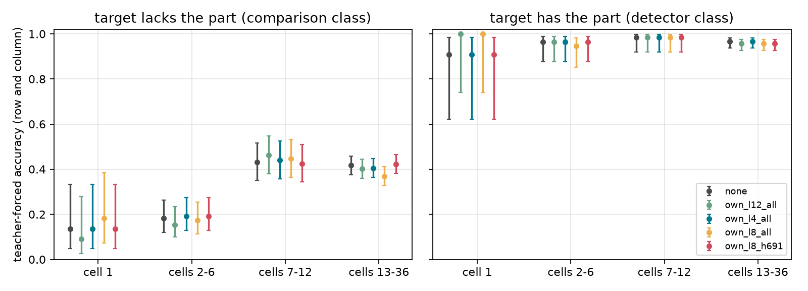
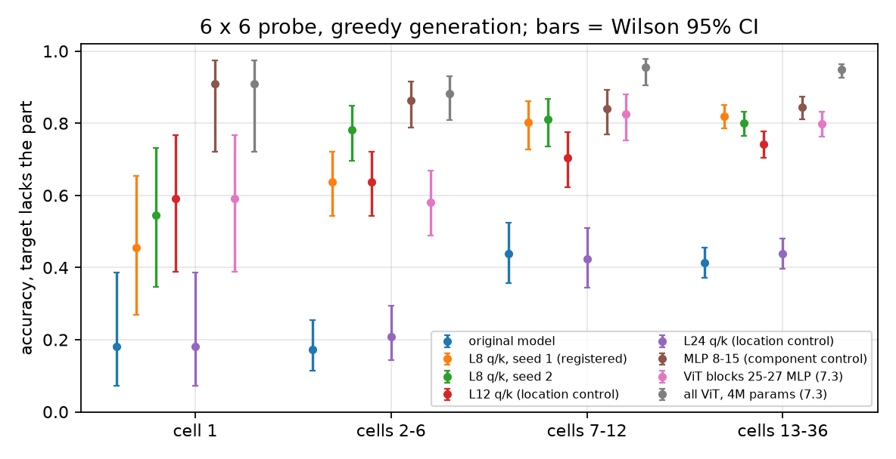
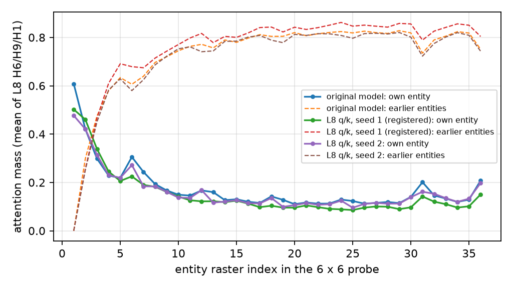
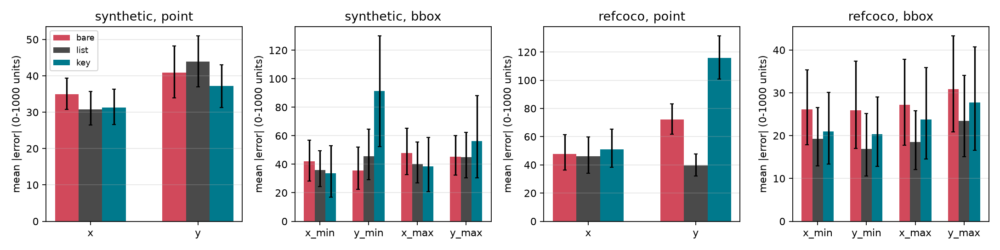

# 新的可解释性指导优化方案（实验 7.5）

实验日期：2026-11-11 至 2026-11-12。本文属于[研究问题 7](plan.md)，依据[实验 2.7 第三轮](../representation/results_2026-11-05_search_circuit.md)与[第四轮](../representation/results_2026-11-11_search_pipeline.md)（plan.md 第 5 节第 50 条及第四轮对它的修订）与[实验 3.15 第二轮](../position/results_2026-11-05_coordinate_mechanism_natural.md)（第 52 条）的机理结论，提出新的候选优化方案并对其中两项做 pilot。主模型为 Qwen3.5-9B，冻结、bfloat16、SDPA，thinking off；Qwen3-VL-8B-Instruct 只用于机理对照，不比较两者的能力。第 2.2 节的预测在任何 7.5 的 GPU 运行之前依据第三轮的结论写定，训练后未作改动；第四轮在本文实验期间完成，本文对机理的叙述与解释以第四轮为准。坐标读出的定点微调（7.2 第二轮）、BabyVision 行列数据（7.4）、ViT 检测器形成（7.3 第二轮）与计数门控（7.3C 第二轮）由其他实验负责，本文不重复。

## 0. 通俗讲述

本文检验两个想法。第一个想法来自“找出与众不同的图形”这一视觉搜索任务的机理。按实验 2.7 第四轮的完整分析，模型完成这个任务的步骤如下。图像被 ViT 编码为一串按光栅顺序（从左到右、从上到下）排列的图像 tokens，每个图形占 2×2 个 tokens。当目标缺少其他图形都有的部件（例如一群带缺口的方框中唯一一个闭合方框）时，ViT 中没有只对它响应的神经元，单看目标自己的 tokens 无法判断它是否异常，模型必须把它与周围比较。decoder 第 1–15 层为此在每个图像 token 上做两件事：序列混合子层（Gated DeltaNet 层与第 4、8、12 层 full attention）把光栅顺序在前的其他图形的内容写进这个 token 的残差，第四轮把这部分写入称为参照向量；随后第 8–15 层 MLP 的一批神经元同时读取 token 自身的内容与参照向量，二者在门控预激活中线性相加、方向相反的部分相互抵消，只有“自身缺少而参照具有”的成分使神经元越过 SiLU 阈值放电，这就是由加法与阈值实现的相减。放电神经元的输出指向第 16、20 层读取 head 的 key 方向，答案位置上的读取 head 以几乎固定的 query 找到这个 token，把它的位置写成行列号。参照向量由许多 full attention head 与许多 DeltaNet 层共同提供，没有单一的关键 head；第 8 层 head 6 的输出是对此前图形内容的近乎均匀的平均，把它置零或替换都不影响定位，它不是必要组件。光栅顺序靠前的特征缺失目标很难被找到，第一行中只有约 17%。

本文的 pilot 设计于第四轮之前，依据的是第三轮的推测：前几个图形在第 8 层的 attention 大部分落在自身上（第 1 个图形 0.61、第 3 个 0.30），若由此得到的参照混入了自身，自身与参照之差就会变小。我们先在原模型上检验：在第 8 层 head 6、9、1 中禁止每个图像 token 注意自身所在图形的 tokens。前排目标的正确率几乎不变（20/110 对 21/110），读取 head 对前排目标的 attention 只与其他位置一样略有上升。这一零结果与第四轮“head 6 不必要、参照由许多组件分担”的结论一致：改动少数几个 head 的 attention 分配，不足以改变 MLP 8–15 读到的参照。随后按预注册方案训练第 8 层 q_proj 与 k_proj 的 LoRA（27.9 万参数，只作用于图像 tokens），特征缺失目标的正确率由 299/792 升至 619–628/792（两个随机种子），与实验 7.3 中同等规模的 ViT LoRA 相当（608/792），且纯文本、POPE、TextVQA、MMVP、GQA 与坐标输出不变。训练后第 8 层的 attention 分配几乎不变；把适配器拆开后，约 70% 的作用来自 q_proj 中控制每个 head 输出幅度的“输出门”：图像 tokens 上第 8 层几乎所有 head 的输出门只升高约 1–7%，读取 head 对目标的 attention 就由 0.19 升至 0.29。按第四轮的流程，第 8 层 full attention 的输出是参照向量的组成部分之一，因此这一结果与“适配器放大了送入 MLP 8–15 的跨图形参照”的解释相容；不过本文没有测量 MLP 8–15 的门控预激活，第 8 层输出也包含自身图形的内容，这一解释尚未被直接证实（第 2.6 节）。改进对所有光栅位置大致等比例，并不专门修复前排劣势。等参数的第 12 层 q/k 对照同样有效（568/792），第 24 层对照无效（314/792），说明有效区间是读取 head 之前、提供参照的中段 attention 层，第 8 层并非唯一位置。代价是行计数变差（行号正确 99/120 降至 76–83/120），这与第 44 条“行列序号共享 DeltaNet 第 9–16 层纵向位置编码”的结论一致：改动中段图像 tokens 上的跨 token 写入，会改变后续 DeltaNet 层在这些 tokens 上累积的行计数。

Qwen3-VL 上的同一测量揭示了一个机理差异：Qwen3-VL 的第一行特征缺失目标并不比后排困难（0.35 对 0.31），而 Qwen3.5 的差距是 0.17 对 0.41；在 Qwen3-VL 的任意一段层中屏蔽自身图形同样不提高前排正确率。这与实验 2.7 把前排劣势的另一来源归于 Gated DeltaNet 在线最小二乘的“尚未收敛”相符。

第二个想法来自坐标数值的读出机理（第 52 条）：直接作答时，坐标的百位主要在数值之前的格式 token（如逗号、空格、左括号）上读入图像。若格式 token 是“读图时刻”，那么让每个数值前有更多格式 token，就应当提高后续数值（纵坐标、框的后三个数）的精度。我们不做训练，只改变提示中的答案格式：原生格式中纵坐标前有 2 个格式 token（“,”与空格），键值格式有 5 个（“,”、“ "”、“y”、“":”与空格），紧凑格式只有 1 个（“,”）。结果否定了“格式 token 越多越好”：在合成图像上键值格式使纵坐标误差下降 7 个单位（0–1000 坐标），但在 RefCOCO 照片上键值格式使纵坐标误差由 40 升至 116，紧凑格式升至 72，而横坐标在三种格式下基本不变。读图时刻因此不是格式 token 数量的通用函数，而是与训练中见过的原生格式绑定的习惯：离开原生格式时，最受影响的是在格式 token 上读入的那个数值。对数据构造的含义是：坐标类训练数据应保持统一的格式，或在多种格式上都提供监督，单纯增加格式 token 不能作为零训练的改进手段。

## 1. 候选优化方案

下表列出依据已有机理结论提出的候选方案。每个方案写明依据（plan.md 第 5 节的条目）、改动的组件与 token 位置、预期效果与副作用、代价，以及训练后检验表示变化的方法。方案 A、B 在本文中做了 pilot。

| 编号 | 依据 | 组件与 token 位置 | 预期效果 | 可能的副作用 | 代价 | 机理检验 | 状态 |
| --- | --- | --- | --- | --- | --- | --- | --- |
| A | 第 50 条（第三轮）：第 8 层 head 6、9、1 搬运前文均值，前几个图形的 attention 主要落在自身；第四轮修订为参照向量由许多 head 与 DeltaNet 层提供、相减发生在 MLP 8–15 的门控中 | 第 8 层 q_proj 与 k_proj 的 LoRA，只作用于图像 tokens（27.9 万参数） | 特征缺失目标、尤其前排目标更容易被找到 | 第 8 层的图像 keys 也被文本 query 读取；后续 DeltaNet 计数可能改变 | 一次 150 步训练（约 5 分钟，A800） | 三个 head 在前排图形上的自身份额下降；读取 head 对前排目标的 attention 上升 | 训练前因果检验与训练 pilot（第 2 节） |
| B | 第 52 条：百位在数值前 1–3 个格式 token 上读入图像 | 答案格式（数据层面），不改参数 | 后续数值前格式 token 增多时误差下降 | 非原生格式的指令遵循变差 | 只需推理 | 以第一个数值为格式内对照：只有后续数值的误差随格式变化 | 零训练 pilot（第 3 节） |
| C | 第 51 条：两条边缘读数在残差流中相加，由第 24–30 层 MLP 转为数字 | 第 24–30 层 MLP，作用于答案数值 token | 自然图像框精度提高 | 所有文本数值经过同一组 MLP，可能影响算术 | 一次训练 | 第 24 层残差中边缘位置的线性可读精度不变而输出误差下降 | 未做：第 52 条显示 872 张自然图像上的坐标点无系统偏置，需先确认误差来自读数还是转换 |
| D | 第 51 条：L20 H11 的 query 编码“哪个物体” | 第 20 层 q_proj，作用于答案前的格式 token | RefCOCO 指代错误减少 | 改变第 20 层其他 head 的 query | 一次训练 | 指代错误样本上 L20 H11 的 attention 转向正确物体 | 未做：需先统计 RefCOCO 错误中“选错物体”所占比例 |
| E | 第 34、42 条：十位与个位经第 25–32 层短卷积读取前一位数字 | 第 25–32 层 DeltaNet 短卷积 | — | — | — | — | 不做：精度损失发生在首位数字一步，短卷积链不是瓶颈 |
| F | 第 54 条：只更新第一个图像 token 与更新全部图像 tokens 同样有效 | 图像片段开头的可学习向量 | — | — | — | — | 不做：属于 7.2 第二轮的范围 |

## 2. 方案 A：第 8 层 attention 的定点微调

### 2.1 组件的计算

第 8 层是 full attention 层。对图像 token $i$，head $h$ 的输出为

$$
o_i^{(h)} = \sigma\!\left(g_i^{(h)}\right) \odot \sum_{j \le i} a_{ij}^{(h)} \, v_j^{(h)}, \qquad
a_{ij}^{(h)} = \operatorname{softmax}_j\!\left( \frac{ q_i^{(h)\top} k_j^{(h)} }{\sqrt{d}} \right),
$$

其中 $q_i^{(h)}, k_j^{(h)}, v_j^{(h)} \in \mathbb{R}^{256}$ 为经过 RMSNorm 与 RoPE 的 query、key 与 value，$d = 256$，$a_{ij}^{(h)}$ 为 token $i$ 对 token $j$ 的 attention 权重，$g_i^{(h)} \in \mathbb{R}^{256}$ 为输出门的 logit，$\sigma$ 为 sigmoid，$\odot$ 为逐元素乘积。Qwen3.5 的 q_proj 把输入 $x_i \in \mathbb{R}^{4096}$ 映射为 $16 \times 512$ 维，每个 head 的前 256 维是 query、后 256 维是输出门 $g_i^{(h)}$；k_proj 映射为 4 组共享的 key。各 head 的输出拼接后经 o_proj 加到残差流上。因此 q_proj 与 k_proj 的改动有两条作用途径：改变 attention 权重 $a_{ij}$（即“读谁”），以及改变输出门 $\sigma(g_i)$（即“写多少”）。

把图像 token $i$ 所在图形的 tokens 集合记为 $E(i)$（4 个 tokens），把光栅顺序在其之前的图形的 tokens 集合记为 $P(i)$。自身份额与前文份额分别为

$$
s_{\mathrm{own}}(i) = \sum_{j \in E(i)} a_{ij}, \qquad s_{\mathrm{prev}}(i) = \sum_{j \in P(i)} a_{ij},
$$

其余 attention 落在图像之前的文本 tokens 上。设计本方案时依据的第三轮推测是：$s_{\mathrm{own}}$ 大时前文均值主要由自身构成，自身与前文均值之差变小。第四轮随后表明，第 8 层 head 6 的输出是对此前实体 value 的近乎均匀的平均，置零或替换都不影响定位；第 8 层 full attention 只是参照向量的提供者之一，参照向量与自身内容在第 8–15 层 MLP 的门控预激活中相减。本节的定义与预测保留第三轮的表述，因为它们在实验前登记；结果的解释以第四轮为准。

### 2.2 预注册的预测

以下预测在 7.5 的任何 GPU 运行之前写定。

1. **训练前因果检验**：在第 8 层 head 6、9、1 中禁止图像 tokens 注意 $E(i)$（自身图形屏蔽），第 2–6 格特征缺失目标的正确率应至少提高 0.10，后排变化较小；第 4 层、第 12 层的全部 head 做同样屏蔽时第 2–6 格的增益应小于第 8 层。
2. **训练**：第 8 层 q/k LoRA 对第 2–6 格的相对增益应大于等参数的第 12、24 层对照；第 24 层位于网格读取 head（第 16、20 层）之后，应接近无效；第 8–15 层 MLP 的 LoRA 应提高后排正确率，但对第 2–6 格的增益较小。
3. **表示变化**：训练后三个 head 在第 2–6 个图形上的 $s_{\mathrm{own}}$ 下降，读取 head 对前排目标的 attention 上升。
4. **副作用**：纯文本、POPE、TextVQA、MMVP、GQA 与坐标命中率在噪声范围内。

### 2.3 数据与操作

- **刺激**：直接复用实验 7.3 的数据与评测，使结果与 7.3 的 ViT 适配器直接可比。训练集为 1200 道 4×4 至 8×8 网格的找不同（75% 为特征缺失目标）加 1200 道 TextVQA 短答案；探测集为 6×6 网格，11 种特征对的每个格子各 2 道特征缺失题与 1 道特征存在题（共 792 + 396 道），问法为“One figure differs from all the others. Give its position. Return only {"row": r, "column": c}”。
- **训练配方**：与 7.3 完全相同（150 步、每步 16 个样本、学习率 2e-4、余弦退火），LoRA 缩放系数 $\alpha / r = 4$，更新只作用于图像 token 位置。
- **条件**：第 8 层 q/k（秩 16，278,528 参数，种子 1、2）；第 12 层与第 24 层 q/k（同参数）；第 8–15 层 MLP 的 gate/up/down（秩 1，393,216 参数）。
- **训练前检验与表示测量**均采用 teacher forcing：在真实答案上一次前向，读取行数字与列数字位置上数字 1–6 的 argmax，二者都正确记为正确；同时记录第 8 层每个 head 对每个图像 token 的 $s_{\mathrm{own}}$、$s_{\mathrm{prev}}$，以及六个读取 head（L16 H6/H11/H2、L20 H2/H11/H10）在行数字位置对目标 4 个 tokens 的 attention 之和。attention 由前向中捕获的 query 与 key（已含 LoRA）重算。
- **适配器拆分**：把 LoRA 的 $B$ 矩阵按输出行分为 q_proj 的输出门行、q_proj 的 query 行与 k_proj 行，分别只保留“输出门”或“query 与 key”部分重新测量。

### 2.4 训练前检验：自身图形屏蔽不改善前排

**原模型重现了前几个图形的高自身份额，但去掉它并不帮助前排目标。** 三个 head 的平均 $s_{\mathrm{own}}$ 在第 1–5 个图形上为 0.61、0.42、0.30、0.23、0.22，与实验 2.7 一致（图 2）。然而屏蔽自身图形后，特征缺失目标在第 2–6 格的正确率由 20/110 变为 21/110（配对 McNemar：2 道变对、1 道变错，p = 1.0），后排由 220/528 变为 223/528；屏蔽第 8 层全部 head 反而使后排下降至 195/528（5 道变对、30 道变错，p < 0.001），第 4、12 层屏蔽均无前排增益（表 1、图 1）。读取 head 对前排目标的 attention 由 0.072 变为 0.081，与后排的变化幅度（0.193 → 0.205）相同。这说明预测 1 不成立：第 8 层少数 head 的 attention 是否落在自身不是前排劣势的瓶颈。这一零结果与第四轮的结论一致：head 6 本身不必要，参照向量由许多 full attention head 与 DeltaNet 层分担，屏蔽三个 head 的自身 attention 对 MLP 8–15 读到的参照改变很小。前排劣势更可能来自可供比较的前文图形太少本身，以及第三轮所述 DeltaNet 记忆在前几个图形上尚未收敛。

表 1　训练前检验（teacher forcing，特征缺失目标，正确数/题数）

| 条件 | 第 1 格 | 第 2–6 格 | 第 7–12 格 | 第 13–36 格 | 特征存在目标 |
| --- | --- | --- | --- | --- | --- |
| 原模型 | 3/22 | 20/110 | 57/132 | 220/528 | 383/396 |
| L8 H6/9/1 自身屏蔽 | 3/22 | 21/110 | 56/132 | 223/528 | 381/396 |
| L8 全部 head 自身屏蔽 | 4/22 | 19/110 | 59/132 | 195/528 | 381/396 |
| L4 全部 head 自身屏蔽 | 3/22 | 21/110 | 58/132 | 214/528 | 383/396 |
| L12 全部 head 自身屏蔽 | 2/22 | 17/110 | 61/132 | 212/528 | 382/396 |

图 1　自身图形屏蔽对 teacher-forced 正确率的影响。横轴为目标的光栅位置分组，纵轴为行列均正确的比例，误差线为 Wilson 95% 置信区间。左图为特征缺失目标，右图为特征存在目标；颜色区分屏蔽条件（深灰：原模型；红：L8 H6/9/1；黄：L8 全部 head；青：L4 全部 head；绿：L12 全部 head）。数值来自原模型在 6×6 探测集上的前向计算。

### 2.5 训练结果：第 8 层小适配器有效，但并非前排专属

**第 8 层 q/k 适配器使特征缺失目标的正确率翻倍，与 7.3 的 ViT 适配器相当且无通用能力损失。** 两个种子分别达到 619/792 与 628/792（原模型 299/792；配对 McNemar 332 道变对、12 道变错），未训练特征（heldout_feature）由 32/144 升至 86–93/144，未训练特征族由 193/288 升至 258–263/288（表 2）。这一结果的含义是：在 decoder 中段只改一层 attention 的 0.28M 参数，就能达到 7.3 中在 ViT 后段训练的效果（608/792），后者需要模型先在 ViT 中形成检测信号，而前者直接加强了 decoder 中的比较。

**增益在各光栅位置上大致等比例，预测 2 中“前排相对增益更大”不成立。** 第 2–6 格由 19/110 升至 70–86/110，第 13–36 格由 218/528 升至 423–433/528（图 3）；等参数的第 12 层对照在第 2–6 格同样达到 70/110。第 24 层对照几乎无效（314/792，第 2–6 格 23/110），符合“读取 head 之后的图像 token 改动不影响网格读出”的预测。第 8–15 层 MLP 对照最强（672/792，第 2–6 格 95/110），但其参数多 41%，因此不能把它与第 8 层的差别解释为组件优劣。

**副作用集中在行计数。** 纯文本 43/45 不变；POPE、TextVQA、MMVP、GQA 的配对差异不显著（第 8 层种子 1：14 道变对、18 道变错，p = 0.60）；坐标命中率不变（合成 87 → 94/167，RefCOCO 93 → 92/100）。7.1 的网格计数题由 89/120 降至 74/120（种子 1，p = 0.006）与 69/120（种子 2，p = 0.001），下降全部来自行数（99 → 83 与 76/120），列数不变（110 → 111/120）。第 12 层与 MLP 8–15 也降低行数（91、87/120），第 24 层不降（102/120）。解释：第 44 条表明行号由 DeltaNet 第 9–16 层沿光栅累积的纵向编码给出，第 8–15 层图像 tokens 上的任何改动都会进入这一累积；本文训练数据不含计数题，因此这一副作用没有被约束。实际使用时应在训练数据中混入计数或行列序号题（与 7.2 混合数据修复行列序号的做法相同）。

表 2　训练结果（贪心生成；特征缺失目标按光栅位置分组；正确数/题数）

| 条件 | 参数 | 第 1 格 | 第 2–6 格 | 第 7–12 格 | 第 13–36 格 | 合计 | 未训练特征 | 计数 | 通用（POPE/TextVQA/MMVP/GQA，各 200） |
| --- | --- | --- | --- | --- | --- | --- | --- | --- | --- |
| 原模型 | — | 4/22 | 19/110 | 58/132 | 218/528 | 299/792 | 32/144 | 89/120 | 170/153/149/72 |
| L8 q/k 种子 1（预注册） | 0.28M | 10/22 | 70/110 | 106/132 | 433/528 | 619/792 | 86/144 | 74/120 | 166/153/148/73 |
| L8 q/k 种子 2 | 0.28M | 12/22 | 86/110 | 107/132 | 423/528 | 628/792 | 93/144 | 69/120 | 168/154/148/70 |
| L12 q/k | 0.28M | 13/22 | 70/110 | 93/132 | 392/528 | 568/792 | 85/144 | 80/120 | 168/157/147/71 |
| L24 q/k | 0.28M | 4/22 | 23/110 | 56/132 | 231/528 | 314/792 | 35/144 | 96/120 | 166/153/148/71 |
| MLP 8–15 | 0.39M | 20/22 | 95/110 | 111/132 | 446/528 | 672/792 | 102/144 | 72/120 | 170/159/148/75 |
| ViT block 25–27 MLP（7.3） | 0.26M | 13/22 | 64/110 | 109/132 | 422/528 | 608/792 | 88/144 | 82/120 | 172/158/149/70 |

图 3　各适配器在 6×6 探测集上的特征缺失目标正确率（贪心生成），按目标光栅位置分组，误差线为 Wilson 95% 置信区间。原模型与 7.3 的两个 ViT 适配器数值取自 7.3 的同一评测。

### 2.6 表示变化：增强的是写入幅度，而非 attention 分配

**训练后第 8 层的 attention 分配几乎不变，预测 3 不成立。** 三个 head 在第 2–6 个图形上的平均 $s_{\mathrm{own}}$ 在训练前后分别为 0.42/0.30/0.23/0.22/0.31 与 0.46/0.34/0.25/0.21/0.23（种子 1），只有第 1 个图形由 0.61 降至 0.48–0.50（图 2）；16 个 head 的平均 $s_{\mathrm{prev}}$ 中只有 head 14（0.77 → 0.53）与 head 10（0.66 → 0.54）变化超过 0.1，其余 head 的变化在 ±0.09 以内。与此同时，读取 head 对目标的 attention 在所有位置上都升高：第 2–6 格由 0.07 升至 0.22–0.23，第 13–36 格由 0.19 升至 0.33–0.35。

图 2　第 8 层 head 6、9、1 的平均 attention 份额随图形光栅序号的变化。实线为自身份额 $s_{\mathrm{own}}$，虚线为前文份额 $s_{\mathrm{prev}}$；颜色区分原模型与两个第 8 层适配器。数值由 1188 张探测图像的前向计算得到（每张图像贡献全部 36 个图形）。

**适配器的作用主要来自输出门。** 只保留输出门部分时，teacher-forced 正确率由 300/792 升至 528/792（种子 1）与 521/792（种子 2），恢复了全量适配器（618–619/792）增益的约 70%；只保留 query 与 key 部分时为 431–433/792，约 41%；两部分大致可加。读取 head 对后排目标的 attention 在三种情形下分别为 0.35（全量）、0.29（输出门）、0.28（query 与 key）。图像 tokens 上第 8 层 16 个 head 的平均输出门 $\sigma(g)$ 在训练后有 15 个升高 0.002–0.011（相对 1–7%），1 个下降 0.002，没有集中在 head 6、9、1 上（表 3）。第 12 层适配器的拆分结果相同（输出门 454/792，query 与 key 417/792，全量 565/792）。

表 3　第 8 层适配器的拆分（teacher forcing，特征缺失目标，正确数/792；读取 attention 为第 13–36 格目标的均值）

| 部分 | 种子 1 | 种子 2 | 读取 attention（种子 1） |
| --- | --- | --- | --- |
| 原模型 | 300 | 300 | 0.19 |
| 全量 | 618 | 619 | 0.35 |
| 只保留输出门 | 528 | 521 | 0.29 |
| 只保留 query 与 key | 431 | 433 | 0.28 |

**解释（以第四轮的流程为框架）：适配器主要放大了第 8 层写入图像 tokens 的输出幅度，这与“放大送入 MLP 8–15 的跨图形参照”相容，但尚未被直接证实。** 第 8 层 full attention 的输出乘以输出门后加到残差流上，第四轮把其中来自其他格的部分算作参照向量的一部分；输出门普遍升高意味着这部分写入变强，读取 head 对目标的 attention 随之在所有位置上升高，与“参照越强、MLP 8–15 的相减信号越大”的预期方向一致。本文的数据不能确立以下三点：第一，没有测量 MLP 8–15 门控预激活的变化，因而不能断定增益经由第四轮所述的相减神经元传递；第二，第 8 层输出中还有 0.1–0.5 的 attention 落在自身图形上，输出门放大的是整个输出，不只是来自其他格的部分；第三，第 12 层适配器同样有效，说明放大中段任一提供参照的 attention 层都可以，与第四轮“参照由许多组件分担”一致，也说明第 8 层并非唯一位置。由于放大对所有位置等比例，原本差值很小的前排目标同样受益，但相对差距并未消除。按优化链条的要求，这里如实记录未匹配之处：预注册的具体机制（去除前文均值中的自身成分）被训练前检验与训练后测量共同否定。

### 2.7 Qwen3-VL 对照

**Qwen3-VL 没有 Qwen3.5 那样的前排劣势，自身图形屏蔽同样无效。** 在同一探测集上（teacher forcing），Qwen3-VL 的特征缺失目标正确率在第 2–6 格为 39/110，第 13–36 格为 164/528（0.35 对 0.31）；在第 1–6、7–12、13–18、19–24 层分别屏蔽全部 head 的自身图形，第 2–6 格为 37、33、32、40/110，均不高于不屏蔽；第 13–18 层屏蔽使后排降至 116/528，说明 Qwen3-VL 在中段层也依赖图形内部的 attention。Qwen3-VL 的 decoder 全部为 full attention，没有 Gated DeltaNet；它在第一行不吃亏，支持实验 2.7 把 Qwen3.5 前排劣势的另一部分归因于 DeltaNet 记忆在前几个图形上尚未收敛。这是机理层面的差异，不涉及两个模型的能力比较。

## 3. 方案 B：答案格式与读图时刻

### 3.1 设计

- **依据**：第 52 条显示直接作答时百位约三分之二在数值之前的 1–3 个格式 token 上读入。若这一读入依赖格式 token 的数量，则增加数值前的格式 token 应提高后续数值的精度；第一个数值前有大量 chat template 与格式 tokens，可作为格式内对照。
- **格式**（Qwen3.5 分词，每个数字为单独 token）：原生格式“[{"point_2d": [x, y]}]”中纵坐标前有 2 个格式 token（“,”与空格）；键值格式“{"x": x, "y": y}”有 5 个；紧凑格式“x,y”只有 1 个。框问法同理（x_min、y_min、x_max、y_max）。
- **预注册预测**：纵坐标误差满足紧凑 ≥ 原生 ≥ 键值，横坐标的变化小于纵坐标；框的后三个数值同理。
- **数据**：3.13 的坐标测试集 997 题（合成 597 题，其中点 447、框 150；RefCOCO 点与框各 200），贪心生成，最多 64 个新 token，按图像尺寸分批。

### 3.2 结果

**格式 token 的数量不是读图精度的通用决定因素，偏离原生格式时受损的是在格式 token 上读入的后续数值。** 在合成图像的点问法上，键值格式使纵坐标误差下降 7.0（95% bootstrap 区间 2.6–11.7，0–1000 单位），横坐标不变，符合预测；紧凑格式对纵坐标无显著影响。在 RefCOCO 点问法上结果相反：键值格式使纵坐标误差由 39.7 升至 115.8（配对差 75.9，区间 60–92），紧凑格式升至 72.1（配对差 32.4），而横坐标在三种格式下为 46–51，没有显著变化（图 4、表 4）。逐题查看，键值格式下照片的横坐标与原生格式接近，纵坐标却常落到远离目标的数值（例如真值 705 时答 100）。框问法上，紧凑格式在 RefCOCO 上使四个数值的误差都上升 7–9（区间均不含 0），键值格式中 50% 的合成框与 22% 的 RefCOCO 框退回原生格式而无法解析。

表 4　答案格式（贪心生成；平均绝对误差，0–1000 单位；括号内为有效答案数）

| 子集 | 格式 | 第 1 个数值 | 第 2 个数值 | 第 3 个数值 | 第 4 个数值 | 命中率或平均 IoU |
| --- | --- | --- | --- | --- | --- | --- |
| 合成，点（447） | 原生 | 30.8 | 44.0 | — | — | 命中 0.66 |
| | 键值（444） | 31.3 | 37.2 | — | — | 命中 0.72 |
| | 紧凑 | 34.9 | 40.9 | — | — | 命中 0.66 |
| RefCOCO，点（200） | 原生 | 46.1 | 39.7 | — | — | 命中 0.93 |
| | 键值（181） | 51.0 | 115.8 | — | — | 命中 0.88 |
| | 紧凑 | 47.7 | 72.1 | — | — | 命中 0.94 |
| 合成，框（150） | 原生 | 35.8 | 45.6 | 40.0 | 44.9 | IoU 0.54 |
| | 键值（75） | 33.8 | 91.4 | 38.6 | 56.2 | IoU 0.53 |
| | 紧凑 | 42.0 | 35.6 | 47.9 | 45.3 | IoU 0.53 |
| RefCOCO，框（200） | 原生 | 19.3 | 16.9 | 18.5 | 23.4 | IoU 0.86 |
| | 键值（156） | 21.0 | 20.3 | 23.8 | 27.8 | IoU 0.84 |
| | 紧凑 | 26.2 | 25.9 | 27.2 | 30.9 | IoU 0.82 |

图 4　三种答案格式下各坐标数值的平均绝对误差（0–1000 单位），误差线为 bootstrap 95% 区间（2000 次重采样）。红：紧凑格式；深灰：原生格式；青：键值格式。数值来自原模型的贪心生成，只统计可解析的答案。

解释：照片上的纵坐标由边缘读取 head 在格式 token 上读入（第 51、52 条），这些 head 的 query 由当前步及其前几步的 token 内容决定。原生格式在训练中大量出现，读入纵坐标所需的 query 已与“,”与空格这两个 token 绑定；换成“"y": ”后 query 改变，读取落到错误位置。合成图像的纵坐标主要由 L20 H11 读取（第 52 条），它对格式的依赖较弱，因而键值格式反而略有帮助。由此，“给数值更多读图时刻”的零训练做法不可行；若要利用这一机理，需要在训练数据中为新的格式 token 提供监督。

## 4. 与其他实验的关系

- 与 7.3（第 55 条）一致：前排劣势可以被更强的比较或检测信号部分弥补，但两类修复都不消除位置梯度；本文进一步表明 decoder 第 8–12 层的小适配器能达到同等效果，作用方式是放大第 8 层的写入。
- 与 7.3C（第 56 条）一致：小 LoRA 的有效位置在一段层内不唯一，训练改变的是信号幅度这一类系统性量，而非预测的具体子机制。
- 与 2.7 第四轮一致：第 8 层 head 6、9、1 的自身图形屏蔽无效，符合“head 6 不必要、参照向量由许多 full attention head 与 DeltaNet 层分担”；第 8 层与第 12 层适配器同样有效，也符合参照来源的分散性。本文没有测量 MLP 8–15 的相减神经元，适配器增益是否经由它们传递有待检验。
- 与第 44 条一致：作用于第 8–15 层图像 tokens 的改动会改变行计数。
- 与第 51、52 条一致并补充：纵坐标在格式 token 上的读入依赖原生格式。

## 5. 局限

- 方案 A 只在合成找不同与通用基准上评测，BabyVision 找不同（33 题）在所有条件下为 1–3 题，样本过少无法判断；未在自然图像找不同上评测。
- 每个对照条件只有一个种子；第 8 层有两个种子，种子间第 2–6 格差异（70 对 86/110）说明前排结果的种子波动较大。
- 输出门拆分只统计了每个 head 256 维门的平均值，未分析门的具体维度。
- 方案 B 中键值格式的部分答案退回原生格式，被记为无效，比较只在有效答案上进行。

## 6. 机理流程总结

方案 A 所涉及的计算过程如下。图像经 ViT 编码为按光栅顺序排列的图像 tokens；在 decoder 第 1–15 层，DeltaNet 层与第 4、8、12 层 full attention 把光栅顺序在前的图形内容写入每个图像 token，构成参照向量（full attention 的每个 head 把加权 value 之和乘以输出门后写回残差流，没有单一的关键 head）；第 8–15 层 MLP 的神经元在门控预激活中把 token 自身内容与参照向量相加，二者相同时相互抵消，“自身缺少而参照具有”的成分使神经元放电，输出写到读取方向上；答案的行数字位置上，第 16、20 层读取 head 以近乎固定的 query 读取差值最大的图形，并把其位置写成行列数字。前排图形可比较的前文图形太少，Qwen3.5 的 DeltaNet 记忆也尚未收敛，因此相减信号小；去掉第 8 层三个 head 在自身图形上的 attention 并不能补上这一不足。27.9 万参数的第 8 层适配器主要放大各 head 的输出门，使第 8 层写入的内容变强，读取 attention 在所有位置等比例增大，特征缺失目标的正确率因此翻倍（这一步经由 MLP 8–15 相减神经元的路径尚未直接测量）；同样的写入也进入 DeltaNet 第 9–16 层的行计数，因而行计数变差。

方案 B 所涉及的计算过程如下。直接作答时，模型在写出数值之前的格式 token 上由读取 head 读入图像位置，百位随后从这些 token 的 hidden states 中取出；读取 head 的 query 由格式 token 的内容决定，并在训练中与原生格式绑定。改变格式会改变这些 query，照片上的纵坐标读取因此偏离目标。

## 实验产物

路径相对于 `$WORK_DIR`，运行目录为 `analysis/application/2026-11-11_new_optimizations/`（下记为 RUN），入口脚本为 `scripts/analysis/application/new_opt.sh`，代码为 `analysis_tools/application/new_opt.py`、`new_opt_run.py`、`new_opt_analysis.py`。

| 内容 | 路径 | 产生方式 |
| --- | --- | --- |
| 表 1、图 1（训练前自身屏蔽，Qwen3.5） | RUN/premask/Qwen3.5-9B__*.jsonl；汇总 RUN/results.json 的 premask | STAGES=premask |
| 第 2.7 节 Qwen3-VL 对照 | RUN/premask/Qwen3-VL-8B-Instruct__*.jsonl | MODEL=Qwen3-VL-8B-Instruct STAGES=premask |
| 表 2、图 3（训练结果） | RUN/eval/{fa8qk_s1,fa8qk_s2,fa12qk_s1,fa24qk_s1,mlp8_15_s1}/{probe,count,coord,general,text,babyvision}.jsonl；原模型与 7.3 适配器：analysis/application/2026-11-05_located_vit_finetune/eval/{base,late_n1200_s1,vitall_n1200_s1}/ | STAGES=train,eval |
| 适配器 checkpoint（全部被引用） | RUN/adapters/{fa8qk_s1,fa8qk_s2,fa12qk_s1,fa24qk_s1,mlp8_15_s1}.pt 与 *_log.jsonl | STAGES=train |
| 图 2、第 2.6 节 attention 份额与读取 attention | RUN/eval/*/attn.jsonl；原模型 RUN/premask/Qwen3.5-9B__none.jsonl | STAGES=attn |
| 表 3（适配器拆分）与输出门均值 | RUN/eval/{fa8qk_s1,fa8qk_s2,fa12qk_s1}/decomp.jsonl、decomp_gates.json | STAGES=decomp |
| 表 4、图 4（答案格式） | RUN/format/{list,key,bare}.jsonl | STAGES=format |
| 全部汇总数值与配对检验 | RUN/results.json | STAGES=analysis |
| 运行元数据（GPU、批大小、参数） | RUN/experiment.json；日志 RUN/run_*.log | — |

GPU 用量：A800 一块约 1.7 小时（训练前检验、格式 pilot、5 个适配器的训练与评测、Qwen3-VL 检验），A40 一块约 0.3 小时（适配器拆分）。

## 修改记录

- 2026-11-12：依据实验 2.7 第四轮（[完整流程](../representation/results_2026-11-11_search_pipeline.md)）改写第 0 节、第 1 节方案 A 的依据、第 2.1、2.4、2.6 节的解释与第 6 节的流程叙述，把视觉搜索的机理表述为“许多序列混合组件提供参照向量、MLP 8–15 门控中相减”，并说明自身图形屏蔽的零结果与 head 6 不必要相符、适配器增益与放大参照相容但未被直接证实；预注册预测（第 2.2 节）保持原文。第 4 节增加与第四轮的对照。
