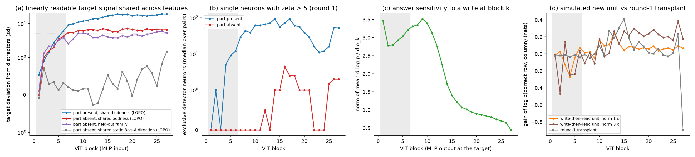
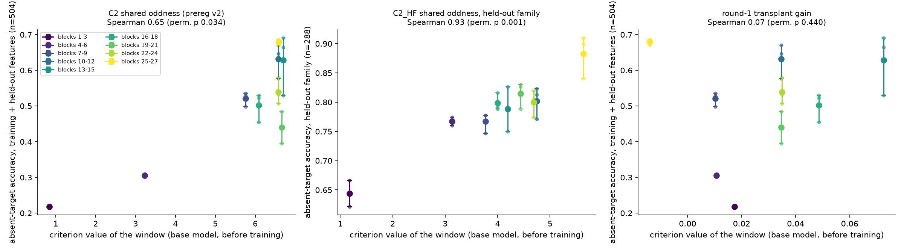
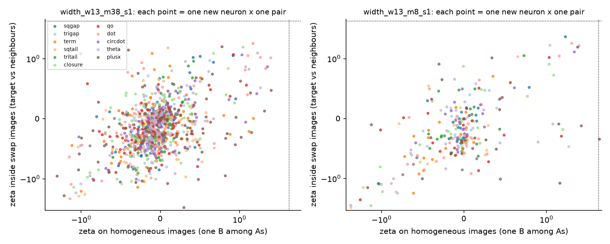
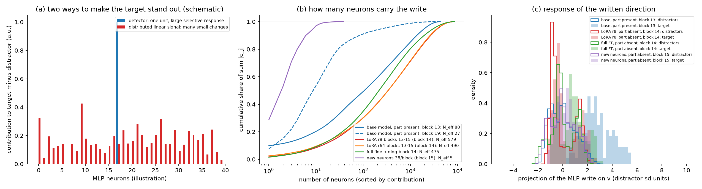
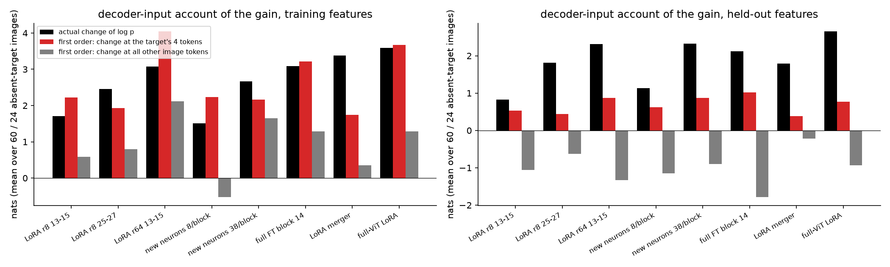
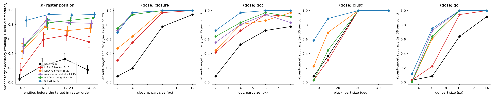
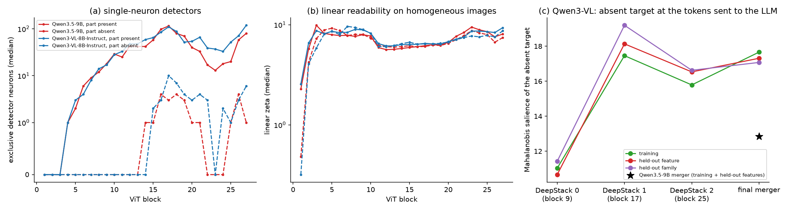
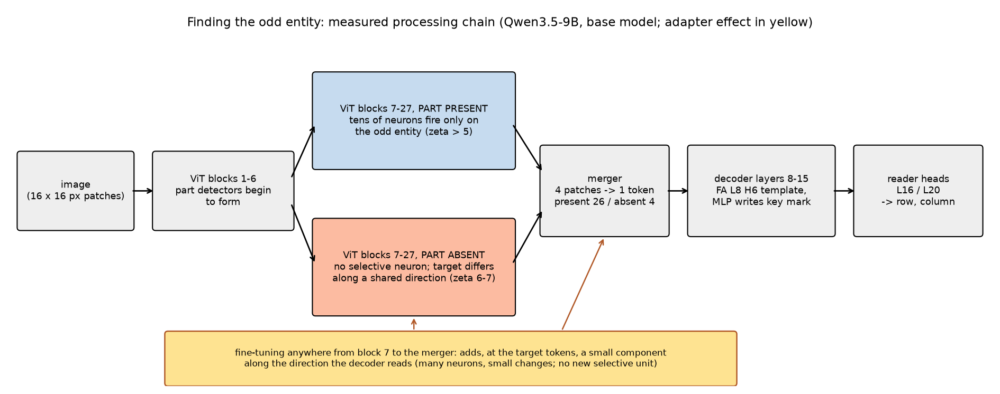

# ViT 检测器的定点形成（实验 7.3 第二轮）

实验日期：2026-11-11 至 2026-11-12。本文属于[研究问题 7](plan.md)，承接[实验 7.3](results_2026-11-05_located_vit_finetune.md)与[实验 2.7 第三轮](../representation/results_2026-11-05_search_circuit.md)。主模型为 Qwen3.5-9B，bfloat16，thinking off，奇异实体问法为直接回答（与 2.6、2.7、7.3 相同）；机理对照模型为 Qwen3-VL-8B-Instruct（只比较机理，不比较能力）。训练数据、探针与评测与 7.3 完全相同。两次位置预测都在本轮任何训练结果产生之前写入文件（第 3.4 节给出时间戳）。

## 0. 通俗讲述

这一节先讲模型怎样找到“与众不同的那个图形”，再讲为什么“少了一个部件”的图形难找，最后讲微调到底修了什么。

**模型怎样找到奇异图形。** 一张 $6 \times 6$ 的图形网格先被切成 $16 \times 16$ 像素的 patch，每个 patch 变成一个 1152 维的向量，依次经过 ViT 的 27 个 block。每个 block 先用 attention 让每个 patch 看到其他 patch，再用 MLP 对每个 patch 单独做一次“读取—整流—写回”：MLP 的 4304 个神经元各自读取一个方向，只有输入与该方向足够一致时才输出非零值（GELU 的整流作用），然后把输出加回 patch 向量。经过 27 个 block 之后，merger 把相邻的 $2 \times 2$ 个 patch 拼成一个 token 送入语言模型（decoder）。实验 2.7 第三轮已经测得 decoder 中的定位电路：第 8 层的一个 attention head 把光栅顺序在前的实体内容搬到每个实体的 token 上，作为“典型实体”的模板；第 8–15 层的 MLP 把“本实体与模板之差”写成一个标记；第 16 层与第 20 层的读取 head 用几乎固定的 query 寻找标记最大的实体，并把它的行列号复制到答案中。因此，decoder 能否找到目标，取决于目标 token 送入 decoder 时与其他实体有多大、多“对路”的差别。

**多一个部件的目标为什么容易。** 当目标比其他实体多一个部件（一群 O 中的 Q），ViT 第 7 个 block 以后有几十个神经元只在 Q 的尾巴上放电，它们的输出在目标处叠加成一个很大的差别，经过 merger 后仍然很强：以本文定义的“目标偏离邻居的标准差数”计，merger 输出处约为 26。decoder 拿到这样的输入，几乎总能找到目标。

**少一个部件的目标为什么难。** 当目标比其他实体少一个部件（一群 Q 中的 O），没有任何神经元“只在没有尾巴时放电”：本文在图像内部逐个检查 ViT 神经元，5 种训练特征上最大的选择性只有邻居波动的 1–4 倍。但信息并没有丢失。ViT 的 attention 把邻居的内容混进每个 patch，第 7 个 block 以后，目标 patch 的向量沿着一个对所有特征都通用的方向偏离邻居约 6–7 个标准差，这个方向只用其他特征拟合就能在新特征上使用。问题在于这个信号是“分布式线性”的：它由上千个神经元的微小差别叠加而成，没有被任何神经元放大；经过 merger 时它被压缩到约 4 个标准差，送入 decoder 后只能依靠 decoder 自己的逐个比较，而这一比较在光栅开头、差别细微时会失败。

**微调修了什么。** 只训练 ViT 的一小部分参数之后，缺失目标的准确率大幅提高。本文检验了四种训练方式：每个 block 秩 8 的 LoRA、秩 64 的 LoRA、单个 block 的全量微调、以及在 MLP 中新增少量整流神经元。无论哪一种，训练后都没有出现新的“缺失检测器”神经元：新增神经元的选择性不超过 2，全量微调后旧神经元的选择性不超过 4.4，被训练 block 写出的目标差别由 100–500 个神经元共同承担。把各种微调对 decoder 输入的改变代入 decoder 的一阶近似后发现，训练特征上答案对数概率的提升主要来自目标 token 上的改变，并且一阶近似与实际提升同量级。也就是说，微调做的是把 ViT 中已经存在、但没有被放大的通用差别信号，改写成 decoder 读取方向上的一个分量。由此也解释了位置的选择：只有在这个通用信号出现之后（第 7 个 block 起）训练才有效；从第 7 个 block 到 merger，每个位置都能读到强度相近的信号，因此都有效，而其中哪个位置更好，取决于该位置的差别方向在完全没有训练过的特征族上是否仍然成立，第 25–27 个 block 在这一点上最好，训练效果也最好。只训练 merger 同样有效，但 merger 也是位置信息进入 decoder 的通道，改写它会损害坐标与计数。

**结论。** “ViT 缺少检测器”这一前提需要修正为：ViT 缺少的是把已有的通用差别信号放大并送达 decoder 读取方向的参数，神经元层面的检测器只是实现这一点的一种方式，梯度下降在本任务中并不选择它。分布式线性信号可以代替检测器，并且改善了大部分 bad case（第 7 节）；它不能完全消除光栅开头的劣势与最细微差别上的失败。

## 1. 假说与主要结论

| 编号 | 假说 | 检验 | 结论 |
| --- | --- | --- | --- |
| H1 | 缺失目标在 ViT 中没有对应神经元，但存在跨特征通用、可线性读出的差别信号；该信号出现之后的位置都能用于修复 | 原模型的跨特征留一检验（第 3.2 节）；多 seed 位置扫描与预注册排序（第 4 节） | 支持：$C_2$ 与 3 seed 准确率的 Spearman 0.65（$p = 0.034$），第 1–6 个 block 最差；第一轮判据为 0.01–0.15 |
| H2 | 第 7 个 block 到 merger 之间不存在显著更优的训练位置 | 3 个 seed 的 9 窗口扫描、merger 与单 block 全量微调（第 4 节） | 否定：平台内差异显著大于 seed 波动（$p < 0.001$），第 25–27 个 block 最好；平台内排序由 $C_2^{\text{HF}}$ 预测（训练外特征族 0.93，预注册） |
| H3 | 给予形成检测器的条件（新增整流神经元、全量微调、高秩）后，也不形成缺失检测器 | 新神经元与旧神经元的图像内与均匀图像选择性（第 5 节） | 支持；秩 64 时出现少量例外 |
| H4 | 微调的改变是 decoder 读取方向上的分布式线性分量 | 逐神经元贡献拆分、decoder 输入的一阶记账（第 6 节） | 支持 |
| H5 | 分布式线性信号改善 bad case | 光栅位置、部件大小剂量、训练外特征（第 7 节） | 大部分支持：光栅开头 4/84 升至 36–72/84，2 px 缺口与内点修复；3 px 尾巴与 8° 旋转未修复 |

主要结论：

1. **缺失目标的信息在 ViT 第 7 个 block 以后以跨特征通用的线性方向存在，只是没有神经元放大它，并在 merger 处被压缩（第 3.2 节）。** 这把“缺少检测器”的问题转化为“缺少把已有信号送达 decoder 的线性映射”。
2. **由这一信号导出的训练前判据预测了有效位置，第一轮判据没有预测力（第 4 节）。** 判据 $C_2$ 解释了第 1–6 个 block 无效、第 7 个 block 以后有效；平台内的真实差异由信号的跨族通用性 $C_2^{\text{HF}}$ 预测，第 25–27 个 block 最好，只训练 merger 同样有效但损害坐标与计数。
3. **给予新增神经元、全量微调或高秩 LoRA，梯度下降也不形成缺失检测器（第 5 节）。** 两个 seed 新增的 228 个神经元在 11 种特征上的图像内选择性都不超过 3.4；全量微调后旧神经元不超过 4.4；只有秩 64 在一种特征上出现 3 个。
4. **微调的改变是 decoder 读取方向上的分布式线性分量（第 6 节）。** 目标差别由数百个神经元承担；训练特征上的收益主要来自目标 token 上与读取方向一致的小分量。
5. **分布式线性信号可以代替检测器修复大部分 bad case，包括光栅开头的目标，但修复不了 ViT 中差别本身过弱的最细微档（第 7 节）；Qwen3-VL 的 ViT 具有相同的检测器缺口，DeepStack 传递的仍是分布式信号（第 8 节）。**

## 2. 模型运算、度量与训练方式

### 2.1 ViT block 与 merger

ViT 第 $k$ 个 block 对每个 patch 的残差状态 $x \in \mathbb{R}^{1152}$ 计算

$$
\begin{aligned}
u &= x + \operatorname{Attn}_k(\operatorname{LN}_1(x)), \\
y &= u + W_2^{(k)} \, \operatorname{GELU}\!\left(W_1^{(k)} z + b_1^{(k)}\right) + b_2^{(k)}, \qquad z = \operatorname{LN}_2(u),
\end{aligned}
$$

其中 $z \in \mathbb{R}^{1152}$ 称为 MLP 输入，$W_1^{(k)} \in \mathbb{R}^{4304 \times 1152}$ 的第 $j$ 行是神经元 $j$ 读取的方向，$a_j = \operatorname{GELU}(W_{1,j}^{(k)} z + b_{1,j}^{(k)})$ 是它的激活，$W_2^{(k)} \in \mathbb{R}^{1152 \times 4304}$ 的第 $j$ 列是它写回残差的方向。因为 MLP 输出对激活是线性的，MLP 写出的向量可以精确地拆成 4304 个神经元各自的贡献之和，这是第 6 节逐神经元拆分的依据。merger 对相邻 $2 \times 2$ 个 patch 的最后一层状态做 LayerNorm、拼接成 4608 维，再经两层 MLP 映射为 decoder 的 4096 维输入 token。一个实体占 $64 \times 64$ 像素，即 16 个 patch、4 个 decoder token。

### 2.2 目标信号的三种度量

记一幅图像中实体 $e$ 在第 $k$ 个 block 的 MLP 输入为 16 个 patch 的平均 $\bar z_e \in \mathbb{R}^{1152}$，目标实体为 $t$，其余 35 个实体为干扰项。

1. **跨特征通用的差别信号（shared oddness，记 $\zeta_{\text{odd}}$）。** 先对每幅图像做中心化 $\tilde z_e = \bar z_e - \frac{1}{36}\sum_{e'} \bar z_{e'}$，去掉整幅图像共有的成分。用 4 种训练特征的图像拟合一个 shrinkage LDA 方向

$$
w = \left(\Sigma + \lambda \tfrac{\operatorname{tr}\Sigma}{d} I\right)^{-1} (m_t - m_d), \qquad \lambda = 0.1, \; d = 1152,
$$

其中 $m_t, m_d \in \mathbb{R}^{1152}$ 是目标与干扰项的 $\tilde z$ 均值，$\Sigma$ 是类内协方差。再在第 5 种特征的 12 幅图像上计算 $s_e = w^{\top}\tilde z_e$，每幅图像的偏差为 $(s_t - \operatorname{mean}_d s_d)/\operatorname{sd}_d s_d$，取中位数。它回答“在第 $k$ 个 block 的 MLP 输入中，是否存在一个不依赖具体特征的方向，使目标与邻居线性可分”。这样定义有两个原因：一个只用少量参数、在 5 种特征上训练的更新要迁移到新特征，只能依靠跨特征共享的方向；中心化与“目标对邻居”的对比使它度量的是图像内部的相对差别，与 decoder 的任务一致。训练外特征使用 5 种训练特征拟合的方向。同一特征内拟合与检验（偶数图像拟合、奇数图像检验）的版本记为 $\zeta_{\text{odd}}^{\text{within}}$。

2. **均匀图像上的神经元选择性（$\zeta^{B \mid A}$，7.3 与 2.7 的定义）。** 在全为 $A$ 与全为 $B$ 的图像上比较神经元的实体响应（16 个 patch 上的最大激活），$\zeta^{B \mid A}_j = (\mu_{B,j} - \mu_{A,j})/(\sigma_{A,j} + 0.01)$；大于 5 称为专属检测器。它只能发现“看到 $B$ 本身就放电”的神经元。

3. **图像内的神经元选择性（$\zeta^{\text{img}}$）。** 在缺失目标图像（一个 $B$ 在一群 $A$ 中）上，神经元 $j$ 的实体响应 $a_{e,j}$ 取 16 个 patch 上的最大激活，

$$
\zeta^{\text{img}}_j = \operatorname{median}_{\text{图像}} \frac{a_{t,j} - \operatorname{mean}_d a_{d,j}}{\operatorname{sd}_d a_{d,j} + 0.01}.
$$

大于 5 的神经元在同一幅图像中只对奇异实体放电，称为图像内专属检测器。它补充第 2 种度量：若新形成的单元读取的是“与邻居不同”这一上下文信号，它在均匀图像中不会放电，只有这个度量能发现它。

### 2.3 训练前的两种因果模拟

1. **读出梯度。** 对缺失目标图像，令 $s$ 为正确行号与列号 token 的对数概率之和（teacher forcing），$o_k$ 为第 $k$ 个 block 在目标 16 个 patch 上的 MLP 输出。梯度 $g_k = \partial s / \partial o_k$（16 个 patch 求和）给出“在第 $k$ 个 block 向目标写入单位向量，答案最多改变多少”，它包含了写入经过后续 block、merger 与 decoder 的全部传递。

2. **写入—读取模拟（write-then-read）。** 在第 $k$ 个 block 的 MLP 上加入一个假想的新神经元：它读取 4 种训练特征拟合的“$B$ 对 $A$”方向 $w_k$（均匀图像上的 patch，LDA），在超过干扰类 patch 响应 3 个标准差后开始输出、6 个标准差时饱和，沿 4 种训练特征图像的平均读出梯度方向 $\hat g_k$ 写出，每个 patch 的写入范数不超过 $c$：

$$
\Delta o_{k,p} = c \cdot \frac{\operatorname{clip}\!\left(\frac{w_k^{\top} z_p - \mu}{\sigma} - 3,\; 0,\; 3\right)}{3} \cdot \hat g_k ,
$$

其中 $z_p$ 是 patch $p$ 的 MLP 输入，$\mu, \sigma$ 是拟合特征中 $A$ patch 响应的均值与标准差，$c = 1.67$ 是 7.3 中“特征存在检测器”写出量的中位数（每个 patch 的 MLP 输出差范数）。在留出特征的 12 幅图像上测量 $s$ 的变化。它模拟的正是“在第 $k$ 个 block 补一个缺失检测器”。

### 2.4 训练方式

所有条件使用 7.3 的数据（5 种训练特征的 1200 条奇异实体样本加 1200 条 TextVQA 短答案）、150 步、每步 16 条、余弦学习率、答案 token 交叉熵；同一 seed 的数据顺序完全相同。

| 方式 | 作用位置 | 形式 | 可训练参数 | 学习率 |
| --- | --- | --- | --- | --- |
| LoRA 秩 8 | 3 个连续 block 的 MLP（fc1、fc2） | $W + \frac{\alpha}{r} BA$，$r = 8$，$\alpha = 32$ | 261,888 | $2 \times 10^{-4}$ |
| LoRA 秩 64 | block 13–15 的 MLP | $r = 64$，$\alpha = 256$ | 2,095,104 | $2 \times 10^{-4}$ |
| LoRA merger | merger 的两个线性层 | $r = 8$ | 143,360 | $2 \times 10^{-4}$ |
| 全量微调 | 单个 block 的 MLP（fc1、fc2 及偏置） | $W + \Delta W$，$\Delta W$ 为稠密矩阵 | 9,921,872 | $10^{-4}$ |
| 新增神经元 | block 13–15 的 MLP，每个 block 新增 $m$ 个 | 见下式 | $m = 38$：262,770；$m = 8$：55,320 | $10^{-3}$ |

新增神经元在原 MLP 输出上加一项

$$
\Delta y = W_{\text{out}} \operatorname{GELU}(W_{\text{in}} z + b), \qquad W_{\text{in}} \in \mathbb{R}^{m \times 1152}, \; b \in \mathbb{R}^{m}, \; W_{\text{out}} \in \mathbb{R}^{1152 \times m}.
$$

$W_{\text{out}}$ 初始化为 0（训练开始时模型不变），$W_{\text{in}}$ 的每一行为随机方向、范数等于该 block 原有 fc1 行范数的中位数，$b$ 初始化为原有 fc1 偏置的中位数，因此新神经元一开始与旧神经元一样稀疏，并且使用同一个整流非线性。这一形式直接给梯度下降提供“新的整流单元”：如果任务需要一个缺失检测器，最便宜的解就是让某个新神经元成为它。它是通用的结构扩展，不依赖任务。全量微调的学习率按训练损失选择：$10^{-5}$ 时最后 20 步的奇异实体损失为 0.089（LoRA 秩 8 为 0.037），欠拟合，故采用 $10^{-4}$（0.006）；$10^{-5}$ 的结果只在表中作为欠拟合参照。

## 3. 训练之前：为什么第一轮定位失效，以及新的判据

### 3.1 第一轮判据测量的是什么

第一轮用两项量选择位置：已有检测器的数目，以及把另一种特征的“检测器输出”移植到缺失目标上时答案的改善。前者描述的是特征存在一方在哪里有神经元，与“缺失信息在哪里可用”没有直接关系；后者移植的是一个特征存在检测器的输出向量，它的方向由供体特征决定，与 decoder 实际读取的方向和缺失目标可用的信息都无关。第 4 节将看到，移植增益与训练结果的秩相关接近 0。

### 3.2 缺失目标的信息在哪里、以什么形式存在

图中数值均由原模型的激活计算，未经训练。(a) 红色为缺失目标的 $\zeta_{\text{odd}}$（5 种训练特征的留一检验，中位数），紫色为训练外特征族（dot、circdot、theta、plusx，用 5 种训练特征拟合的方向），蓝色为特征存在目标的 $\zeta_{\text{odd}}$，灰色为用均匀图像拟合的静态“$B$ 对 $A$”方向在留出特征的缺失目标上的偏差；虚线为 5，纵轴为对称对数坐标。(b) 均匀图像上的专属检测器数（7.3 的测量，各组图形的中位数）。(c) 读出梯度的范数（4 种拟合特征图像上平均梯度的范数，5 折平均）。(d) 写入—读取模拟中对数概率的增益（橙色为写入上限 $c$，棕色为 $3c$），灰色为 7.3 的移植增益。灰色背景为第 1–6 个 block。

| block | 1–3 | 4–6 | 7–9 | 10–12 | 13–15 | 16–18 | 19–21 | 22–24 | 25–27 | merger |
| --- | --- | --- | --- | --- | --- | --- | --- | --- | --- | --- |
| 缺失目标 $\zeta_{\text{odd}}$（训练特征留一） | −0.0–1.5 | 2.0–4.2 | 5.5–6.2 | 6.2–6.8 | 6.3–7.2 | 5.7–6.8 | 6.3–7.1 | 6.2–6.9 | 6.5–6.6 | 4.1 |
| 缺失目标 $\zeta_{\text{odd}}$（训练外特征） | 0.3–1.6 | 2.4–6.0 | 7.1–10.6 | 10.0–11.0 | 9.9–11.4 | 9.7–10.7 | 8.3–9.0 | 8.4–9.4 | 8.8–9.7 | 4.4 |
| 缺失目标 $\zeta_{\text{odd}}$（训练外特征族） | 0.1–2.1 | 2.2–3.9 | 2.6–5.2 | 4.0–5.4 | 3.9–4.6 | 3.8–4.4 | 4.0–4.7 | 4.2–5.1 | 5.4–5.9 | 4.1 |
| 缺失目标 $\zeta_{\text{odd}}^{\text{within}}$ | 0.9–6.9 | 9.9–12.4 | 14.3–15.0 | 14.8–15.2 | 15.2–18.5 | 17.3–19.3 | 15.3–16.3 | 14.8–15.7 | 12.4–15.1 | 10.9 |
| 特征存在目标 $\zeta_{\text{odd}}$（训练特征留一） | 0.5–1.4 | 2.8–6.1 | 9.2–11.2 | 11.8–14.1 | 14.2–17.1 | 17.7–19.4 | 17.2–18.8 | 16.9–17.8 | 17.9–19.7 | 26.3 |
| 静态 $B$ 对 $A$ 方向（留一） | −0.1–0.7 | 0.1–0.3 | 0.1–0.2 | −0.3–0.2 | −0.2–0.5 | 0.2–0.6 | −0.0–0.4 | 0.6–0.8 | 0.2–1.5 | – |

**缺失目标的信息在第 7 个 block 以后已经以一个跨特征通用的线性方向存在，强度在第 7–27 个 block 之间基本不变。** 只用其他 4 种特征拟合的方向，就能在第 5 种特征的图像中把缺失目标与邻居分开 6–7 个标准差；用 5 种训练特征拟合的方向在 Q 中找 O、开口圆中找闭合圆上达到 8–11 个标准差。这说明 ViT 的 attention 在第 4–7 个 block 把邻居信息混入每个 patch 之后，“与邻居不同”成为一个不依赖具体部件的线性特征。它在第 7 个 block 之前迅速增长、之后形成平台，这一形状正对应第一轮观察到的“第 1–6 个 block 无效、第 7–27 个 block 相近”。

**这个信号是上下文的，均匀图像上的静态方向不能迁移。** 用“全为 $B$ 的图像对全为 $A$ 的图像”拟合的方向在留出特征上几乎没有区分力（不超过 1.5）。缺失并不是一个可以单独识别的视觉属性（“没有尾巴的圆”与“没有缺口的方框”在像素上毫无共同之处），只有在与邻居比较时，“少了东西”才成为共同的性质。这也说明第 2.3 节的写入—读取模拟为什么几乎无效（第 7–27 个 block 的增益为 0.02–0.10 nats）：它读取的是静态方向，在留出特征上很少超过阈值。

**特征存在目标的信号由神经元放大，缺失目标的信号没有被放大，并在 merger 处被压缩。** 特征存在目标的 $\zeta_{\text{odd}}$ 从第 7 个 block 的 9 增长到第 27 个 block 的 20、merger 输出的 26；缺失目标则停在 6–7，merger 输出降为 4.1。图像内检测同样显示，5 种训练特征的缺失目标在第 7、10、13、14、15、19、25 个 block 中没有一个神经元的 $\zeta^{\text{img}}$ 超过 5（最大 1.1–3.7），而特征存在目标在同样位置每个 block 有 0–144 个（多数超过 10 个）。读出梯度的范数在第 9 个 block 最大（3.5），第 27 个 block 降为 0.44：越靠后的 block，写入单位向量对答案的影响越小，这是因为残差范数随深度增长、merger 的 LayerNorm 把写入相对缩小（推断）。

### 3.3 由分析导出的判据

上述结果把“该在哪里训练”转化为一个可以在训练前计算的量：一个只覆盖少数 block、在 5 种特征上训练的更新，能够迁移到新特征的前提是它的输入中已经有跨特征通用的目标信号。由此定义判据

$$
C_2(k) = \operatorname{median}_{\text{训练特征}} \zeta_{\text{odd}}(k),
$$

即第 $k$ 个 block MLP 输入处缺失目标的留一 $\zeta_{\text{odd}}$；3 个 block 的窗口取平均。训练外特征族的判据 $C_2^{\text{HF}}$ 用训练外特征族的 $\zeta_{\text{odd}}$。$C_2$ 预测第 1–3、4–6 个 block 最差，第 7–27 个 block 处于同一平台（5.8–6.7），merger 的输入（第 27 个 block 的输出）同样处于平台上。

### 3.4 两次预注册

第一次预注册使用写入—读取模拟（判据 $C_1$：5 折留一的对数概率增益），于 2026-11-11 16:17（UTC）由代码自动写入，排序为 13–15 > 10–12 > 19–21 > 16–18 > 25–27 > 22–24 > 7–9 > 1–3 > 4–6。随后的分析（第 3.2 节）表明 $C_1$ 读取的静态方向不能迁移，于是在 16:22（UTC）写入第二次预注册 $C_2$；本轮第一个探针结果在 16:23 产生，两次预注册都早于任何本轮训练结果。第二次预注册的预测为：

1. P1：9 个窗口的 3 seed 平均准确率（训练特征与训练外特征的缺失目标，共 504 题）与 $C_2$ 的 Spearman 相关大于 0.5；第 1–3、4–6 个 block 最差；第 7–27 个 block 之间的差异小于 seed 波动。
2. P2：训练外特征族上第 25–27 个 block 最好（$C_2^{\text{HF}}$ 最大）。
3. P3：只训练 merger 的 LoRA 与第 7–27 个 block 的窗口同样有效。
4. P4：有效的适配器提高 merger 输出处缺失目标沿原模型方向的 $\zeta_{\text{odd}}$，且提高幅度与准确率一致。
5. P5：新增神经元或全量微调后，不出现均匀图像上的缺失检测器（$\zeta^{B \mid A} > 5$）；可能出现图像内专属检测器（$\zeta^{\text{img}} > 5$）。

## 4. 多 seed 位置检验（H1、H2）

### 4.1 设计

9 个 3-block 窗口的 MLP LoRA（秩 8，0.26M 参数）各训练 3 个 seed（第 1–3、4–6 个 block 为 2 个 seed；seed 1 与 block 13–15、25–27 的 seed 2 沿用第一轮），seed 同时决定数据顺序与 LoRA 初始化。准确率取训练特征与训练外特征的缺失目标（504 题）及训练外特征族（288 题），按 seed 平均。判据与准确率的一致性用 9 个窗口上的 Spearman 相关衡量，单侧置换检验（20000 次）给出 $p$ 值。另外检验两项预测：只训练 merger 的 LoRA（P3），以及第 7–27 个 block 之间的窗口差异是否超过 seed 波动（以 21 次训练的窗口标签置换检验窗口均值的方差）。

### 4.2 结果

每个小点为一次训练的探针准确率，大点与误差线为 seed 平均与最小—最大范围，颜色（viridis）表示窗口位置；横轴为原模型上训练前计算的判据值。左：$C_2$ 对训练特征与训练外特征；中：$C_2^{\text{HF}}$ 对训练外特征族；右：第一轮的移植增益对训练特征与训练外特征。

| 窗口（block） | 1–3 | 4–6 | 7–9 | 10–12 | 13–15 | 16–18 | 19–21 | 22–24 | 25–27 |
| --- | --- | --- | --- | --- | --- | --- | --- | --- | --- |
| $C_2$（训练前） | 0.84 | 3.22 | 5.75 | 6.58 | 6.71 | 6.09 | 6.66 | 6.58 | 6.58 |
| $C_2^{\text{HF}}$（训练前） | 1.18 | 3.13 | 3.77 | 4.75 | 4.20 | 4.00 | 4.44 | 4.69 | 5.64 |
| 训练特征，各 seed（/360） | 79, 79 | 119, 115 | 198, 193, 182 | 246, 233, 218 | 196, 261, 240 | 194, 190, 175 | 181, 144, 164 | 212, 176, 197 | 258, 244, 252 |
| 训练外特征，各 seed（/144） | 31, 31 | 37, 37 | 72, 74, 69 | 92, 93, 73 | 71, 87, 95 | 73, 73, 54 | 63, 55, 59 | 80, 79, 71 | 88, 94, 92 |
| 训练外特征族，各 seed（/288） | 179, 192 | 223, 219 | 224, 215, 224 | 222, 234, 237 | 216, 227, 238 | 235, 228, 227 | 238, 227, 239 | 236, 232, 223 | 262, 259, 242 |
| 训练 + 训练外特征，平均准确率 | 0.22 | 0.31 | 0.52 | 0.63 | 0.63 | 0.50 | 0.44 | 0.54 | 0.68 |

原模型为训练特征 74、训练外特征 32、训练外特征族 193。

| 判据 | 训练 + 训练外特征：Spearman（$p$） | 训练外特征族：Spearman（$p$） | 只在第 7–27 个 block 内：两项 Spearman |
| --- | --- | --- | --- |
| $C_2$（第二次预注册） | 0.65（0.034） | 0.73（0.016） | 0.25 / 0.43 |
| $C_2^{\text{HF}}$（第二次预注册，用于训练外特征族） | 0.85（0.004） | 0.93（0.001） | 0.68 / 0.86 |
| $C_1$ 写入—读取模拟（第一次预注册） | 0.58（0.057） | 0.57（0.056） | 0.14 / 0.14 |
| 第一轮移植增益 | 0.07（0.44） | 0.01（0.50） | −0.18 / −0.46 |
| 第一轮单 block 线性可达偏差 | 0.07（0.44） | 0.15（0.35） | 0.00 / 0.14 |

**跨特征通用的差别信号预测了哪些位置有效，第一轮的判据没有预测力。** $C_2$ 与 3 seed 平均准确率的秩相关为 0.65（置换 $p = 0.034$），第 1–3、4–6 个 block 是最差的两个窗口，与 P1 一致；第一轮的移植增益与单 block 线性可达偏差的秩相关只有 0.01–0.15。这说明位置有效性由“该位置的输入中有没有可以迁移的目标信号”决定；已有检测器的分布与移植一个存在检测器输出的效果都不能预测它。第 1–3 个 block 的 LoRA 在两个 seed 上完全不改善训练特征（79 与 79，原模型 74），第 4–6 个 block 只到 115–119，与 $C_2$ 在这两个窗口仅为 0.8 与 3.2 一致。

**第 7–27 个 block 之间的差异是真实的，$C_2$ 不能排出它，而 $C_2^{\text{HF}}$ 可以。** 21 次训练的窗口置换检验表明平台内窗口均值的差异显著大于 seed 差异（训练 + 训练外特征 $p = 0.0007$，训练外特征族 $p = 0.005$）：第 25–27 个 block 在 3 个 seed 上都最好（0.67–0.69），第 19–21 个 block 都最差（0.40–0.48）。因此 P1 中“平台内差异小于 seed 波动”的部分不成立，第一轮所说“位置差异与 seed 波动同量级”在增加 seed 后也需要修正：它只对单个 seed 的比较成立。$C_2$ 在平台内几乎是常数（5.8–6.7），秩相关只有 0.25；而第二次预注册中用于训练外特征族的 $C_2^{\text{HF}}$ 在平台内有起伏（block 13–18 低、block 10–12 与 24–27 高），它对训练外特征族的秩相关为 0.93（预注册的检验，P2 成立），对训练 + 训练外特征为 0.85（事后观察）。一个解释是（推断）：$C_2^{\text{HF}}$ 衡量的是 5 种训练特征拟合的差别方向在另一个特征族上是否仍然成立，即该位置的差别信号有多“通用”；越通用的位置，训练学到的改写越不依赖训练特征本身，因此在所有测试特征上都更好。

**只训练 merger 同样有效（P3 成立）。** merger 的秩 8 LoRA（14 万参数）在 seed 1 上达到训练特征 305/360、训练外特征 100/144、训练外特征族 242/288，训练 + 训练外特征的准确率 0.80，高于任何 3-block 窗口。第二个 seed 为 308/360、106/144、262/288，结果可重复。merger 的输入是第 27 个 block 的输出，此处 $C_2$ 为 6.6，与平台一致。它的副作用见第 4.3 节。

**单 block 全量微调给出同样的位置规律。** 以第 2.4 节的全量微调（992 万参数，学习率 $10^{-4}$）分别训练 block 5、14、26：训练 + 训练外特征为 260/504、406/504、415/504，训练外特征族为 258/288、238/288、269/288。block 5 处 $C_2 = 3.5$，远低于平台，其准确率也最低，但即使给予近千万参数，它仍明显不如平台上的 block（这说明第 1–6 个 block 失败的原因在于输入中尚无可迁移的信号，增加参数量不能弥补）；block 14 与 26 的 $C_2$ 相同（7.2 与 6.5），准确率也相近。训练外特征族上 block 5 的 258 高于 block 14 的 238，与 $C_2^{\text{HF}}$（3.3 对 4.6）的预测相反，这是本节中唯一与判据不一致的结果。

### 4.3 副作用

| 条件（seed 1） | POPE | TextVQA | MMVP | GQA | 纯文本（/45） | 非 RefCOCO 坐标命中（/167） | RefCOCO 命中（/100） | 网格计数（/120） |
| --- | --- | --- | --- | --- | --- | --- | --- | --- |
| 原模型 | 0.850 | 0.723 | 0.745 | 0.360 | 43 | 87 | 93 | 89 |
| 新增神经元 38 个/block，13–15 | +0.005 | +0.030 | +0.005 | −0.015 | 43 | 89（11/9，$p = 0.82$） | 94 | 93 |
| 全量微调 block 14 | +0.015 | +0.028 | −0.025 | −0.025 | 43 | 93（10/4，$p = 0.18$） | 93 | 90 |
| LoRA merger | +0.025 | +0.055 | −0.025 | +0.015 | 43 | 68（6/25，$p = 0.001$） | 92 | 75 |

通用基准为相对原模型的配对差（每个基准 200 题，2000 次 bootstrap 的 95% 区间除 merger 的 TextVQA [+0.012, +0.100] 外均含 0；TextVQA 的提高来自训练混合中的 TextVQA 短答案数据）。坐标括号内为“原模型错、微调后对 / 原模型对、微调后错”与精确 McNemar 检验。纯文本输出由结构保证不变（decoder 未训练）。

**在 ViT block 内的改写没有可测的副作用，只训练 merger 会损害坐标与计数。** 新增神经元与全量微调的通用基准差值都在 ±0.03 以内，坐标与计数不变；merger LoRA 使合成图像坐标命中由 87 降至 68、网格计数由 89 降至 75。merger 把每 $2 \times 2$ 个 patch 映射为 decoder token，它同时承担位置信息向 decoder 的传递（3.7、3.13），改写 merger 等于改写所有任务共用的接口（推断）。因此 merger 虽然在奇异实体任务上最省参数，工程上应优先选择第 25–27 个 block 或 block 内的新增神经元。

## 5. 给予形成检测器的条件后，检测器是否形成（H3）

### 5.1 设计

第一轮只用秩 8 的 LoRA，它对 fc1 的修改是 $W_1 + \frac{\alpha}{r} B_1 A_1$，4304 个神经元的读取方向都只能在同一个 8 维子空间内移动，单个神经元很难获得大而独特的改变；因此“没有形成检测器”可能只是参数化的限制。本节给梯度下降三种更容易形成检测器的选择：(1) 秩 64 的 LoRA；(2) 单个 block 的全量微调，每个神经元的读取与写出方向都可以独立改变；(3) 新增整流神经元，最便宜的解就是让某个新神经元只在缺失目标上放电。对每个条件测量：新神经元与旧神经元的图像内选择性 $\zeta^{\text{img}}$（第 2.2 节第 3 项，5 种训练特征、2 种训练外特征的缺失目标图像各 12 幅）、均匀图像选择性 $\zeta^{B \mid A}$，以及被训练 block 写出的目标差别由多少个神经元承担（第 6.1 节定义的 $N_{\text{eff}}$）。

### 5.2 结果

| 条件 | 参数量 | 训练特征（/360） | 训练外特征（/144） | 训练外特征族（/288） | 特征存在（/396） | 图像内专属检测器（训练特征，个数 / 最大 $\zeta^{\text{img}}$） | 新神经元最大 $\zeta^{\text{img}}$ / $\zeta^{B \mid A}$ |
| --- | --- | --- | --- | --- | --- | --- | --- |
| 原模型 | – | 74 | 32 | 193 | 379 | 0 / 3.7 | – |
| LoRA 秩 8，block 13–15 | 0.26M | 196 | 71 | 216 | 392 | 0 / 3.7 | – |
| 新增神经元 8 个/block，13–15 | 0.06M | 182 | 65 | 225 | 392 | 0 / 3.2 | 2.6 / 2.0 |
| 新增神经元 38 个/block，13–15（seed 1 / 2） | 0.26M | 269 / 314 | 121 / 121 | 226 / 280 | 391 / 391 | 0 / 3.7；0 / 3.2 | 1.6 / 1.6；2.2 / 1.0 |
| LoRA 秩 64，block 13–15 | 2.10M | 304 | 121 | 244 | 393 | 3 / 15.6（均在 sqgap） | – |
| 全量微调 block 14，学习率 $10^{-5}$（欠拟合） | 9.92M | 119 | 53 | 198 | 383 | 0 / 2.8 | – |
| 全量微调 block 14，学习率 $10^{-4}$ | 9.92M | 303 | 103 | 238 | 395 | 0 / 4.4 | – |
| LoRA 秩 8，block 25–27 | 0.26M | 258 | 88 | 262 | 385 | 2 / 6.5 | – |
| 全 ViT LoRA 秩 8 | 3.99M | 343 | 122 | 279 | 396 | 2 / 6.5 | – |

准确率为 seed 1、$N = 1200$ 的严格答对数；检测器一列统计被训练 block（全 ViT LoRA 为 block 7、13、14、15、19、25）中、5 种训练特征上 $\zeta^{\text{img}} > 5$ 的旧神经元个数之和；原模型一列为 block 13–15 的同一统计。新神经元一列为全部新神经元在 5 种训练特征上的最大值；在 11 种特征上，38 个/block 条件的最大值为 1.9 与 2.8，8 个/block 条件中有 1 个新神经元在训练外特征族的均匀图像上达到 5.2。

图中每个点是一个新神经元在一种特征上的两种选择性：横轴为均匀图像上的 $\zeta^{B \mid A}$，纵轴为缺失目标图像内的 $\zeta^{\text{img}}$，颜色表示特征；虚线为 5。数值由训练后模型的激活计算。

**即使提供新的整流神经元，梯度下降也不把它们训练成缺失检测器。** 每个 block 新增 38 个神经元时，训练外特征的缺失目标由 32/144 升至 121/144（两个 seed 相同），与全 ViT LoRA（122/144）相当，是所有 0.26M 参数条件中最好的；但两个 seed 的 228 个新神经元在训练特征与训练外特征上的图像内选择性都不超过 2.2，在全部 11 种特征上不超过 3.4，均匀图像选择性不超过 3.1。新神经元并没有“只在缺失目标上放电”，而是对所有实体都有响应，只在目标上略有不同，再经 $W_{\text{out}}$ 合成一个有用的改变。这说明本任务的最优解在参数空间中不需要选择性单元：分布在许多单元上的小差别已经足以让损失降到很低（最后 20 步的奇异实体损失 0.017，秩 8 LoRA 为 0.037）。

**全量微调与高秩 LoRA 也基本不形成检测器，例外只出现在个别特征上。** 单 block 全量微调（992 万参数）的旧神经元在训练特征上最大选择性为 4.4，与原模型（3.0）相近；秩 64 的 LoRA 使 block 15 的 3 个旧神经元在方框缺口（sqgap）上超过 5（最大 15.6），其余 4 种训练特征没有；第 25–27 个 block 的 LoRA 与全 ViT LoRA 各出现 2 个弱的图像内检测器（最大 6.5）。均匀图像上的专属检测器总数在训练后不增加（原模型 426 个，各条件 294–420 个）。这些例外数目极少，而且没有出现在准确率提高最多的训练外特征上，不能解释收益。

**训练外特征族主要由该族已有的图像内检测器支撑。** 内部标记族（dot、circdot、theta）与旋转族的缺失目标在原模型中就有图像内专属检测器（block 7–25 每组 1–19 个，最大 6–78），训练后数目不变；它们的原模型准确率（193/288）本来就高于其他两类，训练带来的增益（+5 至 +86）也最小。

## 6. 分布式线性信号：定义、度量与它如何被 decoder 读取（H4）

### 6.1 定义

在第 $k$ 个 block，记适配器使 MLP 输出在实体 $e$ 上（16 个 patch 平均）改变了 $\Delta y_e \in \mathbb{R}^{1152}$（输入取训练后模型中该 block 的实际输入，因而 $\Delta y_e$ 只包含该 block 自身的改变）。令

$$
v = \frac{\bar D}{\lVert \bar D \rVert}, \qquad \bar D = \operatorname{mean}_{\text{图像}}\Big(\Delta y_t - \operatorname{mean}_{d} \Delta y_d\Big),
$$

即适配器在目标上比在干扰项上多写出的平均方向（在偶数号图像上估计）。在奇数号图像上，目标相对干扰项的投影差 $v^{\top}(\Delta y_t - \operatorname{mean}_d \Delta y_d)$ 可以精确拆成每个神经元的贡献：对旧神经元 $j$，

$$
c_j = \underbrace{(v^{\top} W_{2,:j})\,(\Delta a_{t,j} - \operatorname{mean}_d \Delta a_{d,j})}_{\text{读取方向改变（fc1）}} + \underbrace{(v^{\top} \Delta W_{2,:j})\,(a_{t,j} - \operatorname{mean}_d a_{d,j})}_{\text{写出方向改变（fc2）}},
$$

其中 $a$ 是训练后的激活，$\Delta a$ 是训练前后激活之差，$\Delta W_2$ 是 fc2 的改变；对新神经元 $i$，$c_i = (v^{\top} W_{\text{out},:i})(n_{t,i} - \operatorname{mean}_d n_{d,i})$。拆分是精确的，因为 MLP 输出对激活线性，偏置在“目标减干扰项”中抵消。由此定义承担这一差别的有效神经元数

$$
N_{\text{eff}} = \frac{\left(\sum_j \lvert c_j \rvert\right)^2}{\sum_j c_j^2},
$$

它在只有一个神经元贡献时为 1，在 $n$ 个神经元贡献相等时为 $n$。

据此，本文所说的**检测器**是指：一个神经元（或极少数神经元），它在目标上的激活远大于在干扰项上的激活（$\zeta^{\text{img}} > 5$），在干扰项上接近整流下限，并且承担了目标差别的大部分（$N_{\text{eff}}$ 接近 1）。**分布式线性信号**是指：目标差别 $v^{\top}(\Delta y_t - \operatorname{mean}_d \Delta y_d)$ 由数百个神经元的小贡献相加而成（$N_{\text{eff}}$ 为数百），没有一个神经元单独具有大的选择性，每个神经元的改变都随输入连续变化，因而整体上近似为输入的线性函数。直观地说，检测器像一盏只在目标处点亮的灯；分布式线性信号像把一千个旋钮各拧一点点，每个旋钮单独看几乎没有变化，但它们的合力恰好让目标沿某个方向偏离邻居。

### 6.2 结果

(a) 两种机制的示意图（模拟数据，仅作说明）：蓝色为单个神经元承担全部差别，红色为许多神经元各承担一小部分。(b) 由激活计算的逐神经元贡献 $\lvert c_j \rvert$ 按大小排序后的累计占比，横轴为神经元数（对数坐标）；蓝色实线与虚线为原模型中特征存在目标在 block 13、19 的 MLP 输出（此时 $\Delta y$ 取 MLP 输出本身，$c_j = (v^{\top} W_{2,:j})(a_{t,j} - \operatorname{mean}_d a_{d,j})$），红色为秩 8 LoRA（block 14），橙色为秩 64 LoRA（block 14），绿色为全量微调（block 14），紫色为新增 38 个神经元（block 15，只含新神经元）；图例给出 $N_{\text{eff}}$。(c) 目标（填充）与干扰项（轮廓）在 $v$ 上的投影分布，以干扰项标准差为单位（奇数号图像，颜色同 (b)）。

| 条件（block） | $v$ 上的目标偏差（干扰项标准差） | $N_{\text{eff}}$ | 前 10 个神经元的占比 |
| --- | --- | --- | --- |
| 原模型，特征存在，block 7 / 13 / 19 / 25 | 3.0 / 5.2 / 7.8 / 2.3 | 455 / 80 / 27 / 12 | 0.17 / 0.29 / 0.59 / 0.90 |
| LoRA 秩 8，block 13 / 14 / 15 | 1.7 / 1.7 / 0.4 | 501 / 579 / 198 | 0.26 / 0.24 / 0.43 |
| LoRA 秩 64，block 13 / 14 / 15 | 2.7 / 1.9 / 1.3 | 240 / 490 / 117 | 0.24 / 0.29 / 0.35 |
| 全量微调，block 14 | 3.4 | 475 | 0.12 |
| LoRA 秩 8，block 25 / 26 / 27 | 4.4 / 1.6 / 0.4 | 62 / 19 / 188 | 0.35 / 0.70 / 0.50 |
| 新增神经元 38 个，block 13 / 14 / 15 | 0.5 / −0.2 / 1.3 | 6 / 11 / 5（共 38 个） | – |

**微调写出的目标差别由数百个神经元共同承担，没有一个神经元起主导作用。** 秩 8 LoRA、秩 64 LoRA 与全量微调在 block 13–15 的 $N_{\text{eff}}$ 为 117–579，前 10 个神经元只承担 12–43%。作为对照，原模型对特征存在目标的写出在 block 19、25 高度集中（$N_{\text{eff}}$ 27、12，前 10 个神经元承担 59–90%），在 block 7、13 也是分布式的（455、80）：神经元层面的检测器（$\zeta > 5$ 的单个神经元）与“写出由少数神经元承担”并不是同一件事，即使在原模型中，中间 block 的特征存在信号也由许多神经元合成。新增神经元条件中每个 block 的单 block 偏差都很小（−0.2 至 1.3），它的效果需要经过后续 block 才显现（第 3.2 节的平台测量中，merger 输出处缺失目标的 $\zeta_{\text{odd}}$ 由 4.1 升至 6.0）。

**微调后，缺失目标沿原模型通用方向的差别在 merger 输出处变大，变化幅度与准确率一致（P4，ViT block 内的条件成立）。** 以原模型拟合的方向读取训练后模型 merger 输出处的 $\zeta_{\text{odd}}$（训练特征，留一），原模型为 4.1，各条件为 4.7（新增 8 个神经元）、4.8（全量微调欠拟合）、5.0（block 25–27）、5.2（block 13–15）、5.6（全量微调）、5.8（全 ViT）、6.0（新增 38 个神经元）、6.3（秩 64）；这 8 个条件上它与训练 + 训练外特征准确率的 Spearman 相关为 0.83。也就是说，ViT 内的微调确实把已有的通用差别信号更多地保留到了 decoder 输入。merger LoRA 是例外：它的准确率最高之一，但这一度量不变（4.2），说明它在 merger 输出中改写的是另一个方向，原有方向上的差别没有被放大。

### 6.3 decoder 怎样读取这个改变

为了把“分布式线性信号是否被 decoder 使用”落到模型的实际运算上，对每幅缺失目标图像计算原模型中答案对数概率 $s$ 对每个图像 token 的 merger 输出 $m_i \in \mathbb{R}^{4096}$ 的梯度 $g_i = \partial s / \partial m_i$，以及适配器造成的改变 $D_i = m_i^{\text{tuned}} - m_i^{\text{base}}$。一阶近似

$$
\Delta s \approx \sum_{i \in \text{目标}} g_i^{\top} D_i + \sum_{i \notin \text{目标}} g_i^{\top} D_i
$$

把答案的改变分成“目标 4 个 token 上的改变”与“其他 token 上的改变”两部分。它回答两个问题：收益来自目标 token 还是来自干扰项；适配器写出的方向与 decoder 读取的方向（$g$）有多一致。

图中黑色为实际的对数概率变化（训练后减原模型，teacher forcing），红色为目标 token 上改变的一阶贡献，灰色为其他图像 token 的一阶贡献；左为训练特征（60 幅），右为训练外特征（24 幅）。数值由梯度与激活计算。

| 条件 | 训练特征：实际 / 目标一阶 / 其他一阶（nats） | 训练外特征：实际 / 目标一阶 / 其他一阶 | 目标 token 改变范数 / merger 输出范数 | $\cos(D_t - \bar D_d, g_t)$ |
| --- | --- | --- | --- | --- |
| LoRA 秩 8，block 13–15 | 1.71 / 2.22 / 0.59 | 0.82 / 0.53 / −1.06 | 3.2 / 9 | 0.04 |
| LoRA 秩 8，block 25–27 | 2.46 / 1.93 / 0.79 | 1.81 / 0.44 / −0.63 | 3.1 / 9 | 0.03 |
| 新增神经元 38 个 | 2.67 / 2.16 / 1.65 | 2.32 / 0.87 / −0.89 | 4.9 / 9 | 0.00 |
| LoRA 秩 64 | 3.07 / 4.05 / 2.12 | 2.31 / 0.88 / −1.33 | 4.5 / 9 | 0.06 |
| 全量微调 block 14 | 3.08 / 3.21 / 1.28 | 2.12 / 1.02 / −1.79 | 4.5 / 9 | 0.04 |
| LoRA merger | 3.38 / 1.75 / 0.35 | 1.79 / 0.39 / −0.22 | 2.6 / 9 | 0.02 |
| 全 ViT LoRA | 3.59 / 3.67 / 1.29 | 2.65 / 0.77 / −0.94 | 5.4 / 9 | 0.03 |

**在训练特征上，收益主要来自目标 token 沿 decoder 读取方向的改变。** 所有条件中目标 token 的一阶贡献（1.75–4.05 nats）都大于其他 token 的贡献（0.35–2.12），与实际收益同量级。但适配器的改变并不集中在目标上：目标 token 与其他 token 的改变范数几乎相同（约为 merger 输出范数的 30–60%），目标特有部分与读取方向的余弦只有 0.02–0.06（4096 维随机方向的典型余弦约为 0.016）。合起来看，微调对所有 token 做了一次大幅改写，其中只有一个很小的、与读取方向一致的分量在目标上与在干扰项上不同；由于 decoder 的读取对这个方向非常敏感，这个小分量已经足以改变答案。这就是分布式线性信号在 decoder 输入端的样子。

**在训练外特征上，一阶近似不能解释收益。** 训练外特征的目标一阶贡献只有 0.39–1.02 nats，其他 token 的贡献为负，两者之和远小于实际收益（1.79–2.65）。这说明训练外特征的收益依赖 decoder 中的非线性运算（例如第 8 层模板 head 与 MLP 8–15 的比较，2.7 第三轮），不能用“沿读取方向推一下”完整描述（推断）；本文没有进一步分解这一部分。

## 7. 分布式线性信号能否改善 bad case（H5）

### 7.1 设计

第一轮只报告了平均准确率。本节检验三类原模型最容易失败的缺失目标：(1) 光栅顺序靠前的目标（2.7 第二、三轮：前 6 个实体中的缺失目标几乎从不被找到，原因是 decoder 的比较在序列开头缺少参照）；(2) 差别极细微的目标，用 4 种训练外特征各取 4 档部件大小（closure 缺口 2、4、8、12 px，qo 尾长 3、6、10、14 px，dot 内点 2、4、6、8 px，plusx 旋转 8°、15°、30°、45°），每档在 $6 \times 6$ 网格的每个单元格放一次目标（36 幅）；(3) 训练外特征本身（第 4、5 节）。光栅位置按目标之前的实体数分组，取训练特征与训练外特征的缺失目标探针。

### 7.2 结果

(a) 按目标之前的实体数分组的准确率（Wilson 95% 区间）；(b)–(e) 依次为 closure、dot、plusx、qo 在 4 档部件大小下的准确率（每点 36 幅）。黑色为原模型，红色为 LoRA 秩 8（block 13–15），橙色为 LoRA 秩 8（block 25–27），紫色为新增 38 个神经元，绿色为 block 14 全量微调，蓝色为全 ViT LoRA。均为 seed 1。

| 条件 | 之前 0–5 个实体（/84） | 6–11（/84） | 12–23（/168） | 24–35（/168） | closure 2 px | qo 3 px | qo 6 px | dot 2 px | plusx 8° | plusx 15° |
| --- | --- | --- | --- | --- | --- | --- | --- | --- | --- | --- |
| 原模型 | 4 | 19 | 54 | 29 | 3 | 1 | 3 | 3 | 3 | 13 |
| LoRA 秩 8，13–15 | 14 | 50 | 109 | 94 | 11 | 1 | 8 | 15 | 1 | 11 |
| 新增神经元 8 个/block | 22 | 46 | 98 | 81 | 5 | 3 | 9 | 10 | 0 | 12 |
| LoRA 秩 8，25–27 | 36 | 64 | 120 | 126 | 17 | 0 | 22 | 16 | 8 | 25 |
| 新增神经元 38 个/block | 42 | 72 | 139 | 137 | 26 | 0 | 26 | 20 | 1 | 16 |
| 全量微调 block 14 | 43 | 69 | 144 | 150 | 27 | 0 | 23 | 23 | 1 | 16 |
| LoRA 秩 64，13–15 | 56 | 74 | 152 | 143 | 22 | 1 | 23 | 21 | 2 | 18 |
| LoRA merger | 57 | 69 | 144 | 135 | – | – | – | – | – | – |
| 全 ViT LoRA | 72 | 79 | 156 | 158 | 25 | 4 | 27 | 26 | 21 | 32 |

部件大小各列分母为 36。

**分布式线性信号可以修复光栅开头的缺失目标。** 原模型在前 6 个实体中的缺失目标只答对 4/84；所有有效的 ViT 微调都显著提高这一组，0.26M 参数的新增神经元与 block 25–27 的 LoRA 达到 36–42/84，全量微调、秩 64 与 merger 达到 43–57/84，全 ViT LoRA 达到 72/84。2.7 第三轮表明这一组失败的原因是 decoder 第 8 层的模板与 DeltaNet 状态在序列开头尚未形成，缺失目标的标记只能依赖比较；本节说明，只要 ViT 输出中目标沿 decoder 读取方向的差别足够大，即使这一差别不来自任何单个检测器，decoder 也不再需要依赖序列开头无法完成的比较。这与 2.7 第三轮“有检测器的目标在第一行也有 0.85 的准确率”相互印证：对 decoder 而言，决定结果的是目标 token 的输入差别，与产生这一差别的 ViT 单元形式无关。

**中等细微的差别被修复，最细微的两档没有被局部微调修复。** 开口圆中 2 px 的闭合圆、方框中 2 px 内点由 3/36 升至 11–27/36，Q 群中 6 px 尾长对应的 O 由 3/36 升至 8–26/36；但 Q 群中尾长 3 px 的 O（0–3/36）与 8° 的直立十字（0–8/36）在所有局部条件下都没有改善，只有全 ViT LoRA 把 8° 十字提高到 21/36。3 px 的尾巴小于一个 $16 \times 16$ 的 patch 的四分之一，而 8° 的旋转只改变十字端点的少数像素；这两档的失败可能来自 ViT 中差别信号本身太弱（推断，本文未测量这两档的 $\zeta_{\text{odd}}$），超出了“改写已有信号”所能修复的范围。

**训练外特征是收益最大的 bad case，训练外特征族的收益最小。** 训练外特征的缺失目标由 32/144 升至 100–121/144（新增神经元、秩 64、全量微调、merger），训练外特征族只由 193/288 升至 226–244/288。训练外特征族中三种内部标记在原模型中已有图像内检测器，基线较高；旋转族的最细微档仍然失败。

## 8. Qwen3-VL-8B 的 ViT 与 DeepStack（机理对照）

Qwen3-VL-8B 的 ViT 与 Qwen3.5-9B 结构相同（27 个 block，1152 维，$16 \times 16$ patch，$2 \times 2$ merger），另有 DeepStack：把 ViT 第 9、17、25 个 block 的输出各经一个独立的 merger，加到语言模型第 1、2、3 层的图像 token 上。这使 ViT 中间层的状态可以绕过后续 block 与最终 merger 直接进入语言模型。本节只比较机理：两个模型的 ViT 是否同样缺少缺失检测器，以及 DeepStack 送入的 token 中缺失目标的差别有多大。

(a) 均匀图像上的专属检测器数，(b) 均匀图像上单个线性单元可达的 $\zeta$（7.3 的线性可达偏差），均为训练特征与训练外特征共 7 组图形的中位数；红色为 Qwen3.5-9B，蓝色为 Qwen3-VL-8B，实线为特征存在、虚线为特征缺失。(c) Qwen3-VL 中缺失目标在三个 DeepStack merger 输出与最终 merger 输出处的图像内 Mahalanobis 显著性（目标的 token 平均相对 35 个干扰项的分布，秩 8 加各向同性下限，7.3 第 4.3 节与 2.7 的定义），按特征组取中位数；黑色星号为 Qwen3.5-9B 最终 merger 的同一度量。数值均由原模型激活计算。

**Qwen3-VL 的 ViT 同样没有缺失检测器，缺失信息同样可以线性读出。** 两个模型的曲线几乎重合：缺失目标在第 1–13 个 block 中检测器数均为 0，第 14–27 个 block 中出现少量（Qwen3-VL 第 17 个 block 为 10 个，Qwen3.5 为 3 个），而线性可达偏差在第 3 个 block 以后两者都为 6–10。这说明“特征存在靠神经元、特征缺失靠分布式线性信号”是这一 ViT 结构及其预训练方式的共同性质，并非 Qwen3.5 特有。

**DeepStack 把同样的分布式信号从中间层另行送入语言模型，但不提供新的检测器。** Qwen3-VL 第 17 个 block 的 DeepStack token 中缺失目标的显著性（17.5–19.2）与最终 merger（17.1–17.7）相当，第 9 个 block 的较低（10.7–11.4）。DeepStack 读取的 block 中缺失检测器同样稀少，因此它传递的仍是分布式线性信号，只是多了两个不经过后续 block 的入口。Qwen3.5 最终 merger 处的显著性为 12.8（两个模型的 merger 权重不同，这一数值差别不作能力比较）。

## 9. 讨论

### 9.1 “缺少检测器”的前提应当如何修正

第一轮与本轮的前提是：缺失目标难找，是因为 ViT 缺少只在“缺少部件”时放电的神经元，微调应当补上它。本轮的证据从三个方向修正了这一前提。

1. **信息不缺。** 原模型第 7 个 block 以后，缺失目标沿一个跨特征通用的方向偏离邻居 6–7 个标准差（第 3.2 节）；同一特征内的线性偏差达到 15。信息以“与邻居不同”的上下文形式存在，任何静态的“缺少部件”方向都不能迁移。
2. **神经元不是必需的。** 四种训练方式都把缺失目标准确率提高到原来的 3–4 倍，而训练后没有形成承担主要差别的选择性神经元；即使直接提供新的整流神经元，它们也不变成检测器（第 5 节）。
3. **decoder 需要的是读取方向上的输入差别。** 一阶记账显示训练特征上的收益主要来自目标 token 沿 decoder 读取方向的一个小分量（第 6.3 节）；这个分量由数百个神经元合成，同样能修复光栅开头的失败（第 7 节）。

因此，修正后的表述是：**ViT 对“特征缺失”目标已经计算出跨特征通用、线性可读的差别信号，但没有参数把它放大并写入 decoder 读取的方向；它在 merger 处还被进一步压缩。微调补的是这一段线性映射，检测器神经元只是实现映射的一种方式，在本任务中梯度下降不选择它。** 这一结论把缺陷定位为参数问题（确定性高：多种参数化、多个位置、merger 单独训练都能修复），ViT 架构本身并不缺少所需的单元。

### 9.2 分布式线性信号能否代替检测器

就本文测量的任务而言，可以：分布式线性信号使训练外特征的准确率由 22% 升至 70–84%，修复了大部分光栅开头的失败，且在 ViT block 内训练时没有可测的通用能力损失（第 4.3 节）。它有两点不如检测器。第一，它的 $\zeta$ 远小于特征存在检测器（被训练 block 写出的目标偏差 0.4–4.4，原模型特征存在信号在 block 19 为 7.8），收益依赖 decoder 对读取方向的高敏感度；第二，它不能修复 ViT 中差别本身太弱的最细微档（3 px 尾巴、8° 旋转）。一个检测器神经元的优势在于整流：它可以在目标处输出很大的值而在干扰项处为 0，把很小的输入差别放大为很大的输出差别；分布式线性改写不具备这种非线性放大。若要修复最细微的差别，需要在信号更强的位置（更高分辨率或更早的 patch 表示）读取，在同一位置更换参数化不能解决。

### 9.3 与其他实验的一致与冲突

1. **与 2.7 第三轮一致。** 2.7 第三轮测得 decoder 输入直接写入读取 key 的标记只有 0.2 nats（比较类目标），标记主要由 decoder 中段 MLP 写出。本文的一阶记账同样显示，适配器写出的目标特有分量与读取方向的余弦只有 0.02–0.06，训练外特征上的收益还依赖 decoder 的非线性运算：ViT 微调提供的是“原料”，decoder 中段完成其余部分。
2. **与第一轮一致并修正。** 第一轮观察到的“第 1–6 个 block 无效、第 7–27 个 block 有效”由 $C_2$ 的平台形状解释；“平台内差异与 seed 波动同量级”在 3 个 seed 下不成立，平台内的差异由 $C_2^{\text{HF}}$ 预测。第一轮把机理概括为“分布式线性信号”，本文给出了它的精确定义与度量，并说明它是在任何参数化下都出现的解，而非 LoRA 低秩约束的产物。
3. **与 2.7 r4 的关系。** 2.7 第四轮正在重新分析 ViT 检测器如何标记目标；截至本文完成时共享记录中尚无其第四轮条目，两者的一致性留待对照。
4. **与 7.3C 的类比。** 7.3C 发现计数门控 LoRA 的等参数异位对照同样有效；本文在 ViT 中给出了相似现象的一个机理解释：当所需信息在一段连续的层中以同样强度线性存在时，任何一处的线性改写都能利用它，位置特异性只来自信息“何时出现”与“有多通用”。

## 10. 限制

1. 平台内窗口差异的判据 $C_2^{\text{HF}}$ 对训练外特征族是预注册的检验，对训练 + 训练外特征的 0.85 是事后观察；它在第 13–18 个 block 偏低的原因本文没有进一步解释。
2. 形成检测器的条件只在 block 13–15（或 14）上检验，除新增 38 个神经元（2 个 seed，第二个 seed 的新神经元最大图像内选择性 2.2，训练特征 314/360）外每个条件 1 个 seed；全量微调只比较了两个学习率，学习率依据训练损失选择。
3. 一阶记账只在训练特征上与实际收益同量级；训练外特征的收益来自 decoder 的非线性运算，本文没有分解。
4. 最细微两档的失败原因只是推断，未测量这两档在 ViT 中的 $\zeta_{\text{odd}}$。
5. 全部评测仍为合成网格；BabyVision 细粒度子集在第一轮已显示题数过少，本轮未再评测。
6. Qwen3-VL 只做了原模型的检测器与显著性测量，没有在 Qwen3-VL 上训练。

## 11. 过程叙述

示意图中的数值为本文与 2.7 第三轮在原模型上的测量；黄色框表示微调改变的部分。

下面按输入到输出的顺序复述模型在“找出与众不同的图形”时的处理过程，并说明微调在其中改变了什么。

1. **切块与早期 block。** 图像被切成 $16 \times 16$ 像素的 patch，每个 patch 成为一个 1152 维向量。第 1–6 个 block 中，attention 让每个 patch 读到邻近 patch 的内容，MLP 开始形成对局部笔画、缺口、端点有反应的神经元。在这一阶段，“这个实体与邻居不同”的信息还很弱（跨特征偏差 1–4），在这里训练任何参数都几乎无用。
2. **中后期 block：两类目标走两条路。** 从第 7 个 block 起，如果目标多一个部件，几十个 MLP 神经元只在这个部件上放电，它们写回的向量让目标 patch 与邻居相差 9–20 个标准差。如果目标少一个部件，没有神经元为“缺少”放电，但 attention 已经把邻居的内容混进目标 patch，目标与邻居之间出现一个对所有特征通用的方向上的差别，大小约 6–7 个标准差；这个差别分布在上千个神经元的微小差别中，没有被任何神经元放大，并在第 7–27 个 block 中保持不变。
3. **merger。** 每 $2 \times 2$ 个 patch 被拼成一个 decoder token。特征存在目标的差别在这里进一步增大（约 26），特征缺失目标的差别被压缩到约 4。
4. **decoder 写标记与读取。** decoder 第 8 层的模板 head 把前文实体的内容搬到每个实体 token 上，第 8–15 层的 MLP 把“自身与模板之差”写成标记，第 16、20 层的读取 head 找到标记最大的实体并输出它的行列号（2.7 第三轮）。特征存在目标送入 decoder 时差别已经很大，标记很快饱和；特征缺失目标送入时差别小，只能依靠 decoder 的比较，而比较在序列开头（前文实体太少）与差别细微时失败。
5. **微调之后。** 在第 7 个 block 到 merger 之间的任意位置训练少量参数，模型学会一个线性改写：它对所有 token 都做了不小的修改，其中一个很小的分量只在缺失目标上出现，并且恰好落在 decoder 读取的方向上。这个分量由数百个神经元共同产生，没有任何一个神经元成为新的检测器；但对 decoder 而言，目标 token 已经像一个“特征存在”的目标一样与邻居不同，于是光栅开头的目标与大部分细微差别的目标也能被找到。位置之间的差别来自差别信号在该位置有多通用：第 25–27 个 block 与 merger 附近最通用，因此效果最好。

## 12. 运行规模

GPU 用量约 6.3 GPU 小时：一张 A40 约 5.9 小时（24 次训练，每次 9–12 分钟，合计训练 3.8 小时；探针、检测、记账、bad case 与通用评测），一张 A800 约 0.4 小时（预注册分析与原模型的差别信号测量），均为经 claim 工具申请的空闲卡。批量解码沿用 7.3 的 16000 padded tokens 预算。所有无效答案计入分母。

## 13. 实验产物

以下路径均相对于 `$WORK_DIR/analysis/application/`，本轮目录记为 `R2 = 2026-11-11_vit_detector_formation/`，第一轮目录记为 `R1 = 2026-11-05_located_vit_finetune/`。代码为 `analysis_tools/application/detector_formation.py`、`detector_formation_run.py`、`detector_formation_analysis.py`，入口 `scripts/analysis/application/detector_formation.sh`，测试 `tests/analysis/application/test_detector_formation.py`。

| 内容 | 路径 | 生成方式 |
| --- | --- | --- |
| 第 3.2 节 $\zeta_{\text{odd}}$ 剖面、表格（原模型） | `R2/eval/base/oddness.json`、`R2/eval/base/oddness_dirs.pt` | STAGES=oddness，NAME=base |
| 第 3.2 节静态方向、读出梯度、写入—读取模拟 | `R2/relocate/separability.json`、`grads.pt`、`write_read.json` | STAGES=relocate |
| 第 3.4 节两次预注册 | `R2/relocate/prereg.json`、`R2/relocate/prereg_v2.json` | STAGES=relocate；第二次由 `eval/base/oddness.json` 计算后写入 |
| 第 3.2 节图像内神经元选择性（原模型）与第 6.2 节原模型拆分 | `R2/eval/base/detect.json` | STAGES=detect，NAME=base |
| 第 4 节窗口扫描（本轮 seed 2、3） | `R2/eval/lora_wXX_sN/probe.jsonl`、`R2/adapters/lora_wXX_sN_log.jsonl` | STAGES=train,probe |
| 第 4 节窗口扫描（第一轮 seed 1、2） | `R1/eval/<条件>/probe.jsonl` | 第一轮 |
| 第 4 节 Spearman、置换检验、平台检验 | `R2/summary.json`（键 `windows`、`criteria`、`spearman`、`plateau_test`） | STAGES=analysis |
| 第 4.2 节 merger 与单 block 全量微调 | `R2/eval/merger_s*/probe.jsonl`、`R2/eval/full_b*_lr1e4_s1/probe.jsonl` | STAGES=train,probe |
| 第 5 节形成检测器的条件 | `R2/eval/<条件>/probe.jsonl`、`detect.json`、`detectors.json`；`R2/summary.json`（键 `formation`） | STAGES=train,probe,detect |
| 第 6.2 节逐神经元拆分 | `R2/eval/<条件>/detect.json`（键 `split`） | STAGES=detect |
| 第 6.3 节 decoder 输入一阶记账 | `R2/eval/<条件>/readout.json`；`R2/summary.json`（键 `readout`） | STAGES=readout |
| 第 3.4 节 P4 merger 输出 $\zeta_{\text{odd}}$ | `R2/eval/<条件>/oddness.json`（键 `zeta_basedir`） | STAGES=oddness |
| 第 7 节 bad case | `R2/eval/<条件>/badcase.jsonl`、`R2/badcase_items.jsonl`、`R2/images/odd_dose/` | STAGES=badcase |
| 第 8 节 Qwen3-VL 与 Qwen3.5 对照 | `R2/vl/Qwen3-VL-8B-Instruct/detectors.json`、`taps.json`；`R2/vl/Qwen3.5-9B/` | STAGES=vl |
| 通用能力 | `R2/eval/<条件>/general.jsonl`、`coord.jsonl`、`count.jsonl`、`text.jsonl`；`R2/summary.json`（键 `general`） | STAGES=general |
| 保留的权重（文中引用） | `R2/adapters/width_w13_m38_s1.pt`、`full_b14_lr1e4_s1.pt`（只含 block 14 的 $\Delta W$）、`lora_r64_w13_s1.pt`、`merger_s1.pt` | STAGES=train |
| 图 | 仓库 `docs/analysis/application/figures/vit_detector_formation/` | STAGES=analysis |

条件名：`lora_wXX_sN` = 以 block XX 起始的 3 个 block 的 MLP LoRA 秩 8、seed N；`lora_r64_w13_s1` = block 13–15 秩 64；`width_w13_mM_sN` = block 13–15 每个 block 新增 M 个神经元；`full_bXX_lr1e4_sN` = block XX 的 MLP 全量微调（学习率 $10^{-4}$）；`full_b14_s1` = 学习率 $10^{-5}$；`merger_sN` = merger LoRA；`r1_<名称>` = 第一轮的适配器。各次运行的参数与 GPU 记录在 `R2/experiment.json`，各适配器的参数量、学习率与训练耗时在 `R2/adapters/meta.json`（未被引用的适配器权重已删除，只保留训练日志）。

