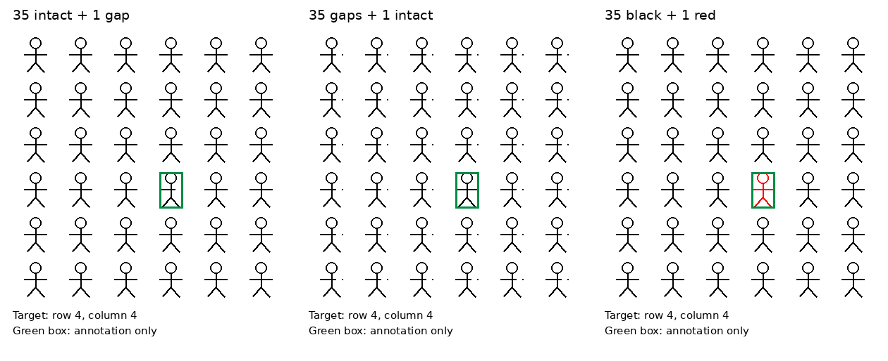
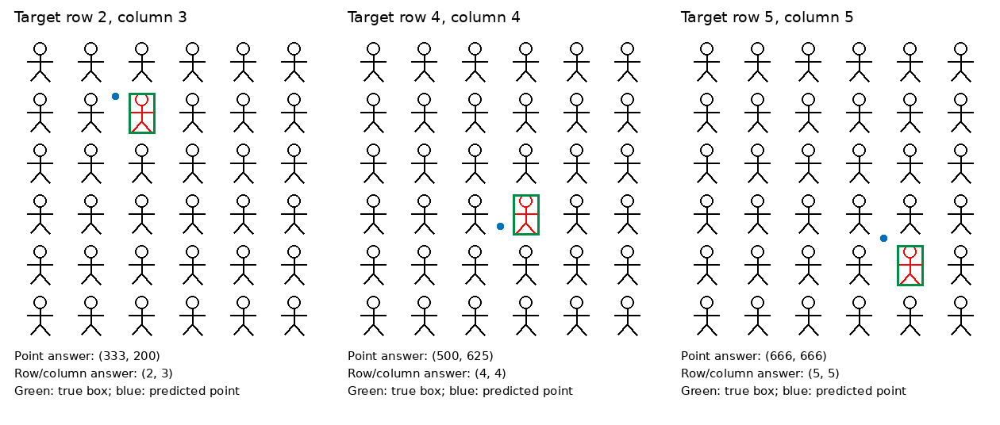
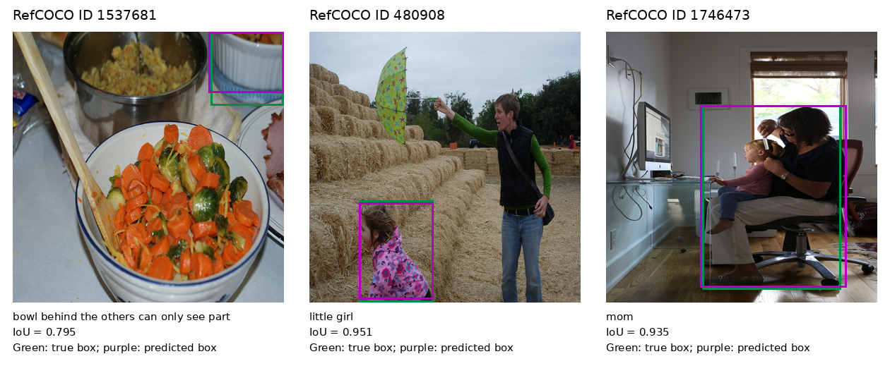

# Grounding：目标选择与答案格式

实验日期：2026-09-30。图示整理日期：2026-10-01；图示使用原有输入与回答，不包含新增模型生成。

## 1. 研究目的与实验结构

本实验检验完整 Qwen3.5-9B 在目标选择条件和答案格式改变时的行为。目标选择分为明确给定属性、相对多数特征的异常、明确给定行列；答案格式分为 point、bbox 和行列。这样的交叉设计可以区分“没有找到目标属性”“没有通过比较选出少数实例”和“未准确输出位置”，同时避免把已告知异常属性的搜索任务当成完整找不同任务。

前一项[规模与 point 实验](results_2026-09-30_point.md)发现，在密集图上即使给出显著红色特征，中心点仍可能错误。为进一步区分细节辨认、目标选择与几何表达，本实验固定较小的 6×6 图，补充答案格式对照，并以自然图像校准坐标输出。

固定样本包含 57 条合成图查询，以及 8 张 RefCOCO 自然图各两种几何输出，共 73 条。模型为 Qwen3.5-9B，checkpoint 为 `c202236235762e1c871ad0ccb60c8ee5ba337b9a`，使用 bfloat16、SDPA、greedy、batch size 1、thinking off、seed 0 和 512-token 输出预算。73 条回答均以 EOS 结束，没有截断。输入图像和全部原始回答保存在 WORK_DIR 的 `grounding/comparison_grounding_v1/`。

主要观察是：少数特征的方向、图像类型和答案形式都会改变结果。三个红色目标的行列回答均正确，中心点却均未选到正确实例；八张自然图的 bbox 几何内容均达到 IoU≥0.5，但多数没有遵循 JSON 包装要求。当前样本量仅能用于定位后续研究问题，不能估计整个模型的通用 grounding 准确率。

## 2. 数据与信息控制

### 2.1 多数与少数特征的交换

合成图为 384×384 pixels，包含 6×6 小人，单元为 64×64 pixels。目标固定在第 2 行第 3 列、第 4 行第 4 列和第 5 行第 5 列。对每个位置分别生成两种图像：35 个完整小人与 1 个右臂有 8×2-pixel 缺口的小人，以及 35 个有相同缺口的小人与 1 个完整小人。图案大小和目标位置在两种条件间保持不变。

明确属性的查询分别说明目标右臂有缺口或完整无缺口。比较查询只说明有一个小人与其他小人不同，不透露哪种属性是少数。行列查询直接给定目标序数，不说明该实例的属性。前两种条件分别输出 point、bbox 与行列；行列查询只输出 point 和 bbox，因为重复输入中的行列答案没有诊断价值。两种多数条件、三个位置和每图八条查询形成 48 条合成查询。

另生成三个对应位置为红色、其他小人为黑色的图像，每幅图分别要求 point、bbox 与行列，形成九条显著属性查询。所有查询独立执行，模型无法读取其他输出。

Point 真值采用实例 tight bbox 的中心。合成 bbox 由每个已知单元内的实际非白像素计算，使用半开坐标范围；最小单元的 bbox 为 (16,8,49,59)，中心为 (32.5,33.5)。使用实际 raster 边界可以包含线宽对笔画端点的影响。两种多数条件下实例外边界不变，因此其 bbox 真值一致。

图 1：三种数据条件的示例，目标均为第 4 行第 4 列。绿色框只用于本文说明，没有出现在模型输入中。前两列交换完整手臂与缺口手臂的多数／少数地位，第三列使用红色作为显著目标属性。原始输入不含行列编号。

### 2.2 RefCOCO 自然图校准

按 validation shard 的排序和行顺序选择前八张不同图像，以原始 image bytes 的 SHA256 去重。数据中的 question 字段是区域描述指令，本实验使用 answer 数组中的第一个 referring expression 作为定位描述，bbox 从原有 xywh 转为 xyxy。每张图分别请求 point 和 bbox，不额外画圈，不给目标位置。

八个 question IDs 为 1537681、480908、1746473、190137、514243、50194、473903、2162742。它们是固定顺序的便利样本，包含人物、动物和器皿等目标，没有经过难度分层。实验也没有排查预训练数据重叠，因而结果仅用于当前 checkpoint 与输入流程的基础校准。

### 2.3 输入与输出示例

同一张少数缺口图的三种目标选择条件如下。每条问题都在独立会话中输入该图。

| 选择条件 | 实际问题的目标描述部分 |
| --- | --- |
| 明确缺口属性 | Find the one person whose arm on the right side of the image has a gap. |
| 比较多数与少数 | One person differs from all the others. Find that person. |
| 指定行列 | Find the person in row 4, column 4, counting from top to bottom and left to right starting at 1. |

Point 条件在描述后要求 bbox 中心，并指定输出 `[{"point_2d": [x, y]}]`；bbox 条件要求紧框，并指定 `[{"bbox_2d": [x_min, y_min, x_max, y_max]}]`。两者均明确所有坐标使用 0–1000 范围、横坐标向右增大、纵坐标向下增大，且不要求解释。行列条件指定输出 `{"row": r, "column": c}`，序数从 1 开始。自然图像将目标描述替换为 `Locate the object described as: ...`，其中省略处逐字填入原始 referring expression。

### 2.4 实验操作

1. 生成九张不同的合成图像，并读取八张去重的 RefCOCO 原图。生成器保存实例的实际像素边界；自然图保存原始标注框。所有真值均不写进模型提示。
2. 按目标选择条件和答案格式构造 73 条输入，保存每条 prompt、图像 hash、目标标注和任务类别。独立执行每条查询，保持 checkpoint、processor、解码参数和 thinking 模式不变。
3. 保存完整原始回答与结束原因，首先执行指定 JSON 格式的严格评分，再独立执行允许明确裸坐标 list 的内容诊断。两套评分共享原回答，格式失败不删除。
4. 按图像条件和答案形式分别统计。图示将真值与模型输出映射回原图，以检查错误来自选错实例还是位置／范围偏差；这些框和点仅为推理结束后的可视化。

## 3. 格式评分与几何评分

### 3.1 保留严格格式评分

Point 提示要求单元素 JSON list，其中包含 point_2d；bbox 提示要求单元素 JSON list，其中包含 bbox_2d；行列要求含 row 与 column 的 JSON 字典。所有图像坐标采用 0–1000 归一化。严格解析接受代码围栏和额外 label，但拒绝错误结构、多目标、非法数值、越界和退化 bbox。原严格结果保存在 `scores.json`，没有重新解释或覆盖。

73 条回答中有些直接给出二元素或四元素坐标 list，几何内容明确但不符合指定包装。因此另生成 `scores_geometry.json`，将“可解读坐标内容”作为独立诊断指标。该诊断只额外接受 point 的二元素纯数字 list、bbox 的四元素纯数字 list；不从解释文字中提取数字，也不将 point 问题中的四元素 bbox 转换为中心。四条自然 point 查询实际输出了四个数，这些仍判为任务形式不匹配并保留为失败。

### 3.2 几何指标

Point 的精度指标为预测中心与真实中心的欧氏距离不超过目标 bbox 对角线的 10%；另报告落入 bbox 与否。在合成图中，还通过最近且唯一的实例中心判断是否选对实例。BBox 的主指标为 IoU≥0.5；另通过预测框中心的最近实例测量其是否位于正确实例附近。最近实例正确并不保证 point 准确，也不保证框覆盖了正确范围。

行列使用 exact match。不同格式的主指标性质不同，因此不将 point、bbox 和行列的正确数量直接相加形成总体性能。所有解析失败均留在对应分母内。

## 4. 合成图结果

下表使用独立的坐标内容诊断。每个单元分母均为三个固定目标位置；“实例正确”是最近实例指标。

| 图像条件与目标选择 | Point 实例正确 | Point 精度达标 | Bbox 中心实例正确 | Bbox IoU≥0.5 | 行列正确 |
| --- | --- | --- | --- | --- | --- |
| 少数缺口，明确给定缺口属性 | 1/3 | 0/3 | 1/3 | 0/3 | 2/3 |
| 少数缺口，只说明与多数不同 | 1/3 | 0/3 | 1/3 | 0/3 | 2/3 |
| 少数缺口，直接给定行列 | 2/3 | 0/3 | 2/3 | 0/3 | 不测 |
| 少数完整，明确给定完整属性 | 0/3 | 0/3 | 0/3 | 0/3 | 0/3 |
| 少数完整，只说明与多数不同 | 0/3 | 0/3 | 0/3 | 0/3 | 0/3 |
| 少数完整，直接给定行列 | 0/3 | 0/3 | 1/3 | 0/3 | 不测 |
| 唯一红色，明确给定红色属性 | 0/3 | 0/3 | 2/3 | 0/3 | 3/3 |

三个红色实例的行列回答全部正确，说明至少在这些独立查询中模型能表达正确的实例序数；对应中心点却全部位于错误实例附近。三个 point 分别输出 (333,200)、(500,625)、(666,666)，与实际目标中心不同。第一个红色 bbox 的 IoU 为 0.469，另两个为 0 和 0.096，提示框中心接近目标仍可能伴随明显范围误差。这组对照支持继续检查位置读取与几何表达，但不同问题可能改变模型的目标选择过程，因此不能断言三类回答共享同一个已经正确的内部实例选择状态。

图 2：三个独立红色目标。绿色框为真实实例，蓝点为 point 查询的模型输出，下方列出另一条独立查询的行列回答。行列三次均正确，而三个中心点均接近错误实例。不同问法可能改变内部选择过程，因此该图展示行为差异，不证明坐标生成时的目标选择已正确。

少数缺口和少数完整之间存在明显差异，但显式告诉模型“完整无缺口”的查询也失败。因此目前不能将交换多数之后的性能下降唯一归因于模型不会比较多数与少数；完整笔画的辨认、重复背景改变后的表征、语言属性映射和位置读取均可能参与。下一步应在指定范围内单独验证该属性，再测量特征比较所增加的困难。

严格格式评分与坐标内容诊断的差别主要出现在行列条件：少数缺口的 point 只有 1/3 符合指定 JSON 结构，bbox 为 0/3；少数完整分别为 0/3 和 1/3。其他合成条件均满足指定格式。这些格式失败不能自动解释为位置错误，故主表显式使用坐标内容指标。该指标仍将全部三条查询留在分母中。

## 5. 自然图结果

| 查询 | 严格格式有效 | 严格格式且几何达标 | 坐标内容有效 | 坐标内容且几何达标 |
| --- | --- | --- | --- | --- |
| Point | 3/8 | 3/8 | 4/8 | 4/8 |
| Bbox | 1/8 | 1/8 | 8/8 | 8/8 |

八个 bbox 的 IoU 依次为 0.795、0.951、0.935、0.992、0.880、0.856、0.975、0.984，全部高于 0.5。四个有效 point 的误差均低于相应 bbox 对角线的 10%；剩余四条 point 查询给出了四元素坐标，未按答案类型转换为成功。

图 3：按采样顺序展示前三张自然图。绿色为真值 bbox，紫色为模型回答中的 bbox；标题对应原始 question ID，图下给出 referring expression 与 IoU。为了并列展示，图像统一显示为方形；框和图像使用同一缩放，实际评分始终在原图坐标中计算。

这一结果说明当前模型与推理流程能够在所选自然样本上输出准确 bbox。合成重复小人的失败因而不能直接外推为模型普遍无法表达图像坐标。两个集合在目标外观、尺寸、数量、背景与描述训练分布等方面都不同，尚不能将差异唯一归因于重复图案或序列长度。

## 6. 对后续实验的约束

本轮最值得继续验证的是“正确行列与错误 point/bbox 是否反映几何读出不足”。可以在独立样本上先验证目标属性和实例序数，再对问题末端与坐标生成位置进行 probe 和 activation patching，并与原图 visual tokens 的位置 probe 对接。这类实验必须控制不同答案格式对查询计算的影响。

对特征比较，应使用更多图案和对称的属性交换，保持细节可见性，并加入多数/少数属性判断的无坐标任务。只有明确属性查询与指定范围属性判断都成功，而不告知异常属性的比较失败时，才更有根据把新增困难定位到实例间比较。

运行入口为 `scripts/analysis/behavior/comparison_grounding.sh`。模型、GPU、自然图数量、输出预算和仅生成坐标内容诊断的开关集中在脚本顶部。原始图像、cases、experiment metadata、模型运行配置、原回答与两套明确区分的评分均保留。五项测试覆盖多数交换、真实 bbox、框几何、point 精度与属性、严格格式和坐标内容解析的边界；没有训练或修改模型权重。
