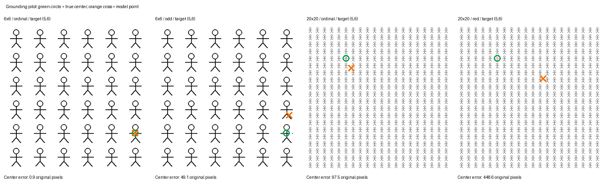

# Point grounding：规模与查询条件

实验日期：2026-09-30。本实验将目标指定方式与图像规模交叉，观察完整模型的中心点输出；特征分析见[单图固定高分位置](../representation/results_2026-09-30_pilot.md)。

## 1. 模型与运行条件

| 项目 | 实际设置 |
| --- | --- |
| 模型 | Qwen3.5-9B |
| checkpoint revision | `c202236235762e1c871ad0ccb60c8ee5ba337b9a` |
| Transformers / PyTorch | 5.17.0 / 2.14.0+cu130 |
| GPU | 一张 A800 80GB；完整模型全部放在 GPU |
| 表征实验 | 仅加载 visual encoder 与 merger，float32、SDPA |
| 行为实验 | 完整模型，bfloat16、SDPA、greedy、batch size 1、seed 0、thinking off |
| 行为实验输出 | 0–1000 归一化的单个 point_2d，x 从左到右、y 从上到下 |
| 正式 pilot 回答预算 | 最多 512 个新 tokens，32/32 条回答均以 EOS 结束 |

实验采用仓库锁定环境，没有修改依赖。输出通过 `.env` 的 WORK_DIR 保存。原始实验路径分别为 `grounding/qwen35_9b_pilot_v1/representation/` 和 `grounding/qwen35_9b_pilot_v2/behavior/`。

## 2. 图像规模与目标选择

### 2.1 图像与查询

采用 6×6 和 20×20 两种规模，分别使用规则与不等间距布局。每种组合测试第 2 行第 3 列、第 5 行第 6 列两个目标。每个目标产生四个任务，共 32 条查询：

1. 全正常图中，直接要求指定行列小人的 bbox 中心。
2. 将该目标画成红色，要求红色小人的中心。
3. 擦除该目标右臂上的 8×2 pixels，要求缺口小人的中心。
4. 在同一缺口图上直接提供目标行列，要求该小人的中心。

第 3 类明确提供“右臂有缺口”这一目标属性，属于细微属性搜索。它没有要求模型自行比较多数与少数特征，因此不测量完整找不同过程。第 4 类只提供行列作为选择条件，提示词没有告知缺口属性；它用于绕过属性搜索。所有查询在独立会话中执行。

图 1：原实验保存的输入与中心点输出示例。图中的真值和预测标记均在推理结束后绘制，模型输入只包含原始小人图；不同画布尺寸下单个小人的像素大小保持一致。

两种规模中小人的笔画和实际像素大小一致；规则单元均为 64×64。画布从 384×384 增加到 1280×1280。Processor 核验给出 24×24 与 80×80 的 patch 网格，对应 144 与 1600 个 visual tokens，图像未缩小。因而本轮规模差异没有伴随单个小人的输入像素变小，但总序列长度、全图上下文、相对坐标范围和位置编码分布同时改变，仍需后续分离。

不等间距布局将前半列宽设为 48、后半列宽设为 80，前半行高设为 80、后半行高设为 48；画布大小不变，小人只平移而不缩放。它是一个固定的非均匀模板，不能代表所有不规则布局。

### 2.2 评分约定

解析器接受包含一个 point_2d 的 JSON list，可带 Markdown 代码围栏及额外 label；拒绝多点、缺失坐标、非数值、NaN 或越界坐标。预测坐标映射回原图后，以距离最近且唯一的实例中心判定是否“选对实例”，并另报中心误差不超过 8 pixels 的比例。未解析与截断回答都保留在总分母内。

最近中心正确允许预测落在身体外，因此只衡量实例身份，不等同于精确 point grounding；8 pixels 阈值在本轮固定的小人尺度下统一使用。本轮参考点沿用生成器的几何定义，为每个 64-pixel 单元内的 (32, 32.5)，缺口不改变参考点。该定义与对实际有色像素计算半开 tight bbox 的中心略有差别，后者为 (32.5, 33.5)，因此这些历史数值应按本轮参考点理解。32 条回答均可解析，均未触发长度上限。

### 2.3 结果

下表分别合并规则与不等间距布局，因此每个单元含四次查询。

| 查询任务 | 6×6：选对实例 | 6×6：中心误差 ≤8 px | 20×20：选对实例 | 20×20：中心误差 ≤8 px |
| --- | --- | --- | --- | --- |
| 全正常图中按行列定位 | 3/4 | 1/4 | 0/4 | 0/4 |
| 红色目标定位 | 3/4 | 0/4 | 0/4 | 0/4 |
| 根据给定缺口属性搜索目标 | 1/4 | 0/4 | 0/4 | 0/4 |
| 已提供缺口目标的行列 | 4/4 | 1/4 | 0/4 | 0/4 |

在 6×6 规则图中，第 5 行第 6 列的真实中心约为归一化坐标 (916.7, 751.3)。直接提供行列时模型输出 (916, 749)，原图误差约 0.9 pixels；要求自行寻找该位置的缺口时输出 (937, 625)，误差约 49.1 pixels，落到上一行附近。同一位置在 20×20 规则图中的真实中心约为 (275.0, 225.4)，直接提供行列得到 (312, 292)，误差约 97.5 pixels；将目标涂红后查询得到 (596, 366)，误差约 448.6 pixels。

规则布局与不等间距布局的样本数各为二，尚不足以判断模型采用哪种排序或计数算法。尤其是 20×20 的红色定位也失败，说明该条件下不能只围绕缺口辨认解释错误；还需比较显著目标的 row-column、point、bbox 输出及自然图像 REC 校准。没有普通 REC 的独立测量，不能声称该 checkpoint 的所有 grounding 都差，也不能预设它已可靠掌握基础定位。

### 2.4 首轮格式诊断的保留记录

行为实验的 v1 使用字典型 point 格式提示和 128-token 上限。32 条查询中有 6 条截断，其余回答主要采用模型常见的单元素 list 与 point_2d；原严格评分记录为 0 个有效回答。该轮保存在 `grounding/qwen35_9b_pilot_v1/behavior/`，未删除或改写评分，也不将其全零分数解释为视觉定位全错。

v2 独立使用 single-point point_2d 提示及 512-token 预算；上表仅报告 v2。两轮同时改变了提示和长度预算，因此不能据此归因某一个因素的改善。原始 prompts、回答、finish_reason、生成配置与图像 hash 均保存，可重现每一轮输入。

## 3. 由结果提出的问题

显著红色目标在密集图上也出现错误，因此需要区分目标选择和几何表达，并用自然 REC 进行校准。由此开展[目标选择与答案格式实验](results_2026-09-30.md)。
