# 找不同的能力分解

实验日期：2026-10-13 至 2026-10-14。本文属于[行为诊断](plan.md)研究，执行[实验 1.3 设计](design_decomposition.md)。主模型为 Qwen3.5-9B，bfloat16、SDPA、greedy decoding，主评测为 thinking off。

## 1. 研究问题与主要结果

实验 1.1 与 1.2 发现，红色目标的行列答案可以正确而中心点错误，密集网格中红色目标也会定位失败，但每个条件只有 2 至 4 个样本。本实验将找不同拆分为六个子任务（T1 单实例属性判断、T2 两实例异同判断、T3 图中指定实例判断、T4 已知属性搜索、T5 完整找不同、T6 显著目标定位）以及 T0 行列计数，在同一批合成图像上按变化类型、变化幅度和网格规模系统测量，确定完整任务最先在哪一步失败。

主评测共 37752 次查询，主要结果如下：

1. **颜色色差 5 与 10 的变化在细节感知阶段即不可分辨。** 这两个等级上 T1 与 T2 的 AUROC 为 0.53–0.62，T5 行列准确率不超过 0.17；缺口与旋转的最小等级在 T2 上的 AUROC 已达 0.94 与 1.00。
2. **T3 的准确率接近 0.5 来自回答偏置。** 旋转条件下 T3 的 Yes 回答比例为 0.00–0.07，而判别分数的 AUROC 为 0.82–1.00；行列指定下缺口条件的 AUROC 为 0.75–0.85。T3 的准确率因此不能作为前置子任务的成功指标。
3. **比较与搜索没有带来额外失败。** 在全部条件中 T5 与 T4 的准确率接近；同一图像上 T4 失败时 T5 的成功比例不超过 0.24，T4 成功时 T5 的成功比例为 0.90–0.99。
4. **位置输出随网格规模失败，且存在两种不同的失败方式。** 红色目标（T6）的行列准确率在 3×3 至 10×10 为 0.96–1.00，20×20 降至 0.44；中心点命中率在 10×10 已降至 0.23。10×10 的中心点误差集中在一个单元以内（94% 的预测距目标中心不足 1 个单元边长），20×20 的行列错误中 75% 为列序号恰好大 1。
5. **在可分辨的条件下，20×20 网格的 T5 失败主要由位置输出解释。** 排除色差 5 与 10 后，T5 行列准确率在 3×3、6×6、10×10、20×20 分别为 0.85、0.79、0.91、0.49，20×20 的数值与 T6 的 0.44 相近。

## 2. 实验设计与实际执行

### 2.1 子任务、刺激与问题

刺激取自[共享合成刺激集](../stimuli.md)（生成器 stimuli-v1）：标准网格、64-pixel 实例单元，四个开发模板（小人、圆环、方框、箭头），画布边长为 $\max(256, 64g)$ pixels，其中 $g$ 为网格每边的实例数。因素水平如下：

| 因素 | 水平 |
| --- | --- |
| 变化类型 | 缺口、颜色、朝向（旋转） |
| 变化幅度（等级 1–4） | 缺口 2、4、8、16 pixels；颜色 CIELAB 色差 5、10、20 与纯红色；旋转 5°、15°、45°、90° |
| 网格规模 | 3×3、6×6、10×10、20×20 |

每个“变化类型 × 幅度 × 网格规模”单元生成 48 张异常图像，共 2304 张；缺口与颜色在四个模板上各取 12 张，旋转只用于小人与箭头，各取 24 张。T6 使用纯红色图像（每个网格规模 48 张），T0 使用不含异常实例的图像（每个网格规模 16 张）。每张异常图像同时用于 T3、T4、T5，其目标实例的裁剪图用于 T1 与 T2。每个子任务另有一种问法，在每 5 张图像中的 1 张上运行。

下图为各子任务的实际输入，均取自正式运行（缺口 16 pixels、6×6 网格、小人模板，目标位于第 2 行第 6 列；T6 的红色目标位于第 5 行第 5 列）。

| T0 行列计数 | T1 单实例（负样本，含缺口） | T1 单实例（正样本） | T2 两实例（负样本） |
| --- | --- | --- | --- |
| 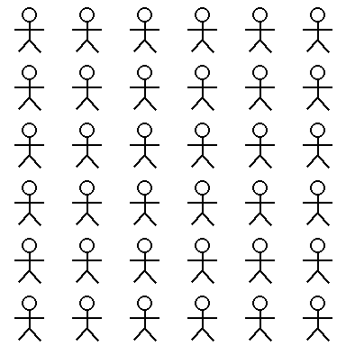 | 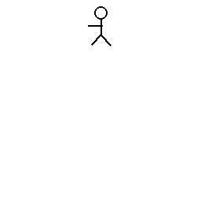 | 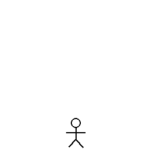 | 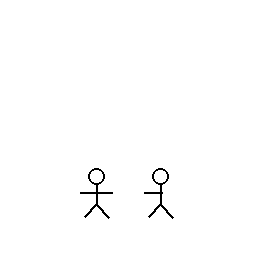 |

| T3 蓝色方框指定 | T3 行列指定、T4、T5 | T6 红色目标 |
| --- | --- | --- |
| 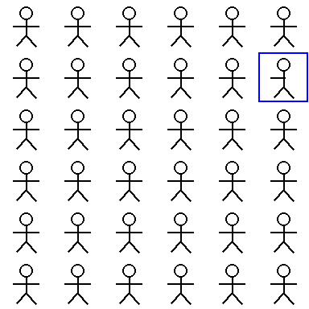 | 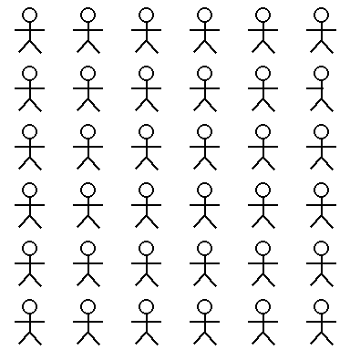 | 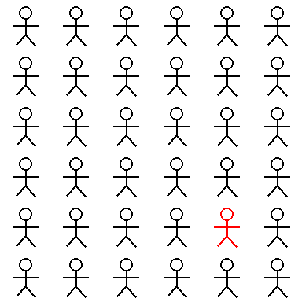 |

主问法如下（行列答案的格式要求在 T4–T6 中相同）：

| 子任务 | 问题 |
| --- | --- |
| T0 | How many rows and how many columns of figures are in this image? Return only {"rows": R, "columns": C}. Output only the JSON, with no explanation. |
| T1 | Are all strokes of this figure connected without any gap? / Is this figure drawn entirely in black? / Is this figure upright? Answer with only Yes or No. |
| T2 | Are the two figures exactly identical? Answer with only Yes or No. |
| T3 | Is the figure inside the blue box exactly identical to the other figures? 或 Is the figure in row 2, column 6 exactly identical to the other figures? Rows are counted from top to bottom and columns from left to right, starting at 1. Answer with only Yes or No. |
| T4 | One figure has a gap in its strokes. Give its position. Return only {"row": r, "column": c}, counting rows from top to bottom and columns from left to right, starting at 1. Output only the JSON, with no explanation. |
| T5 | One figure differs from all the others. Give its position.（格式要求同 T4） |
| T6 | One figure is drawn in red. Give its position.（格式要求同 T4） |

T4–T6 的每张图像另以中心点（point_2d）和 bbox（bbox_2d）两种格式各运行一次，坐标为 0–1000 归一化。

### 2.2 符号与指标

- $s$：二值任务的判别分数。记回答首个 token 处“Yes”与“No”两个 token 的 logit 为 $z_{\mathrm{Yes}}$ 与 $z_{\mathrm{No}}$，则

$$
s = z_{\mathrm{Yes}} - z_{\mathrm{No}}.
$$

  $s>0$ 记为回答 Yes。准确率按 $s$ 的符号计算；Yes 回答比例为 $s>0$ 的样本比例，用于衡量回答偏置。

- AUROC：在答案为 Yes 的样本集合 $P$ 与答案为 No 的样本集合 $N$ 上，

$$
\mathrm{AUROC} = \frac{1}{|P|\,|N|} \sum_{i \in P} \sum_{j \in N} \Big( \mathbb{1}[s_i > s_j] + \tfrac{1}{2}\,\mathbb{1}[s_i = s_j] \Big).
$$

  它等于随机抽取一个正样本和一个负样本时正样本得分更高的概率，与判别阈值无关。准确率接近 0.5 而 AUROC 明显高于 0.5，说明模型能够区分两类样本，但判别阈值偏向一侧。

- 单元距离 $d$：预测中心点 $\hat{p}$（bbox 取框中心）与目标中心 $p$ 之间的欧氏距离除以单元边长 64 pixels，

$$
d = \frac{\lVert \hat{p} - p \rVert_2}{64}.
$$

  $d<0.5$ 近似表示落在目标单元内，$d \approx 1$ 表示落在相邻实例。实例命中以预测点所在单元是否为目标单元判定。

- 行列偏差 $(\Delta r, \Delta c)$：预测行列减去真值行列，用于区分差一行或一列的计数错误与远离目标的选择错误。

- 阈值 $\delta_{75}$：设计中按准确率拟合心理测量曲线。由于 T3 存在强回答偏置（第 4.2 节），本文另以 AUROC 定义阈值：在对数幅度轴上对相邻等级的 AUROC 线性插值，取 AUROC 首次达到 0.75 的幅度。设相邻等级幅度为 $\delta_k < \delta_{k+1}$，AUROC 为 $a_k < 0.75 \le a_{k+1}$，则

$$
\log \delta_{75} = \log \delta_k + \frac{0.75 - a_k}{a_{k+1} - a_k}\,\big(\log \delta_{k+1} - \log \delta_k\big).
$$

  若最小等级已达到 0.75，则阈值记为“低于测试范围”；若最大等级仍未达到，则记为“高于测试范围”。

- 区间：比例的 95% 区间均为 Wilson 区间。

### 2.3 评分口径

1. 二值任务按 $s$ 的符号评分，生成回答的格式只用于检查，主评测中 T1–T3 的 Yes／No 格式合规率为 100%。
2. 定位任务同时保存严格评分与内容诊断评分。严格评分要求 JSON 与指定 schema 完全一致；内容诊断评分额外接受无歧义的包装差异，例如用单元素 list 包装的行列字典或裸坐标 list。T4 行列答案中有 625 条、T5 中有 411 条属于前一种包装，严格评分将其记为失败。由于本实验关注答案内容，正文的定位结果均使用内容诊断评分；严格评分见产物中的 tables.md。截断与无法解析的回答在两种口径下均计为失败。
3. bbox 答案除 IoU≥0.5 外，另报告框中心命中率。目标实例的 tight bbox 只有约 33×51 pixels，模型给出的框宽约为 tight bbox 的 1.3 倍，因此即使在 3×3 网格中 T6 的框中心命中率为 1.00，IoU≥0.5 的比例也只有 0.12。IoU≥0.5 主要反映框的尺寸精度，不适合比较实例选择。

### 2.4 规模、耗时与运行

| 条件 | 查询数 | 运行时间 | 说明 |
| --- | --- | --- | --- |
| 主评测 | 37752 | 6 h 56 min（2026-10-13 21:45 至 10-14 04:42） | 单张 GPU，batch size 1，平均约 0.66 s／条 |
| 显式推理（thinking off） | 300 | 分两段运行；后 109 条用时 36 min | 前 191 条的耗时未单独记录 |
| thinking on | 52 | 58 min | 平均约 67 s／条 |
| BabyVision 对应问题 | 192 | 55 s | |

二值任务的输出上限为 8 tokens，定位任务为 256 tokens，显式推理为 2048 tokens，thinking on 为 8192 tokens。另有一次每单元 3 张图像的开发运行（目录 2026-10-13_decomposition_pilot），仅用于检查程序与问法，不进入本文的任何统计。

### 2.5 与设计的偏离

1. **推理过程观察的规模缩小。** 设计为每种条件约 1500 次生成；实际显式推理为 300 条（最小与次大幅度，每单元 6 张），thinking on 为 52 条（只取次大幅度，每单元 2 张）。thinking on 平均每条约 67 s，在单张 GPU 上运行设计规模需要约 28 h，因此缩小样本。两种条件的比较只能检测较大的差异。
2. **人工编码规模与编码者。** 设计为 300 条人工编码与第二名编码者的 60 条复核；实际在 352 条推理文本中按“条件 × 子任务 × 正误”分层，每层最多抽取 8 条，共 101 条，由 Claude agent 单一编码者完成，没有第二名编码者，因而无法报告 Cohen's kappa。撰写本文时另对其中 4 条随机样本复核了编码，与原编码一致。规则抽取的错误率在这 101 条上估计，而非另抽 50 条。
3. **辅助条件未运行。** 设计第 2.2 节的固定画布、非方形网格、多数／少数交换、保留模板与其他变化类型均未运行，因此本文没有多数／少数对照的结果。
4. **定位任务的输出上限为 256 tokens**，设计为 128 tokens；放宽上限是为了减少 bbox 回答附带 label 字段时的截断。
5. **阈值定义。** 在设计的准确率拟合之外增加了基于 AUROC 的阈值（第 2.2 节）。
6. **BabyVision 的对应问题**在设计的 T2、T3、T6 之外增加了原始问题的 T5 行列版本。

## 3. 子任务结果

### 3.1 子任务曲线

下图给出每种变化类型下各子任务的准确率随网格规模的变化，每条曲线对应一个变化幅度，误差线为 Wilson 95% 区间，虚线为随机水平（二值任务为 0.5，行列为 $1/g^2$，中心点为单元面积占画布面积的比例）。定位任务使用内容诊断评分。

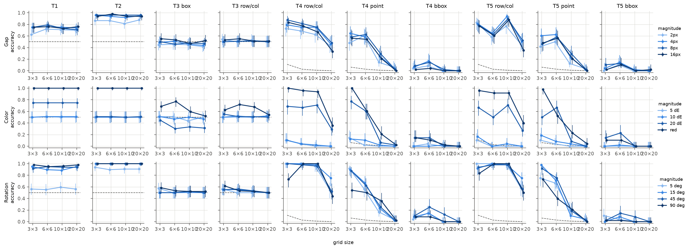

T1–T3 的 AUROC 曲线如下，虚线为 0.5。

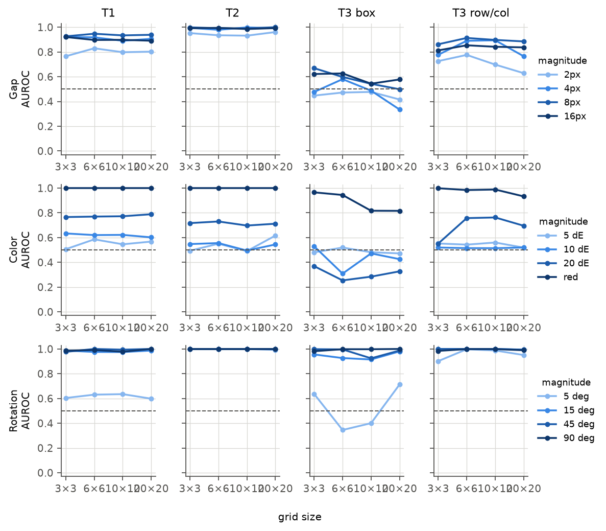

数据显示三类模式：

1. **T1 与 T2 不随网格规模变化。** 二者的输入只含一个或两个实例，与网格规模无关，四个网格规模相当于对同一类输入的重复测量。
2. **T4 与 T5 的行列答案在 3×3 至 10×10 基本持平，在 20×20 下降约一半。** 中心点与 bbox 答案在 10×10 已大幅下降。
3. **T3 在几乎所有条件下接近 0.5**，只有纯红色条件略高（0.52–0.77）。

### 3.2 细节感知：T1 与 T2

下表按变化类型与幅度汇总 T1 与 T2 的 AUROC（四个网格规模合并，每格 $n=192$），并给出 AUROC 阈值。

| 变化类型 | 子任务 | 等级 1 | 等级 2 | 等级 3 | 等级 4 | $\delta_{75}$（AUROC） |
| --- | --- | --- | --- | --- | --- | --- |
| 缺口 | T1 | 0.80 | 0.91 | 0.94 | 0.90 | 低于测试范围（<2 px） |
| 缺口 | T2 | 0.94 | 0.99 | 1.00 | 0.99 | 低于测试范围（<2 px） |
| 颜色 | T1 | 0.55 | 0.62 | 0.77 | 1.00 | 色差 17.9 |
| 颜色 | T2 | 0.54 | 0.53 | 0.71 | 1.00 | 色差 25 |
| 旋转 | T1 | 0.62 | 0.98 | 0.99 | 0.99 | 7.5° |
| 旋转 | T2 | 1.00 | 1.00 | 1.00 | 1.00 | 低于测试范围（<5°） |

数据显示：

1. **颜色色差 5 与 10 在 T1 与 T2 上均接近随机水平**，色差 20 的 AUROC 为 0.71–0.79，纯红色为 1.00。颜色变化的前三级为接近黑色的深色，sRGB 分别为 (19,6,2)、(30,12,5)、(48,20,10)。
2. **缺口与旋转的最小等级在 T2 上已可分辨**（AUROC 0.94 与 1.00），在 T1 上较低（0.80 与 0.62）。用语言描述的属性问题比不需要说出属性的异同比较更难。
3. **T1 存在模板相关的偏置。** 缺口条件下小人模板的 Yes 回答比例为 0.01，即模型几乎总是回答小人“有缺口”，而 AUROC 为 0.83；其余三个模板的 Yes 回答比例为 0.26–0.62。原模板小人的头部与身体相接（见第 2.1 节示例），由于 AUROC 较高，这一偏置可能来自模型对“strokes connected”在火柴人图形上的理解，属于问题措辞与模板的交互；该推测尚未检验。
4. **颜色条件下 T2 偏向回答“相同”。** 颜色条件的 T2 Yes 回答比例为 0.87，色差 20 时准确率只有 0.51，但 AUROC 为 0.71–0.73。

按准确率拟合的心理测量曲线见下图。由于 T3 的准确率受偏置支配，T3 的拟合阈值全部落在测试范围之外或接近最大等级，不具解释意义。

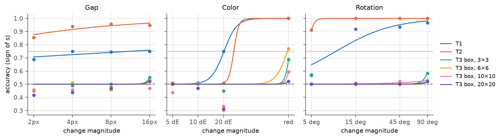

### 3.3 回答偏置：T3

下表汇总 T3 的准确率、AUROC 与 Yes 回答比例（四个幅度合并，每格 $n=384$）。T3 中“Yes”表示被指定实例与其他实例相同，因此真实目标的正确答案为 No。

| 变化类型 | 指定方式 | 网格 | 准确率 | AUROC | Yes 回答比例 |
| --- | --- | --- | --- | --- | --- |
| 缺口 | 蓝色方框 | 3 / 6 / 10 / 20 | 0.50 / 0.49 / 0.46 / 0.46 | 0.55 / 0.57 / 0.50 / 0.46 | 0.29 / 0.22 / 0.20 / 0.16 |
| 缺口 | 行列 | 3 / 6 / 10 / 20 | 0.52 / 0.52 / 0.52 / 0.51 | 0.78 / 0.85 / 0.82 / 0.75 | 0.14 / 0.10 / 0.11 / 0.05 |
| 颜色 | 蓝色方框 | 3 / 6 / 10 / 20 | 0.54 / 0.51 / 0.47 / 0.45 | 0.52 / 0.47 / 0.48 / 0.49 | 0.70 / 0.75 / 0.62 / 0.50 |
| 颜色 | 行列 | 3 / 6 / 10 / 20 | 0.54 / 0.56 / 0.55 / 0.52 | 0.56 / 0.60 / 0.61 / 0.59 | 0.65 / 0.61 / 0.60 / 0.39 |
| 旋转 | 蓝色方框 | 3 / 6 / 10 / 20 | 0.54 / 0.51 / 0.51 / 0.51 | 0.85 / 0.84 / 0.82 / 0.92 | 0.07 / 0.01 / 0.03 / 0.01 |
| 旋转 | 行列 | 3 / 6 / 10 / 20 | 0.57 / 0.54 / 0.52 / 0.50 | 0.97 / 1.00 / 0.99 / 0.94 | 0.07 / 0.04 / 0.02 / 0.00 |

下图为全部 T3 样本上 $s$ 的分布，按被指定实例为真实目标（正确答案 No）与正常实例（正确答案 Yes）分色。正常实例的 $s$ 集中在 −2 附近，即模型对正常实例也倾向回答“不相同”。

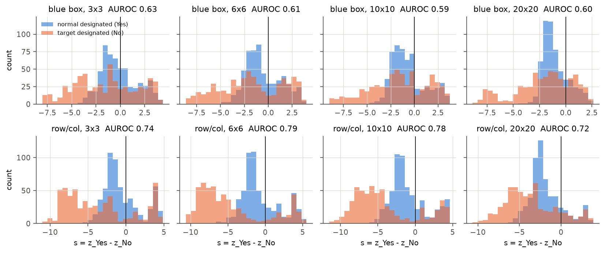

数据显示：

1. **旋转与缺口（行列指定）条件下，T3 准确率接近 0.5 是回答偏置所致。** 模型几乎对所有被指定实例回答“不相同”，但 $s$ 对真实目标与正常实例的排序正确，旋转条件的 AUROC 为 0.82–1.00，缺口行列条件为 0.75–0.85，且不随网格规模单调下降。
2. **缺口（蓝色方框指定）与颜色条件的 AUROC 接近 0.5**，说明在这些条件下 $s$ 本身也不能区分目标与正常实例。色差 20 的蓝色方框条件 AUROC 为 0.25–0.37（见第 3.1 节 AUROC 图），即被方框指定的真实目标反而得到更高的“相同”分数；其原因尚不清楚。
3. **行列指定的 AUROC 不低于蓝色方框指定。** 设计第 5.4 节预期的“方框成功而行列失败”模式没有出现。

### 3.4 行列计数：T0 与 T6

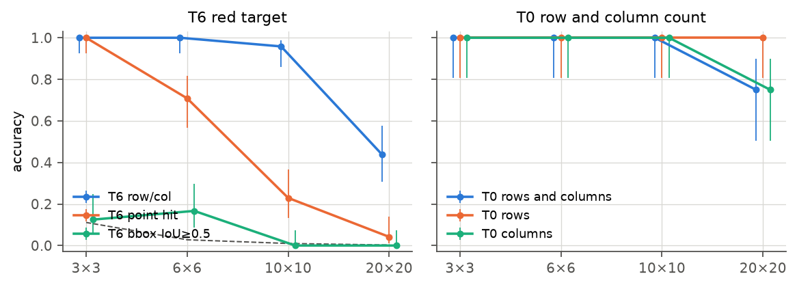

| 网格 | T6 行列 | T6 中心点命中 | T6 框中心命中 | T6 IoU≥0.5 | T0 行数正确 | T0 列数正确 |
| --- | --- | --- | --- | --- | --- | --- |
| 3×3 | 1.00 [0.93, 1.00] | 1.00 [0.93, 1.00] | 1.00 [0.93, 1.00] | 0.12 | 16/16 | 16/16 |
| 6×6 | 1.00 [0.93, 1.00] | 0.71 [0.57, 0.82] | 0.79 [0.66, 0.88] | 0.17 | 16/16 | 16/16 |
| 10×10 | 0.96 [0.86, 0.99] | 0.23 [0.13, 0.37] | 0.15 [0.07, 0.27] | 0.00 | 16/16 | 16/16 |
| 20×20 | 0.44 [0.31, 0.58] | 0.04 [0.01, 0.14] | 0.02 [0.00, 0.11] | 0.00 | 16/16 | 12/16 |

T6 每格 $n=48$，T0 每格 $n=16$。数据显示：

1. **红色目标的行列答案在 10×10 以内几乎全部正确，中心点答案从 6×6 开始下降。** 这与实验 1.2 中“行列正确而中心点错误”的观察一致，且本实验给出了 48 个样本的估计。
2. **20×20 网格的列计数出错。** T0 在 20×20 中有 4/16 次回答 21 列，行数全部正确。T6 在 20×20 的 25 个错误行列答案中，16 个只错列，列偏差的均值为 +1.0。

### 3.5 位置误差的结构

**行列偏差。** 下图为 10×10 与 20×20 网格中 T4–T6 行列答案的偏差分布。

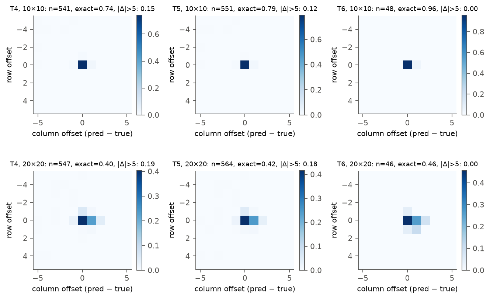

错误行列答案的构成（内容诊断评分）：

| 子任务 | 网格 | 错误数 | 回答 (1,1) 的比例 | 只错行 | 只错列 | 行列均错 | 与目标相邻 |
| --- | --- | --- | --- | --- | --- | --- | --- |
| T4 | 6 | 118 | 0.53 | 0.17 | 0.17 | 0.66 | 0.19 |
| T4 | 10 | 140 | 0.82 | 0.09 | 0.23 | 0.68 | 0.18 |
| T4 | 20 | 326 | 0.29 | 0.12 | 0.53 | 0.35 | 0.53 |
| T5 | 6 | 86 | 0.52 | 0.30 | 0.13 | 0.57 | 0.21 |
| T5 | 10 | 114 | 0.82 | 0.09 | 0.25 | 0.66 | 0.19 |
| T5 | 20 | 329 | 0.28 | 0.12 | 0.54 | 0.34 | 0.56 |

数据显示两类错误：

1. **回答 (1,1)。** 在 6×6 与 10×10 网格中，52%–82% 的错误答案为第 1 行第 1 列，集中于色差 5 与 10 的条件。这是模型未找到目标时的默认答案，属于感知失败，不属于位置换算错误。
2. **20×20 网格中列序号偏大 1。** 20×20 的错误以只错列为主（53%–54%），在 T4–T6 的全部只错列答案中，75% 的列偏差为 +1，7% 为 −1。下图按真值序号分组给出行与列的正确率：20×20 网格中第 1–4 列的正确率为 0.81，第 9–12 列降至 0.31；行的正确率从 0.81 平缓降至 0.59。10×10 网格中行与列的正确率接近。

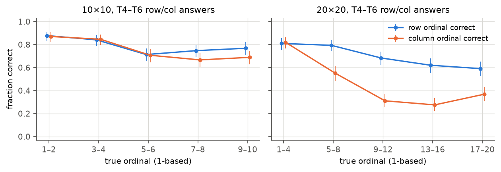

结合 T0 在 20×20 中回答 21 列的现象，数据显示 20×20 网格中列的计数在第 5 列之后多计一列，行的计数没有同样的系统偏差。列为何比行更易多计，需要由非方形网格（4×8 与 8×4）和实验 3.5 检验。

**坐标压缩与误差向量场。** 以预测的归一化坐标对真值坐标做最小二乘线性回归，斜率小于 1 表示预测向图像中心收缩。

| 子任务 | 3×3 斜率 x / y | 6×6 | 10×10 | 20×20 |
| --- | --- | --- | --- | --- |
| T4 | 0.90 / 0.87 | 0.76 / 0.75 | 0.76 / 0.79 | 0.65 / 0.61 |
| T5 | 0.68 / 0.76 | 0.74 / 0.75 | 0.73 / 0.77 | 0.63 / 0.57 |
| T6 | 1.22 / 1.30 | 0.94 / 0.95 | 0.90 / 0.99 | 0.90 / 0.84 |

T4 与 T5 的斜率包含了未找到目标时的默认答案，因而低于 T6。T6 的斜率在 6×6 至 20×20 为 0.84–0.99，压缩程度较小。T6 中心点的单元距离中位数在 3×3、6×6、10×10、20×20 分别为 0.34、0.50、0.63、3.03；10×10 中 94% 的预测距目标中心不足 1 个单元，平均向右下偏移约 0.3 个单元，20×20 中只有 8% 不足 1 个单元。因此 10×10 的中心点失败是近距离的精度不足，20×20 则是远离目标的错误。

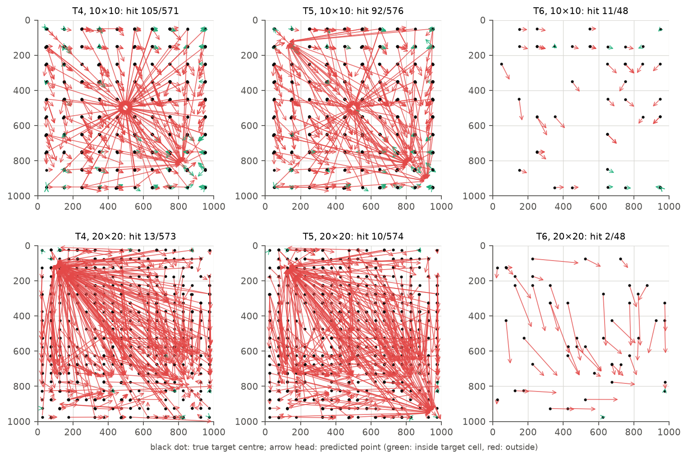

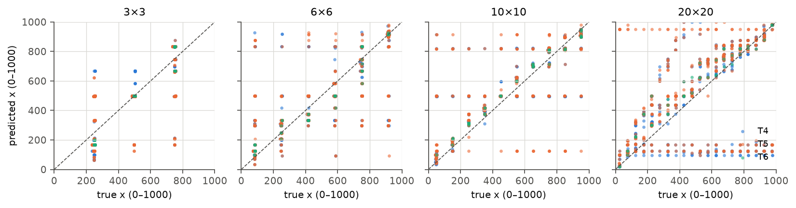

## 4. 逐图条件分析

### 4.1 记录与定义

同一张异常图像在 T1–T5 上的结果组成一条记录。二值任务以配对样本计：T1 与 T2 要求同一图像的正样本与负样本均回答正确，T3 要求指定真实目标与指定正常实例两个问题均回答正确。T4 与 T5 使用行列答案的内容诊断评分。每个网格规模有 576 条记录。

### 4.2 T5 成功率按其他子任务的结果分组

| 网格 | 条件 | T2 成功时 T5 成功率 | T2 失败时 | T1 成功时 | T1 失败时 | T4 成功时 | T4 失败时 |
| --- | --- | --- | --- | --- | --- | --- | --- |
| 3×3 | 记录数 400 / 176 / 294 / 282 / 425 / 151 | 0.90 | 0.35 | 0.89 | 0.57 | 0.93 | 0.18 |
| 6×6 | 记录数 398 / 178 / 305 / 271 / 418 / 158 | 0.83 | 0.26 | 0.77 | 0.52 | 0.90 | 0.01 |
| 10×10 | 记录数 387 / 189 / 296 / 280 / 401 / 175 | 0.95 | 0.36 | 0.95 | 0.56 | 0.99 | 0.24 |
| 20×20 | 记录数 397 / 179 / 299 / 277 / 221 / 355 | 0.53 | 0.14 | 0.49 | 0.31 | 0.97 | 0.06 |

数据显示：

1. **同一图像的 T2 结果能够预测 T5。** 在 3×3 至 10×10 网格中，T2 成功的图像 T5 成功率为 0.83–0.95，T2 失败的图像为 0.26–0.36。
2. **在 20×20 网格中，T2 成功的图像 T5 成功率也只有 0.53。** 失败发生在 T2 与 T5 之间增加的步骤上；结合第 3.4、3.5 节，这一步骤主要是行列输出。
3. **T4 与 T5 几乎同时成功或失败。** T4 成功时 T5 成功率为 0.90–0.99，T4 失败时为 0.01–0.24。T5 需要在不知道属性的情况下选出少数实例，T4 已给出属性，二者的差别没有带来额外失败。
4. **T3 不能作为条件变量。** 由于回答偏置，T3 配对成功的图像在每个网格中只有 15–55 条，按 T3 分组没有意义。

下图为 T5 失败的图像中各子任务的成功比例。

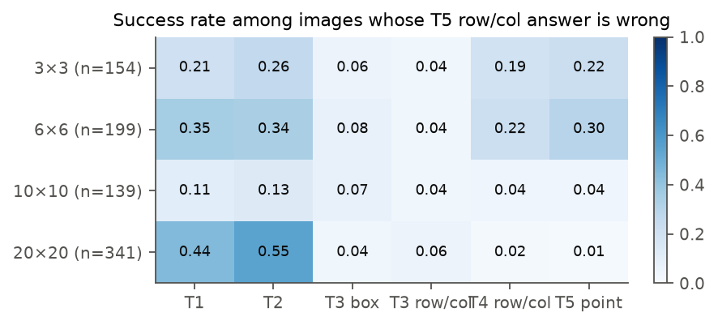

## 5. 问法检查

每 5 张图像中的 1 张另以第二种问法运行。下表为相同图像上两种问法的准确率（严格评分）：

| 子任务 | 3×3 主／替代 | 6×6 | 10×10 | 20×20 |
| --- | --- | --- | --- | --- |
| T1 | 0.74 / 0.79 | 0.73 / 0.78 | 0.74 / 0.77 | 0.78 / 0.78 |
| T2 | 0.85 / 0.85 | 0.85 / 0.86 | 0.84 / 0.85 | 0.84 / 0.85 |
| T3 | 0.54 / 0.51 | 0.50 / 0.50 | 0.50 / 0.52 | 0.50 / 0.50 |
| T4 | 0.24 / 0.48 | 0.64 / 0.68 | 0.66 / 0.72 | 0.36 / 0.39 |
| T5 | 0.39 / 0.68 | 0.66 / 0.70 | 0.75 / 0.74 | 0.35 / 0.37 |

T1–T3 的结论不依赖问法。T4 与 T5 在 3×3 的差异来自主问法下更多的 list 包装（严格评分记为失败），不改变内容诊断评分下的结论。

## 6. 推理过程观察

### 6.1 条件与样本

推理过程观察只使用 T3（行列指定）、T4、T5、T6 的行列答案格式，6×6 与 20×20 两种网格。显式推理在问题末尾要求先逐步说明观察与推理，再给出指定格式的答案；thinking on 开启模型原生 thinking，记录 thinking 段落与最终回答。显式推理的二值答案从最后一个“Answer: Yes／No”解析，定位答案取文本中最后一个 JSON 对象；thinking on 的答案取 `</think>` 之后的文本。

### 6.2 与主评测的准确率对照

在相同的问题上比较主评测与推理条件的结果，检验采用 exact McNemar 检验。记 $b$ 为主评测正确而推理条件错误的问题数，$c$ 为相反情形的问题数，在两种条件准确率相同的零假设下 $b$ 服从 $\mathrm{Binomial}(b+c, 1/2)$，双侧 $p$ 值由该分布计算。

| 条件 | 子任务 | 网格 | $n$ | 主评测 | 推理条件 | $b$ | $c$ | McNemar $p$ |
| --- | --- | --- | --- | --- | --- | --- | --- | --- |
| 显式推理 | T3 | 6 | 72 | 0.50 | 0.58 | 3 | 9 | 0.15 |
| 显式推理 | T3 | 20 | 72 | 0.50 | 0.72 | 5 | 21 | 0.0025 |
| 显式推理 | T4 | 6 / 20 | 36 / 36 | 0.75 / 0.39 | 0.69 / 0.36 | 3 / 4 | 1 / 3 | 0.63 / 1.00 |
| 显式推理 | T5 | 6 / 20 | 36 / 36 | 0.69 / 0.44 | 0.69 / 0.31 | 2 / 5 | 2 / 0 | 1.00 / 0.063 |
| 显式推理 | T6 | 6 / 20 | 6 / 6 | 1.00 / 0.33 | 1.00 / 0.33 | 0 / 1 | 0 / 1 | 1.00 |
| thinking on | T3 | 6 / 20 | 12 / 12 | 0.50 / 0.50 | 0.83 / 0.58 | 0 / 2 | 4 / 3 | 0.13 / 1.00 |
| thinking on | T4 | 6 / 20 | 6 / 6 | 1.00 / 0.50 | 1.00 / 0.50 | 0 | 0 | 1.00 |
| thinking on | T5 | 6 / 20 | 6 / 6 | 1.00 / 0.50 | 1.00 / 0.50 | 0 | 0 | 1.00 |
| thinking on | T6 | 6 / 20 | 2 / 2 | 1.00 / 0.50 | 1.00 / 0.00 | 0 / 1 | 0 | 1.00 |

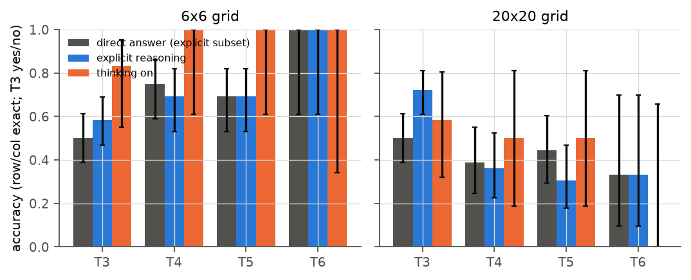

数据显示：

1. **显式推理提高了 T3 的准确率，同时回答偏置消失。** 显式推理下 T3 的 Yes 回答比例为 0.47，主评测中行列指定 T3 的 Yes 回答比例依变化类型为 0.00–0.65；合并两种网格后准确率由 0.50 提高到 0.65（$b=8$，$c=30$，$p=0.0005$）。thinking on 的方向相同（0.50 提高到 0.71，$n=24$，$p=0.18$）。
2. **推理没有改善定位任务。** 显式推理下 T4–T6 的准确率与主评测相同或略低，20×20 网格的 T5 由 0.44 降至 0.31（$p=0.063$）。thinking on 在 T4–T6 上与主评测完全一致，样本量很小。
3. **截断。** 显式推理有 16 条、thinking on 有 5 条达到输出上限，均计为失败；thinking on 的截断集中于 20×20 的 T3（4/12），平均输出长度为 4944 tokens。

### 6.3 规则抽取

规则从全部 352 条推理文本中抽取声明的网格规模、最终锁定的行列以及最终答案与该行列是否一致。在人工编码的 101 条上，规则抽取与人工判断一致的比例为 82/101。

| 条件 | 网格 | 声明网格规模正确／有声明 | 声明位置正确／有声明（T4–T6） | 最终答案与声明位置一致 |
| --- | --- | --- | --- | --- |
| 显式推理 | 6×6 | 142/149 | 55/78 | 72/73 |
| 显式推理 | 20×20 | 95/115 | 26/77 | 70/72 |
| thinking on | 6×6 | 16/16 | 13/13 | 13/13 |
| thinking on | 20×20 | 4/8 | 4/12 | 12/12 |

20×20 网格中错误的网格声明多为 20×21 或 21×21，方向与 T0 的列数多计一致。最终答案几乎总与推理中锁定的位置一致，即错误在推理文本中已经出现，转写答案的步骤几乎不引入错误。

### 6.4 人工编码

编码表在编码前固定，见产物目录中的 manual_codebook.md。属性描述分为准确、虚构（描述了图中不存在的细节）、含糊、无；失败环节为最先出错的步骤，分为感知、比较、定位、不一致、截断、其他。人工编码基于每条样本的 prompt、推理文本与生成元数据（目标行列、变化类型与幅度、模板），20×20 网格需要时对目标单元裁剪查看。

错误回答的失败环节（每格为条数）：

| 条件 | 子任务 | 错误样本数 | 感知 | 比较 | 定位 | 截断 |
| --- | --- | --- | --- | --- | --- | --- |
| 显式推理 | T3 | 8 | 4 | 1 | 0 | 3 |
| 显式推理 | T4 | 8 | 4 | 0 | 4 | 0 |
| 显式推理 | T5 | 8 | 4 | 0 | 3 | 1 |
| 显式推理 | T6 | 4 | 0 | 0 | 4 | 0 |
| thinking on | T3 | 7 | 0 | 1 | 1 | 5 |
| thinking on | T4–T6 | 8 | 0 | 0 | 8 | 0 |

属性描述（全部 101 条）：

| 条件 | 回答正确时：准确／虚构／含糊或无 | 回答错误时：准确／虚构／含糊或无 |
| --- | --- | --- |
| 显式推理 | 19 / 12 / 1 | 12 / 13 / 3 |
| thinking on | 24 / 2 / 0 | 13 / 1 / 1 |

数据显示：

1. **显式推理中虚构细节普遍，且常与正确答案共存。** 显式推理中回答正确的 T3 样本有 6/8 描述了不存在的细节，T5 有 5/8；即模型给出正确判断时，书面理由与图像不符。thinking on 中虚构描述只有 3/41。
2. **thinking on 的错误全部发生在定位或截断。** thinking on 中 T4–T6 的 8 条错误均为正确描述了目标实例、但行列计数错误；显式推理中定位与感知错误各约一半。
3. **搜索方式。** thinking on 的 41 条中 39 条为逐行扫描；显式推理中错误回答更常直接声称发现目标（T4 5/8，T5 6/8），正确回答更常逐行扫描（T4 7/8，T5 5/8）。

推理文本是模型生成的输出，不一定反映内部计算过程。上述结论与第 3–4 节的方向一致：可分辨条件下的失败主要发生在行列输出上。

## 7. BabyVision 对应检验

### 7.1 标注与问题

BabyVision 的 16 道 Find the different 题目由 agent 目视确定每题的行数、列数，以及存在边框或标题时的实例网格范围；其余题目的网格范围取全部前景像素（与背景色的最大通道差超过 60）的外接框。网格范围等分为行数×列数个单元，每个实例的 tight box 为单元内前景像素的外接框，答案行列来自 benchmark 答案。全部标注框绘制为 overlay 图像供目视核对。标注文件保存于 DATA_DIR 下的 BabyVision_annotations/find_the_different_grid_v1.json，overlay 图像保存于运行目录的 babyvision_overlays/。16 道题的网格从 7×7 到 25×10，多数在 100 个实例以上。

每道题构造：T2（正确答案实例与一个正常实例并排，及两个正常实例并排）；T3（蓝色方框与行列两种方式，各指定正确答案实例与三个随机正常实例）；T5（原图，要求输出不同实例的行列）；T6（将正确答案实例涂红后要求输出行列）。图像只在右侧与下方以背景色填充到 32 的倍数，不缩放。

### 7.2 结果

| 问题 | 结果 |
| --- | --- |
| T2 | 含异常的配对正确 13/16，两个正常实例的配对正确 10/16；AUROC 0.85 |
| T3 蓝色方框 | 指定正确答案实例时正确 15/16，指定正常实例时正确 8/48；Yes 回答比例 0.14；AUROC 0.66 |
| T3 行列 | 指定正确答案实例时正确 14/16，指定正常实例时正确 8/48；Yes 回答比例 0.16；AUROC 0.60 |
| T5 原始问题 | 3/16 |
| T6 涂红后的行列 | 8/16 |

与合成刺激比较，三项结果的方向一致：

1. **两实例比较能够分辨原始题目中的差异**（T2 AUROC 0.85），与合成刺激中 T2 对缺口与旋转的高 AUROC 一致。
2. **T3 同样偏向回答“不相同”**，AUROC 只有 0.60–0.66。
3. **红色目标的行列定位在大网格中只有约一半正确**，与合成 20×20 网格的 T6（0.44）相近。T6 有 4 道题的回答无法解析为合法行列，计为失败。

16 道题的样本量很小，以上只说明方向一致，不估计总体准确率。

## 8. 解释与限制

### 8.1 对照设计第 5.4 节的瓶颈判断

| 结果模式 | 本实验的数据 | 判断 | 证据强度 |
| --- | --- | --- | --- |
| T1 或 T2 在较大幅度下仍失败 | 颜色色差 5、10 的 T1、T2 AUROC 为 0.53–0.62，色差 20 为 0.71–0.79；缺口与旋转的最小等级 T2 AUROC ≥0.94 | 对接近黑色的颜色变化成立；对缺口与旋转不成立 | 强：每格 $n=192$，与 T5 的 (1,1) 默认答案一致 |
| T1、T2 成功，T3 随网格规模下降 | T3 的 AUROC 不随网格规模单调下降，准确率低由回答偏置造成 | 不成立；T3 的 sign 准确率不能测量指定位置的读取 | 中：AUROC 结论稳定，但蓝色方框条件存在未解释的反向 AUROC |
| T3 成功，T5 失败 | T5 与 T4 准确率接近，T4 成功时 T5 成功率 0.90–0.99 | 不成立；实例比较与搜索没有带来额外失败 | 强 |
| T6 随网格规模下降 | 中心点在 10×10 降至 0.23，行列在 20×20 降至 0.44；20×20 列序号系统性多计 1 | 成立，且为可分辨条件下 20×20 T5 失败的主要来源 | 强：行列偏差、T0、推理文本三类证据一致 |
| T3 中标记方式成功而行列方式失败 | 行列指定的 AUROC 不低于蓝色方框指定 | 不成立 | 中 |

综合判断：在本实验的刺激范围内，找不同存在两个独立的瓶颈。第一是**细节感知**，只对接近黑色的颜色变化（色差 ≤10）成立，缺口 2 pixels 与旋转 5° 在两实例比较中已可分辨。第二是**位置输出**，表现为中心点坐标在 10×10 网格中的精度不足，以及 20×20 网格中列序号的系统性多计。两者之间的实例比较与搜索步骤，数据没有显示额外的失败。

### 8.2 推测

以下内容尚未被本实验直接检验：

1. 20×20 网格中列多计一列，可能与画布宽 1280 pixels 时视觉 token 的列数和实例列数的对应关系有关；行没有同样的偏差，可能与 token 序列按行展开有关。
2. T3 的回答偏置可能来自问题中“exactly identical to the other figures”的措辞，使模型倾向于否定；显式推理消除了这一偏置，结合主评测中较高的 AUROC，偏置可能只作用于直接回答的判别阈值，模型可获得的信息本身足以区分目标与正常实例。
3. 色差 20 的蓝色方框条件 AUROC 小于 0.5，可能与蓝色方框和深色笔画的颜色混合有关。

### 8.3 限制

1. 本实验只测量行为，不揭示内部机制；子任务的问题文字不同，可能改变模型的内部计算。
2. 网格规模与画布像素尺寸共同变化（3×3 为 256 pixels，20×20 为 1280 pixels），本文无法区分实例数量与图像尺寸的作用；固定画布条件未运行。
3. 多数／少数交换、非方形网格、保留模板与其他变化类型均未运行。
4. 推理过程观察的样本量远小于设计，thinking on 每格只有 2–12 条；人工编码只有单一编码者，未报告编码一致性。
5. 定位结果使用内容诊断评分，严格格式评分下 T4、T5 的行列准确率更低（约 25% 的回答使用了 list 包装）。
6. T1 的缺口问题在小人模板上存在强偏置，T1 的缺口结果受模板影响。

## 9. 下一步

1. **实验 3.5（坐标读取路径）**：以 T6 为主要输入，分析两种位置输出失败：10×10 网格中行列正确而中心点偏差约 0.3–0.6 个单元的样本，以及 20×20 网格中列序号多计 1 的样本。推理文本中“正确描述目标而行列错误”的 thinking on 样本可作为补充输入。
2. **非方形网格与固定画布**（设计第 2.2 节辅助条件 1、2）：检验列多计是否依赖列数、画布宽度或实例数量。
3. **实验 2.3、2.4 的颜色阈值**：检查色差 5 与 10 的颜色信息是否存在于 ViT 与 decoder 的视觉表征中，区分编码阶段丢失与读出失败。
4. **T3 的偏置校正**：在后续使用 T3 的实验（问题 5 的局部重读、实验 4.2）中，以 AUROC 为主指标，或改用不含“other figures”的问法，并在小样本上先确认偏置消除。

## 10. 运行与产物

- 程序：analysis_tools/behavior/decomposition.py（刺激、运行与评分），decomposition_analysis.py（子任务曲线、阈值、逐图条件分析与位置误差），decomposition_supplement.py（T3 偏置、推理条件对照与 BabyVision 汇总），decomposition_reasoning.py（推理文本的规则抽取与人工编码汇总），decomposition_babyvision.py（BabyVision 标注与问题构造）。入口为 scripts/analysis/behavior/decomposition.sh，COMMAND 取 score、analyze、supplement、reasoning。
- 运行目录：WORK_DIR 下的 analysis/behavior/2026-10-13_decomposition/。cases.jsonl 与 images.jsonl 记录全部问题与图像，results_*.jsonl 为原始回答与首 token logits，scores_*_strict.jsonl 与 scores_*_diagnostic.jsonl 为两种评分；analysis/ 下的 tables.md、summary.json、supplement.md、per_image_records.json 与 figures/ 为本文的数值与图；reasoning/ 下为规则抽取、人工编码样本、编码表与编码结果。
- BabyVision 标注：DATA_DIR 下的 BabyVision_annotations/find_the_different_grid_v1.json。
