# 能力分解的补充条件

实验日期：2026-10-14。本文属于[行为诊断](plan.md)研究，执行[实验 1.3 设计](design_decomposition.md)第 2.2 节的辅助条件，并补充一项 T3 问法修订与一项环形布局条件。主模型为 Qwen3.5-9B，bfloat16、SDPA、greedy decoding、thinking off。正式结果见[能力分解结果](results_2026-10-13_decomposition.md)，下文简称“正式运行”。

## 1. 研究问题与主要结果

正式运行留下四个问题：

1. T3（被指定实例是否与其他实例相同）的准确率接近 0.5，判别分数的 AUROC 却较高，模型几乎总是回答“不相同”。这一偏置是否由问法造成，换用其他问法能否在不降低 AUROC 的前提下消除偏置。
2. 20×20 网格中列序号系统性多计 1。这一错误取决于列数、画布宽度，还是视觉 token 行的长度。
3. 网格规模与画布像素尺寸共同变化，无法区分实例数量与实例像素尺寸对位置输出的影响。
4. 中心点坐标的线性回归斜率小于 1，被描述为向图像中心压缩。若实例不排成行列，坐标精度是否仍随实例数量下降，压缩是否是到中心距离的函数。

本文对应设置四组条件：T3 问法修订（3072 + 9216 次查询）、非方形网格与固定画布（15744 次）、环形布局（4032 次）。主要结果如下：

1. **T3 的偏置来自“identical”类问法。** 八种候选问法中，询问“与多数实例相比是否有任何不同”的问法（下称 C5）把“相同”判断比例从 0.23–0.30 调整到 0.51–0.56（基础比例 0.5），在全部 9216 个正式 T3 样本上，准确率由 0.50 升至 0.73（蓝色方框指定）、由 0.53 升至 0.83（行列指定），AUROC 同时由 0.61 升至 0.78、由 0.76 升至 0.81，配对 McNemar 检验的 $p<10^{-160}$。强调“仔细观察”与“答案可能是 Yes 或 No”的问法不能消除偏置。
2. **序号多计 1 不限于列。** 10 行 20 列网格中错误集中于列（T6 的 79 个错误中 69 个为列序号恰好大 1），20 行 10 列网格中错误集中于行（49 个错误中 32 个为行序号恰好大 1）。该错误出现在含 20 个 64-pixel 实例、长 1280 pixels 的轴上；20 个 32-pixel 实例排成 640 pixels 的轴时，系统性的 +1 消失，错误分散为多种偏差。
3. **位置输出同时受实例数量与实例尺寸影响。** 固定 768×768 画布时，6×6（单元 128 pixels）、12×12（64）、24×24（32）的 T6 行列准确率为 1.00、0.95、0.11，中心点命中率为 0.68、0.08、0.07；24×24 网格中 T0 对 48 张图像全部回答 25 行 25 列。
4. **环形布局中实例选择精度不随 N 塌缩，也不存在向中心的压缩。** N=8、12、16、24 时，T6 中心点所对应的最近实例为目标的比例为 0.90、0.81、0.87、0.78，预测点到圆心距离与真实距离之比的中位数为 0.97–1.02。网格中的“压缩”表现为沿每个坐标轴前四分之三位置上预测坐标系统性偏大、最末端准确，与到中心的距离无关。
5. **模型混用两种坐标约定。** 在 768×768 的稀疏布局中，9%–50% 的中心点答案按 0–1000 归一化解释落在目标之外，但按绝对 pixel 坐标解释恰好落在目标单元内；这一现象在正式运行的 3×3 至 20×20 网格中几乎不出现（每格不超过 4 条）。
6. **环形序号答案在第 4 个实例之后失效。** 要求按顺时针序号回答时，T6 的准确率由 N=8 的 0.38 降至 N=16 的 0.10，答案集中于 10、15、20 等少数整数。

## 2. 实验设计与实际执行

### 2.1 条件总览

| 部分 | 目的 | 刺激 | 子任务与答案格式 | 查询数 |
| --- | --- | --- | --- | --- |
| A1 T3 问法开发 | 在小样本上比较八种问法 | 正式运行的 T3 图像，重复编号 0–3，幅度等级 2 与 4 | T3，蓝色方框与行列两种指定 | 3072 |
| A2 T3 全量 | 在全部正式 T3 样本上比较选定问法与原问法 | 正式运行的全部主措辞 T3 图像 | T3 | 9216 |
| B 非方形网格 | 区分行与列、列数与画布宽度 | 4×8、8×4、10×20、20×10，单元 64 | T0、T3、T4、T5、T6；行列与中心点 | 7872 |
| C 固定画布 | 区分实例数量与实例像素尺寸 | 768×768 画布上的 6×6（128）、12×12（64）、24×24（32），以及 640×640 的 20×20（32） | 同 B | 7872 |
| D 环形布局 | 去除行列结构后测量坐标精度与压缩 | N=8、12、16、24 的圆环，另有 N=8 的两个较小半径 | T0、T5、T6；中心点与顺时针序号 | 4032 |

网格记为“行数×列数”，例如 4×8 表示 4 行 8 列；条件名中的 c 后数字为单元边长，例如 f24c32 为固定画布上单元 32 pixels 的 24×24 网格。

B、C 两组的每个布局使用相同的刺激配置：

1. **T4、T5 与 T3**：缺口 16 pixels（缺口等级 4）与旋转 45°（旋转等级 3）各 96 张图像，合计 192 张。正式运行中这两种变化在 T2 上的 AUROC 均不低于 0.99，因此失败可以归于位置输出，不归于细节感知。模板与缺口位置的轮换方式与正式运行相同。
2. **T6**：纯红色目标 192 张图像。
3. **T0**：不含异常实例的图像 48 张。
4. **T3**：在 T4／T5 图像上用行列指定真实目标或一个随机正常实例，各运行原问法与 C5，共 768 次查询。

目标位置按 stimuli-v1 的 uniform_targets 均匀抽样。每个“布局 × 子任务 × 答案格式”单元 $n=192$，比例接近 0.5 时 Wilson 95% 区间半宽约 0.07。

新增条件的必要性：4×8 与 8×4 网格每轴最多 8 个实例，正式运行中 10×10 以内的行列答案几乎全部正确，无法复现多计错误。因此在设计要求的 4×8、8×4 之外增加 10×20 与 20×10（单轴 20 个实例），并在固定画布之外增加 640×640 上单元 32 pixels 的 20×20，用于在实例数量不变时改变画布尺寸与 token 数。

### 2.2 输入示例

下图为每个布局与圆环的第一张 T6 图像（红色目标）。

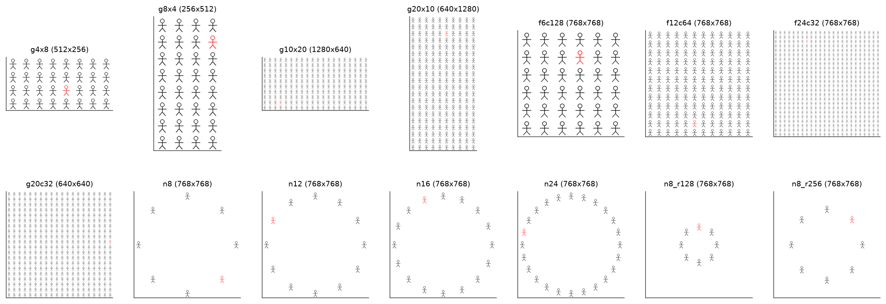

问题文本与正式运行相同。中心点格式为

> One figure is drawn in red. Give the center of its bounding box. Return only [{"point_2d": [x, y]}]. All coordinates use 0-1000 normalization; x increases rightward and y increases downward. Output only the JSON, with no explanation.

环形布局的序号格式把第二句替换为

> The figures are arranged evenly on a circle. Number them clockwise, starting with the figure at the top (the 12 o'clock position) as figure 1. Give the number of this figure. Return only {"index": k}.

环形布局的 T0 问题为“How many figures are in this image? Return only {"count": N}.”。

### 2.3 T3 候选问法

候选问法中的“{D}”在蓝色方框指定下为“the figure inside the blue box”，在行列指定下为“the figure in row r, column c”并在问题后附加行列计数约定，所有问法以“Answer with only Yes or No.”结尾。第二列为 Yes 对应的判断。

| 编号 | 问题 | Yes 表示 |
| --- | --- | --- |
| C0 | Is {D} exactly identical to the other figures?（正式运行原问法） | 相同 |
| C1 | Is {D} different from the other figures in any way? | 不同 |
| C2 | Look carefully at {D} and compare it with the other figures. Is it exactly identical to them? The answer may be Yes or No. | 相同 |
| C3 | Most figures in this image are identical copies of the same drawing. Is {D} one of these identical copies? Look carefully; the answer may be Yes or No. | 相同 |
| C4 | Is {D} exactly identical to the figure in row r′, column c′? | 相同 |
| C5 | Is there anything about {D} that differs from the majority of the figures? | 不同 |
| C6 | Does {D} look the same as most of the figures in the image? Look carefully; the answer may be Yes or No. | 相同 |
| C7 | Is {D} the odd one out? | 不同 |

C4 的参照实例 $(r', c')$ 从既非被指定实例、也非真实目标的正常实例中按固定种子随机抽取，因此当被指定实例为正常实例时，正确答案为“相同”。C0 在开发子集上重新运行，384 个样本中 383 个的判别分数与正式运行逐位相同，1 个相差一个 bf16 量化步长（0.125），说明单条 prefill 的运行方式复现了正式评分。

### 2.4 符号与指标

1. **判别分数。** 记首个回答 token 处“Yes”与“No”的 logit 为 $z_{\mathrm{Yes}}$ 与 $z_{\mathrm{No}}$。为了在 Yes 含义相反的问法之间比较，定义“相同分数”

$$
s_{\mathrm{same}} = \sigma \cdot (z_{\mathrm{Yes}} - z_{\mathrm{No}}),
$$

其中 $\sigma = +1$ 表示该问法的 Yes 表示“相同”，$\sigma = -1$ 表示 Yes 表示“不同”。$s_{\mathrm{same}} > 0$ 判定为“相同”。准确率按这一判定计算，AUROC 以真实“相同”样本为正类、在 $s_{\mathrm{same}}$ 上计算。

2. **“相同”判断比例。** 判定为“相同”的样本比例。开发子集与全量集中被指定实例一半为真实目标、一半为正常实例，因此该比例的理想值为 0.5，偏离 0.5 的程度衡量回答偏置。

3. **问法选择规则。** 在开发子集上按“指定方式 × 变化类型”划分 6 个单元，每单元 $n=64$。对每种问法计算 6 个单元的平均 AUROC $\bar{a}$ 与平均偏离

$$
\bar{b} = \frac{1}{6} \sum_{k=1}^{6} \left| q_k - 0.5 \right|,
$$

其中 $q_k$ 是第 $k$ 个单元的“相同”判断比例。在 $\bar{a}$ 不低于 C0 的 $\bar{a}$ 减 0.02 的问法中，选择 $\bar{b}$ 最小者。该规则在查看全量结果之前固定。

4. **中心点命中与最近实例。** 网格条件沿用正式运行的定义：预测点所在单元为目标单元即为命中，单元距离 $d$ 为预测点到目标 tight bbox 中心的欧氏距离除以单元边长。圆环中单元之间留有空白，预测点可能落在任何单元之外，因此另报告“最近实例为目标”的比例，即与预测点距离最近的实例中心属于目标。网格中单元相互邻接，两种定义在网格中基本一致，跨布局比较时使用后者。

5. **径向比与角度误差。** 记圆心为 $c$，目标中心为 $p$，预测点为 $\hat{p}$，均为 pixel 坐标。径向比

$$
\rho = \frac{\lVert \hat{p} - c \rVert_2}{\lVert p - c \rVert_2}
$$

小于 1 表示预测点比目标更靠近圆心，等于 1 表示到圆心的距离无偏。角度误差为 $\hat{p}$ 与 $p$ 相对圆心的方位角之差（顺时针为正），除以相邻实例的角间距 $360°/N$，单位为“实例间距”。

6. **坐标约定。** 模型应输出 0–1000 归一化坐标。对每个有效中心点答案，同时按两种方式解释输出的数值 $(u, v)$：归一化解释为 $(u W/1000,\, v H/1000)$，pixel 解释为 $(u, v)$，其中 $W \times H$ 为画布尺寸。若归一化解释落在目标单元内，记为“归一化命中”；否则若 pixel 解释落在目标单元内，记为“pixel 命中”。随机数值按 pixel 解释恰好落入目标单元的概率约为单元面积与画布面积之比，本文各条件下不超过 0.03。计算径向比、角度误差与坐标校准曲线时排除 pixel 命中的答案。

7. **区间与检验。** 比例的区间为 Wilson 95% 区间。T3 问法比较对同一样本的正误做精确 McNemar 检验，记原问法正确而 C5 错误的样本数为 $b$、反之为 $c$；AUROC 差值的 95% 区间由按图像重抽样的配对 bootstrap（2000 次）给出。

### 2.5 评分口径

定位任务沿用正式运行的内容诊断评分：接受用单元素 list 包装的行列字典与裸坐标 list，截断与无法解析的回答计为失败并保留在分母中。严格评分与诊断评分均保存于产物目录。

### 2.6 运行

1. T3 与其他二值问题逐条运行（batch size 1），从 prefill 的最后位置读取 logits。
2. 生成任务使用 qwen_runtime.generate_batch，batch size 为 8，同一 batch 内图像尺寸相同，输出上限为 256 tokens。对 B、C 与 D 各随机抽取 20 条生成任务，以 batch size 1 重新生成：答案层面（行列、序号、计数或中心点是否命中）一致 18/20 与 19/20，文本完全相同 13/20 与 15/20，不一致来自 bf16 下坐标数值的微小差异。
3. 推理在共享 GPU 上运行，四部分的模型时间合计约 3.5 GPU hours（单条耗时之和；B、C 的 T3 与生成任务分别在两张 GPU 上并行）。

### 2.7 与设计及任务要求的偏离

1. 增加 10×20、20×10 与 640×640 上的 20×20（单元 32）三个网格布局，理由见第 2.1 节。
2. T4 与 T5 只使用缺口 16 pixels 与旋转 45° 两种可分辨的变化，未覆盖全部变化类型与幅度；与正式运行比较时，正式运行的数值取相同变化、主措辞的子集（每网格 $n=96$），因此与正式结果文档中合并全部幅度的数值不同。
3. 未运行 bbox 格式与 thinking on。B、C 中的 T3 只使用行列指定。
4. 正式运行的生成任务为 batch size 1，本文为 batch size 8；第 2.6 节的抽查显示答案层面一致率为 0.90–0.95，跨运行比较时差异小于约 0.1 的结论不可靠。
5. T3 开发子集与全量集重叠（开发子集为全量集的 4.2%），第 3.2 节另报告排除开发样本后的结果。
6. 环形布局只有 4 个实例（N 能被 4 整除时位于 12、3、6、9 点方向）对齐 32-pixel token 网格，其余实例的位置只取整到 pixel，见第 5.1 节。

## 3. T3 问法修订

### 3.1 开发子集

开发子集包含 96 张图像（3 种变化 × 等级 2 与 4 × 4 种网格 × 4 个重复），每种问法 384 次查询，其中一半被指定实例为真实目标。

| 问法 | Yes 表示 | 准确率 | AUROC | “相同”判断比例 | Yes 回答比例 | 蓝色方框 AUROC | 行列 AUROC | $\bar{a}$ | $\bar{b}$ |
| --- | --- | --- | --- | --- | --- | --- | --- | --- | --- |
| C0 | 相同 | 0.55 | 0.72 | 0.24 | 0.24 | 0.68 | 0.79 | 0.75 | 0.29 |
| C1 | 不同 | 0.74 | 0.83 | 0.46 | 0.53 | 0.77 | 0.84 | 0.82 | 0.14 |
| C2 | 相同 | 0.52 | 0.78 | 0.03 | 0.03 | 0.77 | 0.82 | 0.81 | 0.47 |
| C3 | 相同 | 0.51 | 0.87 | 0.01 | 0.01 | 0.86 | 0.89 | 0.86 | 0.49 |
| C4 | 相同 | 0.59 | 0.71 | 0.24 | 0.24 | 0.59 | 0.79 | 0.71 | 0.29 |
| C5 | 不同 | 0.79 | 0.84 | 0.51 | 0.49 | 0.83 | 0.83 | 0.84 | 0.08 |
| C6 | 相同 | 0.73 | 0.87 | 0.36 | 0.36 | 0.89 | 0.88 | 0.89 | 0.20 |
| C7 | 不同 | 0.76 | 0.84 | 0.45 | 0.53 | 0.81 | 0.84 | 0.83 | 0.13 |

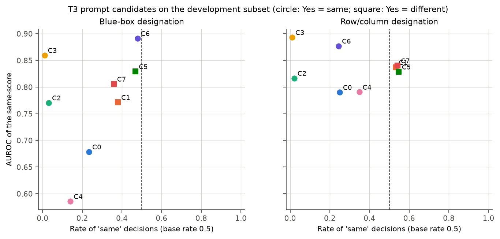

图中横轴为“相同”判断比例，纵轴为 AUROC，圆点为 Yes 表示“相同”的问法，方块为 Yes 表示“不同”的问法。按第 2.4 节的规则，C4 的 $\bar{a}$ 低于阈值，其余七种问法合格，C5 的 $\bar{b}$ 最小而入选。数据显示：

1. **偏置与措辞中的“identical”相关。** 以“exactly identical”或“identical copies”提问的 C0、C2、C3 中，“相同”判断比例只有 0.01–0.24。C2 与 C3 明确要求仔细观察并说明答案可能是 Yes 或 No，偏置反而更强。
2. **偏置与对“No” token 的先验偏好无关。** Yes 表示“不同”的 C1、C5、C7 的 Yes 回答比例为 0.49–0.53；若模型偏好回答 No，这三种问法的“相同”判断比例应接近 1。
3. **不含“other figures”的 C6 与 C7 的 AUROC 不低于 C5**，但 C6 在行列指定下仍偏向“不相同”（0.24），C7 在蓝色方框指定下的“相同”判断比例为 0.36。
4. **C3 的 AUROC 最高（0.86）而准确率为 0.51**，即判别分数的排序最好，判别阈值却最偏。AUROC 与回答偏置在不同问法下独立变化。

### 3.2 全量比较

C5 在正式运行的全部 9216 个主措辞 T3 样本上运行，原问法的分数取自正式运行，二者逐样本配对。每格 $n=1536$（四种网格合并），合计行 $n=4608$。

| 指定方式 | 变化类型 | 准确率 原 → C5 | AUROC 原 → C5 | “相同”判断比例 原 → C5 | $b$ / $c$ |
| --- | --- | --- | --- | --- | --- |
| 蓝色方框 | 缺口 | 0.48 → 0.71 | 0.52 → 0.76 | 0.22 → 0.46 | 97 / 450 |
| 蓝色方框 | 颜色 | 0.49 → 0.59 | 0.50 → 0.61 | 0.64 → 0.67 | 159 / 311 |
| 蓝色方框 | 旋转 | 0.52 → 0.88 | 0.86 → 0.97 | 0.03 → 0.39 | 28 / 582 |
| 蓝色方框 | 合计 | 0.50 → 0.73 | 0.61 → 0.78 | 0.30 → 0.51 | 284 / 1343 |
| 行列 | 缺口 | 0.51 → 0.87 | 0.80 → 0.90 | 0.10 → 0.50 | 35 / 587 |
| 行列 | 颜色 | 0.54 → 0.68 | 0.59 → 0.62 | 0.56 → 0.75 | 40 / 253 |
| 行列 | 旋转 | 0.53 → 0.92 | 0.98 → 0.99 | 0.03 → 0.42 | 2 / 598 |
| 行列 | 合计 | 0.53 → 0.83 | 0.76 → 0.81 | 0.23 → 0.56 | 77 / 1438 |

合计行的 McNemar 检验 $p$ 值均小于 $10^{-160}$。AUROC 差值的配对 bootstrap 95% 区间在蓝色方框合计为 [0.166, 0.184]，在行列合计为 [0.044, 0.055]，在每个“指定方式 × 变化类型”单元中下界均大于 0。排除开发子集的 384 张图像后，蓝色方框的准确率为 0.49 → 0.72、AUROC 为 0.60 → 0.78，行列为 0.53 → 0.82、0.76 → 0.81，与全量结果一致。

C5 的行列准确率在 3×3、6×6、10×10、20×20 为 0.83、0.84、0.84、0.80，AUROC 为 0.80、0.82、0.81、0.79，不随网格规模明显下降。

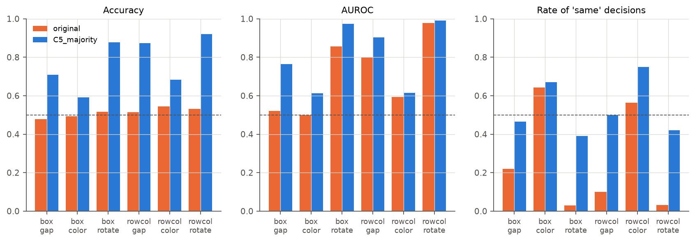

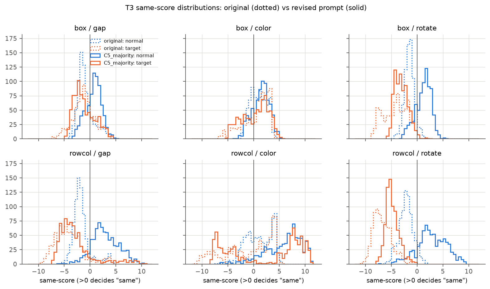

分数分布图中虚线为原问法，实线为 C5，蓝色为正常实例（应判“相同”），橙色为真实目标（应判“不同”）。数据显示：

1. **C5 消除了旋转与缺口条件的偏置。** 原问法下正常实例的 $s_{\mathrm{same}}$ 集中在 0 以下；C5 下正常实例与真实目标的分数分布位于 0 的两侧。
2. **正式运行中“蓝色方框缺口条件 AUROC 约 0.5”的结论依赖问法。** 同一批样本在 C5 下 AUROC 为 0.76。正式运行第 3.3 节据此推断的“方框指定下 $s$ 不能区分目标与正常实例”，应限定为原问法下的结论。
3. **颜色条件的提升最小。** 颜色条件包含色差 5 与 10 两个在 T1、T2 中已不可分辨的等级，C5 下仍偏向“相同”（0.67–0.75），与正式运行中颜色条件 T2 偏向“相同”的现象一致。

## 4. 非方形网格与固定画布

### 4.1 行列计数与行列答案

下表的正式运行行取相同变化、主措辞的子集。T0 列为 48 张图像（正式运行为 16 张）中行数、列数正确的张数与回答的分布。

| 布局 | 行×列 | 单元 | 画布 | T0 行数正确 | T0 列数正确 | T6 行列 | T5 行列 | T4 行列 |
| --- | --- | --- | --- | --- | --- | --- | --- | --- |
| 正式 6×6 | 6×6 | 64 | 384×384 | 16/16 | 16/16 | 1.00 [0.93, 1.00] | 0.79 [0.70, 0.86] | 0.88 [0.79, 0.93] |
| 正式 10×10 | 10×10 | 64 | 640×640 | 16/16 | 16/16 | 0.96 [0.86, 0.99] | 0.93 [0.86, 0.96] | 0.81 [0.72, 0.88] |
| 正式 20×20 | 20×20 | 64 | 1280×1280 | 16/16 | 12/16（4 次答 21） | 0.44 [0.31, 0.58] | 0.46 [0.36, 0.56] | 0.43 [0.33, 0.53] |
| g4x8 | 4×8 | 64 | 512×256 | 48/48 | 48/48 | 1.00 [0.98, 1.00] | 0.81 [0.75, 0.86] | 0.91 [0.86, 0.94] |
| g8x4 | 8×4 | 64 | 256×512 | 48/48 | 48/48 | 0.94 [0.89, 0.96] | 0.51 [0.44, 0.58] | 0.54 [0.47, 0.61] |
| g10x20 | 10×20 | 64 | 1280×640 | 48/48 | 48/48 | 0.58 [0.51, 0.65] | 0.60 [0.53, 0.67] | 0.59 [0.52, 0.66] |
| g20x10 | 20×10 | 64 | 640×1280 | 36/48（12 次答 21） | 48/48 | 0.74 [0.68, 0.80] | 0.67 [0.60, 0.73] | 0.65 [0.58, 0.71] |
| f6c128 | 6×6 | 128 | 768×768 | 48/48 | 48/48 | 1.00 [0.98, 1.00] | 0.99 [0.96, 1.00] | 0.96 [0.93, 0.98] |
| f12c64 | 12×12 | 64 | 768×768 | 48/48 | 48/48 | 0.95 [0.91, 0.97] | 0.83 [0.77, 0.88] | 0.80 [0.73, 0.85] |
| f24c32 | 24×24 | 32 | 768×768 | 0/48（全部答 25） | 0/48（全部答 25） | 0.11 [0.08, 0.17] | 0.07 [0.04, 0.12] | 0.10 [0.06, 0.15] |
| g20c32 | 20×20 | 32 | 640×640 | 48/48 | 48/48 | 0.20 [0.15, 0.26] | 0.16 [0.11, 0.21] | 0.15 [0.11, 0.21] |

新布局每格 $n=192$，正式运行 T6 每格 $n=48$、T4 与 T5 每格 $n=96$。g8x4 的 T4、T5 行列准确率偏低来自格式：192 条回答中 76 条与 80 条为括号不配对的 JSON（例如以“[{"row": 2, "column": 2]”包装），无法解析；在可解析的回答中准确率为 0.89 与 0.88。从这些回答中取 24 条以 batch size 1 重新生成，22 条仍无法解析，因此该格式错误与 batching 无关。

下表给出 T6 行列错误的构成。“只错列”指行正确而列错误，“+1”指偏差恰好为 +1。

| 布局 | 错误数 | 只错列 | 其中列 +1 | 只错行 | 其中行 +1 | 行列均错 |
| --- | --- | --- | --- | --- | --- | --- |
| 正式 20×20 | 25 | 16 | 12 | 4 | 2 | 5 |
| g10x20 | 79 | 77 | 69 | 2 | 0 | 0 |
| g20x10 | 49 | 7 | 7 | 39 | 32 | 3 |
| g20c32 | 154 | 44 | 18 | 47 | 3 | 63 |
| f24c32 | 156 | 41 | 3 | 37 | 4 | 78 |

T4 与 T5 的错误构成方向相同：g10x20 中 T4、T5 的只错列错误为 65 与 66 个，其中列 +1 为 55 与 56 个。

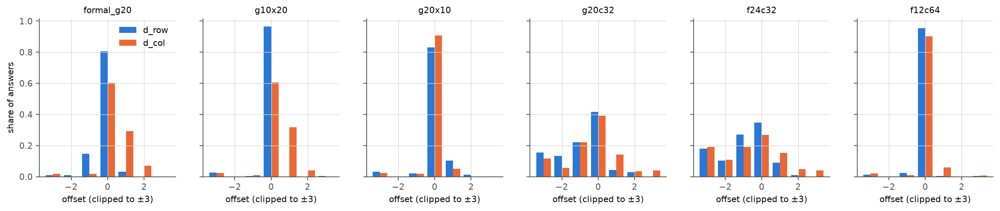

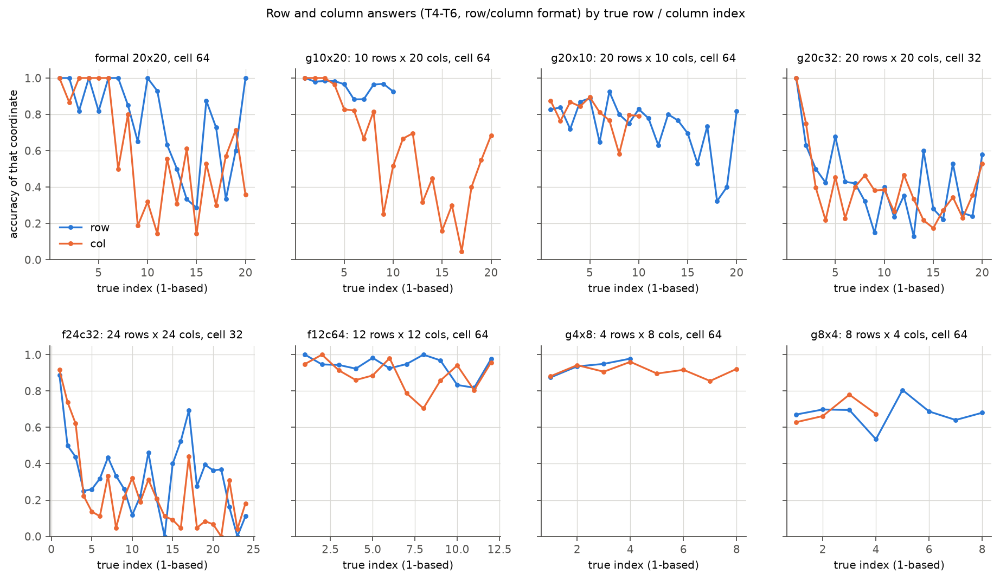

数据显示：

1. **序号多计 1 同样出现在行方向。** 在 20 行 10 列网格中，行方向出现同样的错误：T6 错误中 32/49 为行 +1，T0 有 12/48 次回答 21 行；10 行 20 列网格中错误几乎全部在列方向。多计 1 发生在含 20 个实例的轴上，与该轴是行还是列无关。
2. **多计 1 依赖单个实例的像素尺寸。** 正式 20×20（单元 64，轴长 1280 pixels，每个实例 2 个 merged token）中有系统性的 +1；20×20 网格改为单元 32（轴长 640 pixels，每个实例 1 个 merged token）后，T0 的行列计数全部正确，T6 只错列的 44 个错误中只有 18 个为 +1，行方向几乎没有 +1，错误转为在两个方向上分散的偏差，T6 行列准确率进一步降至 0.20。
3. **计数与定位可以分离。** 10 行 20 列网格中 T0 的列数 48/48 正确，T6 的列序号却有 69 次多计 1。T0 回答正确的总数不能保证逐个实例的序号正确。
4. **24×24（单元 32）在计数与定位上同时失败**：T0 对全部 48 张图像回答 25 行 25 列，T6 行列准确率为 0.11。

### 4.2 固定画布：实例数量与实例尺寸

| 布局 | 实例数 | 单元 | T6 行列 | T6 中心点命中 | T6 单元距离中位数 | T5 中心点命中 |
| --- | --- | --- | --- | --- | --- | --- |
| 正式 6×6（384 画布） | 36 | 64 | 1.00 | 0.71 [0.57, 0.82] | 0.50 | 0.66 [0.56, 0.74] |
| f6c128 | 36 | 128 | 1.00 | 0.68 [0.61, 0.74] | 0.49 | 0.58 [0.51, 0.65] |
| g4x8 | 32 | 64 | 1.00 | 0.80 [0.73, 0.85] | 0.30 | 0.61 [0.54, 0.68] |
| g8x4 | 32 | 64 | 0.94 | 0.71 [0.65, 0.77] | 0.34 | 0.55 [0.48, 0.62] |
| 正式 10×10（640 画布） | 100 | 64 | 0.96 | 0.23 [0.13, 0.37] | 0.63 | 0.20 [0.13, 0.29] |
| f12c64 | 144 | 64 | 0.95 | 0.08 [0.05, 0.12] | 1.54 | 0.11 [0.07, 0.16] |
| g10x20 / g20x10 | 200 | 64 | 0.58 / 0.74 | 0.12 / 0.12 | 1.19 / 2.22 | 0.09 / 0.09 |
| g20c32 | 400 | 32 | 0.20 | 0.08 [0.05, 0.13] | 1.74 | 0.04 [0.02, 0.07] |
| 正式 20×20（1280 画布） | 400 | 64 | 0.44 | 0.04 [0.01, 0.14] | 3.03 | 0.01 [0.00, 0.06] |
| f24c32 | 576 | 32 | 0.11 | 0.07 [0.04, 0.12] | 2.08 | 0.03 [0.01, 0.07] |

数据显示：

1. **中心点命中率主要随实例数量下降。** 实例数为 32–36 的布局，无论单元为 64 还是 128 pixels、画布为 256×512 还是 768×768，命中率为 0.68–0.80；实例数达到 100 以上的布局全部降至 0.04–0.23。单元距离以单元边长为单位，因此实例数相同时，128-pixel 单元上的 pixel 误差是 64-pixel 单元上的两倍。
2. **行列答案同时受实例尺寸影响。** 实例数同为 400 时，单元 32 的行列准确率（0.20）低于单元 64（0.44）；768 画布上 144 个 64-pixel 实例的行列准确率为 0.95，576 个 32-pixel 实例为 0.11。
3. **f12c64 的中心点命中率（0.08）低于正式 10×10（0.23）**，二者单元相同、实例数为 144 与 100，单元距离中位数为 1.54 与 0.63。

### 4.3 中心点的系统偏差

下图按真实列（横坐标 x）与真实行（纵坐标 y）给出 T6 中心点预测坐标的中位数，虚线为无偏情形。

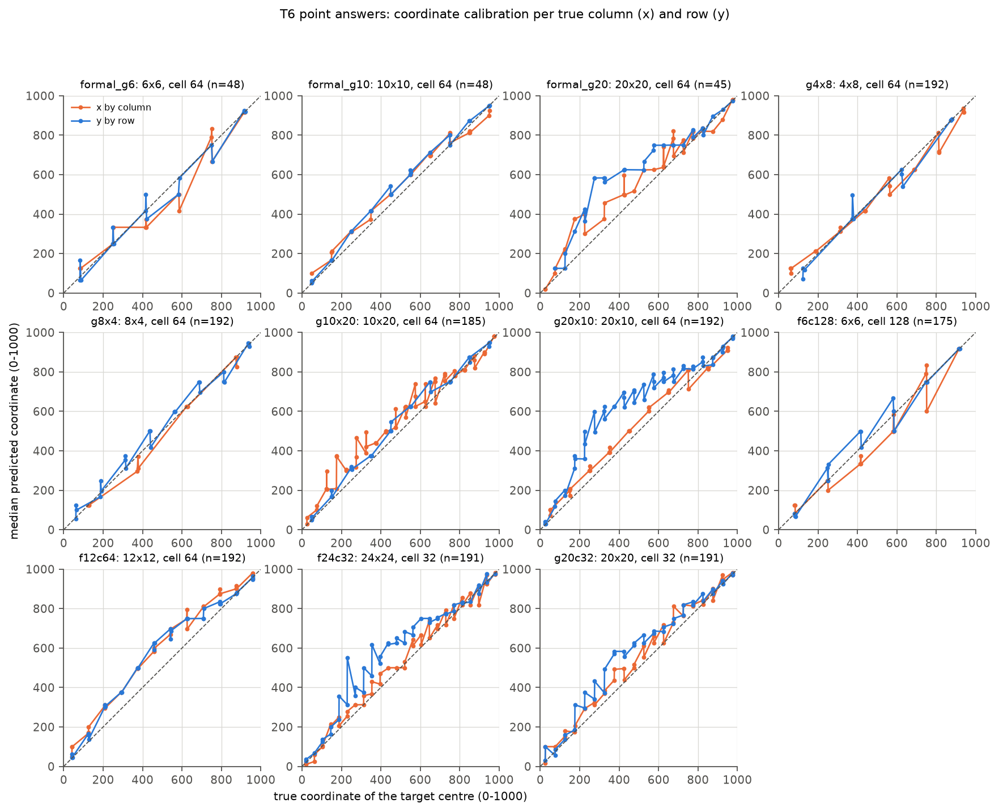

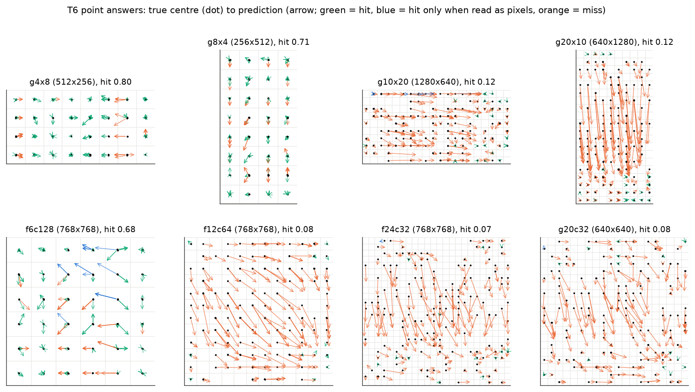

误差图中每个箭头由目标中心指向预测点，绿色为归一化命中，蓝色为 pixel 命中，橙色为未命中。将每个坐标轴等分为四段，T6 预测相对目标的偏差中位数（单位为单元边长）如下：

| 布局 | x 方向，四段 | y 方向，四段 |
| --- | --- | --- |
| 正式 20×20 | +1.51, +1.49, +1.51, +0.09 | +1.48, +5.16, +2.23, +0.09 |
| g10x20 | +1.47, +1.40, +1.49, −0.01 | +0.17, +0.51, +0.45, −0.02 |
| g20x10 | +0.49, +0.51, +0.47, −0.33 | +1.82, +4.97, +3.05, 0.00 |
| f12c64 | +0.69, +1.47, +1.48, +0.30 | +0.50, +1.48, +1.50, +0.07 |
| f24c32 | +0.10, +0.98, +0.71, +0.09 | +1.12, +3.50, +2.50, +0.46 |
| g4x8 | +0.20, −0.01, −0.49, −0.11 | −0.06, +0.01, 0.00, +0.01 |

数据显示：

1. **密集网格中预测坐标沿轴向偏大。** 实例数不少于 144 的网格中，前三段的偏差为 +0.5 至 +5 个单元，最后一段接近 0；含 20 个实例的轴偏差最大。实例数为 32 的 g4x8 没有这种偏差。
2. **线性回归斜率小于 1 来自这种偏差。** 起点与终点附近准确、中间整体偏向坐标增大方向的曲线，用直线拟合会得到小于 1 的斜率。按到中心的方向看，前两段的偏移指向中心，第三段的偏移背离中心，最后一段接近 0；这一模式由沿轴的单向偏移决定，与到中心的距离没有对应关系。
3. **偏差方向与行列答案的 +1 一致**，都把目标报告在更靠后的位置。

## 5. 环形布局

### 5.1 刺激

圆环布局由 stimuli.py 新增的 RingSpec 与 generate_ring 生成，现有网格规格生成的图像逐字节不变（测试中固定了 6 个网格规格的 PNG 哈希）。几何参数如下：

1. 画布为 768×768 pixels，圆心为画布中心 $(384, 384)$，恰好位于 32-pixel token 网格的交点。
2. 实例单元为 64×64 pixels，第 $k$ 个实例（$k = 0, \dots, N-1$）的单元中心为

$$
\left( 384 + R \sin \frac{2\pi k}{N},\; 384 - R \cos \frac{2\pi k}{N} \right),
$$

即 $k=0$ 位于 12 点方向，序号顺时针增大；单元左上角取整到 pixel。

3. 半径 $R$ 取 32 的倍数。主条件四种 N 共用 $R = 352$ pixels（归一化半径 458），使所有实例到圆心的距离相同，N 的变化只改变相邻实例的间距（N=24 时相邻单元中心相距约 92 pixels，即 1.44 个单元）。$R$ 满足任意两个单元互不重叠的条件；N=24 时满足该条件的最小半径为 320。
4. 由于 $R$ 与圆心都在 token 网格上，3、6、9、12 点方向的实例与 token 网格对齐；其余实例的位置偏离 token 网格。
5. 另设 N=8、$R=128$ 与 $R=256$ 两个半径条件（只运行 T6），用于在同一画布上改变实例到圆心的距离。

### 5.2 实例选择精度

| 圆环 | N | R | T0 计数正确 | T6 最近实例为目标 | T6 单元命中 | T6 序号正确 | T5 最近实例为目标 | T5 序号正确 |
| --- | --- | --- | --- | --- | --- | --- | --- | --- |
| n8 | 8 | 352 | 48/48 | 0.90 [0.84, 0.93] | 0.56 | 0.38 [0.31, 0.45] | 0.86 [0.81, 0.91] | 0.31 [0.25, 0.38] |
| n12 | 12 | 352 | 48/48 | 0.81 [0.75, 0.86] | 0.47 | 0.36 [0.29, 0.43] | 0.67 [0.60, 0.73] | 0.15 [0.11, 0.21] |
| n16 | 16 | 352 | 48/48 | 0.87 [0.81, 0.91] | 0.57 | 0.10 [0.06, 0.15] | 0.76 [0.70, 0.82] | 0.08 [0.05, 0.13] |
| n24 | 24 | 352 | 36/48（12 次答 20） | 0.78 [0.71, 0.83] | 0.55 | 0.12 [0.08, 0.17] | 0.61 [0.54, 0.68] | 0.06 [0.04, 0.11] |
| n8_r128 | 8 | 128 | – | 0.58 [0.51, 0.65] | 0.44 | 0.33 [0.27, 0.40] | – | – |
| n8_r256 | 8 | 256 | – | 0.81 [0.75, 0.86] | 0.30 | 0.26 [0.20, 0.32] | – | – |

每格 $n=192$。

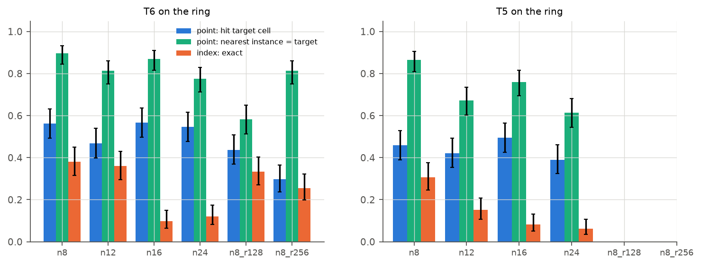

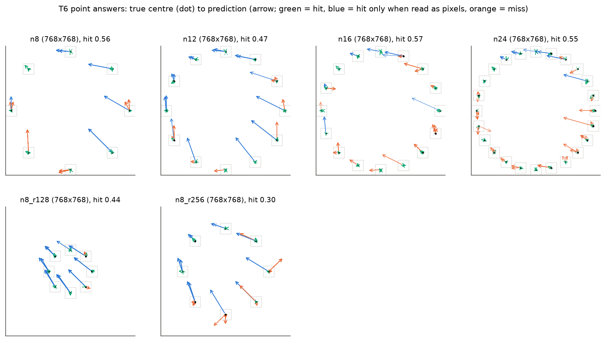

数据显示：

1. **没有行列结构时，中心点的实例选择精度在 N=8 至 24 之间不塌缩。** T6 最近实例为目标的比例为 0.78–0.90，T5 为 0.61–0.86。与之对比，网格中实例数为 32–36 时命中率为 0.68–0.80，与圆环相近；网格的塌缩发生在 100 个实例以上，圆环条件没有覆盖这一范围。因此，本实验能够确定的是：在实例数不超过 24 时，去除行列结构不改变实例选择精度。
2. **单元命中率明显低于最近实例比例**（0.47–0.57 对 0.78–0.90）。圆环中单元之间有空白，许多预测点落在目标附近但在 64-pixel 单元之外；其中相当一部分是 pixel 约定的答案（第 5.4 节）。
3. **紧凑的小半径圆环更难。** N=8、$R=128$ 时相邻单元之间几乎没有空白，最近实例比例降至 0.58。

### 5.3 径向与角度误差

| 圆环 | T6 径向比中位数 [IQR] | T6 角度误差绝对值中位数（实例间距） | T5 径向比中位数 [IQR] |
| --- | --- | --- | --- |
| n8 | 1.02 [0.99, 1.03] | 0.03 | 1.00 [0.98, 1.03] |
| n12 | 1.00 [0.98, 1.04] | 0.09 | 0.99 [0.97, 1.02] |
| n16 | 0.98 [0.93, 1.03] | 0.08 | 0.99 [0.96, 1.01] |
| n24 | 0.97 [0.93, 1.00] | 0.21 | 0.96 [0.92, 0.99] |
| n8_r128 | 1.15 [1.08, 1.20] | 0.07 | – |
| n8_r256 | 1.11 [1.02, 1.14] | 0.02 | – |

该表排除了 pixel 命中的答案（每格剩余 96–172 条）。

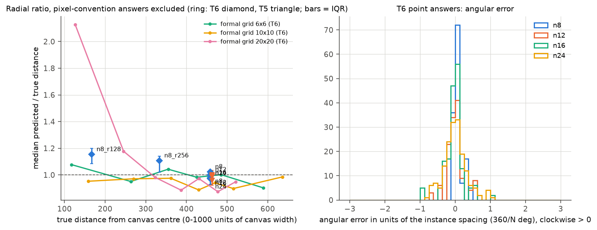

左图的折线为正式运行网格中 T6 中心点的径向比，按目标到画布中心的距离分组；菱形与三角形为圆环条件，误差线为四分位距。数据显示：

1. **同一半径上的实例没有向中心的压缩。** $R=352$ 时径向比的中位数为 0.96–1.02，四分位距在 0.92–1.04 之内。
2. **径向比与到中心的距离没有单调关系。** 圆环半径减小到 128 与 256 时径向比大于 1，即预测点偏向远离圆心；正式运行网格的径向比在大部分距离上为 0.87–1.07，只在 20×20 网格最靠近中心的两个区间大于 1.1（最靠近中心的区间约为 2.1）。
3. **角度误差随 N 增大而增大，但始终远小于一个实例间距。** 中位数由 N=8 的 0.03 增至 N=24 的 0.21 个实例间距，换算为 pixel 约为 8 与 19 pixels。

### 5.4 坐标约定的混用

下表统计每个条件 T6 与 T5 中心点答案中 pixel 命中的数量（第 2.4 节）。

| 条件 | 画布 | T6 pixel 命中 / 192 | T5 pixel 命中 / 192 | T6 按任一解释命中 |
| --- | --- | --- | --- | --- |
| n8 | 768×768 | 38 | 54 | 0.76 |
| n12 | 768×768 | 64 | 75 | 0.80 |
| n16 | 768×768 | 20 | 29 | 0.67 |
| n24 | 768×768 | 21 | 32 | 0.66 |
| n8_r128 | 768×768 | 96 | – | 0.94 |
| n8_r256 | 768×768 | 72 | – | 0.67 |
| f6c128 | 768×768 | 17 | 33 | 0.77 |
| f12c64、f24c32 | 768×768 | 0–1 | 0 | – |
| 正式 3×3 至 20×20 | 256–1280 | 0–3（每网格 48 条） | 0–4（每网格 96 条） | – |

在环形布局中，pixel 解释的答案在误差图中表现为指向左上方的长箭头（例如 3 点方向的实例被报告在画布中部偏左），因为在 768×768 画布上把 pixel 坐标当作 0–1000 坐标读取，相当于把位置乘以 0.768。数据显示：

1. **混用只出现在实例稀疏的布局中。** 环形布局与 128-pixel 单元的 6×6 网格中有 9%–50% 的答案使用 pixel 约定；实例密集的 12×12 与 24×24 网格在同一画布尺寸下几乎没有。
2. **最紧凑的圆环中 pixel 约定最多**（N=8、$R=128$，96/192），按任一解释计算的命中率达到 0.94，高于其他圆环。
3. 第 5.2 节中单元命中率低于最近实例比例，主要部分来自这种约定混用。

### 5.5 顺时针序号

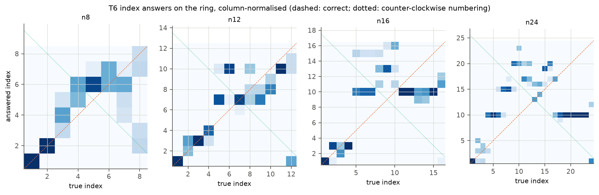

图中每列为一个真实序号，颜色为该列内回答各序号的比例，橙色虚线为正确答案，绿色点线为逆时针编号时的答案。数据显示：

1. **序号 1–4 基本正确，之后的答案集中在少数整数上。** N=16 时大部分序号 5 以上的目标被回答为 10，N=24 时答案集中于 10、15、20。
2. **答案不符合逆时针编号或起点错位的规律。** 混淆矩阵的质量不沿绿色点线分布，也不沿与对角线平行的直线分布。
3. **同一图像上中心点单元命中而序号错误的情况远多于相反情况**（N=16 的 T6 为 93 对 3，N=24 为 87 对 5）。模型能够指出目标的位置，却不能把它转换为沿圆周的序号。
4. N=24 的 T0 有 12/48 次回答 20 个实例。

## 6. 解释与限制

### 6.1 对正式运行结论的修订

| 正式运行的结论 | 本文的证据 | 修订 |
| --- | --- | --- |
| T3 准确率接近 0.5 来自回答偏置 | C5 下准确率 0.73–0.83，AUROC 同时提高 | 成立，偏置由“identical”类问法引起；后续实验的 T3 改用 C5 |
| 蓝色方框缺口条件 AUROC 约 0.5，$s$ 不能区分目标 | C5 下为 0.76 | 只适用于原问法 |
| 20×20 网格中列序号多计 1，行没有同样的偏差 | 20 行 10 列网格中行多计 1 | 多计 1 出现在含 20 个 64-pixel 实例的轴上，与行列方向无关 |
| 中心点向图像中心压缩 | 圆环径向比 0.96–1.02；网格偏差沿轴向偏大、末端准确 | 改述为“密集网格中预测坐标沿轴向系统性偏大” |
| 中心点精度在 10×10 不足 | 固定画布下 36 个实例命中率 0.68，144 个实例 0.08 | 精度主要由实例数量决定，与画布尺寸关系较小 |

### 6.2 推测

以下内容尚未被直接检验：

1. 行列 +1 与中心点沿轴偏大方向一致，二者可能来自同一个“沿轴计数并换算位置”的过程：在含约 20 个 2-token 实例的轴上计数时多计一个，再把序号换算为坐标。单元 32 的网格中 +1 消失，可能因为每个实例只占一个 merged token，计数单位与 token 单位重合。
2. pixel 约定的答案可能源自训练数据中混合的坐标格式（Qwen2.5-VL 使用绝对 pixel 坐标，Qwen3 系列使用 0–1000 归一化坐标）。它集中出现在稀疏布局中，可能与实例周围大面积空白时模型更多依赖自然图像 grounding 的输出习惯有关。
3. C5 的问法把判断目标从“完全相同”改为“存在差异”，可能改变了判别阈值而不改变视觉信息的读取；C3 的 AUROC 最高而阈值最偏，与这一解释一致。

### 6.3 限制

1. T4、T5 只使用两种可分辨的变化，T3 修订只在一个模型上选择；C5 在其他模型（实验 4.2）上是否同样无偏需要重新检查。
2. 生成任务使用 batch size 8，与正式运行的 batch size 1 不同，答案层面的一致率为 0.90–0.95。
3. 圆环最多 24 个实例，无法检验 100 个以上实例时没有行列结构的精度；圆环的单元命中率受实例间空白的影响，跨布局比较依赖“最近实例”的定义。
4. pixel 约定的判定只在目标单元内成立，对未命中的答案无法判断其使用的约定。
5. 序号答案只测试了“从 12 点方向顺时针”一种约定，未测试钟点（clock position）答案。

## 7. 后续工作

1. 后续使用 T3 的实验（问题 5 的局部重读、实验 4.2）采用 C5，同时报告 AUROC。
2. 实验 3.5 增加 10 行 20 列与 20 行 10 列网格的 T6 样本，比较行 +1 与列 +1 在坐标读取路径上的差异；并以 768×768 圆环中的 pixel 约定答案为样本，检查两种坐标约定在 hidden states 中是否对应不同的读出方向。
3. 定位任务的评分另报告“按任一坐标约定命中”的诊断指标，避免把约定混用计为位置错误。

## 8. 运行与产物

- 程序：analysis_tools/behavior/decomposition_conditions.py（四部分的问题构造、运行与评分），decomposition_conditions_analysis.py（汇总、表格与图）。刺激生成新增 analysis_tools/common/stimuli.py 中的 RingSpec、generate_ring、ring_offsets、ring_cells_disjoint 与 min_ring_radius。入口为 scripts/analysis/behavior/decomposition_supplement.sh，COMMAND 取 build、run、spotcheck、score、analyze，PART 取 t3dev、t3full、layouts、ring。
- 测试：tests/analysis/behavior/test_decomposition_conditions.py，tests/analysis/common/test_stimuli.py 中新增的网格哈希固定与圆环几何测试。
- 运行目录：WORK_DIR 下的 analysis/behavior/2026-10-14_decomposition_supplement/。cases_{part}.jsonl 为全部问题，results_{part}*.jsonl 为原始回答或首 token logits，scores_{part}_strict.jsonl 与 scores_{part}_diagnostic.jsonl 为两种评分，spotcheck_{layouts,ring}.jsonl 为 batching 抽查，check_g8x4_unparsable_bs1.jsonl 为第 4.1 节的格式复查；analysis/ 下的 tables.md、summary.json 与 figures/ 为本文的数值与图。正式运行目录只被读取，未被修改。
