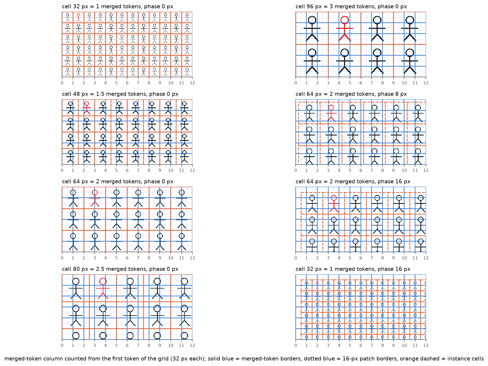
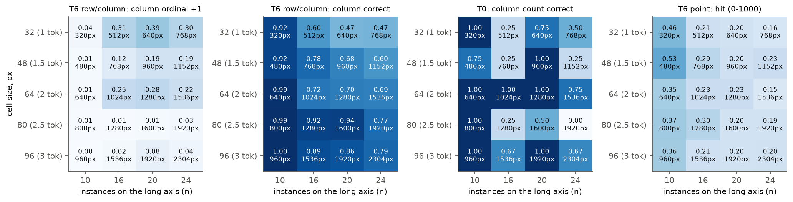
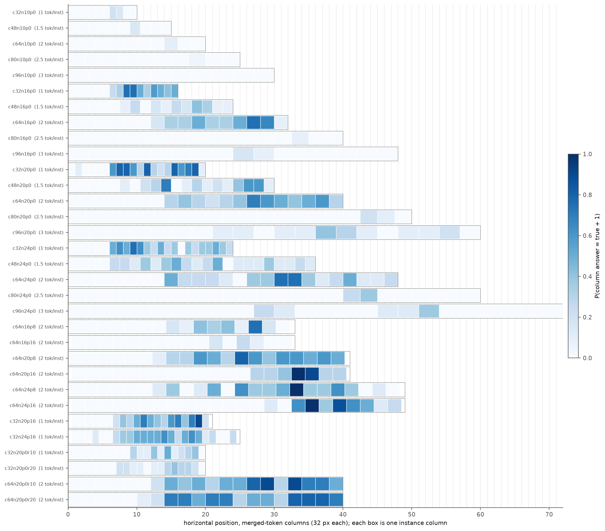
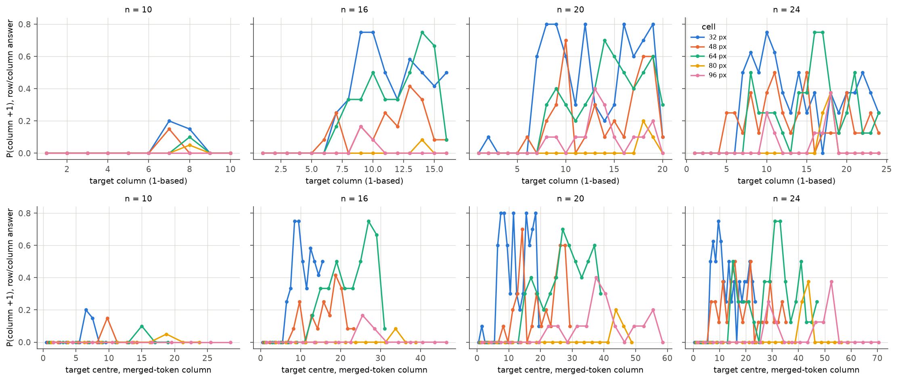
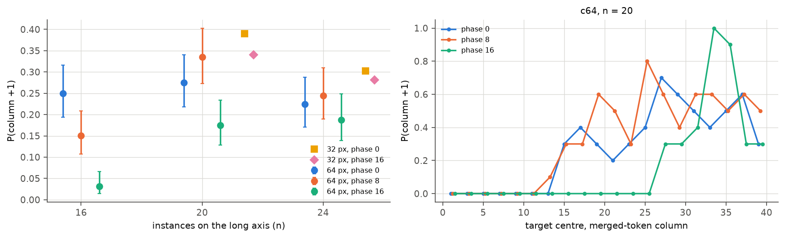
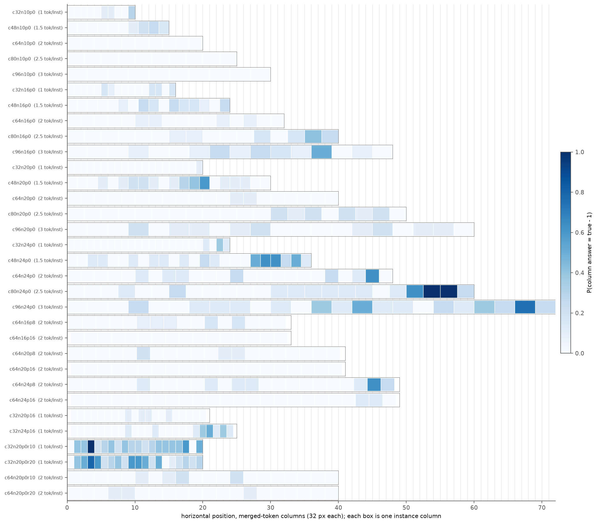
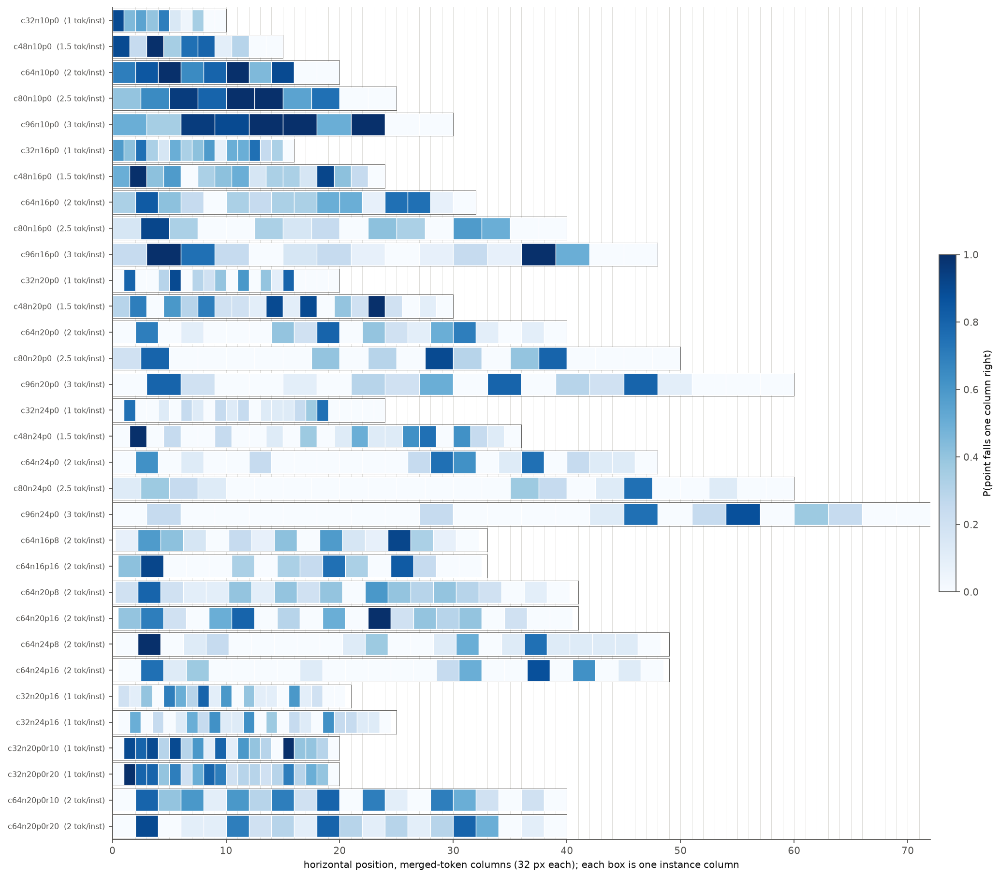
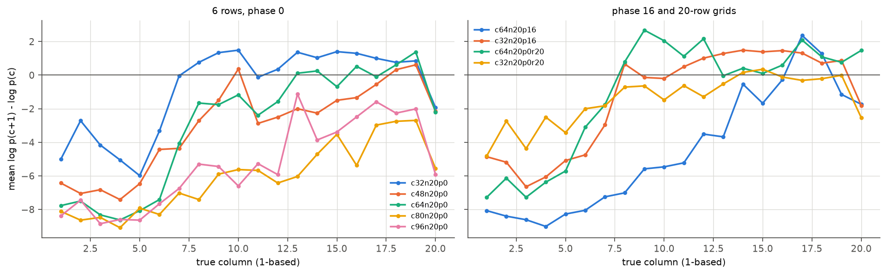
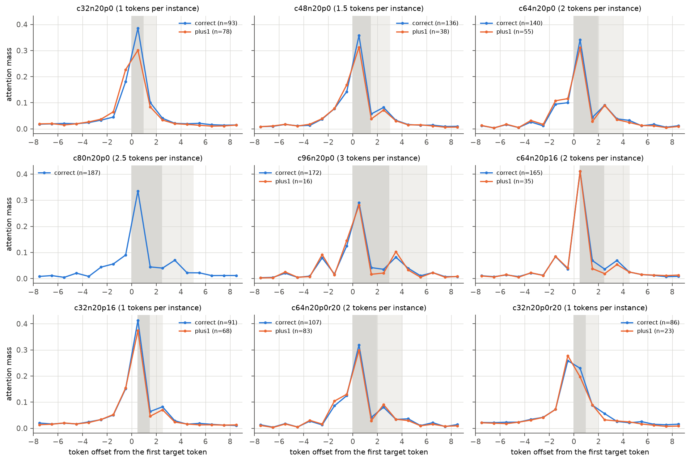

# 序号偏差与 token 网格

实验日期：2026-10-15。本文属于[行为诊断](plan.md)研究，编号为实验 1.4。主模型为 Qwen3.5-9B，bfloat16、SDPA、greedy decoding、thinking off。前置结果见[能力分解的补充条件](results_2026-10-14_decomposition_supplement.md)（下称“1.3 补充”）与[坐标读取路径](../position/results_2026-10-14_coordinate_readout.md)（下称“实验 3.5”）。

## 1. 研究问题与主要结果

1.3 补充发现，行列答案中“序号多计 1”（下称 +1 偏差）出现在含 20 个 64-pixel 实例、长 1280 pixels 的轴上，而在 640×640 画布上的 20×20 网格（单元 32 pixels）中，系统性的 +1 不再出现。实例越小越难看清，错误模式却随实例缩小而改变，这一现象需要解释。Qwen3.5 的 ViT patch 为 16 pixels，2×2 spatial merge 后每个视觉 token 覆盖 32×32 pixels，因此实例尺寸、轴长与 token 网格之间存在以下四种可能的联系：

- **H1 每个实例的 token 数。** 64-pixel 实例占 2×2 个 merged token，32-pixel 实例恰好占 1 个，序号换算可能混淆 token 序号与实例序号。
- **H2 轴长相对于 ViT learned absolute position embedding 网格的比例。** 该 embedding 为 48×48 的表，对应 768 pixels，较长的轴需要更大比例的插值。
- **H3 轴上的实例数量**，与实例尺寸无关。
- **H4 实例边界与 token 边界的对齐方式。**

本文以“单元尺寸 × 实例数量”的全因子网格分离 H1–H3，以相位平移检验 H4，并增加行数条件，直接复现 1.3 补充中 +1 消失的条件。主要结果如下：

1. **+1 偏差在单元 32 pixels 的网格中并未消失。** 6 行 20 列、单元 32 pixels 的网格中，列序号 +1 的比例为 0.39 [0.33, 0.46]，是全部条件中最高的。1.3 补充的 20×20（单元 32）网格中 +1 被另一种错误取代：把行数增加到 10 与 20 时，列 +1 降至 0.12，列 −1 升至 0.35 与 0.34，行 −1 也升至 0.40 与 0.33。单元 64 pixels 时，增加行数不产生 −1，+1 由 0.28 升至 0.39 与 0.41。因此 1.3 补充中“+1 随实例缩小而消失”的观察，来自单元 32 pixels 的密集二维网格中出现的 −1 偏差，与单个实例变小无关。
2. **+1 偏差取决于实例数量与单元尺寸，与轴长无关（H2 不成立）。** 轴长同为 1280 pixels 时，20 个 64-pixel 实例的 +1 比例为 0.28，16 个 80-pixel 实例为 0.01；10 个实例的轴上，五种单元尺寸的 +1 比例均不超过 0.04。对 3920 个 6 行、相位 0 的行列样本拟合的 logistic 模型中，$\log_2 n$ 与 $\log_2 s$ 的系数符号相反（+1.58 与 −1.36），与 H2 要求的相等系数不符。
3. **单元尺寸的作用不单调，不能归结为“每个实例的 token 数”（H1 只部分成立）。** 实例数不少于 16 时，单元 32、48、64 pixels（每实例 1、1.5、2 个 token）的 +1 比例为 0.12–0.39，单元 80 与 96 pixels（2.5 与 3 个 token）只有 0.01–0.08。整数 token 数的 96-pixel 实例与非整数的 48-pixel 实例的结果与“token 数是否为整数”无关。
4. **+1 的起始位置对应实例序号，与 token 位置或 pixel 位置无关。** 单元 32、48、64 pixels 的 6 行网格中，+1 比例首次达到 0.2 的列为第 5–8 列，对应的 token 列却分别为 6.5、6.8–11.2 与 15.0；同一实例序号在三种单元下位于完全不同的 token 位置。
5. **相位平移改变 +1，但没有消除它（H4 部分成立）。** 64-pixel 实例平移 16 pixels（实例中心落在 token 边界上）后，16 列网格的 +1 比例由 0.25 降至 0.03，20 列与 24 列网格由 0.28 与 0.22 降至 0.17 与 0.19，起始列由第 8 列后移至第 13–17 列；平移 8 pixels 没有一致的作用。32-pixel 实例平移 16 pixels 后 +1 比例几乎不变（0.39 → 0.34）。
6. **+1 发生在读取之后。** teacher forcing 下，+1 样本对 $c+1$ 的对数概率比真值高 0.6–2.7，答对样本低 2.1–6.3。10 个指向型 head 在生成列号首位数字时的 attention 分布，在 +1 样本与答对样本之间几乎重合，峰值都位于目标实例上（单元 64 pixels 时为 0.93 与 0.97）。$\log p(c+1) - \log p(c)$ 随真值列号增大而单调上升，在所有单元尺寸中都存在；单元不超过 64 pixels 时该差值在第 7 列附近越过 0，单元 80 与 96 pixels 时始终低于 0。
7. **坐标约定诊断。** 在正式运行、1.3 补充与本实验的全部 point 答案上计算“任一坐标约定命中”。只在 pixel 约定下命中的比例在正式运行 3×3 至 20×20 网格中为 0–0.06，在 1.3 补充的环形布局中为 0.10–0.50，在 128-pixel 单元的 6×6 网格中为 0.09–0.19，在本实验中除两个条件（0.078 与 0.050）外不超过 0.016。均匀随机点在两种约定下的机会命中率之和不超过 0.067，打乱预测与目标配对的基线不超过 0.155。

## 2. 实验设计

### 2.1 符号

| 符号 | 含义 |
| --- | --- |
| $s$ | 实例单元边长，单位 pixel，取 32、48、64、80、96 |
| $k = s/32$ | 每个实例沿一个方向覆盖的 merged token 数，取 1、1.5、2、2.5、3 |
| $n$ | 长轴（水平方向）上的实例数，即列数，取 10、16、20、24 |
| $m$ | 行数，主条件为 6，行数条件为 10 与 20 |
| $L = n s$ | 长轴的内容长度，单位 pixel |
| $\phi$ | 网格原点相对 32-pixel token 网格的平移量，单位 pixel，取 0、8、16 |
| $c$ | 目标所在的真值列号，从 1 开始 |
| $\hat{c}$ | 模型回答的列号 |
| $\delta = \hat{c} - c$ | 列序号偏差；$\delta = +1$ 即 +1 偏差 |
| $P_{+1}$ | 一个条件内 $\delta = +1$ 的样本比例，分母为该条件全部 T6 行列样本 |

条件名记为 c{s}n{n}p{φ}，行数不为 6 时附加 r{m}，例如 c64n20p16 为单元 64 pixels、20 列、平移 16 pixels 的 6 行网格，c32n20p0r20 为单元 32 pixels 的 20×20 网格。

### 2.2 条件

1. **全因子网格（20 个条件）。** $s \in \{32, 48, 64, 80, 96\}$ 与 $n \in \{10, 16, 20, 24\}$ 完全交叉，$m = 6$，$\phi = 0$。固定 $n$ 时改变 $s$，同时改变 $k$ 与 $L$；固定 $L$ 时存在多组不同的 $(n, s)$，例如 $L = 1280$ 的 c64n20 与 c80n16、$L = 768$ 的 c32n24 与 c48n16、$L = 1920$ 的 c96n20 与 c80n24。因此 H1–H3 的预测可以在同一组数据上相互区分。
2. **相位条件（8 个条件）。** $s = 64$、$n \in \{16, 20, 24\}$ 时 $\phi \in \{8, 16\}$，$s = 32$、$n \in \{20, 24\}$ 时 $\phi = 16$。平移后画布两侧各增加 32 pixels 的边距，使网格完整位于画布内。
3. **行数条件（4 个条件）。** $s \in \{32, 64\}$、$n = 20$、$m \in \{10, 20\}$。该组在设计开始时没有计划，在全因子网格的部分结果显示 c32n20p0 的 $P_{+1}$ 最高之后加入，用于连接 6 行网格与 1.3 补充中的 20×20 网格。

使用 6 行而非方形网格，是为了在长轴含 24 个实例时把 token 数控制在 1296 以内；1.3 补充已表明 +1 偏差随含 20 个实例的轴出现，与该轴是行还是列无关，因此本文只在水平方向改变实例数。单元 48 与 80 pixels 不是 32 的倍数，超出 stimuli-v1 的 StimulusSpec 范围；本文用 stimuli.render_instance 绘制实例，按 stimuli.generate 的规则放置，单元为 32 倍数时生成的 PNG 与 stimuli-v1 逐字节相同（测试中固定）。所有画布边长为 32 的倍数，processor 不做缩放。

### 2.3 刺激与 token 网格

下图为各单元尺寸与相位条件的局部，蓝色实线为 32-pixel merged token 的边界，蓝色点线为 16-pixel patch 的边界，橙色虚线为实例单元的边界，横坐标为从网格第一个 token 起算的 token 列。单元 48 与 80 pixels 时，实例边界交替落在 token 边界与 token 中线上；单元 64 pixels、平移 16 pixels 时，实例中心落在 token 边界上，每个 token 跨越相邻两个实例的一半。

### 2.4 子任务与问题

每个条件包含两类图像：

1. **T6（红色目标）。** 目标按列分层抽样：每列 $\lceil 192/n \rceil$ 个目标（$n = 10, 16, 20, 24$ 时为 20、12、10、8），行均匀随机，合计 192–200 张图像。每张图像以行列与中心点两种格式各提问一次。模板在 person、ring、square、arrow 之间轮换。问题与 1.3 相同，行列格式为

> One figure is drawn in red. Give its position. Return only {"row": r, "column": c}, counting rows from top to bottom and columns from left to right, starting at 1. Output only the JSON, with no explanation.

中心点格式把第二句替换为“Give the center of its bounding box. Return only [{"point_2d": [x, y]}]. All coordinates use 0-1000 normalization; x increases rightward and y increases downward.”。

2. **T0（行列计数）。** 每个条件 24 次查询，问题为“How many rows and how many columns of figures are in this image? Return only {"rows": R, "columns": C}. Output only the JSON, with no explanation.”。无目标的图像由模板唯一决定，因此 24 次查询只对应 4 张不同的图像（每个模板重复 6 次）；T0 的有效样本量为每条件 4 张图像。1.3 补充的 T0（每布局 48 次查询）同样只含 4 张不同图像。

合计 32 个条件、13328 次查询，其中 T6 行列与中心点各 6280 次、T0 768 次。

### 2.5 评分

1. 行列与中心点答案沿用 1.3 的内容诊断评分（接受单元素 list 包装、代码围栏与裸坐标 list）；严格评分另存，二者在本实验中接近（行列准确率逐条件相差不超过 0.05，中心点命中率完全相同）。
2. 列序号偏差 $\delta$ 对超出网格的回答也保留：目标在第 $n$ 列而回答第 $n+1$ 列时，严格评分记为 out of range，本文仍计为 $\delta = +1$。全部 6280 个行列答案中只有 2 个无法解析，计入分母且不计为任何偏差。
3. 中心点答案的预测列为预测点所在网格单元的列。

### 2.6 机制测量

在 9 个条件（c32/c48/c64/c80/c96n20p0、c64n20p16、c32n20p16、c32n20p0r20、c64n20p0r20）的全部 1800 个 T6 行列样本上，以模型自己生成的回答前缀（包括代码围栏与行号）进行 teacher forcing：

1. **候选对数概率。** 对候选列号 $v \in \{c-1, c, c+1, c+2, \hat{c}\}$，计算列号各位数字与其后右括号的对数概率之和 $\ell(v)$，报告

$$
\Delta = \ell(c+1) - \ell(c).
$$

$\Delta > 0$ 表示模型在给定前缀下更倾向回答 $c+1$；$\Delta$ 的绝对值衡量这一偏好的置信程度。

2. **指向型 head 的 attention。** 使用实验 3.5 在 6×6 行列任务上选出的 10 个 head（L16 H2、L16 H11、L16 H6、L20 H11、L12 H1、L16 H0、L16 H1、L24 H11、L16 H3、L16 H15），在生成列号首位数字的位置读取其对视觉 token 的 attention，沿行求和得到每个 token 列的 attention 质量，归一化后在 10 个 head 上平均。峰值 token 中心所在的实例若为目标实例（距离不超过半个实例宽度），记为“峰值位于目标”。

### 2.7 运行

1. 生成使用 qwen_runtime.generate_batch，batch size 为 8，同一 batch 内图像尺寸相同，输出上限 256 tokens，全部回答以 EOS 结束。随机抽取 20 条以 batch size 1 重新生成，答案层面一致 20/20，文本完全相同 17/20。
2. 推理在共享 GPU 上运行，生成约 3.4 GPU hours（两个进程并行），机制测量约 1.2 GPU hours，合计约 4.7 GPU hours。

## 3. 结果

### 3.1 全因子网格：实例数量与单元尺寸

图中每格标出比例与轴长 $L$。T6 行列与 T6 中心点每格 $n = 192$–200，T0 每格 24 次查询（4 张图像）。下表给出 6 行网格的 $P_{+1}$ 及 Wilson 95% 区间。

| $s$（$k$） | $n=10$ | $n=16$ | $n=20$ | $n=24$ |
| --- | --- | --- | --- | --- |
| 32（1） | 0.04 [0.02, 0.07] | 0.31 [0.25, 0.38] | 0.39 [0.33, 0.46] | 0.30 [0.24, 0.37] |
| 48（1.5） | 0.01 [0.01, 0.04] | 0.12 [0.08, 0.17] | 0.19 [0.14, 0.25] | 0.19 [0.14, 0.25] |
| 64（2） | 0.01 [0.00, 0.04] | 0.25 [0.19, 0.32] | 0.28 [0.22, 0.34] | 0.22 [0.17, 0.29] |
| 80（2.5） | 0.01 [0.00, 0.03] | 0.01 [0.00, 0.03] | 0.01 [0.01, 0.04] | 0.03 [0.01, 0.06] |
| 96（3） | 0.00 [0.00, 0.02] | 0.02 [0.01, 0.04] | 0.08 [0.05, 0.13] | 0.04 [0.02, 0.08] |

数据显示：

1. **H2 不成立。** 相同轴长下 $P_{+1}$ 差异很大：$L = 1280$ 时 c64n20 为 0.28、c80n16 为 0.01；$L = 768$ 时 c32n24 为 0.30、c48n16 为 0.12；$L = 1920$ 时 c96n20 为 0.08、c80n24 为 0.03。不同轴长下 $P_{+1}$ 可以相近：c32n20（640 pixels）为 0.39，c64n20（1280）为 0.28。为了用一个数概括，以 6 行、$\phi = 0$ 的 3920 个行列样本拟合

$$
\operatorname{logit} P(\delta = +1) = \beta_0 + \beta_n \log_2 n + \beta_s \log_2 s .
$$

由于 $\log_2 L = \log_2 n + \log_2 s$，若 $P_{+1}$ 只由轴长决定，应有 $\beta_n = \beta_s > 0$。拟合结果为 $\beta_n = 1.58$（标准误 0.14），$\beta_s = -1.36$（0.09），二者之差为 2.94（0.17），符号相反。该线性模型不能表达单元尺寸的非单调作用（第 2 点），只用于排除 H2。

2. **H3 是必要条件，单元尺寸决定偏差的大小。** $n = 10$ 时五种单元的 $P_{+1}$ 均不超过 0.04；$n \geq 16$ 时偏差出现，但只在 $s \leq 64$ 时明显。单元 80 与 96 pixels 的错误转为少量的 −1（0.05–0.17）。
3. **H1 的“token 数整除”形式不成立。** 若 +1 来自 token 序号与实例序号的混淆，整数 $k$（32、64、96 pixels）应比非整数 $k$（48、80）更易出错。实际上 96 pixels 的 $P_{+1}$ 不超过 0.08，48 pixels 为 0.12–0.19，二者的大小关系与 $k$ 是否为整数无关；$P_{+1}$ 随 $s$ 的变化表现为 $s \leq 64$ 与 $s \geq 80$ 之间的分界。
4. **T0 计数正确不保证定位正确，反之亦然。** c64n20 的 T0 列数 4/4 张图像正确，T6 的 $P_{+1}$ 为 0.28；c80n24 的 T0 对 4 张图像全部回答 22 列，T6 的 $P_{+1}$ 只有 0.03。

### 3.2 +1 偏差的列分布

下图把每个条件的每一列画在其 pixel 范围上（横坐标为 token 列），颜色为该列目标的 $P_{+1}$，每格 8–20 个样本。

上排横坐标为真值列号，下排为目标中心所在的 token 列。数据显示：

1. **前 5–6 列几乎不出现 +1。** 在全部 6 行、$\phi = 0$ 的条件中，第 1–5 列的 $P_{+1}$ 除个别格外为 0。
2. **起始位置对齐实例序号。** 将起始列定义为 $P_{+1}$ 首次不低于 0.2 的列，c32、c48、c64 在 $n = 16, 20, 24$ 的起始列为第 5–8 列，对应的 token 列为 6.5（c32）、6.8–11.2（c48）与 15.0（c64）。上排三条曲线在第 6–7 列处同时上升，下排三条曲线的上升位置相距约 8 个 token。若 +1 取决于某个固定的 token 列或 pixel 位置，下排的上升位置应当重合。
3. **最后一列很少出现 +1。** 回答第 $n+1$ 列的样本在每个条件中只有 0–8 个（合计 59 个），第 $n$ 列的 $P_{+1}$ 明显低于其左侧各列。
4. **起始之后 $P_{+1}$ 不随列号累积。** c32n20 中第 8–9 列达到 0.8，第 10–11 列降至 0.3–0.6，第 12 列又为 0.8。若模型逐个计数时在某处多计一个，其右侧所有列应当都偏 1；实际的偏差逐列波动，说明错误不是一次性的计数遗漏。

### 3.3 相位平移

| 条件 | $\phi = 0$ | $\phi = 8$ | $\phi = 16$ | 起始列（$\phi = 0$ / 8 / 16） |
| --- | --- | --- | --- | --- |
| c64n16 | 0.25 [0.19, 0.32] | 0.15 [0.11, 0.21] | 0.03 [0.01, 0.07] | 8 / 10 / 13 |
| c64n20 | 0.28 [0.22, 0.34] | 0.34 [0.27, 0.40] | 0.17 [0.13, 0.23] | 8 / 8 / 14 |
| c64n24 | 0.22 [0.17, 0.29] | 0.24 [0.19, 0.31] | 0.19 [0.14, 0.25] | 8 / 8 / 17 |
| c32n20 | 0.39 [0.33, 0.46] | – | 0.34 [0.28, 0.41] | 7 / – / 7 |
| c32n24 | 0.30 [0.24, 0.37] | – | 0.28 [0.22, 0.35] | 7 / – / 7 |

数据显示：

1. **64-pixel 实例平移 16 pixels 使 +1 的起始位置后移。** 起始列由第 8 列移到第 13–17 列，16 列网格中几乎不再出现 +1；20 与 24 列网格中 +1 集中在靠右的列，个别列达到 1.0（右图）。
2. **平移 8 pixels 与平移 32-pixel 实例都没有一致的作用。** 平移 8 pixels 时，实例边界落在 patch 内部，但每个 token 仍主要被一个实例占据。
3. 平移条件同时在画布两侧增加 32 pixels 的空白，与相位的作用相混；由于 $\phi = 8$ 带有相同的边距却不改变起始列，边距本身不能解释 $\phi = 16$ 的作用。

### 3.4 行数：1.3 补充中 +1 消失的原因

| 条件 | 行×列 | 画布 | 行列准确率 | 列 +1 | 列 −1 | 行 +1 | 行 −1 | T0 行数 / 列数正确（图像） |
| --- | --- | --- | --- | --- | --- | --- | --- | --- |
| c32n20p0 | 6×20 | 640×256 | 0.43 [0.37, 0.50] | 0.39 | 0.01 | 0.01 | 0.04 | 3/4、3/4 |
| c32n20p0r10 | 10×20 | 640×320 | 0.22 [0.17, 0.28] | 0.12 | 0.35 | 0.01 | 0.40 | 3/4、3/4 |
| c32n20p0r20 | 20×20 | 640×640 | 0.17 [0.12, 0.23] | 0.12 | 0.34 | 0.03 | 0.33 | 4/4、4/4 |
| c64n20p0 | 6×20 | 1280×384 | 0.70 [0.63, 0.76] | 0.28 | 0.01 | 0.00 | 0.00 | 4/4、4/4 |
| c64n20p0r10 | 10×20 | 1280×640 | 0.56 [0.50, 0.63] | 0.39 | 0.03 | 0.00 | 0.01 | 4/4、4/4 |
| c64n20p0r20 | 20×20 | 1280×1280 | 0.41 [0.35, 0.48] | 0.41 | 0.01 | 0.10 | 0.11 | 4/4、3/4 |

每行 $n = 200$。1.3 补充的 20×20（单元 32）网格中，按本文口径重新统计的列 +1 与列 −1 为 24/192 与 63/192（0.13 与 0.33），与 c32n20p0r20 一致。

数据显示：

1. **单元 32 pixels 时，行数增加使偏差方向由 +1 变为 −1，并同时出现在行与列上。** 6 行时只有列 +1；10 行与 20 行时列 −1 与行 −1 均为 0.33–0.40。
2. **单元 64 pixels 时，行数增加只加强 +1。** 列 +1 由 0.28 升至 0.41，没有出现 −1。
3. 因此，1.3 补充中“+1 在单元 32 时消失”应表述为：单元 32 pixels 的密集二维网格中出现了方向相反的 −1 偏差，它在数量上压过 +1，使错误分布看似分散。单个实例的尺寸本身不消除 +1；6 行网格中单元 32 pixels 的 +1 最强。

### 3.5 中心点答案

| $n$ | 中心点命中（五种单元的范围） | 预测点 x 偏差中位数（单元） | 预测列 = 真值列 + 1 的比例 |
| --- | --- | --- | --- |
| 10 | 0.35–0.53 | +0.46 至 +0.50 | 0.35–0.64 |
| 16 | 0.21–0.30 | +0.96 至 +1.48 | 0.25–0.41 |
| 20 | 0.20–0.23 | +0.94 至 +1.49 | 0.20–0.34 |
| 24 | 0.15–0.23 | +1.45 至 +2.08 | 0.10–0.22 |

数据显示：

1. **中心点答案普遍向右偏，偏差在所有单元尺寸中都存在。** $n = 10$ 时预测点平均落在目标右边界附近（偏差约 0.5 个单元），$n \geq 16$ 时偏差为 1–2 个单元。
2. **中心点的右偏与行列答案的 +1 不同源。** c80 与 c96 的行列 $P_{+1}$ 不超过 0.08，同一批图像的中心点 x 偏差却与 c32、c64 相同（$n = 20$ 时为 +1.49）。行列答案并非由中心点坐标换算而来。

### 3.6 机制：读取正确，序号换算偏移

| 条件 | 组 | 样本数 | $\Delta$ 均值 | 峰值位于目标 |
| --- | --- | --- | --- | --- |
| c32n20p0 | 答对 / +1 | 93 / 78 | −3.30 / +1.40 | 0.88 / 0.56 |
| c48n20p0 | 答对 / +1 | 136 / 38 | −4.36 / +1.85 | 0.91 / 0.76 |
| c64n20p0 | 答对 / +1 | 140 / 55 | −5.26 / +2.35 | 0.97 / 0.93 |
| c80n20p0 | 答对 / +1 | 187 / 3 | −6.28 / +0.84 | 0.87 / – |
| c96n20p0 | 答对 / +1 | 172 / 16 | −5.98 / +1.18 | 0.91 / 0.94 |
| c64n20p16 | 答对 / +1 | 165 / 35 | −5.84 / +1.87 | 1.00 / 1.00 |
| c32n20p16 | 答对 / +1 | 91 / 68 | −4.33 / +1.10 | 0.99 / 0.96 |
| c64n20p0r20 | 答对 / +1 | 107 / 83 | −4.35 / +2.72 | 0.87 / 0.80 |
| c32n20p0r20 | 答对 / +1 | 86 / 23 | −2.06 / +0.64 | 0.50 / 0.30 |

attention 图的横坐标为相对目标实例第一个 token 的 token 偏移，深灰为目标实例的范围，浅灰为右侧相邻实例的范围；单元 48 与 80 pixels 的目标起点在 token 内的位置随列交替，阴影只对偶数列准确。数据显示：

1. **+1 是高置信的错误。** 各条件 +1 样本的 $\Delta$ 均值为 +0.6 至 +2.7，答对样本为 −2.1 至 −6.3，与实验 3.5 在 20×20 网格上的结果（+3.06 与 −4.4）一致。
2. **读取阶段没有偏向右侧实例。** 除单元 32 pixels 的两个 $\phi = 0$ 条件外，+1 样本中 attention 峰值位于目标实例的比例为 0.76–1.00，与答对样本相近；两组的平均 attention 曲线几乎重合，右侧相邻实例上的质量没有增加。c32n20p0 中 +1 样本的峰值位于目标的比例较低（0.56），偏离方向为左侧（平均 −0.44 个实例），与回答的方向相反。
3. **$\Delta$ 随列号单调上升，单元尺寸改变其整体水平。** 在 6 行、$\phi = 0$ 的五种单元中，$\Delta$ 都由第 1–5 列的 −3 至 −9 逐渐升高；单元 32、48、64 pixels 时在第 7–8 列附近越过 0，单元 80 与 96 pixels 时升至 −2 至 −3 后保持在 0 以下。相位 16 的 64-pixel 网格中，$\Delta$ 在第 16 列之前低于 0。行列答案的 +1 因此可以描述为：列号换算中存在一个随列号增大的、偏向 $c+1$ 的倾向，所有单元尺寸都有，只有在单元较小、相位为 0 时越过判别阈值。

### 3.7 坐标约定诊断

依[研究计划](../plan.md)第 6 节第 9 条实现诊断指标。设画布为 $W \times H$ pixels，模型输出点为 $(x, y)$，目标区域 $B$ 为目标所在的网格单元（环形布局为目标单元框，半开区间）。

$$
h_{\mathrm{norm}} = \mathbb{1}\left[\left(\tfrac{xW}{1000}, \tfrac{yH}{1000}\right) \in B\right], \qquad
h_{\mathrm{pix}} = \mathbb{1}\left[x < W,\ y < H,\ (x, y) \in B\right], \qquad
h_{\mathrm{any}} = \max(h_{\mathrm{norm}}, h_{\mathrm{pix}}).
$$

其中 $h_{\mathrm{norm}}$ 要求 $0 \le x, y \le 1000$，与严格评分的取值范围相同；$h_{\mathrm{pix}}$ 不限制输出不超过 1000，因为宽度大于 1000 pixels 的画布上 pixel 坐标可以超过 1000。“只在 pixel 约定下命中”定义为 $h_{\mathrm{pix}} = 1$ 且 $h_{\mathrm{norm}} = 0$。

两种基线的含义如下：

1. **均匀随机机会率。** 输出点在 $[0, 1000]^2$ 上均匀分布时，归一化约定命中的概率为 $p_{\mathrm{norm}} = |B| / (WH)$；pixel 约定命中的概率为 $p_{\mathrm{pix}} = |B \cap [0, 1000]^2| / 10^6$；二者之并为 $p_{\mathrm{any}} = p_{\mathrm{norm}} + p_{\mathrm{pix}} - p_{\mathrm{both}}$，其中 $p_{\mathrm{both}}$ 为两个命中区域在输出空间中重叠部分的面积除以 $10^6$。表中给出组内样本的平均值。
2. **打乱基线。** 同一组内，把每个有效预测点与组内其他图像的目标配对计算 $h_{\mathrm{any}}$，保留了模型输出值的分布（例如偏好单元中心的数值），比均匀随机更接近该指标的实际机会水平。

$h_{\mathrm{norm}}$ 与原有诊断评分的命中逐条一致（正式运行 4800 条、1.3 补充 6528 条，差异为 0）。新列另存于本实验目录的 convention/ 下，不覆盖任何原有评分文件。

**正式运行（1.3，主措辞与替换措辞合并，T4、T5 每格 $n = 576$，T6 每格 48）：**

| 子任务 | 网格 | 画布 | $h_{\mathrm{norm}}$ | 只在 pixel 约定下命中 | $h_{\mathrm{any}}$ | $p_{\mathrm{norm}}$ / $p_{\mathrm{pix}}$ / $p_{\mathrm{any}}$ | 打乱基线 |
| --- | --- | --- | --- | --- | --- | --- | --- |
| T4 | 3×3 | 256 | 0.628 | 0.050 [0.035, 0.071] | 0.679 | 0.063 / 0.004 / 0.067 | 0.116 |
| T4 | 20×20 | 1280 | 0.023 | 0.023 [0.013, 0.038] | 0.045 | 0.003 / 0.003 / 0.005 | 0.005 |
| T5 | 3×3 | 256 | 0.592 | 0.019 [0.011, 0.034] | 0.611 | 0.063 / 0.004 / 0.067 | 0.118 |
| T5 | 20×20 | 1280 | 0.017 | 0.038 [0.025, 0.057] | 0.056 | 0.003 / 0.003 / 0.005 | 0.005 |
| T6 | 20×20 | 1280 | 0.042 | 0.062 [0.021, 0.168] | 0.104 | 0.003 / 0.003 / 0.005 | 0.006 |
| T4、T5、T6 | 6×6、10×10 | 384、640 | 0.16–0.71 | 0（各格上限 ≤ 0.074） | 同 $h_{\mathrm{norm}}$ | ≤ 0.032 | ≤ 0.033 |

**1.3 补充（每格 $n = 192$）：**

| 条件 | 画布 | T6 只在 pixel 约定下命中 | T6 $h_{\mathrm{any}}$ | T5 只在 pixel 约定下命中 | T5 $h_{\mathrm{any}}$ | T6 $p_{\mathrm{any}}$ | T6 打乱基线 |
| --- | --- | --- | --- | --- | --- | --- | --- |
| 环 n8 | 768 | 0.198 [0.148, 0.260] | 0.760 | 0.281 | 0.740 | 0.011 | 0.093 |
| 环 n12 | 768 | 0.333 [0.270, 0.403] | 0.802 | 0.391 | 0.812 | 0.011 | 0.065 |
| 环 n16 | 768 | 0.104 [0.068, 0.155] | 0.672 | 0.151 | 0.646 | 0.011 | 0.049 |
| 环 n24 | 768 | 0.109 [0.073, 0.161] | 0.656 | 0.167 | 0.557 | 0.011 | 0.035 |
| 环 n8，$R=128$ | 768 | 0.500 [0.430, 0.570] | 0.938 | – | – | 0.011 | 0.154 |
| 环 n8，$R=256$ | 768 | 0.375 [0.310, 0.445] | 0.672 | – | – | 0.011 | 0.082 |
| f6c128 | 768 | 0.089 [0.056, 0.137] | 0.771 | 0.172 | 0.755 | 0.042 | 0.041 |
| g10x20 | 1280×640 | 0.036 [0.018, 0.073] | 0.161 | 0.000 | 0.089 | 0.008 | 0.008 |
| 其余 6 个网格 | 256–1280 | 0–0.005 | 同 $h_{\mathrm{norm}}$ | 0–0.005 | 同 $h_{\mathrm{norm}}$ | ≤ 0.035 | ≤ 0.038 |

**本实验（T6，每条件 $n = 192$–200）：** 只在 pixel 约定下命中的比例在 30 个条件中为 0–0.016，c96n16p0（1536×576）为 0.078 [0.048, 0.125]，c64n20p0r20（1280×1280）为 0.050 [0.027, 0.090]；$p_{\mathrm{any}}$ 为 0.003–0.024，打乱基线为 0.003–0.026。

数据显示：

1. **pixel 约定的答案集中在稀疏布局与大画布中。** 环形布局与 128-pixel 单元的网格中占 9%–50%；实例密集、画布不超过 1000 pixels 的网格中几乎为 0；画布为 1280 pixels 或更宽时，密集网格也出现 2%–8%。
2. **诊断指标的提升远高于机会水平。** 环形布局中 $h_{\mathrm{any}}$ 比 $h_{\mathrm{norm}}$ 高 0.10–0.50，而 $p_{\mathrm{any}} - p_{\mathrm{norm}}$ 只有 0.004，打乱基线不超过 0.155。因此这些答案确实选中了目标，只是使用了 pixel 坐标。
3. **3×3 网格的打乱基线（0.116–0.118）明显高于均匀机会率（0.067）**，因为模型输出集中于单元中心值；小网格中报告 $h_{\mathrm{any}}$ 时应以打乱基线为参照。
4. 画布边长接近 1000 pixels 时两种约定几乎重合，本文各条件画布边长为 256–2304 pixels，没有落在 900–1100 pixels 之间的条件（c96n10 的宽 960 pixels 例外，其只在 pixel 约定下命中的比例为 0）。

## 4. 解释与限制

### 4.1 对假设的判定

| 假设 | 证据 | 判定 |
| --- | --- | --- |
| H1 每个实例的 token 数 | $s \leq 64$ 出现 +1，$s \geq 80$ 几乎没有；整数与非整数 $k$ 之间无对应关系 | 实例尺寸起作用，但与“token 数是否整除”无关 |
| H2 轴长与 48×48 PE 网格 | 相同轴长下 $P_{+1}$ 由 0.01 到 0.28；logistic 系数符号相反 | 不成立，与实验 3.5 中 learned PE 因果作用接近 0 的结果一致 |
| H3 轴上的实例数 | $n = 10$ 时 $P_{+1} \le 0.04$；起始位置对应第 5–8 个实例 | 成立，为必要条件 |
| H4 边界与 token 对齐 | 64-pixel 实例平移 16 pixels 使起始列后移 5–9 列；8 pixels 与 32-pixel 实例无一致作用 | 部分成立 |

### 4.2 推测

以下解释尚未被直接检验：

1. 行列答案的列号可能来自一个“沿列方向累积的位置量”到整数序号的换算。$\Delta$ 随列号单调上升、起始位置对应实例序号而非 token 位置，说明这一换算以实例为单位，偏差随累积的实例数增大。单元尺寸与相位改变的是该偏差的整体水平。实验 3.8 显示行序号由 DeltaNet 第 9–16 层自顶行起计数得到，而序列顺序的操作不改变 20×20 网格的列 +1；列方向的换算可能由另一条路径完成。
2. 单元 32 pixels 的密集网格中 −1 偏差与 +1 方向相反，并同时出现在行与列上，可能对应另一种失败：相邻实例只隔一个 token，计数时合并相邻实例。

### 4.3 限制

1. 只使用水平方向的长轴与 T6 红色目标，没有覆盖 T4、T5 与 bbox 格式。
2. T0 每条件只有 4 张不同图像，T0 的比例只能作为辅助证据；1.3 补充的 T0 同样如此。
3. 每列 8–20 个样本，单列的 $P_{+1}$ 区间较宽（半宽约 0.2），起始列的估计受此影响。
4. 相位条件同时增加了画布边距；行数条件同时改变了画布高度与 token 总数。
5. 机制测量只覆盖 $n = 20$ 的 9 个条件，attention 只读取 10 个指向型 head 在列号首位数字处的分布。
6. 生成任务使用 batch size 8；答案层面的抽查一致率为 20/20。

## 5. 后续工作

1. 在 c64n20p0 与 c80n20p0 之间做 activation patching（实验 2.5b/2.5c 的方法），定位 $\Delta$ 的整体水平在哪些层由单元尺寸决定。
2. 沿列号读出“累积位置量”：以列号为目标训练线性 probe（实验 3.6），检查其读出值是否在第 7 列附近相对真值偏大，以及偏大量是否随单元尺寸变化。
3. 对单元 32 pixels 的 10 行与 20 行网格单独分析 −1 偏差的位置分布与 attention，判断是否为相邻实例合并。
4. 后续定位实验的 point 评分同时报告 $h_{\mathrm{norm}}$、只在 pixel 约定下命中的比例与打乱基线。

## 6. 运行与产物

- 程序：analysis_tools/behavior/ordinal_token_grid.py（刺激、问题构造、运行、评分、机制测量与对历史运行的坐标约定重评分），ordinal_token_grid_analysis.py（汇总、表格与图），coordinate_convention.py（任一坐标约定命中的评分函数与机会率）。入口为 scripts/analysis/behavior/ordinal_token_grid.sh，COMMAND 取 build、run、spotcheck、score、mech、convention、analyze。
- 测试：tests/analysis/behavior/test_ordinal_token_grid.py（与 stimuli-v1 的逐字节一致、画布对齐、列分层抽样、评分、坐标约定指标与 Monte Carlo 机会率）。
- 运行目录：WORK_DIR 下的 analysis/behavior/2026-10-15_ordinal_token_grid/。cases.jsonl 为全部问题，results*.jsonl 为原始回答，scores_strict.jsonl 与 scores_diagnostic.jsonl 为两种评分（中心点答案附坐标约定列），spotcheck.jsonl 为 batching 抽查，mech/records*.jsonl 为 teacher forcing 与 attention 记录，convention/ 下为正式运行与 1.3 补充的坐标约定列，analysis/ 下的 tables.md、summary.json 与 figures/ 为本文的数值与图。正式运行与 1.3 补充的目录只被读取，未被修改。
