# 行列序号的机理

实验日期：2026-10-16。本文属于[行为诊断](plan.md)研究，编号为实验 1.5，执行[实验设计](design_ordinal_mechanism.md)。主模型为 Qwen3.5-9B，bfloat16、SDPA、greedy decoding、thinking off。前置结果见[序号偏差与 token 网格](results_2026-10-15_ordinal_token_grid.md)（下称“1.4”）、[序列顺序的位置作用](../position/results_2026-10-15_sequence_order.md)（下称“3.8”）、[坐标读取路径](../position/results_2026-10-14_coordinate_readout.md)（下称“3.5”）与 [patching 扩展](../representation/results_2026-10-15_patching_extension.md)（下称“2.5c”）。

## 0. 通俗讲述

当模型回答“红色图形在第 10 列”时，这个数字可以有三种来历。第一种是先在图中找到目标的连续位置，再按“整行有多少个图形”把位置换算成序号，好比用尺子量出目标离左边缘占全宽的一半，再乘以 20；第二种是直接读取目标落在规则网格的第几个格子上，好比看棋盘坐标；第三种是从左边缘开始一个一个地数，数到目标为止。三种来历在普通网格上给出同样的答案，因此本实验构造了成对的图像，使三者的预测互相分开：把整个网格右移一格时，格子编号加一而图形的个数不变；在目标左侧删去一列图形时，目标的像素位置不变而它之前的图形少了一个；在目标右侧删去一列时，目标之前的内容完全不变。如果模型在数数，前一种编辑不改变答案、第二种使答案减一、第三种不改变答案；尺子换算会让左删与右删给出相同的结果，读格子会让整体右移使答案加一。

实测答案几乎完全按照“数数”的预测变化：整体右移后答案不变，左删使答案恰好减一，右删不改变答案。数数有明确的精度极限，目标在前约 5 个图形之内时计数精确，此后左删引起的变化不再恰好为一，答案的误差随序号增大，并带有一个约 3%–8% 的比例高估，在第 5–8 列附近越过四舍五入的阈值，形成此前观察到的“多数一”偏差。一个出乎意料的现象是，列方向上若目标左侧有一列空白，17%–30% 的回答会从这列空白之后重新开始计数，仿佛空白处是新的左边缘；行方向上同样的空白行几乎不引起重新计数。

探针结果说明数数的结果在模型内部以什么形式存在。目标的连续位置在所有层、所有位置上都可以线性读出，但“精确到整数的序号”只在模型即将写出答案数字的位置、第 16–28 层形成；在这一位置沿“序号增大”的方向推动 hidden state，大序号容易被推动一格，小序号几乎不动，与“小数目精确、大数目近似”的行为一致。要求模型先写出推理过程时，推理文本声称在逐个计数，但答案与直接作答相同，多数文本只是复述一个已经形成的序号。行方向与列方向的偏差服从同一条规律：轴上图形足够多（约 16–20 个）时出现多数一，起点位置晚于列方向。这一共同规律背后的计算在行与列上是否相同，以及“从空白处重新计数”在机制上意味着什么，由实验 3.10（[行列序号的统一机制](../position/results_2026-10-20_rowcol_mechanism.md)）进一步检验。

## 1. 研究问题与主要结果

行列答案的序号可以由三条路径产生：(a) 先在内部定位到连续坐标，再按实例数换算；(b) 直接读取目标在规则网格上的槽位；(c) 对目标之前的实例计数。本文以“移动目标而不改变计数”与“改变计数而不移动目标”的配对变体区分三条路径，在只要求答案的 prompt（direct）与允许先推理的 prompt（think，thinking 仍为 off）上分别测量，并以探针、沿方向的干预、四个简单的认知模型与已有数据的行偏差汇总回答四个问题。主要结果如下：

1. **序号来自对实例的计数，与槽位或比例换算不符（Q1）。** 整个网格平移一个单元（shift）后，direct 答案不变的比例在目标序号 3–5 时为 0.97（列）与 0.88（行），槽位路径预测的 +1 只占 3%–4%；在目标之前删除一列实例（delL）后，答案恰好减 1 的比例为 0.83（列）与 0.79（行），而实例数同样减 1、删除位于目标之后（delR）时答案不变的比例为 0.97 与 0.96。比例换算路径预测 delL 与 delR 的答案相同，与数据不符（第 3.1 节，图“配对变化”与“按序号分组的配对变化”）。
2. **计数只在前几个实例上精确，此后依赖局部的边界。** delL 的精确减 1 在目标序号 6 以上降到 0.15–0.38；列方向上，内部空白之后的目标有 17%–30% 被从空白处重新计数（direct 的 insL 与 delL），行方向只有 0%–9%。目标序号大于 5 时，内部空白还使答案以 −2 到 −15 的幅度大幅减小（第 3.1 节）。
3. **think prompt 下的推理文本声称逐个计数，但没有改变答案（Q1）。** 在同一批 base 图像上，think 与 direct 的答案准确率相同（H64 为 0.66 与 0.66，不一致对 0/0；H32 为 0.38 与 0.44），+1 偏差在 think 下依然存在（H32 10/32，H64 10/32）。推理文本中逐个列出直到目标的全部序号的回答只占 19%–28%，多数回答只断言“它是从左数第 k 个”。think 只在行方向的变体上带来显著改善（V64 全部变体 0.68 → 0.76，McNemar 不一致对 6 与 20，$p = 0.009$）（第 3.2 节）。
4. **整数序号只在答案位置形成，坐标之外的信息主要是“目标之前有空白”（Q2）。** 连续坐标与计数在全部位置和层上都可以线性读出（$R^2$ 0.85–0.99），但 16 类序号分类在目标 visual token 与 prompt 末尾接近控制任务；在预测长轴序号首位数字的状态上，准确率由第 8 层的 0.05–0.06 升至第 28 层的 0.54（列）与 0.42（行），控制任务为 0.21 与 0.31。坐标无法解释的计数残差（即目标之前是否有空白）在 prompt 末尾与早期层可读出（$R^2$ 0.74–0.92），MLP 探针没有带来额外信息（第 3.3 节，图“ridge 探针”“分类探针”“状态流形”）。**
5. **答案状态上的序号是一个可被方向特异地移动的连续量，小序号除外（Q1）。** 在第 20–24 层沿条件均值差方向推动预测序号的状态，答案按符号移动（第 24 层 $m_{+3}$：列 +0.30、行 +0.84），同范数随机方向的平均变化不超过 0.05；序号 3–5 的列号完全不受影响，序号 12–18 有 0.43–0.80 被改变。3.6 的 x 方向对列号只有弱的同向作用（第 20 层 +0.17）。think 下最终答案复制自推理文本，干预完全无效（第 3.4 节，图“沿方向的干预”）。**
6. **+1 的起始位置不需要专门的解释（Q3）。** 以 1.4 的 3920 个回答比较四个 3–5 参数的模型，“带偏差的比例估计”（实例数被高估 3%–8%，噪声随序号增大）与“subitizing 加近似计数”的拟合几乎相同（总负对数似然 2011 与 1966，BIC 4684 与 4759），二者都把 +1 的上升放在第 5–8 列附近；起始位置是一个随序号线性增长的偏差越过四舍五入阈值的位置。subitizing 模型拟合出的精确范围 $K$ 只有 1–4。对单元 48 与 64 pixels 的网格，两模型都高估最后一列回答 $n + 1$ 的比例（例如 c64n16 预测 0.44–0.49，实测 0.08），说明末端由网格边界锚定。数字先验与两端锚定模型明显更差（第 3.5 节）。
7. **行与列的偏差服从同一规律，方向由轴上的实例数决定（Q4）。** 行含 20 个实例时，行号同样出现 +1（本实验 V32 与 V64 为 0.33 与 0.30，1.3 补充的 20×10 网格为 0.18），起始位置为第 9–13 行，晚于列的第 5–8 列；6–12 行的网格几乎没有行 +1。行 −1 只出现在单元 32 pixels、行列都不少于 10 的密集网格中（0.22–0.40），从第 2 行即开始，常与列 −1 同时出现（同一样本行列同时 −1 的比例为 0.08–0.17），属于定位偏移，与计数的起始位置无关（第 3.6 节）。

## 2. 实验设计与执行

### 2.1 刺激

长轴有 21 条槽位线，短轴 6 个实例，单元 $s$ pixels。H 条件的长轴为水平方向（6 行 21 列，序号为列号），V 条件为竖直方向（21 行 6 列，序号为行号）。每张 base 图像的前 20 条槽位线有实例，第 21 条空白，红色目标位于第 $c$ 条实例线（$c = 3, \dots, 18$），每个 $c$ 有 4 张 base，模板在 person、ring、square、arrow 之间轮换。每张 base 派生 4 个变体，各变体的计数 $k$、槽位 $g$ 与目标 pixel 位置见设计第 2.3 节。下图为 H64 的一张 base（$c = 10$）及其变体，标题给出三条路径的预测：

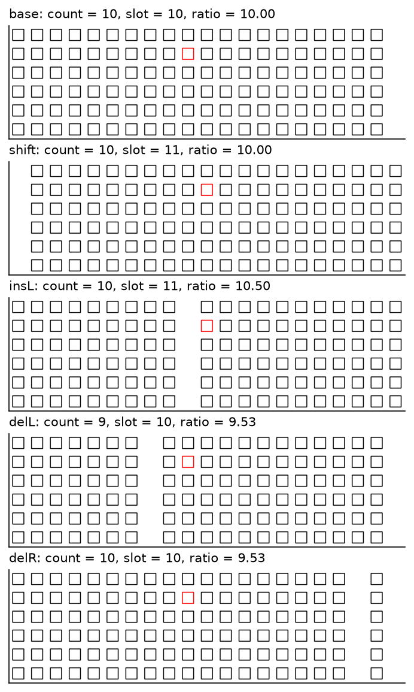

条件为 H32、H64、H96、V32、V64，单元 96 pixels 在 1.4 中几乎没有 +1 偏差，作为对照。

### 2.2 问题与运行

1. direct prompt 与 1.3、1.4 的 T6 行列问题相同；think prompt 要求“First describe step by step how you determine its row and its column”，最后一行给出同样的 JSON，thinking 仍为 off。问题全文见设计第 3.1 节。
2. 每个条件 320 个 direct 问题（64 张 base × 5 个变体），合计 1600 个；H32、H64、V64 的每个 $c$ 取 2 张 base 的全部变体（160 张图像）另以 think prompt 提问，合计 480 个。
3. 生成使用 qwen_runtime.generate_batch，direct 的 batch size 为 16、输出上限 64 tokens，think 的 batch size 为 8（前 32 个为 16）、上限 1536 tokens。以 batch size 1 抽查 20 个 direct 与 4 个 think 回答，答案层面一致 20/20 与 4/4，文本完全相同 17/20 与 4/4。
4. direct 回答全部可解析；think 回答中 12/480 因达到输出上限（逐项列举进入循环）而没有最终答案，计入分母、不计为任何路径的命中。
5. 特征采集以模型自己的回答做 teacher forcing，读取偶数层（第 0 层为输入 embedding）在四个位置上的 residual stream：prompt 最后一个 token（last）、预测行号首位数字的状态（row0）、预测列号首位数字的状态（col0）与目标单元覆盖的 merged visual token 的平均（vis）。direct 回答全部采集；think 回答中 474/480 可定位答案数字并被采集。
6. 推理在共享 GPU 上运行（GPU 0、3、4，未使用 GPU 1），direct 生成约 0.4 GPU hours，think 生成约 1.0 GPU hours，特征采集约 0.4 GPU hours，方向干预约 1.0 GPU hours（含一次方向过弱、已存档的预实验），合计约 2.8 GPU hours。

### 2.3 路径预测与评分

对每张图像计算四个预测：计数 $k$、槽位 $g$、比例换算 $r$（设计第 2.2 节），以及“从空白处重新计数”的序号 $k_{\mathrm{gap}}$，即目标与它之前最近一条内部空白槽位线之间的实例线数（目标之前没有内部空白时 $k_{\mathrm{gap}} = k$）。$k_{\mathrm{gap}}$ 在设计阶段没有列出，是在 direct 结果显示内部空白引起大幅负向偏差之后加入的。配对变化定义为

$$
\Delta = \hat{o}_{\text{variant}} - \hat{o}_{\text{base}},
$$

其中 $\hat{o}$ 为同一张 base 派生的变体与 base 本身的回答序号。以配对变化衡量路径可以消除 base 本身的 +1 偏差。

## 3. 结果

### 3.1 配对变体：计数路径（Q1，direct）

下图为每个条件、每个变体的配对变化分布（direct），颜色由深蓝（$\Delta \le -2$）、浅蓝（$-1$）、灰（0）、橙（$+1$）到深橙（$\ge +2$）。

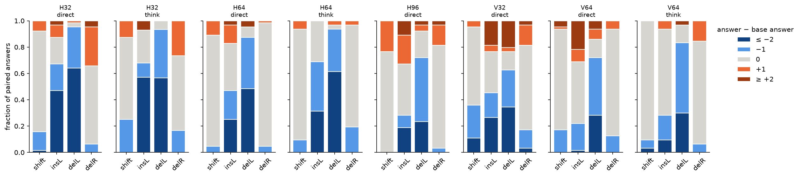

| 条件 | base 计数命中 | shift：$\Delta = 0$ / $+1$ | insL：$\Delta = 0$ / 从空白重新计数 | delL：$\Delta = -1$ / $\le -2$ | delR：$\Delta = 0$ |
| --- | --- | --- | --- | --- | --- |
| H32 | 0.45 [0.34, 0.57] | 0.77 / 0.08 | 0.20 / 0.30 | 0.31 / 0.64 | 0.59 |
| H64 | 0.69 [0.57, 0.79] | 0.84 / 0.11 | 0.36 / 0.17 | 0.39 / 0.48 | 0.94 |
| H96 | 0.88 [0.77, 0.94] | 0.77 / 0.23 | 0.39 / 0.06 | 0.48 / 0.23 | 0.78 |
| V32 | 0.34 [0.24, 0.47] | 0.59 / 0.05 | 0.31 / 0.09 | 0.28 / 0.34 | 0.64 |
| V64 | 0.64 [0.52, 0.75] | 0.77 / 0.02 | 0.47 / 0.00 | 0.44 / 0.28 | 0.81 |

每格分母为 64 个配对（全部回答有效）。base 计数命中为 base 图像回答等于 $k$ 的比例。槽位路径预测 shift 与 insL 的 $\Delta = +1$，计数路径预测 0；比例换算路径预测 shift 的 $\Delta = 0$、delL 与 delR 的 $\Delta \approx 0$。

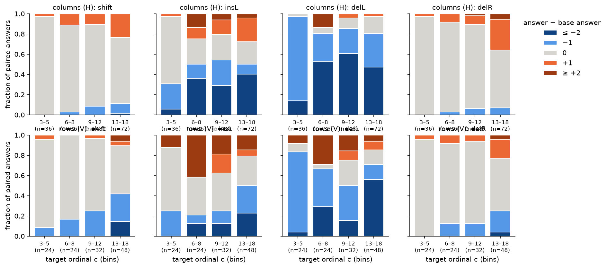

上图把五个条件按轴合并（上排列、下排行），横轴为目标序号 $c$ 的四个区间。数据显示：

1. **shift 几乎不改变答案。** 目标序号 3–5 时 $\Delta = 0$ 的比例为 0.97 [0.86, 1.00]（列，$n = 36$）与 0.88 [0.69, 0.96]（行，$n = 24$），13–18 时降至 0.65 与 0.48。槽位路径在全部区间都预测 $\Delta = +1$，实测 $+1$ 不超过 0.24。目标的 pixel 位置整体移动一个单元而实例之间的次序不变时，序号不变，与实验 3.5 C5 的边缘插入结果一致。
2. **delL 与 delR 的差异直接显示计数。** 两种变体都删除一条实例线、目标 pixel 位置不变，只有 delL 改变目标之前的实例数。目标序号 3–5 时，delL 的 $\Delta = -1$ 为 0.83 [0.68, 0.92]（列）与 0.79 [0.60, 0.91]（行），delR 的 $\Delta = 0$ 为 0.97 [0.86, 1.00] 与 0.96 [0.80, 0.99]。比例换算路径对两种变体给出相同的预测，因而被排除；槽位路径预测 delL 的 $\Delta = 0$，同样被排除。
3. **计数只在前约 5 个实例上精确。** 目标序号不小于 6 时，delL 的精确减 1 降至 0.25–0.33（列）与 0.15–0.38（行），其余回答以 $\Delta \le -2$ 为主（列 0.47–0.60）。delR 与 shift 的 $\Delta = 0$ 也随序号下降，但下降幅度小得多（13–18 时 0.48–0.65）。
4. **列方向的计数以空白为新的起点。** insL 与 delL 的目标之前都有一条内部空白。列方向上，回答等于 $k_{\mathrm{gap}}$ 而不等于 $k$ 的比例为 0.30（H32 insL）、0.23（H32 delL）、0.17–0.19（H64）与 0.06–0.11（H96）；行方向为 0.00–0.09。insL 中的空白不被计为一列：回答等于 $g$（把空白计为一列）的比例只有 0.06–0.17。解释（未经直接检验）：列号的计数以最近的视觉边界（网格左缘或一条空白）为起点，远离起点的目标只能部分地由跨越空白的累积得到；行号的计数沿序列进行（3.8），空白行不中断这一累积。

### 3.2 think prompt 与推理策略（Q1）

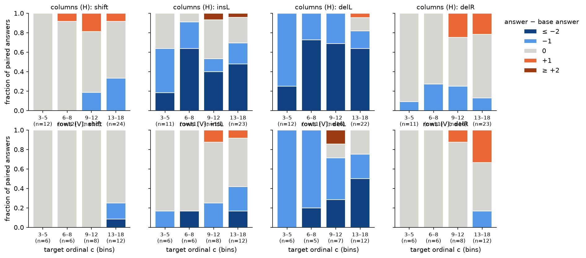

| 条件 | 全部变体计数命中：direct / think | 不一致对（direct 对 think 错 / think 对 direct 错） | base 的 +1：direct / think |
| --- | --- | --- | --- |
| H32 | 0.33 [0.26, 0.40] / 0.29 [0.22, 0.36] | 17 / 11（$p = 0.34$） | 12/32 / 10/32 |
| H64 | 0.50 [0.42, 0.58] / 0.55 [0.47, 0.63] | 7 / 15（$p = 0.13$） | 11/32 / 10/32 |
| V64 | 0.68 [0.60, 0.74] / 0.76 [0.69, 0.82] | 6 / 20（$p = 0.009$） | 7/32 / 4/32 |

每个条件 160 个配对（同一张图像的两种 prompt），$p$ 为双侧精确 McNemar 检验。think 的变体结果与 direct 相同：shift 与 delR 基本不改变答案，delL 在目标序号 3–5 时精确减 1（列 0.75，行 1.00），列方向的 insL 与 delL 同样出现从空白重新计数（H64 insL 0.34，H32 0.25）。

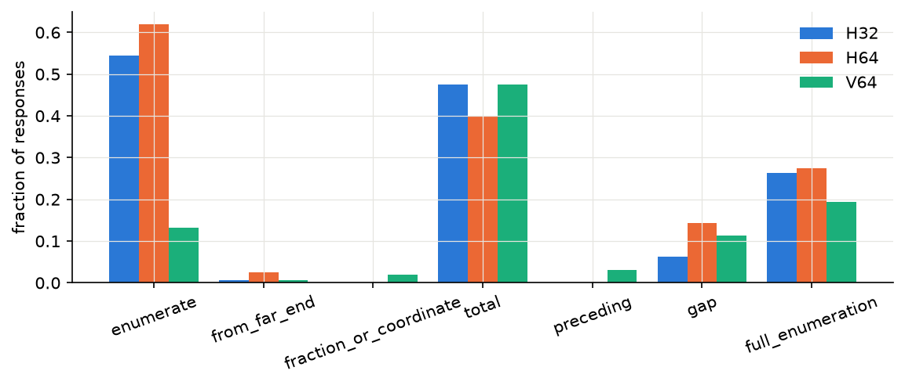

规则编码的策略比例（每条件 160 条回答）：

| 策略 | H32 | H64 | V64 |
| --- | --- | --- | --- |
| 列出连续序号（含“Column 1, 2, 3, ..., 20”这类模板） | 0.54 | 0.62 | 0.13 |
| 逐个列出直到目标的全部序号（无省略号） | 0.26 [0.20, 0.34] | 0.28 [0.21, 0.35] | 0.19 [0.14, 0.26] |
| 陈述总行数或总列数 | 0.47 | 0.40 | 0.47 |
| 比例或坐标估计 | 0.00 | 0.00 | 0.02 |
| 从远端计数 | 0.01 | 0.03 | 0.01 |
| 提及空白或分组 | 0.06 | 0.14 | 0.11 |

人工阅读 20 条回答（H64 与 H32 各 8 条、V64 4 条）后，推理文本可以归为三类：

1. **断言型。** 先数出行，再写“In row 3, count the circles from left to right … the red circle is the 10th circle”，序号直接给出，没有逐个列举的过程。H64 的一条 +1 回答（真值 17）写道“there are 17 black circles before it, so it’s at position 18”，用于支持答案的“之前的实例数”与答案一起偏大 1。
2. **逐项列举。** “1st: black, 2nd: black, 3rd: red”，多见于目标序号较小的样本；逐项列举的回答计数命中率较高（H32 0.60 对 0.18，V64 0.94 对 0.72），但列举本身只在序号小时出现，二者混杂了目标序号的作用。
3. **分组型。** 少数回答描述空白造成的分组，例如“the fourth circle in the second group”，再把两组相加。

据此，think 下的“计数”多为对一个已经形成的序号的口头复述；答案层面与 direct 一致（第 1 点的不一致对），+1 偏差在 think 下没有减少。

### 3.3 探针：hidden states 中的序号信息（Q2）

探针在 H 条件（H32、H64、H96 合并，960 个 direct 样本）与 V 条件（V32、V64 合并，640 个）上分别训练，特征与目标都在条件内去均值；全部探针在 128 维主成分空间中进行（主成分由全部样本的 Gram 矩阵计算，不使用标签），以 base 为单位做 5 折交叉验证。下图为 H 条件 direct 的 ridge 探针，蓝、橙、绿、黄线分别为 last、row0、col0、vis 四个位置，纵轴为交叉验证 $R^2$；第 0 层的 last、row0、col0 是同一个文本 token 的 embedding，没有方差，不作图。

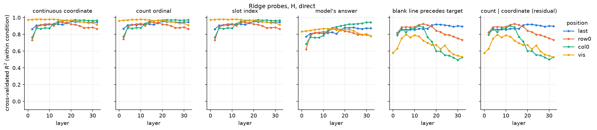

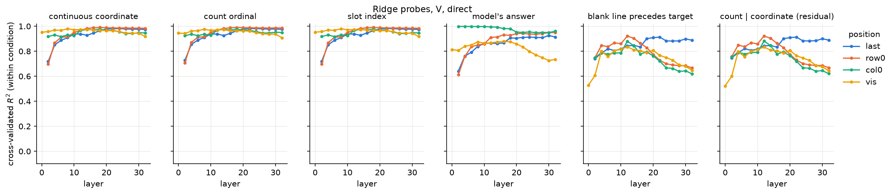

下图为计数序号 $k$ 的 16 类分类器（实线）与控制任务（虚线），左为线性（one-hot 最小二乘）分类器，右为 MLP（一层 128 单元），输入为前 64 个主成分；颜色同上。控制任务把每个条件中的每个槽位随机映射到一个序号标签。

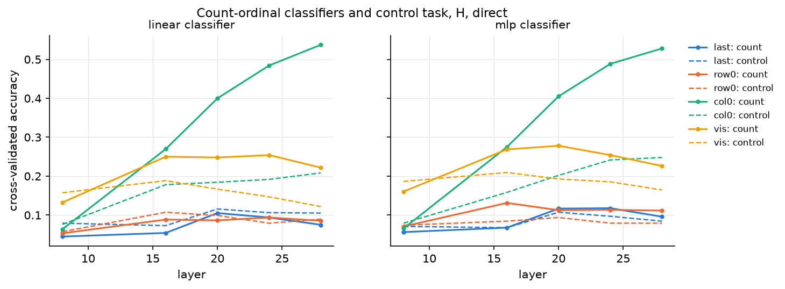

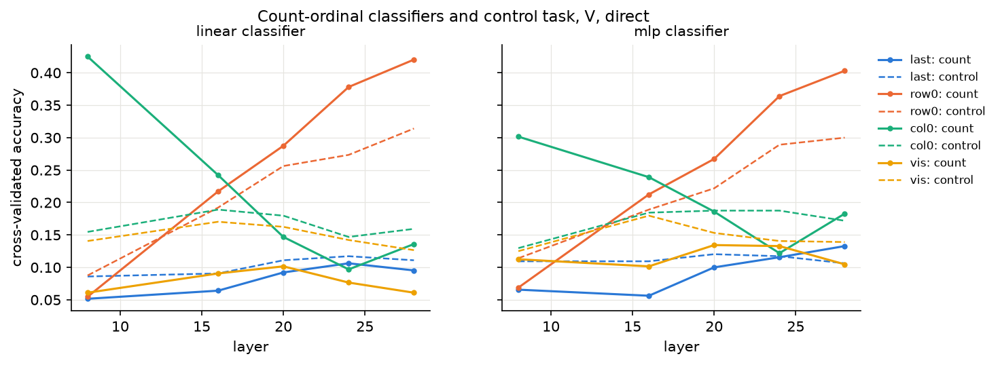

| 位置（H 条件 / V 条件） | 连续坐标 $u$ 的 $R^2$（层 4–32） | 计数序号的线性分类准确率（层 8 / 16 / 24 / 28） | 控制任务（层 28） | 目标之前有空白的 $R^2$（层 4–12 / 层 28） |
| --- | --- | --- | --- | --- |
| last | 0.91–0.95 / 0.85–0.98 | 0.04 / 0.05 / 0.09 / 0.07；0.05 / 0.06 / 0.11 / 0.10 | 0.11 / 0.11 | 0.86–0.87 / 0.89；0.78–0.84 / 0.88 |
| 长轴序号的答案状态（H：col0；V：row0） | 0.87–0.97 / 0.87–0.99 | 0.06 / 0.27 / 0.48 / 0.54；0.05 / 0.22 / 0.38 / 0.42 | 0.21 / 0.31 | 0.83–0.90 / 0.52；0.84–0.92 / 0.68 |
| vis | 0.92–0.98 / 0.92–0.98 | 0.13 / 0.25 / 0.25 / 0.22；0.06 / 0.09 / 0.08 / 0.06 | 0.12 / 0.13 | 0.75–0.80 / 0.56；0.76–0.84 / 0.69 |

计数序号共 16 类，多数类比例为 0.06；“已知精确坐标与条件、取每个槽位上最常见的计数”所能达到的上限为 0.61（同一槽位在不同变体中对应两个计数）。数据显示：

1. **位置以连续量的形式处处存在。** 在全部位置与第 2 层之后的全部层，连续坐标 $u$、计数 $k$、槽位 $g$ 的 $R^2$ 都在 0.85–0.99 之间；目标的 visual token 在第 0 层（ViT 输出）即为 0.97。由于三者在本设计中高度相关，$R^2$ 不能区分它们；以条件内 $k$ 的标准差 4.6 换算，$R^2 = 0.95$ 对应约 1 个实例的读出误差。
2. **整数序号只在答案位置形成。** 以 16 类分类衡量“精确到整数”的信息：目标 visual token 上的线性准确率不超过 0.25（H）与 0.09（V），与控制任务（0.12–0.19）相近或更低；prompt 最后一个 token 上只有 0.04–0.13，接近多数类比例，尽管同一位置的连续 $R^2$ 达到 0.95。长轴序号的答案状态上，准确率从第 8 层的 0.05–0.06 升至第 28 层的 0.54（H）与 0.42（V），高于控制任务 0.21 与 0.31，接近 0.61 的上限。MLP 与线性分类器的准确率相差不超过 0.05，说明非线性读出没有带来额外的整数信息。因此 visual token 与 prompt 末尾保存的是精度约为 1 个实例的位置量，整数序号由答案位置在第 16–28 层形成，与 2.5c 中列号在第 20 层由格式 token 读入一致。
3. **坐标之外的信息：目标之前是否有空白。** 本设计中，条件内以 $u$ 线性回归 $k$ 的残差只取决于目标之前是否有一条空白实例线。该量在 last 上的 $R^2$ 为 0.74–0.92（全部层），在答案状态上第 4–12 层为 0.83–0.92、第 28 层降至 0.52（H）与 0.68（V），在 visual token 上为 0.53–0.84。hidden states 确实含有坐标无法给出的、与计数有关的信息，但它首先是“左侧有空白”这一视觉特征，本设计无法把它与“之前的实例数”区分开（第 4.2 节）。
4. **+1 不能从 prefill 状态中预先读出。** 在没有内部空白的变体（base、shift、delR）上，以“回答是否为 $k + 1$”为目标、同时输入 $k$ 的探针，AUROC 为 0.72–0.80（H）与 0.64–0.78（V）；只用 $k$ 本身已有 0.72 与 0.65。状态在 $k$ 之外增加的 AUROC 不超过 0.08（H）与 0.13（V），+1 主要可由目标的序号大小预测（第 3.5 节）。
5. **偏差在答案位置逐层形成。** 回答减去计数（$\hat{o} - k$）的 $R^2$ 在答案状态上由第 4 层的 0.28（H）与 0.19（V）升至第 32 层的 0.55 与 0.47，在 visual token 上始终不超过 0.35（H）与 0.25（V）。该量的方差主要来自内部空白引起的大幅负偏差。
6. **think 下答案状态的信息较弱。** think 的答案状态位于推理文本之后，$u$ 的 $R^2$ 只有 0.53–0.72（H），计数序号的线性准确率在第 24–28 层为 0.31–0.32（控制任务 0.11）；last 位置与 direct 相同（$R^2$ 0.89–0.94）。V64 的 think 只有 158 个样本，在 128 个主成分上的 ridge 探针严重过拟合（目标 visual token 在第 0 层的 $u$ 的 $R^2$ 只有 0.28，direct 下同类刺激为 0.95），因此不作解释。

下图为 H64 与 V64 的状态在前三个主成分上的点云，上排为侧视图、下排为俯视图，点的颜色为计数序号 $k$（viridis，深紫为 2、黄为 18），灰色为点云在底面上的投影。答案状态（第一、三列，第 24 层）沿 $k$ 形成一条连续的弧；目标的 visual token（第二、四列，第 16 层）分成 4 簇，每簇内部沿 $k$ 连续排列。刺激共有 4 种图形模板（person、ring、square、arrow），簇数与模板数相同，解释为按模板分簇（未逐点核对）。两种状态都没有按整数序号分开的离散簇。

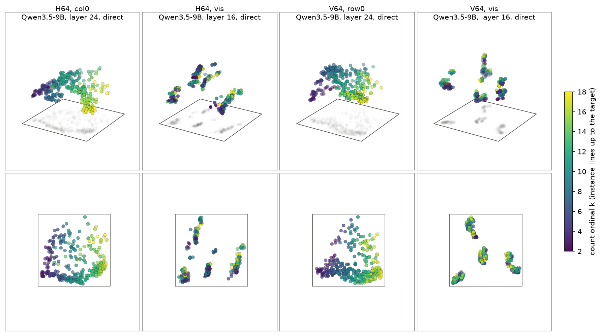

### 3.4 沿方向的干预（Q1）

干预作用于 base 变体中预测长轴序号首位数字的状态（H 为 col0，V 为 row0），direct 取每个条件中 base 序号能被 3 整除的样本（H 66 个、V 44 个），think 取能被 2 整除的样本（H 32 个、V 16 个）；每个样本在 4 个层上各运行 13 个标签（含不干预）。方向的定义见设计文档第 3.3 节，下文以 $m_{\pm 1}$、$m_{\pm 3}$ 表示条件均值差方向，以 $a$ 表示答案的线性编码方向，以 $x_{3.6}$ 表示 3.6 的 x 方向（范数与 $m_{+3}$ 相同）。

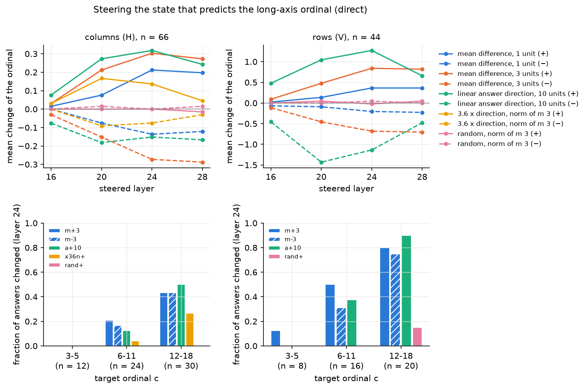

上图上排为序号的平均变化（干预后减不干预）随干预层的变化，颜色区分方向类型（蓝：$m_{\pm 1}$，橙：$m_{\pm 3}$，绿：$a$ 的 10 个单位，黄：$x_{3.6}$，粉：随机方向），实线为正向、虚线为负向；下排为第 24 层上答案发生改变的比例，按目标序号分为 3–5、6–11、12–18 三组，斜线填充为 $m_{-3}$。

| 方向（第 24 层，direct） | H：平均变化 / 改变比例 | V：平均变化 / 改变比例 |
| --- | --- | --- |
| $m_{+1}$ / $m_{-1}$ | +0.21 / 0.21；−0.14 / 0.14 | +0.36 / 0.34；−0.20 / 0.18 |
| $m_{+3}$ / $m_{-3}$ | +0.30 / 0.27；−0.27 / 0.26 | +0.84 / 0.57；−0.68 / 0.45 |
| $+10a$ / $-10a$ | +0.32 / 0.27；−0.15 / 0.18 | +1.27 / 0.55；−1.14 / 0.52 |
| $x_{3.6}$ 正向 / 负向 | +0.14 / 0.14；−0.08 / 0.08 | 未施加 |
| 随机正向 / 负向 | 0.00 / 0.00；0.00 / 0.06 | −0.02 / 0.07；+0.05 / 0.05 |

数据显示：

1. **方向特异，且符号正确。** 均值差方向与答案方向使序号按方向的符号移动，同范数的随机方向在全部层上的平均变化不超过 0.05。第 16 层的干预几乎无效（H 不超过 0.08），效果在第 20–24 层达到最大，与探针中整数序号在答案位置第 16–28 层形成的时间一致（第 3.3 节）。
2. **移动幅度小于方向的设计幅度。** $m_{+1}$ 改变的答案几乎都恰好加 1（H 0.21、V 0.32 的样本恰为 +1），$m_{\pm 3}$ 改变的答案多数只移动 1–2，H 中没有恰为 ±3 的样本。单个状态上的加性干预只能部分改写序号，后续层仍从其他位置读入序号信息。
3. **小序号不受干预，大序号容易被移动。** 第 24 层上，目标序号 3–5 的列号在全部方向下都没有改变（12 个样本），行号只有 $m_{+3}$ 改变了 1/8；序号 12–18 时，$m_{\pm 3}$ 改变了 0.43（H）与 0.75–0.80（V）的答案，$+10a$ 改变了 0.50 与 0.90，随机方向也改变了 V 中 0.15 的答案。小序号的答案由一个稳定的计数结果决定；大序号的答案位于一个连续量上相邻整数之间的边界附近，小扰动即可使其越过取整阈值。这与第 3.1 节中精确计数只覆盖前约 5 个实例的结果一致。
4. **3.6 的 x 方向对列号有弱的同向作用。** 与 $m_{+3}$ 范数相同的 $x_{3.6}$ 在第 20 层使列号平均增加 0.17（$m_{+3}$ 为 0.21），反向为 −0.09，第 28 层降至 0.05，作用集中在序号 12–18（第 24 层改变 0.27）。两方向的余弦只有 0.03–0.28。解释：point prompt 中的 x 坐标表示与序号的答案状态共享一部分方向，序号读出在较早层仍部分依赖连续的水平位置；该作用弱于均值差方向，不足以支持“先定位到坐标再换算”作为主要路径。
5. **think 下干预完全无效。** think 的 48 个样本、全部 4 个层和 12 个方向上，答案没有任何改变（包括 $\pm 10a$）。48 条推理文本中有 46 条在最终 JSON 之前已经写出了同一个行号或列号；最终答案由已生成文本中的数字复制得到，答案状态上的干预无法改写它。若要在 think 下检验序号的形成，需要干预推理文本中首次写出序号的位置，本实验未做。

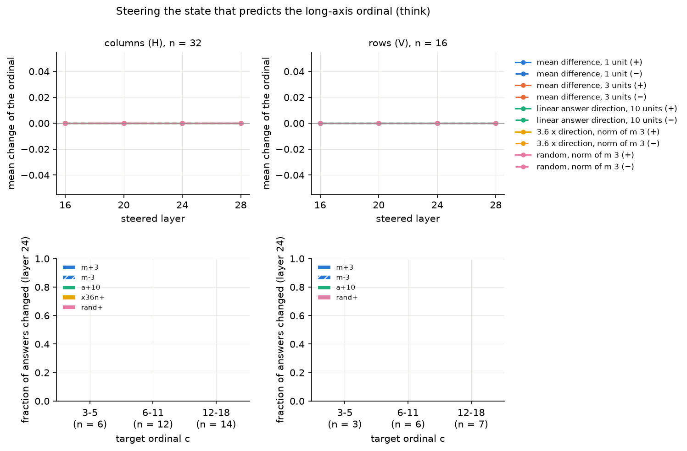

### 3.5 +1 起始位置的简单模型（Q3）

对 1.4 中 6 行、相位 0 的 20 个条件（3920 个回答）逐条件拟合设计第 3.4 节的四个模型。

| 模型 | 每条件参数数 | 总负对数似然 | AIC | BIC |
| --- | --- | --- | --- | --- |
| subitizing 加近似计数 | 5（含 $K$） | 1966 | 4132 | 4759 |
| 带偏差的比例估计 | 4 | 2011 | 4182 | 4684 |
| 两端锚定的比例判断 | 4 | 2420 | 5000 | 5502 |
| 数字先验（另加 29 个共享参数） | 3 | 2055 | 4289 | 4847 |

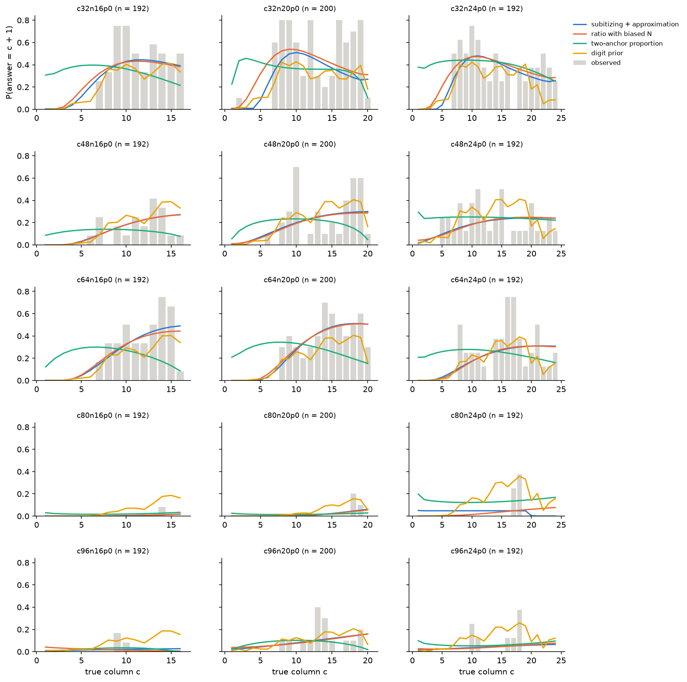

灰色柱为实测 $P(\hat{c} = c + 1)$，蓝、橙、绿、黄线分别为 subitizing 加近似计数、带偏差的比例估计、两端锚定的比例判断与数字先验的预测；每格为一个 1.4 条件，标题给出样本数。数据显示：

1. **比例估计与 subitizing 模型同样好，且都不需要特殊的起始机制。** 单元 32 与 64 pixels、实例数不少于 16 时，比例模型拟合出的实例数高估量 $\gamma$ 为 0.012–0.076（c48 为 0.001–0.009，因 c48 同时有 0.09–0.16 的 −1，均值漂移被抵消）。均值偏差 $(c - 0.5)\gamma$ 在 c32 条件中于第 7–11 列越过 0.5；由于噪声随序号增大，$P(+1)$ 在此之前已开始上升。subitizing 模型拟合出的精确范围 $K$ 为 1–4，漂移斜率 $\beta$ 为 0.012–0.114；在 $K$ 之后它与比例模型给出几乎相同的线性漂移，两者的似然只差 0–2（c80n24 例外，该条件以 −1 为主）。单元 80 与 96 pixels 的 $\gamma$ 在 −0.02 与 0.02 之间。
2. **实测的起始比两个模型都更陡。** c32n20 中第 6 列为 0.10、第 7 列为 0.60，高斯漂移模型预测由第 4 列到第 9 列逐渐上升。第 3.1 节中 delL 的精确减 1 在目标序号 6 处由 0.83 降至 0.28，与这一陡峭的起始位置相吻合：前约 5 个实例的序号精确，此后由近似的累积给出。
3. **末端由边界锚定。** 单元 48 与 64 pixels、$n \ge 16$ 时，两模型预测最后一列回答 $n + 1$ 的比例为 0.24–0.51，实测为 0.08–0.30（c64n16 预测 0.44–0.49，实测 0.08）；单元 32 pixels 时预测与实测接近（c32n16 实测 0.50）。四个简单模型都不含“最后一个实例”的信息，而 Qwen3.5-9B 的回答显示它在多数条件下利用了网格的末端。
4. **数字先验不能解释 +1。** 共享的数值先验随数值单调上升（数值 10 至 20 的对数权重由 0.2 升至 6.1），等价于另一种随序号增长的漂移；它在 c80 与 c96 上预测出实测没有的 +1，AIC 比比例模型高 107。
5. **两端锚定的比例判断最差。** 该模型要求两端无偏、中部偏大，实测的 +1 一直持续到倒数第二列。

综上，+1 的起始位置可以描述为：序号的估计带有约 3%–8% 的比例高估，在第 5–8 个实例之后越过四舍五入的阈值；起始位置之前的精确性对应少量实例上的精确计数（第 3.1 节）。这一描述不需要额外的“第 7 个实例”机制，因此起始位置本身不值得单独解释，值得解释的是比例高估的来源与单元尺寸对它的影响（1.4 第 3.1 节）。

### 3.6 行偏差（Q4）

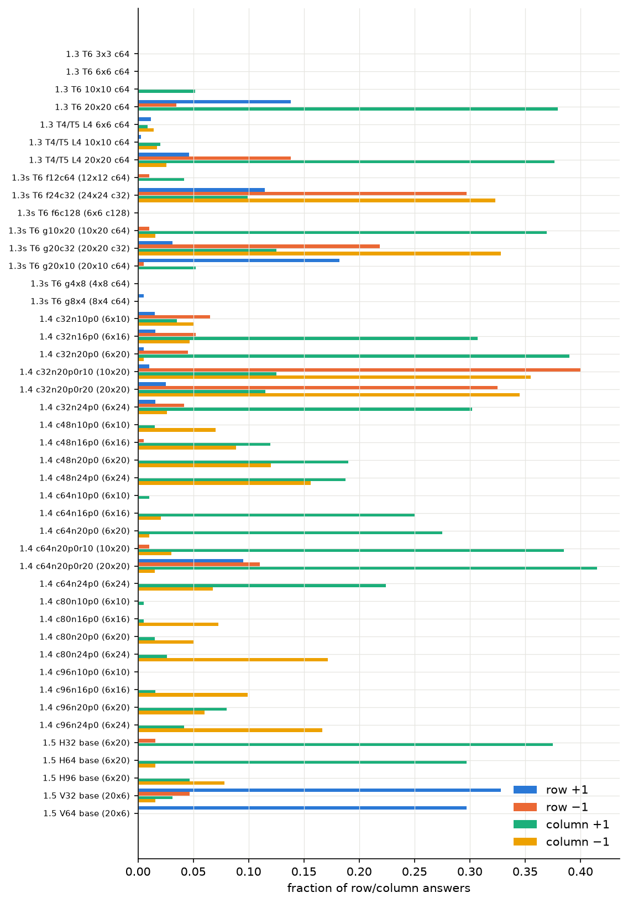

图中蓝、橙、绿、黄柱分别为行 +1、行 −1、列 +1、列 −1 的比例，分母为该布局全部行列回答。代表性布局如下（T6 红色目标；1.3 正式运行每格 58 个，1.3 补充 192 个，1.4 192–200 个，本实验 base 64 个）：

| 布局（行 × 列，单元） | 行 +1 | 行 −1 | 列 +1 | 列 −1 | 行列同时 −1 |
| --- | --- | --- | --- | --- | --- |
| 1.3 20×20，64 | 0.14 | 0.03 | 0.38 | 0.00 | 0.00 |
| 1.3 补充 10×20，64 | 0.00 | 0.01 | 0.37 | 0.02 | 0.00 |
| 1.3 补充 20×10，64 | 0.18 | 0.01 | 0.05 | 0.00 | 0.00 |
| 1.4 6×20，64 | 0.00 | 0.00 | 0.28 | 0.01 | 0.00 |
| 1.4 20×20，64 | 0.10 | 0.11 | 0.41 | 0.01 | 0.00 |
| 本实验 V64（20×6，64） | 0.30 | 0.00 | 0.00 | 0.00 | 0.00 |
| 本实验 V32（20×6，32） | 0.33 | 0.05 | 0.03 | 0.02 | 0.00 |
| 1.4 6×20，32 | 0.01 | 0.04 | 0.39 | 0.01 | 0.00 |
| 1.4 10×20，32 | 0.01 | 0.40 | 0.12 | 0.35 | 0.17 |
| 1.4 20×20，32 | 0.03 | 0.33 | 0.12 | 0.34 | 0.12 |
| 1.3 补充 20×20，32 | 0.03 | 0.22 | 0.12 | 0.33 | 0.08 |
| 1.3 补充 24×24，32 | 0.11 | 0.30 | 0.10 | 0.32 | 0.10 |

数据显示：

1. **行 +1 与列 +1 服从同一个条件：轴上至少约 16–20 个实例。** 只有 6–12 行的网格，行 +1 不超过 0.02；行含 20 个实例时，行 +1 为 0.10–0.33。1.3 补充的 10×20 与 20×10 网格互为转置，+1 分别出现在列与行上。
2. **行 +1 的起始位置晚于列。** V64 的行 +1 在第 12 行之后达到 0.5–0.8，20×10 网格在第 11 行之后，c64 的 20×20 网格在第 13 行之后；列 +1 在第 5–8 列开始（1.4）。行方向的 delL 在目标序号 3–5 时同样精确减 1（第 3.1 节），两者的精确计数范围相近，差别在于起始之后的漂移斜率：行的比例高估较小。
3. **行 −1 是另一种失败。** 行 −1 只出现在单元 32 pixels 且行列都不少于 10 的网格中，从第 2 行开始就达到 0.5–0.7，没有起始位置；第 1 行的目标从不被回答为第 0 行，因此它不是 0 起点的计数约定。同一样本行列同时 −1 的比例为 0.08–0.17，在 10×20 网格中，行列偏差的联合分布以 $(0, 0)$、$(-1, -1)$、$(0, -1)$ 为前三位。1.4 第 3.6 节显示这类网格中答对样本的指向型 head 峰值落在目标上的比例也只有 0.50，−1 样本的峰值偏向左侧。解释（未经直接检验）：单元 32 pixels 的密集二维网格中，每个实例只占一个 merged token，目标的读取向左上方的相邻 token 偏移，属于定位环节的误差，与计数的漂移无关。

与实验 3.8 的联系：3.8 显示行号由 DeltaNet 第 9–16 层沿 causal 序列对图形行计数，计数以顶行为起点，序列中的空白 token 不被计入。本实验从图像侧得到一致的结果：行方向删除目标之前的一行时答案减 1，空白行不被计为一行，且空白行不打断计数（$k_{\mathrm{gap}}$ 命中 0%–9%）。列方向没有这样的序列累积：同一行内的实例在序列中相邻，列号需要在一行 token 内部计数，3.8 中行内平移不改变列号；本实验中列号以空白为新起点的比例达到 17%–30%。行列的不对称因此体现在两处：(1) 行号的计数经由序列累积，对内部空白稳健，列号的计数依赖可见的边界；(2) 两者的比例高估都在约 5 个实例后出现，行的高估较小，行 +1 的起始位置更晚。

## 4. 解释与限制

### 4.1 对三条路径的判定

| 路径 | 关键预测 | 证据 | 判定 |
| --- | --- | --- | --- |
| (a) 坐标换算 | delL 与 delR 相同；shift 不变 | delL −1 为 0.79–0.83，delR 不变为 0.96–0.97（$c \le 5$） | 不是主要路径 |
| (b) 槽位 | shift 与 insL 为 +1 | shift 的 +1 不超过 0.24，insL 不超过 0.24 | 不成立 |
| (c) 计数 | delL 为 −1，其余为 0 | 前约 5 个实例精确成立；之后为近似累积，列方向以空白为新起点 | 成立，精确范围有限 |

探针与干预补充了路径 (c) 的形式：目标位置在 visual token 中以连续量编码，整数序号在答案位置的第 16–28 层形成；序号 3–5 时形成的是一个稳定的计数结果，对加性干预不敏感，序号较大时形成的是连续量的取整，容易被均值差方向与随机方向移动（第 3.3、3.4 节）。3.6 的 x 方向只有弱的作用，坐标换算 (a) 至多是大序号时的次要成分。

### 4.2 限制

1. 每个目标序号只有 4 张 base（think 为 2 张），按序号区间合并后每格 24–72 个配对；单个序号的比例只作描述。
2. 删除或插入一条实例线必然改变目标之前的可见内容，计数的改变与“目标之前有一条空白”这一视觉特征无法完全分离；delR 只控制了“图中有一条空白”。
3. think 的推理策略由规则编码，人工核对只覆盖 20 条；“逐项列举”与目标序号相关，其与正确率的关系不能解释为因果。
4. think 中 12/480 个回答因达到 1536 tokens 的上限而没有答案。
5. Q3 的模型只描述 1.4 的回答分布，参数逐条件拟合，没有在条件之间检验泛化。
6. 与设计的偏离：(1) 路径预测中的 $k_{\mathrm{gap}}$（从最近的内部空白重新计数）在看到 insL 与 delL 的回答分布后加入，属于事后分析；(2) 干预的预实验使用回归得到的坐标与计数的偏方向，二者在条件内近乎共线（余弦约 −0.98），且 1–3 个单元的答案方向几乎不改变答案，因此正式运行改用条件均值差方向与 10 个单元的答案方向，预实验记录存档于 steer/ 下；(3) 干预只取部分 base（direct 每 3 张取 1 张，think 每 2 张取 1 张），每个序号区间 8–30 个样本；(4) 探针全部在 128 维主成分空间中进行；(5) think 的生成在前 32 个问题之后改用 batch size 8。
7. V64 的 think 只有 158 个特征样本，探针结果不作解释；think 下的干预只作用于最终答案的数字状态，未检验推理文本中首次写出序号的位置。
8. 只使用合成网格。自然图像中没有规则的行列，本实验的结论（行列序号由计数得到）不直接适用于 RefCOCO 上的坐标答案；坐标答案的机制见实验 3.6。

## 5. 运行与产物

- 程序：analysis_tools/behavior/ordinal_mechanism.py（刺激、问题、评分、路径预测与策略编码），ordinal_mechanism_run.py（生成、抽查、特征采集与方向干预，复用 coordinate_readout 的 prepare 与 teacher forcing、coordinate_value 的 Steerer 与 continue_number），ordinal_mechanism_analysis.py（方向估计、路径分析、探针、Q3 模型与行偏差汇总），ordinal_mechanism_figures.py（作图）。入口为 scripts/analysis/behavior/ordinal_mechanism.sh，COMMAND 取 build、gen、spot、capture、directions、steer、analyze。
- 测试：tests/analysis/behavior/test_ordinal_mechanism.py。
- 运行目录：WORK_DIR 下的 analysis/behavior/2026-10-16_ordinal_mechanism/。cases.jsonl 为全部问题与路径预测，gen/ 下为回答、运行记录与抽查，features/ 下为各条件的 residual 特征（float16）与采集状态，steer/ 下为方向与干预记录，analysis/ 下为 summary.json、探针结果与图。1.3、1.3 补充、1.4 与 3.6 的目录只被读取。
