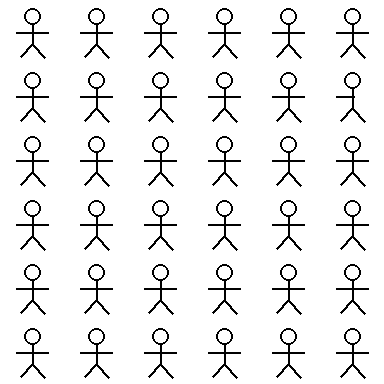
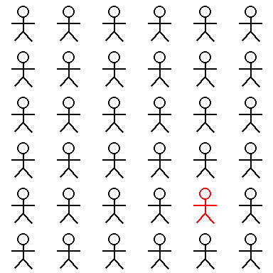
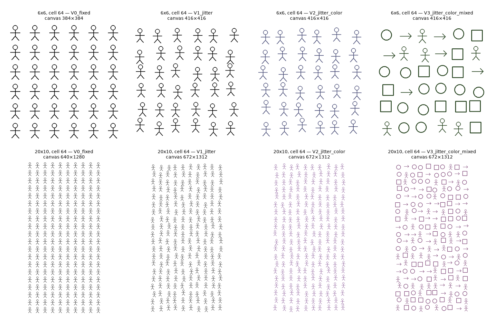
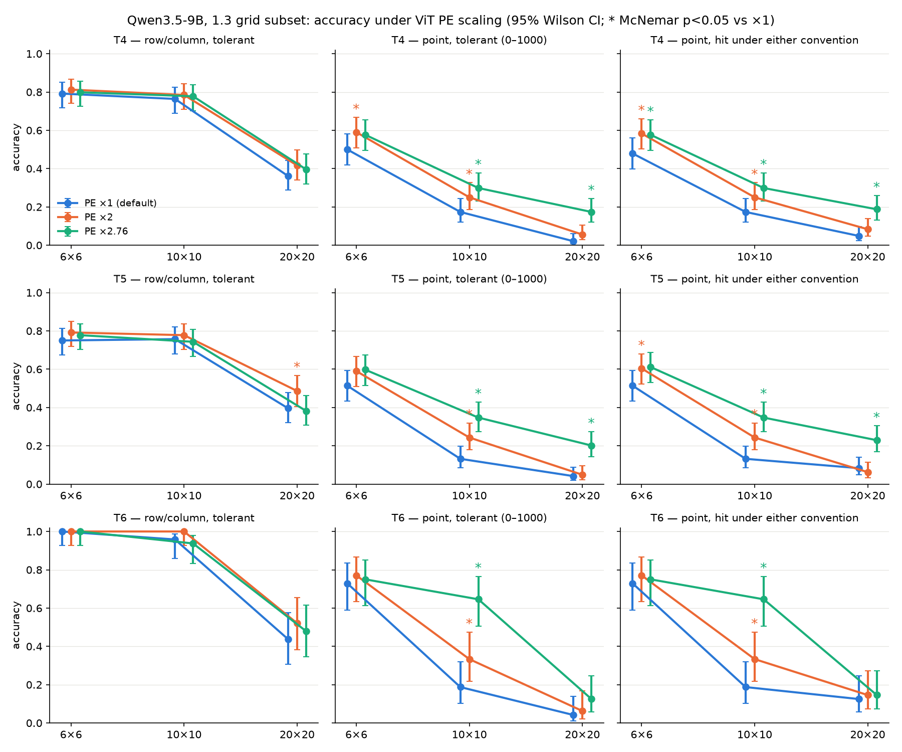
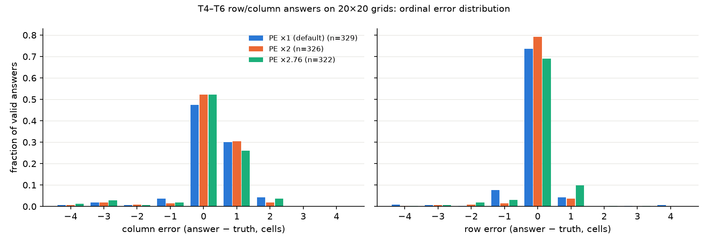
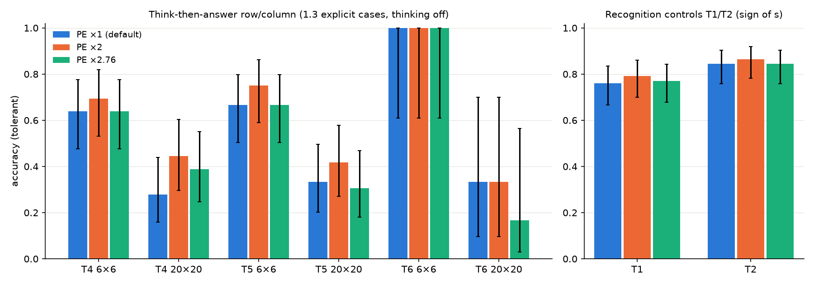
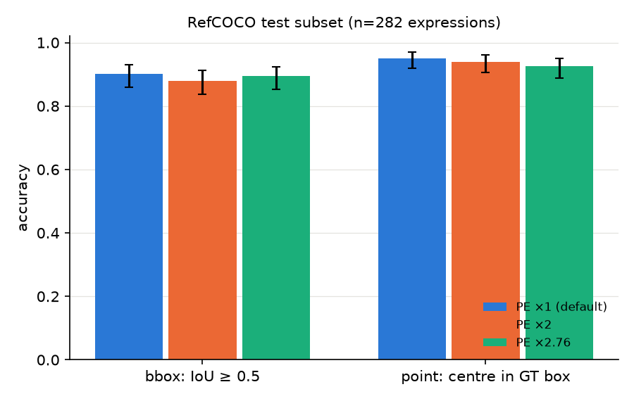
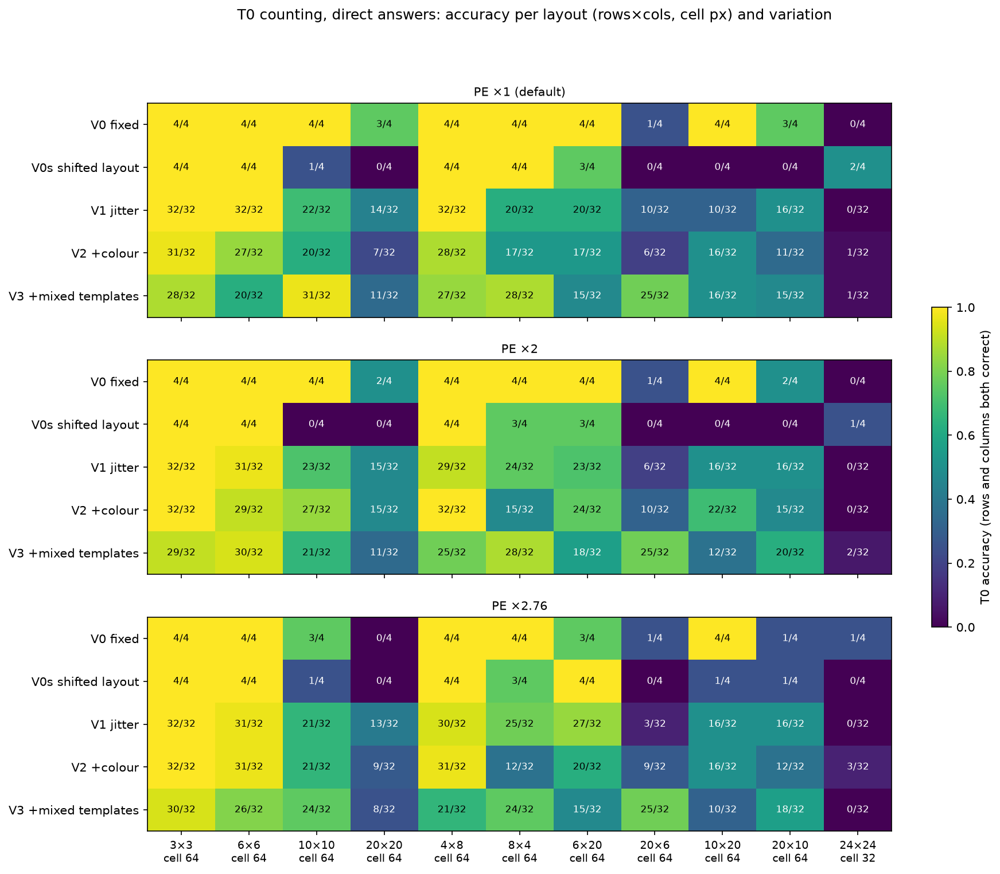
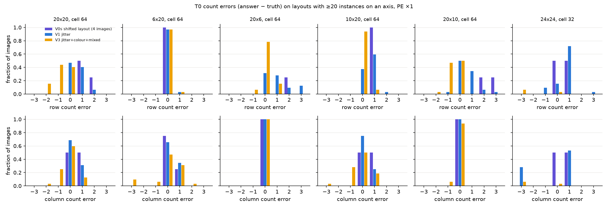
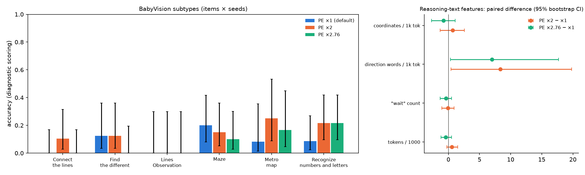

# PE 缩放的行为检验与 T0 图像变化

实验日期：2026-10-16。本文属于[行为诊断](plan.md)研究，编号为实验 1.6。主模型为 Qwen3.5-9B，bfloat16，thinking off。前置结果见[能力分解](results_2026-10-13_decomposition.md)（实验 1.3）、[能力分解的补充条件](results_2026-10-14_decomposition_supplement.md)（下称“1.3 补充”）、[序号偏差与 token 网格](results_2026-10-15_ordinal_token_grid.md)（实验 1.4）与 [ViT 位置与布局表征](../position/results_2026-10-15_vit_layout.md)（实验 3.7）。

## 1. 研究问题与主要结果

实验 3.7 发现，Qwen3.5 的 learned absolute position embedding（下称 PE）与 Qwen3-VL 方向相同、范数约为其 1/2.76；在白色画布上把 PE 放大 2 至 2.76 倍可显著提高单个圆盘的定位精度，RefCOCO val 不受影响，放大 4 倍则有损害。该结果只在大面积留白、只含一个物体的图像上得到。本实验检验两个问题：

1. **A：PE 放大能否改善含多个实例的合成网格与 BabyVision 的定位与追踪类题目，同时不损害识别与自然图像 grounding。** 比较 PE ×1、×2、×2.76 三个条件下实验 1.3 的分层子集、BabyVision 的 Visual Tracking 与 Find the different 子类、RefCOCO test 子集上的行为。
2. **B：T0 行列计数在真实的逐图像变化下是否仍然成立。** 实验 1.3、1.3 补充与 1.4 的每个 T0 条件只含 4 张不同的图像（每个模板 1 张），本实验构造逐图像变化的 T0 数据集并重新测量。

主要结果如下：

1. **PE ×2.76 显著提高合成网格的中心点定位，主要作用于 10×10 与 20×20 网格。** 三个网格合并后，中心点命中率在 T4 由 0.23 升至 0.35（100 对样本中 74 个变对、23 个变错，McNemar $p = 2 \times 10^{-7}$），T5 由 0.23 升至 0.38（$p = 4 \times 10^{-10}$），T6 由 0.32 升至 0.51（$p = 4 \times 10^{-6}$）；T6 在 10×10 网格中由 9/48 升至 31/48（22 个变对、0 个变错）。×2 的作用方向相同、幅度较小（第 3.1 节，图 1）。
2. **PE 放大不改变行列答案的内容正确率，也不消除 20×20 网格的列序号 +1 偏差。** tolerant 评分下，T4、T5、T6 的行列准确率在三个条件间差异均不显著（合并后 McNemar $p \ge 0.06$）；20×20 网格中列 +1 的比例在 ×1 与 ×2.76 下分别为 0.28 与 0.18（T4）、0.23 与 0.31（T6）。strict 准确率的提高几乎全部来自 JSON 格式错误的减少：tolerant 解析挽救的行列答案在 ×1 下为 52 个，在 ×2.76 下为 3 个（第 3.1 节）。
3. **先推理后回答的行列题、T1/T2 识别对照不受 PE 放大影响。** 1.3 的 156 道先推理后回答的行列题在三个条件下的 tolerant 准确率为 77/156、91/156、79/156（×2.76 对 ×1：$p \ge 0.48$）；T1 与 T2 的准确率在三个条件间的差异不超过 3 个百分点（$p \ge 0.38$，第 3.2 节，图 2）。
4. **自然图像上，×2.76 使中心点答案略有下降，bbox 答案不变。** RefCOCO test 的 282 条表达式上，bbox IoU≥0.5 的比例为 0.901、0.879、0.894（$p \ge 0.21$），平均 IoU 差为 −0.015 [−0.031, 0.000]；中心点落入真值框的比例为 0.950、0.940、0.926，×2.76 对 ×1 为 1 个变对、8 个变错（$p = 0.039$，第 3.3 节，图 3）。
5. **T0 计数的高准确率依赖于实例与 visual token 网格的对齐方式。** 实验 1.3 的 T0 图像（V0）中网格紧贴画布、实例单元与 32-pixel token 边界对齐；只把同样的网格平移到抖动布局所需的位置（四周留 16 pixels 白边，下称 V0s），计数准确率即由 35/44 降至 22/44，轴上实例数不少于 10 的 7 种布局中由 19/28 降至 6/28，错误全部为多计（1 至 7 个）。逐实例抖动 8 pixels（V1）的准确率为 208/352 = 0.59，与 V0s 接近（Fisher $p = 0.26$）。1.3 中 T0 在 20×20 网格上“基本正确”的结论只在对齐布局下成立（第 3.4 节，图 4、图 5）。
6. **PE 放大不显著改变 BabyVision Visual Tracking 与 Find the different 的准确率，也不改变推理文本对图像的描述方式。** 99 题的 strict 准确率在 ×1 与 ×2.76 下均为 8/99（5 对 5，$p = 1.0$），在 ×2 下为 15/99（10 题变对、3 题变错，McNemar $p = 0.09$），增益不随放大倍数单调增加；回答长度、“wait”次数、坐标与方向词密度、未依据图像的措辞比例的配对差均不显著（第 3.5 节，图 7）。
7. **混合模板使长轴上的计数由多计转为少计，PE 放大对 T0 没有一致作用。** V3（抖动、逐图像笔画颜色、逐实例混合模板）在含 20 个实例的轴上主要少计 1（如 20×10 网格 47% 的图像回答 19 行），在 24×24 网格中 26/32 的图像回答 20×20。PE ×2 使全部 T0 合并准确率提高（159 个变对、113 个变错，$p = 0.006$），×2.76 没有作用（155 对 156）；先推理后回答的 T0 在 ×2.76 下由 100/132 降至 85/132（$p = 0.017$，第 3.4 节）。

## 2. 实验设计

### 2.1 PE 缩放

Qwen3.5 的 ViT 输入为 patch embedding 与 PE 之和。记一张图像的 patch 数为 $N_p$，patch embedding 为 $X \in \mathbb{R}^{N_p \times 1152}$，由 48×48 的 PE 表双线性插值得到的 PE 为 $P \in \mathbb{R}^{N_p \times 1152}$。PE 缩放把 ViT 第一个 block 的输入改为

$$
H_0 = X + \alpha P ,
$$

其中 $\alpha$ 为标量缩放倍数，取 1（模型默认）、2 与 2.756（下称 ×2.76，即 Qwen3-VL-8B 与 Qwen3.5-9B 两张 PE 表每项范数之比的均值，见实验 3.7）。ViT 内部的 2D RoPE、全部权重与 LLM 均不改变。缩放通过实验 3.7 的 `vit_edit` hook 实现（`analysis_tools/position/vit_layout.py`），只作用于图像编码的 prefill，同一 batch 内全部图像使用相同的 $\alpha$。选择 PE 而非其他参数，是因为实验 3.7 表明 PE 是 Qwen3.5 相对 Qwen3-VL 缩小最多的 ViT 张量，且放大 PE 只改变位置信号与内容信号的相对强度、不引入新参数；该操作属于诊断性干预，不作为面向特定任务的结构修改。

### 2.2 刺激与问题

| 部分 | 数据 | 问题与答案形式 | 样本量（每个 PE 条件） |
| --- | --- | --- | --- |
| A1 合成网格 | 1.3 正式运行图像（主措辞） | T4、T5 行列与中心点，6×6、10×10、20×20，每个“变化类型 × 幅度”取 12 道 | 1728 |
| | | T6（纯红目标）行列与中心点，三个网格的全部题目 | 288 |
| | | T1、T2 识别对照，每个“任务 × 变化类型 × 幅度 × 正负样本”取 4 道 | 192 |
| | | 1.3 先推理后回答的 T4、T5、T6 行列题（6×6 与 20×20） | 156 |
| A2 BabyVision | Visual Tracking 全部 83 题（Maze 20、Connect the lines 19、Metro map 12、Lines Observation 9、Recognize numbers and letters 23）与 Find the different 16 题 | 原始问题与已有 thinking-off 运行相同的提示 | 99 |
| A3 RefCOCO | RefCOCO test split，按目标面积分层，每张 COCO 图像 1 条表达式 | bbox 与中心点两种提示 | 282 × 2 |
| B T0 | 新建 T0 数据集，见第 2.3 节 | 直接回答：每张图像 1 道；先推理后回答：每种布局取 V3 的 12 张 | 1144 + 132 |

A1 的问题、图像与 1.3 完全相同；行列提示为“…Give its position. Return only {"row": r, "column": c}…”，中心点提示为“…Give the center of its bounding box. Return only [{"point_2d": [x, y]}]…”，全文见实验 1.3 第 2 节。A1 的输入示例如下（6×6 网格；左为 T4/T5 使用的缺口 16 pixels 图像，右为 T6 使用的纯红目标图像，均来自实验 1.3）：

| T4/T5 输入 | T6 输入 |
| --- | --- |
|  |  |

A3 的 bbox 提示与实验 4.2 相同；中心点提示为“Locate the object described as: "…". Give the center of its bounding box. Return only [{"point_2d": [x, y]}]. All coordinates use 0-1000 normalization; x increases rightward and y increases downward. Output only the JSON, with no explanation.”。RefCOCO test 与实验 3.7、4.2 使用的 val 子集不重叠。

T0 的直接回答提示与 1.3 相同：“How many rows and how many columns of figures are in this image? Return only {"rows": R, "columns": C}. Output only the JSON, with no explanation.”。先推理后回答的提示为“How many rows and how many columns of figures are in this image? First describe step by step how you count the rows and the columns. Then give the final answer on the last line as {"rows": R, "columns": C}.”。

### 2.3 T0 数据集

**数据位置。** `$DATA_DIR/stimuli_t0_count_variation_v1/`，内含 `images/`（1144 张 PNG）、`metadata.jsonl`（每张图像一行：布局、变化条件、模板、随机种子、画布尺寸、网格原点、笔画 RGB、每个实例的行列、模板、抖动偏移、tight bbox 与中心）与 `manifest.json`（生成规则、种子 20261016、`metadata.jsonl` 的 SHA-256 与生成代码的 SHA-256）。每张图像的 SHA-256 记录于 metadata，1144 张图像的 hash 互不相同。生成代码为 `analysis_tools/behavior/pe_scaling_t0.py` 的 `build-t0`，其中 V0 直接调用 stimuli-v1 的 `generate`，与 1.3 的 16 张 T0 图像逐字节相同。

**布局。** 单元 64 pixels 的 3×3、6×6、10×10、20×20（1.3 的四种网格），4×8、8×4（1.3 补充的非方形网格），6×20、20×6、10×20、20×10（含 20 个实例的轴分别为行或列），以及单元 32 pixels 的 24×24（1.3 补充中全部回答 25×25 的固定画布条件），共 11 种。

**变化条件。** 变化逐级累加，使每一级的作用可以单独比较：

| 条件 | 内容 | 每种布局的图像数 |
| --- | --- | --- |
| V0 fixed | stimuli-v1 无异常网格，网格紧贴画布（小网格居中且对齐 32 pixels），黑色笔画，单一模板 | 4（每个模板 1 张） |
| V0s shifted | 与 V1 相同的画布与网格原点（四周增加共 32 pixels 白边，网格原点平移 16 pixels），无逐实例偏移 | 4（每个模板 1 张） |
| V1 jitter | V0s 的布局上，每个实例在两个方向各独立平移 $[-s/8, s/8]$ 内的整数 pixels（$s$ 为单元边长，单元 64 时最多 8 pixels） | 32 |
| V2 +colour | V1 加逐图像笔画颜色：CIELAB 中明度 $L \in [15, 45]$、彩度 $C \in [25, 60]$、色相均匀抽样，超出 sRGB 色域时重抽 | 32 |
| V3 +mixed | V2 加逐实例混合模板：每个实例从小人、圆环、方框、箭头中均匀抽取 | 32 |

**选择理由。**

1. 抖动直接破坏严格周期性，生成器 stimuli-v1 已支持且保证实例不越出单元，是题目给出的候选中最接近“同一网格的不同图像”的变化。抖动需要额外白边，因此画布与网格原点随之改变；V0s 把这一布局改变单独分离出来，否则无法区分“抖动”与“布局平移”的作用。
2. 逐图像颜色改变全部笔画的像素值而不改变几何，检验计数是否依赖黑色笔画；颜色限定为深色，避免低对比度带来的可见性问题，也避免与 T1/T6 的“颜色异常”混淆（同一图像内全部实例颜色相同）。
3. 混合模板使相邻实例不再相同，检验计数是否依赖重复图案；BabyVision 的计数与找不同题目中实例外观并不总是相同。
4. 不采用亚阈值旋转或缩放噪声：旋转与缩放是 T1/T4 中“异常实例”的定义维度，把它们作为背景噪声会使同一套刺激中“正常”与“异常”的界线依赖阈值，且抖动与混合模板已经提供足够的逐图像变化。
5. 非方形网格沿用 1.3 补充与 1.4 的条件，并新增 6×20 与 20×6，使含 20 个实例的轴分别作为行与列出现。

图 4 给出 6×6 与 20×10 网格在 V0、V1、V2、V3 下的示例。

图 4：T0 数据集示例。上行为 6×6 网格，下行为 20×10 网格；从左到右依次为 V0（1.3 图像）、V1（抖动）、V2（抖动加笔画颜色）、V3（抖动、颜色加混合模板）。小标题给出画布尺寸。

### 2.4 评分与统计

1. **A1 行列与中心点。** strict 与 content-diagnostic 评分沿用 `decomposition.py`；tolerant 评分沿用 `tolerant_parse.py`，只对 JSON 解析失败、且答案区域恰好含一个所需数值候选的回答重新评分；中心点另报告“任一坐标约定下命中”（`coordinate_convention.py`，命中区域为目标单元）。行列偏差记为 $\Delta c = \hat c - c$ 与 $\Delta r = \hat r - r$，其中 $\hat c, \hat r$ 为回答的列号与行号，$c, r$ 为真值；“列 +1”指 $\Delta c = 1$ 且 $\Delta r = 0$。T1/T2 沿用 1.3 的判定：第一个答案 token 上 $s = z_{\mathrm{Yes}} - z_{\mathrm{No}}$ 的符号。
2. **A2 BabyVision。** strict 评分为 `eva.benchmark.score`，诊断评分为 `eva/diagnostic_scoring.py`。推理文本另提取 5 个描述性特征：回答长度（token 数）、“wait”出现次数、方向词（up、down、left、right 等）与括号坐标“(a, b)”每 1000 个 token 的出现次数，以及是否含“assume”“as described”“typical”等表示未依据图像内容的措辞。
3. **A3 RefCOCO。** bbox 以 IoU≥0.5 为正确（实验 4.2 的评分函数）；中心点以“0–1000 坐标换算后落入真值框”为正确。
4. **B T0。** 行数与列数均正确为正确；tolerant 评分在 JSON 不完整时接受恰好一个 "rows" 与一个 "columns" 整数。全部 3432 个直接回答中，strict 与 tolerant 只有 1 例不同，下文报告 tolerant。
5. **统计。** 比例给出 Wilson 95% 区间。同一题目在两个 PE 条件之间的比较用精确 McNemar 检验，记“变对”为 ×1 错而另一条件对，“变错”反之；不同图像之间的比较（如 V1 对 V0s）用双侧 Fisher 精确检验。RefCOCO 平均 IoU 差与 BabyVision 文本特征差给出逐题配对差的 bootstrap 95% 区间（2000 次）。截断与无法解析的回答保留在分母中，计为错误。

### 2.5 运行

1. 合成网格、T0 与 RefCOCO 使用 greedy decoding 与左侧 padding 的 batch 推理（batch size 16，T0 与 RefCOCO 为 8；直接回答最多 256 个新 token，先推理后回答最多 2048 个，T1/T2 最多 8 个），attention 为 SDPA。
2. **batch 推理与 1.3 逐条推理的一致性。** 用 ×1 的 A1 回答与 1.3 正式运行（batch size 1）的回答逐题比较：直接回答 2208 题中 2149 题（97.3%）的 tolerant 正误相同，2038 题（92.3%）的答案相同（行列相同或中心点落入同一单元）；先推理后回答 156 题中 145 题正误相同。差异来自 bfloat16 下 padding 引起的数值差，下文全部 PE 比较均在同一 batch 推理设置下配对进行。
3. BabyVision 使用与已有 thinking-off 运行相同的解码设置：sampling，temperature 1.0、top-k 40、top-p 1.0，最多 32768 个新 token，flash_attention_2，原始分辨率输入。99 道题按参考运行的回答长度排序后每 8 题组成一个 batch，batch 的组成在三个 PE 条件之间相同，每个 batch 的随机种子为 `eva.decoding.sampling_seed(42, batch_index)`，因此三个条件共享随机数序列，但 PE 改变 logits 后采样路径仍会分叉。
4. 运行入口为 `scripts/analysis/behavior/pe_scaling_t0.sh`，代码为 `analysis_tools/behavior/pe_scaling_t0.py` 与 `pe_scaling_t0_analysis.py`，测试为 `tests/analysis/behavior/test_pe_scaling_t0.py`。GPU 使用见第 6 节。

## 3. 结果

### 3.1 合成网格的直接回答

图 1：1.3 分层子集上 T4、T5、T6 的准确率随网格规模的变化。左列为 tolerant 行列准确率，中列为 tolerant 中心点命中率（0–1000 坐标），右列为任一坐标约定下的中心点命中率。蓝色为 PE ×1，橙色为 ×2，绿色为 ×2.76；误差线为 Wilson 95% 区间，星号表示该条件对 ×1 的 McNemar $p < 0.05$，星号颜色与条件相同。T4、T5 每点 $n = 144$，T6 每点 $n = 48$。

中心点命中率（tolerant；括号内为 ×2.76 对 ×1 的变对/变错数与 McNemar $p$）：

| 任务 | 网格 | ×1 | ×2 | ×2.76 | ×2.76 对 ×1 | 中位中心误差（单元，×1 → ×2.76） |
| --- | --- | --- | --- | --- | --- | --- |
| T4 | 6×6 | 0.50 | 0.59 | 0.58 | 27/16，0.13 | 0.51 → 0.51 |
| T4 | 10×10 | 0.17 | 0.25 | 0.30 | 25/7，0.002 | 0.78 → 0.70 |
| T4 | 20×20 | 0.02 | 0.06 | 0.17 | 22/0，$5 \times 10^{-7}$ | 4.08 → 3.28 |
| T5 | 6×6 | 0.51 | 0.59 | 0.60 | 29/17，0.10 | 0.58 → 0.50 |
| T5 | 10×10 | 0.13 | 0.24 | 0.35 | 36/5，$8 \times 10^{-7}$ | 0.86 → 0.68 |
| T5 | 20×20 | 0.04 | 0.05 | 0.20 | 25/2，$6 \times 10^{-6}$ | 3.95 → 2.31 |
| T6 | 6×6 | 0.73 | 0.77 | 0.75 | 4/3，1.0 | 0.50 → 0.50 |
| T6 | 10×10 | 0.19 | 0.33 | 0.65 | 22/0，$5 \times 10^{-7}$ | 0.66 → 0.51 |
| T6 | 20×20 | 0.04 | 0.06 | 0.12 | 5/1，0.22 | 3.02 → 1.61 |

中心误差以单元边长为单位，0.5 以下表示答案落在目标单元内部附近。

1. **×2.76 的收益集中于大网格。** 6×6 网格中 ×2 与 ×2.76 的收益为 7–10 个百分点、多数不显著；10×10 与 20×20 网格中 ×2.76 使 T4、T5 的命中率提高 13–22 个百分点，变错数为 0–7。T6 在 10×10 网格中的提高（0.19 → 0.65）是全部条件中最大的：T6 的目标颜色显著，行列准确率在 ×1 下已达 0.96，中心点的失败主要来自坐标数值的偏移，这与实验 3.7 中“PE 放大后均匀背景上的中心误差下降”的结果一致。
2. **20×20 网格的中心误差仍为 2–3 个单元。** ×2.76 把中位误差由 3–4 个单元降到 1.6–3.3 个单元，命中率仍不超过 0.20。放大 PE 缩小了坐标偏移，但没有使 20×20 网格的中心点达到可用精度。
3. **坐标约定诊断没有改变结论。** 任一坐标约定下的命中率与 0–1000 坐标命中率最多相差 8 个百分点（T6 20×20），PE 放大的收益不来自坐标约定的切换。

行列答案（tolerant；strict 在括号内）：

| 任务 | 网格 | ×1 | ×2 | ×2.76 | ×2.76 对 ×1 | 列 +1（×1 / ×2.76） | 行 +1（×1 / ×2.76） |
| --- | --- | --- | --- | --- | --- | --- | --- |
| T4 | 6×6 | 0.79 (0.59) | 0.81 (0.67) | 0.80 (0.67) | 6/5，1.0 | 0.01 / 0.01 | 0.00 / 0.01 |
| T4 | 10×10 | 0.76 (0.61) | 0.78 (0.76) | 0.78 (0.78) | 9/7，0.80 | 0.02 / 0.01 | 0.00 / 0.01 |
| T4 | 20×20 | 0.36 (0.34) | 0.42 (0.42) | 0.40 (0.40) | 22/17，0.52 | 0.28 / 0.18 | 0.00 / 0.05 |
| T5 | 6×6 | 0.75 (0.62) | 0.79 (0.65) | 0.78 (0.67) | 8/4，0.39 | 0.03 / 0.01 | 0.00 / 0.00 |
| T5 | 10×10 | 0.76 (0.71) | 0.78 (0.76) | 0.74 (0.74) | 10/12，0.83 | 0.01 / 0.00 | 0.00 / 0.01 |
| T5 | 20×20 | 0.40 (0.37) | 0.49 (0.49) | 0.38 (0.38) | 21/23，0.88 | 0.25 / 0.23 | 0.01 / 0.06 |
| T6 | 6×6 | 1.00 (0.88) | 1.00 (1.00) | 1.00 (1.00) | 0/0，1.0 | 0.00 / 0.00 | 0.00 / 0.00 |
| T6 | 10×10 | 0.96 (0.83) | 1.00 (1.00) | 0.94 (0.94) | 2/3，1.0 | 0.04 / 0.00 | 0.00 / 0.00 |
| T6 | 20×20 | 0.44 (0.44) | 0.52 (0.52) | 0.48 (0.48) | 4/2，0.69 | 0.23 / 0.31 | 0.04 / 0.06 |

图 2a：20×20 网格中 T4、T5、T6 行列答案的列误差 $\Delta c$（左）与行误差 $\Delta r$（右）的分布，分母为有效答案数（图例中给出）。颜色同图 1。

1. **行列内容正确率不随 PE 改变。** tolerant 准确率在每个网格中的差异不超过 9 个百分点，只有 T5 20×20 的 ×2 达到 $p = 0.04$（24 个变对、11 个变错），×2.76 均不显著。三个网格合并后，×2.76 对 ×1 的 McNemar $p$ 在 T4、T5、T6 中为 0.39、1.0、1.0。
2. **strict 准确率的提高来自格式。** 行列答案中被 tolerant 解析挽救的 JSON 格式错误（典型形式为 `[{"row": 4, "column": 4]`）在 ×1、×2、×2.76 下分别为 52、15、3 个，其中 6×6 网格为 34、11、2 个。因此 strict 行列准确率在 ×2 与 ×2.76 下显著提高（T4 合并：0.51 → 0.61，$p = 5 \times 10^{-5}$），内容并未改变。视觉输入的改变会改变答案的输出格式，这说明格式错误并非与图像无关的语言层面噪声；其机制本文未作分析。
3. **+1 偏差仍然存在，并部分转移到行方向。** 20×20 网格中列 +1 的比例在 ×2.76 下为 0.18–0.31，与 ×1 的 0.23–0.28 相当；行 +1 由 0.00–0.04 升至 0.05–0.06（图 2a 右）。实验 1.4 把 +1 偏差定位在实例序号的换算环节，PE 的强度不改变这一环节，与该结论一致。

### 3.2 先推理后回答与识别对照

图 2b：左为 1.3 先推理后回答的行列题（thinking off，模型先描述观察过程再给出最后一行的答案）的 tolerant 准确率；右为 T1、T2 识别对照的准确率。颜色同图 1，误差线为 Wilson 95% 区间。

1. **先推理后回答的行列题不受 PE 放大影响。** T4、T5、T6 合并后，tolerant 准确率在 ×1、×2、×2.76 下为 77/156、91/156、79/156；×2 对 ×1 为 20 个变对、6 个变错（各任务分别检验时 $p = 0.08$、0.11、1.0），×2.76 对 ×1 为 19 个变对、17 个变错。20×20 网格中，×2.76 下 T5 的列 +1 由 9/36 降至 3/36，T6 由 1/6 升至 4/6，没有一致方向。截断（2048 个 token）在三个条件下为 9、5、8 例。
2. **直接回答与先推理后回答的差异在 PE 放大下保持。** ×1 下先推理后回答的 20×20 行列准确率（T4 10/36、T5 12/36）与直接回答（T4 0.36、T5 0.40）相当；PE 放大没有使两种提示中的任一种在 20×20 上明显获益。
3. **识别不受影响。** T1 准确率为 0.76、0.79、0.77，T2 为 0.84、0.86、0.84（每格 $n = 96$，McNemar $p \ge 0.38$）。PE 放大引起的中心点改善因此不是一般性的视觉质量变化。

### 3.3 RefCOCO test

图 3：RefCOCO test 子集（282 条表达式）上 bbox（IoU≥0.5）与中心点（落入真值框）的准确率。颜色同图 1，误差线为 Wilson 95% 区间。

| 提示 | ×1 | ×2 | ×2.76 | ×2 对 ×1 | ×2.76 对 ×1 |
| --- | --- | --- | --- | --- | --- |
| bbox IoU≥0.5 | 254/282 = 0.901 [0.86, 0.93] | 248/282 = 0.879 [0.84, 0.91] | 252/282 = 0.894 [0.85, 0.92] | 5/11，0.21 | 5/7，0.77 |
| bbox 平均 IoU | 0.821 | 0.817 | 0.807 | −0.004 [−0.021, 0.013] | −0.015 [−0.031, 0.000] |
| 中心点落入框内 | 268/282 = 0.950 [0.92, 0.97] | 265/282 = 0.940 [0.91, 0.96] | 261/282 = 0.926 [0.89, 0.95] | 1/4，0.38 | 1/8，0.039 |

1. **bbox 没有显著退化。** 结果与实验 3.7 在 RefCOCO val 751 条表达式上的结果一致（×2 与 ×2.76 均无显著差异）。
2. **×2.76 使中心点略有下降。** 9 个改变的样本中 8 个变错，下降幅度为 2.4 个百分点，在面积 1%–5% 的小目标层中最大（75/82 → 72/82）。合成网格中心点命中率的提高（第 3.1 节）与自然图像上的轻微下降方向相反：放大 PE 在大面积留白的合成图像上补足了位置信号，在 patch 内容本身已提供丰富差异的自然图像上则可能使位置信号相对过强（解释，尚未直接检验）。×2 在两类图像上都没有显著损害，是两者之间较稳妥的倍数。

### 3.4 T0 计数

图 5：T0 直接回答的准确率（行数与列数均正确）。三个子图从上到下为 PE ×1、×2、×2.76；横轴为布局（行×列，单元边长 pixels），纵轴为变化条件；颜色为 viridis 色标的准确率（0 为深紫，1 为黄色），格内为正确数/图像数。

图 6：PE ×1 下含 20 个以上实例轴的 6 种布局中，行数（上）与列数（下）的计数误差（回答 − 真值）分布。紫色为 V0s（每种布局 4 张图像），蓝色为 V1，黄色为 V3；绝对值大于 3 的误差（V0s 中的 +4、+5、+7）未画出，仍计入分母。

PE ×1 下各条件合并于 11 种布局的准确率：

| 条件 | 图像数 | 直接回答 ×1 | ×2 | ×2.76 |
| --- | --- | --- | --- | --- |
| V0 fixed（1.3 图像） | 44 | 35/44 = 0.80 [0.65, 0.89] | 33/44 | 29/44 |
| V0s shifted | 44 | 22/44 = 0.50 [0.36, 0.64] | 19/44 | 22/44 |
| V1 jitter | 352 | 208/352 = 0.59 [0.54, 0.64] | 215/352 | 214/352 |
| V2 +colour | 352 | 181/352 = 0.51 [0.46, 0.57] | 221/352 | 196/352 |
| V3 +mixed | 352 | 217/352 = 0.62 [0.56, 0.67] | 221/352 | 201/352 |

1. **网格平移即可破坏长轴计数。** V0 与 V0s 的像素内容相同，差别只在于网格相对画布与 token 网格的位置。3×3、6×6、4×8、8×4 四种小布局在两种位置下都全部正确；轴上实例数不少于 10 的 7 种布局中，V0 为 19/28 正确，V0s 只有 6/28，V0s 的 22 个错误全部为多计，行方向多计 1 至 7 个（如 11×10、22×10、25×6、21×20，图 5 第二行）；V0 的 9 个错误也全部为多计 1。V0s 的布局与实验 1.4 中相位 16 pixels 的条件相同（同样增加 32 pixels 白边），1.4 中该相位使 T6 的 +1 起始列后移；本实验显示同一平移对 T0 的作用方向相反，使总数多计。白边与相位平移在 V0s 中同时改变，二者各自的作用本实验无法分离。
2. **抖动本身不进一步降低计数。** V1 的准确率 0.59 与 V0s 的 0.50 没有显著差异（Fisher $p = 0.26$）；在 20×20、6×20、10×20 等布局上，V1 的误差同样以 +1 为主（图 6 蓝色）。1.3 中 T0 在单元 64 的 20×20 网格上 3/4 正确，在真实变化下降为 14/32（V1）与 11/32（V3）。实验 1.3 与 1.3 补充中“T0 计数正确”的结论只适用于网格紧贴画布、实例单元与 token 边界对齐的图像。
3. **混合模板改变误差方向。** V3 在含 20 个实例的轴上以少计为主：20×10 网格中 15/32 回答 19 行，20×20 网格中 19/32 张的行数少计 1–2（14 张少计 1，5 张少计 2）；24×24（单元 32）网格中 26/32 回答 20×20，与 V0 的 25×25 不同。相同模板时的多计与混合模板时的少计说明，模型的计数结果依赖实例外观的重复结构，而非逐一枚举实例（解释）。在 20×6 网格上 V3 反而比 V1 更准确（25/32 对 10/32，Fisher $p = 4 \times 10^{-4}$），说明外观变化的作用依赖布局，不能概括为单一方向的难度变化。
4. **笔画颜色在 ×1 下使准确率小幅下降。** V2 比 V1 低 8 个百分点（181 对 208），在 6×6 与 20×20 上最明显（27/32 对 32/32、7/32 对 14/32）；×2 下 V2 与 V1 相当（221 对 215）。
5. **PE 缩放对 T0 没有一致作用。** 全部 1144 张图像合并后，×2 对 ×1 为 159 个变对、113 个变错（$p = 0.006$），×2.76 为 155 对 156（$p = 1.0$）；V0 在 ×2.76 下由 35/44 降至 29/44，20×20 网格由 3/4 降至 0/4。×2 的收益主要来自 V2（+40）。PE 放大对计数的作用小于布局与外观的作用，方向也不稳定。
6. **先推理后回答的计数略好于直接回答，PE ×2.76 损害之。** 每种布局取 V3 的 12 张图像，先推理后回答在 ×1 下 100/132 正确，同一批图像的直接回答为 93/132（17 个变对、10 个变错，$p = 0.25$）。×2.76 使先推理后回答降至 85/132（10 个变对、25 个变错，$p = 0.017$），×2 为 98/132。先推理后回答在 24×24 网格中仍有 9/12 回答 20×20，逐行描述并没有纠正这一默认答案。132 题中有 36 次截断（三个条件合计），截断计为错误。

### 3.5 BabyVision

图 7：左为 99 道 BabyVision 题目在 PE ×1（蓝色）与 ×2.76（绿色）下各子类的诊断评分准确率，误差线为 Wilson 95% 区间；右为推理文本特征的逐题配对差（×2.76 − ×1，95% bootstrap 区间），自上而下为括号坐标与方向词每 1000 个 token 的出现次数、“wait”次数与回答长度（千 token）。

| 子类 | 题数 | ×1 strict / 诊断 | ×2.76 strict / 诊断 |
| --- | --- | --- | --- |
| Maze | 20 | 3 / 4 | 2 / 2 |
| Connect the lines | 19 | 0 / 0 | 0 / 0 |
| Metro map | 12 | 1 / 1 | 2 / 2 |
| Lines Observation | 9 | 0 / 0 | 0 / 0 |
| Recognize numbers and letters | 23 | 2 / 2 | 4 / 5 |
| Find the different | 16 | 2 / 2 | 0 / 0 |
| 合计 | 99 | 8 / 9 | 8 / 9 |

1. **PE ×2.76 不改变 BabyVision 的准确率。** strict 准确率在两个条件下均为 8/99 = 0.081 [0.04, 0.15]（5 题变对、5 题变错，McNemar $p = 1.0$），诊断评分均为 9/99（6 对 6）。已有参考运行（同一解码设置、不同 batch 组成）在这 99 题上为 10/99，与本实验的 ×1 一致。各子类的变化不超过 3 题，没有子类达到显著。合成网格上中心点的改善（第 3.1 节）没有转化为迷宫、连线与找不同题目的收益；这些题目的失败主要不在坐标数值的精度上（解释）。
2. **推理文本的描述方式没有可测的改变。** 回答长度的配对差为 −445 [−1187, 443] 个 token，“wait”次数为 −0.39 [−1.28, 0.45]，括号坐标密度为 −0.8 [−2.7, 1.2]，含“assume”“as described”等未依据图像内容的措辞的回答比例由 0.66 变为 0.59（配对差 −0.07 [−0.16, 0.03]）。方向词密度的配对差为 +7.0 [0.4, 17.4]，但该差异由 ×2.76 下唯一一个截断于 32768 个 token 的 Maze 回答（循环重复方向词，密度 499 次/千 token）造成；排除该题后平均差为 +2.7，逐题差的中位数为 0.4（54 题增加、40 题减少）。
3. **逐题阅读与特征统计一致。** 以 Find the different 第 4152 题为例，两个条件下模型都声明网格为 8 行 11 列，再逐行扫描；×1 的回答中出现“since we can't see the actual image”，×2.76 的回答中出现“since this is text-based, I'll simulate visual inspection”，两者都承认没有依据图像内容。×1 回答 (7,2)（正确），×2.76 回答 (4,7)。16 道 Find the different 中，以“7x7”这类形式写出的网格尺寸在两个条件下相同或均未写出的有 11 题。PE 放大没有使模型更多地描述所见内容，也没有减少对“典型题目”的猜测。
4. **PE ×2 的增益未达到显著，且不随放大倍数单调变化。** ×2 的 strict 准确率为 15/99 = 0.152 [0.09, 0.24]（10 题变对、3 题变错，McNemar $p = 0.09$），诊断评分为 15/99（10 对 4，$p = 0.18$）。增益分布在 Connect the lines（0/19 → 2/19）、Metro map（1/12 → 3/12）与 Recognize numbers and letters（2/23 → 5/23），Maze、Lines Observation 与 Find the different 不变。×2.76 回到 8/99，因此 ×2 的增益与单种子 sampling 解码的采样方差无法区分，不构成 PE 放大改善 BabyVision 的证据。三个条件各有不超过 1 条回答截断于 32768 个 token。

## 4. 解释与限制

### 4.1 结论

1. **PE 强度是 Qwen3.5 合成网格上中心点精度的一个限制因素，但不是行列序号与计数错误的来源。** 证据：中心点命中率与中心误差随 PE 放大改善（第 3.1 节，图 1），行列内容正确率、列 +1 偏差与 T0 计数不随之改善（第 3.1、3.4 节，图 2a、图 5）。这与实验 3.7 的结论一致：放大 PE 提高了均匀背景上 RoPE 位置特征的可分性，影响连续坐标的数值；行列序号依赖实例序号的换算（实验 1.4），后者不受 PE 强度影响。
2. **PE 放大不是可直接部署的改进。** 自然图像中心点有小幅显著下降（第 3.3 节），T0 先推理后回答在 ×2.76 下变差（第 3.4 节）。×2 在自然图像上没有显著损害，但其合成网格收益约为 ×2.76 的一半。若以此为依据调整模型，更合理的方向是在训练中约束 PE 范数不被 weight decay 过度压缩，而非推理时固定放大倍数；该推断尚无训练实验支持。
3. **T0 的“基本正确”依赖对齐布局。** 第 3.4 节显示，网格位置的平移即可使长轴计数由 19/28 降至 6/28。1.3 与 1.4 中依据 T0 得出的“计数正确而定位错误”的判断，需要在 V1–V3 的图像上重新确认。

### 4.2 限制

1. A1 的子集只取主措辞，每个“变化类型 × 幅度”12 道，单个网格内的比较检验力有限；合并检验是主要依据。
2. V0 与 V0s 每种布局只有 4 张图像（一个模板一张），这两个条件的布局级比例只能作为辅助证据；合并后的比较（44 张）仍有较宽的区间。
3. V0s 同时改变了白边与相位，二者没有分离；T0 只有主措辞。
4. BabyVision 题目数少（每子类 9–23 题），只运行一个随机种子；sampling 解码下 PE 改变 logits 后采样路径分叉，单题的变对与变错同时包含 PE 作用与采样方差，结论以合计的配对检验与描述性特征为准。

## 5. 后续工作

1. 分离白边与相位：在 V0 的画布上只平移网格（无白边）以及只加白边（相位 0），确定 T0 多计的来源。
2. 在 V1–V3 图像上重复 1.4 的 T6 行列测量，检验 +1 偏差在真实变化下的形态。
3. 对 PE ×2 与 ×2.76 下格式错误的减少作逐 token 分析，确定视觉输入影响 JSON 结构的位置。

## 6. 运行与产物

1. 产物目录：`$WORK_DIR/analysis/behavior/2026-10-16_pe_scaling_t0/`。`grid/`、`t0/`、`refcoco/`、`babyvision/` 分别保存题目、逐条回答（`results_*.jsonl`，每条含 PE 条件、batch size 与解码记录）；`run_meta/` 保存每次运行的模型 provenance、解码设置与代码 hash；`analysis/summary.json` 为全部统计，`analysis/*_rows.jsonl` 为逐条评分。
2. T0 数据集：`$DATA_DIR/stimuli_t0_count_variation_v1/`。
3. 图：`docs/analysis/behavior/figures/pe_scaling_t0/`。
4. 运行：`COMMAND=build|run|spotcheck|analyze`，在 `scripts/analysis/behavior/pe_scaling_t0.sh` 顶部配置。
5. GPU 使用：全部运行在与其他用户共享的 GPU 0、3（A800）与 4、5、6（A40）上，每个进程持有一份 9B 权重，未使用 GPU 1。合成网格约 7 GPU 小时，T0 与 RefCOCO 约 6 GPU 小时，BabyVision ×1 与 ×2.76 合计约 22 GPU 小时，×2 另以两个分片运行（长回答的 sampling 解码在共享 GPU 上约 5 步/秒）。
