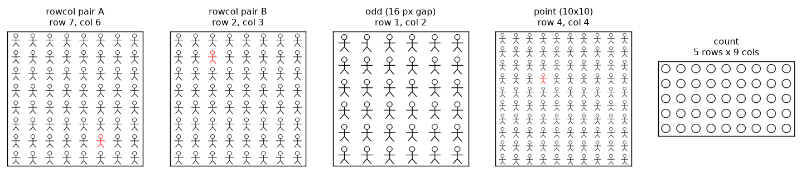
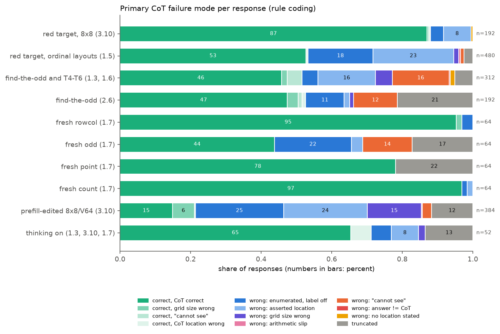
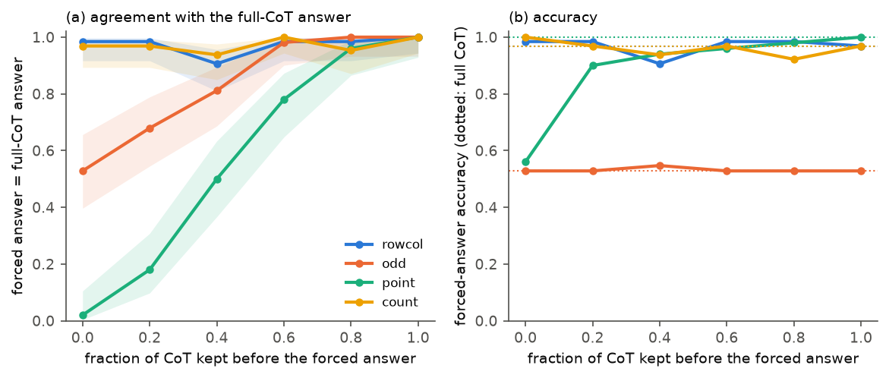
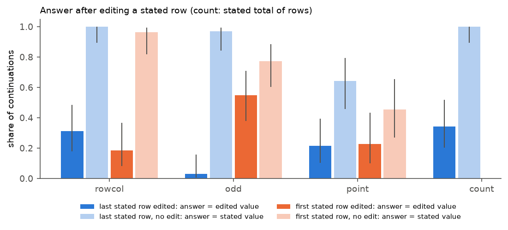
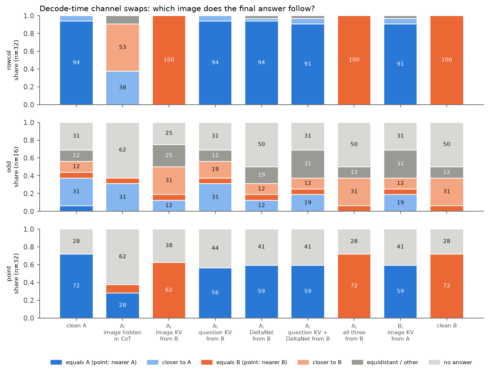
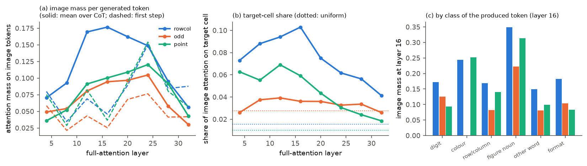
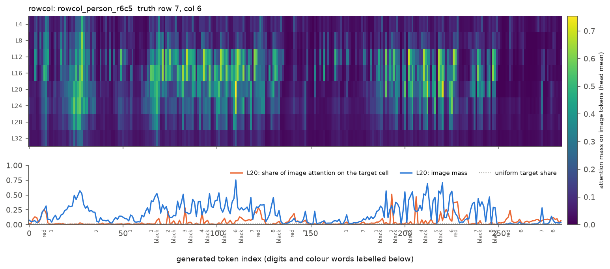
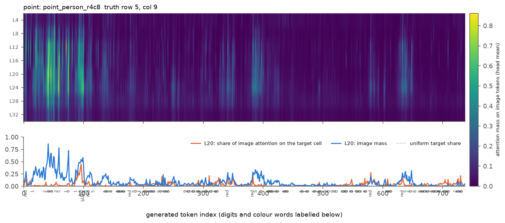

# 思维链的行为与机理

实验日期：2026-10-21 至 2026-10-22。本文属于[行为诊断](plan.md)研究，编号为实验 1.7，执行[实验设计](design_cot_mechanism.md)。模型为 Qwen3.5-9B，bfloat16、SDPA、greedy decoding，默认 thinking off。前置结果为[行列序号的统一机制](../position/results_2026-10-20_rowcol_mechanism.md)（下称“3.10”）、[异常实体定位](../representation/results_2026-10-20_odd_entity.md)（下称“2.6”）、[能力分解](results_2026-10-13_decomposition.md)（下称“1.3”）、[行列序号的机理](results_2026-10-16_ordinal_mechanism.md)（下称“1.5”）与 [PE 缩放](results_2026-10-16_pe_scaling_t0.md)（下称“1.6”）。

## 0. 通俗讲述

3.10 发现，在 prefill 中破坏图像 token 上的行计数之后，模型即使先写推理文本再作答，也会照样逐行列举并报出错误的行数。这很容易让人以为 VLM 的思维链（chain-of-thought, CoT）只是“表演”：生成推理文本时模型不再看图，文本只是把 prefill 早已得出的结论换一种说法讲出来。本实验检验这一判断，结论比“表演”更具体，也更有用。

先看行为。我们用不调用 LLM 的规则编码了约 2100 条推理文本，覆盖网格行列、找不同、坐标、计数与 BabyVision。错误回答中有约 61% 在推理文本里就写下了错误的位置，最终答案随之出错；答案与推理文本自相矛盾的情形几乎不存在（1262 条中只有 8 条）。另外两类常见失败是“我看不到图像”一类的声明与截断。“看不到图像”并非随机出现：在红色目标上从不出现，在 10 ΔE 的颜色差异或 2 pixels 缺口这类难以察觉的差异上出现于约 60–80% 的回答，出现后准确率从 0.66 跌到 0.10。这类声明是视觉证据缺失时的标志，模型此时转而依赖“这类题通常的答案”。

再看忠实性。如果把推理文本截断后强制作答，网格行列与计数的答案在一个推理 token 都不保留时就已与完整 CoT 的答案一致（63/64 与 62/64），说明这些任务的答案在开始写 CoT 之前就已确定；坐标任务则相反，只保留 0 个推理 token 时只有 1/50 与完整答案一致，准确率由 0.56 升到完整 CoT 的 1.00，因为 CoT 在这里真正完成了“第几行第几列 → 0–1000 坐标”的换算。把推理文本中陈述的行号改动 1，红色目标任务里有 18/32 的续写会写出“Wait — let's double-check”，回到原来的行号，只有 10/32 采用改动后的值。这说明模型在续写时会核对某个独立于文本的信息源。

那么这个信息源是什么？decoding 阶段，生成的 token 只能通过三条通道接触 prefill：全注意力层里图像 token 的 key/value cache、问题文本 token 的 key/value cache，以及 Gated DeltaNet 层的循环状态。我们取一对布局相同、红色目标位于不同单元的图像 A 与 B，用 A 做 prefill，然后在生成 CoT 时把其中一条通道换成 B 的版本。结果非常干净：只换图像 cache，答案和推理文本中第一次陈述的行号都 32/32 转向 B；只换问题文本 cache、只换 DeltaNet 状态或两者同时换，答案 29–30/32 保持 A，0/32 转向 B；反过来用 B 做 prefill、只在 CoT 中给 A 的图像 cache，答案 29/32 回到 A；把图像在 CoT 阶段完全遮住，32 条回答没有一条答对，模型开始声称网格是“5 行 5 列”。所以**写 CoT 时模型确实在看图，而且位置信息只经由图像 token 的 cache 流入，问题文本上的 prefill 摘要与 DeltaNet 状态几乎不携带位置。** 注意力测量与此一致：生成每个 token 时，层 12–20 约 17% 的注意力落在图像上，写到“Row 3: …”这一行时，约 21–23% 的图像注意力落在第 3 行，是均匀分布（12.5%）的近两倍。

这与 3.10 怎样调和？答案是：模型“看”的是图像 token 在 prefill 中被加工过的表示，3.10 的行计数器正写在这些表示里。我们重复 3.10 的 prefill 编辑（层 9–16 在图像 token 上令 DeltaNet 的 $\alpha = 1$），只把编辑后的图像 cache 交给干净的 prefill，行号正确率就从 31/32 降到 14/32；反过来在编辑过的 prefill 上换回干净的图像 cache，正确率回到 31/32。因此 CoT 的逐行列举是在逐行“读取”图像 token，但读到的行号是 prefill 的累加器写好的标签，文字层面的列举不构成独立计数。CoT 的作用取决于任务：对位置读出，它是对图像 token 状态的再次读取，不能纠正 prefill 中形成的错误；对需要符号换算的步骤（坐标），它承担真实计算；对视觉证据不足的任务（找不同），它在候选之间摇摆，准确率不变。

## 1. 主要结果

1. **CoT 失败的主体是“推理文本中写下了错误的位置”，答案几乎总与文本一致。** 在不含 prefill 编辑的 thinking-off 网格语料中，543 条错误回答里 329 条（61%）属于此类（逐行列举但标签错位 147 条，直接断言错误位置 182 条），“看不到图像”声明 88 条（16%），截断 94 条（17%），声明的网格规模错误 24 条（4%）；答案与推理中最后陈述的位置一致的比例为 1254/1262（第 3.1 节，图“失败模式”）。
2. **“看不到图像”声明标志视觉证据缺失。** 2.6 的找不同中，红色目标 0/32 出现声明，10 ΔE 颜色差异 22/32、2 pixels 缺口 swap 11/16 出现；带声明的找不同回答准确率 0.10（15/149），不带声明的为 0.66（259/395）；BabyVision 中带声明的 44 条只有 1 条答对（第 3.1 节）。
3. **网格行列与计数的答案在写 CoT 前已确定，坐标的答案由 CoT 计算。** 截断到 0 个推理 token 时强制作答，与完整 CoT 答案一致的比例为 rowcol 63/64、count 62/64、odd 28/53、point 1/50；point 的准确率由 0.56 升至 1.00（第 3.2 节，图“截断”）。
4. **编辑推理文本中的行号，红色目标任务多数被纠正，弱证据任务多数被采纳。** 改动最后陈述的行号后，答案采用新值的比例为 rowcol 10/32、count 11/32、point 6/28、odd 1/32；改动第一次陈述的行号后，odd 17/31 采用新值，rowcol 只有 5/27（第 3.3 节，图“编辑”）。
5. **CoT 生成时重新读取图像 cache，位置只经由图像 cache 传递。** rowcol 与 point 的通道替换中，只换图像 cache 使答案转向 B（32/32、20/20 有效回答），只换问题文本 cache、DeltaNet 状态或两者，答案保持 A（rowcol 29–30/32，point 18–19 条有效回答全部为 A）；遮住图像后 rowcol 0/32 答对（第 3.5 节，图“通道替换”）。
6. **3.10 的 prefill 编辑经由图像 cache 进入 CoT。** 编辑后的图像 cache 配干净 prefill：行号正确 14/32（编辑整体为 14/32）；干净图像 cache 配编辑后的 prefill：31/32（第 3.6 节）。

## 2. 实验设计概要

| 子实验 | 内容 | 规模 |
| --- | --- | --- |
| E1 失败模式分类 | 规则编码已有语料与新生成语料；分层人工抽查 40 条 | 2143 条回答 |
| E2a 截断后强制作答 | think 回答在正文 token 比例 $f \in \{0, 0.2, \dots, 1\}$ 处截断，接答案提示 | 231 条回答 × 6 |
| E2b 编辑陈述的行号 | 最后与第一次陈述的行号改动 1（count 为总行数），续写至结束；同位置不改动作对照 | 每任务 32 条 |
| E2c 先答后解释 | direct、think、answer-first 三种问法的答案比较 | 每任务 64 张 |
| E3a 注意力时间线 | 无干预 A 的每个生成步、8 个全注意力层的图像注意力 | rowcol/point 各 32 条、odd 16 条 |
| E3b/E3c 通道替换 | 9 种 decoding 条件（设计第 4.3 节） | rowcol、point 各 32 对；odd 16 对 |
| E3d 与 3.10 的连接 | 层 9–16 图像 token 上 $\alpha = 1$ 的 prefill 与干净 prefill 交换图像 cache | rowcol 32 张 |

新生成的四个任务集见下图。rowcol 为 8×8 网格中找红色图形的行列；odd 为 6×6 网格中找有 16 pixels 缺口的图形；point 为 10×10 网格中红色图形的 0–1000 中心坐标；count 为行列各 3–12 的网格计数。E3 的配对 $(A, B)$ 具有相同的模板、网格与 token 布局，目标单元在行与列上都至少相差 2。

图“刺激示例”：从左到右为 rowcol 配对的 A 与 B、odd、point 与 count 的图像，标题给出真值。图像由 stimuli-v1 渲染，未经任何处理。

运行说明：GPU 资源紧张，大部分阶段以 device_map 拆分在两张共享 A800 上运行，后期改为单卡；合计约 15 GPU hours（与他人共享，利用率低）。批量 greedy 解码与 batch size 1 的参考 `generate` 在 20 个样本上答案一致 17/20：3 个不一致中 2 个是参考解码在 1024 tokens 处截断而批量解码给出答案，1 个是坐标末位相差 1。自写的 decoding 循环在 smoke test 中与 `generate` 的 160-token 文本 3/4 逐字一致（另 1 条在 150 个字符后出现 bf16 舍入差异），all_from_B 与 clean_B 的文本 32/32 逐字一致，说明 cache 拼接本身不引入偏差。

## 3. 结果

### 3.1 失败模式（E1）

图“失败模式”：每条回答按规则编码得到的主失败模式所占比例。颜色依次为：深绿“答对且 CoT 正确”，浅绿三档为“答对但网格规模错误／带看不到图像声明／CoT 位置错误”，深蓝“逐行列举但标签错位”，浅蓝“直接断言错误位置”，紫色“网格规模错误”，粉色“算术不一致”，橙色“看不到图像”，红色“答案与 CoT 不一致”，黄色“未陈述位置”，灰色“截断”。比例直接由规则编码计数得到，未做拟合。point 的推理文本混用 0-based 与 1-based 索引，只区分答对、截断与其他错误。

| 语料 | $n$ | 准确率 | 错误：位置写错（列举／断言） | 错误：看不到图像 | 错误：截断 | 错误：网格规模 | 答案与 CoT 一致 |
| --- | --- | --- | --- | --- | --- | --- | --- |
| 红色目标 8×8（3.10） | 192 | 0.88 | 7 / 15 | 0 | 0 | 0 | 191/192 |
| 红色目标序号布局（1.5） | 480 | 0.53 | 88 / 110 | 5 | 12 | 7 | 465/468 |
| 找不同与 T4–T6（1.3、1.6） | 312 | 0.52 | 14 / 51 | 50 | 16 | 15 | 292/294 |
| 找不同（2.6） | 192 | 0.53 | 21 / 3 | 24 | 41 | 2 | 146/148 |
| 新 rowcol | 64 | 0.97 | 2 / 0 | 0 | 0 | 0 | 64/64 |
| 新 odd | 64 | 0.44 | 14 / 2 | 9 | 11 | 0 | 53/53 |
| 新 point | 64 | 0.78 | — | 0 | 14 | — | — |
| 新 count | 64 | 0.97 | 1 / 1 | 0 | 0 | 0 | 43/43 |
| prefill 编辑（3.10） | 384 | 0.21 | 96 / 91 | 10 | 45 | 59 | 339/339 |
| thinking on | 52 | 0.71 | 3 / 4 | 0 | 7 | 1 | 41/44 |

“位置写错”指推理正文最后陈述的行或列与真值不同而答案沿用它；“逐行列举”要求出现 Row 1、Row 2、Row 3 这样连续的标签。规则编码在分层抽取的 40 条上与人工判断一致 37/40；不一致的 3 条均为把“第 7 个图形在右侧分组中”这类分组内序号误判为列号，属于规则的假阳性。抽查发现并修正了两类假阳性（坐标系说明“Column 1 is the leftmost”、列表“column 1, 2”），修正前一致率为 32/40，因此上述一致率在同一样本上偏乐观。

1. **推理文本与答案几乎从不矛盾，错误在文本中已经写出。** 七个不含编辑的语料中，答案与推理最后陈述的位置一致 1254/1262；人工检查规则标出的“不一致”样本，大多数是规则把分组内序号或 0-based 索引当作位置，真正的自相矛盾接近于零。这说明 CoT 不存在“文本推对了、答案写错了”的转写损失，失败发生在推理文本中写下位置的那一刻，与 1.3 第 6.3 节的结论一致。
2. **逐行列举并不保证计数正确。** 1.5 的序号布局中 88 条错误回答带有完整的逐行或逐列列举，列举标签与写下的错误答案同步偏移；3.10 的 prefill 编辑语料中，197 条在列举中写出“Row k: … red”的回答里 128 条的 $k$ 与真值不同、却与答案相同，无编辑时这一比例为 0/117（真值一致 109/117）。逐行列举中“红色在第 $k$ 行”的标签随 prefill 的计数器移动，列举本身没有独立地数行。
3. **网格规模的声明随 prefill 计数器改变。** prefill 编辑后，有网格规模声明的回答中 89/91 写出错误的规模（“6 rows”“5 rows”），无编辑时为 1/47。20×20 网格上的“20×21”“21×21”（1.3）与 6×6 方框网格上的“6 rows and 5 columns”（2.6，6 条答对仍写错）属于同一现象：总行列数同样由图像 token 上的计数给出，不在文本中重新清点。
4. **“看不到图像”声明对应视觉证据缺失，模型随即改用题型先验。** 2.6 中声明率随差异的可察觉程度变化：红色 0/32，16 pixels 缺口 std 0/16，20 ΔE 颜色 swap 12/16，10 ΔE 颜色 std 13/16，2 pixels 缺口 swap 11/16。带声明的回答常写“in many such puzzles, the odd one is placed centrally”“I recall that in some versions”，然后给出 (4,4)、(10,11) 这类居中位置。BabyVision 六个子类中，Find the different 13/16、Maze 14/20、Lines Observation 7/9 带声明，整体 44/99；带声明的回答 1/44 答对，不带声明的 7/55 答对。这类声明在 thinking on 中为 0/52，thinking on 改为写“let's assume”等无依据假设（10/52）。
5. **thinking on 改变文风，不改变失败结构。** thinking on 的 52 条中 46 条逐行列举，31 条带自我修正词；错误仍主要是写下错误位置（7/15）与截断（7/15）。

### 3.2 截断后强制作答（E2a）

图“截断”：(a) 在保留比例 $f$ 的 CoT 正文后接答案提示、greedy 解码得到的答案与完整 CoT 答案一致的比例；(b) 该答案的准确率，点线为完整 CoT 的准确率。阴影为 Wilson 95% 区间。只使用以 eos 结束的 think 回答（rowcol 64、odd 53、point 50、count 64）；point 的“一致”指两点距离不超过 25 个归一化单位。

1. **rowcol 与 count 的答案在 CoT 之前已经确定。** $f = 0$ 时强制作答与完整 CoT 答案一致 63/64（rowcol）与 62/64（count），准确率 0.98 与 0.97，与完整 CoT 相同。对这两类任务，CoT 对答案没有必要性，这与 3.10 的“隐式计数”一致。
2. **point 的答案依赖 CoT 中的换算。** $f = 0$ 时一致 1/50，准确率 0.56（28/50）；$f = 0.2$ 时准确率已达 0.90（45/50），$f = 0.6$ 时一致 39/50。point 的推理文本先写出“第 5 行、第 9 列”，再按“$x = (c - 0.5) \times 100$”一类算式得到坐标（64 条中 37 条含此类算式），图“时间线”显示图像注意力集中在前约 100 个 token 的定位阶段，后面的换算阶段几乎不看图。CoT 在这里完成了 direct 作答时由 L20 读出与数字 MLP 完成、且误差较大的值转换（3.11、3.12）。
3. **odd 的 CoT 改变答案，但不改变准确率。** $f = 0$ 时一致 28/53，随 $f$ 增大单调升至 1；准确率在各 $f$ 下恒为 0.53。推理文本在候选之间换来换去，换到的仍是错误候选的概率与原答案相同。

### 3.3 编辑推理文本中的行号（E2b）

图“编辑”：深色为改动陈述的行号（count 为陈述的总行数）后，续写得到的答案采用新值的比例；浅色为同一截断位置不改动时答案等于原陈述值的比例。蓝色为最后一次陈述，橙色为第一次陈述。误差线为 Wilson 95% 区间。count 的推理文本只陈述一次总行数，没有“第一次陈述”条件。

| 任务 | 最后陈述被改：采用新值 / 回到原值 / 无答案 | 第一次陈述被改：采用新值 / 回到原值 / 无答案 |
| --- | --- | --- |
| rowcol | 10 / 18 / 4（$n = 32$） | 5 / 13 / 8（$n = 27$） |
| odd | 1 / 26 / 5（$n = 32$） | 17 / 2 / 12（$n = 31$） |
| point | 6 / 9 / 13（$n = 28$） | 5 / 0 / 16（$n = 22$） |
| count | 11 / 17 / 4（$n = 32$） | — |

1. **红色目标与计数任务中，模型多数会核对并纠正被改的数字。** rowcol 的一条续写在被改为“row 6”后写道“Wait — let's double-check by visually counting: … Row 5: all black, Row 6: third figure from left is red”，随后回到正确行；count 的一条在“there are 4 rows”之后写“That's only 3 rows”。纠正需要一个独立于文本的信息源，第 3.5 节表明它是图像 token 的 cache。另一方面，仍有约 1/3 的续写直接沿用被改的值，说明答案对文本也有相当的依赖。
2. **odd 的行为依赖被改的位置。** 改动第一次陈述后 17/31 采用新值（不改动时 24/31 的答案等于第一次陈述的值）；改动最后陈述后只有 1/32 采用，续写会回到文本中更早写下的逐行描述（“Row 3: 4 arrows, then a dash”），据此改回。视觉证据弱时，模型以自己先前写下的文本为准。
3. **point 的编辑大多导致截断。** 续写上限为 512 tokens，被改后模型反复核算，13/28 与 16/22 在上限内没有给出答案；给出答案的回答中采用新值与回到原值的数目相近。

### 3.4 先答后解释（E2c）

| 任务 | 准确率：direct / think / answer-first | 答案一致：direct–answer-first | direct–think | McNemar（direct 对 think） |
| --- | --- | --- | --- | --- |
| rowcol | 63 / 62 / 63（$n = 64$） | 64/64 | 63/64 | $b = 1, c = 0$，$p = 1.0$ |
| odd | 31 / 28 / 31 | 32/64 | 28/64 | $b = 4, c = 1$，$p = 0.38$ |
| point | 30 / 50 / 30 | 54/64 | 2/64 | $b = 11, c = 31$，$p = 0.003$ |
| count | 64 / 62 / 64 | 64/64 | 62/64 | $b = 2, c = 0$，$p = 0.50$ |

**先给答案的回答与 direct 答案几乎相同，解释从不修改已给出的答案。** answer-first 的第一行答案在 rowcol 与 count 上与 direct 完全一致；全部 256 条 answer-first 回答中，解释末尾重新给出不同答案的为 0 条。point 的 answer-first 只输出 JSON、不写解释，准确率与 direct 相同（30/64），远低于 think（50/64）。这说明 think 在 point 上的增益来自“先写出行列、再换算”的顺序，答案一旦先给出，后续文本只起解释作用。

### 3.5 CoT 生成中的信息流（E3a–E3c）

图“通道替换”：每个条件下最终答案等于 A 的真值（深蓝）、更接近 A（浅蓝）、等于 B（深橙）、更接近 B（浅橙）、与两者等距或其他（深灰）、未给出答案（浅灰）的比例。point 按答案点距离哪个目标中心更近归入 A 或 B。条件定义见设计第 4.3 节：横轴分号前为 prefill 所用的图像，分号后为 decoding 阶段被替换的通道。比例由 decoding 结果直接计数得到。

| 条件 | rowcol：A / B / 无答案（$n = 32$） | point：A / B / 无答案（$n = 32$） | rowcol：CoT 第一次陈述的行 = A / B |
| --- | --- | --- | --- |
| clean A | 30 / 0 / 0 | 23 / 0 / 9 | 31 / 0 |
| A；CoT 中遮住图像 | 0 / 0 / 0（全部错误） | 9 / 3 / 20 | 3 / 3 |
| A；图像 cache 来自 B | 0 / 32 / 0 | 0 / 20 / 12 | 0 / 32 |
| A；问题文本 cache 来自 B | 30 / 0 / 0 | 18 / 0 / 14 | 32 / 0 |
| A；DeltaNet 状态来自 B | 30 / 0 / 0 | 19 / 0 / 13 | 31 / 0 |
| A；问题文本 + DeltaNet 来自 B | 29 / 0 / 0 | 19 / 0 / 13 | 30 / 0 |
| B；图像 cache 来自 A | 29 / 0 / 0 | 19 / 0 / 13 | 30 / 0 |
| A；三条通道均来自 B | 0 / 32 / 0 | 0 / 23 / 9 | 0 / 32 |

1. **写 CoT 时，位置信息只经由图像 token 的 cache 流入。** 只替换图像 cache，rowcol 的答案与第一次陈述的行都 32/32 转向 B；只替换问题文本 cache、DeltaNet 状态或两者，答案 0/32 转向 B。互补条件（B 的 prefill、A 的图像 cache）答案 29/32 回到 A。point 的结果相同：有效回答中，图像 cache 来自 B 时 20/20 更接近 B，其余替换 18–19 条全部更接近 A。问题文本 token 在 prefill 中虽然也注意了图像，但其 cache 与 DeltaNet 状态中没有 CoT 可用的位置信息；位置由生成过程按需从图像 token 上读出。这一结论只针对位置；遮住图像时 rowcol 的 CoT 仍知道“这是一个图形网格”，说明粗略的场景信息存在于文本侧。
2. **不能看图时，CoT 编造网格结构。** rowcol 在 CoT 阶段遮住图像后 0/32 答对，答案更接近 A 与更接近 B 的数目为 12 与 17，与随机无异；推理文本写出“5 rows, 5 columns”“6x6 grid”这类与 8×8 不符的规模。point 遮住后 20/32 未能在上限内给出答案，给出答案的 12 条中 9 条更接近 A，提示坐标任务的文本侧保留了少量粗略位置。
3. **odd 处于地板，通道替换无法区分。** odd 配对集的 clean A 只有 1/16 精确答对、5/16 截断，各条件的分布相近；按设计中预先规定的规则（第一批 clean A 准确率低于 0.25 即停止该任务），odd 只运行了第一批 16 对。模型没有找到目标时，图像 cache 中不存在可读的位置，替换任何通道都无从改变答案。

图“注意力汇总”：(a) 无干预 A 的生成过程中，每个全注意力层上 head 平均的图像注意力质量 $m$（定义见设计第 2 节）；实线为对全部生成步与回答取平均，虚线为第一个生成步（输入为最后一个 prompt token）。(b) 图像注意力中落在目标单元 token 上的份额，点线为目标单元 token 占全部图像 token 的比例（均匀注意力下的期望）。(c) 按“该步产生的 token”分类后层 16 的平均图像注意力质量。数值由注意力探针从模型激活直接计算（$\mathrm{softmax}(qk^\top/\sqrt{d})$，与 SDPA 所用的 q、k 相同）。

4. **CoT 生成时模型持续看图，读到具体内容的步骤看得更多。** rowcol 中，生成每个 token 时层 12–20 有 16–18% 的注意力落在图像上（point 在层 12–24 为 9–12%，odd 为 8–10%），层 32 只有 6%。产生图形名词（“figure”“circle”）与颜色词（“red”“black”）的步骤看图最多（层 16：rowcol 0.35 与 0.24，point 0.31 与 0.25），产生格式符号与普通词的步骤最少（0.15–0.18）。产生数字的步骤在 rowcol 为 0.17，在 point 只有 0.09：point 的大多数数字属于换算算式，不读图。
5. **逐行列举时，注意力跟随正在写的那一行。** rowcol 写“Row $k$: …”这一行（$k$ 不是目标所在行）时，层 16–20 的图像注意力有 21–23% 落在第 $k$ 行的 token 上，均匀分布为 12.5%；同时仍有 23–29% 落在目标所在行（红色图形）。写目标所在行时图像注意力质量反而较低（层 16：0.22 对其他行的 0.39）。目标单元的份额在层 16 为 0.10，是均匀期望（0.016）的约 6 倍。L20 H11（3.11 确认的坐标读取 head）在 CoT 中的目标单元份额为 0.10。

图“时间线”：上为 rowcol、下为 point 的一条无干预回答。热图的纵轴为 8 个全注意力层，横轴为生成的 token，颜色为 head 平均的图像注意力质量（viridis，色标见右侧）；下方折线为层 20 的图像注意力质量（蓝）与其中落在目标单元上的份额（橙），点线为均匀份额；横轴下方标出数字与颜色词。rowcol 的看图峰值出现在逐行列举“Row k: black”的每一行，point 的看图集中在前约 100 个 token 的定位阶段，此后的坐标换算几乎不看图。

### 3.6 与 3.10 的连接（E3d）

| 条件（rowcol，$n = 32$） | 行号正确 | 行号少计 | 无答案 | 有效回答的平均行号误差 |
| --- | --- | --- | --- | --- |
| prefill 编辑，图像 cache 也来自编辑 | 14 | 14 | 4 | −0.71 |
| 干净 prefill，图像 cache 来自编辑 | 14 | 12 | 6 | −0.65 |
| prefill 编辑，图像 cache 来自干净 prefill | 31 | 1 | 0 | −0.03 |

**3.10 的 prefill 编辑完全经由图像 token 的 cache 进入 CoT。** 编辑是在层 9–16 的图像 token 上令 DeltaNet 的 $\alpha = 1$（不遗忘），即 3.10 中破坏行计数的干预。只把编辑后的图像 cache 交给干净的 prefill，行号正确率与整体编辑相同（14/32），且同样少计；在编辑后的 prefill 上换回干净图像 cache，正确率回到 31/32。编辑同样改变了问题文本 cache 与 DeltaNet 的循环状态，但这两条通道上的改变对答案没有影响。结合第 3.5 节，3.10 观察到的“推理文本复述被破坏的累加器输出”可以精确表述为：CoT 在生成时重新读取图像 token 的表示，而行号这一标签由 prefill 中的 DeltaNet 累加器写进这些表示，读取过程本身不再计数。

## 4. 讨论

### 4.1 CoT 在三类任务中的角色

把第 3 节的结果放在一起，CoT 的作用随任务所需的计算类型而定：

1. **位置读出（rowcol、count、序号）。** 答案在写 CoT 前已由 prefill 确定（第 3.2 节）。CoT 生成时确实重新读取图像（第 3.5 节），逐行列举时注意力跟随所写的行，但读到的是 prefill 写进图像 token 的计数标签（第 3.6 节），所以逐行列举看起来像在数，实际上是把图像 token 上已有的行号逐个读出。这类 CoT 在“是否读图”的意义上是忠实的，在“是否独立计算”的意义上不忠实；它可以纠正文本中被改的数字（第 3.3 节），不能纠正 prefill 的计数错误（3.10）。
2. **符号换算（point）。** CoT 先读出行列，再在文本中做算术，答案依赖文本（第 3.2 节），后半段几乎不看图（图“时间线”）。这里 CoT 真正承担计算，并把 point 的准确率由 30/64 提高到 50/64（$p = 0.003$），代价是 14/64 截断。
3. **视觉证据不足（odd、BabyVision 的大部分子类）。** 图像 token 中没有可读的目标，CoT 在候选间摇摆（第 3.2 节），或声明“看不到图像”并改用题型先验（第 3.1 节）；文本可以改变答案，不能提高准确率。

### 4.2 参数问题还是架构限制

1. **位置信息只经由图像 cache 传递，属于架构上的信息流事实，确定性高。** decoding 时的三条通道由架构决定，替换实验对 rowcol 与 point 给出 0/32 与 32/32 这样的二值结果。问题文本 token 在 prefill 中没有形成 CoT 可用的位置摘要，这一点可能随训练改变（属于参数），但在当前模型中成立。
2. **CoT 不能纠正 prefill 中的计数错误，主要是参数与训练方式的问题，确定性中等。** 架构并不阻止生成过程逐个注意图像 token 并在文本中计数；当前模型的逐行列举读取的是图像 token 上现成的行号标签，没有逐个读取图形的外观。可以设想通过训练让列举的每一行只读取该行图形本身的特征（例如“这一行有 8 个图形，其中第 6 个是红色”），但本实验没有检验这种行为能否被训练出来。
3. **“看不到图像”声明是能力不足时的训练产物，属于参数问题。** 它与视觉证据的强弱严格对应，表明模型能感知自己“没有找到”，但训练数据使它以题型先验作答，没有学会回答“无法确定”。

### 4.3 与其他实验的一致与冲突

1. **3.10：** 一致，并细化了其隐式计数结论的通道：prefill 编辑只经由图像 cache 进入 CoT，文本侧状态不起作用（第 3.6 节）。
2. **3.11：** 3.11 发现 direct 作答时每个坐标数字都在 L20 重新读取图像 KV。本实验在 CoT 中看到同样的“按需读取”，并且读取发生在写出颜色词、图形名词与“Row k”的步骤；位置信息不经由文本侧状态传递，这与 3.11 中 L28/L32 的图像 KV 不被使用相容。
3. **3.12 r2：** 3.12 r2 发现坐标的第二位数字不重新读图，而读取第一位数字 token 处的 DeltaNet short-conv 状态。本实验中 point 的换算阶段同样几乎不看图（图“时间线”）。两者共同说明：从图像读出的只是一个粗略的值，之后的数字由文本侧计算得出。
4. **2.6：** 一致。2.6 发现先描述多数图形不能补救搜索不对称；本实验进一步显示，这类任务中 CoT 的“看不到图像”声明恰好出现在 2.6 中搜索失败的条件上。
5. **1.3、1.5：** 一致。1.3 发现最终答案几乎总与推理中锁定的位置一致，1.5 发现 think 下的计数多为断言式复述；本实验以截断与编辑把“复述”量化为“答案在 CoT 前已确定”。

## 5. 限制

1. 规则编码只抽取位置、规模与若干短语，无法判断描述性细节是否虚构；虚构细节的比例引用 1.3 第 6.4 节的人工编码。规则的一致率在用于修正规则的同一 40 条样本上计算，偏乐观。
2. 通道替换只在 rowcol（红色目标，接近天花板）与 point 上给出可解释的结果；odd 处于地板，只运行了 16 对。“位置只经由图像 cache 传递”的结论尚未在目标可见但难以定位的中等难度任务上检验。
3. 第一个生成步之前的最后一个 prompt token 由编辑后的 cache 计算，因此所有生成 token 都受干预影响；但 prefill 中问题文本 token 自身的计算未被干预，“问题文本 cache 不携带位置”指的是这些 token 的 key/value 对生成过程的作用。
4. thinking on 只做了行为编码（52 条），没有做注意力与通道替换。
5. point 与 odd 的 think 回答截断较多（14/64 与 11/64，上限 1024 tokens），编辑续写上限 512 tokens 导致 point 的编辑结论不稳定。
6. 共享 GPU 上大部分阶段以模型拆分方式运行；批量与参考解码答案一致 17/20。

## 6. 产物

产物位于 WORK_DIR 的 `analysis/behavior/2026-10-21_cot_mechanism/`：`taxonomy/coded.jsonl`（全部 2143 条回答的规则编码）、`gen/records.jsonl` 与 `gen/spotcheck.json`（新生成语料与一致性检查）、`faith/records_*.jsonl`（截断与编辑）、`mech/records.jsonl` 与 `mech/probes/*.npz`（通道替换的文本与注意力探针）、`mech_edit/records.jsonl`（E3d）、`summary.json`（全部统计）与 `run_*.json`（运行参数、模型版本与代码摘要）。程序为 `analysis_tools/behavior/cot_mechanism.py`、`cot_mechanism_engine.py`、`cot_mechanism_run.py`、`cot_mechanism_taxonomy.py`、`cot_mechanism_analysis.py` 与 `cot_mechanism_figures.py`，入口为 `scripts/analysis/behavior/cot_mechanism.sh`，测试为 `tests/analysis/behavior/test_cot_mechanism.py`。
