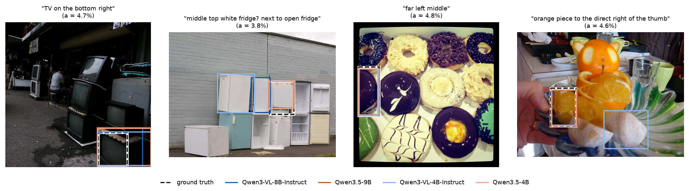
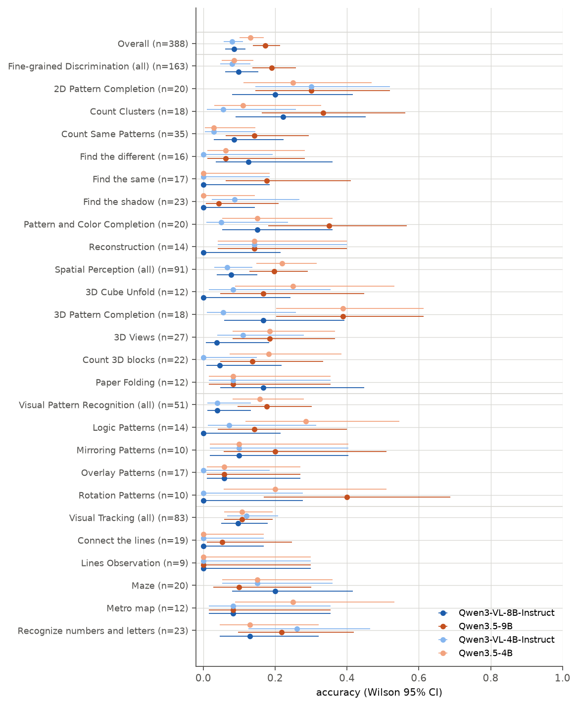
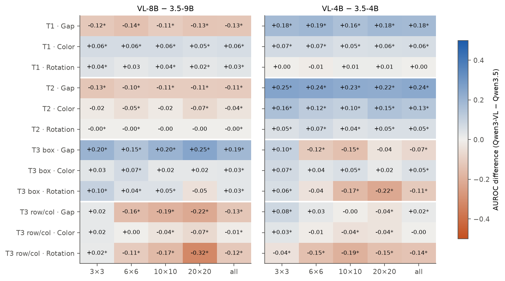
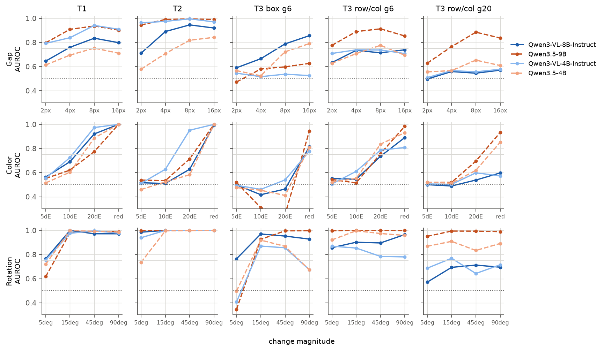
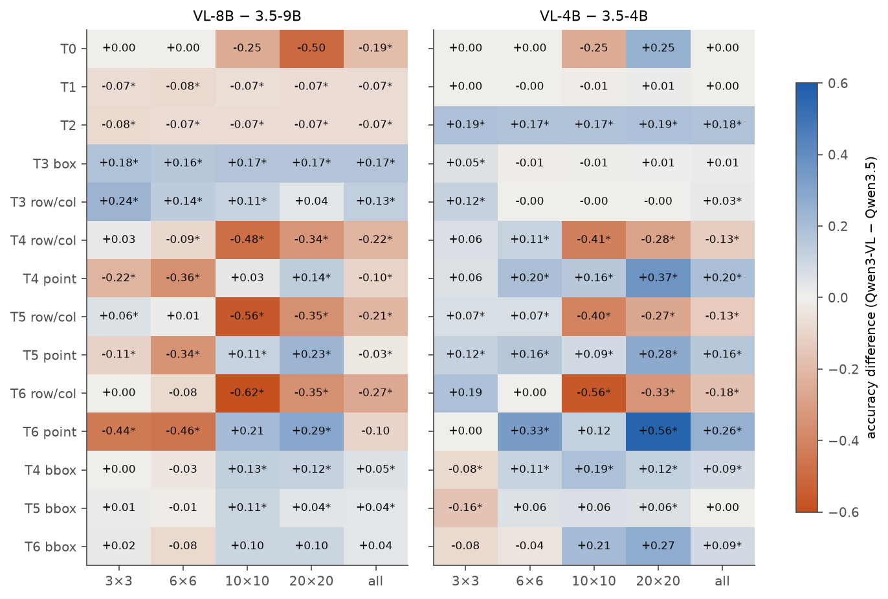
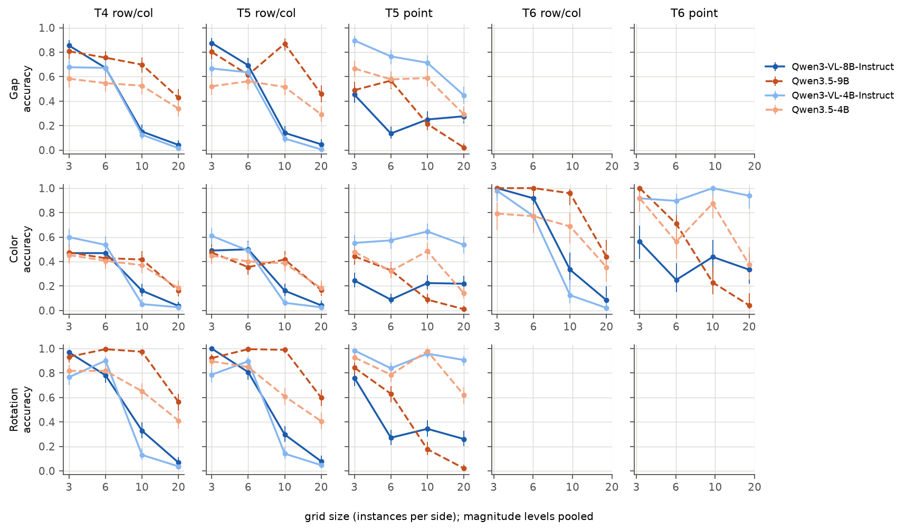
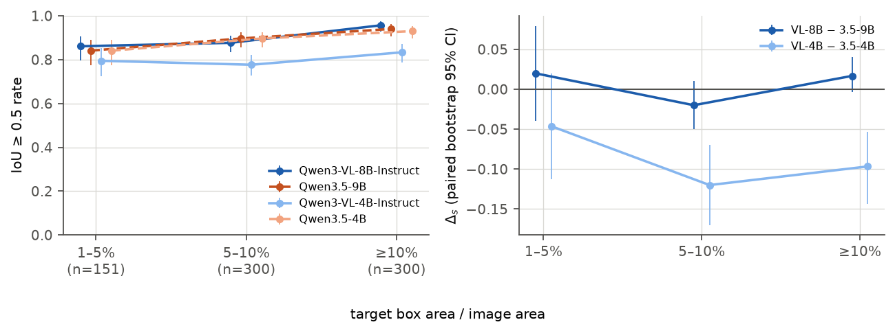
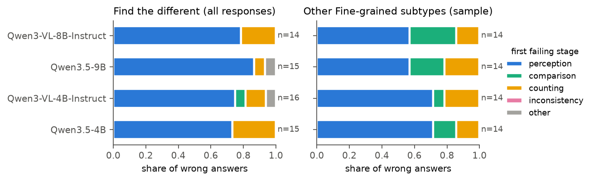

# DeepStack 端到端对照

实验日期：2026-10-14。本文属于[多层视觉特征注入](plan.md)研究，执行计划第 5 节的实验 4.2。比较对象为具有 DeepStack 的 Qwen3-VL 与不具有 DeepStack 的 Qwen3.5，分为 Qwen3-VL-8B-Instruct 对 Qwen3.5-9B、Qwen3-VL-4B-Instruct 对 Qwen3.5-4B 两组，均为 bfloat16、thinking off。

## 1. 研究问题与主要结果

DeepStack 把 ViT 中间层特征注入 LLM 前三层，其设计目的是补充主路径视觉 token 缺少的局部细节。Qwen3.5 不再使用这一机制。本实验在相同刺激与问题上比较两类模型，回答一个筛选性的问题：具有 DeepStack 的模型族在哪些任务上更强，这些任务随后作为实验 4.3（DeepStack 消融）与 4.4（表征对照）的分析对象。两类模型的训练数据、LLM 结构与 post-training 同时不同，本实验的差异不能单独归因于 DeepStack（计划第 5.3 节）。

评测分为三部分：BabyVision 全集 388 题，实验 1.3 的子任务 T0–T6（37752 次查询，另加 T3 修订问法 9216 次），RefCOCO val 按目标面积分层的 751 条表达式。主要结果如下：

1. **DeepStack 族只在两类任务上一致占优。** 第一类是单实例的颜色判断：T1 颜色的 AUROC 在两组中均高 0.062，$\delta_{75}$ 为 12.0 对 17.9 与 10.7 对 14.3（色差单位）。第二类是密集网格中的坐标输出：20×20 网格中 T6 的中心点命中率为 0.33 对 0.04（8B 组）与 0.94 对 0.38（4B 组）。同样网格中的行列序号答案则相反，Qwen3.5 远更准确（T6 在 10×10 网格中为 0.33 对 0.96 与 0.12 对 0.69）。
2. **其余细粒度结果不支持 DeepStack 族更强。** 缺口细节的差异方向随规模反转（T2 缺口 AUROC 差值为 -0.112 与 +0.236）；T3 在修订问法下两组均为 Qwen3.5 更好；RefCOCO 在 1%–5% 的小目标层上没有差异（8B 组 $\Delta_s=+0.020$ [-0.040, +0.079]），4B 组中 Qwen3-VL-4B 在全部面积层上均较弱。
3. **BabyVision 上 Qwen3.5 更高，差异主要来自 Qwen3-VL 的循环与截断。** 完整预算下为 33 对 67 与 31 对 51（共 388 题）；Qwen3-VL 在 4096 tokens 上限下有 45%（8B）与 59%（4B）的回答被截断。匹配 4096 tokens 预算后，两组差异不显著（$p=0.053$ 与 $p=0.885$）。
4. **推理文本中两类模型的失败环节相同。** Fine-grained Discrimination 的错误回答中，首个失败环节为感知描述的比例在四个模型中为 57%–87%，两类模型之间没有可见差别。
5. **对 4.3 与 4.4 的建议。** 以 T1、T2 的颜色变化（色差 10–20）、T5、T6 在大网格中的坐标答案、以及 Qwen3-VL-4B 的缺口判断为主要分析对象，BabyVision 降为次要指标（第 7.2 节）。

## 2. 实验设计与实际执行

### 2.1 模型与解码

| 模型 | DeepStack | checkpoint revision | 层数（ViT／decoder） |
| --- | --- | --- | --- |
| Qwen3-VL-8B-Instruct | 有，抽取 ViT block 8、16、24 | 0c351dd01ed8 | 27／36 |
| Qwen3.5-9B | 无 | c20223623576 | 27／32 |
| Qwen3-VL-4B-Instruct | 有，抽取 ViT block 5、11、17 | ebb281ec70b0 | 24／36 |
| Qwen3.5-4B | 无 | 851bf6e806ef | 24／32 |

四个 checkpoint 均从本地 HF cache 离线读取，未下载任何权重。运行环境为 torch 2.14.0、transformers 5.17.0。三部分评测的解码设置如下：

| 评测 | 解码 | 输出上限 | batch size |
| --- | --- | --- | --- |
| BabyVision | 各模型官方推荐的 thinking off／Instruct 采样参数（下表），随机种子 42 | Qwen3.5 为 32768 tokens；Qwen3-VL 为 4096 tokens | Qwen3.5 为 8（Qwen3.5-9B 沿用已有运行，为 4）；Qwen3-VL 为 16 |
| 子任务 T0–T6 | greedy；二值任务读取首 token logits | 二值 8 tokens，定位 256 tokens | 16 或 8（Qwen3.5-9B 沿用实验 1.3 的 batch size 1 结果） |
| RefCOCO | greedy | 256 tokens | 8 |

| 模型 | 采样参数（BabyVision） |
| --- | --- |
| Qwen3.5-9B、Qwen3.5-4B | temperature 1.0，top_p 1.0，top_k 40，repetition_penalty 1.0 |
| Qwen3-VL-8B-Instruct、Qwen3-VL-4B-Instruct | temperature 0.7，top_p 0.8，top_k 20，repetition_penalty 1.0 |

两类模型的 model card 均另外推荐 presence_penalty（Qwen3-VL Instruct 为 1.5），Hugging Face generate 不支持该参数，四个模型均未使用。

**Chat template 与 processor 的核对。** Qwen3.5 在 thinking off 时由 chat template 在回答开头插入空的 think 段落；Qwen3-VL Instruct 的 chat template 不含 think 标签，enable_thinking 参数对其 prompt 文本没有影响（逐字核对两种取值下的 prompt 文本相同）。四个模型的 image processor 配置一致：patch 16、spatial merge 2、最小像素数 65536（即 256×256）。256×256 的画布被保留为 16×16 个 patch，不发生缩放；192×192 的输入被放大到 256×256。子任务的全部输入在运行时逐张核对 image_grid_thw 与原图尺寸一致。

### 2.2 评测内容

**BabyVision。** 使用仓库已有的批量评测入口 eva.evaluation 与本地严格评分（要求末行为“Final answer: X”，与参考答案规范化后逐字相等）。Qwen3.5-9B 的结果直接取自已有的 thinking off 运行，其余三个模型新运行。各模型的完整回答均保存。

**能力分解子任务。** 刺激、问题与评分全部沿用[实验 1.3](../behavior/results_2026-10-13_decomposition.md) 的正式运行：缺口、颜色、旋转三种变化，各 4 个变化幅度，3×3、6×6、10×10、20×20 四种网格，每个“变化类型 × 幅度 × 网格”单元 48 张异常图像。子任务定义如下，输入示例见实验 1.3 结果第 2.1 节：

| 子任务 | 输入 | 回答 |
| --- | --- | --- |
| T0 | 无异常实例的网格 | 行数与列数 |
| T1 | 单个实例（256×256 画布） | 是否具有某属性（Yes／No） |
| T2 | 两个并排实例 | 二者是否相同（Yes／No） |
| T3 | 网格，以蓝色方框或行列序号指定一个实例 | 被指定实例是否与其他实例相同（Yes／No） |
| T4 | 网格，已知异常属性 | 异常实例的位置 |
| T5 | 网格，未知异常属性 | 异常实例的位置 |
| T6 | 网格，异常实例为纯红色 | 红色实例的位置 |

定位任务（T4–T6）的位置分别以行列、中心点（point_2d）与 bbox（bbox_2d）三种格式回答，坐标为 0–1000 归一化。实验 1.3 的补充实验发现 T3 原问法（“exactly identical to the other figures”）使模型强烈偏向回答“不相同”，修订问法 C5（“Is there anything about {D} that differs from the majority of the figures?”）消除了该偏置（见[能力分解的补充条件](../behavior/results_2026-10-14_decomposition_supplement.md)）。本实验以原问法为主比较（与 Qwen3.5-9B 的已有结果对应），另在全部 9216 个 T3 样本上运行 C5；Qwen3.5-9B 的 C5 结果取自补充实验。

**RefCOCO。** 数据为本地的 lmms-lab RefCOCO val（8811 条标注，嵌入原图）。问题为“Locate the object described as: "{表达式}". Give its tight bounding box. Return only [{"bbox_2d": [x_min, y_min, x_max, y_max]}].”，并附 0–1000 归一化说明，表达式取每条标注的第一条描述。每张 COCO 图像最多取一条表达式。下图为 1%–5% 面积层的四个输入示例，虚线为真值框，实线为各模型的预测框。

### 2.3 符号与统计

- 比例指标附 Wilson 95% 区间，并报告分母。
- **McNemar 检验。** 同一题目在一组两个模型上的正误构成配对。记只有 Qwen3-VL 答对的题数为 $b$，只有 Qwen3.5 答对的题数为 $c$，在原假设下 $b$ 服从参数为 $(b+c, 1/2)$ 的二项分布，双侧精确 $p$ 值为

$$
p = \min\left(1,\; 2 \sum_{i=0}^{\min(b,c)} \binom{b+c}{i} 2^{-(b+c)}\right).
$$

  该检验只使用两模型结论不一致的题目，因此对两模型共同的难易差异不敏感。子任务在“子任务 × 网格”单元上、BabyVision 在子类型上的多个检验使用 Holm 校正。

- **判别分数与 AUROC。** 二值任务的判别分数为回答首 token 处两个 token 的 logit 之差 $s = z_{\mathrm{Yes}} - z_{\mathrm{No}}$。T1–T3 的准确率按 $s$ 的符号计算，受判别阈值（回答偏置）影响；AUROC 为随机抽取一个正样本与一个负样本时正样本 $s$ 更高的概率，与阈值无关。两模型 AUROC 之差的 95% 区间由配对 bootstrap 给出：以生成图像的记录（同一张异常网格及其裁剪的单实例图）为单位有放回抽样，两模型使用相同的抽样，重复 500 次（C5 为 1000 次）。
- **阈值 $\delta_{75}$。** 沿用实验 1.3 的两种定义：按准确率拟合心理测量曲线（设计第 5.1 节），以及在对数幅度轴上对 AUROC 线性插值、取 AUROC 首次达到 0.75 的幅度。设相邻等级幅度为 $\delta_k < \delta_{k+1}$、AUROC 为 $a_k < 0.75 \le a_{k+1}$，则

$$
\log \delta_{75} = \log \delta_k + \frac{0.75 - a_k}{a_{k+1} - a_k}\left(\log \delta_{k+1} - \log \delta_k\right).
$$

  由于 T3 原问法存在强回答偏置，正文以 AUROC 定义为主。
- **RefCOCO 的面积差值。** 记模型 $m$ 在面积层 $s$ 上 IoU≥0.5 的比例为 $p_{m,s}$，差值为

$$
\Delta_s = p_{\mathrm{VL},s} - p_{3.5,s}.
$$

  下标 VL 与 3.5 分别表示同组的 Qwen3-VL 与 Qwen3.5。由于每张图像只有一条表达式，以题目为单位的配对 bootstrap（5000 次）等价于以图像为单位，给出 $\Delta_s$ 的 95% 区间。面积趋势以最小层与最大层的差值 $\Delta_{\mathrm{small}} - \Delta_{\mathrm{large}}$ 衡量，两层分别独立重抽样。

### 2.4 规模、耗时与批处理检查

| 评测 | 新运行的模型 | 查询数 | GPU 时间（约） |
| --- | --- | --- | --- |
| BabyVision | VL-8B、VL-4B、3.5-4B | 3 × 388 | 21 小时（其中 3.5-4B 为 12.5 小时） |
| 子任务 T0–T6 | VL-8B、VL-4B、3.5-4B | 3 × 37752 | 9 小时（含被中断后续跑的部分） |
| T3 修订问法 C5 | VL-8B、VL-4B、3.5-4B | 3 × 9216 | 1.5 小时 |
| RefCOCO | 四个模型 | 4 × 751 | 1 小时 |
| 批处理核对与预算延长检查 | — | 约 600 条 | 3 小时 |

合计约 35 GPU 小时，运行于共享的 A800 80GB 与 A40 GPU，单个进程占用一张卡。BabyVision 的 Qwen3.5-4B 运行最慢，原因是其回答较长（中位数约 2900 tokens，最长 24600 tokens）。本环境未安装 causal_conv1d，Gated DeltaNet 的短卷积使用参考实现；在 Qwen3.5-9B 上的实测表明该 kernel 对解码速度无可测影响，主要开销来自长回答的逐 token 解码。为缩短墙钟时间，BabyVision 按 Qwen3.5-9B 已有回答的长度对题目排序，把长度相近的题目放入同一 batch，并把全集按排序位置切成互不重叠的若干段，由多个进程在不同 GPU 上并行运行后合并。合并时核对各段的解码配置一致、题目无重复且覆盖全集；分段边界处有 4 题被两个进程重复运行，合并保留先完成的一份，另一份单独存档（两份的正误相同）。

所有新运行均使用左侧 padding 的批量解码以提高吞吐量。批量与逐条解码在 bf16 下可能产生不同的舍入，因此在三类样本上核对答案层面的一致性：答案一致指两段文本获得相同的评分（二值任务比较 $s$ 的符号，定位任务比较内容诊断评分，RefCOCO 比较 IoU≥0.5 的结果）。

| 核对 | 样本 | 文本完全相同 | 答案一致 |
| --- | --- | --- | --- |
| Qwen3.5-9B：batch size 16 对实验 1.3 的逐条结果 | 子任务，按“子任务 × 格式 × 网格”每格 8 条，共 416 条 | 326 | 406（97.6%） |
| Qwen3-VL-8B：批量对逐条 | 子任务 20 条 | 19 | 19 |
| Qwen3-VL-4B：批量对逐条 | 子任务 20 条 | 19 | 20 |
| Qwen3.5-4B：批量对逐条 | 子任务 20 条 | 16 | 20 |
| 四个模型：批量对逐条 | RefCOCO 各 20 条 | 6–9 | 各 20 |

文本差异集中于坐标数值的小幅变化（例如中心点相差数个单位）与 JSON 的空白格式。在 Qwen3.5-9B 的 416 条核对中，10 条答案不一致，其中二值任务 96 条中 1 条符号翻转（$s$ 由 0.125 变为 -0.5），其余为定位任务的命中变化。Qwen3.5-9B 的子任务结果来自 batch size 1，其余三个模型来自批量解码，二者之间约 2% 的答案层面差异不影响下文以 0.05 以上为量级的比较。

### 2.5 与设计的偏离

1. **Qwen3-VL 的 BabyVision 输出上限为 4096 tokens。** 计划要求两类模型使用相同的官方解码设置。Qwen3-VL Instruct 在 BabyVision 上大量陷入循环，在 32768 tokens 的上限下单个 batch 需要数小时且结果仍为截断，因此改用 4096 tokens，并以匹配预算的准确率（第 3.2 节）与预算延长检查补充比较。
2. **未使用 presence_penalty。** 两类模型的官方推荐设置均含 presence_penalty，Hugging Face generate 不支持该参数。缺少该惩罚可能是 Qwen3-VL 循环增多的原因之一，第 7 节讨论其影响。
3. **新运行使用批量解码。** Qwen3.5-9B 的子任务结果沿用实验 1.3 的 batch size 1 运行，其余模型使用 batch size 8–16。第 2.4 节的核对显示答案层面约 2% 的差异。
4. **RefCOCO 的面积分层。** 设计中的 $a<1\%$ 层在 RefCOCO val 中为空，$a \ge 5\%$ 层被拆为两层（第 5.1 节）。
5. **增加 T3 修订问法 C5。** 设计中只有原问法。C5 在三个新运行的模型上全部运行，Qwen3.5-9B 的 C5 结果取自实验 1.3 的补充实验，两者的刺激与评分相同。
6. **推理文本的人工编码规模与编码者。** 设计第 6.3 节要求按分层抽取 300 条并由人工编码。本实验抽取 142 条（Find the different 全部 64 条回答，其余子类型每个模型每类 2 条错误、1 条正确），由四个独立的 Claude 子代理在不知道模型身份的条件下编码，第五个子代理独立重复编码其中 40 条以估计一致性。编码者为语言模型，结论的可靠性低于人工编码。

## 3. BabyVision

### 3.1 总体与类别

| 范围 | $n$ | VL-8B | 3.5-9B | McNemar $b$／$c$，$p$ | VL-4B | 3.5-4B | McNemar $b$／$c$，$p$ |
| --- | --- | --- | --- | --- | --- | --- | --- |
| 全集 | 388 | 33（0.09） | 67（0.17） | 18／52，<0.001 | 31（0.08） | 51（0.13） | 24／44，0.021 |
| Fine-grained Discrimination | 163 | 16 | 31 | 7／22，0.008 | 13 | 14 | 12／13，1.000 |
| Spatial Perception | 91 | 7 | 18 | 4／15，0.019 | 6 | 20 | 6／20，0.009 |
| Visual Pattern Recognition | 51 | 2 | 9 | 2／9，0.065 | 2 | 8 | 0／6，0.031 |
| Visual Tracking | 83 | 8 | 9 | 5／6，1.000 | 10 | 9 | 6／5，1.000 |

表中为答对题数（括号内为准确率），$b$ 与 $c$ 的定义见第 2.3 节。各子类型的准确率与 Wilson 区间如下图，深色为 8B／9B，浅色为 4B。

22 个子类型中，没有一个在 Holm 校正后达到 $p<0.05$；子类型的题数为 9–35，单个子类型只能分辨 0.3 以上的差异。Qwen3-VL 在两组中均不低于 Qwen3.5 的子类型只有 Maze（4／20 对 2／20，3／20 对 3／20）与 Paper Folding（2／12 对 1／12，1／12 对 1／12），差值均为 1–2 题。

### 3.2 输出长度与匹配预算

Qwen3-VL Instruct 在 BabyVision 上频繁陷入重复或无休止的逐项枚举。在 4096 tokens 的上限下，Qwen3-VL-8B 有 176／388 条回答被截断，Qwen3-VL-4B 有 228／388 条；被截断的回答没有“Final answer”行，计为错误。截断回答中，判定为字面重复的分别为 55 与 115 条，判定规则为：回答末尾 1500 个字符内，某个长度不少于 30 个字符的行出现 3 次以上，或末尾 60 个字符在该范围内出现 3 次以上。其余截断回答在人工抽查中多为语义层面的循环，即反复枚举同一组选项、措辞略有变化。Qwen3.5 在 32768 tokens 的上限下没有截断，回答长度的中位数为 2515（9B）与 2897（4B）tokens。

为了把比较限定在相同的输出预算内，本实验另外计算匹配预算的准确率：把 Qwen3.5 中长度超过 4096 tokens 的回答计为错误。匹配预算下，Qwen3.5-9B 为 48／388（0.12），Qwen3.5-4B 为 29／388（0.07）；McNemar 检验在 8B 组为 19／34，$p=0.053$，在 4B 组为 25／23，$p=0.885$。匹配预算削弱了 Qwen3.5 的优势，原因是 Qwen3.5 有相当一部分正确回答长于 4096 tokens（9B 为 19／67，4B 为 22／51）。

为估计 4096 tokens 上限对 Qwen3-VL 的影响，本实验从 Qwen3-VL-8B 的 176 条截断回答中随机抽取 32 题，以 16384 tokens 的上限和相同的采样参数重新回答（新的随机种子，因此是重新采样，不是对原回答的续写）。结果如下：

- 18／32 题在新的回答中正常结束，长度中位数为 949 tokens，说明截断主要来自采样过程中偶然进入的循环，与题目本身需要的推理长度关系不大；
- 14／32 题在 16384 tokens 处仍被截断，其中 6 条可由第 3.2 节的规则判定为字面重复；
- 4／32 题答对（0.125，Wilson 区间 [0.05, 0.28]）。

按该比例外推，若全部 176 条截断回答获得同样的重新回答机会，Qwen3-VL-8B 的总体准确率约为 0.14（按区间外推为 0.11–0.21），仍不高于 Qwen3.5-9B 的 0.17。该外推只用于说明量级，不作为正式结果。

### 3.3 小结

BabyVision 总体上没有提供 DeepStack 族占优的证据：完整预算下两组均为 Qwen3.5 更高，匹配预算下两组之间无显著差异。Visual Tracking 是唯一在两组中准确率都接近相等的类别，四个模型的准确率都只有 0.10 左右，该类别上的相等反映的是共同的低水平，不能说明 DeepStack 带来了追踪能力。

## 4. 能力分解子任务

### 4.1 二值任务的判别能力

二值任务以 AUROC 比较判别能力。下图为两组模型的 AUROC 差值（Qwen3-VL 减 Qwen3.5），按子任务、变化类型与网格规模排列，四个变化幅度合并；星号表示配对 bootstrap 95% 区间不含 0。

各变化幅度上的 AUROC 如下图，实线为 Qwen3-VL，虚线为 Qwen3.5，深色为 8B／9B，浅色为 4B；灰色水平线为 0.75，点线为 0.5。

四个网格合并后的 AUROC 如下表（T1、T2 的输入与网格规模无关，四个网格相当于重复测量）：

| 子任务 | 变化 | VL-8B | 3.5-9B | 差值 [95% CI] | VL-4B | 3.5-4B | 差值 [95% CI] |
| --- | --- | --- | --- | --- | --- | --- | --- |
| T1 | 缺口 | 0.759 | 0.885 | -0.126 [-0.146, -0.107] | 0.870 | 0.693 | +0.177 [+0.158, +0.198] |
| T1 | 颜色 | 0.798 | 0.736 | +0.062 [+0.045, +0.077] | 0.812 | 0.751 | +0.062 [+0.047, +0.076] |
| T1 | 旋转 | 0.929 | 0.897 | +0.032 [+0.019, +0.046] | 0.925 | 0.923 | +0.003 [-0.009, +0.013] |
| T2 | 缺口 | 0.868 | 0.980 | -0.112 [-0.125, -0.098] | 0.973 | 0.737 | +0.236 [+0.215, +0.257] |
| T2 | 颜色 | 0.660 | 0.697 | -0.036 [-0.059, -0.015] | 0.779 | 0.645 | +0.134 [+0.110, +0.159] |
| T2 | 旋转 | 0.997 | 0.999 | -0.003 [-0.005, -0.001] | 0.986 | 0.934 | +0.052 [+0.040, +0.063] |
| T3 方框 | 缺口 | 0.709 | 0.522 | +0.187 [+0.162, +0.214] | 0.564 | 0.635 | -0.071 [-0.096, -0.043] |
| T3 方框 | 颜色 | 0.529 | 0.499 | +0.031 [+0.011, +0.048] | 0.566 | 0.519 | +0.047 [+0.023, +0.071] |
| T3 方框 | 旋转 | 0.886 | 0.856 | +0.030 [+0.008, +0.051] | 0.705 | 0.820 | -0.114 [-0.137, -0.092] |
| T3 行列 | 缺口 | 0.672 | 0.799 | -0.128 [-0.151, -0.110] | 0.674 | 0.656 | +0.018 [+0.000, +0.034] |
| T3 行列 | 颜色 | 0.582 | 0.594 | -0.011 [-0.021, -0.001] | 0.599 | 0.600 | -0.001 [-0.014, +0.011] |
| T3 行列 | 旋转 | 0.859 | 0.978 | -0.119 [-0.134, -0.103] | 0.787 | 0.923 | -0.135 [-0.153, -0.122] |

数据显示：

1. **两组方向一致的差异只出现在颜色的单实例判断上。** T1 颜色在两组中均为 Qwen3-VL 更高（+0.062 与 +0.062）。差异集中于色差 10 与 20 两个等级：色差 20 时 Qwen3-VL 的 AUROC 为 0.92 与 0.97，Qwen3.5 为 0.77 与 0.89；色差 5 时四个模型均接近 0.55，纯红色时均为 1.00。T3 蓝色方框指定下的颜色条件同样为 Qwen3-VL 略高（+0.031 与 +0.047），但两组的 AUROC 都只有 0.50–0.57。
2. **缺口细节的差异方向随模型规模反转。** 8B／9B 组中 Qwen3.5-9B 在 T1、T2 缺口上更高（-0.126 与 -0.112），4B 组中 Qwen3-VL-4B 更高（+0.177 与 +0.236）。反转主要来自 Qwen3.5 由 9B 到 4B 的下降：T2 缺口的 AUROC 由 0.980 降至 0.737，而 Qwen3-VL 由 0.868 升至 0.973。缺口 2 pixels 的 T2 AUROC 在 Qwen3-VL-4B 为 0.96，在 Qwen3.5-4B 为 0.58。
3. **行列指定的 T3 在两组中均为 Qwen3.5 不低于 Qwen3-VL**，旋转条件下差值约 -0.12，且随网格增大而扩大（8B 组 20×20 为 -0.32）。蓝色方框指定的 T3 两组方向不一致。

$\delta_{75}$ 汇总了同一现象。下表为 AUROC 定义的阈值（"<" 表示最小等级已达到 0.75，">" 表示最大等级仍未达到）：

| 变化 | 子任务 | VL-8B | 3.5-9B | VL-4B | 3.5-4B |
| --- | --- | --- | --- | --- | --- |
| 缺口（pixels） | T1 | 3.8 | <2 | <2 | 7.7 |
| 缺口（pixels） | T2 | 2.3 | <2 | <2 | 5.2 |
| 颜色（色差） | T1 | 12.0 | 17.9 | 10.7 | 14.3 |
| 颜色（色差） | T2 | 36.1 | 25.0 | 13.0 | 40.7 |
| 旋转（度） | T1 | <5 | 7.5 | <5 | 5.6 |
| 旋转（度） | T2 | <5 | <5 | <5 | 5.3 |

T1 颜色的阈值在两组中均为 Qwen3-VL 更低（12.0 对 17.9，10.7 对 14.3）；其余阈值的高低在两组之间不一致。T3 的阈值与按准确率拟合的阈值见产物中的 tables.md，T3 原问法下多数落在测试范围之外，不具解释意义。

### 4.2 T3 的修订问法

T3 原问法的准确率受回答偏置支配，而且偏置方向因模型而异。原问法中 Yes 表示“相同”，四个网格合并后 $s>0$ 的比例（“相同”判定比例，理想值 0.5）在 Qwen3-VL-8B 为 0.76（方框）与 0.66（行列），在 Qwen3.5-9B 为 0.30 与 0.23，在 Qwen3-VL-4B 为 0.11 与 0.17，在 Qwen3.5-4B 为 0.02 与 0.18。原问法下 Qwen3-VL-8B 的准确率较高（0.67 与 0.66），部分来自其偏置较轻。改用 C5 后，各模型的结果如下（四个网格合并，每格 $n=4608$）：

| 指定方式 | 模型 | 准确率 原 → C5 | AUROC 原 → C5 | “相同”判定比例 C5 |
| --- | --- | --- | --- | --- |
| 方框 | VL-8B | 0.67 → 0.55 | 0.66 → 0.72 | 0.20 |
| 方框 | 3.5-9B | 0.50 → 0.73 | 0.61 → 0.78 | 0.51 |
| 方框 | VL-4B | 0.51 → 0.50 | 0.60 → 0.65 | 0.01 |
| 方框 | 3.5-4B | 0.50 → 0.62 | 0.63 → 0.73 | 0.26 |
| 行列 | VL-8B | 0.66 → 0.63 | 0.67 → 0.71 | 0.38 |
| 行列 | 3.5-9B | 0.53 → 0.83 | 0.76 → 0.81 | 0.56 |
| 行列 | VL-4B | 0.55 → 0.64 | 0.67 → 0.74 | 0.38 |
| 行列 | 3.5-4B | 0.52 → 0.73 | 0.70 → 0.78 | 0.52 |

C5 下两组的合并 AUROC 差值均为负，即 Qwen3.5 的判别更好；4B 组只有方框指定的 3×3 网格为 Qwen3-VL 略高：

| 指定方式 | 网格 | VL-8B − 3.5-9B | VL-4B − 3.5-4B |
| --- | --- | --- | --- |
| 方框 | 3×3 | -0.033 [-0.054, -0.011] | +0.042 [+0.011, +0.073] |
| 方框 | 20×20 | -0.053 [-0.076, -0.030] | -0.090 [-0.125, -0.059] |
| 方框 | 合并 | -0.060 [-0.071, -0.048] | -0.074 [-0.087, -0.060] |
| 行列 | 3×3 | -0.013 [-0.022, -0.003] | -0.036 [-0.051, -0.021] |
| 行列 | 20×20 | -0.212 [-0.234, -0.192] | -0.089 [-0.107, -0.072] |
| 行列 | 合并 | -0.094 [-0.102, -0.086] | -0.044 [-0.052, -0.035] |

数据显示：

1. **C5 消除偏置的效果只在 Qwen3.5 上成立。** Qwen3-VL-4B 在方框指定下几乎总是回答“有不同”（“相同”判定比例 0.01），Qwen3-VL-8B 为 0.20。补充实验依据 Qwen3.5-9B 选择问法，问法偏置因模型而异。
2. **原问法下方框指定的 T3 是 8B 组中 Qwen3-VL 占优幅度最大的二值条件（缺口 +0.187），C5 下该优势消失。** 原问法的方框 AUROC（三种变化合并）为 0.66 对 0.61，C5 下为 0.72 对 0.78。因此，T3 的模型间比较依赖问法，不能作为 DeepStack 族在“图中指定实例的细节判断”上占优的证据。
3. **行列指定下 Qwen3.5 的优势随网格增大而扩大**（8B 组由 3×3 的 -0.013 到 20×20 的 -0.212），与第 4.3 节行列定位的结果一致：Qwen3-VL 对大网格中行列序号的处理更弱。

### 4.3 定位任务

下图为定位与计数任务的准确率差值（Qwen3-VL 减 Qwen3.5），变化类型与幅度合并，位置答案使用实验 1.3 的内容诊断评分；星号表示 Holm 校正后 McNemar $p<0.05$（“all”列为未校正的 $p$）。T6 每格 $n=48$，T0 每格 $n=16$，其余每格 $n=576$。

按变化类型分开的曲线如下，实线为 Qwen3-VL，虚线为 Qwen3.5。

数据显示两种方向相反、在两组中均成立的差异：

1. **行列答案在 10×10 与 20×20 网格中 Qwen3.5 远强于 Qwen3-VL。** T6 红色目标的行列准确率在 10×10 网格为 0.33 对 0.96（8B 组）与 0.12 对 0.69（4B 组），20×20 为 0.08 对 0.44 与 0.02 对 0.35；T4、T5 同样在 10×10 下降 0.40–0.56。3×3 与 6×6 网格中两类模型接近。Qwen3-VL 在 10×10 网格中的错误集中于行或列少计 1：Qwen3-VL-8B 的 T5、T6 行列答案中，偏差为 (0, 0)、(-1, 0)、(-1, -1)、(0, -1) 的样本数分别为 131、128、112、94；Qwen3.5-9B 在 10×10 几乎没有偏差，在 20×20 为列多计 1（实验 1.3 的已知现象）。T0（无异常实例时的行列计数）在 10×10 网格中 Qwen3-VL-8B 为 0.75，低于 Qwen3.5-9B 的 1.00。
2. **中心点与 bbox 答案在 20×20 网格中 Qwen3-VL 更强。** T5 中心点命中率在 20×20 为 0.25 对 0.02（8B 组）与 0.63 对 0.35（4B 组），T6 中心点为 0.33 对 0.04 与 0.94 对 0.38；bbox 在 10×10 与 20×20 网格中两组均为 Qwen3-VL 更高（差值 +0.04 至 +0.19）。在 3×3 与 6×6 网格中，8B 组的中心点结果相反（T6 中心点 0.56 对 1.00、0.25 对 0.71），4B 组仍为 Qwen3-VL 更高。

第一项差异属于位置的序数表示，第二项属于坐标输出。二者方向相反，说明“位置输出”在两类模型中不是同一种能力：Qwen3-VL 在密集网格中给出的坐标更接近目标，却更容易把目标换算成错误的行列序号。

## 5. RefCOCO 小目标定位

### 5.1 面积分层

RefCOCO val 的 8811 条标注中，面积比例 $a<1\%$ 的目标为 0 条，$1\% \le a < 5\%$ 为 180 条（151 张不同图像），$5\% \le a < 10\%$ 为 2189 条，$a \ge 10\%$ 为 6442 条。RefCOCO 的标注过程排除了很小的目标，因此设计中的 $a<1\%$ 层为空。为保留三个面积层以检验趋势，本实验把设计中的 $a \ge 5\%$ 层拆为 5%–10% 与 $a \ge 10\%$ 两层，各抽 300 条；1%–5% 层取全部 151 张图像。

### 5.2 结果

| 面积层 | $n$ | VL-8B | 3.5-9B | $\Delta_s$ [95% CI] | VL-4B | 3.5-4B | $\Delta_s$ [95% CI] |
| --- | --- | --- | --- | --- | --- | --- | --- |
| 1%–5% | 151 | 0.86 [0.80, 0.91] | 0.84 [0.77, 0.89] | +0.020 [-0.040, +0.079] | 0.79 [0.72, 0.85] | 0.84 [0.77, 0.89] | -0.046 [-0.113, +0.020] |
| 5%–10% | 300 | 0.88 [0.83, 0.91] | 0.90 [0.86, 0.93] | -0.020 [-0.050, +0.010] | 0.78 [0.73, 0.82] | 0.90 [0.86, 0.93] | -0.120 [-0.170, -0.070] |
| ≥10% | 300 | 0.96 [0.93, 0.97] | 0.94 [0.91, 0.96] | +0.017 [-0.003, +0.040] | 0.83 [0.79, 0.87] | 0.93 [0.90, 0.95] | -0.097 [-0.143, -0.053] |
| 合并 | 751 | 0.91 [0.88, 0.92] | 0.90 [0.88, 0.92] | +0.003 [-0.016, +0.023] | 0.80 [0.77, 0.83] | 0.90 [0.88, 0.92] | -0.096 [-0.125, -0.067] |

数据显示：

1. **8B／9B 组在三个面积层上均无差异。** $\Delta_s$ 的区间均包含 0，面积趋势 $\Delta_{\mathrm{small}} - \Delta_{\mathrm{large}} = +0.003$ [-0.060, +0.066]。
2. **4B 组中 Qwen3-VL-4B 在全部面积层上均较弱**（合并 -0.096，McNemar $p<0.001$），差值不随面积减小而增大（趋势 +0.050 [-0.029, +0.130]）。按计划第 5.2 节的判据，这一差异更可能来自一般定位能力的差别，与小目标细节无关。

在 RefCOCO 的面积范围内（$a \ge 1\%$），没有证据表明 DeepStack 族在小目标上更强。1%–5% 层只有 151 条，其区间宽度约 ±0.06，只能排除较大的差异。

## 6. 推理文本编码

### 6.1 编码方式

编码表沿用[能力分解设计](../behavior/design_decomposition.md)第 6.3 节，分为两类：

1. **规则编码。** 对 Find the different 的全部 64 条回答（4 个模型 × 16 题），从推理文本中抽取声明的网格规模与最终锁定的行列，与 BabyVision 标注的真值及最终答案比较。
2. **人工编码。** 盲化样本共 142 条：Find the different 的全部 64 条，以及 Fine-grained Discrimination 其余 7 个子类型中每个模型每个子类型随机抽取的 2 条错误与 1 条正确回答（不足时取全部），共 78 条。样本顺序随机打乱，模型身份由密钥文件隐藏。编码项为三项：属性描述（accurate、mixed、hallucinated、vague）、搜索方式（row_scan、pairwise、direct_claim、none）与错误回答的首个失败环节（perception、comparison、counting、inconsistency、other）。各取值的判定标准在编码前固定，写入产物中的 coding_instructions.md。

人工编码由四个 Claude 子代理分担，每个编码者查看原图、问题、参考答案与回答文本；回答长于 7000 个字符时保留开头 5000 与结尾 2000 个字符。第五个编码者独立重复编码其中 40 条，两次编码的一致性如下：

| 编码项 | 重复编码条数 | 一致率 | Cohen's kappa |
| --- | --- | --- | --- |
| 属性描述 | 40 | 0.75 | 0.61 |
| 搜索方式 | 40 | 0.90 | 0.81 |
| 失败环节 | 33（错误回答） | 0.94 | 0.87 |

属性描述的一致性中等，分歧集中于 mixed 与 hallucinated 的边界；失败环节的一致性较高，下文以失败环节为主要结论。

### 6.2 结果

Find the different 的规则编码如下（每个模型 16 题）：

| 模型 | 答对 | 声明网格规模 | 其中正确 | 声明目标行列 | 其中与真值相符 | 最终答案与推理不一致 |
| --- | --- | --- | --- | --- | --- | --- |
| VL-8B | 2 | 6 | 4 | 11 | 2 | 0 |
| 3.5-9B | 1 | 8 | 4 | 15 | 2 | 1 |
| VL-4B | 0 | 8 | 4 | 7 | 0 | 0 |
| 3.5-4B | 1 | 8 | 5 | 15 | 1 | 2 |

人工编码的首个失败环节分布如下图，左图为 Find the different 的全部错误回答，右图为其余子类型的抽样错误回答。

数据显示：

1. **四个模型的错误都主要始于感知描述。** Find the different 中首个失败环节为 perception 的比例为 11／14（VL-8B）、13／15（3.5-9B）、12／16（VL-4B）与 11／15（3.5-4B），其余子类型为 8／14、8／14、10／14 与 10／14。典型错误有两类：一类声称全部实例相同，漏掉细微差异（例如把“Poen”读作“Poem”、忽略带变音符的字母）；另一类虚构图像结构或属性（例如错误的网格规模、并不存在的颜色交替），随后在虚构的位置上给出答案。两类模型的失败环节分布没有可见差别。
2. **行列计数与换算是第二类失败环节。** Find the different 中 counting 为 3、1、2、4 条，主要表现为目标描述正确，但声明的网格规模或行列序号错误；规则编码中声明的网格规模只有约一半正确。
3. **答案与推理不一致的情况很少。** 人工编码中没有 inconsistency；规则编码中只有 Qwen3.5 出现 1–2 条。
4. **搜索方式在 Find the different 上有差别，在其余子类型上相近。** Find the different 中 Qwen3.5 更多直接声称发现目标（direct_claim 为 11／16 与 10／16），Qwen3-VL 为 7／16 与 8／16；每格只有 16 条，该差异不具统计意义。其余子类型中四个模型都以逐项枚举（row_scan）为主。
5. **属性描述在四个模型中均以 mixed 与 hallucinated 为主**，完全准确的描述在 Find the different 中只有 0–4 条。

推理文本没有显示 DeepStack 族在细节描述上更准确：两类模型在 Fine-grained Discrimination 上的失败都主要发生在感知阶段，与实验 1.3 对 Qwen3.5-9B 的结论一致。另有一条编码者指出的评分问题：Qwen3.5-9B 在 taskId 879 上回答“(10,5)”，参考答案写作“10,5”，严格评分判为错误，人工编码为 other。BabyVision 的 Find the different 参考答案格式不统一（同一子类型中有“(7,2)”“10,5”“6-7”等写法），本实验保持严格评分口径不变；若按格式宽松的比较，Qwen3.5-9B 的 Find the different 为 2／16，三个新运行模型不受影响。

## 7. 解释与限制

### 7.1 DeepStack 族占优的任务

在两组模型中方向一致、且区间不含 0 的 Qwen3-VL 优势只有两类：

1. **单实例的颜色判断。** T1 颜色的 AUROC 差值在两组中均为 +0.062，$\delta_{75}$ 为 12.0 对 17.9 与 10.7 对 14.3，差异集中于色差 10–20。这一差异与 DeepStack 的设计目的相符：ViT 浅层特征保留较多的低层颜色信息，经注入后可能使 decoder 更容易读出细微色差。但颜色差异只出现在单实例输入上，在两实例比较（T2）与网格中的指定实例（T3）上不稳定。
2. **密集网格中的坐标输出。** 10×10 与 20×20 网格中，T5、T6 的中心点与 bbox 命中率在两组中均为 Qwen3-VL 更高。与之相反，同样网格中的行列序号答案在两组中均为 Qwen3.5 远更准确。两类模型的差别因此位于“位置的表示形式”上：Qwen3-VL 的坐标更接近目标，却更容易把目标换算成错误的行列序号。坐标输出的优势可能来自 DeepStack 保留的空间细节，也可能来自 Qwen3-VL 在 grounding 数据上的训练，本实验无法区分。

其余结果不支持 DeepStack 族在细粒度任务上整体更强：BabyVision 的总体与细粒度类别在完整预算下均为 Qwen3.5 更高、在匹配预算下无显著差异；缺口细节的差异方向随模型规模反转；RefCOCO 在 1%–5% 的小目标上没有差异。推理文本显示两类模型的失败都主要始于感知描述。

### 7.2 对实验 4.3 与 4.4 的任务建议

依据上述结果，4.3（DeepStack 消融）与 4.4（表征对照）宜集中于以下任务：

1. **T1、T2 的颜色变化，色差 10 与 20 两个等级。** 这是两组一致的判别优势，可检验关闭或模糊 DeepStack 注入后 Qwen3-VL 的颜色判别是否降至 Qwen3.5 的水平，以及注入特征中色差的可读性是否高于主路径特征。
2. **T5、T6 在 10×10 与 20×20 网格中的中心点与 bbox 答案，并同时记录行列答案。** 消融后若坐标命中率下降而行列准确率不变，说明 DeepStack 提供了坐标所需的局部空间信息。
3. **T1、T2 的缺口变化，以 Qwen3-VL-4B 为主。** Qwen3-VL-4B 在 2 pixels 缺口上的 T2 AUROC 为 0.96，Qwen3.5-4B 为 0.58，是本实验中幅度最大的单项差异；由于方向在 8B／9B 组中相反，该条件用于检验 DeepStack 的作用是否依赖模型规模。

BabyVision 不宜作为 4.3 的主要指标：Qwen3-VL 的分数受循环与截断支配，消融引起的变化难以与解码行为的变化区分。计划第 6.3 节中 4.3 的评测子集包含 BabyVision 的 Find the different、Fine-grained Discrimination 与 Visual Tracking，建议将其降为次要指标，并在 Qwen3-VL 的消融中使用相同的 4096 tokens 上限与匹配预算的计分。RefCOCO 的三个面积层可保留为“一般定位能力不受影响”的对照。

### 7.3 限制

1. **模型族差异不能归因于 DeepStack。** 两类模型的训练数据、LLM 结构（Qwen3.5 使用 Gated DeltaNet 与 attention 的混合结构）与 post-training 同时不同（计划第 5.3 节）。本实验的结论只用于选择 4.3 与 4.4 的分析对象。
2. **Qwen3-VL 的 BabyVision 结果受解码设置影响。** Hugging Face generate 不支持官方推荐的 presence_penalty，Qwen3-VL Instruct 在缺少该惩罚时大量循环；输出上限 4096 tokens 又使部分仍在推进的回答被截断。BabyVision 上 Qwen3-VL 的分数应视为当前解码设置下的结果，第 3.2 节的预算延长检查给出了上限放宽后的变化幅度。
3. **批量解码。** 新运行使用批量解码，Qwen3.5-9B 的子任务结果来自逐条解码，二者在答案层面约有 2% 的差异（第 2.4 节）。
4. **样本规模。** BabyVision 的子类型只有 9–35 题；Find the different 每个模型 16 题，推理文本编码的每格样本量为 14–21 条，只能识别较大的差异。
5. **RefCOCO 的面积范围。** RefCOCO val 中没有面积比例低于 1% 的目标，本实验无法检验极小目标上的差异。
6. **T3 的问法偏置因模型而异。** C5 只消除了 Qwen3.5 的偏置，T3 的模型间比较以 AUROC 为准，准确率不宜直接比较。
7. **人工编码由语言模型完成。** 编码者为 Claude 子代理，属性描述的一致性只有 kappa 0.61；失败环节的一致性较高（kappa 0.87），但仍未与人类编码者校准。

## 8. 运行与产物

运行入口为 scripts/analysis/deepstack/deepstack_comparison.sh，参数集中在脚本顶部，COMMAND 选择步骤：babyvision、bv_merge、bv_extension（BabyVision）；decomp_prepare、decomp_run、t3c5_run、decomp_score、decomp_analyze（子任务）；refcoco_build、refcoco_run、refcoco_score（RefCOCO）；spotcheck、batch_validate（批处理核对）；analyze（统计与作图）；reasoning（推理文本编码）。代码位于 analysis_tools/deepstack/ 下的 deepstack_comparison.py（运行）、deepstack_comparison_analysis.py（统计与作图）与 deepstack_reasoning.py（推理文本编码），测试位于 tests/analysis/deepstack/。

产物位于 WORK_DIR/analysis/deepstack/2026-10-14_end_to_end/：

- babyvision/：三个新运行模型的完整回答（jsonl，含解码配置的 meta 与 summary），parts/ 为合并前的分段，extension/ 为预算延长检查，overlap/ 为分段边界处的重复运行；
- decomposition/<模型>/：子任务的原始回答（results_main.jsonl）、两种评分、T3 C5 回答（results_t3c5.jsonl）与运行记录，刺激文件以符号链接指向实验 1.3；
- refcoco/：抽样的题目与图像、四个模型的回答与评分；
- checks/、各模型目录下的 spotcheck_*.jsonl：批处理核对；
- reasoning/：规则编码（rule_codes.jsonl）、盲化样本与密钥、人工编码与汇总；
- analysis/：全部表格（tables.md）、汇总数值（summary.json）与图。
