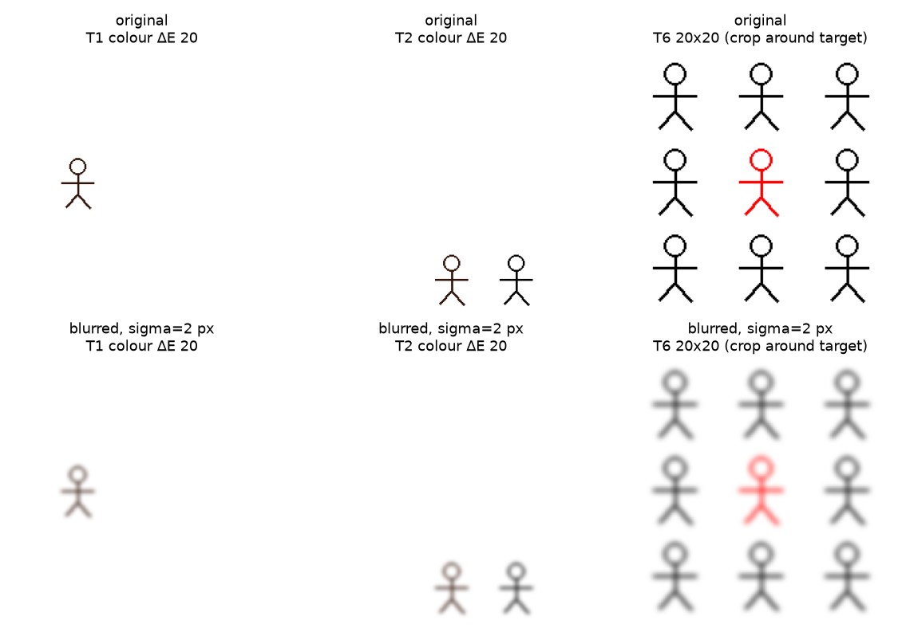
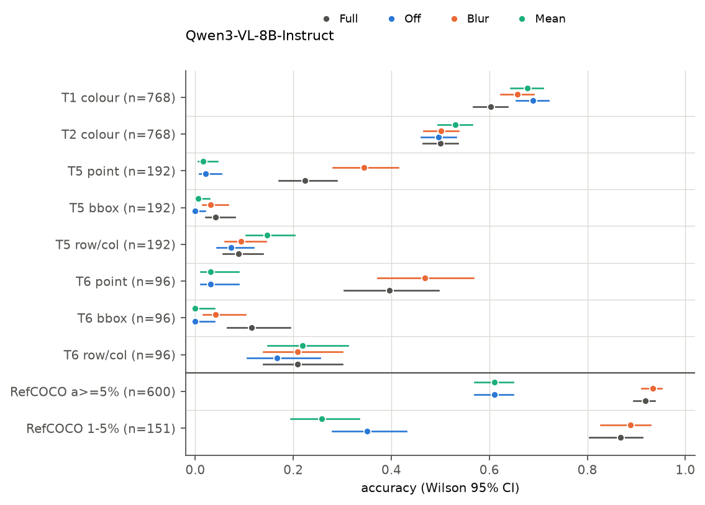
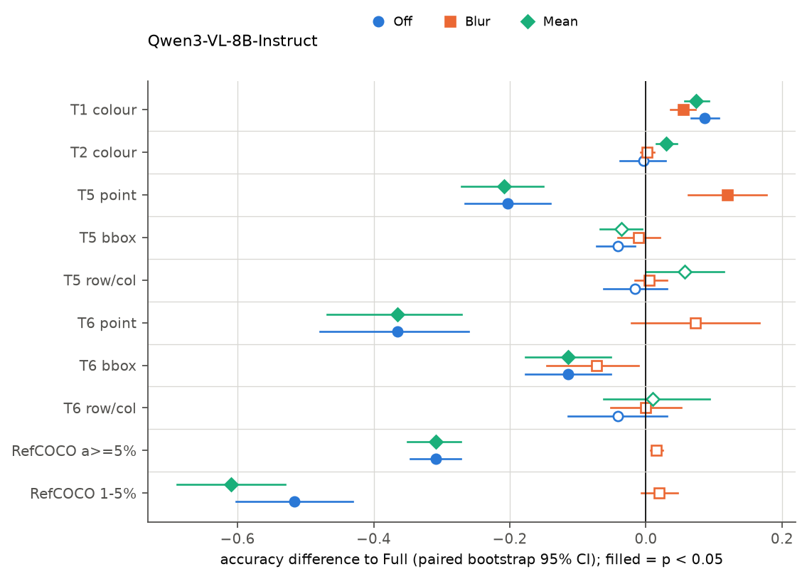
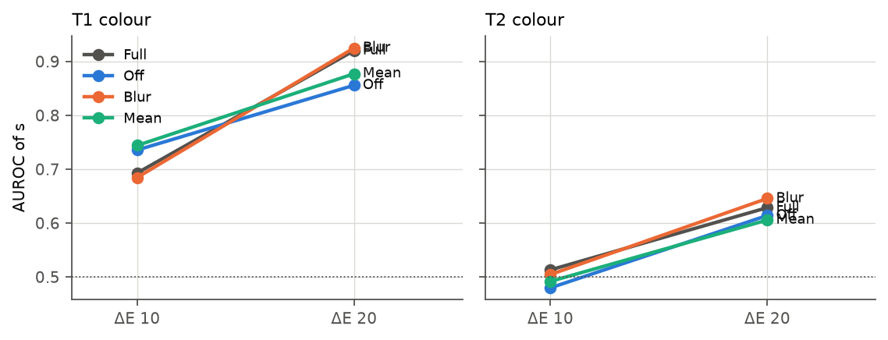
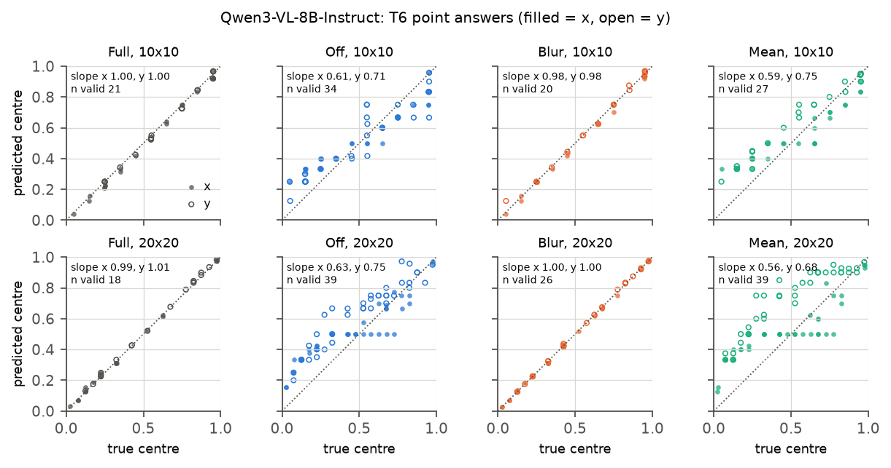
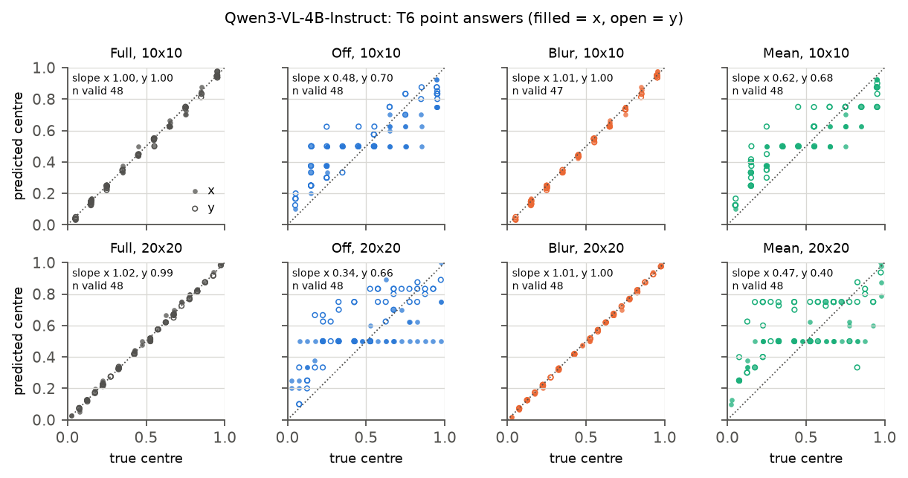
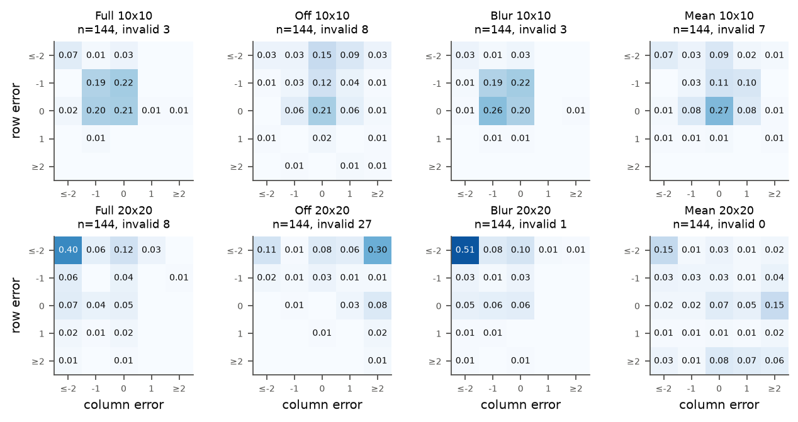
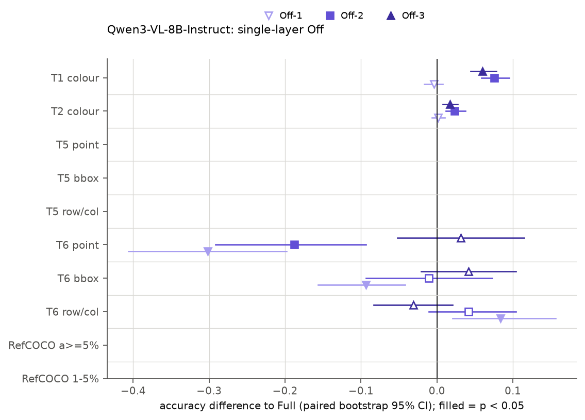
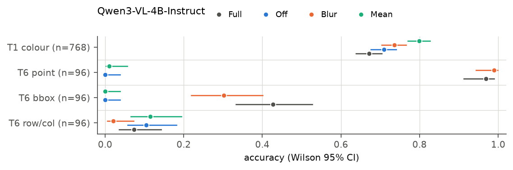

# DeepStack 消融（轻量版）

实验日期：2026-10-15。本文属于[多层视觉特征注入](plan.md)研究，执行计划第 6 节的实验 4.3（DeepStack 消融）。本次为轻量版本：只运行主要对比与单层关闭，评测集中于[实验 4.2](results_2026-10-14_end_to_end.md) 选出的两类任务，模型为 Qwen3-VL-8B-Instruct，并在 Qwen3-VL-4B-Instruct 上重复两项任务。

## 1. 研究问题与主要结果

实验 4.2 发现，具有 DeepStack 的 Qwen3-VL 只在两类任务上相对 Qwen3.5 一致占优：单实例颜色判断（T1 颜色，色差 10–20），以及 10×10 与 20×20 网格中的坐标输出（T5、T6 的中心点与 bbox 答案）。两类模型的训练数据与 LLM 结构同时不同，4.2 无法把这些差异归因于 DeepStack。本实验固定 Qwen3-VL 的全部权重，只修改注入 decoder 前三层的 DeepStack 特征，回答三个问题：

1. 移除 DeepStack 注入是否选择性地损害颜色判别；
2. 移除 DeepStack 注入是否选择性地损害密集网格中的坐标精度；
3. 上述损失是否超出 Blur 与 Mean 两种对照所测量的分布外损伤。

主要结果如下：

1. **坐标输出依赖 DeepStack 注入的图像特异内容。** Qwen3-VL-8B 的 T6 中心点命中率在完整模型（Full）下为 0.40，关闭注入（Off）与均值替换（Mean）后均降为 0.03，低通替换（Blur）下为 0.47；T5 中心点由 0.22 降为 0.02（Off、Mean），Blur 下为 0.34。Qwen3-VL-4B 的 T6 中心点由 0.97 降为 0.00（Off）与 0.01（Mean），Blur 下为 0.99。Off 与 Mean 下的预测坐标仍与真值高度相关（8B 的 T6 有效回答中 $r = 0.88$–$0.99$），但被压缩向画布中央（斜率 0.56–0.75），并集中于 1/4、1/3、1/2 等少数几个数值；Blur 下斜率为 0.98–1.00，与 Full 相同。
2. **颜色判别基本不依赖 DeepStack。** 8B 的 T1 颜色 AUROC 在四种条件下为 0.806（Full）、0.794（Off）、0.807（Blur）、0.806（Mean），Off 与 Full 之差为 −0.012 [−0.029, +0.005]。色差 20 一级在 Off 下下降 0.064，Mean 下下降 0.043，但 Off 下的 AUROC 0.856 仍高于实验 4.2 中 Qwen3.5-9B 的 0.77。准确率在 Off、Blur、Mean 下反而上升（+0.05 至 +0.09），原因是回答偏置向“No”移动，判别能力并未提高。4B 模型结果一致。
3. **损伤局限于坐标输出，Blur 与 Mean 两种对照不支持“一般性分布外损伤”的解释。** Blur 保留了注入项的分布，在全部任务上均无损伤；Mean 保留了注入项的一阶统计量，其损伤与 Off 几乎相同。不输出坐标的任务（T1、T2 二值判断，行列序号答案的准确率）在 Off 下没有下降。计划中作为一般能力对照的 RefCOCO 大目标层在 Off 与 Mean 下由 0.92 降为 0.61，但 RefCOCO 本身是坐标输出任务，其预测框中心同样出现向中央的压缩（x 方向斜率由 0.95 降为 0.82），因此该下降属于同一种坐标损伤。
4. **所需信息可以由低通图像提供，主要来自最浅的抽取层。** Blur（Gaussian 标准差 2 pixels）不损害坐标，说明 DeepStack 为坐标输出提供的是在低通后仍保留的图像特异内容，例如目标的位置与布局，而非高频细节。单层关闭中，关闭 ViT block 8 的特征（Off-1）使 T6 中心点由 0.40 降为 0.09，关闭 block 16（Off-2）降为 0.21，关闭 block 24（Off-3）为 0.43，无显著变化。
5. **Qwen3-VL 行列答案的“少计 1”偏差同样来自 DeepStack。** 行列答案的准确率在各条件下不变，但误差结构改变：10×10 网格中，行或列少计 1 的回答在 Full 下为 87/144，Blur 下为 95/144，Off 与 Mean 下只有 30/144 与 32/144。实验 4.2 中 Qwen3-VL 特有的行列偏差在关闭注入后基本消失。

据此，三个问题的回答为：(1) 移除注入不损害颜色判别，4.2 中的颜色优势大部分来自 DeepStack 以外的因素；(2) 移除注入严重损害坐标精度，在两个规模上一致；(3) 坐标损伤超出分布外对照所能解释的范围，Blur 无损伤而 Mean 与 Off 同样严重，损伤来自图像特异的低频内容的缺失。

## 2. 实验设计

### 2.1 条件

沿用计划第 4 节的符号。对一张图像，记 merger 输出的 visual token 数为 $N$，LLM hidden size 为 $d$（8B 模型为 4096，4B 模型为 2560）。第 $k$ 个抽取层的 DeepStack 特征为

$$
D_k \in \mathbb{R}^{N \times d}, \qquad k = 1, 2, 3,
$$

8B 模型的三个抽取层为 ViT block 8、16、24，4B 模型为 block 5、11、17。记 decoder 第 $j+1$ 层输出的 hidden states 为 $H^{(j)} \in \mathbb{R}^{L \times d}$，$L$ 为序列长度，$\Omega$ 为 visual token 所在位置的下标集合。各条件只改变加入 decoder 的特征 $\tilde{D}_k \in \mathbb{R}^{N \times d}$：

$$
H^{(j)}_{\Omega} \leftarrow H^{(j)}_{\Omega} + \tilde{D}_{j+1}, \qquad j = 0, 1, 2.
$$

主路径视觉 token、全部权重、prompt 与解码方式在各条件下完全相同。

| 条件 | $\tilde{D}_k$ | 保留的内容 | 移除的内容 |
| --- | --- | --- | --- |
| Full | $D_k$ | 全部 | 无 |
| Off | 零矩阵 | 无 | 注入项整体 |
| Off-$k$ | 第 $k$ 层取零矩阵，其余为 $D_k$ | 另两个抽取层 | 第 $k$ 个抽取层 |
| Mean | $\mathbf{1}\bar{d}_k^{\top}$ | 注入项的一阶统计量 | 全部图像特异内容 |
| Blur | 由模糊图像计算的 $D_k$ | 注入项的分布与低频内容 | 高频细节 |

Mean 中的均值向量 $\bar{d}_k \in \mathbb{R}^{d}$ 为参考图像集全部 visual token 上第 $k$ 个抽取层特征的平均：

$$
\bar{d}_k = \frac{1}{T} \sum_{i=1}^{T} D_k[i],
$$

其中 $D_k[i] \in \mathbb{R}^{d}$ 为参考集中第 $i$ 个 visual token 的特征，$T$ 为参考集的 visual token 总数，$\mathbf{1}$ 为长度 $N$ 的全 1 列向量，二者之积把同一均值向量放到每个 visual token 位置。参考集由 250 张合成刺激（3×3、6×6 网格，以及缺口与旋转的单实例和两实例图像，均不在评测样本中）与 250 张 RefCOCO testA 图像（与评测所用的 val 图像不重叠）组成，共 $T = 95368$ 个 visual token。Blur 中，输入图像先以标准差 2 pixels 的 Gaussian 核模糊（Pillow 的 GaussianBlur 半径参数即标准差），再送入 processor，由同一 ViT 与 DeepStack merger 计算特征；主路径视觉 token $V \in \mathbb{R}^{N \times d}$ 仍由原图计算。

两种对照的作用如下。Off 的下降同时包含两部分：模型对注入内容的依赖，以及 decoder 前三层 hidden states 偏离训练分布造成的一般性损伤。Mean 保留注入项的平均方向与幅度，只移除图像特异内容；Blur 保留注入项的整体分布，只移除高频细节。由此可以区分三种情形：

| 观察 | 解释 |
| --- | --- |
| Off 下降，Mean 基本恢复 | 下降主要来自注入项幅度与方向的缺失，即分布外损伤 |
| Off 与 Mean 同样下降，Blur 基本恢复 | 任务依赖注入项中的图像特异内容，且该内容在低通后仍保留 |
| Off、Mean、Blur 同样下降 | 任务依赖注入项中的高频细节 |

### 2.2 评测任务与样本

刺激、问题与评分全部沿用[实验 1.3](../behavior/results_2026-10-13_decomposition.md) 的正式运行，只使用主问法（primary wording）。依据 4.2 的任务建议（4.2 结果第 7.2 节）与计划第 6.3 节，评测集如下：

| 任务 | 输入与条件 | 回答格式 | 题数（8B） | 题数（4B） |
| --- | --- | --- | --- | --- |
| T1 颜色 | 单个实例，色差 10 与 20，四种网格尺度各 48 条记录，异常与正常各一半 | Yes／No | 768 | 768 |
| T2 颜色 | 两个并排实例，抽样方式同 T1 | Yes／No | 768 | – |
| T5 | 10×10 与 20×20 网格，未知异常属性；每个“网格 × 变化类型 × 幅度”单元随机抽取 8 条记录，同一图像分别以三种格式提问 | 中心点、bbox、行列 | 576 | – |
| T6 | 10×10 与 20×20 网格，异常实例为纯红色，全部 48 条记录 | 中心点、bbox、行列 | 288 | 288 |
| RefCOCO | 4.2 的面积分层样本：1%–5% 层 151 条，5%–10% 与 ≥10% 层各 300 条 | bbox | 751 | – |

T1、T2 的输入与网格尺度无关，四种尺度相当于四次独立抽取的记录。下图为输入示例及其模糊版本，Blur 条件下 DeepStack 特征由下排图像计算：

### 2.3 指标与统计

1. **二值任务。** 判别分数为首个回答 token 处两个 token 的 logit 之差 $s = z_{\mathrm{Yes}} - z_{\mathrm{No}}$，准确率按 $s$ 的符号计算，受回答偏置影响；AUROC 与阈值无关，作为判别能力的主指标。AUROC 之差的 95% 区间由以记录为单位的配对 bootstrap（1000 次）给出。
2. **定位任务。** 中心点答案以预测点所在网格单元等于目标单元为命中；bbox 答案以与目标紧致框的 IoU≥0.5 为正确；行列答案要求行号与列号均正确。评分采用 1.3 的内容诊断评分，输出多个点或多个框的回答不符合格式，记为无效与错误。按[总计划](../plan.md)第 6 节第 9 条，中心点答案另报告“任一坐标约定命中”，即把同一输出按绝对 pixel 解读后的命中与 0–1000 归一化命中取并集。
3. **成对检验。** 同一题目在条件 $c$ 与 Full 下的正误构成配对，记只有条件 $c$ 答对的题数为 $b$、只有 Full 答对的题数为 $c'$，使用精确 McNemar 检验。主要检验族为 Off、Blur、Mean 对 Full 在各主要指标上的比较（8B 为 9 项指标 × 3 个条件，共 27 个检验；4B 为 4 × 3 = 12 个检验），各模型分别做 Holm 校正。单层关闭与按网格拆分的比较报告未校正的 $p$。准确率差值的 95% 区间由以题目为单位的配对 bootstrap 给出。
4. **坐标校准。** 对每个坐标轴，以目标中心占画布边长的比例 $u \in [0, 1]$ 为自变量，以有效回答的预测中心比例 $\hat{u}$ 为因变量，做最小二乘拟合

$$
\hat{u} = a\,u + b_0,
$$

  其中 $a$ 为斜率，$b_0$ 为截距，另报告 Pearson 相关系数 $r$。完美校准对应 $a = 1$、$b_0 = 0$；$a < 1$ 且 $b_0 > 0$ 表示预测被压缩向固定点 $u^{*} = b_0 / (1 - a)$，当 $u^{*}$ 接近 0.5 时即压缩向画布中央。$r$ 高而 $a$ 低，说明模型仍能区分目标的相对位置，但坐标的尺度失准。

## 3. 实际执行

### 3.1 模型、解码与实现

模型 checkpoint 与 4.2 相同（Qwen3-VL-8B-Instruct revision 0c351dd01ed8，Qwen3-VL-4B-Instruct revision ebb281ec70b0），bfloat16，sdpa attention，greedy decoding，thinking off；二值任务输出上限 8 tokens，定位任务 256 tokens。

实现上，程序替换 model.model.language_model 的 forward，拦截 Qwen3VLModel 传入的 deepstack_visual_embeds 参数（每个抽取层一个形状为“batch 中全部 visual token 数 × $d$”的张量），按条件替换后再调用原 forward。该参数只在 prefill 中出现，因此缓存解码步骤不受影响。每个 batch 运行后核对替换恰好发生一次，否则报错。Blur 条件对 batch 中的每张图像计算模糊图像的 DeepStack 特征，并核对模糊前后的 image_grid_thw 相同。

### 3.2 修改生效的核对

在一个 T6 中心点样本上，比较各条件与 Full 在 visual token 位置的 decoder 输出。记条件 $c$ 与 Full 下某一 decoder 层在 visual token 位置的输出分别为 $H_c, H_{\mathrm{full}} \in \mathbb{R}^{N \times d}$，指标为 Frobenius 范数下的相对变化 $\lVert H_c - H_{\mathrm{full}} \rVert / \lVert H_{\mathrm{full}} \rVert$，同时报告首 token logits 的最大绝对差。forward hook 记录的是 decoder 层自身的输出，DeepStack 特征在该输出之后才加入，因此移除 $D_k$ 的效果从第 $k+1$ 层开始可见。8B 模型的结果如下：

| 条件 | 第 1 层 | 第 2 层 | 第 3 层 | 第 4 层 | logits 最大差 |
| --- | --- | --- | --- | --- | --- |
| Off | 0 | 0.328 | 0.559 | 0.606 | 3.25 |
| Blur | 0 | 0.280 | 0.446 | 0.463 | 1.63 |
| Mean | 0 | 0.297 | 0.503 | 0.533 | 3.75 |
| Off-1 | 0 | 0.328 | 0.265 | 0.248 | 2.38 |
| Off-2 | 0 | 0 | 0.465 | 0.436 | 1.80 |
| Off-3 | 0 | 0 | 0 | 0.245 | 1.16 |

各条件只在预期的层上改变 hidden states。注入项占 visual token 表征的比重很大：关闭全部注入后第 4 层输出的相对变化为 0.61。4B 模型的核对结果相同（Off 下第 4 层为 0.65）。

### 3.3 一致性核对、规模与耗时

1. **Full 与 4.2 的一致性。** 本实验的 Full 条件与 4.2 的同一模型在相同题目上的评分一致率为 3130/3151（8B，99.3%）与 1040/1056（4B，98.5%），差异来自批处理组成不同引起的 bf16 舍入。这说明替换 forward 的包装本身不改变模型行为。
2. **批量与逐条解码。** 每个模型在 Full、Off、Blur、Mean 下各抽取 20 条子任务样本，以 batch size 1 重新回答并比较评分。答案层面一致为 79/80（8B）与 79/80（4B），文本完全相同为 71/80 与 74/80。
3. **规模与耗时。** 8B 共运行 4 × 3151 次查询（Full、Off、Blur、Mean）与 3 × 1824 次查询（Off-1、Off-2、Off-3，限于 T1、T2、T6）；4B 共运行 4 × 1056 次查询。合计约 4 GPU 小时，运行于与其他用户共享的 A800 与 A40。由于其他进程占用显存，部分运行因 OOM 中断后续跑，batch size 依次为 16、8、4，每条记录保存其 batch size；结果按 batch 追加写入，续跑不重复、不遗漏题目。

## 4. 结果

### 4.1 主要指标

下图为 8B 模型在各条件下的准确率（Wilson 95% 区间），横线以下两行为 RefCOCO：

相对 Full 的准确率差值如下，实心标记表示 $p < 0.05$（主要指标为 Holm 校正后）：

| 指标 | $n$ | Full | Off | Blur | Mean |
| --- | --- | --- | --- | --- | --- |
| T1 颜色 | 768 | 0.60 | 0.69（66／0，<0.001） | 0.66（46／4，<0.001） | 0.68（57／0，<0.001） |
| T2 颜色 | 768 | 0.50 | 0.50（74／77，1.000） | 0.50（7／6，1.000） | 0.53（28／5，0.001） |
| T5 中心点 | 192 | 0.22 | 0.02（3／42，<0.001） | 0.34（28／5，0.001） | 0.02（2／42，<0.001） |
| T5 bbox | 192 | 0.04 | 0.00（0／8，0.102） | 0.03（3／5，1.000） | 0.01（1／8，0.469） |
| T5 行列 | 192 | 0.09 | 0.07（9／12，1.000） | 0.09（3／2，1.000） | 0.15（23／12，0.895） |
| T6 中心点 | 96 | 0.40 | 0.03（2／37，<0.001） | 0.47（15／8，1.000） | 0.03（1／36，<0.001） |
| T6 bbox | 96 | 0.11 | 0.00（0／11，0.016） | 0.04（2／9，0.720） | 0.00（0／11，0.016） |
| T6 行列 | 96 | 0.21 | 0.17（4／8，1.000） | 0.21（4／4，1.000） | 0.22（9／8，1.000） |
| RefCOCO $a \ge 5\%$ | 600 | 0.92 | 0.61（6／191，<0.001） | 0.93（9／0，0.055） | 0.61（4／189，<0.001） |
| RefCOCO 1%–5% | 151 | 0.87 | 0.35（3／81，<0.001） | 0.89（4／1，0.375） | 0.26（2／94，<0.001） |

括号内依次为 $b$／$c'$ 与 Holm 校正后的 $p$（RefCOCO 1%–5% 不在主要检验族中，为未校正值）。全部比例的 Wilson 区间、差值的 bootstrap 区间与按网格拆分的结果见产物中的 tables.md。

“任一坐标约定命中”与严格命中在 Full、Blur 下完全相同；只在 pixel 约定下命中的回答在 Off 与 Mean 下分别只有 2 条与 1 条（均为 T5 20×20），在 Off-1 与 Off-2 下分别为 1 条与 4 条（均为 T6 20×20）。两种约定合并后的机会命中率为 0.014（10×10）与 0.005（20×20）。因此 Off 与 Mean 下的坐标损伤与坐标约定的混用无关；Off-2 下少数回答改用了 pixel 约定，第 4.6 节单独说明。

### 4.2 颜色判别

下图为 T1、T2 颜色在两个色差等级上的 AUROC：

| 模型 | 子任务 | 色差 | Full | Off | Blur | Mean |
| --- | --- | --- | --- | --- | --- | --- |
| 8B | T1 | 10 与 20 合并 | 0.806 | 0.794（−0.012 [−0.029, +0.005]） | 0.807（+0.001） | 0.806（+0.000） |
| 8B | T1 | 10 | 0.693 | 0.736（+0.043 [+0.017, +0.073]） | 0.685（−0.008） | 0.744（+0.051） |
| 8B | T1 | 20 | 0.920 | 0.856（−0.064 [−0.081, −0.047]） | 0.925（+0.005） | 0.877（−0.043） |
| 8B | T2 | 10 与 20 合并 | 0.571 | 0.546（−0.024 [−0.052, +0.002]） | 0.577（+0.006） | 0.549（−0.022） |
| 4B | T1 | 10 与 20 合并 | 0.849 | 0.826（−0.023 [−0.034, −0.012]） | 0.862（+0.013） | 0.903（+0.054） |
| 4B | T1 | 20 | 0.973 | 0.959（−0.014） | 0.978（+0.005） | 0.995（+0.022） |

数据显示：

1. **合并两个色差等级后，三种条件均不降低 T1 颜色的判别能力。** 8B 的差值区间均包含 0；4B 的 Off 下降 0.023，Mean 反而上升 0.054。
2. **色差 20 一级在 Off 与 Mean 下有小幅下降，色差 10 一级则上升。** 8B 在色差 20 下 Off 降低 0.064，Mean 降低 0.043，Blur 不变；色差 10 下 Off 与 Mean 上升约 0.05。两个方向相反的变化说明，移除注入改变了 $s$ 对色差的响应形状，而没有系统性地削弱颜色信息。
3. **残余优势仍大于 4.2 的模型间差异的主要部分。** 4.2 中色差 20 的 T1 AUROC 为 Qwen3-VL-8B 0.92 对 Qwen3.5-9B 0.77。Off 条件下 Qwen3-VL-8B 仍为 0.856，即 0.15 的模型间差异中至多约 0.06 可由注入项解释；4B 组中 Off 下的 0.959 同样高于 Qwen3.5-4B 的 0.89。
4. **准确率的上升来自回答偏置。** T1 主问法“Is this figure drawn entirely in black?”在 Full 下 $s$ 的均值为 +9.49，模型强烈倾向回答 Yes；Off、Blur、Mean 下均值降为 +7.88、+8.37、+8.87，更多异常样本被判为 No，准确率因而上升，AUROC 不变。

### 4.3 坐标输出

T6 中心点答案的预测中心与真值中心的关系如下（实心点为 x 坐标，空心点为 y 坐标，点线为完美校准）：

| 模型 | 条件 | 网格 | 有效回答 | x 斜率 | x 截距 | x 的 $r$ | y 斜率 | y 截距 | y 的 $r$ |
| --- | --- | --- | --- | --- | --- | --- | --- | --- | --- |
| 8B | Full | 20×20 | 18 | 0.99 | 0.00 | 1.00 | 1.01 | 0.00 | 1.00 |
| 8B | Off | 20×20 | 39 | 0.63 | 0.23 | 0.93 | 0.75 | 0.26 | 0.95 |
| 8B | Blur | 20×20 | 26 | 1.00 | 0.00 | 1.00 | 1.00 | 0.00 | 1.00 |
| 8B | Mean | 20×20 | 39 | 0.56 | 0.26 | 0.88 | 0.68 | 0.38 | 0.92 |
| 4B | Full | 20×20 | 48 | 1.02 | 0.00 | 1.00 | 0.99 | 0.00 | 1.00 |
| 4B | Off | 20×20 | 48 | 0.34 | 0.35 | 0.68 | 0.66 | 0.30 | 0.81 |
| 4B | Blur | 20×20 | 48 | 1.01 | −0.01 | 1.00 | 1.00 | 0.00 | 1.00 |
| 4B | Mean | 20×20 | 48 | 0.47 | 0.28 | 0.78 | 0.40 | 0.43 | 0.59 |

数据显示：

1. **Off 与 Mean 下命中率接近 0，Blur 下与 Full 相同或更高。** 8B 的 T6 中心点为 0.40、0.03、0.47、0.03（Full、Off、Blur、Mean），4B 为 0.97、0.00、0.99、0.01；T6 bbox 在 Off 与 Mean 下两个模型均为 0。下降与回答格式无关：Off 下 8B 的有效中心点回答反而更多（T6 为 73/96，Full 为 39/96，Full 的无效回答多为同一点的重复列举）。
2. **模型仍知道目标的大致位置，但坐标尺度失准。** 8B 在 Off 与 Mean 下，T6 有效回答的预测与真值的相关仍高（$r$ 为 0.88–0.99），斜率降为 0.56–0.75，截距为 0.16–0.38。按第 2.3 节的定义，x 方向的压缩固定点 $u^{*}$ 为 0.54–0.62，即压缩向画布中央；y 方向为 0.55–1.19，20×20 网格中预测整体偏向下方。散点图显示，Off 与 Mean 下的预测集中在 0.25、0.33、0.5、0.67、0.75 等少数数值上，相当于只给出“左四分之一”“中央”一类的粗略位置。
3. **Blur 完整保留坐标精度。** 两个模型在 Blur 下的斜率均为 0.98–1.01，截距接近 0，$r = 1.00$。8B 的 T5 中心点在 Blur 下由 0.22 升至 0.34（$p = 0.001$），伴随有效回答由 77 增至 94；这一上升的原因尚未分析。

### 4.4 行列答案

T5 与 T6 的行列答案在 10×10 与 20×20 网格中的误差分布如下，每格为该“行误差 × 列误差”组合占全部回答的比例：

| 条件 | 网格 | 回答数 | 无效 | 完全正确 | 少计 1（行、列或二者） | 平均行误差 | 平均列误差 |
| --- | --- | --- | --- | --- | --- | --- | --- |
| Full | 10×10 | 144 | 3 | 30 | 87 | −0.94 | −0.90 |
| Off | 10×10 | 144 | 8 | 30 | 30 | −1.10 | +0.02 |
| Blur | 10×10 | 144 | 3 | 29 | 95 | −0.68 | −0.70 |
| Mean | 10×10 | 144 | 7 | 39 | 32 | −0.99 | −0.39 |
| Full | 20×20 | 144 | 8 | 7 | 12 | −4.26 | −4.12 |
| Off | 20×20 | 144 | 27 | 0 | 8 | −3.59 | +1.43 |
| Blur | 20×20 | 144 | 1 | 9 | 15 | −5.11 | −4.38 |
| Mean | 20×20 | 144 | 0 | 10 | 11 | −0.80 | −0.99 |

1. **行列准确率不变。** T5 与 T6 的行列准确率在各条件之间的差异均不显著（第 4.1 节）。
2. **误差结构随注入内容改变。** Full 与 Blur 下，10×10 网格的错误集中于行、列或二者少计 1（87 与 95 条），20×20 网格集中于行列均少计 2 以上，与 4.2 报告的 Qwen3-VL 行列偏差相同。Off 与 Mean 下少计 1 的回答降为 30 与 32 条，误差分散到正负两侧，20×20 网格的平均误差绝对值由 4 以上降到 1 左右（Mean）。因此，Qwen3-VL 行列序号的系统性少计依赖于注入项中的图像特异内容，且该内容在低通后仍保留。

### 4.5 分布外损伤的对照

计划第 6.2 节以 RefCOCO 大目标层作为一般能力指标，要求细粒度任务下降而一般能力指标接近不变，才把结果解释为对细节的选择性依赖。本实验中该条件不满足：RefCOCO $a \ge 5\%$ 层在 Off 与 Mean 下由 0.92 降为 0.61，1%–5% 层由 0.87 降为 0.35 与 0.26。但 RefCOCO 的回答同样是 0–1000 归一化 bbox，属于坐标输出：Off 下预测框中心的 x 斜率由 0.95 降为 0.82，Mean 下为 0.89，与网格任务中的压缩方向相同。RefCOCO 的下降因此不能作为一般性损伤的独立度量。

能够区分“一般性损伤”与“坐标特异损伤”的证据来自另外两方面：

1. **不输出坐标的任务不受影响。** T1、T2 的 AUROC 与行列答案的准确率在 Off 下均无显著下降（第 4.2、4.4 节）。若 Off 造成一般性的分布外损伤，这些任务也应当下降。
2. **Blur 无损伤，Mean 与 Off 同样严重。** Blur 与 Mean 均使注入项保持在训练分布附近，二者的结果却截然相反。差别在于 Blur 保留了图像特异的低频内容，Mean 没有保留。因此坐标损伤来自图像特异内容的缺失，超出了分布偏移本身所能解释的范围。

### 4.6 单层关闭

8B 模型在 T1、T2、T6 上运行了 Off-1、Off-2、Off-3：

| 指标 | Full | Off-1（block 8） | Off-2（block 16） | Off-3（block 24） |
| --- | --- | --- | --- | --- |
| T6 中心点 | 0.40 | 0.09（2／31，<0.001） | 0.21（3／21，<0.001） | 0.43（11／8，0.648） |
| T6 bbox | 0.11 | 0.02（0／9，0.004） | 0.10（8／9，1.000） | 0.16（7／3，0.344） |
| T6 行列 | 0.21 | 0.29（10／2，0.039） | 0.25（6／2，0.289） | 0.18（2／5，0.453） |
| T1 颜色（准确率） | 0.60 | 0.60（9／12，0.664） | 0.68（58／0，<0.001） | 0.66（46／0，<0.001） |

括号内为 $b$／$c'$ 与未校正的 $p$。最浅的抽取层承担了坐标信息的主要部分：Off-1 使 T6 中心点降至 0.09，接近 Off 的 0.03；Off-2 的影响约为其一半（20×20 网格中另有 4 条回答只在 pixel 约定下命中，按任一约定计 T6 中心点为 0.25）；Off-3 无影响。Off-1 下 T6 的坐标斜率为 0.82–0.88，压缩程度弱于 Off，但命中率已大幅下降，说明 20×20 网格的单元宽度只有画布的 5%，斜率的小幅偏离即足以使中心点落入相邻单元。T1 准确率的变化与 Off-1 无关而与 Off-2、Off-3 有关，且只是回答偏置的移动（第 4.2 节）。

### 4.7 Qwen3-VL-4B

4B 模型在 T1 颜色与 T6 上重复了 Off、Blur、Mean：

结果与 8B 一致且更为清晰：T6 中心点在 Full 与 Blur 下为 0.97 与 0.99，在 Off 与 Mean 下为 0.00 与 0.01（Holm 校正后 $p < 10^{-20}$）；T6 bbox 由 0.43 降为 0（Off、Mean），Blur 下为 0.30（$p = 0.288$）；T1 颜色的 AUROC 在 Off 下降低 0.023，在 Mean 下上升 0.054。

## 5. 解释与限制

### 5.1 解释

1. **DeepStack 在 Qwen3-VL 中的主要作用是为坐标输出提供位置尺度。** 移除注入后，模型仍能区分目标的相对位置，但无法输出精确的归一化坐标，预测退化为少数粗略的分数值。所需内容在 Gaussian 模糊后仍然保留，主要来自最浅的抽取层（ViT block 8）。一种可能的解释是：ViT 输入端的绝对 position embedding 在浅层表征中最为显著，DeepStack 把这一位置信息直接送入 decoder，使 LLM 能够把 visual token 映射到精确的画布坐标；主路径特征来自 ViT 末层，其中位置信息较弱。该解释需要由实验 4.4 检验，例如比较 $D_1$ 与主路径 $V$ 中目标位置的可读性。
2. **4.2 中 Qwen3-VL 的两项优势只有一项可归因于 DeepStack。** 密集网格中的坐标优势在关闭注入后完全消失，并低于 4.2 中 Qwen3.5 的水平（Qwen3.5-9B 的 T6 中心点在 20×20 网格为 0.04），与 DeepStack 的作用一致。颜色判别的优势在关闭注入后基本保留，应归因于训练数据或其他结构差异。
3. **DeepStack 提供的是低频的图像特异内容，而非高频细节。** Blur 在全部任务上均无损伤，与 DeepStack“补充主路径缺少的局部细节”这一设计动机不同。在本实验的任务上，没有观察到依赖注入项高频内容的行为。
4. **行列偏差与坐标精度来自同一来源。** Qwen3-VL 在 10×10 网格中的行列少计 1，以及在 20×20 网格中的大幅少计，均在关闭注入后消失。这提示 Qwen3-VL 的行列序号答案部分地由坐标表示换算而来，坐标尺度与序号的换算存在系统偏差；这一点与实验 1.4（序号偏差与 token 网格）直接相关。

### 5.2 限制

1. **轻量规模。** T5、T6 的每个“网格 × 格式”单元只有 48–96 题，bbox 的基线准确率很低（8B 的 T5 bbox 为 0.04），bbox 上的比较缺乏统计功效。单层关闭只在 8B 的 T1、T2、T6 上运行。
2. **一般能力对照不独立于坐标。** 计划中的 RefCOCO 大目标层本身依赖坐标输出，COCO caption 交叉熵未运行。本实验以不输出坐标的二值任务和行列答案替代，二者都是合成刺激上的任务，不能完全代表一般视觉理解能力。
3. **消融修改的是已训练模型。** 结果说明 Qwen3-VL 对注入内容的依赖，不能推断不含 DeepStack 的训练（例如 Qwen3.5）会得到怎样的坐标能力；Qwen3.5 在 4.2 中的 T6 中心点命中率（4B 为 0.38）说明其他训练方式可以部分补偿。
4. **Blur 的强度单一。** 只使用了标准差 2 pixels 的模糊。网格中实例的线宽约 2 pixels，该强度足以使线条明显变淡（第 2.2 节示例图），但更强的模糊是否开始损害坐标尚未测试。
5. **严格格式评分。** Full 下 8B 有约一半的中心点回答因列举多个点而无效，各条件的有效回答数不同。坐标校准只在有效回答上计算，不同条件的有效样本不完全相同。

## 6. 与设计的偏离

1. **评测范围按轻量版本缩减。** 未运行 BabyVision 与 T3；T5 为分层抽样子集；单层关闭只覆盖 T1、T2、T6；4B 只覆盖 T1 颜色与 T6。计划第 6.3 节中的 4B 缺口条件未运行。
2. **均值参考集为 500 张图像。** 计划为 RefCOCO train 500 张与合成刺激 500 张。本地 RefCOCO 数据不含 train 划分，改用 testA 的 250 张图像（与 val 评测图像不重叠）与 250 张合成刺激。
3. **未运行 COCO caption 交叉熵。** 一般能力对照以不输出坐标的任务替代，原因见第 5.2 节。
4. **Holm 校正按模型分别进行。** 8B 与 4B 的主要检验族分别为 27 与 12 个检验。
5. **batch size 不一。** 由于共享 GPU 上的 OOM，8B 的 Full、Off 使用 batch size 16，其余条件使用 8；4B 使用 8 与 4。第 3.3 节的核对显示，答案层面的批处理差异约为 1%–2%。

## 7. 运行与产物

运行入口为 scripts/analysis/deepstack/deepstack_ablation.sh，参数集中在脚本顶部，COMMAND 选择步骤：build（样本与参考集）、means（均值向量）、verify（修改生效核对）、run（指定模型与条件的批量回答，可续跑）、spotcheck（逐条解码核对）、score（评分）、analyze（统计与作图）。代码位于 analysis_tools/deepstack/ 下的 deepstack_ablation.py（条件实现与运行）与 deepstack_ablation_analysis.py（统计与作图），测试位于 tests/analysis/deepstack/test_deepstack_ablation.py。

产物位于 WORK_DIR/analysis/deepstack/2026-10-15_ablation_light/：

- cases.jsonl、build.json：评测样本与抽样配置；images 与 refcoco_images 为指向实验 1.3 与 4.2 的符号链接；
- reference.jsonl、reference_images/、means_<模型>.pt：均值替换的参考集（含各图像的 hash）与均值向量；
- runs/<模型>/<条件>.jsonl：全部原始回答（含首 token 的 $s$ 与 batch size），<条件>.json 为运行配置，<条件>.scores.jsonl 为评分，run_log.jsonl 为各次运行记录；
- checks/：修改生效核对（verify_<模型>.jsonl）与逐条解码核对（spotcheck_<模型>.jsonl）；
- analysis/：全部表格（tables.md）、汇总数值（summary.json）与图；文档用图复制到 docs/analysis/deepstack/figures/ablation_light/；
- logs/：各运行队列的日志。
