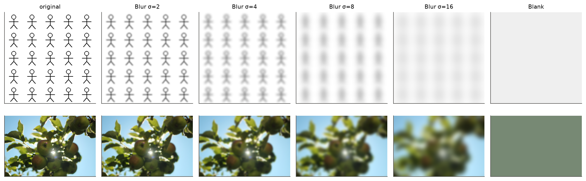
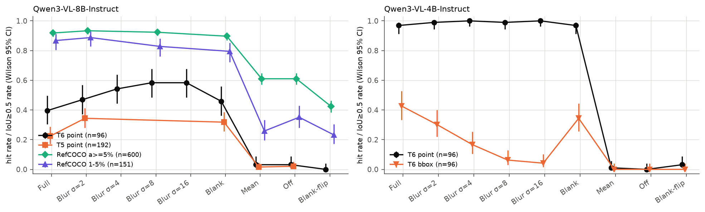
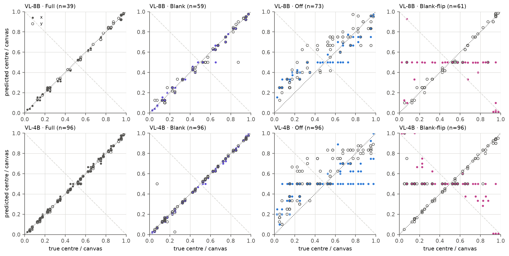
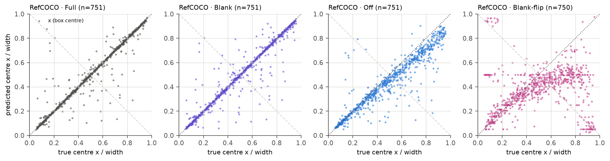
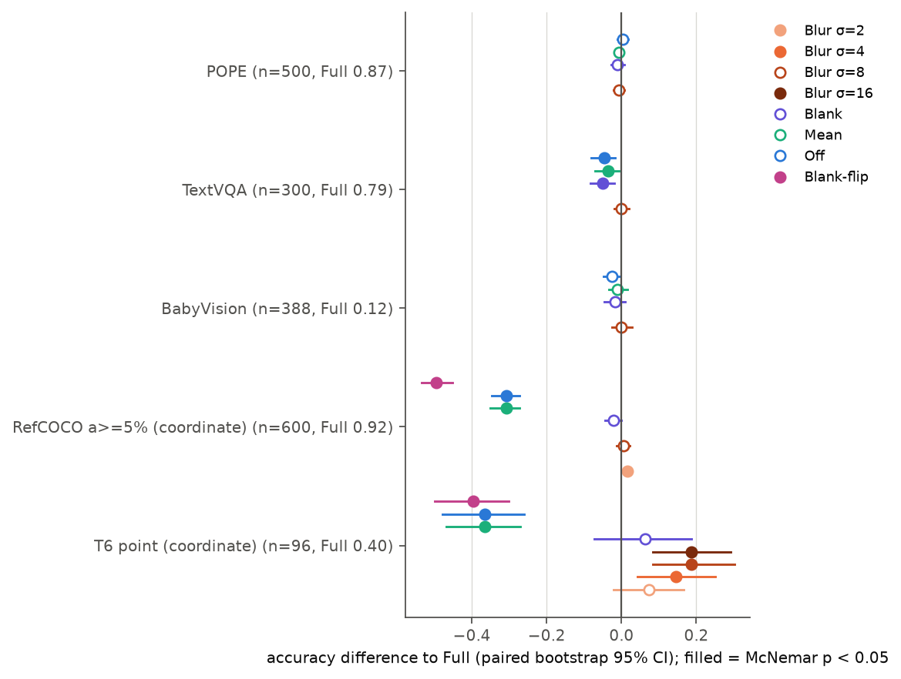
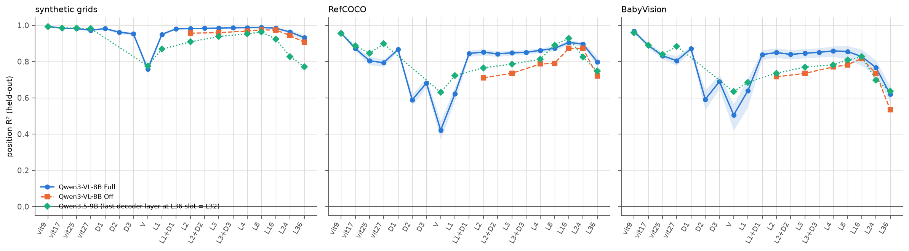
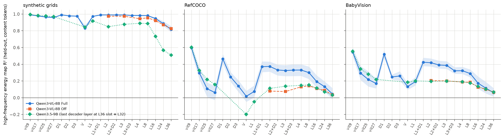
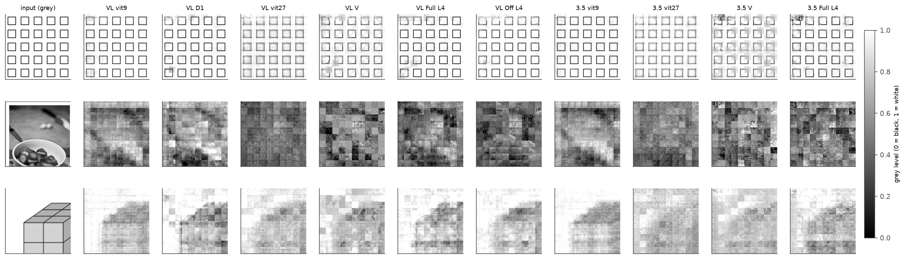

# DeepStack 注入项的位置编码与细节内容

实验日期：2026-10-20。本文属于[多层视觉特征注入](plan.md)研究，执行计划第 10 节列出的三项待办实验（模糊强度扫描、非坐标任务对照、注入特征的位置可读性），编号为实验 4.4。模型为 Qwen3-VL-8B-Instruct，主要对比在 Qwen3-VL-4B-Instruct 上重复，表征对照加入 Qwen3.5-9B。

## 0. 通俗讲述

Qwen3-VL 的 DeepStack 把 ViT 第 9、17、25 个 block（以 1 起编号；配置中的 0 起索引为 8、16、24）的输出各自经过一个 merger，加到 decoder 前三层的视觉 token 上。设计这一机制的出发点是“浅层 ViT 特征保留了末层丢失的局部细节”。实验 4.3（[DeepStack 消融](results_2026-10-15_ablation_light.md)）发现了一个与这一出发点不一致的现象：关闭注入只破坏坐标输出，而把注入项换成模糊图像的特征却毫无损伤。这说明模型依赖注入项中某种在低通滤波后仍然保留的内容，最自然的候选是位置。

本文把注入项拆成两部分来理解。对一张图像，第 $k$ 个注入项可以近似写成“只与 token 在画布上的位置有关的部分”加上“与图像内容有关的部分”。前一部分来自 ViT 输入端的绝对 position embedding，它在浅层 block 中仍然很强；后一部分才是设计者想要的细节。如果模型真正使用的是位置部分，那么用一张纯色图像计算注入项（内容部分被清空、位置部分保留）应当足以恢复坐标能力；如果把这一纯色注入项在 token 网格上左右镜像，模型输出的横坐标应当被拉向镜像的一侧，而纵坐标不受影响。这两个预测都可以直接检验，并且与“细节”假说给出截然不同的结果。

实验分三组。第一组逐步加强模糊（高斯标准差 2、4、8、16 pixels），再换成纯色图像（Blank）和镜像的纯色图像（Blank-flip），观察坐标任务。第二组用不输出坐标的任务（POPE 物体存在判断、TextVQA 文字识别、BabyVision 直接作答）测量注入项对一般能力的贡献。第三组用线性读出器测量每个视觉 token 中能读出多少位置、多少局部细节，比较 ViT 各层、注入项、主路径视觉 token 与 decoder 各层，并与没有 DeepStack 的 Qwen3.5-9B 对照。

结果给出了一个清楚的分工。坐标能力几乎完全由注入项的位置部分支撑：纯色注入使 RefCOCO 的定位准确率从关闭注入时的 0.61 回到 0.90（完整模型为 0.92），镜像注入使横坐标与真值的相关系数从 0.95 降到 0.18，纵坐标保持 0.93；模糊到标准差 16 pixels 也不损害密集网格的中心点。注入项确实携带主路径缺少的细节：在自然图像上，第一个注入项中可以线性读出的高频能量分布（$R^2=0.46$）远多于主路径视觉 token（$R^2=0.02$），这一细节进入 decoder 后在第 4 层仍有 0.33（关闭注入时为 0.13），但随层数增加而衰减，到最后一层与关闭注入时以及 Qwen3.5 的水平相同（0.05、0.04、0.03）。行为上，没有一个测试任务因移除标准差 8 pixels 以下的细节而变差；唯一可见的内容依赖是框的大小，模糊使注入项中的物体轮廓变宽，模型画出的框随之变大，说明注入项中低频的空间范围会被直接使用。因此，DeepStack 在 Qwen3-VL 中实际承担的是“为每个视觉 token 提供精确绝对位置”的功能，它携带的高频细节在到达答案之前被 decoder 丢弃。这为 Qwen3.5 去掉 DeepStack 提供了一种机制层面的解释：被模型使用的那部分功能可以由其他途径部分替代，而设计者期望的细节补充在训练好的模型中并没有被利用。

## 1. 研究问题与主要结论

总体问题是：DeepStack 注入的浅层 ViT 特征对细节与位置的感知和使用贡献了什么。本文拆成三个子问题：

1. 注入特征在 decoder 的哪里、以何种形式被读取；
2. 注入特征是否携带 ViT 末层已经丢失的低层细节；
3. 这些细节是否到达答案。

主要结论如下，每一项给出支持它的实验小节与图。

1. **坐标输出所依赖的是注入项中与图像内容无关的位置编码。** 用纯色图像（填充原图平均颜色）计算的注入项 Blank 使 RefCOCO 面积不小于 5% 的目标的 IoU≥0.5 比例为 0.90，完整模型（Full）为 0.92，关闭注入（Off）与均值替换（Mean）均为 0.61；1%–5% 的小目标上为 0.79、0.87、0.35、0.26（第 4.1 节，图 sweep）。Blank 不含任何图像内容，Mean 在每个 token 上放同一向量，二者的唯一区别是 Blank 保留了随 token 位置变化的部分。因此恢复坐标所需的信息就是这一位置部分。

2. **decoder 从注入项读取横坐标，镜像注入使横坐标失去与真值的对应。** Blank-flip 把纯色注入项的 token 网格左右镜像。RefCOCO 预测框中心的横坐标与真值的相关系数由 Full 的 0.95 降为 0.18，纵坐标保持 0.93；密集网格 T6 中心点的横坐标斜率在 8B 与 4B 中为 −0.36 与 −0.53，约 40% 的有效回答落在画布中线的镜像一侧（第 4.2 节，图 mirror 与 mirror_refcoco）。这是一个因果读取证据：只改变注入项的位置部分，模型的横坐标随之移动，纵坐标不动。冲突的位置信号使大量回答塌缩到画布中央 0.5 处，与实验 3.12 报告的“中心先验”一致。

3. **中心点坐标不依赖注入项中的细节，框的大小依赖注入项中的低频实例范围。** 模糊强度扫描中，T6 中心点命中率在标准差 2、4、8、16 pixels 下为 0.47、0.54、0.58、0.58，均不低于 Full 的 0.40；RefCOCO 在标准差 8 pixels 下与 Full 无差异（第 4.1 节）。网格实例的线宽约 2 pixels、单元宽 64 pixels，标准差 16 pixels 的模糊已使实例无法辨认（第 2.2 节的输入示例图），因此中心点所需的注入内容与实例的形状无关。与此不同，预测框随模糊增强而变大（4B 的框面积比由 1.62 增至 2.69，bbox 正确率由 0.43 降至 0.04），Blank 下框面积比为 1.72（第 4.1 节）：注入项中的实例范围被模型直接用于确定框的边界。

4. **注入项携带主路径视觉 token 丢失的细节，并把它带入 decoder 前部。** 在 RefCOCO 图像上，以每个 token 的 32×32 pixels 覆盖区内高频能量的空间分布为读出目标，ViT 第 9 层的 $R^2$ 为 0.60，第一个注入项 $D_1$ 为 0.46，主路径 $V$ 为 0.02；decoder 第 1 层输出在加入 $D_1$ 前为 0.08，加入后为 0.37（第 4.4 节，图 hfenergy_readability）。主路径 merger 只接收 ViT 末层特征，而末层的该指标只有 0.06，所以 $D_1$ 是 decoder 获得这类细节的唯一来源。BabyVision 图像给出相同的模式。

5. **注入的高频细节在 decoder 中逐层衰减，没有可测的行为贡献。** 同一指标在 Full 的 decoder 第 4、8、16、24、36 层为 0.33、0.30、0.19、0.13、0.05，Off 为 0.13、0.14、0.11、0.09、0.04，Qwen3.5-9B 第 32 层为 0.03（第 4.4 节）。行为上，标准差 8 pixels 的模糊不改变 POPE、TextVQA、BabyVision 的准确率（差值 −0.01、0.00、0.00，第 4.3 节，图 general）。注入的细节在 decoder 前部可读，在后部消失，且下游答案对它不敏感。注入内容中到达答案的部分是低频的实例范围（第 3 项的框大小）与 TextVQA 所用的低频内容（第 6 项）。

6. **注入项中的图像内容只以低频形式贡献少量非坐标能力。** TextVQA 在 Off、Mean、Blank 下下降 0.04–0.05（$p \le 0.035$），在标准差 8 pixels 的模糊下不变；POPE 的 AUROC 在全部条件下为 0.941–0.944（第 4.3 节）。TextVQA 依赖的注入内容在强模糊后仍然保留，属于低频的布局或颜色信息，与文字笔画的高频细节无关。

7. **Qwen3.5 的主路径视觉 token 含有更多位置信息，但同样缺少细节。** Qwen3.5-9B 的 $V$ 在 RefCOCO 上的位置 $R^2$ 为 0.63，高于 Qwen3-VL-8B 的 0.42；高频能量的 $R^2$ 为 −0.20，与 Qwen3-VL 的 $V$ 同样接近无信息（第 4.4 节）。这一差异与“Qwen3-VL 的主路径把位置交给 DeepStack 承担”的解释一致（解释，未经因果检验）。

据此回答三个子问题：(1) 注入项在 decoder 第 1–3 层以残差相加的方式进入视觉 token，被读取的主要是其中的绝对位置编码，镜像实验确认横坐标直接取自这一编码；(2) 注入项携带 ViT 末层丢失的细节，第一个注入项（来自 ViT 第 9 层）最多；(3) 高频细节在 decoder 中衰减，没有可测的行为贡献；注入内容中到达答案的是低频的空间范围与布局。

## 2. 实验设计

### 2.1 符号

沿用[计划](plan.md)第 4 节的符号，层号的使用约定见第 2.4 节。

| 符号 | 形状 | 含义 |
| --- | --- | --- |
| $I$ | $H \times W \times 3$ | 输入图像 |
| $N$ | 标量 | merger 输出的视觉 token 数，每个 token 覆盖 32×32 pixels |
| $d$ | 标量 | LLM hidden size，8B 为 4096，4B 为 2560 |
| $D_k(I)$ | $N \times d$ | 由图像 $I$ 计算的第 $k$ 个 DeepStack 特征，$k = 1, 2, 3$ |
| $\tilde{D}_k$ | $N \times d$ | 某一条件下实际加入 decoder 的第 $k$ 个特征 |
| $G_\sigma$ | 映射 | 标准差为 $\sigma$ pixels 的高斯模糊 |
| $\bar{I}$ | $H \times W \times 3$ | 与 $I$ 同尺寸、每个像素等于 $I$ 平均颜色的纯色图像 |
| $\Pi$ | $N \times N$ | 置换矩阵，把 token 网格中第 $r$ 行第 $c$ 列的 token 移到第 $r$ 行第 $C-1-c$ 列，$C$ 为 token 网格列数 |
| $h$ | $d$ 或 1152 | 某一读出位置上一个视觉 token 的表征 |

各条件只改变 $\tilde{D}_k$，主路径视觉 token、全部权重、prompt 与解码方式不变：

$$
H^{(j)}_{\Omega} \leftarrow H^{(j)}_{\Omega} + \tilde{D}_{j+1}, \qquad j = 0, 1, 2.
$$

其中 $H^{(j)}_{\Omega}$ 为 decoder 第 $j+1$ 层输出中位于视觉 token 位置的各行。

### 2.2 条件

| 条件 | $\tilde{D}_k$ | 保留 | 移除 | 来源 |
| --- | --- | --- | --- | --- |
| Full | $D_k(I)$ | 全部 | 无 | 4.3 |
| Off | $0$ | 无 | 全部 | 4.3 |
| Mean | $\mathbf{1}\bar{d}_k^{\top}$ | 一阶统计量 | 位置与内容 | 4.3 |
| Blur-$\sigma$ | $D_k(G_\sigma(I))$，$\sigma \in \{2, 4, 8, 16\}$ | 位置与低频内容 | 尺度小于约 $\sigma$ 的细节 | $\sigma=2$ 为 4.3，其余为本文 |
| Blank | $D_k(\bar{I})$ | 位置与平均颜色 | 全部空间内容 | 本文 |
| Blank-flip | $\Pi\, D_k(\bar{I})$ | 镜像后的位置 | 全部空间内容 | 本文 |

设计原理如下。对一个固定尺寸的图像，可以把注入项近似分解为

$$
D_k(I) \approx P_k + C_k(I),
$$

其中 $P_k \in \mathbb{R}^{N \times d}$ 只取决于 token 在画布上的位置（来自 ViT 输入端的绝对 position embedding 与 2D RoPE），$C_k(I)$ 取决于图像内容。这一分解是一个工作假设：ViT 的非线性使位置与内容存在交互，因而它只用于构造条件，不用于定量结论。在该分解下，Blank 保留 $P_k$ 与纯色图像对应的常数内容，Mean 连 $P_k$ 的逐 token 变化也一并移除，Blur 逐步移除 $C_k$ 的高频部分。三类条件的预测如下：

| 假设 | Blank | Blank-flip | Blur 随 $\sigma$ 增大 |
| --- | --- | --- | --- |
| 坐标依赖 $P_k$ | 接近 Full | 横坐标被拉向镜像位置，纵坐标不变 | 保持 |
| 坐标依赖 $C_k$ 的细节 | 接近 Off | 接近 Off | 逐步下降 |

Blank-flip 是读取位置的直接检验。$\Pi$ 只交换同一行内的 token，因此若 decoder 从注入项读取绝对位置，只有横坐标会受影响。

下图为计算注入项所用的图像：上排为 10×10 网格图的左上四分之一，下排为一张 RefCOCO 图像；各列依次为原图、四种模糊强度与 Blank 所用的纯色图像。

### 2.3 任务与样本

**坐标任务（A 组）。** 沿用 4.3 的样本，刺激、问题与评分来自[实验 1.3](../behavior/results_2026-10-13_decomposition.md)：T6（纯红色目标，10×10 与 20×20 网格，中心点、bbox、行列三种回答格式，每种 96 题）、T5（未知异常属性，三种格式各 192 题）与 RefCOCO val 的面积分层样本（1%–5% 层 151 条，5%–10% 与 ≥10% 层各 300 条）。中心点以落入目标单元为命中，bbox 以 IoU≥0.5 为正确，行列以行号与列号均正确为正确。8B 的 Blank 运行全部 1615 题；Blank-flip 与 Blur-8 运行 T6 与 RefCOCO；Blur-4 与 Blur-16 只运行 T6。4B 在 T6 上运行 Blank、Blank-flip、Blur-4、Blur-8、Blur-16。

**非坐标任务（B 组）。** 均为自然图像或手绘图像，且答案不含坐标：

| 任务 | 样本 | prompt 要求 | 指标 |
| --- | --- | --- | --- |
| POPE | adversarial 子集随机 500 条，yes 与 no 各半 | “Answer with only Yes or No.” | 首 token 的 $z_{\mathrm{Yes}} - z_{\mathrm{No}}$ 的符号与 AUROC |
| TextVQA | validation 随机 300 条 | “Answer the question using a single word or phrase.” | 至少 3 个标注答案匹配为正确，另报告 VQA accuracy |
| BabyVision | 全部 388 题 | 仓库评测 prompt 末尾加“Do not explain. Output only the final answer line.” | 格式容错的诊断评分 |

BabyVision 使用直接作答，以排除 Qwen3-VL 在长推理中的循环与截断（实验 4.2 第 3 节）。B 组运行 Full、Off、Mean、Blur-8、Blank 五个条件。

**表征对照（C 组）。** 270 张图像：90 张 T5/T6 网格图、90 张 RefCOCO 图像、90 张 BabyVision 图像。自然图像先缩放到长边 640 pixels 且两边均为 32 的倍数，使 processor 不再改变尺寸，从而每个 token 的像素覆盖区可以精确确定。每张图像保存 64 个 token（含内容的 token 48 个、空白 token 16 个，按需补足），另有每个来源 4 张图像保存全部 token 用于重建可视化。

### 2.4 读出位置与读出目标

读出位置按信息流顺序排列，ViT block 与 decoder 层均以 1 起编号：

| 模型 | 读出位置 |
| --- | --- |
| Qwen3-VL-8B | ViT 第 9、17、25、27 个 block 的输出（每个 merged token 取对应 2×2 个 patch 的平均，1152 维）；$D_1, D_2, D_3$；$V$；decoder 第 1–4、8、16、24、36 层输出（Full 与 Off）；以及第 $j$ 层输出加上 $D_j$ 后的状态（记为 L$j$+D$j$，即第 $j+1$ 层的实际输入） |
| Qwen3.5-9B | ViT 第 9、17、25、27 个 block；$V$；decoder 第 1–4、8、16、24、32 层输出 |

capture hook 记录的是 decoder 层自身的输出，DeepStack 特征在该输出之后才加入，因此“L1”不含 $D_1$，“L1+D1”含 $D_1$。视觉 token 位于问题文本之前，其表征与 prompt 无关，统一使用“Describe the image.”。

每个 token 的读出目标在原图像素上定义，记 token 覆盖区的灰度为 $g \in [0,1]^{32 \times 32}$，高通响应为 $g - G_2(g)$：

| 目标 | 维度 | 定义 | 含义 |
| --- | --- | --- | --- |
| 位置 | 2 | token 中心的归一化坐标 $(x, y) \in [0, 1]^2$ | 绝对位置 |
| 高频能量分布 | 16 | 覆盖区分为 4×4 个 8×8 pixels 子块，每块取高通响应平方均值的对数 | 细线、边缘与纹理的所在位置，不要求像素相位 |
| 4 pixels 结构 | 64 | 覆盖区的 8×8 灰度缩略图减去其均值 | 4 pixels 分辨率下的形状 |
| 粗颜色 | 48 | 覆盖区 4×4 子块的平均 RGB | 低频内容 |

读出器为 ridge 回归：

$$
\hat{y} = W^{\top} \frac{h - \mu}{s} + b,
$$

其中 $\mu, s$ 为训练集上逐维的均值与标准差，$W$ 与 $b$ 由最小二乘加 $\lambda \lVert W \rVert^2$ 惩罚求得。图像按来源分层划分为训练 60%、验证 20%、测试 20%（162、54、54 张），$\lambda$ 在验证集上从 5 个取值中选择，在训练与验证集上重新拟合后于测试集上报告

$$
R^2 = 1 - \frac{\sum \lVert y - \hat{y} \rVert^2}{\sum \lVert y - \bar{y}_{\mathrm{train}} \rVert^2}.
$$

求和遍历测试 token 与目标维度，$\bar{y}_{\mathrm{train}}$ 为训练集的目标均值。位置在全部 token 上拟合与评估，其余目标只用含内容的 token（覆盖区灰度标准差大于 0.01）。95% 区间由按测试图像的 bootstrap（1000 次）给出。读出器采用联合训练、按来源分别评估的方式，因此同一读出器需要对三类图像同时有效。

该读出器只说明信息能被线性恢复，不说明模型使用了这些信息；使用与否由 A、B 两组的干预判断。

## 3. 实际执行

### 3.1 实现与核对

1. **条件实现。** 沿用 4.3 的方式，替换 language model 的 forward，拦截 Qwen3VLModel 传入的 deepstack_visual_embeds 并按条件替换；每个 batch 核对替换恰好发生一次。Blur 与 Blank 先在原图上构造替换图像，再由同一 ViT 与 DeepStack merger 计算特征，并核对替换图像的 image_grid_thw 与原图相同。

2. **修改生效。** 在一张 T6 图像上，各条件相对 Full 在 decoder 第 1 层输出上的变化为 0，第 2、3、4 层的相对 Frobenius 变化如下表。Off、Mean、Blur-2 的数值与 4.3 一致。

| 条件 | 第 2 层 | 第 3 层 | 第 4 层 | logits 最大差 |
| --- | --- | --- | --- | --- |
| Off | 0.328 | 0.559 | 0.606 | 3.34 |
| Blur-2 | 0.280 | 0.446 | 0.463 | 1.69 |
| Blur-8 | 0.365 | 0.620 | 0.649 | 2.50 |
| Blur-16 | 0.398 | 0.701 | 0.722 | 2.41 |
| Blank | 0.416 | 0.694 | 0.733 | 2.23 |
| Blank-flip | 0.446 | 0.713 | 0.751 | 2.86 |

Blank 对 decoder 状态的改变量大于 Off，却几乎完全保留了坐标能力（第 4.1 节），说明坐标能力依赖注入项中特定的一部分，与注入项的整体幅度无关。

3. **镜像算子。** 在一张左上角有黑色方块的非对称图像上，原图内容图（各 token 特征与纯色图像特征的距离）与“镜像图像的内容图经 $\Pi$ 映回”之间的相关系数为 0.949，未经 $\Pi$ 映回时为 −0.180，确认 $\Pi$ 与图像的左右镜像一致。

4. **批处理一致性。** 批量解码 batch size 为 8（每条记录保存其 batch size）。在 Qwen3-VL-4B 的 Blank、Blank-flip、Blur-8 运行中各随机抽取 20 题，以 batch size 1 重新回答，答案层面一致 59/60，文本完全相同 50/60。8B 的逐条核对因共享 GPU 显存不足未运行；4.3 在同一实现上的 8B 核对为 79/80。

### 3.2 规模与耗时

8B 共运行 Blank 2803 次、Blank-flip 1039 次、Blur-8 2227 次、Blur-4 与 Blur-16 各 288 次查询，B 组 Full、Off、Mean 各 1188 次；4B 共 5 × 288 次；C 组为两个模型各 270 张图像的前向，以及 39 个读出位置的 ridge 拟合。合计约 8 GPU 小时，运行于与其他用户共享的 A800 与 A40。由于共享 GPU 的显存波动，部分运行因 OOM 在加载阶段失败后重新排队，结果按 batch 追加写入，续跑不重复、不遗漏题目；两个进程曾向同一条件文件并行追加不同题目，事后核对全部记录可解析且题目无重复。

## 4. 结果

### 4.1 模糊扫描与无内容注入

下图为 8B（左）与 4B（右）的坐标指标随条件的变化，条件从左到右依次移除更多注入内容，最右的 Blank-flip 为镜像注入。纵轴为命中率或 IoU≥0.5 比例，竖线为 Wilson 95% 区间：

| 指标（8B） | $n$ | Full | Blur-2 | Blur-4 | Blur-8 | Blur-16 | Blank | Mean | Off | Blank-flip |
| --- | --- | --- | --- | --- | --- | --- | --- | --- | --- | --- |
| T6 中心点 | 96 | 0.40 | 0.47 | 0.54 | 0.58 | 0.58 | 0.46 | 0.03 | 0.03 | 0.00 |
| T6 bbox | 96 | 0.11 | 0.04 | 0.02 | 0.00 | 0.01 | 0.02 | 0.00 | 0.00 | 0.00 |
| T6 行列 | 96 | 0.21 | 0.21 | 0.19 | 0.11 | 0.06 | 0.08 | 0.22 | 0.17 | 0.04 |
| T5 中心点 | 192 | 0.22 | 0.34 | – | – | – | 0.32 | 0.02 | 0.02 | – |
| T5 行列 | 192 | 0.09 | 0.09 | – | – | – | 0.03 | 0.15 | 0.07 | – |
| RefCOCO $a \ge 5\%$ | 600 | 0.92 | 0.93 | – | 0.92 | – | 0.90 | 0.61 | 0.61 | 0.42 |
| RefCOCO 1%–5% | 151 | 0.87 | 0.89 | – | 0.83 | – | 0.79 | 0.26 | 0.35 | 0.23 |

全部比例的 Wilson 区间、与 Full 的差值与精确 McNemar 检验见产物中的 tables.md。主要对比的 $p$ 值为：Blank 对 Full，RefCOCO $a \ge 5\%$ 为 0.053，1%–5% 为 0.027，T6 中心点为 0.418；Off 对 Full 在三项上均小于 0.001。

数据显示：

1. **中心点与 RefCOCO 在 Blur 与 Blank 下保持，在 Mean 与 Off 下崩溃。** 这一分界与第 2.2 节“坐标依赖 $P_k$”的预测完全一致。Blank 与 Mean 都不含图像内容，Blank 保留了逐 token 变化的位置部分，二者在 RefCOCO $a \ge 5\%$ 上相差 0.29。

2. **Blank 在小目标上有小幅损失。** RefCOCO 1%–5% 层 Blank 比 Full 低 0.07（$p = 0.027$），Blur-8 低 0.04（$p = 0.26$）。小目标的框需要目标边界的精确位置，注入项中的图像内容对此有少量贡献。

3. **中心点命中率随模糊增强而上升。** T6 中心点由 Full 的 0.40 升至 Blur-16 的 0.58（$p = 0.001$），主要来自有效回答的增加（39 增至 59 条，Full 的无效回答多为同一点的重复列举）。有效回答的坐标斜率在全部 Blur 条件下为 0.98–1.03，与 Full 相同。

4. **依赖目标范围的回答随内容移除而变差。** T6 bbox 由 0.11 降至 Blur-4 的 0.02（$p = 0.012$）与 Blank 的 0.02；行列答案在 Blur-8、Blur-16、Blank 下降至 0.11、0.06、0.08（$p \le 0.012$）。行列误差的结构显示（tables.md），Blank 下 10×10 网格的平均行误差为 −1.55，Full 为 −0.94，少计更严重。Mean 与 Off 下行列准确率不变（4.3 第 4.4 节），而 Blank 下降。一种解释是：Qwen3-VL 的行列答案部分地由注入的位置编码换算而来（4.3 发现行列少计 1 的偏差依赖注入项），当位置编码存在而注入内容被移除时，这条换算路径缺少实例边界的校正，少计加重；关闭全部注入时模型转而使用与 Qwen3.5 相同的计数路径。该解释尚未检验。

4B 的结果见下表，中心点的模式与 8B 相同。

| 指标（4B） | $n$ | Full | Blur-2 | Blur-4 | Blur-8 | Blur-16 | Blank | Mean | Off | Blank-flip |
| --- | --- | --- | --- | --- | --- | --- | --- | --- | --- | --- |
| T6 中心点 | 96 | 0.97 | 0.99 | 1.00 | 0.99 | 1.00 | 0.97 | 0.01 | 0.00 | 0.03 |
| T6 bbox | 96 | 0.43 | 0.30 | 0.17 | 0.06 | 0.04 | 0.34 | 0.00 | 0.00 | 0.00 |
| T6 行列 | 96 | 0.07 | 0.02 | 0.02 | 0.02 | 0.00 | 0.02 | 0.11 | 0.10 | 0.02 |

4B 的 T6 中心点在全部 Blur 与 Blank 下为 0.97–1.00，在 Mean、Off、Blank-flip 下为 0.00–0.03（$p < 0.001$）。bbox 给出一个额外的现象：

5. **框的大小取自注入项中的实例范围。** 4B 的 T6 bbox 随模糊增强单调下降（0.43、0.30、0.17、0.06、0.04，Blur-4 起 $p < 0.001$），Blank 下为 0.34（$p = 0.23$）。预测框面积与真值紧致框面积之比的中位数在 Full、Blur-2、Blur-4、Blur-8、Blur-16、Blank 下为 1.62、2.19、2.44、2.69、2.69、1.72（8B 为 1.92、2.43、2.62、2.89、2.44、2.28），模糊越强框越大，而中心点保持精确。模糊使注入项中的实例范围扩大，模型据此画出更大的框；Blank 没有可供参照的实例范围，框的大小回到 Full 的水平。这说明注入项中的图像内容确实到达了答案，到达的形式是低频的空间范围，与高频细节无关。

### 4.2 镜像注入

下图为 T6 中心点回答的预测中心与真值中心（画布比例）。实心点为横坐标，空心点为纵坐标；点线为完美校准，虚线为镜像位置 $1 - x$。颜色只区分条件：灰色为 Full，紫色为 Blank，蓝色为 Off，品红为 Blank-flip。

下图为 RefCOCO 预测框中心的横坐标与真值的关系（图像宽度比例），颜色约定同上：

| 条件 | 任务 | 有效回答 | x 斜率 | x 的 $r$ | y 斜率 | y 的 $r$ | x 落在镜像一侧的比例 |
| --- | --- | --- | --- | --- | --- | --- | --- |
| Full | T6 | 39 | 0.99 | 1.00 | 1.00 | 1.00 | 0.00 |
| Blank | T6 | 59 | 0.98 | 0.99 | 0.97 | 0.98 | 0.00 |
| Off | T6 | 73 | 0.62 | 0.94 | 0.73 | 0.92 | 0.00 |
| Blank-flip | T6 | 61 | −0.36 | −0.53 | 0.92 | 0.96 | 0.41 |
| 4B Blank-flip | T6 | 96 | −0.53 | −0.73 | 0.61 | 0.76 | 0.40 |
| Full | RefCOCO | 751 | 0.95 | 0.95 | 0.98 | 0.96 | – |
| Blank | RefCOCO | 751 | 0.94 | 0.95 | 0.95 | 0.95 | – |
| Off | RefCOCO | 751 | 0.82 | 0.93 | 0.94 | 0.93 | – |
| Blank-flip | RefCOCO | 750 | 0.13 | 0.18 | 0.94 | 0.93 | – |

数据显示：

1. **镜像主要影响横坐标。** 8B 的两个任务中纵坐标的斜率与相关系数在 Blank-flip 下保持在 Full 的水平（4B 的纵坐标斜率降为 0.61，受到部分干扰），横坐标的相关系数降到 0.18（RefCOCO）与负值（T6）。$\Pi$ 只交换同一行内的 token，这一选择性说明模型的横坐标直接读取自注入项的位置编码；$\Pi$ 不改变 token 的行，纵坐标因而保持正确，这与“纵坐标同样读取注入项”相容，但本实验不能单独证明这一点。

2. **镜像的位置信号与其他位置线索冲突，回答塌缩到中央或完全镜像。** T6 的散点图中，Blank-flip 下大部分横坐标落在 0.5，靠近画布两侧的目标则被报告在镜像位置（真值 0.95 的目标报告为 0.01）。RefCOCO 中靠近左右边缘的目标同样出现完全镜像的簇（左上与右下角），中部目标的预测被压到 0.4–0.5。解释：decoder 的坐标输出综合了注入项的位置编码与其他位置线索（例如 RoPE 与图像内容的相对布局，Off 下仍保留 $r = 0.93$ 的相对位置）；两者一致时输出精确，矛盾时输出退回中心先验，只有在注入编码的信号最强的边缘区域才完全服从镜像。该解释与实验 3.12 对 Qwen3.5 的结论“数字输出 = 较弱的图像证据 × 较强的中心先验”相互印证：去掉或打乱注入的位置编码后，Qwen3-VL 的坐标输出表现出同样的中心先验。

3. **Off 的失准是位置编码缺失的结果。** Off 下 RefCOCO 横坐标斜率为 0.82、T6 为 0.62，预测压缩向中央，Blank 恢复到 0.94 与 0.98。

### 4.3 非坐标任务对照

下图为 8B 在非坐标任务与两个坐标任务上相对 Full 的准确率差值（配对 bootstrap 95% 区间），实心标记表示精确 McNemar 检验 $p < 0.05$：

| 任务 | $n$ | Full | Blur-8 | Blank | Mean | Off |
| --- | --- | --- | --- | --- | --- | --- |
| POPE 准确率 | 500 | 0.87 | 0.87（$p=0.61$） | 0.86（$p=0.38$） | 0.87（$p=0.51$） | 0.88（$p=0.77$） |
| POPE AUROC | 500 | 0.944 | 0.944 | 0.941 | 0.942 | 0.943 |
| TextVQA 准确率 | 300 | 0.79 | 0.79（$p=1.00$） | 0.74（$p=0.004$） | 0.76（$p=0.035$） | 0.75（$p=0.009$） |
| TextVQA VQA accuracy | 300 | 0.824 | 0.822 | 0.777 | 0.786 | 0.777 |
| BabyVision | 388 | 0.12 | 0.12（$p=1.00$） | 0.10（$p=0.28$） | 0.11（$p=0.52$） | 0.09（$p=0.052$） |

数据显示：

1. **物体存在判断完全不依赖注入项。** POPE 的准确率与 AUROC 在五个条件之间的差异均不超过 0.01。这说明关闭注入不造成一般性的分布外损伤，4.3 中坐标任务的崩溃属于特异性的依赖。

2. **TextVQA 依赖注入项的低频图像内容。** Off、Mean、Blank 使 TextVQA 下降 0.04–0.05，Blur-8 不下降。三个下降条件的共同点是去掉了图像内容，Blur-8 保留了低频内容，因此 TextVQA 使用的注入内容在标准差 8 pixels 的模糊后仍然存在，例如文字区域的位置与明暗布局。Qwen3-VL 技术报告中 DeepStack 的增益集中在 OCR 与文档类任务（计划第 2.2 节），本结果表明在已训练模型中这一增益的来源是低频内容，与笔画细节无关。

3. **BabyVision 直接作答的准确率接近随机，注入项的影响不显著。** Off 下降 0.03（$p = 0.052$），其余条件的差值不超过 0.02。直接作答下 Full 只有 0.12，统计功效有限。

### 4.4 注入特征的可读性

下图为位置读出的 $R^2$。横轴为按信息流排列的读出位置（ViT block 以 1 起编号，vit9 即 DeepStack 的第一个抽取层；L$j$+D$j$ 为第 $j$ 层输出加上第 $j$ 个注入项后的状态）。蓝色实线为 Qwen3-VL-8B Full，阴影为 95% 区间；橙色虚线为 Off；绿色点线为 Qwen3.5-9B，其最后一层（第 32 层）画在 L36 的位置。三个子图分别为合成网格、RefCOCO 与 BabyVision 的测试图像。

下图为高频能量分布读出的 $R^2$，图例与上图相同：

4 pixels 结构与粗颜色的读出见 structure_readability.png 与 coarse_readability.png。RefCOCO 测试图像上的主要数值如下（括号内为 95% 区间），BabyVision 的数值模式相同（tables.md）：

| 读出位置 | 位置 | 高频能量分布 | 4 pixels 结构 | 粗颜色 |
| --- | --- | --- | --- | --- |
| VL ViT 第 9 层 | 0.96 [0.95, 0.96] | 0.60 [0.54, 0.65] | 0.11 [0.06, 0.14] | 0.89 |
| VL ViT 第 27 层 | 0.79 [0.77, 0.81] | 0.06 [−0.03, 0.14] | −0.10 | 0.63 |
| VL $D_1$ | 0.87 [0.86, 0.88] | 0.46 [0.41, 0.52] | 0.11 [0.08, 0.15] | 0.72 |
| VL $D_2$ | 0.59 | 0.25 | −0.01 | 0.61 |
| VL $D_3$ | 0.68 | 0.14 | −0.05 | 0.60 |
| VL $V$ | 0.42 [0.37, 0.47] | 0.02 [−0.05, 0.08] | −0.10 | 0.48 |
| VL L1（注入前） | 0.62 | 0.08 | −0.06 | 0.59 |
| VL L1+D1 | 0.85 | 0.37 | 0.02 | 0.69 |
| VL Full L4 / Off L4 | 0.86 / 0.79 | 0.33 / 0.13 | 0.01 / −0.06 | 0.66 / 0.60 |
| VL Full L16 / Off L16 | 0.91 / 0.87 | 0.19 / 0.11 | −0.04 / −0.05 | 0.62 / 0.60 |
| VL Full L36 / Off L36 | 0.80 / 0.72 | 0.05 / 0.04 | −0.07 / −0.07 | 0.56 / 0.58 |
| 3.5 ViT 第 9 层 | 0.95 | 0.60 | 0.11 | 0.89 |
| 3.5 ViT 第 27 层 | 0.90 | 0.16 | −0.09 | 0.68 |
| 3.5 $V$ | 0.63 [0.59, 0.66] | −0.20 [−0.33, −0.10] | −0.16 | 0.50 |
| 3.5 L4 | 0.81 | 0.15 | −0.06 | 0.60 |
| 3.5 L16 | 0.93 | 0.11 | −0.06 | 0.59 |
| 3.5 L32 | 0.75 | 0.03 | −0.07 | 0.55 |

数据显示：

1. **ViT 第 9 层保留最多的位置与细节，两个模型完全相同。** 第 9 层在两个模型中的四项指标几乎一致（位置 0.96 与 0.95，高频能量 0.60 与 0.60），随后都向末层衰减。实验 5.1 发现 Qwen3.5 的 ViT 第 9 层投影可以替代像素裁剪，本结果说明这一层的细节优势是两代 ViT 共有的性质，Qwen3-VL 的 $D_1$ 正是从同一层抽取。

2. **$D_1$ 是 ViT 第 9 层的有损投影，保留了主路径丢失的位置与细节。** $D_1$ 的位置与高频能量分别为 0.87 与 0.46，主路径 $V$ 只有 0.42 与 0.02。合成网格上各位置的读出都接近饱和（$R^2 > 0.95$），差异主要体现在自然图像上。

3. **注入使 decoder 前部的位置与细节可读性立即跃升。** 加入 $D_1$ 后，位置由 0.62 升至 0.85，高频能量由 0.08 升至 0.37；Off 在第 2 层只有 0.71 与 0.08。第 2、3 个注入项（L2+D2、L3+D3）几乎不再增加两项指标，与 4.3 中 Off-3 无影响、Off-1 影响最大的结果一致。

4. **位置在 decoder 中段趋同，细节在 decoder 后部消失。** Off 的位置可读性在 decoder 中逐层上升，第 16 层达到 0.87，接近 Full 的 0.91，说明 decoder 能从 RoPE 与上下文中重建 token 的位置。高频能量在 Full 中由第 4 层的 0.33 降到第 36 层的 0.05，Off 与 Qwen3.5 的最后一层分别为 0.04 与 0.03，三者无差别。

5. **线性可读的位置与坐标输出所用的位置编码不同。** Off 在第 16 层的位置可读性已接近 Full，坐标输出却严重失准（第 4.1 节）；Blank 恢复坐标。这说明坐标输出依赖的是注入项中特定格式的位置编码 $P_k$，decoder 自行重建的位置信息虽然可以被外部读出器读出，却不能替代 $P_k$ 被坐标输出电路使用。这一点与实验 3.7 的结论“ViT 把位置写入目标 token，但 Qwen3.5 的 decoder 不使用它”相呼应：可读出不等于被使用。

6. **4 pixels 结构几乎不能从任何单个 token 线性读出。** 在自然图像上，只有 ViT 第 9 层与 $D_1$ 的 $R^2$ 为正（0.11），其余位置均不高于 0.02。高频能量分布（细节在哪里）比细节的精确形状更容易读出。

下图为测试图像左上 10×10 个 token 区域的灰度重建：对每个读出位置，以 ridge 回归由单个 token 预测其 32×32 灰度覆盖区，再拼回图像。第一列为输入灰度图，其余列标题中 VL 与 3.5 分别表示 Qwen3-VL-8B 与 Qwen3.5-9B。灰度条的单位为灰度值（0 为黑，1 为白）。

ViT 第 9 层、$D_1$ 与 Full 的第 4 层能重建立方体边缘与碗的轮廓，$V$、ViT 末层与 Off 的第 4 层只能给出块状的明暗分布，Qwen3.5 的 $V$ 与第 4 层同样呈块状。这一观察与上表的高频能量读出一致。

## 5. 讨论

### 5.1 DeepStack 在 Qwen3-VL 中的机制

把 4.3 与本文的结果合并，可以得到以下机制描述（第 1、2 项为测量结果，第 3、4 项为解释）：

1. **注入项承担两项功能，只有一项被下游使用。** $D_1$ 同时携带精确的绝对位置（$R^2 = 0.87$）与 ViT 第 9 层的细节（高频能量 0.46）。坐标输出依赖前者（Blank 恢复、Blank-flip 镜像），没有任何测试任务依赖后者（Blur-8 与 Blur-16 无损伤），TextVQA 只依赖低频内容。

2. **位置编码在 decoder 第 1 层后即进入残差流并被坐标输出读取，细节在 decoder 中段以后丢失。** 第 4.4 节的逐层曲线显示，位置可读性在全部 decoder 层保持高位，细节可读性在第 8 层之后单调衰减并在最后一层与 Off 相同。

3. **Qwen3-VL 的主路径把位置交给 DeepStack 承担。** Qwen3-VL 的 $V$ 位置可读性（0.42）明显低于 Qwen3.5 的 $V$（0.63），而 ViT 末层的位置可读性两者相近（0.79 与 0.90）。这提示 Qwen3-VL 的主路径 merger 在联合训练中把位置信息“让给”了注入项，从而使关闭注入后的坐标输出失去主要来源。该解释需要用更直接的方式检验，例如比较两模型主路径 merger 对 position embedding 方向的增益。

4. **Qwen3.5 去掉 DeepStack 的可能原因。** 如果 DeepStack 的实际作用是提供绝对位置，那么同样的功能可以由主路径保留更多位置信息来部分替代，Qwen3.5 的 $V$ 正是如此；DeepStack 携带的细节在 Qwen3-VL 中没有到达答案，去掉它不会损失这部分细节的实际收益。代价在于精确坐标：实验 4.2 中 Qwen3.5-9B 在 20×20 网格上的 T6 中心点只有 0.04，实验 3.12 发现 Qwen3.5 的坐标数字由较弱的图像证据与较强的中心先验组合而成，这与 Qwen3-VL 关闭注入后的“压缩向中央”属于同一现象。这一判断基于对已训练模型的分析，不能替代 Qwen 团队的训练消融。

### 5.2 与其他实验的关系

1. **与实验 5.1（局部重读）一致并互补。** 5.1 发现 Qwen3.5 的 ViT 第 9 层特征经 merger 投影后可以支持色差 10 的判断，ViT 末层缓存则不行。本文确认 ViT 第 9 层的细节优势在两代 ViT 中相同，并发现 Qwen3-VL 已经以 $D_1$ 的形式把这一层送入 decoder，但这一细节在 decoder 中衰减、未被使用。两者合起来说明：细节在 ViT 第 9 层可得，瓶颈在于 decoder 能否在需要时保留并读取它。5.1 的重读把第 9 层 token 作为额外的序列元素追加到输入中，并给出区域提示，模型可以直接 attend 到这些 token；DeepStack 只把细节加到原视觉 token 的残差上，细节随层数被覆盖。这一差别可能是前者有效、后者无效的原因（解释，未检验）。

2. **与实验 3.7 一致。** 3.7 发现 Qwen3.5 的 ViT 把位置写入目标 token，decoder 却不使用。本文发现 Qwen3-VL 的 decoder 使用的是注入项中特定格式的位置编码，Off 时 decoder 自行重建的位置虽然可读，却不能支撑坐标输出。两者都说明“位置信息可读”与“坐标输出电路使用它”是两回事。

3. **与实验 3.12 一致。** Blank-flip 与 Off 下的中心塌缩与 3.12 的中心先验模型吻合：位置证据缺失或矛盾时，坐标输出退回 0.5 附近的先验值。

4. **与实验 2.2（高范数 token）的关联。** ViT 第 27 层特征的方差几乎全部集中在少数几个主方向上，与实验 2.2 报告的高范数 token 一致；这可能是末层与 $V$ 的细节读出很低的原因之一，本文未单独检验。

### 5.3 对方向二的含义

本文结果不支持“在 LLM 前部注入更多浅层细节即可改善细粒度推理”的方案：Qwen3-VL 已经这样做，细节却在 decoder 中被丢弃。更合理的方向是让细节在模型需要时被读取，例如 5.1 的按需重读，或以位置编码明确的形式重新提供局部特征。这一建议适用于一般的细粒度视觉任务，不针对网格任务。

## 6. 限制

1. **位置与内容的分解是近似的。** Blank 使用纯色图像，其注入项除位置部分外还含有该颜色对应的常数内容；ViT 中位置与内容存在非线性交互。因此 Blank 的结果只说明与图像空间内容无关的注入足以恢复坐标，并未精确分离出 $P_k$。
2. **读出器是线性的。** 结构与高频能量的低 $R^2$ 不排除非线性可读；本文只在同一读出器下比较各位置。
3. **样本规模。** T6 每种格式 96 题，bbox 的基线准确率低（8B 为 0.11），bbox 上的比较功效有限；Blur-4 与 Blur-16 只运行 T6。BabyVision 直接作答的准确率接近随机。
4. **只分析已训练模型。** 结论说明 Qwen3-VL 如何使用注入项，不能推断以其他方式训练的模型的行为。
5. **ViT 第 27 层的主成分分析受高范数 token 主导。** 原计划的“位置子空间份额”指标因此失效，未在正文报告，数值保留在 tables.md 中。

## 7. 与计划的偏离

1. **增加了 Blank 与 Blank-flip 两个条件。** 计划第 10 节只列出模糊扫描。4.3 的结果提示坐标依赖位置，纯色与镜像注入是区分“位置”与“低频内容”最直接的干预，因此加入。
2. **通用能力对照使用 POPE、TextVQA 与 BabyVision 直接作答。** 计划建议 COCO caption 交叉熵；本地数据不含 COCO caption 标注，改用三个答案不含坐标的任务，其中 TextVQA 同时检验 Qwen3-VL 技术报告中 DeepStack 增益最大的 OCR 类能力。
3. **位置可读性扩展为位置与细节的逐层读出。** 计划第 10 节要求比较第 9 层注入特征与主路径中目标位置的可读程度；本文对每个视觉 token 读出位置与三类细节，覆盖 ViT、注入项与 decoder 各层，并加入 Qwen3.5 对照。
4. **Blur-2 与 Full、Off、Mean 的坐标任务结果直接取自 4.3 的运行。** 样本与实现完全相同（同一组 cases 与同一替换方式）。

## 8. 运行与产物

运行入口为 scripts/analysis/deepstack/deepstack_todo.sh，参数集中在脚本顶部，COMMAND 选择步骤：build（样本与表征图像）、verify（修改生效与镜像算子核对）、run（指定模型、条件与任务的批量回答，可续跑）、spotcheck（逐条解码核对）、represent（表征提取）、score（评分）、analyze（统计、读出与作图）。代码位于 analysis_tools/deepstack/ 下的 deepstack_todo.py 与 deepstack_todo_analysis.py，测试位于 tests/analysis/deepstack/test_deepstack_todo.py。

产物位于 WORK_DIR/analysis/deepstack/2026-10-20_todo/：

- cases.jsonl、build.json、rep_images.jsonl：A、B 组样本与 C 组图像列表；images 与 refcoco_images 为指向 4.3 产物的符号链接，pope_images、textvqa_images、babyvision_images、rep_images 为本实验使用的图像；
- runs/<模型>/<条件>.jsonl：原始回答（含首 token 的 $s$ 与 batch size），<条件>.scores.jsonl 为评分，<条件>.json 为运行配置；
- represent/<模型>/：各读出位置的 token 表征（float16，约 6 GB）已于 2026-10-22 删除；读出结果保存在 analysis/representation.json，重新运行 analyze 时需设置 SKIP_REPRESENTATION=1，重新计算读出需先以 COMMAND=represent 重新提取；
- checks/：修改生效核对与逐条解码核对；
- analysis/：tables.md、summary.json、representation.json、重建数据与全部图；文档用图复制到 docs/analysis/deepstack/figures/todo/。
