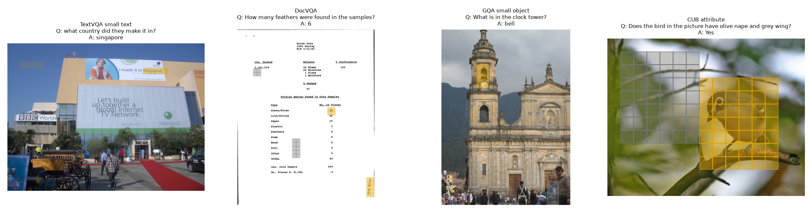
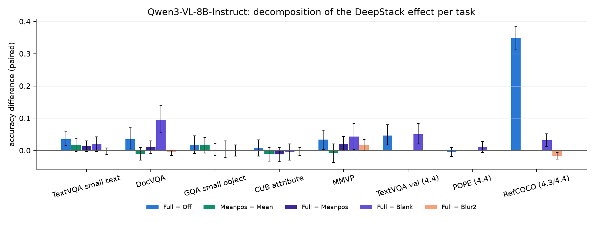
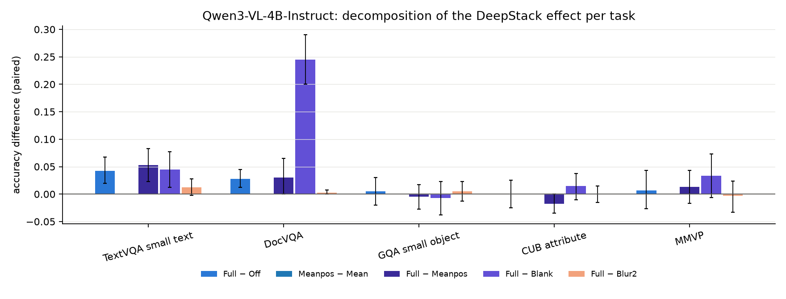
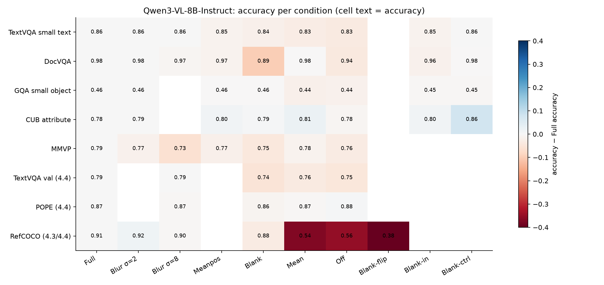
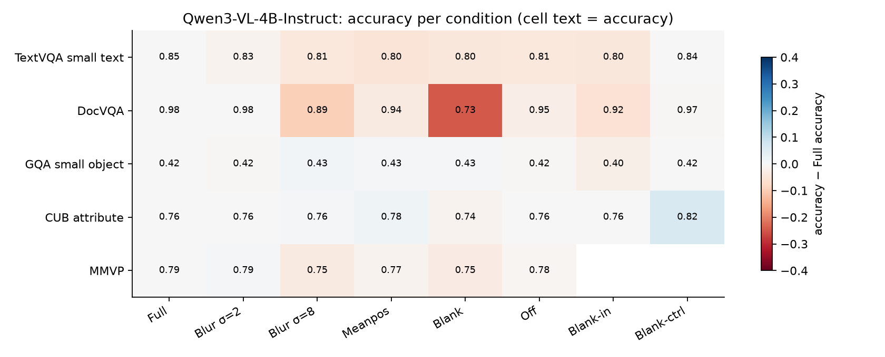
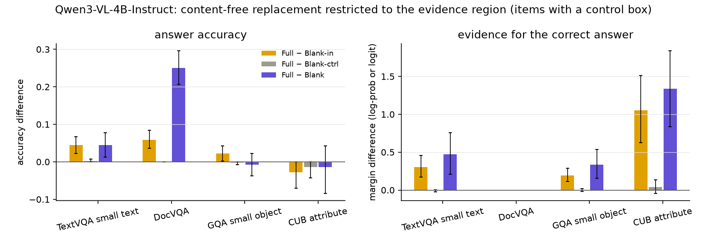
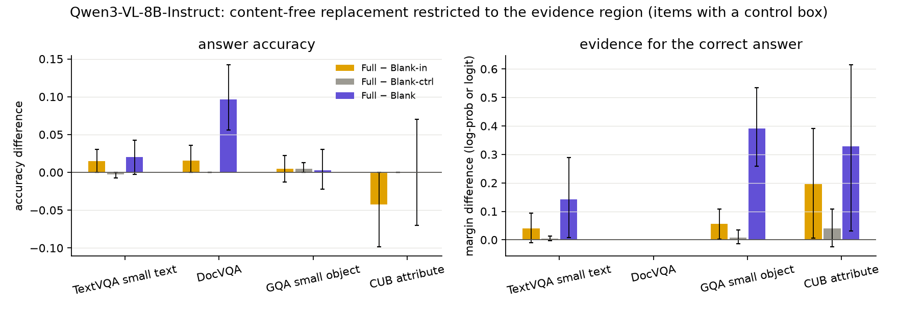
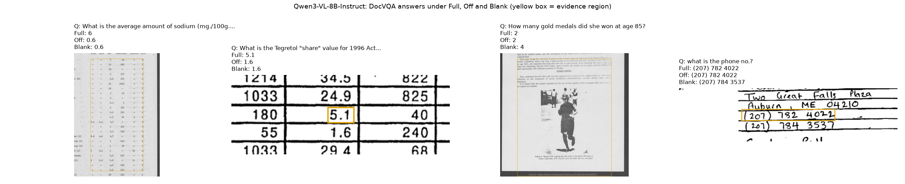
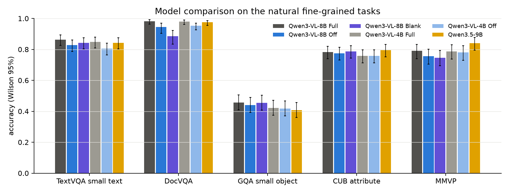

# DeepStack 注入内容在自然图像细粒度任务上的作用

实验日期：2026-10-21。本文属于[多层视觉特征注入](plan.md)研究，编号为实验 4.5。模型为 Qwen3-VL-8B-Instruct 与 Qwen3-VL-4B-Instruct，Qwen3.5-9B 作为不含 DeepStack 的对照。本文检验实验 4.4（[注入项的位置编码与细节内容](results_2026-10-20_todo.md)）的结论在自然图像细粒度任务上是否成立，并与 DeepStack 原论文及 Qwen3-VL 技术报告的结论对照。

## 0. 通俗讲述

Qwen3-VL 的 DeepStack 把 ViT 第 9、17、25 个 block 的特征分别投影后，加到 decoder 前三层的视觉 token 上。设计者的说法是“保留从低层到高层的丰富视觉信息”，技术报告把它带来的增益归于 DocVQA、InfoVQA 等需要细粒度信息的任务。实验 4.4 在合成网格和 RefCOCO 上得到了一个与此不同的图景：注入项真正被模型使用的部分是“每个 token 在画布上的绝对位置”，用一张纯色图像计算出的注入项（只有位置、没有内容）就能恢复坐标输出，而注入项中的高频细节没有可测的行为贡献。4.4 的证据主要来自坐标任务，自然图像上只有 TextVQA 一个文字识别任务，因此这一结论在“读字、看小物体、辨别细微属性”这类任务上是否成立仍未确定。

本文的思路是把注入项拆成三部分分别移除，并在五类自然图像任务上测量每一部分的贡献。第一部分是位置编码，第二部分是图像内容中粗尺度的部分（例如文字行的明暗布局），第三部分是图像内容中细尺度的部分（例如笔画）。对应的操作是：关闭注入（Off，三部分全部移除）；只保留位置编码、内容换成自然图像的平均内容（Meanpos）；用模糊图像计算注入项（Blur，移除细尺度内容，标准差 2 或 8 pixels）；用纯色图像计算注入项（Blank，保留位置，但内容被换成“这里什么都没有”的纯色内容）。在此之外，本文只在问题相关的证据区域（例如答案所在的文字框）把注入内容换成纯色内容（Blank-in），并以同样大小、不重叠的另一块区域作为对照（Blank-ctrl），直接检验“证据区域的注入内容是否到达答案”。任务包括 TextVQA 小文字、DocVQA 文档、GQA 小物体、CUB 鸟类细粒度属性与 MMVP，每类 300–400 题；证据框来自 Visual-CoT 的标注。

结果给出了比 4.4 更细致的结论。第一，细尺度内容（模糊标准差 2 pixels 即可移除的部分）在两个模型、全部任务上都没有可测的贡献，这一点与 4.4 一致。第二，粗尺度内容并非无用：注入内容在证据区域被换成纯色时，4B 的 TextVQA 与 DocVQA 准确率分别下降 4.5 与 5.9 个百分点，GQA 下降 2.2 个百分点，换在对照区域时不下降；下降幅度随证据区域的 token 数增加。这说明 decoder 确实在答案所在的位置读取注入内容。第三，这种读取对 8B 的贡献小，对 4B 的贡献大：4B 在标准差 8 pixels 的模糊下 DocVQA 下降 9 个百分点、TextVQA 下降 4 个百分点，错误多为字符级的近似错误；8B 在同样条件下不下降。第四，decoder 对注入内容的信任会带来副作用：Blank 注入“空白”内容时，DocVQA 的准确率比完全关闭注入还低（8B 为 0.885 对 0.945，4B 为 0.735 对 0.953），错误的典型形式是读到相邻一行的数值。第五，从量级上看，Qwen3-VL-8B 在这些任务上关闭注入只损失 2–4 个百分点，其中大部分可以由只含位置的注入恢复；与坐标任务上 35 个百分点的损失相比，DeepStack 对自然图像细粒度识别的推理时贡献很小，且不含 DeepStack 的 Qwen3.5-9B 在这些任务上与 Qwen3-VL-8B 持平或更好。

因此，“DeepStack 不直接提供细节，而是通过位置帮助细节识别”这一表述需要修正。更准确的表述是：在已训练的 Qwen3-VL 中，DeepStack 的位置编码承担坐标输出；注入内容中粗到中尺度的部分（文字行布局、字形轮廓）在证据位置被读取并参与文字识别，其作用在 4B 中明显、在 8B 中微弱；注入内容中细于约 2 pixels 的部分不被使用。原论文与技术报告的增益来自分别训练的模型之间的比较，本文测量的是已训练模型在推理时对注入项的使用，二者可以同时成立，第 6.2 节讨论这一区别。

## 1. 研究问题与主要结论

总体问题是：在自然图像细粒度任务上，Qwen3-VL 的回答在推理时依赖 DeepStack 注入项的哪一部分。拆为三个子问题：

1. 文献中 DeepStack 的增益出现在哪些任务上，证据是什么形式（第 2 节）；
2. 在自然图像细粒度任务上，注入项的总贡献可以分解为多少位置贡献与多少内容贡献，内容贡献属于哪一空间尺度（第 5.1–5.2 节）；
3. 证据区域的注入内容是否因果地到达答案（第 5.3 节）。

主要结论如下，每一项给出支持它的小节与图。

1. **在自然图像细粒度任务上，DeepStack 的推理时总贡献很小。** Qwen3-VL-8B 关闭注入（Off）后，TextVQA 小文字、DocVQA、MMVP 的准确率分别下降 3.5、3.5、3.3 个百分点，GQA 小物体与 CUB 属性无显著变化；同一操作使 RefCOCO 下降 35.0 个百分点（第 5.1 节，图 decomposition）。这说明 DeepStack 在推理时首先是坐标输出的必要输入，对自然图像中的“读”与“认”只起辅助作用。

2. **注入内容中细于约 2 pixels 的部分不被使用。** 以标准差 2 pixels 的模糊图像计算注入项（Blur2），8B 与 4B 在全部 5 个任务上的准确率变化都不超过 1.7 个百分点且不显著（第 5.2 节）。这与 4.4 的结论一致：注入项携带的最细尺度的高频细节在答案中没有可测的作用。

3. **4B 在文字识别中使用注入内容中 2–8 pixels 尺度的部分。** 4B 在标准差 8 pixels 的模糊下 DocVQA 下降 9.0 个百分点（$n = 200$，$p < 0.001$），TextVQA 下降 4.2 个百分点（$p = 0.005$）；DocVQA 的这类错误中 15/20 为与正确答案编辑距离很小的近似错误（第 5.2 节）。8B 在同样条件下 TextVQA 与 DocVQA 均不下降，MMVP 下降 6.0 个百分点（$p < 0.001$）。这说明注入内容中字形轮廓尺度的信息在较小的模型中参与了字符识别，在较大的模型中可以由主路径视觉 token 替代。

4. **证据区域的注入内容因果地到达答案。** 只在证据区域把注入内容换成纯色内容（Blank-in）时，4B 的 TextVQA、DocVQA、GQA 下降 4.5、5.9、2.2 个百分点，正确答案的对数概率下降 0.30 与 0.19 nats；在同样形状、不重叠的对照区域做相同替换（Blank-ctrl）时变化均为 0（第 5.3 节，图 region）。8B 的方向相同、幅度较小（TextVQA 1.5 个百分点，$p = 0.11$；GQA 对数概率 0.06 nats）。这是对“注入内容是否被使用”的直接因果检验：被读取的内容位于答案所在的 token 上，而非弥散在整张图像中。

5. **decoder 信任注入内容，冲突的内容使文档阅读读错行。** Blank 保留位置、但在每个 token 上注入“纯色、无墨迹”的内容，DocVQA 的准确率低于完全关闭注入：8B 为 0.885 对 0.945（$n = 200$），4B 为 0.735 对 0.953（$n = 400$）；在只含位置、内容为平均值的 Meanpos 下为 0.970 与 0.945（第 5.4 节，图 doc_examples）。错误的典型形式是读出相邻行或相邻列的数值。这说明注入内容会被当作该位置的视觉证据使用；当它与主路径矛盾时，模型的阅读定位被误导。

6. **自然图像上 Off 的损失大部分由位置编码与一阶统计量恢复。** 8B 的 TextVQA 在 Meanpos 下比 Full 低 1.3 个百分点（不显著），DocVQA 在 Mean 下与 Full 相同（第 5.1 节）。这说明 Off 在这些任务上的损失主要来自位置编码与注入分布的缺失，内容贡献对 8B 处于本实验的检测下限附近。

7. **不含 DeepStack 的 Qwen3.5-9B 在这些任务上不弱于 Qwen3-VL-8B。** 二者在 TextVQA 小文字、DocVQA、CUB 上无显著差异，Qwen3.5-9B 在 MMVP 上高 5.0 个百分点（$p = 0.036$），在 GQA 小物体上低 5.0 个百分点（$p = 0.029$）（第 5.5 节，图 models）。在推理时的自然图像细粒度识别上，没有证据表明移除 DeepStack 造成了能力损失。

## 2. 文献中 DeepStack 的增益与证据

### 2.1 原始 DeepStack

Meng et al.（2024，arXiv:2406.04334）注入的是高分辨率图像的额外 token：672 pixels 输入得到 2880 个 token，按 2D 空间间隔采样分为 4 组，每组与 576 个全局 token 一一对应，以残差相加的方式加到 LLM 前部的 4 层。主要增益（7B，与 LLaVA-1.5-7B 比较，context 长度相同）为 TextVQA 58.2 到 62.4、DocVQA 28.1 到 39.1、InfoVQA 25.8 到 29.8、SEED 58.6 到 60.6、POPE 85.9 到 86.7、GQA 62.0 到 63.1。论文中的“重复堆叠低分辨率 token”消融不带来增益，作者据此认为增益来自高分辨率 token。论文的变体 DeepStack-V 把高分辨率 token 注入 ViT 的中间层，不涉及“把 ViT 中间层特征注入 LLM”。

原始 DeepStack 与 Qwen3-VL 的 DeepStack 在信息来源上有本质区别。原始 DeepStack 注入的是主路径没有看到的新像素（更高分辨率），Qwen3-VL 注入的是同一组 16×16 pixels patch 在 ViT 较浅层的表征，不包含任何主路径之外的像素。因此原论文的“细节”证据不能直接迁移到 Qwen3-VL：Qwen3-VL 的注入项最多只能补回 ViT 后部各层丢失的信息。

### 2.2 Qwen3-VL 技术报告

Qwen3-VL Technical Report（arXiv:2511.21631）第 2.2 节写道，DeepStack 被扩展为从 ViT 的中间层抽取 token，“这一设计保留了从低层到高层的丰富视觉信息”；摘要中的表述是“利用多层 ViT 特征加强视觉-语言对齐”。第 5.12.2 节的消融使用内部 15B-A2B 模型，预训练 200B tokens，不含 post-training，平均分由 74.7 升至 76.0，增益集中于 OCRBench（81.0 到 83.6）、InfoVQA（71.9 到 74.2）、ChartQA（81.5 到 83.3）、DocVQA（89.5 到 91.1），TextVQA 无变化（80.6 与 80.5）。报告将其解释为提升了细粒度视觉理解能力。

### 2.3 证据形式

两篇工作的全部证据都是分别训练的模型之间的比较，没有一项从已训练模型中移除注入项的推理时消融。因此文献回答的是“以 DeepStack 训练能否得到更好的模型”，本文与 4.3、4.4 回答的是“已训练的 Qwen3-VL 在推理时使用注入项的哪一部分”。

## 3. 实验设计

### 3.1 符号

沿用[计划](plan.md)第 4 节与 4.4 第 2.1 节的符号。

| 符号 | 形状 | 含义 |
| --- | --- | --- |
| $I$ | $H \times W \times 3$ | 输入图像，$H$ 与 $W$ 均为 32 的倍数 |
| $N$ | 标量 | 视觉 token 数，$N = HW / 32^2$，每个 token 覆盖 32×32 pixels |
| $d$ | 标量 | LLM hidden size，8B 为 4096，4B 为 2560 |
| $D_k(I)$ | $N \times d$ | 由图像 $I$ 计算的第 $k$ 个 DeepStack 特征，$k = 1, 2, 3$ |
| $\tilde{D}_k$ | $N \times d$ | 某一条件下实际加入 decoder 的第 $k$ 个特征 |
| $\bar{d}_k$ | $d$ | 4.3 参考图像集上 $D_k$ 在全部 token 上的均值 |
| $\bar{I}$ | $H \times W \times 3$ | 与 $I$ 同尺寸、每个像素等于 $I$ 平均颜色的纯色图像 |
| $G_\sigma$ | 映射 | 标准差为 $\sigma$ pixels 的高斯模糊 |
| $m$ | $N$ | 证据区域的 token 掩码，与证据框有重叠的 token 取 1 |
| $m'$ | $N$ | 对照区域的 token 掩码，由 $m$ 整体平移到不与 $m$ 重叠的位置得到 |
| $\mathbf{1}$ | $N$ | 全 1 向量 |

### 3.2 条件

所有条件只改变 $\tilde{D}_k$，主路径视觉 token、全部权重、prompt 与解码方式不变：

$$
H^{(j)}_{\Omega} \leftarrow H^{(j)}_{\Omega} + \tilde{D}_{j+1}, \qquad j = 0, 1, 2.
$$

| 条件 | $\tilde{D}_k$ | 保留 | 移除 |
| --- | --- | --- | --- |
| Full | $D_k(I)$ | 全部 | 无 |
| Off | $0$ | 无 | 全部 |
| Mean | $\mathbf{1}\bar{d}_k^{\top}$ | 一阶统计量 | 位置与内容 |
| Meanpos | 见下式 | 位置编码与平均内容 | 本图像的内容 |
| Blank | $D_k(\bar{I})$ | 位置编码与纯色内容 | 本图像的空间内容 |
| Blur2、Blur8 | $D_k(G_\sigma(I))$，$\sigma = 2, 8$ | 位置与尺度大于约 $\sigma$ 的内容 | 尺度小于约 $\sigma$ 的内容 |
| Blank-in | $(1 - m) \odot D_k(I) + m \odot D_k(\bar{I})$ | 证据区域外的全部注入 | 证据区域的内容 |
| Blank-ctrl | $(1 - m') \odot D_k(I) + m' \odot D_k(\bar{I})$ | 对照区域外的全部注入 | 对照区域的内容 |

其中 $\odot$ 表示按 token 选择，即掩码为 1 的 token 取后一项的对应行。Meanpos 的定义为

$$
\tilde{D}_k = D_k(\bar{I}) - \mathbf{1}\,\mu_k^{\top} + \mathbf{1}\,\bar{d}_k^{\top}, \qquad \mu_k = \frac{1}{N} D_k(\bar{I})^{\top}\mathbf{1}.
$$

其中 $\mu_k \in \mathbb{R}^{d}$ 是纯色图像注入项在本图像全部 token 上的平均。设计原理如下。4.4 把注入项近似分解为位置部分与内容部分之和；纯色图像的注入项中，逐 token 变化的部分只能来自位置，而在所有 token 上相同的部分 $\mu_k$ 主要编码“纯色”这一内容。Meanpos 去掉 $\mu_k$、换成自然图像的平均内容 $\bar{d}_k$，得到一个“有位置、内容为平均值”的注入项。引入这一条件的原因是 Blank 的内容并非中性：本文发现纯色内容会被模型当作“此处无墨迹”的证据（第 5.4 节），因此 Full 与 Blank 的差同时包含“失去有用内容”与“加入误导内容”两部分，Full 与 Meanpos 的差才是更干净的内容贡献。

### 3.3 效应分解

记条件 $c$ 下某一任务的准确率为 $A_c$。本文报告以下成对差值，均在相同题目上计算：

| 差值 | 含义 |
| --- | --- |
| $A_{\mathrm{Full}} - A_{\mathrm{Off}}$ | 注入项的总贡献 |
| $A_{\mathrm{Meanpos}} - A_{\mathrm{Mean}}$ | 位置编码的贡献（在平均内容之上） |
| $A_{\mathrm{Full}} - A_{\mathrm{Meanpos}}$ | 本图像内容的贡献（在位置编码之上） |
| $A_{\mathrm{Full}} - A_{\mathrm{Blur2}}$ | 尺度小于约 2 pixels 的内容的贡献 |
| $A_{\mathrm{Blur2}} - A_{\mathrm{Blur8}}$ | 尺度在约 2–8 pixels 之间的内容的贡献 |
| $A_{\mathrm{Full}} - A_{\mathrm{BlankIn}}$ 与 $A_{\mathrm{Full}} - A_{\mathrm{BlankCtrl}}$ | 证据区域与对照区域的内容贡献 |
| $A_{\mathrm{Meanpos}} - A_{\mathrm{Blank}}$ | 纯色内容造成的冲突损伤 |

任务指派中提出的“Off 与 Blank 之差为位置以外的内容贡献”在本设计中由 Full 与 Meanpos 之差承担，原因是 Off 与 Blank 之差同时包含位置编码与纯色内容两项。

### 3.4 任务与样本

| 任务 | 来源 | $n$ | 图像预处理 | prompt 要求 | 指标 |
| --- | --- | --- | --- | --- | --- |
| TextVQA 小文字 | Visual-CoT 的 TextVQA 子集，证据框面积小于图像的 0.5%，答案不超过 4 个词，每图 1 题 | 400 | 面积上限 $1024^2$ pixels | 单词或短语作答 | 与标注答案归一化后完全匹配；正确答案的 teacher-forced 对数概率 |
| DocVQA | Visual-CoT 的 DocVQA 子集，答案不超过 4 个词，每图 1 题 | 400（Full）；其余条件为按编号的前 200 题 | 面积上限 $1600 \times 1024$ pixels | 同上 | 完全匹配；ANLS |
| GQA 小物体 | Visual-CoT 的 GQA 子集，证据框面积小于 1.5%，单词答案 | 400 | 原尺寸 | 同上 | 完全匹配；对数概率 |
| CUB 属性 | Visual-CoT 的 CUB 子集，yes 与 no 各 200 题 | 400 | 原尺寸 | 只答 Yes 或 No | 首 token 的 $z_{\mathrm{Yes}} - z_{\mathrm{No}}$ 的符号；按真值取向的 margin |
| MMVP | 全部 300 题（150 对） | 300 | 原图为 224×224，放大到 256×256 | 只答选项字母 | 单题与成对准确率 |

此外引用 4.3 与 4.4 在 TextVQA validation（300 题）、POPE（500 题）、RefCOCO（751 条）上的已有结果。

所有图像先缩放到两边均为 32 的倍数，使 processor 不改变尺寸，每个 token 的像素覆盖区因而可以精确确定，证据框可以映射为 token 掩码 $m$。对照掩码 $m'$ 是 $m$ 的外接矩形内的图案整体平移到随机的、不与 $m$ 重叠的位置，替换的 token 数与 $m$ 相同。CUB 的证据框为整只鸟，常占图像的 40%，只有 71 题能放下不重叠的对照区域；DocVQA 有 8 题放不下。Blank-in 在全部带证据框的题目上运行，与 Blank-ctrl 的成对比较只用有对照区域的题目。

下图为每个任务的一个输入示例，黄色方格为证据区域的 token，灰色方格为对照区域的 token，方格边长 32 pixels：

## 4. 实际执行

1. **实现。** 条件在 decoder 接收 deepstack_visual_embeds 之前替换张量，沿用 4.3 的 deepstack_override；图像派生条件在每个 batch 前由同一 ViT 重新计算注入项，并核对 processor 的 grid 与存储的图像尺寸一致。每个 batch 内替换函数被调用的次数受到检查（生成 1 次，teacher forcing 再 1 次）。
2. **解码。** greedy decoding，thinking off，left padding 的 batch 推理，batch size 4 或 8（逐条记录）。从 4B 的 Full 与 Blank-in 运行中随机抽取 20 题以 batch size 1 重跑，回答文本 20/20 一致。
3. **规模。** 8B 运行 Full、Off、Mean、Meanpos、Blank、Blur2、Blank-in、Blank-ctrl 共 8 个条件与 Blur8（TextVQA、DocVQA、MMVP），4B 运行除 Mean 以外的同样条件与全部任务上的 Blur8，Qwen3.5-9B 运行 Full；合计约 2.6 万次回答。GPU 被其他用户大量占用，部分运行把模型分到两张卡上，总耗时约 12 GPU 小时。
4. **偏离。** DocVQA 的 prompt 约 1600 tokens，为控制计算量，DocVQA 在 Full 以外的条件只运行前 200 题，且只在 Full 下计算 teacher-forced 对数概率；4B 的 Off、Blank、Blank-in、Blur2 在设定修改前已运行全部 400 题。Blank-out（只保留证据区域的注入内容）与 Blank-flip 在本实验中未运行。

## 5. 结果

### 5.1 效应分解

下表为 8B 的准确率（DocVQA 除 Full 外 $n = 200$，表中 Full 为 400 题上的值；成对比较一律在共同题目上计算，见 analysis/tables.md）。

| 任务 | Full | Off | Mean | Meanpos | Blank | Blur2 | Blur8 | Blank-in | Blank-ctrl |
| --- | --- | --- | --- | --- | --- | --- | --- | --- | --- |
| TextVQA 小文字 | 0.863 | 0.828 | 0.833 | 0.850 | 0.843 | 0.865 | 0.863 | 0.848 | 0.865 |
| DocVQA | 0.983 | 0.945 | 0.980 | 0.970 | 0.885 | 0.985 | 0.975 | 0.965 | 0.980 |
| GQA 小物体 | 0.458 | 0.440 | 0.438 | 0.455 | 0.455 | 0.458 | – | 0.453 | 0.453 |
| CUB 属性 | 0.782 | 0.775 | 0.805 | 0.795 | 0.787 | 0.785 | – | 0.797 | – |
| MMVP | 0.790 | 0.757 | 0.777 | 0.770 | 0.747 | 0.773 | 0.730 | – | – |
| RefCOCO（4.3/4.4） | 0.908 | 0.558 | 0.539 | – | 0.876 | 0.924 | 0.904 | – | – |

8B 的主要成对差值（准确率差，括号内为 bootstrap 95% 区间；$p$ 为 McNemar 检验）：

| 任务 | Full − Off | Meanpos − Mean | Full − Meanpos | Full − Blur2 | Meanpos − Blank |
| --- | --- | --- | --- | --- | --- |
| TextVQA 小文字 | +0.035 [+0.015, +0.057]，$p = 0.003$ | +0.017 [−0.003, +0.037] | +0.013 [−0.003, +0.030] | −0.002 | +0.007 |
| DocVQA | +0.035 [+0.005, +0.070]，$p = 0.039$ | −0.010 | +0.010 [−0.010, +0.030] | −0.005 | +0.085 [+0.045, +0.125]，$p < 0.001$ |
| GQA 小物体 | +0.018，$p = 0.28$ | +0.018 | +0.003 | 0.000 | 0.000 |
| CUB 属性 | +0.007，$p = 0.69$ | −0.010 | −0.013 | −0.003 | +0.008 |
| MMVP | +0.033 [+0.003, +0.063]，$p = 0.064$ | −0.007 | +0.020 [0.000, +0.043] | +0.017 | +0.023 |

连续指标比准确率更敏感。8B 正确答案的对数概率（nats，正值表示前一条件更支持正确答案）在 TextVQA 上 Full − Off 为 +0.33 [+0.20, +0.47]，Meanpos − Mean 为 +0.16 [+0.08, +0.24]，Full − Meanpos 为 +0.16 [+0.05, +0.29]；GQA 上三者为 +0.77、+0.42、+0.14，均显著；Full − Blur2 在 TextVQA 上为 0.00，在 GQA 上为 +0.19 [+0.12, +0.27]。

下图为 8B 与 4B 的分解。纵轴为成对准确率差，误差棒为 bootstrap 95% 区间，数值由模型在各条件下的回答计算。颜色区分差值：蓝色为 Full − Off，绿色为 Meanpos − Mean，深紫为 Full − Meanpos，紫色为 Full − Blank，浅橙为 Full − Blur2。4B 没有运行 Mean，因此缺少绿色柱；4.4 的三个任务只有 8B 的数据。

下图为各条件的准确率矩阵。格中文字为准确率，颜色为该条件与 Full 的准确率之差（RdBu 色图，红色表示低于 Full，蓝色表示高于 Full，色条单位为准确率）；各格为该条件下全部已运行题目的准确率，DocVQA 的非 Full 条件为 200 题。

数据显示：

1. **自然图像细粒度任务对注入项的依赖比坐标任务小一个数量级。** 8B 的 Full − Off 在 TextVQA、DocVQA、MMVP 上约为 3.5 个百分点，在 GQA 与 CUB 上不显著，RefCOCO 为 35.0 个百分点。这说明 4.3 与 4.4 中注入项“不可或缺”的结论只对坐标输出成立。

2. **8B 的 Off 损失主要由位置编码与一阶统计量恢复。** DocVQA 在 Mean 下已回到 0.980，说明 Off 在文档上的损失来自注入分布的缺失（分布外损伤），与内容无关；TextVQA 与 GQA 上，位置编码（Meanpos − Mean）贡献的对数概率与本图像内容（Full − Meanpos）贡献的对数概率大小相当（TextVQA 均为 0.16 nats），但二者换算成准确率都不显著。对 8B 而言，内容的推理时贡献存在但很小。

3. **4B 的内容贡献更大。** 4B 的 Full − Meanpos 在 TextVQA 上为 +5.2 个百分点 [+2.2, +8.3]（$p = 0.001$），DocVQA 上为 +3.0 个百分点（$p = 0.15$）；Full − Off 为 +4.2 与 +2.7 个百分点。4B 在 TextVQA 上的 Off 损失几乎全部来自内容，位置编码不能替代。

### 5.2 内容的空间尺度

| 模型与任务 | Full − Blur2 | Blur2 − Blur8 | Full − Blur8 |
| --- | --- | --- | --- |
| 8B TextVQA | −0.002 | +0.002 | 0.000 |
| 8B DocVQA（$n = 200$） | −0.005 | +0.010 | +0.005 |
| 8B MMVP | +0.017，$p = 0.13$ | +0.043，$p = 0.011$ | +0.060，$p < 0.001$ |
| 4B TextVQA | +0.013，$p = 0.18$ | +0.030，$p = 0.043$ | +0.042，$p = 0.005$ |
| 4B DocVQA（$n = 200$） | +0.002 | +0.085，$p < 0.001$ | +0.090，$p < 0.001$ |
| 4B MMVP | −0.003 | +0.040，$p = 0.023$ | +0.037，$p = 0.071$ |
| 4B GQA、CUB | 0.005、0.000 | −0.015、−0.005 | −0.010、−0.005 |

数据显示：

1. **细于约 2 pixels 的内容没有贡献。** 全部 10 个模型与任务的组合中，Full − Blur2 的准确率差不超过 1.7 个百分点且不显著。仅有的可测效应是连续指标上的小幅变化（8B GQA 对数概率 +0.19 nats，CUB margin +0.12）。这与 4.4 中“标准差 8 pixels 以下的模糊不损害任何任务”的观察一致，并把这一结论推广到小文字与文档。

2. **2–8 pixels 尺度的内容在 4B 的文字识别与两个模型的 MMVP 中被使用。** 标准差 8 pixels 的模糊使文档中的单个字符无法辨认，但保留了文字行与段落的明暗布局。4B 在 Blur8 下 DocVQA 下降 9.0 个百分点，由 Full 正确变为 Blur8 错误的 20 题中有 15 题的 ANLS 不低于 0.5，即答案只差个别字符，例如数字串中漏读一位。这说明 4B 用注入内容中字形轮廓尺度的信息辅助字符识别；8B 不依赖这一尺度，说明它的主路径视觉 token 足以完成同样的识别（解释，未经直接检验）。MMVP 的题目涉及物体朝向、形状与状态，8B 与 4B 都在 Blur8 下下降（成对准确率 8B 由 0.600 降至 0.473），说明这类判断使用了注入内容中的中尺度形状信息。

### 5.3 证据区域替换

下图为只在证据区域（黄色）或对照区域（灰色）把注入内容换成纯色内容的效应，紫色为全图 Blank 作为参照。左图为成对准确率差，右图为正确答案证据的变化（TextVQA 与 GQA 为正确答案的 teacher-forced 对数概率，CUB 为按真值取向的 yes/no logit margin，DocVQA 未计算）；误差棒为 bootstrap 95% 区间，只包含有对照区域的题目。

| 模型与任务 | $n$ | Full − Blank-in | Full − Blank-ctrl | 对数概率：Blank-in | 对数概率：Blank-ctrl |
| --- | --- | --- | --- | --- | --- |
| 4B TextVQA | 400 | +0.045 [+0.023, +0.068]，$p < 0.001$ | +0.003 | +0.30 [+0.17, +0.45] | −0.01 |
| 4B DocVQA | 392 | +0.059 [+0.036, +0.084]，$p < 0.001$ | 0.000 | – | – |
| 4B GQA | 400 | +0.022 [+0.003, +0.042]，$p = 0.035$ | −0.003 | +0.19 [+0.11, +0.29] | 0.00 |
| 4B CUB | 71 | −0.028 | −0.014 | +1.05 [+0.63, +1.51] | +0.04 |
| 8B TextVQA | 400 | +0.015 [0.000, +0.030]，$p = 0.11$ | −0.002 | +0.04 [−0.01, +0.09] | 0.00 |
| 8B DocVQA | 197 | +0.015，$p = 0.25$ | 0.000 | – | – |
| 8B GQA | 400 | +0.005 | +0.005 | +0.06 [0.00, +0.11] | +0.01 |
| 8B CUB | 71 | −0.042 | 0.000 | +0.20 [+0.01, +0.39] | +0.04 |

按证据区域的 token 数分层，4B 的 Full − Blank-in 在 TextVQA 上随区域增大而增大（1–4 个 token：+3.2 个百分点；5–12 个：+4.3；13 个以上：+8.9），DocVQA 同样（1–4 个：0；5–12 个：+3.6；13 个以上：+8.1，$p < 0.001$）。

数据显示：

1. **注入内容在答案所在的 token 上被读取。** 同样数量的 token 被替换，位于证据区域时 4B 的三个任务均下降，位于对照区域时变化为 0。这一对比排除了“任意局部扰动都会损害回答”的解释，直接说明注入内容在证据位置参与了答案的形成。

2. **8B 的读取方向相同但幅度小。** 8B 的 Blank-in 只在连续指标上可测（GQA 0.06 nats，CUB 0.20），准确率变化不显著。这与第 5.1 与 5.2 节的结论一致：8B 的识别主要依靠主路径视觉 token。

3. **效应随证据区域增大而增大。** 证据区域越大，被换成“空白”的文字越多，答案越容易出错。小文字（1–4 个 token）上效应最小，说明注入内容并没有为最小的文字提供主路径缺少的笔画信息；它的作用更接近于较大文字区域上的字形与布局。

### 5.4 冲突内容与读错行

下图为 8B 在 DocVQA 上 Full 答对、Blank 答错的四个例子，每格为证据框（黄色）附近的原图裁剪，标题依次为问题、Full、Off 与 Blank 下的回答；回答文本为模型的原始输出。

| 模型 | Off | Meanpos | Blank | Full 答对、Blank 答错的题数 | 其中近似错误（ANLS ≥ 0.5） |
| --- | --- | --- | --- | --- | --- |
| 8B DocVQA（$n = 200$） | 0.945 | 0.970 | 0.885 | 20 | 5 |
| 4B DocVQA（Off 与 Blank 为 400 题，Meanpos 为 200 题） | 0.953 | 0.945 | 0.735 | 102 | 33 |

数据显示：

1. **纯色内容造成的损伤大于没有注入。** 8B 的 Meanpos − Blank 为 +8.5 个百分点（$p < 0.001$），4B 为 +21.0 个百分点。Meanpos 与 Blank 有相同的位置编码，差别只在内容是“自然图像的平均内容”还是“纯色”，因此损伤来自纯色内容本身。

2. **错误的主要形式是读到相邻的行或列。** 示例中，表格读出了下一行的 1.6（真值 5.1），电话号码读出了下一行的号码，4B 的错误中约三分之二与正确答案完全不同，而非字符级的偏差。解释：在文档中，注入内容携带“这里有一行墨迹”的布局信息，模型用它和位置编码一起确定所读的行；当注入内容在所有位置都声称“空白”时，行的定位失去依据，模型从相邻的行取值。这与 4.4 中“框的大小取自注入项中的实例范围”属于同一类机制：注入内容以低频的空间范围形式被使用。

3. **TextVQA 与 GQA 上没有同样的冲突。** 8B 的 Meanpos − Blank 在 TextVQA 与 GQA 上为 0.7 与 0.0 个百分点。场景文字与小物体通常孤立出现，没有需要区分的密集相邻行，因此布局信息的冲突不造成错误（解释）。

### 5.5 与 Qwen3.5-9B 的比较

下图为三个模型在五个任务上的准确率，误差棒为 Wilson 95% 区间。颜色约定：深灰为 Qwen3-VL-8B Full，蓝色为 8B Off，紫色为 8B Blank，浅灰为 4B Full，浅蓝为 4B Off，金色为 Qwen3.5-9B；8B Off 与 Blank 在 DocVQA 上为 200 题。

| 任务 | Qwen3-VL-8B Full | Qwen3-VL-8B Off | Qwen3.5-9B | Full − Qwen3.5（成对） |
| --- | --- | --- | --- | --- |
| TextVQA 小文字 | 0.863 | 0.828 | 0.843 | +0.020，$p = 0.29$ |
| DocVQA | 0.983 | 0.945 | 0.975 | +0.008，$p = 0.45$ |
| GQA 小物体 | 0.458 | 0.440 | 0.407 | +0.050，$p = 0.029$ |
| CUB 属性 | 0.782 | 0.775 | 0.795 | −0.013，$p = 0.58$ |
| MMVP | 0.790 | 0.757 | 0.840 | −0.050，$p = 0.036$ |

**没有 DeepStack 的 Qwen3.5-9B 在自然图像细粒度识别上不弱于 Qwen3-VL-8B。** 五个任务中两模型在三个任务上无显著差异，各有一项显著占优。两模型的训练数据、decoder 结构与 post-training 均不同，这一比较不能归因于 DeepStack；它说明的是，就推理时表现而言，移除 DeepStack 的模型族没有在这些任务上表现出细粒度识别的缺口，这与 4.2 的端到端对照一致。

## 6. 讨论

### 6.1 对 4.4 结论的修正

4.4 的结论是“DeepStack 在 Qwen3-VL 中实际承担的是为每个视觉 token 提供精确绝对位置的功能，它携带的高频细节在到达答案之前被 decoder 丢弃”。本文在自然图像上对其中两部分给出不同的确定程度：

1. **位置部分得到维持。** 坐标输出对位置编码的依赖（RefCOCO 35 个百分点）远大于任何自然图像识别任务对注入项的依赖（不超过 4 个百分点），位置编码是 DeepStack 在推理时最重要的功能。在识别任务上，只含位置的 Meanpos 恢复了 8B 的大部分 Off 损失。

2. **“细节被丢弃”只对最细的尺度成立。** 细于约 2 pixels 的内容在全部任务上没有贡献；2–8 pixels 尺度的内容在 4B 的文字识别中有 4–9 个百分点的贡献，并且证据区域替换证明它在答案所在的位置被读取。因此，“DeepStack 不直接提供细节，而是通过位置帮助细节识别”应修正为：DeepStack 的位置编码是坐标输出的必要输入；它的内容以字形轮廓与布局的尺度参与识别，作用随模型增大而减弱；最细的笔画级细节不被使用。

3. **注入内容被模型当作证据使用。** 4.4 观察到注入的高频能量读出在 decoder 后部衰减到与 Off 相同的水平，并据此推断细节没有进入答案。本文的 Blank 冲突与证据区域替换说明，注入内容中较粗尺度的部分在 decoder 中被读取并影响答案，线性读出的衰减不能排除这一点：被使用的信息可以在前部层就被转写为任务相关的表征（例如“所读的行”），而不再以高频能量的形式存在（解释）。

### 6.2 与论文结论的对照

1. **信息来源不同。** 原始 DeepStack 的增益来自主路径没有看到的高分辨率像素；Qwen3-VL 的 DeepStack 只重新注入同一组 patch 在 ViT 浅层的表征。原论文“增益来自细节”的证据因此不适用于 Qwen3-VL 的版本。

2. **训练时与推理时。** Qwen3-VL 报告的 DocVQA、InfoVQA、OCRBench 增益为 1.6–2.6 个百分点，来自两次独立的预训练。本文测得 8B 在推理时移除注入内容（Full − Meanpos）对 DocVQA 与 TextVQA 的影响约为 1 个百分点且不显著，4B 为 3–5 个百分点。两种可能的解释是：(a) 以 DeepStack 训练改变了 ViT 与 decoder 的参数，使主路径本身变好，这部分收益在推理时移除注入项后仍然保留；(b) 训练时的收益主要来自位置编码与注入分布带来的优化便利。本文的冻结模型实验不能区分 (a) 与 (b)，也不能检验“以不含 DeepStack 的方式训练会得到什么”；检验需要分别训练的模型。本文能确定的是：已训练的 Qwen3-VL-8B 在推理时从注入内容中获得的识别收益很小，因此 Qwen3.5 移除 DeepStack 后只需另外提供位置信息即可替代其推理时功能，这一判断属于参数与训练层面，确定程度为中等。

3. **一致之处。** Qwen3-VL 报告中 TextVQA 无增益，本文中 8B 的 TextVQA 内容贡献同样不显著；增益集中于文档类任务，本文中文档是唯一出现明显内容依赖（4B）与内容冲突（两模型）的任务。

### 6.3 与其他实验的关系

1. **实验 4.4。** 本文的 Blank 冲突为 4.4 观察到的“Blank 下 TextVQA 下降 5 个百分点而 Blur8 不下降”提供了解释：TextVQA validation 上 Blur8 − Blank 为 +5.0 个百分点，Blank 的下降很可能同样包含纯色内容的冲突成分（解释）。
2. **实验 3.12 与 3.10（Qwen3.5 的坐标与行列机制）。** 4.4 指出移除注入的位置编码后 Qwen3-VL 的坐标输出出现与 Qwen3.5 相同的中心先验。本文表明，在识别任务上 Qwen3.5 不弱于 Qwen3-VL，因此 Qwen3.5 的坐标输出问题不能由“缺少 DeepStack 的细节”解释，应继续归因于坐标读出路径本身（3.11、3.12 的结论）。
3. **局部重读（问题 5）。** 4B 的结果说明，在较小的模型中，把浅层视觉特征按位置加回 decoder 可以改善文字识别；但 8B 中这一收益很小，而且冲突内容会误导阅读定位。按需重读浅层特征时，需要保证注入内容与主路径一致，避免引入与原图矛盾的内容。

### 6.4 对方向二的含义

DeepStack 在推理时的主要价值是位置编码，其次是粗尺度的布局与字形轮廓；笔画级细节不被使用。若方向二需要补充细节，单纯在 decoder 前部注入浅层特征不足以让模型使用最细尺度的信息；与原始 DeepStack 一样提供主路径没有看到的新像素（更高分辨率的局部区域），才是信息量上真正新增的输入。这一判断与局部重读的思路一致。

## 7. 限制

1. **证据框的质量。** Visual-CoT 的证据框由自动流程生成，部分框与答案位置不一致（输入示例中 DocVQA 的框落在相邻行）。框的误差使 Blank-in 的效应偏小，因此本文的证据区域效应是保守估计。
2. **天花板与严格评分。** DocVQA 的 Full 准确率为 0.98，可检测的下降空间有限；TextVQA 与 GQA 只有 Visual-CoT 给出的单一答案，完全匹配偏严格，GQA 的绝对准确率因此较低。成对比较不受评分口径影响。
3. **训练集重叠。** Visual-CoT 的样本来自各数据集的 train split，模型可能在训练中见过。这对条件之间的成对比较影响有限，但绝对准确率偏高。
4. **4B 缺少 Mean 条件**，4B 的位置贡献只能通过 Meanpos 与 Off 间接比较；Blank-out 与自然图像上的 Blank-flip 未运行。
5. **冻结模型。** 全部结论限于已训练模型的推理时行为，不说明以不同方式训练的结果（第 6.2 节）。
6. **MMVP 图像为 224×224 的本地版本**，放大到 256×256 后只有 64 个视觉 token。

## 8. 计划修订建议

建议在 [plan.md](plan.md) 第 10 节的进度表中加入一行，并在第 2.3 节末尾与第 8 节的结果模式表中各加入一段，文字如下：

1. 进度表新增：“4.5 | 自然图像细粒度任务上的注入内容验证 | 在 TextVQA 小文字、DocVQA、GQA 小物体、CUB 属性、MMVP 上分解注入项的位置与内容贡献，并以证据区域替换检验注入内容是否到达答案 | 已完成，见[结果](results_2026-10-21_natural.md)：细于约 2 pixels 的内容无贡献；4B 的文字识别使用 2–8 pixels 尺度的注入内容（DocVQA Blur8 −9 个百分点，证据区域替换 −6 个百分点，对照区域 0）；8B 的内容贡献约 1 个百分点；纯色内容使文档阅读读错行”。
2. 第 2.3 节末尾新增：“实验 4.5 表明，DeepStack 的注入内容在推理时以字形轮廓与布局的尺度参与文字识别，作用随模型增大而减弱，笔画级细节不被使用；Qwen3.5-9B 在自然图像细粒度识别上不弱于 Qwen3-VL-8B。”
3. 第 8 节结果模式表新增一行：“4.5 中证据区域替换使识别下降、对照区域不变，且 Blur8 而非 Blur2 造成下降 | 注入内容以粗到中尺度在证据位置被读取，最细尺度不被使用 | 方向二补充细节时提供主路径未见的新像素，而非重复注入浅层特征”。

## 9. 运行与产物

运行入口为 scripts/analysis/deepstack/deepstack_natural.sh，参数集中在脚本顶部，COMMAND 选择步骤：build（样本选择、Visual-CoT 图像抽取、缩放与证据掩码）、run（指定模型与条件列表的批量回答，可续跑；SPLIT 参数允许把模型分到两张卡上）、score、analyze。代码位于 analysis_tools/deepstack/ 下的 deepstack_natural.py 与 deepstack_natural_analysis.py，测试位于 tests/analysis/deepstack/test_deepstack_natural.py。

产物保存于 WORK_DIR 的 analysis/deepstack/2026-10-21_natural/：

- cases.jsonl、build.json：样本、prompt、缩放后的图像尺寸、证据框与对照区域的 token 索引；images/ 为缩放后的输入图像，viscot_raw/ 为从 Visual-CoT 归档中抽取的 CUB 与 DocVQA 原图；
- runs/<模型>/<条件>.jsonl：原始回答、首 token 的 margin、teacher-forced 对数概率与 batch size，<条件>.scores.jsonl 为评分，<条件>.json 为运行配置；
- checks/spotcheck.jsonl：batch size 1 与批量回答的逐条核对；
- analysis/：tables.md、summary.json；文档用图保存在 docs/analysis/deepstack/figures/natural/。

实验 4.4 的 represent/ 目录（约 6 GB 的逐 token 表征）已删除，4.4 的读出结果保存在其 analysis/representation.json 中。
