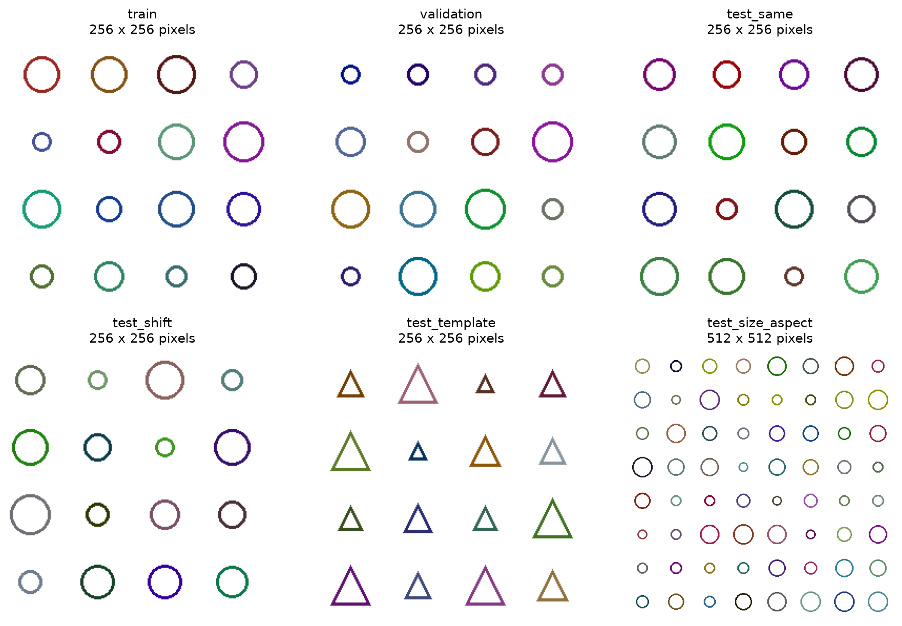
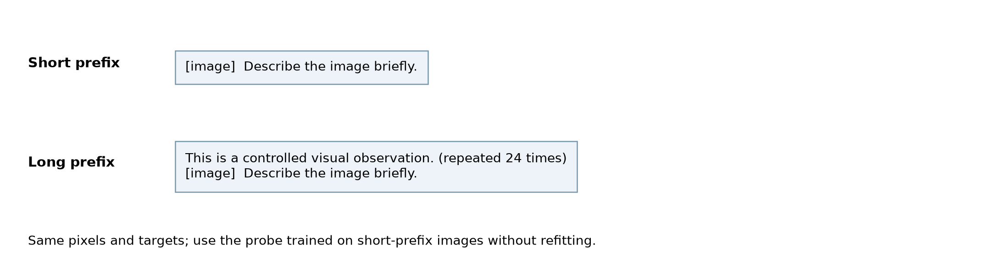
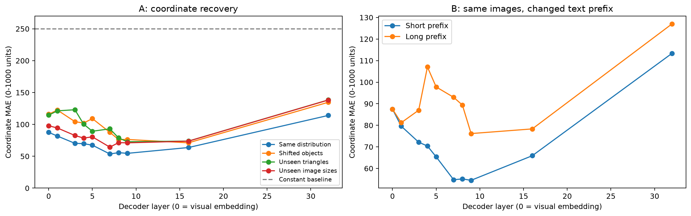

# 位置信息提取：合成图实验

实验日期：2026-09-30。研究问题、真实图像扩展和进度见[研究方案](plan.md)。

## 1. 研究问题与证据范围

复杂 grounding 至少需要目标属性识别、实例选择以及位置读出三个环节。局部改动能够引起可分辨的特征变化，只说明视觉表示对该改动敏感；即使外部分类器能够选出异常实例，也不能据此断定原 VLM 能够读出该实例的位置。本研究首先检验更基础的问题：在不向 probe 输入 token index、position IDs 或图像尺寸的情况下，能否从一个 visual token 的向量恢复其在输入图像网格中的二维位置。

需要区分三种位置。**输入槽位位置**是该 token 在经过 processor 和 spatial merger 后所对应的图像网格位置，具有明确、可计算的标签。**语义信息的来源位置**是 token 内某项语义特征所对应的图像区域；经过 attention 混合后，同一个 token 可以同时包含来自多个区域的信息，因此来源位置可能是一个分布。**查询目标位置**是问题所指定的实例所在位置，需要将问题、实例属性和位置绑定。本轮 probe 只评估第一种位置，既不恢复全部语义来源，也不直接测量原模型回答 grounding 问题的能力。

## 2. 位置从哪些计算路径进入模型

### 2.1 ViT 已经向 visual embedding 注入位置信息

本地 Transformers 的 `Qwen3_5VisionModel.forward` 在 patch embedding 后加入经过双线性插值的 learned absolute position embedding，并在视觉 attention 中使用二维 rotary position embedding。`spatial merger` 再将相邻 patches 合并为输入语言模型的 visual embedding。因此，进入 decoder 的向量已经经过位置与视觉内容的联合计算。分析 decoder 时，需要同时考虑上游已有位置特征、full attention 的 rotary 计算、linear attention 的顺序更新以及 residual stream 对既有特征的保留。

其中，二维坐标、线性序列顺序与物体序数是不同标签。二维网格坐标可以由 processor 的排列规则得到；“第几行第几个物体”则依赖实例分组与排序，存在缺项或不等间距时尤其不能与网格坐标混用。

### 2.2 Full attention：RoPE 提供相对关系，但单个向量没有普适的绝对位置逆解

先考虑一个 attention head 的一维 RoPE。设 query 与 key 的维数均为偶数维，位置用整数表示，旋转矩阵由每个二维通道对的旋转块组成：

$$
q_m,k_n\in\mathbb{R}^{d},\qquad R(p)\in\mathbb{R}^{d\times d},\qquad
\widetilde q_m=R(m)q_m,\quad\widetilde k_n=R(n)k_n.
$$

其中，未旋转的 query 和 key 由当前位置的 hidden state 投影得到，旋转角由位置与固定频率共同决定。旋转矩阵的正交性与角度可加性给出：

$$
\widetilde q_m^{\mathsf T}\widetilde k_n
=q_m^{\mathsf T}R(m)^{\mathsf T}R(n)k_n
=q_m^{\mathsf T}R(n-m)k_n.
$$

这一形式使 attention score 显式依赖两个位置的相对差值。Qwen3.5 的 decoder 将时间、行、列坐标的旋转频率按实现规则组合，并只旋转指定的通道；对各坐标分量仍可使用上述推导。该推导描述 query/key 的成对关系，不等价于给所有 hidden-state 维度附上一个可独立读取的坐标。[RoFormer 原论文](https://arxiv.org/abs/2104.09864)

单独观察旋转后的向量时，如果旋转前的内容向量未知，那么任意候选位置都存在一个相容的内容向量：

$$
\widetilde q=R(p)q_p,\qquad q_p=R(p)^{-1}\widetilde q.
$$

因此，仅凭旋转公式不能为任意输入建立唯一的绝对位置逆解。若已知旋转前后向量，且有效通道不退化，则可以估计旋转角，再结合候选坐标范围处理相位歧义；若有已知位置的参考 token，也可以估计成对位移。这些附加信息需要明确提供，不能当作单向量天然可逆的证据。实际 hidden states 中仍可能存在强位置读出信号，其来源可以是 learned absolute position embedding、边界上下文以及模型学习形成的表征分布。

### 2.3 Linear attention：递归顺序不等于缺少位置信息

本地 `Qwen3_5GatedDeltaNet` 对投影后的 query、key、value 使用 causal depthwise convolution，再执行 gated delta rule。本节使用与本地 recurrent reference implementation 一致的矩阵方向。设单个 head 的 key 与 query 维数为 key dimension，value 维数为 value dimension，状态矩阵的行对应 key 通道、列对应 value 通道：

$$
k_t,q_t\in\mathbb{R}^{d_k},\quad v_t\in\mathbb{R}^{d_v},\quad
S_t\in\mathbb{R}^{d_k\times d_v},\quad
\alpha_t,\beta_t\in(0,1).
$$

这里的 query 已包含实现中的归一化与尺度因子，key 已进行所配置的归一化；时间下标表示序列访问顺序。先衰减旧状态，再读取当前 key 的旧 value，最后写入残差：

$$
\begin{aligned}
\bar S_t&=\alpha_t S_{t-1},\\
\delta_t&=\beta_t\left(v_t-\bar S_t^{\mathsf T}k_t\right),\\
S_t&=\bar S_t+k_t\delta_t^{\mathsf T}
=\alpha_t\left(I-\beta_t k_t k_t^{\mathsf T}\right)S_{t-1}+\beta_t k_t v_t^{\mathsf T},\\
o_t&=S_t^{\mathsf T}q_t\in\mathbb{R}^{d_v}.
\end{aligned}
$$

单位矩阵的形状为 key dimension 的方阵。遗忘门控制全部旧状态的衰减，delta 更新则修正当前 key 方向所关联的 value。实际 block 在读出之后还有 gated normalization、输出投影、residual connection 和 MLP，上述公式仅对应 recurrent core。[Gated Delta Networks 原论文](https://arxiv.org/abs/2412.06464)

定义每一步的线性状态转移和写入矩阵：

$$
A_t=\alpha_t\left(I-\beta_t k_t k_t^{\mathsf T}\right)\in\mathbb{R}^{d_k\times d_k},\qquad
B_t=\beta_t k_t v_t^{\mathsf T}\in\mathbb{R}^{d_k\times d_v}.
$$

从零状态出发，两次写入的结果为：

$$
S_2=A_2B_1+B_2.
$$

交换两次输入通常得到另一状态，因为一般情况下两次变换不交换，而且门、query/key/value 还会受到 causal convolution 与上游上下文影响。即使两个连续输入完全相同，状态也可能随访问次数变化；例如固定标量转移和写入给出的状态是一个有限几何级数：

$$
s_0=0,\quad s_t=a s_{t-1}+b,\quad
s_t=b\frac{1-a^t}{1-a},\quad 0<a<1.
$$

这个例子说明没有显式 position embedding 的递归状态也可以包含序列长度信号，同时揭示信号随时间趋于饱和、受数值精度限制的可能性。它不是对 Qwen3.5 已学会计数的断言。递归状态中的顺序敏感性、边界距离与精确二维坐标同样不能等同；二维坐标还需要行宽和换行结构等信息，而 visual embedding 已经提供了可供状态接收的二维位置线索。

有关 recurrent models 的直接分析中，Buitrago 与 Gu 将长序列泛化失败联系到训练期间未充分覆盖的可达状态分布，并给出经验与理论分析。这提示位置读出实验应包含未见序列长度，不能只在固定网格上报告随机 token split 的准确率；该论文并未直接证明 Qwen3.5 的 grounding 失败来自某种状态饱和。[Understanding and Improving Length Generalization in Recurrent Models](https://proceedings.mlr.press/v267/buitrago25a.html)

### 2.4 相关分析的适用范围

已有文献从不同角度说明，位置表征不能仅凭是否加入显式 position embedding 判断。Neishi 与 Yoshinaga 使用 GRU 替换 Transformer 的 positional encoding，并通过控制训练句长和测试句长研究泛化；该工作将 recurrent computation 视为引入相对顺序信息的途径，支持设置未见长度的实验，但没有给出从任意 recurrent state 精确恢复二维坐标的方法。[On the Relation between Position Information and Sentence Length](https://aclanthology.org/K19-1031/)

Haviv 等人的 probe 实验发现，没有显式 positional encoding 的 causal Transformer 仍能形成绝对位置信息。作者提出的解释是 causal mask 允许模型利用可访问前驱数量推断位置；这一机制在论文中属于假设，其实验对象也不是 Gated DeltaNet。因此，这篇论文支持加入序列边界与前缀控制，不能直接证明 Qwen3.5 的 linear attention 通过计数前驱获取坐标。[Transformer Language Models without Positional Encodings Still Learn Positional Information](https://arxiv.org/abs/2203.16634)

结合 recurrent length generalization 与 Gated Delta Networks 的研究，本项目将三个问题分别测量：状态是否对输入顺序敏感、单个输出向量是否允许读出位置，以及原模型是否利用该位置完成 grounding。本轮的数学推导回答第一项的可能性，坐标 probe 检验第二项；第三项需要在完整模型生成坐标时进行因果干预。既有文献和本轮结果均未建立这三项之间的必然关系。

## 3. 实验设计

本研究包含两个实验。**实验 A 检查同一个 visual token 的位置能否由其 hidden state 读出，以及读出能否推广到新的图形和图像尺寸。实验 B 固定图像，只增加图像前面的文本，检查同一个位置读出器是否仍然稳定。** 两个实验使用同一组已经训练完成的 probes，实验 B 不训练新的 probe。

### 3.1 实验 A：跨图像坐标预测

实验固定使用 Qwen3.5-9B、bfloat16、SDPA 和 thinking off，只执行 prompt prefill。每次输入由图像和英文请求 `Describe the image briefly.` 构成。图像在请求文字之前，因此 causal decoder 中图像位置的 hidden states 不能读取后面的请求文字。研究流程如下：

1. **构造整图划分。** 训练集包含 24 张图，验证集包含 6 张图，均由圆或方形组成，图像尺寸为 256×256 或 384×384。四个测试条件各有 8 张独立图，分别包含同分布新图、实例整体平移、未见三角形，以及未见尺寸和长宽比。未见尺寸为 512×512、512×256、256×512、640×384，每种两张图。每个实例的颜色与大小随机生成。
2. **提取表征和位置标签。** 保存 merger 输出及 decoder 第 1、3、4、5、7、8、9、16、32 层之后的 visual-token 向量，标签来自实际 processor 网格。该轮重点覆盖前两个 full-attention block 附近的位置变化，并以第 16、32 层观察较深位置；深层采样稀疏，无法判断具体在哪一层出现变化。2026-10-01 的真实图实验覆盖所有 decoder 层。
3. **训练并选择 probe。** 对每个提取位置独立拟合低容量线性回归，仅用训练图拟合参数，用验证图选择正则化系数。probe 输入不含 token index、position IDs 或图像尺寸。
4. **在独立测试图上评价。** 分别报告四种测试条件的误差，并与训练标签打乱和恒定中心预测比较。同一图的所有 tokens 始终处于同一个数据划分，防止同图泄漏。

图 1 展示六种数据条件的代表图。实例平移改变视觉内容所在位置，而 token 的槽位坐标标签仍根据实际输入网格生成，因此该条件测量位置读出对图像内容变化的稳定性。

### 3.2 实验 B：文本前缀对照

该实验的动机是区分“图像内部二维位置”与“图像在语言模型输入序列中的位置”。如果单 token 的位置读出只依赖图像内部位置，那么保持像素不变时，增加图像前的文本不应改变预测；实际变化则表明读出受到文本上下文影响。

1. 从实验 A 的同分布测试集中选择 4 张图，每张图保留原始短输入。
2. 在图像之前增加 `This is a controlled visual observation.`，重复 24 次。图像、图像后的描述请求以及位置标签完全不变。实际 tokenization 将第一个 visual token 的序列 index 从 4 移到 173。
3. 提取两种输入的同层 hidden states，并使用实验 A 在短输入条件下训练好的 probe；不使用长前缀样本重新拟合。
4. 分别计算短输入、长输入的坐标误差，以及相同图像槽位两次预测之间的二维距离，再对 4 张图等权平均。

图 2 展示两种输入的唯一干预位置。实验共使用 62 张独立图像、66 次前向传播。增加文本同时改变了内容、输入长度和递归状态，因此该实验检测上下文敏感性，不能独立识别 RoPE 或 linear attention 的因果贡献。

### 3.3 标签、probe 与评价指标

对于高、宽分别为网格行列数的图像，使用每个 merged token 的归一化中心作为标签：

$$
y_{r,c}=\left(\frac{c+1/2}{W},\frac{r+1/2}{H}\right)\in\mathbb{R}^{2},\qquad
0\le r<H,\quad0\le c<W.
$$

其中横坐标在前、纵坐标在后，网格按照模型输出的行优先顺序排列。probe 只接收对应的 hidden-state 向量；网格尺寸仅供评估程序构造标签，不能作为输入特征。

为限制容量与计算成本，所有阶段使用固定种子的高斯随机投影，将原始向量压到 256 维，再以训练集各维标准差缩放。线性 ridge probe 的可训练参数只有 514 个，包括两个偏置。设训练 token 数量为样本数，投影后的设计矩阵、标签矩阵、线性权重和偏置的形状分别为：

$$
X\in\mathbb{R}^{N\times256},\quad Y\in\mathbb{R}^{N\times2},\quad
W_p\in\mathbb{R}^{256\times2},\quad b_p\in\mathbb{R}^{2}.
$$

训练目标为：

$$
\min_{W_p,b_p}\left\|XW_p+\mathbf 1b_p^{\mathsf T}-Y\right\|_F^2+\lambda\|W_p\|_F^2.
$$

偏置不正则化，正则化系数仅从 0.01、1、100 中依据验证集均方误差选择。测试期间不重新拟合、不裁剪越界预测。主要指标是两个归一化坐标的平均绝对误差，另外报告二维欧氏误差及其 90% 分位数。随机标签对照仅打乱训练标签、保持测试标签真实不变；常数对照输出训练标签均值。以上对照用于排查训练集标签结构和简单位置均值能否解释结果。

## 4. 实际结果

结果及完整数值由本轮实际运行生成，保存于配置的 WORK_DIR 下 `grounding/qwen35_9b_slot_probe_v2`。后续小节报告各测试条件的读出误差与前缀干预结果。

### 4.1 实验 A：坐标预测

图 3 左侧对应实验 A，右侧对应实验 B。图中误差换算为 0–1000 坐标单位；下表保留原始 0–1 单位，二者相差 1000 倍。折线只连接已测量层，不能据此判断未测量层的局部变化。

下表的数值是归一化坐标平均绝对误差，按各组全部 token 汇总，因此同组内较大的图像权重更高。数值越小越好，0.01 对应图像宽或高的 1%。所有测试条件的常数基线均为 0.2500；同分布测试的打乱训练标签基线为 0.2533–0.2623。

| 特征阶段 | 同分布 | 实例排列平移 | 未见三角形 | 未见尺寸/长宽比 |
|---|---:|---:|---:|---:|
| Visual embedding | 0.0875 | 0.1160 | 0.1145 | 0.0979 |
| 第 1 层（linear） | 0.0817 | 0.1224 | 0.1213 | 0.0944 |
| 第 3 层（linear） | 0.0703 | 0.1044 | 0.1230 | 0.0826 |
| 第 4 层（full） | 0.0698 | 0.1021 | 0.1004 | 0.0785 |
| 第 5 层（linear） | 0.0674 | 0.1091 | 0.0893 | 0.0805 |
| 第 7 层（linear） | 0.0536 | 0.0876 | 0.0930 | 0.0643 |
| 第 8 层（full） | 0.0557 | 0.0763 | 0.0789 | 0.0714 |
| 第 9 层（linear） | 0.0546 | 0.0764 | 0.0728 | 0.0711 |
| 第 16 层（full） | 0.0637 | 0.0711 | 0.0738 | 0.0737 |
| 第 32 层（full） | 0.1140 | 0.1347 | 0.1384 | 0.1382 |

这些结果支持一个范围明确的结论：在本轮重复图形数据中，visual embedding 和所测 decoder hidden states 均含有可供低容量线性 probe 利用的输入槽位坐标信息，且在未见模板、平移和尺寸条件下仍优于常数与随机标签对照。第 7–9 层的同分布读出误差约为 0.054，比 visual embedding 的 0.088 更小；第 32 层约为 0.114，显示位置可读性随深度并非单调提高。对 384 pixels 的边长而言，0.054 约相当于每个坐标 21 pixels 的平均绝对误差，因而这些结果也不能被描述为“精确恢复所有 token 位置”。

分别检查两个坐标也能排除平均误差仅由一个坐标下降造成的解释：visual embedding的横、纵坐标 MAE 分别为 0.0882、0.0868；第 7 层的横、纵坐标 MAE 分别为 0.0574、0.0498；第 32 层的横、纵坐标 MAE 分别为 0.1232、0.1049。

跨模板和平移误差通常大于同分布误差，说明 probe 尚未获得对视觉内容完全稳定的位置解码。未见尺寸组的性能仍明显优于基线，排除了只对固定数量槽位做离散分类这一解释，但不能排除 probe 借助连续的位置编码、边界上下文或实例排列周期。由于第 7 层与第 8 层等相邻阶段分别训练了独立 probe，层间结果并不证明 linear attention 生成位置或 full attention 破坏位置。验证这类因果解释需要进一步固定读出器，并分别干预 rotary、recurrent state 或 residual 路径。

### 4.2 实验 B：文本前缀对照

4 张成对图像在短输入中从序列 index 4 开始出现 visual tokens；插入重复说明文本后，起点变为 173，即前面增加 169 个 tokens。两组像素及二维网格标签完全相同，probe 始终使用短前缀训练结果，不适应长前缀。下表对成对图先分别计算误差，再对 4 张图取等权均值；预测位移是同一槽位在两种前缀下的预测坐标之差的二维长度。

| 特征阶段 | 短前缀坐标 MAE | 长前缀坐标 MAE | 平均预测位移 |
|---|---:|---:|---:|
| visual_embedding | 0.0875 | 0.0875 | 0.0000 |
| decoder_1_linear_attention | 0.0796 | 0.0812 | 0.0328 |
| decoder_3_linear_attention | 0.0722 | 0.0870 | 0.0754 |
| decoder_4_full_attention | 0.0704 | 0.1070 | 0.1116 |
| decoder_7_linear_attention | 0.0548 | 0.0930 | 0.1149 |
| decoder_8_full_attention | 0.0551 | 0.0894 | 0.1115 |
| decoder_16_full_attention | 0.0659 | 0.0783 | 0.0845 |
| decoder_32_full_attention | 0.1134 | 0.1270 | 0.1304 |

Visual embedding 的预测位移严格为零，与视觉编码器不接收文本前缀一致。decoder 第 1 层之后已经出现非零预测位移；第 7 层的平均位移约为 0.115。该现象说明训练得到的槽位读出方向会受到前置上下文影响，其影响不能全部归因于 full attention，因为第 1 层是 linear attention，仍可通过 causal convolution、recurrent state 和 gated/residual 计算接收前缀信息。

这项干预同时改变了前缀内容、序列长度、递归状态和图像相对文本的位置，尚不能将误差增大归因于某一个机制，也不能解释为模型的自然 grounding 答案必然变差。它提出了一个可进一步精化的实验：固定完整文本语义，分别移动图像在消息中的位置、只修改传给 full attention 的 position IDs、替换 linear attention 到达图像起点时的 recurrent state，并用同一组 probe 检查变化。此类干预只用于机制分析，所有任务行为评估继续保持 thinking off。

## 5. 结论、局限与后续实验

本轮数据不支持“linear attention 不含显式位置编码，因此 visual tokens 没有位置信息”的推断。ViT 上游位置编码、递归状态的顺序敏感性、因果卷积与残差保留共同构成了潜在的位置来源，实际 probe 也在多个条件下读出了输入槽位坐标。另一方面，能够读出位置仍然只是一项表征基础。grounding 需要先选择正确实例，再从其相关 tokens 得到位置，最后表达为中心点或 bbox；这三步均没有被本轮 probe 自动解决。

当前结果的主要限制是训练图只有 24 张、每个测试条件只有 8 张，且图像仍属于重复几何图形。所有阶段共用一种 256 维随机投影设计和一个随机种子，因此不能将 probe 误差视为完整 hidden state 的信息上限，也不能将误差升高视为位置信息已经消失。误差按 token 聚合，尚未报告跨图像 bootstrap 置信区间。位置标签是经过 processor 后的网格中心，不含实例 bbox；对于跨 patch 的目标，准确的 object center 还需要聚合多个 token 的证据。长前缀只测量 4 对图像，结果应作为下一轮机制实验的依据。

下一轮应依次增加以下检验。首先，在自然图像与更密集的合成图上进行独立整图测试，同时增加仅含重复一致 patches 的图像，以区分位置读出是否依赖具体物体或边界内容。其次，在保持输入槽位不变时交换两个区域的局部视觉内容，并分别标注槽位坐标与语义来源坐标，检验两个读出目标是否能够被区分。最后，在已确认目标属性可读、目标实例可被外部读出器正确选择的样本中，将槽位坐标 probe 与实例选择 probe 组合；再与原模型输出中心点和 bbox 的结果对照，从而识别表征可用但原模型未成功利用的位置读出失败。

## 6. 运行与产物

实验入口为 `scripts/analysis/position_probe.sh`，模型、GPU 和输出目录名称均位于脚本顶部。脚本使用项目已有的 `uv run --frozen` 环境。`cases.json` 保存整图划分、生成种子、实际网格和序列起点；`experiment.json` 保存模型配置、thinking 模式和代码摘要；`features.pt` 保存提取的各阶段特征；`results.json` 保存全部读出、对照与前缀干预统计。用于最终结论的运行目录名称是 `qwen35_9b_slot_probe_v2`。几何标签、线性回归数值恢复和图像平移可重复性已有独立测试。
