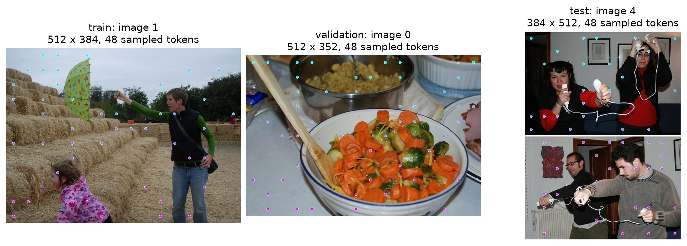
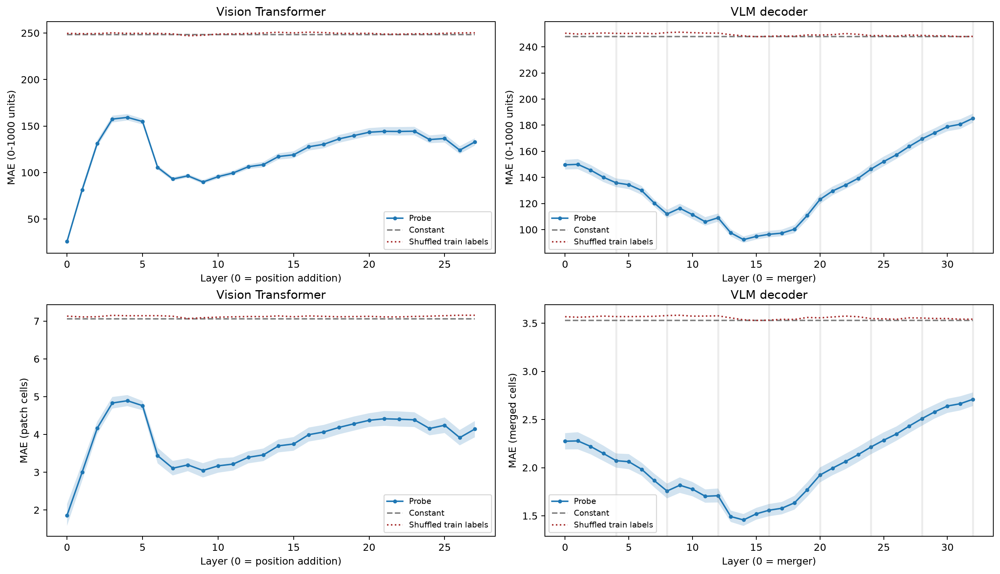
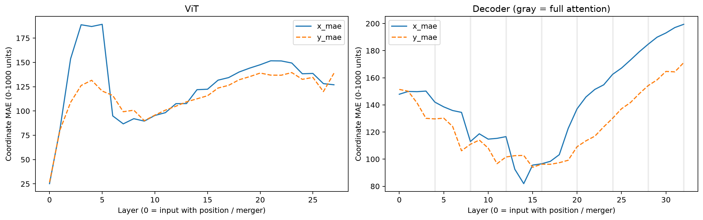
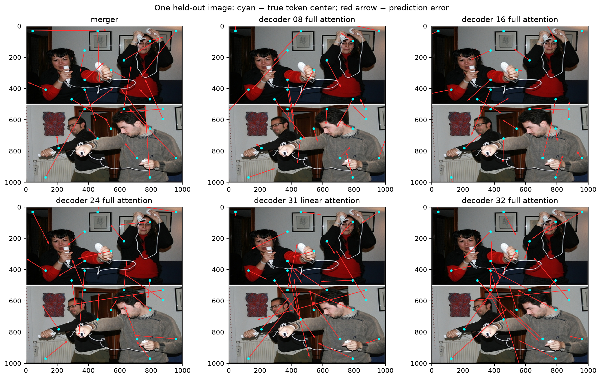
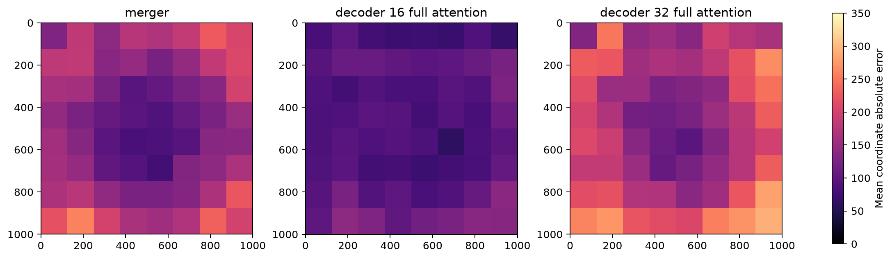
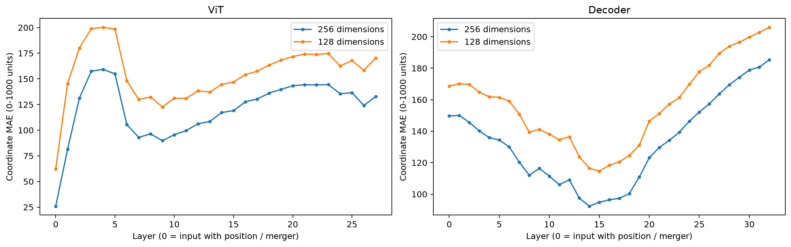

# 位置信息提取：真实图实验

实验日期：2026-10-01。研究范围与实验进度见[研究方案](plan.md)；重复几何图形及文本前缀的对照见[合成图实验](results_2026-09-30.md)。

## 1. 研究问题

本实验检验自然图像中的单个 visual token 是否允许低容量 probe 恢复其输入槽位位置，并完整观察位置可读性随 ViT 和 VLM backbone 深度的变化。合成图实验只有 24 张训练图，且 decoder 第 16 层和第 32 层之间没有采样，难以判断结论能否推广到真实场景，也难以确定深层误差上升发生的具体范围。因此，本实验使用 360 张不同的 RefCOCO 图像，覆盖 ViT 全部 27 层和 decoder 全部 32 层，分别训练网格坐标和 0–1000 图像坐标的 probe。

核心结果是：decoder 中位置预测误差由 merger 输出的 149.64 降至第 14 层的 92.33，然后在后半部分逐渐升至第 32 层的 185.29，单位均为 0–1000 图像坐标。ViT 的变化更复杂，直接加入 learned position embedding 后的误差为 25.96，后续 block 中出现多次上升和下降。所有结论均指本实验线性 probe 的可读性，不等价于信息总量，也不等价于原模型 grounding 能力。

## 2. 数据与输入

### 2.1 图像选择

数据来自本地 RefCOCO 的 validation Parquet shards，使用真实 RGB 图像，不使用 referring-expression 答案、bbox 或人为圆圈标记。由于同一张图像可能对应多条 referring expressions，采样前根据原始图像字节的 SHA-256 去重。本实验顺序读取 shards，收集前 360 张长宽比不超过 3 的独立图像，因此属于可复现的便利样本，不构成对完整 RefCOCO 数据分布的估计。

1. 固定种子 20261001，将 360 张图像随机划分为 240 张训练图、60 张验证图和 60 张测试图。同一图像的所有采样位置始终处于同一划分。
2. 将图像最长边缩放到 512 pixels，并将两边分别取至相邻的 32-pixel 整数倍，再经过模型原有 processor。对齐会轻微改变长宽比，不进行裁剪；坐标标签以实际 processor 网格为准。
3. 每张图从 merged grid 均匀无放回采样 48 个位置。对于 ViT，在每个选中 merged cell 的四个 patches 中随机选择一个 patch。因此每个提取位置分别拥有 11,520 个训练 token、2,880 个验证 token 和 2,880 个测试 token。
4. 保存原始图像 hash、来源 question ID、原始和输入尺寸、实际网格以及采样 indices。图像只按完整图划分，不随机拆分同图 tokens。

图 1 给出训练、验证和测试各一张样例，圆点表示实际用于 probe 的 merged-token 中心，颜色仅用于区分纵向位置。所有图使用相同数量的位置，因此主要指标按 token 汇总与先按图平均在本实验中完全一致。

### 2.2 模型输入与提取位置

每次输入均为一张图像，随后附上 `Describe the image briefly.`。使用 Qwen3.5-9B、bfloat16、SDPA 和 thinking off，仅执行 prefill，不生成回答，也不把坐标目标写入 prompt。图像位于请求文字之前，因此 causal decoder 的 visual-token hidden states 不能读取图像后面的描述请求。

提取位置分为四类：

- **Patch content：** patch embedding 的输出，尚未加入 learned absolute position embedding。这一处作为内容线索基线；自然图像中天空与地面的分布可能允许弱位置预测，不能先验假定内容完全没有位置相关性。
- **ViT position input 与全部 ViT blocks：** 第一层 block 输入已经加上 interpolated learned position embedding；随后保存第 1–27 层完整 block 输出。视觉 attention 同时使用二维 RoPE。
- **Merger：** 将相邻 2×2 patches 合并后，得到输入语言模型的 visual embeddings。
- **全部 decoder blocks：** 保存第 1–32 层完整 block 输出。每四层中的第四层使用 full attention，其他层使用 linear attention。输出同时包含 attention、residual connection 和 MLP 的作用。

共记录 62 个提取位置。ViT 的原始序列按 spatial-merge groups 排列，需要显式还原到 patch 的行列；merger 和 decoder 则使用 merged grid。不能直接把 ViT 的序列 index 按整图行宽取模，否则会给 patch 分配错误坐标。该排列转换和坐标单位已有独立测试。

## 3. Probe 与评价

### 3.1 两种坐标目标

设某一提取位置对应的网格有 H 行、W 列，零起始行列为 r、c。本实验的两个目标分别是网格索引与图像归一化中心，均以横坐标在前：

$$
y^{\mathrm{grid}}_{r,c}=(c,r)\in\mathbb{R}^2,\qquad
 y^{\mathrm{image}}_{r,c}=1000\left(\frac{c+1/2}{W},\frac{r+1/2}{H}\right)\in\mathbb{R}^2.
$$

网格目标保留 token 的离散列、行索引；图像目标表示对应 patch 或 merged region 在整图中的中心。ViT 使用原始 patch grid，merger 与 decoder 使用每边缩小两倍的 merged grid。当前数据的 patch grid 包含 15 种尺寸，从 16×32 到 32×32，也包含纵向布局；merged grid 在每个轴上均缩小两倍。

这两种目标分别拟合。固定网格时二者存在简单的线性缩放关系；跨图像的行列数变化时，同一个网格索引可能对应不同归一化位置，因此全体数据不存在统一的二维仿射映射。Probe 不接收行宽和图像尺寸，网格预测因而同时涉及对网格尺度的隐式判断。本实验的 grid 是图像局部行列索引，未加入 decoder mRoPE 中由前置文本引入的整体 offset。

### 3.2 训练流程

1. 将采样 token 的 hidden state 转成 float32，并通过固定高斯随机矩阵投影到 256 维。每种原始维数使用固定种子生成投影矩阵，同维度的所有层共用相同矩阵。投影参数不训练，投影结果以 float16 缓存。
2. 仅依据训练 tokens 的各维标准差缩放输入。每个提取位置、每种坐标目标独立拟合一个 ridge probe，输出两个坐标。包含偏置后，每个 probe 有 514 个可训练参数。
3. 正则化系数从 0.01、1、100 中根据验证图像的均方误差选择。测试图不参与参数拟合或选择；测试预测不裁剪到图像边界。
4. 另行拟合打乱训练标签的 probe，保持测试标签真实不变；常数基线输出训练标签均值。两项对照用于判断结果是否超过位置分布的简单先验。

令训练矩阵 X 有 N 行、256 列，标签矩阵 Y 有 N 行、2 列，权重矩阵 B 有 256 行、2 列，偏置 b 为二维向量。优化目标是：

$$
\min_{B,b}\ \|XB+\mathbf{1}b^{\mathsf T}-Y\|_F^2+\lambda\|B\|_F^2.
$$

正则项只约束权重，不约束偏置。固定投影限制了读出容量与缓存大小，同时也可能丢弃部分有用方向，因此结果应解释为该读出方法可恢复的信息，而不能解释为完整 hidden state 的信息上限。

### 3.3 评价指标

主要指标为两个坐标的平均绝对误差：对每个 token 分别计算横、纵坐标的绝对误差，然后对两个坐标和全部测试 tokens 平均。图像坐标误差以 0–1000 单位报告，例如 100 相当于图像宽或高的 10%；网格误差则以 patch cell 或 merged cell 为单位，两种网格单位不能直接横向比较。

报告还包含以下指标：

- 横坐标 MAE 与纵坐标 MAE，检查平均值是否掩盖单一方向的变化。
- 对 grid 预测取最近整数后的精确位置准确率，以及横纵各不超过一个 cell 的准确率。预测不先裁剪；两种坐标都满足条件才计为正确。
- 以测试图为抽样单位进行 2,000 次 bootstrap，给出主 MAE 的 95% 区间。每次重采样保留整张图的 48 个 tokens，避免把同图 tokens 当作独立图像样本。

## 4. 实验结果

### 4.1 全层误差

图 2 上排是图像坐标误差，下排是网格误差，阴影为按图像 bootstrap 的 95% 区间。ViT 第 0 处表示加位置编码之后、第一层 block 之前；decoder 第 0 处表示 merger 输出。灰色竖线标出 full-attention 层。虚线和点线分别是常数与打乱训练标签的基线。图中上下两排分别来自独立训练的 probe。

| 提取位置 | 图像坐标 MAE | 95% 区间 | 网格 MAE | 精确网格准确率 |
|---|---:|---:|---:|---:|
| Patch content | 248.72 | 244.47–253.26 | 7.087 patches | 0.24% |
| 加入 ViT position embedding | 25.96 | 24.39–27.67 | 1.861 patches | 5.90% |
| ViT 第 1 层 | 81.35 | 77.68–85.08 | 3.001 patches | 1.63% |
| ViT 第 4 层 | 159.26 | 156.00–162.81 | 4.892 patches | 0.56% |
| ViT 第 9 层 | 89.80 | 87.73–91.94 | 3.047 patches | 1.32% |
| ViT 第 27 层 | 132.91 | 128.89–136.82 | 4.143 patches | 0.90% |
| Merger | 149.64 | 146.03–153.44 | 2.274 merged cells | 2.19% |
| Decoder 第 7 层 | 120.33 | 117.62–123.09 | 1.865 merged cells | 3.37% |
| Decoder 第 14 层 | 92.33 | 89.86–94.78 | 1.457 merged cells | 5.59% |
| Decoder 第 16 层 | 96.41 | 94.04–99.05 | 1.558 merged cells | 5.14% |
| Decoder 第 24 层 | 146.33 | 142.87–149.78 | 2.215 merged cells | 2.01% |
| Decoder 第 31 层 | 180.70 | 177.01–184.49 | 2.664 merged cells | 1.35% |
| Decoder 第 32 层 | 185.29 | 181.95–188.86 | 2.710 merged cells | 1.22% |

Patch-content 的图像坐标误差接近常数基线 248.28，加入 learned position embedding 后下降到 25.96。这一前后对照符合位置编码向 patch 向量显式注入二维位置的计算过程。但后续 ViT 层没有保持同等线性可读性，误差先上升、再下降、再缓慢增大，表明单调的信息混合解释不足以描述实际曲线。

Decoder 的误差从 merger 起点总体下降至第 14 层，在第 14–17 层附近形成低误差区，随后逐渐上升。第 16 层之后不存在一个未观测的巨大断点：第 20、24、28、32 层分别为 123.13、146.33、169.48、185.29。合成图中的“中间层较好、末层较差”在这批真实图上仍然成立，但最低点所在层和误差数值不同。

两个 decoder 坐标目标均在第 14 层达到最低平均误差。尽管这支持位置确实可读，该层精确网格准确率仅为 5.59%，横纵各允许一格误差时为 36.98%。因此当前 probe 尚未达到精确恢复每个 token 位置的水平。

### 4.2 横纵坐标与空间分布

图 3 单独展示横纵坐标误差，省略接近 250 的基线以便观察层间变化。Decoder 第 14 层的横、纵 MAE 分别为 81.93 和 102.73；第 32 层分别为 199.42 和 171.16。两个方向均在深层恶化，但变化幅度不同，不能将整体趋势解释为只有一个坐标失效。

图 4 固定同一张独立测试图与同一组 token 位置。青点为真实中心，红色箭头从真实中心指向预测位置；为避免遮挡，仅展示 48 个采样点中的 24 个。图中能够直接检查位置误差是否集中于边缘、是否向图像中心收缩，以及不同层的预测如何变化。该图是预先按测试顺序选择的第一张图，未依据预测质量挑选样例。

图 5 将全部测试图的坐标投到归一化的 8×8 网格，对落入每个格子的 token 计算平均坐标绝对误差。三张图使用相同的 0–350 色标，比较 merger、第 16 层与第 32 层。该聚合仅用于描述空间误差分布，不参与训练或选择最佳层。

### 4.3 Probe 容量对照

为检查曲线是否只在一个投影维度下出现，使用同一份缓存的前 128 个投影维度重新训练全部 probes。图像划分、标签、正则化选择和测试方式均不变，容量由 514 个参数降为 258 个参数。该对照改变读出容量，但没有增加随机种子，也没有重新提取模型表征。

图 6 显示维度降低使整体误差上升，但 decoder 的中间层低、后半部分逐渐上升的趋势仍然存在。128 维条件下 merger、第 14、第 16、第 32 层的图像坐标 MAE 分别为 168.57、116.37、118.32、206.00，最低点为第 15 层的 114.62；256 维的最低点为第 14 层的 92.33。精确的最佳层因容量变化而移动，整体趋势在这两个设置中一致。该对照仍不足以排除更高容量或非线性读出在末层获得更好结果。

## 5. 层间变化的解释

逐层结果说明，位置线性可读性并不随 attention 的累计次数单调变化。以下三种机制能够产生不同曲线，现有实验对它们提供的证据强弱不同。

1. **位置编码注入和上游位置保留。** Patch content 与 position input 的误差差异直接对应 learned absolute position embedding 的加法。Decoder 输入继承了 ViT 和 merger 的位置特征，linear attention 没有新增显式位置编码不意味着其输入缺少位置。
2. **内容与位置的联合计算可以改善某些线性方向。** 中间 decoder 层可能整合边界、相对空间关系和序列上下文，使槽位位置更容易被线性读出。每层训练独立 probe 能够追随这类表征变换，因而浅层误差较大并不与上游已有位置信息矛盾。该解释与观测相容，但尚未用干预确认具体贡献。
3. **深层表征可能更服务于语义和语言输出，使槽位位置在固定容量读出下更难提取。** 深层位置可以被重新编码、混入内容方向或转为非线性结构；随机投影也可能保留不同比例的有效方向。因此 MAE 上升不能直接证明位置已经消失，更不能仅据此认定 attention 将其他 token 的位置错误地写入当前 token。

Full 与 linear blocks 的输出同时包含 residual 和 MLP，且它们交替构成同一个已训练网络。第 14 层误差低于第 16 层并不能独立归因于 attention 类型。要区分机制，需要在固定样本与读出器上分别干预 position IDs、recurrent state 或局部内容，同时控制 hidden-state 分布的变化。

## 6. 局限与后续检验

本实验把训练图数从 24 增加到 240，并加入真实图像、全层记录和按图像的置信区间；仍只覆盖一个模型、一个便利样本和一种主要线性读出配置。全部图像最长边固定为 512，测试包含不同长宽比，但没有独立的未见最大边长条件。因此不能宣称已经证明跨分辨率的普遍位置恢复。

位置标签描述 token 的输入槽位，不描述该 token 内所有语义信息的来源。Probe 也没有读出小人的行列序数、物体中心或 bbox。本轮 128 与 256 维对照检查了两种低容量设置；后续应增加更高投影维度与轻量非线性 probe 的对照，确认深层误差变化对读出形式是否稳定；随后在位置可读但原模型几何输出错误的样本上研究读取和表达路径。模型预训练期间是否见过这些 RefCOCO 图像没有核查，但 probe 的训练、验证和测试按图像严格分离。

## 7. 复现记录

运行入口为 `scripts/analysis/position_real_probe.sh`，参数集中在脚本顶部。产物目录为配置的 WORK_DIR 下 `analysis/position/2026-10-01_refcoco_layers/`。

- `experiment.json` 保存模型 snapshot 名称、提取代码摘要、开始与结束时间、thinking 模式、精度、投影维度和模型配置。
- `cases.json` 保存整图划分、来源 hash、尺寸、网格、采样位置与输入 prompt。
- `features.npz` 保存 62 个提取位置的固定投影特征，不保存完整 hidden states。
- `results.json` 保存两种目标的全部逐层指标、图像级误差、置信区间与基线；`predictions.npz` 保存测试图预测，支持重新作图。128 维容量对照使用 `results_dim128.json` 和 `predictions_dim128.npz`。`evaluation.json` 与 `evaluation_dim128.json` 记录评价代码摘要、运行时间和配置。
- `images/` 保存实际输入的图像；本文图表由 `analysis_tools/position_figures.py` 根据上述文件生成，发布副本位于本问题目录的 `figures/`。
