# 坐标读取路径

实验日期：2026-10-14，补充部分（C4 输出 patching 与冗余结构、自然图像、C5 插行、6×6 定向条件）于 2026-10-15 完成。本文属于[位置信息与坐标读取](plan.md)研究，执行[实验 3.5 设计](design_coordinate_readout.md)。模型为 Qwen3.5-9B，bfloat16、SDPA、greedy decoding，thinking off。

## 1. 研究问题与主要结果

实验 1.3 表明 Qwen3.5-9B 的位置输出是独立于细节感知的主要瓶颈：20×20 网格中列号多计 1 的答案占只错列答案的 75%，10×10 网格的中心点命中率只有 0.23 而 94% 的预测落在一个单元以内，中心点坐标的回归斜率偏离 1。实验 2.5a 表明视觉信息在 full attention 层 8、12、16 向文本位置传递。本实验在模型生成 point、bbox 与行列答案时测量 attention 与梯度归因，并对四种位置来源（S1 ViT 位置、S2 decoder MRoPE position IDs、S3 视觉内容、S4 序列顺序）逐一进行因果干预，回答坐标信息来自哪里、经过哪些层、以及网格定位为何出错。

主要结果如下：

1. **decoder 的 MRoPE position IDs 单独改变时不影响坐标输出，该结论在自然图像上成立。** 在 108 张单目标图像上，图像 token 的 MRoPE ID 整体平移 $\pm 2$ 至 $\pm 8$ 个单位的位移权重为 $w = -0.00$，区域互换为 $w = 0.01$；在 298 张 RefCOCO 图像上，整体平移为 $w = -0.00$，区域互换为 0.05；T6 网格的行列答案在全部 MRoPE 平移下的改变比例不超过 4%，与数值噪声相当。
2. **单目标画布上的坐标主要由 ViT 2D RoPE 决定，这一结论不推广到自然图像。** 单目标画布上只交换 ViT RoPE ID 的位移权重为 0.71 [0.65, 0.77]，只交换 learned PE 为 0.01；RefCOCO 上只交换 ViT RoPE ID 的权重只有 0.16 [0.12, 0.20]，同时交换 PE 与 RoPE 为 0.19。
3. **自然图像中，坐标主要由目标内容所在的序列槽位决定，且槽位的作用依赖 MRoPE ID 与槽位一致。** RefCOCO 上交换目标与另一区域的 visual embedding（槽位与 MRoPE ID 不动）使输出移向新槽位，权重 0.78 [0.72, 0.83]；只移动槽位而让 token 保留原 MRoPE ID（序列置换）的权重为 0.28，只交换 MRoPE ID 为 0.05。序列置换在纵向的权重为 0.72、横向为 0.20，与单目标画布（横向 0.17、纵向 0.35）和 T6 网格（行号跟随 0.88–1.02）一致：序列顺序主要承载纵向位置。
4. **坐标 token 在生成时于层 12–24 重新读取目标，该模式在自然图像上复现。** 生成坐标首位数字时，单目标画布上层 16 与 20 平均 68%–70% 的 attention 落在图像 token 上；RefCOCO 上层 12–24 为 0.60–0.70，而问题末端与最后一个 prompt token 只有 0.02–0.15。
5. **20×20 网格的列号多计 1 发生在读取之后。** 答错样本中指向型 head 的 attention 峰值仍位于真值列，与答对样本的分布重合；teacher forcing 下，多计 1 的样本对 $c+1$ 的对数概率比真值高 3.06，属于高置信的错误，不是两个相邻候选之间的微弱偏好。模型还会给出超出网格范围的第 21 列。
6. **点坐标集中于少数“整齐”数值。** 单目标 point 回答的 472 个坐标值中 500 出现 78 次，667、750、333、250 等简单分数值也明显过多；T6 回答集中于 125、375、417、583、917 等网格单元中心值。坐标输出带有离散化的取值偏好，这是中心点误差与回归斜率偏离 1 的直接成因之一。
7. **C1 选出的 5 个候选指向型 head 不足以携带坐标，坐标经由层 20 的少数 head 传递，且存在冗余。** 把目标在另一位置的 run B 的 head 输出 patch 到 run A 的答案位置时，5 个候选 head 整体的权重只有 0.10，层 20 的全部 16 个 head 为 0.68，其中单个 head L20 H11 为 0.48；全部 128 个 full attention head 为 1.05，与 run B 自身的 1.08 相当。均值消融指向分数前 10 的 head 使命中率从 0.54 降至 0.19，消融前 40 以外随机抽取的 64 个 head 不改变命中率。
8. **横坐标与纵坐标经由不同的路径到达答案。** 在答案位置消融指向分数前 10 的 head 后，输出纵坐标与真值的相关从 0.99 降至 0.36，横坐标仍为 0.98；消融答案位置的全部 128 个 full attention head 后横坐标的相关仍为 0.92，而把消融起点提前到图像之后的第一个 token 时，108 个回答的横坐标全部变为 499。横坐标在生成开始前已由图像之后的文本位置读取，并可不经答案位置的 full attention 到达答案；纵坐标主要依赖层 20 的 head 在生成时的读取。
9. **行列序数不由像素位置或 position IDs 换算。** 在目标所在行的上方插入一个单元高的空白带后，基线答对的网格中行号改变的比例为 6×6 5/48、10×10 4/46、20×20 6/21；position IDs 层面的插行与插列只改变 0–1 个答案。行列答案主要由目标在实例之间的相对次序决定，像素位移只引起少量“多计 1”。

## 2. 实验设计与实际执行

### 2.1 位置来源与干预

Qwen3.5-9B 中可能把位置带到坐标 token 的四条路径如下：

| 来源 | 计算位置 | 本实验的干预 |
| --- | --- | --- |
| S1 ViT 位置 | ViT：patch embedding 后加入一次 learned absolute position embedding（PE），27 层 attention 均使用 2D RoPE | 平移 PE 插值窗口；在两个区域之间交换 PE、RoPE ID 或二者；缩放 RoPE ID |
| S2 MRoPE position IDs | decoder 的 8 个 full attention 层（4, 8, …, 32） | 整体平移图像 token 的 $(p^{h}, p^{w})$；区域互换；按比例缩放 |
| S3 视觉内容 | 图像本身 | 本次只在合成图像上运行，内容不提供位置线索 |
| S4 序列顺序 | 24 个 Gated DeltaNet 层与 causal mask | 交换两区域 token 在序列中的槽位，token 保留自己的 embedding 与 MRoPE ID |

另有两个组合条件：内容交换（C3）交换两区域的 visual embedding，MRoPE ID 与槽位不动，因此目标内容携带的 S1 位置指向原位置，而槽位（S2 与 S4）指向新位置；自然移动对照把圆实际画在新位置，给出真实位移下输出的跟随程度。

### 2.2 刺激与问题

| 任务 | 图像 | 格式 | 样本量 |
| --- | --- | --- | --- |
| 单目标网格 | 512×512 白色画布，单个红色实心圆，直径 32、64、128 pixels，圆心位于 6×6 等距位置并加 $\pm 16$ pixels 抖动 | point、bbox | 108 张 × 2 |
| 平移序列 | 圆心沿水平或竖直中线以 32 pixels 步长移动，圆完整位于画布内 | point | 86 张 |
| 画布尺寸序列 | 边长 256–1280 pixels，7 个固定相对位置 | point | 42 张 |
| T6 网格 | 实验 1.3 的红色目标网格与原问题，6×6、10×10、20×20 | 行列、point、bbox | 每种规模 48 张 × 3 |
| 自然图像 | 实验 3.4 测试划分的 RefCOCO 图像（长边 512 pixels），每张图像使用其 RefCOCO 记录的第一条 referring expression 与 bbox | point、bbox | 300 张 × 2 |

单目标问题为 “There is one red circle in the image.” 加实验 1.3 的格式要求，例如 point 格式为 “Give the center of its bounding box. Return only [{"point_2d": [x, y]}]. All coordinates use 0-1000 normalization; x increases rightward and y increases downward. Output only the JSON, with no explanation.”。T6 使用实验 1.3 的原问题 “One figure is drawn in red. Give its position. Return only {"row": r, "column": c}, …”。下图为实际输入示例：

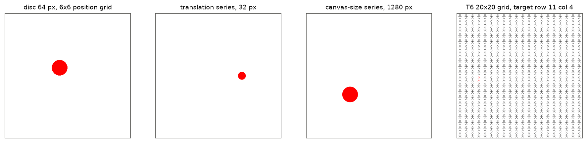

### 2.3 符号与指标

记 $\mathcal{V}$ 为全部 visual token 的集合，$\mathcal{T} \subset \mathcal{V}$ 为与目标 tight bbox 重叠的 visual token 集合。full attention 层 $\ell$ 的 head $k$ 在 query 位置 $m$ 对 token $j$ 的 softmax 权重记为 $a^{\ell,k}_{m,j}$。坐标 token 的 query 位置是其 next-token 预测产生该 token 的输入位置。

**目标富集度。** 定义

$$
E^{\ell,k}_{m} = \frac{\sum_{j \in \mathcal{T}} a^{\ell,k}_{m,j} \big/ \sum_{j \in \mathcal{V}} a^{\ell,k}_{m,j}}{|\mathcal{T}| \,/\, |\mathcal{V}|}.
$$

分子是图像上的 attention 中落在目标区域的比例，分母是目标区域的面积比例，$E = 1$ 表示与均匀分配相同。“图像 attention 质量”指 $\sum_{j \in \mathcal{V}} a^{\ell,k}_{m,j}$。

**归因占比。** 设 $z$ 为坐标首位 token 的 logit 减去其余 9 个数字 token 的平均 logit，$x^{\ell}_{j} \in \mathbb{R}^{4096}$ 为第 $\ell$ 层输入在 token $j$ 上的 residual。定义

$$
A^{\ell}_{j} = \left( \frac{\partial z}{\partial x^{\ell}_{j}} \right)^{\mathsf T} x^{\ell}_{j}, \qquad \rho^{\ell} = \frac{\sum_{j \in \mathcal{T}} |A^{\ell}_{j}|}{\sum_{j \in \mathcal{V}} |A^{\ell}_{j}|}.
$$

$A^{\ell}_{j}$ 是 $z$ 对该 residual 的一阶贡献，$\rho^{\ell}$ 是目标区域在图像归因中的占比；另记图像 token 在全部 token 归因中的占比（下文称图像归因占比）。

**位移权重。** 设基线输出坐标为 $\hat y_0 \in \mathbb{R}^{2}$，干预后输出为 $\hat y \in \mathbb{R}^{2}$，干预在某一来源上施加的位移为 $d \in \mathbb{R}^{2}$（均为 0–1000 坐标）。定义

$$
w = \frac{(\hat y - \hat y_0)^{\mathsf T} d}{\| d \|^2}, \qquad e_{\perp} = \frac{\left\| (\hat y - \hat y_0) - w\, d \right\|}{\| d \|}.
$$

$w = 1$ 表示输出完全跟随被干预的来源，$w = 0$ 表示不受影响；$e_{\perp}$ 衡量垂直于 $d$ 的位移。网格任务以单元为单位记录答案位移，跟随比为答案位移除以互换位移（同为单元数），与 $w$ 含义相同。

### 2.4 操作

1. **解码与干预接口。** 全部条件使用自行实现的 greedy 解码：向模型传入 inputs_embeds 与形状为 $(4, B, L)$ 的 position IDs，ViT 的 RoPE ID 与 PE 插值索引作为前向参数替换。同一图像的各条件序列长度相同，以不含 padding 的 batch（batch size 8）解码。随机抽取 20 个 C0 样本与参考实现 generate 比较，18/20 的答案一致，2 个不一致样本的坐标相差 4 与 10 个单位。
2. **数值噪声水平。** 间隙基线（图像前后各空出 8 个 MRoPE 位置）与标准输入相比，108 张图像中 47 张坐标完全相同，中心差的中位数为 1、均值为 5.8 个单位，首个坐标 token 的数字 logit 最大差平均 0.22；ViT RoPE ID 整体平移（数学上不变）引起的中心差中位数为 1、均值为 6.6。两者都是 bf16 舍入造成的噪声，下文小于约 10 个单位的变化不作解释，间隙基线可作为 MRoPE 平移的参照。
3. **attention 读取。** 在 full attention 模块输入处记录 hidden states 与 rotary 表，重算 query 行的 softmax 权重，并以重算的 gated 输出与模块实际输出比较；4720 个层-样本组合的相对最大误差中位数为 0.0035，最大 0.012。
4. **运行规模。** C0 共 776 次生成；C1 记录 592 个样本；C2 对 108 张单目标 point 图像各运行 47–79 个条件；C4 对 108 张图像各运行 12 种 head 集合；网格定向分析对 T6 的 5 个“规模 × 格式”组合各 48 张图像运行 43 个条件与 24 个补充条件。总计约 7 GPU 小时（共享 GPU）。
5. **补充运行（2026-10-15）。** C4 输出 patching 对 108 张单目标 point 图像各运行 41–82 个“集合 × 互换位置”条件，层 20 的逐 head 扫描另运行 34 个集合；冗余结构的均值消融对 108 张图像各运行 33 种集合，另以 8 种集合比较两个消融起点。RefCOCO 生成 600 个基线回答，C1 读取 600 个回答，干预对 300 张 point 图像各运行 28–38 个条件。C5 对 144 张 T6 行列图像各运行 9 个条件；6×6 定向分析补齐 96 张图像的主条件与 48 张 point 图像的补充条件。patching 与消融按“集合 × 样本”拼成最多 32 行的 batch，C2 类干预与 C5 的 batch size 为 8。RefCOCO 的解码器与参考实现 generate 在随机 20 个样本上 20/20 的回答文本一致。补充运行合计约 4 GPU 小时。

## 3. 结果

### 3.1 C0：基准表现

| 任务 | 格式 | 命中或正确 | 中心误差（0–1000） | 回归斜率 x / y |
| --- | --- | --- | --- | --- |
| 单目标网格，直径 32 | point | 8/36 [0.12, 0.38] | 77.9 [61.1, 95.3] | 1.07 / 1.11 |
| 单目标网格，直径 64 | point | 17/36 [0.32, 0.63] | 68.6 [57.1, 79.9] | 1.05 / 1.10 |
| 单目标网格，直径 128 | point | 34/36 [0.82, 0.98] | 82.1 [71.1, 92.9] | 1.12 / 1.14 |
| 单目标网格，直径 64 | bbox | 中心命中 17/36，IoU≥0.5 为 6/36 | 67.3 | 1.06 / 1.08 |
| T6 6×6 / 10×10 / 20×20 | 行列 | 46/48、46/48、22/48 | — | — |
| T6 6×6 / 10×10 / 20×20 | point | 33/48、11/48、2/48 | — | 0.92 / 0.96，0.90 / 0.98，0.88 / 0.85 |

方括号为 Wilson 95% 区间（比例）或以图像为单位的 bootstrap 95% 区间（均值）。本实验的解码器在 T6 上与实验 1.3 原回答的文本一致比例为行列 132/144、point 89/144、bbox 99/144，20×20 行列正确率 22/48 与实验 1.3 的 21/48 相当。

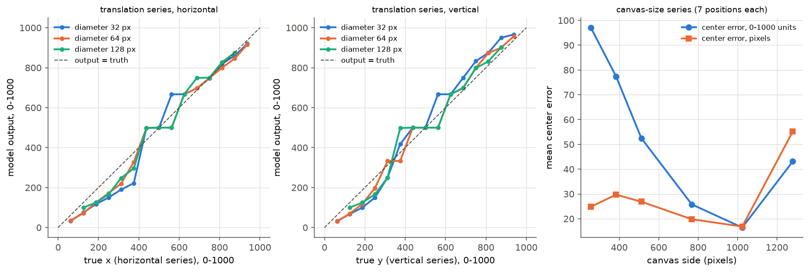

1. **单目标坐标随真实位置呈阶梯状变化。** 平移序列中，相邻多个位置给出同一输出值（例如 500、667），然后跳到下一个值；回归斜率为 1.05–1.14，截距为负，说明在空白画布上坐标向两侧拉伸，与 T6 网格中 0.85–0.98 的斜率方向相反。实验 1.3 观察到的“中心压缩”只在网格任务中成立。
2. **以 pixels 计的误差基本不随画布尺寸变化。** 画布边长 256、384、512、768、1024 时，中心误差为 25、30、27、20、17 pixels，即约 0.5–1 个 merged token；以 0–1000 计的误差因此从 97 降至 17。边长 1280 时误差升至 55 pixels。

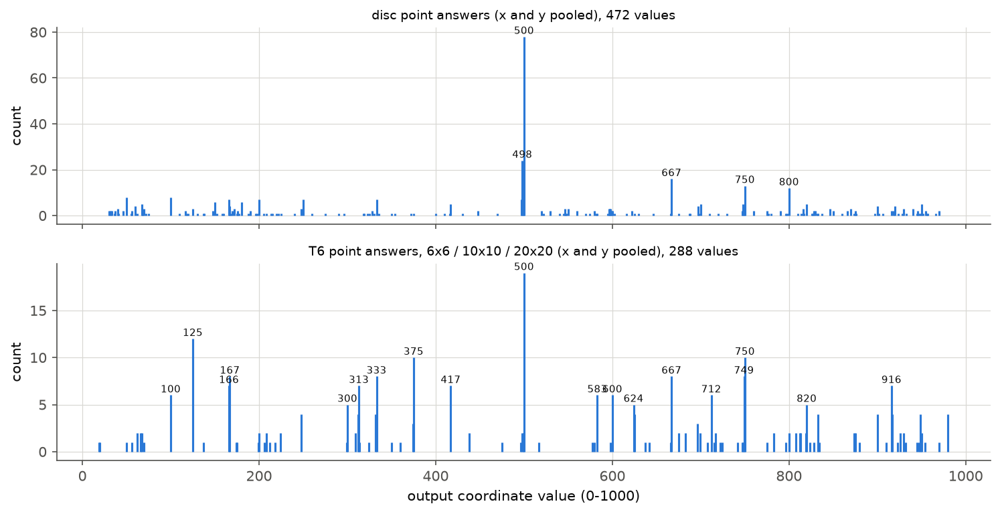

3. **坐标输出偏好少数数值。** 单目标 point 回答的 472 个坐标值共有 176 个不同取值，其中 500 出现 78 次、498 出现 24 次、667 出现 16 次、750 出现 13 次；T6 point 回答中 500、125、375、750、667、333、167 最多，这些值对应画布的二分、三分、四分、八分点或 6×6、12×12 单元中心。坐标的数字输出带有离散化的先验，连续真实位置被映射到附近的“整齐”数值，形成上图的阶梯。
4. **坐标约定的诊断。** 按[研究计划](../plan.md)第 6 节第 9 条，point 回答另按绝对 pixel 约定解读（共享实现 `analysis_tools/behavior/coordinate_convention.py`）。目标区域取圆的 tight bbox 或 T6 的目标单元，因此下表的严格命中数略高于上表“落在圆内”的命中数。机会命中率为 $[0, 1000]^2$ 上均匀随机点的命中概率。

| 任务 | 严格命中 | 任一约定命中 | 只在 pixel 约定下命中 | 机会命中率（严格 / 任一） |
| --- | --- | --- | --- | --- |
| 单目标网格 | 61/108 | 61/108 | 0/108 | 0.025 / 0.031 |
| 平移序列 | 55/86 | 55/86 | 0/86 | 0.026 / 0.032 |
| 画布尺寸序列（256–1280） | 32/42 | 32/42 | 0/42 | 0.016 / 0.017–0.032 |
| T6 6×6 / 10×10 | 33/48、11/48 | 33/48、11/48 | 0/48、0/48 | 0.028 / 0.032，0.010 / 0.014 |
| T6 20×20（1280 pixels） | 2/48 | 6/48 | 4/48 | 0.003 / 0.005 |

单目标画布与 6×6、10×10 网格上没有任何回答只在 pixel 约定下命中；20×20 网格的 1280-pixel 画布上有 4 个回答只在 pixel 约定下命中，与实验 1.3 观察到的“大画布上有时以 pixels 作答”一致。画布边长 1024 pixels 时两种约定几乎重合，该行不具区分力。

### 3.2 C1：生成坐标时的 attention 与归因

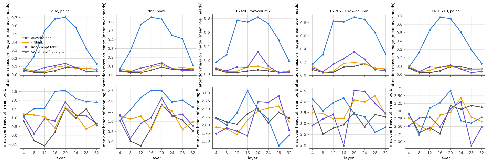

上排为图像 attention 质量（16 个 head 的平均），下排为各层中目标富集度最高的 head 的 $\log E$。数据显示：

1. **生成坐标首位数字时，模型重新读取图像。** 单目标 point 任务中，坐标首位数字在层 12、16、20、24 的图像 attention 质量为 0.54、0.68、0.70、0.58，最大 $\log E$ 为 2.5（约 12 倍富集）；问题末端、`</think>` 与最后一个 prompt token 在全部层的图像 attention 质量只有 0.02–0.14。行列任务更集中：6×6 与 20×20 的行号、列号首位数字在层 12–24 的图像 attention 质量为 0.72–0.88。
2. **读取发生在层 12–24，层 28 与 32 的读取明显减弱。** 层 4 与 8 的图像 attention 质量不超过 0.31，层 32 降至 0.11–0.32。实验 2.5a 的 patching 只测量了 prompt 内的信息流，本实验表明答案 token 在生成阶段于层 12–24 直接读取目标所在的 visual token。实验 3.4 中线性 probe 在 visual token 的 residual 上以层 14–15 读出位置的精度最高、层 19 之后下降，与这一读取窗口相符。

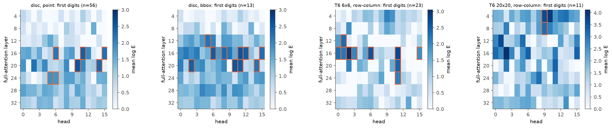

3. **候选指向型 head 集中于层 16 与 20，并在验证集上复现。** 单目标 point 任务按选择集选出的前 5 个 head 为 L20 H10、L16 H11、L20 H14、L16 H15、L16 H6，验证集上的平均 $\log E$ 为 2.46、2.37、2.25、2.22、2.12，attention 最大位置落在目标内的比例为 0.49–0.71；bbox 任务与 6×6 行列任务选出的 head 与之高度重叠（L16 H11、L20 H10、L16 H6、L20 H11、L16 H2）。20×20 行列任务答对样本只有 22 个，满足“最大位置命中率不低于 0.5”的 head 只有 L4 H9 与 L8 H9，该任务的分析改用 6×6 行列任务选出的 head。

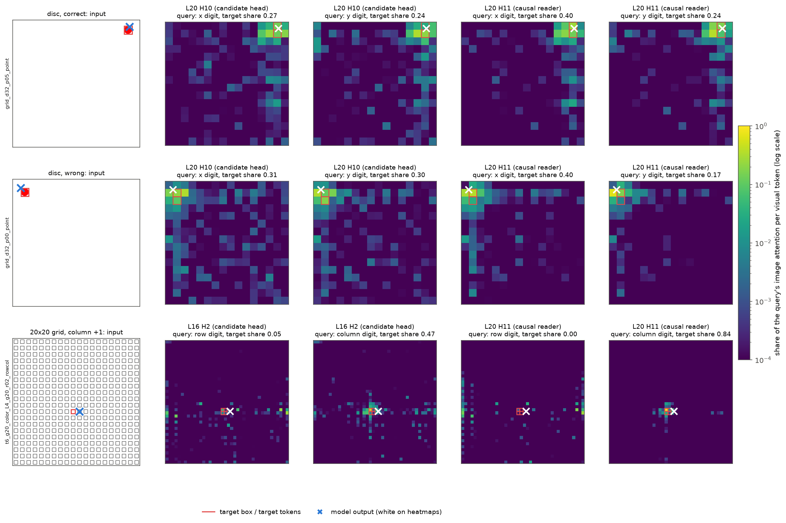

三行依次为一个答对的单目标样本、一个答错的单目标样本和一个 20×20 网格中列号多计 1 的样本（行列任务的候选 head 取自 6×6 行列任务）。第 1 列为输入，红框为目标的 tight box，蓝色叉号为模型输出。第 2–5 列的 query 均为预测坐标值首位数字的位置（第 2.3 节），依次为候选 head 在第一个、第二个坐标值处的 attention 与 L20 H11（C4 中的因果读取 head）在两个坐标值处的 attention。颜色为 viridis 对数色标，表示该 query 落在图像上的 attention 中分配给每个 visual token 的比例，所有面板共用 $[10^{-4}, 1]$ 的固定范围（右侧 colorbar）；红色方格为与目标重叠的 visual token，白色叉号为模型输出，面板标题给出目标 token 的 attention 合计比例。单目标样本中两个 head 的 attention 峰值位于目标及其相邻 token，目标 token 的合计比例为 0.17–0.40，其余比例分散在图像其他位置。20×20 样本中，L20 H11 在列号处把 0.84 的图像 attention 分配给目标 token，在行号处目标比例为 0.00，attention 落在目标所在行左右两端的 token 上；6×6 选出的候选 head L16 H2 在列号处的目标比例为 0.47。行号与纵坐标的读取因此不以目标 token 为峰值，实验 2.5e（[“看得准但答错”的系统检验](../representation/results_2026-10-16_sees_right.md)）在 15 个条件上系统检验了这一差别。

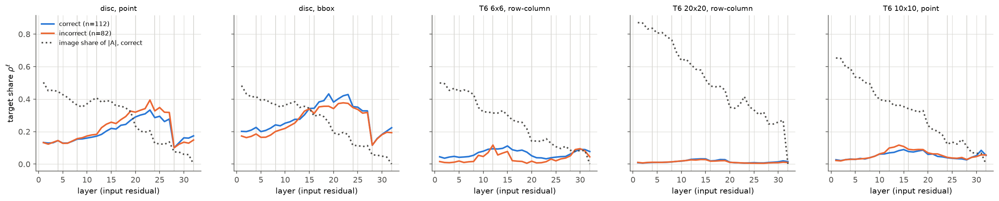

4. **目标区域的归因在层 19–23 达到峰值，层 28 之前骤降。** 单目标 point 答对样本的 $\rho^{\ell}$ 从层 1 的 0.13 升至层 23 的 0.33，层 28 输入处降至 0.10；图像归因占比从层 1 的 0.50 降至层 20 的 0.23、层 28 之后的 0.06–0.08。目标信息在层 24–27 之前已被读出到文本位置，与 attention 读取集中于层 12–24 的结果一致。答错样本的 $\rho^{\ell}$ 与答对样本几乎重合，失败与目标区域的归因不足无关。网格任务中目标只占全部 visual token 的约 0.3%（20×20）至 3%（6×6），$\rho^{\ell}$ 只有 0.01–0.11，但形状相同：20×20 行列任务的图像归因占比从层 1 的 0.87 降至层 28 之后的 0.25–0.27，答对与答错样本的 $\rho^{\ell}$ 同样重合。

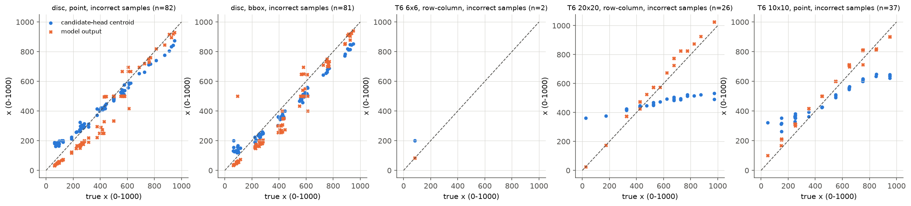

5. **答错时指向型 head 仍指向真值。** 单目标 point 答错样本（$n = 82$）中，候选 head 的 attention 质心与真值的相关为 0.995（x）与 0.991（y），平均距离为 71 个单位；与模型输出的平均距离为 130 个单位。读取阶段选对了位置，误差在读取之后产生，对应设计第 12 节“读取正确而后续表达失败”的模式。

### 3.3 C2 与 C3：位置来源的因果干预

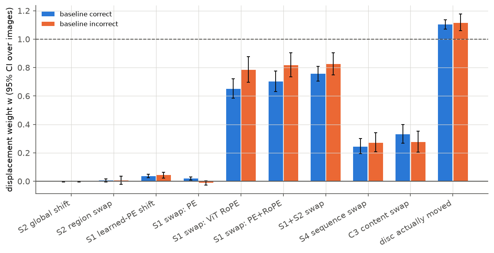

| 干预 | 基线答对（59 张） | 基线答错（49 张） | $e_{\perp}$（全部） |
| --- | --- | --- | --- |
| S2 MRoPE 整体平移 | −0.00 [−0.00, 0.00] | −0.00 [−0.00, 0.00] | 0.01 |
| S2 MRoPE 区域互换 | 0.01 [−0.00, 0.02] | 0.01 [−0.02, 0.03] | 0.02 |
| S1 learned PE 窗口平移 | 0.04 [0.02, 0.05] | 0.04 [0.02, 0.06] | 0.08 |
| S1 区域互换：只交换 PE | 0.02 [0.01, 0.03] | −0.01 [−0.03, 0.00] | 0.02 |
| S1 区域互换：只交换 ViT RoPE | 0.65 [0.58, 0.72] | 0.78 [0.70, 0.88] | 0.11 |
| S1 区域互换：PE 与 RoPE | 0.70 [0.63, 0.77] | 0.82 [0.73, 0.90] | 0.11 |
| S1 与 S2 同时互换 | 0.76 [0.71, 0.81] | 0.82 [0.75, 0.90] | 0.11 |
| S4 序列置换 | 0.24 [0.20, 0.30] | 0.27 [0.21, 0.34] | 0.06 |
| C3 内容交换 | 0.33 [0.27, 0.40] | 0.28 [0.21, 0.35] | 0.05 |
| 圆真实移动 | 1.10 [1.07, 1.13] | 1.12 [1.06, 1.18] | 0.12 |

区间为以图像为单位的 bootstrap 95% 区间；每张图像的 $w$ 先在 2–6 个互换距离与两个方向上平均。

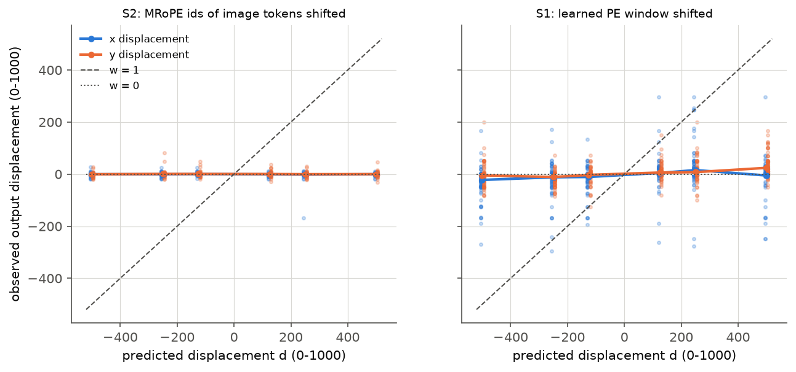

1. **MRoPE position IDs 不决定坐标。** 图像 token 的 $(p^{h}, p^{w})$ 平移 $\pm 2$、$\pm 4$、$\pm 8$ 个单位（预测位移 125–500）时，输出位移的均值在全部偏移量上接近 0；区域互换同样为 0.01。图像与问题之间的 ID 差（机制 M1）以及单独改变的图像内部相对 ID（机制 M2）均不改变坐标；图像内部 ID 与序列槽位一致时对槽位作用的增强见第 3.6.3 节。
2. **ViT RoPE 是单目标坐标的主要来源。** 只交换 ViT RoPE ID 时输出向 $\mathcal{T}'$ 移动 65%–78%，横向与纵向分别为 0.73 与 0.70；只交换 learned PE 的权重为 0.01，PE 窗口平移为 0.04。learned PE 并非完全无关：把 PE 改为在两倍大的虚拟画布上插值（居中窗口，PE 的空间频率减半）使输出平均移动 94 个单位，说明 PE 影响 ViT 的整体表示，但不以“绝对位置标签”的方式决定坐标。ViT RoPE 的权重随互换距离增大，2、4、6 个 token 的距离分别为 0.44、0.53、0.73（答对样本）。
3. **ViT RoPE 编码的是相对位移的尺度。** ViT RoPE ID 整体平移不改变输出（见 2.4），而以图像中心为原点把全部 ID 乘以 0.5 使输出的 y 平均下移 46 个单位、x 不变，乘以 0.8 与 1.25 的位移为 14 与 −9。
4. **两个来源近似线性叠加。** S1 与 S2 同时互换的权重 0.76 接近 S1 单独互换（0.70）与 S2 单独互换（0.01）之和，两个来源独立贡献；由于 S2 的权重为 0，冲突设计实际检验的是 S1 单独作用。
5. **序列顺序承担剩余部分，且偏重纵向。** 序列置换的权重为 0.24–0.27，横向 0.17、纵向 0.35；内容交换的权重 0.26–0.33 与序列置换相近，而 MRoPE 互换为 0，因此内容交换中“槽位”一侧的作用来自序列顺序（S4）。ViT 来源（约 0.75）与序列顺序（约 0.25）之和接近 1，与圆真实移动的 1.1 量级一致。
6. **内容交换后目标仍被识别。** “Is there a red circle in the image?” 的 Yes 与 No logit 差在标准输入上为 5.2，内容交换后为 4.1（460 个条件），位置读取的变化不是识别失败造成的。

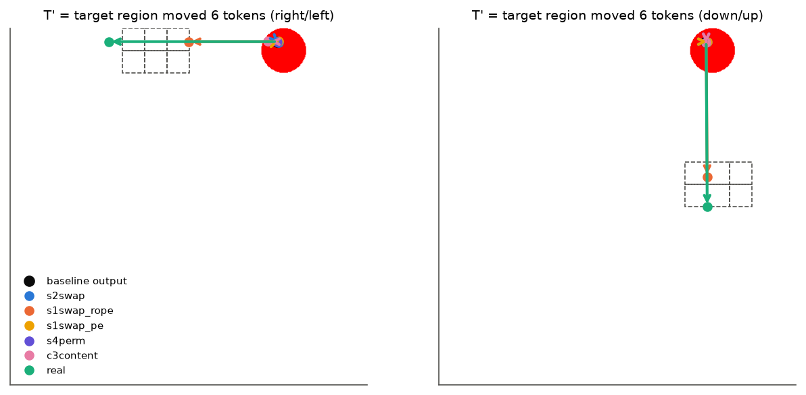

上图为一个代表性样本（ViT RoPE 互换的权重接近总体平均）：虚线框为 $\mathcal{T}'$，箭头从基线输出指向各干预条件的输出。只有 ViT RoPE 互换与真实移动使输出明显离开原位置。

### 3.4 C4：指向型 head 的消融与输出 patching

C1 的 attention 只说明哪些 head 在生成坐标时注视目标。本节以三组干预回答这些 head 是否携带坐标：均值消融检验必要性，输出 patching 检验充分性，逐步扩大的消融集合检验冗余结构。三组干预均只作用于答案位置（最后一个 prompt token 及全部生成步），样本为 108 张单目标 point 图像。

#### 3.4.1 候选 head 的均值消融

把单目标 point 任务的 7 个候选 head（L16 H6、H11、H15，L20 H10、H14，L24 H5、H6）的门控输出在答案位置替换为其平均值，并以相同层中随机抽取的 7 个 head 重复 10 次作为对照（108 张图像）：

| head 集合 | 中心误差变化 | 输出位移 | 命中率 | 识别 logit 差变化 |
| --- | --- | --- | --- | --- |
| 无消融 | — | — | 0.54 | — |
| 候选 head | −6.9 [−11.8, −2.1] | 34.3 [28.5, 40.7] | 0.56 | −0.12 |
| 随机 head（10 组均值的范围） | −1.4 至 5.0 | 9.6 至 18.0 | 0.50–0.56 | −0.07 至 0.21 |

消融候选 head 使输出平均移动 34 个单位，是随机 head 的 2–3 倍，但误差没有上升，命中率不变。单独去掉这 7 个 head 不足以破坏定位，下文以 patching 与更大的消融集合区分“这些 head 不携带坐标”与“坐标被其他 head 冗余携带”两种解释。

#### 3.4.2 输出 patching

记目标位于 $\mathcal{T}$ 的输入为 run A，把圆实际画在 $\mathcal{T}'$ 的输入为 run B（第 2.2 节自然移动对照的图像）。run A 与 run B 在同一 batch 中解码，run B 的每一步输入强制取 run A 当步生成的 token，使两行处于相同的文本上下文。在 run A 的答案位置，用 run B 同一位置的 head 输出（gate 之后、output projection 之前）替换 run A 的输出，Gated DeltaNet 层则替换整层 token mixer 的输出，记 patching 后 run A 的输出坐标为 $\hat y_{p} \in \mathbb{R}^{2}$。位移权重沿用第 2.3 节的定义：

$$
w = \frac{(\hat y_{p} - \hat y_{A})^{\mathsf T} d}{\| d \|^{2}},
$$

其中 $\hat y_{A} \in \mathbb{R}^{2}$ 为同一 batch 中未替换的 run A 的输出，$d \in \mathbb{R}^{2}$ 为 $\mathcal{T}'$ 中心减去 $\mathcal{T}$ 中心（0–1000 坐标）。$w = 1$ 表示被替换的 head 足以把 run B 的目标位置带入 run A；run B 自身输出相对 $\hat y_{A}$ 的权重为 1.08，是 $w$ 可达到的参照值。主条件取相距 4 个 merged 单元的横向与纵向 $\mathcal{T}'$（92 张图像至少有一个有效位置），横向位置的 $w$ 反映横坐标，纵向位置反映纵坐标。

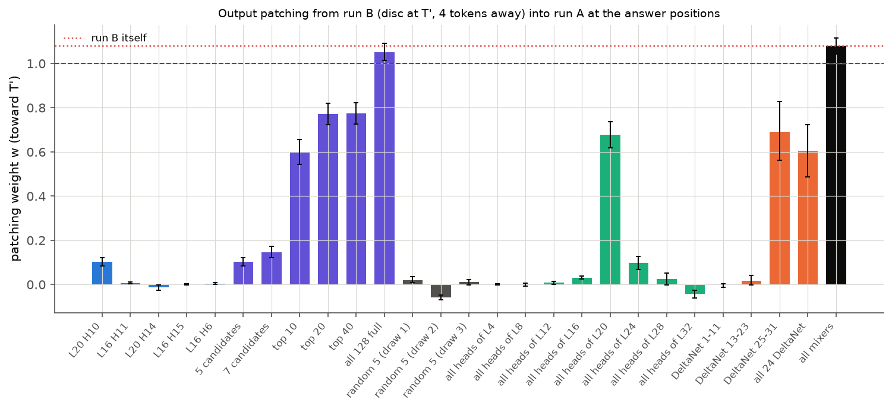

| 替换的输出 | $w$（全部） | 横向 | 纵向 |
| --- | --- | --- | --- |
| L20 H10（候选 head 中最大者） | 0.10 [0.08, 0.12] | 0.05 | 0.16 |
| 5 个候选 head | 0.10 [0.09, 0.12] | 0.04 | 0.17 |
| 同层随机 5 个 head（3 组） | −0.06 至 0.02 | — | — |
| 指向分数前 10 / 20 / 40 个 head | 0.60 / 0.77 / 0.78 | 0.43 / 0.66 / 0.67 | 0.80 / 0.88 / 0.88 |
| 层 20 的全部 16 个 head | 0.68 [0.62, 0.74] | 0.53 | 0.86 |
| 层 16 / 层 24 的全部 head | 0.03 / 0.10 | 0.02 / 0.16 | 0.04 / 0.04 |
| 层 4、8、12、28、32 的全部 head | −0.04 至 0.02 | — | — |
| 全部 128 个 full attention head | 1.05 [1.01, 1.09] | 1.04 | 1.09 |
| Gated DeltaNet 层 1–11 / 13–23 | −0.00 / 0.02 | — | — |
| Gated DeltaNet 层 25–31 | 0.69 [0.56, 0.83] | 0.53 | 0.77 |
| 全部 24 个 Gated DeltaNet 层 | 0.61 [0.49, 0.72] | 0.50 | 0.62 |
| 全部 token mixer（上限检查） | 1.08 [1.04, 1.12] | 1.06 | 1.12 |

方括号为以图像为单位的 bootstrap 95% 区间。“全部 token mixer”使 run A 答案位置的 residual 与 run B 完全一致，79% 的输出坐标与 run B 完全相同，$w$ 与 run B 自身相等，说明替换实现正确。

1. **候选 head 不足以携带坐标。** 5 个候选 head 整体的 $w$ 为 0.10，与 C4 均值消融的小幅效应一致；其中层 16 的 3 个 head 各自的 $w$ 不超过 0.01。C1 中目标富集度最高的 head 与把坐标写入答案的 head 不重合。
2. **坐标经由层 20 写入答案。** 只替换层 20 的 16 个 head 即达到 $w = 0.68$，纵向为 0.86；其他 full attention 层单独替换均不超过 0.10。层 16 的 attention 富集度与层 20 相当（第 3.2 节），但其输出不携带坐标。全部 128 个 head 达到 1.05，与 run B 自身相当：答案位置所需的坐标信息全部可以由 full attention 的输出提供。
3. **层 25–31 的 Gated DeltaNet 输出同样携带坐标。** 替换这 6 层的整层输出使 $w = 0.69$，而层 13–23 只有 0.02。层 25–31 位于层 20 之后，答案位置在这些层的输出由层 20 已写入的坐标信息与 Gated DeltaNet 的递推状态共同决定，因此该结果表示坐标信息在层 20 之后仍以 Gated DeltaNet 输出的形式向后传递，不构成独立于层 20 的第二个读取来源。
4. **随距离的变化。** 互换距离为 2、4、6 个单元时，5 个候选 head 的 $w$ 为 0.13、0.10、0.10，指向分数前 20 为 0.60、0.77、0.89，全部 full attention head 为 0.91、1.05、1.13，run B 自身为 0.96、1.08、1.16。

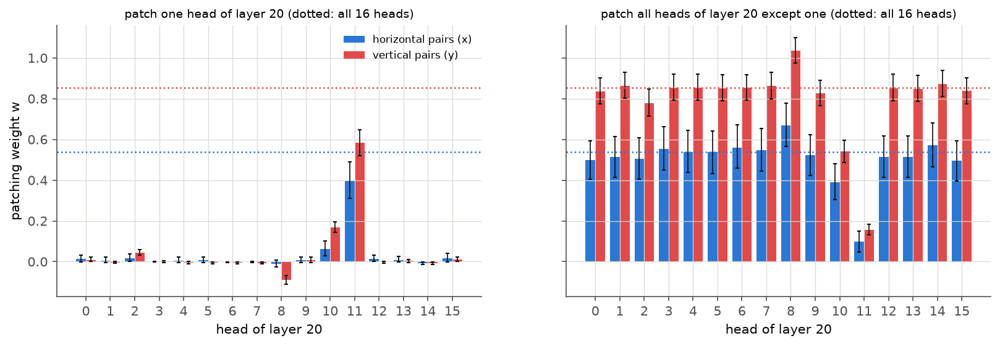

5. **层 20 内部由单个 head 主导。** 只替换 L20 H11 的 $w$ 为 0.48 [0.43, 0.54]（横向 0.40、纵向 0.58），约为整层的 70%；只替换 L20 H10 为 0.11，其余 14 个 head 不超过 0.05。替换除 H11 以外的 15 个 head 时 $w$ 降至 0.12，替换除 H10 以外的 15 个 head 为 0.45；L20 H8 的作用方向相反，去掉它后整层的 $w$ 从 0.68 升至 0.84。L20 H11 在 C1 中未被选为单目标候选 head（其 attention 最大位置命中目标的比例为 0.37，低于 0.5 的阈值），但在 6×6 行列任务的候选中排第 4、在 RefCOCO point 任务按同一规则选出的候选中排第 2（第 3.6 节）。

#### 3.4.3 冗余结构

按指向分数（C1 选择集上坐标首位 token 的平均 $\log E$）从高到低取前 $k$ 个 full attention head，在答案位置做均值消融；对照为从前 40 名以外随机抽取的 $k$ 个 head（每个 $k$ 抽 3 组）。

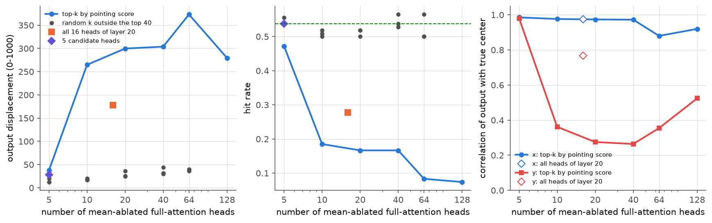

| 消融的 head | 输出位移 | 命中率 | 与真值的相关（x / y） | 识别 logit 差变化 |
| --- | --- | --- | --- | --- |
| 无 | — | 58/108 = 0.54 [0.44, 0.63] | 0.99 / 0.99 | — |
| 5 个候选 head | 28 | 58/108 | 0.99 / 0.99 | −0.06 |
| 指向分数前 5 | 38 | 51/108 | 0.99 / 0.98 | −0.01 |
| 指向分数前 10 | 265 [219, 316] | 20/108 = 0.19 [0.12, 0.27] | 0.98 / 0.36 | −0.31 |
| 指向分数前 20 / 40 | 300 / 304 | 18/108、18/108 | 0.97 / 0.28，0.97 / 0.26 | −0.31 / −0.84 |
| 指向分数前 64 / 全部 128 | 373 / 279 | 9/108、8/108 | 0.88 / 0.35，0.92 / 0.52 | −0.69 / −1.84 |
| 层 20 的全部 16 个 head | 178 [147, 212] | 30/108 = 0.28 [0.20, 0.37] | 0.97 / 0.77 | 0.05 |
| 层 16 的全部 16 个 head | 23 | 55/108 | 0.99 / 0.99 | −0.51 |
| 随机 5–64 个 head（15 组） | 13–44 | 0.50–0.56 | 0.99 / 0.99 | −2.5 至 0.7 |

输出位移与识别 logit 差变化为跨图像均值，命中率给出分母与 Wilson 区间。

1. **冗余集中在少数 head 之间。** 消融前 5 个 head 几乎无影响，加入第 6–10 名（L16 H6、L20 H11、L20 H4、L20 H8 与 L16 H12）后命中率从 0.47 骤降至 0.19，输出平均移动 265 个单位；继续扩大到 40 个 head 只增加少量损伤。随机消融 64 个 head 不改变命中率。坐标读取的冗余存在于指向分数最高的约 10 个 head 之间，与模型其余部分无关。
2. **损伤针对纵坐标。** 消融前 10 个 head 后，输出纵坐标与真值的相关从 0.99 降至 0.36，横坐标保持 0.98；层 20 的整层消融同样主要损伤纵坐标（0.77）。识别 logit 差只下降 0.31（基线约 5.2），目标识别不受影响。
3. **层 20 的整层消融弱于其中 6 个 head 的消融。** 单独消融前 10 名中属于层 20 的 6 个 head 已使纵坐标相关降至 0.41、命中率降至 0.21，而层 20 全部 16 个 head 的消融只降至 0.77 与 0.28；层 16 的 4 个 head 单独消融无影响。均值消融把层 20 的全部 head 同时固定为平均输出，包括作用方向相反的 L20 H8，因此整层消融与部分消融不满足单调关系。
4. **Gated DeltaNet 层的均值消融无法解释。** 以平均输出替换层 1–11、13–23 或全部 24 层 Gated DeltaNet 的整层输出后，108 个回答中有效回答分别为 0、1、0 个（输出退化为重复的括号或代码围栏）；只替换层 25–31 时 81/108 有效。整层均值消融同时破坏了语言生成本身，Gated DeltaNet 层的作用以 3.4.2 节的 patching 结果为准。

#### 3.4.4 横坐标与纵坐标的路径

为检验横坐标是否在生成开始前已被读取，部分集合另从图像之后的第一个 token（问题文本、模板与答案）开始做均值消融，均值仍取答案位置的平均输出。

| 消融的 head | 起点：答案位置（x / y 相关，命中率） | 起点：图像之后（x / y 相关，命中率） |
| --- | --- | --- |
| 指向分数前 10 | 0.98 / 0.36，0.20 | 0.96 / 0.29，0.19 |
| 层 16 与层 20 的全部 32 个 head | 0.96 / 0.34，0.14 | 0.78 / 0.25，0.14 |
| 全部 128 个 head | 0.92 / 0.55，0.08 | 横坐标恒为 499 / 0.44，0.02 |

1. 只在答案位置消融全部 full attention head 时，横坐标与真值的相关仍为 0.92；消融起点提前到图像之后，108 个回答的横坐标全部为 499，纵坐标 99/108 为 500。横坐标可以在不经过答案位置 full attention 的情况下到达答案，前提是图像之后的文本位置在 prefill 中经 full attention 读取过图像；答案位置能接触这些文本位置的唯一其他途径是 Gated DeltaNet 的递推状态，与 3.4.2 节层 25–31 的 patching 结果相符。
2. 纵坐标在两种起点下均受到严重损伤，主要依赖答案位置的层 20 读取。该分工与第 3.3 节的位置来源一致：纵向位置更多来自序列顺序，横向位置更多来自 ViT RoPE。由于图像之后起点的消融对问题文本位置使用了答案位置的平均输出，该条件偏离训练分布较远，只用于判断信息是否存在，不用于估计权重。

### 3.5 网格定位失败的定向分析

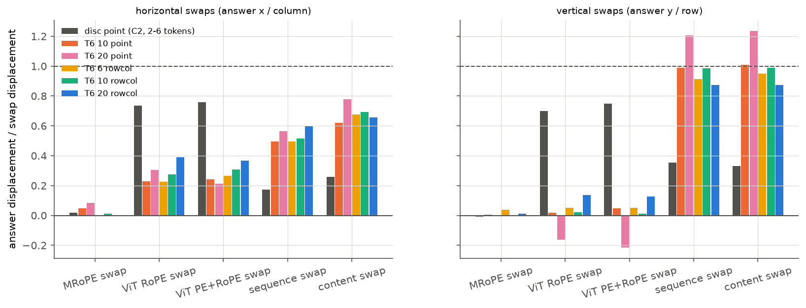

上图为各类区域互换下答案位移与互换位移之比，左为横向互换（答案的 x 或列号），右为纵向互换（答案的 y 或行号）；网格条件为相邻一个单元的互换，单目标条件取自 C2。

1. **网格任务同样不使用 MRoPE。** 20×20 行列任务在 MRoPE 平移 $\pm 2$、$\pm 4$ 个单位下 0/48 的答案改变；MRoPE 区域互换的跟随比为 −0.02–0.02。把 $p^{w}$ 压缩为 0.9 倍使列号平均变化 −0.12（8/48 改变），不足以解释多计 1 的系统偏差。
2. **网格中的行号由序列顺序决定，列号由序列顺序与 ViT RoPE 共同决定。** 20×20 行列任务中，序列置换使行号跟随 0.77–0.98、列号跟随 0.50–0.70；ViT PE 与 RoPE 同时互换使列号跟随 0.33–0.41、行号只跟随 0.02–0.23。6×6 与 10×10 行列任务给出同样的分工：序列置换的行号跟随比为 0.88–1.02、列号为 0.03–0.62，ViT 互换的列号跟随比为 0.21–0.49、行号不超过 0.06。6×6 的主条件补齐后（96 张图像），MRoPE 平移与缩放使行列答案改变的比例为 0–4%，单独交换 ViT RoPE ID 的列号跟随比为 0.21 与 0.24、行号为 0.05；6×6 point 任务的横坐标在 ViT RoPE 互换下跟随 0.38–0.45、纵坐标 0.11–0.15，在序列置换下纵坐标跟随 0.79–0.83。10×10 point 任务的纵坐标在序列置换下跟随 0.90–1.07，在 ViT 互换下只有 0.03–0.06。相距 3 个单元的互换给出相同的结论：20×20 行列任务中纵向序列置换的跟随比为 0.91 与 1.02，横向为 0.47 与 0.63。与单目标图像相比，网格中 ViT RoPE 的作用明显减弱，可能因为规则网格中每个实例的局部 ViT 上下文相同，RoPE 只能在目标附近提供有限的位置差异。

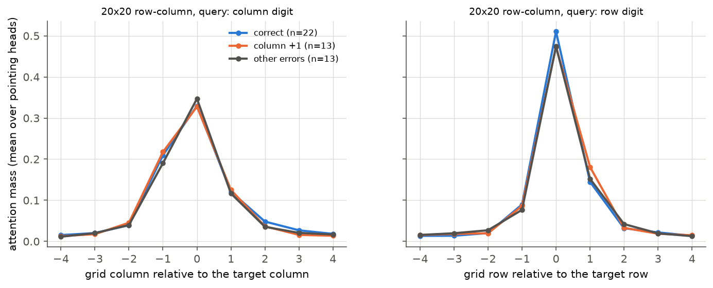

3. **列号多计 1 与读取相邻列无关。** 以 6×6 行列任务选出的 10 个指向型 head 计算 20×20 任务列号首位数字处的 attention，答对样本（$n = 22$）与列号多计 1 的样本（$n = 13$）在目标列的质量分别为 0.33 与 0.33，在右侧相邻列为 0.12 与 0.13；两组分布几乎重合，峰值都在真值列。

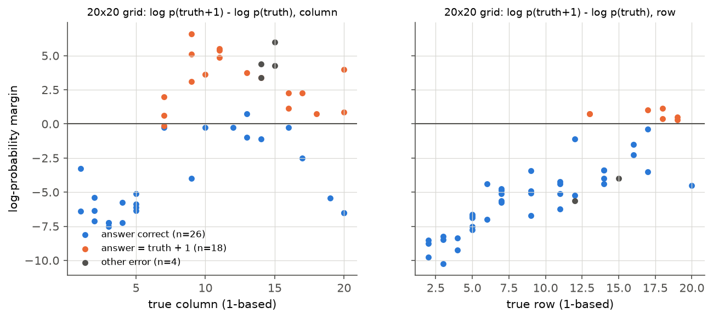

4. **多计 1 是高置信的数值错误。** 20×20 行列任务中，以 teacher forcing 比较真值列号 $c$ 与 $c + 1$ 的对数概率，列号答对的样本（$n = 26$）中 $\log p(c+1) - \log p(c)$ 平均为 −4.4，列号多计 1 的样本（$n = 18$）中为 +3.06；行号多计 1 的样本（$n = 7$）为 +0.69。另有样本在 20 列的网格中回答第 21 列，与实验 1.3 中 T0 计出 21 列的现象一致。

6×6 网格中没有列号多计 1 的回答，列号答对样本（$n = 48$）的 $\log p(c+1) - \log p(c)$ 平均为 −6.97，比 20×20 的答对样本更确定。

综合以上三点：20×20 网格的列号错误不来自 MRoPE、不来自读取相邻列，也不是两个相邻数字之间的微弱偏好。目标位置被正确读取，错误发生在把读取到的位置转换为序数的步骤中，这一步骤主要依据序列顺序与 ViT 位置。实验 1.3 的补充实验表明，多计 1 出现在任何含 20 个 64-pixel 实例的轴上（20×10 网格的行、10×20 网格的列），单元缩小到 32 pixels 时消失，且同一图像上的行列计数正确而定位多计 1；结合本节结果，多计 1 是“读取到的位置 → 序数”换算对实例数与单元尺度的系统偏差，而不是列方向特有的读取错误，20×20 方形网格中列多于行的错误比例仍待解释。10×10 point 答案平均向右下偏移 0.32 与 0.35 个单元（3.1 节），同属读取之后的数值换算偏差。

### 3.6 自然图像（RefCOCO）

单目标画布排除了内容线索，T6 网格的实例完全相同。本节在实验 3.4 测试划分的 300 张 RefCOCO 图像（与实验 3.4 的 probe 测试图像相同）上重复 C0、C1 与第 6.6 节的干预，检验三个主要结论能否推广到自然图像：MRoPE 的权重接近 0、ViT RoPE 主导、坐标 token 在层 12–24 重新读取图像。问题为 “Locate the object described as: {expression}.” 加与单目标任务相同的格式要求。

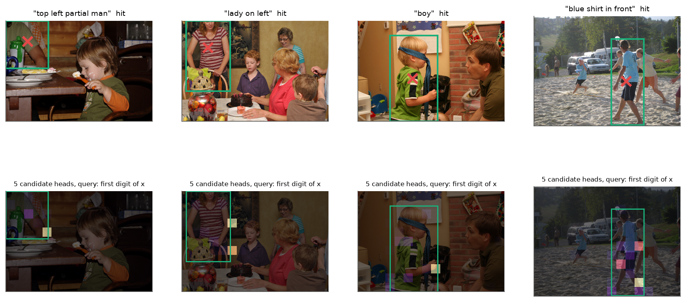

上排为随机抽取的 4 个 point 样本，绿色框为真值 bbox，红叉为模型输出；下排为 5 个候选 head 在横坐标首位数字处的平均 attention。

#### 3.6.1 C0：基准表现

| 格式 | 严格评分 | 任一坐标约定命中 | 只在 pixel 约定下命中 | 机会命中率（严格 / 任一） | 中心误差（0–1000） | 回归斜率 x / y |
| --- | --- | --- | --- | --- | --- | --- |
| point | 命中 291/300 = 0.97 [0.94, 0.98] | 291/300 | 0/300 | 0.22 / 0.25 | 48.9 [41.6, 57.4]，中位数 25.8 | 1.02 / 0.99 |
| bbox | IoU≥0.5 为 273/300 = 0.91 [0.87, 0.94]，平均 IoU 0.85 | 中心命中 289/300 | 0/300 | 0.22 / 0.25 | 30.4，中位数 8.7 | 0.97 / 0.92 |

RefCOCO 的目标平均占图像面积的 22%（按 visual token 计为 28%），机会命中率远高于单目标画布，因此 0.97 的命中率不能与单目标画布的 0.54 直接比较；中心误差的中位数 25.8 与单目标画布直径 128 的误差 82.1 相比仍小得多，回归斜率接近 1，没有出现单目标画布上的拉伸或网格上的压缩。按 pixel 约定以 IoU≥0.5 评分的 bbox 为 0/300，模型在自然图像上始终使用 0–1000 约定。2 个 point 回答无法解析，计入分母。

#### 3.6.2 C1：读取模式

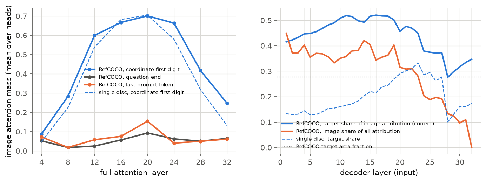

1. **读取窗口复现。** point 任务坐标首位数字在层 12、16、20、24 的图像 attention 质量为 0.60、0.67、0.70、0.66，层 4 为 0.09、层 32 为 0.25；问题末端、`</think>` 与最后一个 prompt token 在全部层不超过 0.15。曲线与单目标画布（虚线）几乎重合，层 24 处高 0.08。
2. **候选 head 在自然图像上仍指向目标。** 单目标画布选出的 5 个候选 head 在 RefCOCO point 任务上的平均 $\log E$ 为 1.19–1.28，attention 最大位置落在目标 bbox 内的比例为 0.91–0.92，在 128 个 head 中排第 5–14 名。目标平均占 28% 的 visual token，$\log E$ 的上限约为 $\ln(1/0.28) \approx 1.28$，这些 head 的富集接近饱和。在 RefCOCO 上按同一规则重新选出的前 10 个 head 全部位于层 16 与 20，与单目标画布的 5 个候选重叠 4 个，L20 H2 与 L20 H11 排在前两位。答对样本中 5 个候选 head 的 attention 质心与真值中心的相关为 0.94（x）与 0.84（y）。
3. **目标区域的归因在层 24 之后下降。** 答对样本的 $\rho^{\ell}$ 在层 10–18 维持在 0.49–0.52，层 24 输入处降至 0.38、层 28 降至 0.28；图像归因占比从层 1 的 0.45 降至层 28 之后的 0.10–0.13。下降从层 24 开始，单目标画布的骤降出现在层 28，两者形状一致。

#### 3.6.3 位置来源干预

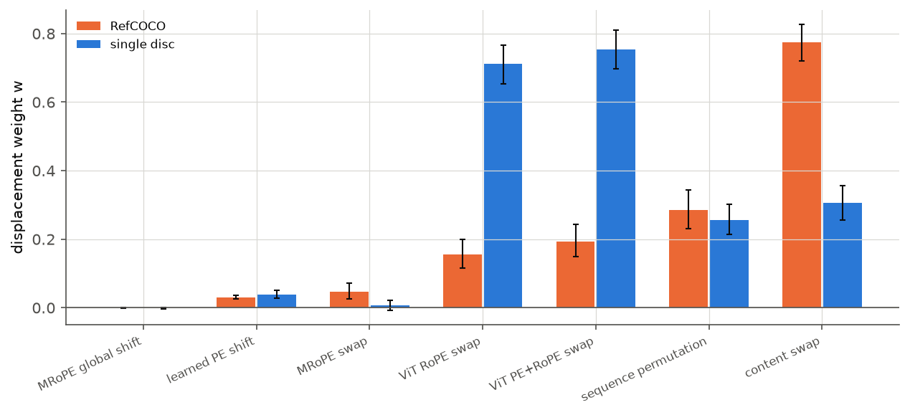

全局平移在 298 张有效图像上运行；区域互换要求目标的平移副本完全位于图像内，横向 189 张、纵向 49 张满足条件（RefCOCO 目标多为纵向较长的人物）。

| 干预 | RefCOCO $w$ | 横向 / 纵向 | 单目标画布 $w$ |
| --- | --- | --- | --- |
| MRoPE 全局平移 | −0.00 [−0.00, 0.00] | 0.00 / −0.00 | −0.00 |
| learned PE 窗口平移 | 0.03 [0.02, 0.04] | 0.03 / 0.03 | 0.04 |
| MRoPE 区域互换 | 0.05 [0.03, 0.07] | 0.05 / 0.00 | 0.01 |
| ViT RoPE 互换 | 0.16 [0.12, 0.20] | 0.17 / 0.08 | 0.71 |
| ViT PE 与 RoPE 互换 | 0.19 [0.15, 0.24] | 0.20 / 0.12 | 0.75 |
| 序列置换 | 0.28 [0.23, 0.34] | 0.20 / 0.72 | 0.26 |
| 内容交换 | 0.78 [0.72, 0.83] | 0.78 / 0.76 | 0.30 |

区间为以图像为单位的 bootstrap 95% 区间；$e_{\perp}$ 为 0.01–0.14。间隙基线与标准输入的中心差中位数为 2、均值为 5.6，ViT RoPE 整体平移为中位数 4、均值 9.6，噪声水平与单目标画布相当。

1. **MRoPE 的结论成立。** 全局平移的权重为 −0.00，答对与答错样本相同，图像与文本之间的 ID 差不参与坐标读取；区域互换的权重为 0.05。
2. **ViT RoPE 主导的结论不成立。** 只交换 ViT RoPE ID 的权重为 0.16，是单目标画布的约五分之一；按互换距离分组（平移 2–4、5–7、8 个及以上 token）为 0.04、0.15、0.27，均远低于单目标画布同等距离下的 0.44–0.73。
3. **槽位成为主要来源，且依赖 MRoPE ID 与槽位一致。** 内容交换把目标的 visual embedding 移入 $\mathcal{T}'$ 的槽位，槽位与 MRoPE ID 都指向 $\mathcal{T}'$，输出跟随 0.78；序列置换只移动槽位、token 保留原 MRoPE ID，权重为 0.28；只交换 MRoPE ID 为 0.05。0.78 明显大于 0.28 与 0.05 之和，说明 MRoPE ID 单独改变时不起作用，与槽位一致时显著增强槽位的作用。全局平移保持了图像内部 ID 与槽位的一致，因此不改变输出。单目标画布上同样存在较弱的这种关系（内容交换 0.30、序列置换 0.26、MRoPE 互换 0.01）。
4. **序列顺序承载纵向位置。** 序列置换的纵向权重为 0.72、横向为 0.20，与单目标画布和 T6 网格的分工相同。横向位置在序列置换下跟随较少，需要 MRoPE ID 与槽位一致才能移动（内容交换横向 0.78）。

综合三项检验：MRoPE 全局 ID 不参与坐标、坐标 token 在层 12–24 重新读取图像这两项结论推广到自然图像；“ViT RoPE 决定坐标”只在内容不提供位置线索的单目标画布上成立。在自然图像中，visual embedding 自身携带的位置只占约 0.2，坐标主要由目标内容所在的序列槽位与该槽位的 MRoPE ID 共同决定。一种可能的解释是，单目标画布上每个 token 的 ViT 上下文只由 RoPE 区分，而自然图像中目标 patch 的表示还依赖与周围内容的关系，交换 RoPE ID 后这些关系与新位置不一致，decoder 更多依据槽位定位。该解释尚未检验。

### 3.7 C5：行列答案的插行与插列

T6 行列答案在 MRoPE 平移下不变（第 3.5 节），但序列置换会移动行号。本节检验行列序数是由目标的像素位置换算而来，还是由目标在实例之间的相对次序决定。在 144 张 T6 行列图像上，于目标所在行的上方（或目标所在列的左侧）插入一个单元宽的白色空白带，目标的行列序数不变而像素位置移动一个单元；插在画布顶边（左边）时整个网格一起移动，插在底边（右边）时目标像素位置不变，作为画布尺寸变化的对照。position IDs 层面的插入保持像素不变，把插入点之后的 MRoPE 行（列）ID 增加 2。

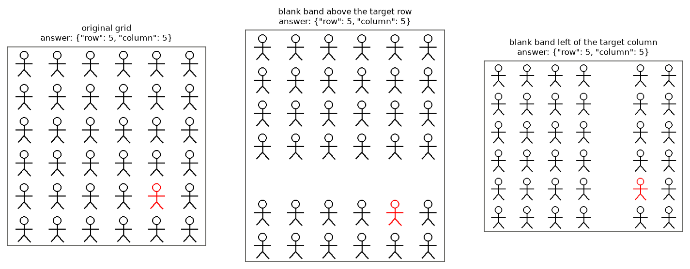

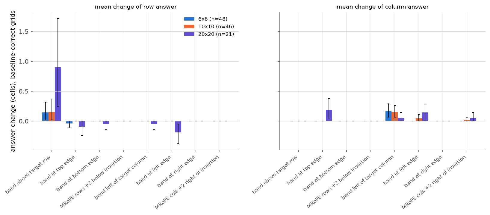

| 条件（基线答对的网格） | 6×6（$n = 48$） | 10×10（$n = 46$） | 20×20（$n = 21$） |
| --- | --- | --- | --- |
| 目标行上方插入空白带：行号改变 | 5（行号 +1 为 4） | 4（+1 为 3） | 6（+1 为 2） |
| 顶边插入：任一答案改变 | 2 | 0 | 6 |
| 底边插入：任一答案改变 | 0 | 0 | 1 |
| 目标列左侧插入空白带：列号改变 | 7（+1 为 6） | 7（全部 +1） | 2（+1 为 1） |
| 左边插入：任一答案改变 | 0 | 2 | 7 |
| 右边插入：任一答案改变 | 0 | 0 | 0 |
| MRoPE 行 ID 插入：行号改变 | 0 | 0 | 0 |
| MRoPE 列 ID 插入：列号改变 | 0 | 1 | 1 |

基线答对的样本以同一 batch 中的标准输入判定。6×6 网格目标行上方插入时行号改变 5/48 = 0.10 [0.05, 0.22]，目标列左侧插入时列号改变 7/48 = 0.15 [0.07, 0.27]。

1. **行列序数不随像素位置换算。** 插入空白带使目标下移一个单元，若序数由像素位置除以单元尺度得到，行号应全部加 1；实际只有 9%–15% 的 6×6 与 10×10 答案改变，改变多数为 +1。模型主要依据目标在实例之间的相对次序作答。
2. **position IDs 插入不改变答案。** 与第 3.5 节的 MRoPE 平移一致，position IDs 层面的插入在 115 个答对网格中只改变 2 个列号。
3. **网格中间的空白带比边缘的空白带影响更大。** 6×6 与 10×10 网格中，顶边、左边、底边、右边插入几乎不改变答案（0–2 个），中间插入改变 4–7 个，23 个改变中 20 个为 +1：空白带被部分样本计为一行或一列实例。20×20 网格中边缘插入同样改变 6–7/21 个答案，该规模的答案对任何画布变化都不稳定，不能区分两种解释。
4. **生成行号时 attention 不逐行扫描。** 以 6×6 行列任务选出的 10 个指向型 head 计算行号首位数字处 attention 在各行的分布，答对样本中目标行占 0.53–0.66，目标行之前的各行合计 0.11–0.17，之后的各行合计 0.24–0.30（6×6、10×10、20×20）。若模型在生成时依次计数目标之前的行，attention 应集中于目标之前的行；实际分布以目标行为峰、两侧近似对称，计数（若存在）在生成开始前已经完成。

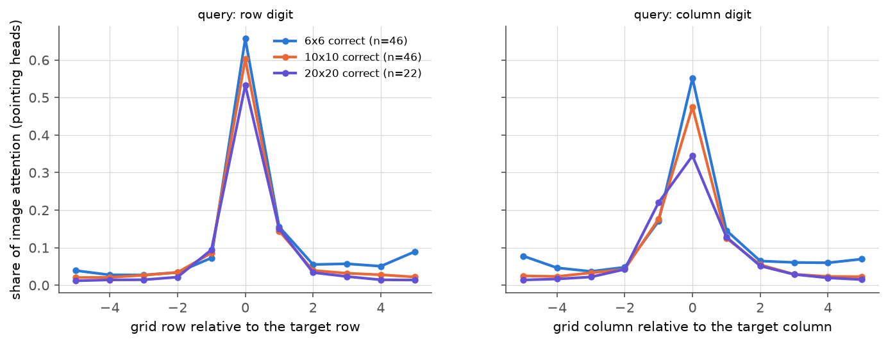

## 4. 限制与待开展部分

1. **RefCOCO 的区域互换与设计不同。** 设计第 6.6 节只规定全局平移；为检验 ViT RoPE 的作用另加入区域互换。自然图像中 $\mathcal{T}'$ 含有其他内容，互换同时把另一块内容的位置标签换到 $\mathcal{T}$，且满足条件的样本偏向较小的目标（横向 189 张、纵向 49 张）。S3 内容线索的权重无法从全局平移中单独估计：全局平移下 MRoPE 与 learned PE 的权重均接近 0，$1 - w$ 主要反映这两个来源本身不起作用。
2. **patching 的 run B 与 run A 在图像内容上只差目标位置。** run B 被强制跟随 run A 的生成 token，其文本上下文与自身自由生成时不同；“全部 token mixer”的上限检查（$w$ 与 run B 自身相同）表明这种对齐不影响结论。
3. **Gated DeltaNet 层的整层均值消融破坏生成。** 层 1–23 的整层均值替换使几乎全部回答无效，linear attention 层的必要性无法用均值消融检验，本文只报告其 patching 结果。图像之后起点的消融对问题文本位置使用答案位置的平均输出，同样偏离训练分布。
4. **20×20 网格的梯度归因分两次运行。** 主运行中 20×20（约 1700 个 token）的反向传播在共享 GPU 上显存不足，相应记录先标为缺失，随后以 c1grad 阶段在显存更大的 GPU 上补算全部 96 条，未以任何值填补。
5. **单目标网格的边缘位置有裁切。** 6×6 网格外圈加抖动后，直径 64 与 128 的圆在 21/108 个 point 样本中部分超出画布，真值使用可见部分的 tight bbox。
6. **噪声水平。** bf16 下数学上等价的输入（间隙基线、ViT RoPE 整体平移）也会使坐标平均变化约 6 个单位，小幅位移不作解释。
7. **C5 的样本量。** 20×20 网格基线答对的样本只有 21 个，且边缘插入同样改变答案，该规模的插行结果只作描述。
8. **坐标单位。** 实验 1.3 的补充实验发现模型在稀疏的 768-pixel 画布上有时以绝对 pixels 作答；本实验全部单目标与 RefCOCO 回答的坐标均不超过 1000，只有 20×20 网格（1280 pixels）有 4/48 个 point 回答只在 pixel 约定下命中（第 3.1 节）。
9. **分布外输入。** ViT RoPE 互换与序列置换产生训练中未出现的输入，$e_{\perp}$ 为 0.05–0.14，处于可接受范围，但权重的绝对值仍可能受分布外效应影响。

## 5. 由结果导出的后续实验

1. **层 20 读取的坐标表示。** 层 20 的 head（尤其 L20 H11）把纵坐标写入答案位置，可在其输出与答案位置 residual 上检验坐标数值以何种形式表示，以及从表示到“整齐”数字的转换在哪些层发生（对应实验 3.6）。
2. **序列顺序与 MRoPE 一致性的作用。** 自然图像中槽位与 MRoPE ID 一致时的权重（0.78）远大于二者单独作用之和，可在 Gated DeltaNet 层与 full attention 层分别破坏这种一致性，定位依赖顺序的计算（对应实验 3.8）。
3. **ViT 位置在自然图像中的作用。** 单目标画布与 RefCOCO 上 ViT RoPE 权重的差异需要在 ViT 内部检验：目标 patch 的表示在 RoPE 交换后是否仍与周围内容的关系一致（对应实验 3.7）。
4. **方向二的窗口设计。** 重读窗口时，全局 MRoPE ID 可以自由选择，但窗口 token 的排列顺序与窗口内部的 MRoPE ID 需要与原图保持一致。

## 6. 产物

产物位于 WORK_DIR 的 `analysis/position/2026-10-14_coordinate_readout/`：`cases.json`（全部样本与真值）、`baseline/`（C0 回答、评分与 generate 一致性抽查）、`attention/`（C1 指标与关键 query 的 attention、有效贡献与梯度归因图）、`interventions/`（C2 与 C3）、`ablation/`（C4 均值消融；`records_redundancy.jsonl` 为冗余结构，`records_post_image.jsonl` 为两种消融起点，`mixer_means.pt` 为均值）、`patching/`（C4 输出 patching；`records_L20.jsonl` 为层 20 的逐 head 扫描）、`refcoco/`（RefCOCO 样本、基线、`attention/` 与 `interventions.jsonl`）、`insertion/`（C5）、`failure/`（网格定向分析）、`results.json`（主运行的全部指标与区间）、`results_supp.json`（补充部分的指标）、`experiment.json`（模型版本、代码摘要与运行参数）。程序为 `analysis_tools/position/coordinate_readout*.py`，入口为 `scripts/analysis/position/coordinate_readout.sh`。
