# 坐标读取路径

实验日期：2026-10-14。本文属于[位置信息与坐标读取](plan.md)研究，执行[实验 3.5 设计](design_coordinate_readout.md)。模型为 Qwen3.5-9B，bfloat16、SDPA、greedy decoding，thinking off。

## 1. 研究问题与主要结果

实验 1.3 表明 Qwen3.5-9B 的位置输出是独立于细节感知的主要瓶颈：20×20 网格中列号多计 1 的答案占只错列答案的 75%，10×10 网格的中心点命中率只有 0.23 而 94% 的预测落在一个单元以内，中心点坐标的回归斜率偏离 1。实验 2.5a 表明视觉信息在 full attention 层 8、12、16 向文本位置传递。本实验在模型生成 point、bbox 与行列答案时测量 attention 与梯度归因，并对四种位置来源（S1 ViT 位置、S2 decoder MRoPE position IDs、S3 视觉内容、S4 序列顺序）逐一进行因果干预，回答坐标信息来自哪里、经过哪些层、以及网格定位为何出错。

主要结果如下：

1. **decoder 的 MRoPE position IDs 对坐标输出没有因果作用。** 在 108 张单目标图像上，图像 token 的 MRoPE ID 整体平移 $\pm 2$ 至 $\pm 8$ 个单位的位移权重为 $w = -0.00$，区域互换为 $w = 0.01$；T6 网格的行列答案在全部 MRoPE 平移下 0 次改变。
2. **单目标坐标主要由 ViT 2D RoPE 写入 visual embedding 的位置决定，learned absolute position embedding 几乎不起作用。** 只交换 ViT RoPE ID 的位移权重为 0.71 [0.65, 0.77]，同时交换 PE 与 RoPE 为 0.75，只交换 PE 为 0.01；圆真实移动的对照为 1.11。
3. **序列顺序是第二个位置来源，且主要承载纵向位置。** 单目标图像中，序列置换的权重为横向 0.17、纵向 0.35；T6 网格中，行号与纵坐标几乎完全跟随序列中的槽位（内容交换的跟随比 0.87–1.24），列号与横坐标由 ViT RoPE（0.23–0.39）与序列顺序（0.49–0.60）共同决定。
4. **坐标 token 在生成时重新读取目标。** 生成坐标首位数字时，full attention 层 16 与 20 上平均 68%–70% 的 attention 落在图像 token 上，目标富集度约为 12 倍；生成开始前的问题末端、`</think>` 与最后一个 prompt token 只有 4%–14% 的 attention 落在图像上。
5. **20×20 网格的列号多计 1 发生在读取之后。** 答错样本中指向型 head 的 attention 峰值仍位于真值列，与答对样本的分布重合；teacher forcing 下，多计 1 的样本对 $c+1$ 的对数概率比真值高 3.06，属于高置信的错误，不是两个相邻候选之间的微弱偏好。模型还会给出超出网格范围的第 21 列。
6. **点坐标集中于少数“整齐”数值。** 单目标 point 回答的 472 个坐标值中 500 出现 78 次，667、750、333、250 等简单分数值也明显过多；T6 回答集中于 125、375、417、583、917 等网格单元中心值。坐标输出带有离散化的取值偏好，这是中心点误差与回归斜率偏离 1 的直接成因之一。

## 2. 实验设计与实际执行

### 2.1 位置来源与干预

Qwen3.5-9B 中可能把位置带到坐标 token 的四条路径如下：

| 来源 | 计算位置 | 本实验的干预 |
| --- | --- | --- |
| S1 ViT 位置 | ViT：patch embedding 后加入一次 learned absolute position embedding（PE），27 层 attention 均使用 2D RoPE | 平移 PE 插值窗口；在两个区域之间交换 PE、RoPE ID 或二者；缩放 RoPE ID |
| S2 MRoPE position IDs | decoder 的 8 个 full attention 层（4, 8, …, 32） | 整体平移图像 token 的 $(p^{h}, p^{w})$；区域互换；按比例缩放 |
| S3 视觉内容 | 图像本身 | 本次只在合成图像上运行，内容不提供位置线索 |
| S4 序列顺序 | 24 个 Gated DeltaNet 层与 causal mask | 交换两区域 token 在序列中的槽位，token 保留自己的 embedding 与 MRoPE ID |

另有两个组合条件：内容交换（C3）交换两区域的 visual embedding，MRoPE ID 与槽位不动，因此目标内容携带的 S1 位置指向原位置，而槽位（S2 与 S4）指向新位置；自然移动对照把圆实际画在新位置，给出真实位移下输出的跟随程度。

### 2.2 刺激与问题

| 任务 | 图像 | 格式 | 样本量 |
| --- | --- | --- | --- |
| 单目标网格 | 512×512 白色画布，单个红色实心圆，直径 32、64、128 pixels，圆心位于 6×6 等距位置并加 $\pm 16$ pixels 抖动 | point、bbox | 108 张 × 2 |
| 平移序列 | 圆心沿水平或竖直中线以 32 pixels 步长移动，圆完整位于画布内 | point | 86 张 |
| 画布尺寸序列 | 边长 256–1280 pixels，7 个固定相对位置 | point | 42 张 |
| T6 网格 | 实验 1.3 的红色目标网格与原问题，6×6、10×10、20×20 | 行列、point、bbox | 每种规模 48 张 × 3 |

单目标问题为 “There is one red circle in the image.” 加实验 1.3 的格式要求，例如 point 格式为 “Give the center of its bounding box. Return only [{"point_2d": [x, y]}]. All coordinates use 0-1000 normalization; x increases rightward and y increases downward. Output only the JSON, with no explanation.”。T6 使用实验 1.3 的原问题 “One figure is drawn in red. Give its position. Return only {"row": r, "column": c}, …”。下图为实际输入示例：

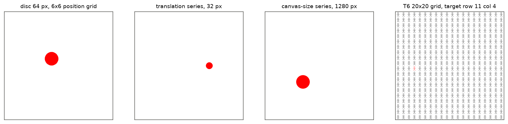

### 2.3 符号与指标

记 $\mathcal{V}$ 为全部 visual token 的集合，$\mathcal{T} \subset \mathcal{V}$ 为与目标 tight bbox 重叠的 visual token 集合。full attention 层 $\ell$ 的 head $k$ 在 query 位置 $m$ 对 token $j$ 的 softmax 权重记为 $a^{\ell,k}_{m,j}$。坐标 token 的 query 位置是其 next-token 预测产生该 token 的输入位置。

**目标富集度。** 定义

$$
E^{\ell,k}_{m} = \frac{\sum_{j \in \mathcal{T}} a^{\ell,k}_{m,j} \big/ \sum_{j \in \mathcal{V}} a^{\ell,k}_{m,j}}{|\mathcal{T}| \,/\, |\mathcal{V}|}.
$$

分子是图像上的 attention 中落在目标区域的比例，分母是目标区域的面积比例，$E = 1$ 表示与均匀分配相同。“图像 attention 质量”指 $\sum_{j \in \mathcal{V}} a^{\ell,k}_{m,j}$。

**归因占比。** 设 $z$ 为坐标首位 token 的 logit 减去其余 9 个数字 token 的平均 logit，$x^{\ell}_{j} \in \mathbb{R}^{4096}$ 为第 $\ell$ 层输入在 token $j$ 上的 residual。定义

$$
A^{\ell}_{j} = \left( \frac{\partial z}{\partial x^{\ell}_{j}} \right)^{\mathsf T} x^{\ell}_{j}, \qquad \rho^{\ell} = \frac{\sum_{j \in \mathcal{T}} |A^{\ell}_{j}|}{\sum_{j \in \mathcal{V}} |A^{\ell}_{j}|}.
$$

$A^{\ell}_{j}$ 是 $z$ 对该 residual 的一阶贡献，$\rho^{\ell}$ 是目标区域在图像归因中的占比；另记图像 token 在全部 token 归因中的占比（下文称图像归因占比）。

**位移权重。** 设基线输出坐标为 $\hat y_0 \in \mathbb{R}^{2}$，干预后输出为 $\hat y \in \mathbb{R}^{2}$，干预在某一来源上施加的位移为 $d \in \mathbb{R}^{2}$（均为 0–1000 坐标）。定义

$$
w = \frac{(\hat y - \hat y_0)^{\mathsf T} d}{\| d \|^2}, \qquad e_{\perp} = \frac{\left\| (\hat y - \hat y_0) - w\, d \right\|}{\| d \|}.
$$

$w = 1$ 表示输出完全跟随被干预的来源，$w = 0$ 表示不受影响；$e_{\perp}$ 衡量垂直于 $d$ 的位移。网格任务以单元为单位记录答案位移，跟随比为答案位移除以互换位移（同为单元数），与 $w$ 含义相同。

### 2.4 操作

1. **解码与干预接口。** 全部条件使用自行实现的 greedy 解码：向模型传入 inputs_embeds 与形状为 $(4, B, L)$ 的 position IDs，ViT 的 RoPE ID 与 PE 插值索引作为前向参数替换。同一图像的各条件序列长度相同，以不含 padding 的 batch（batch size 8）解码。随机抽取 20 个 C0 样本与参考实现 generate 比较，18/20 的答案一致，2 个不一致样本的坐标相差 4 与 10 个单位。
2. **数值噪声水平。** 间隙基线（图像前后各空出 8 个 MRoPE 位置）与标准输入相比，108 张图像中 47 张坐标完全相同，中心差的中位数为 1、均值为 5.8 个单位，首个坐标 token 的数字 logit 最大差平均 0.22；ViT RoPE ID 整体平移（数学上不变）引起的中心差中位数为 1、均值为 6.6。两者都是 bf16 舍入造成的噪声，下文小于约 10 个单位的变化不作解释，间隙基线可作为 MRoPE 平移的参照。
3. **attention 读取。** 在 full attention 模块输入处记录 hidden states 与 rotary 表，重算 query 行的 softmax 权重，并以重算的 gated 输出与模块实际输出比较；4720 个层-样本组合的相对最大误差中位数为 0.0035，最大 0.012。
4. **运行规模。** C0 共 776 次生成；C1 记录 592 个样本；C2 对 108 张单目标 point 图像各运行 47–79 个条件；C4 对 108 张图像各运行 12 种 head 集合；网格定向分析对 T6 的 5 个“规模 × 格式”组合各 48 张图像运行 43 个条件与 24 个补充条件。总计约 7 GPU 小时（共享 GPU）。

## 3. 结果

### 3.1 C0：基准表现

| 任务 | 格式 | 命中或正确 | 中心误差（0–1000） | 回归斜率 x / y |
| --- | --- | --- | --- | --- |
| 单目标网格，直径 32 | point | 8/36 [0.12, 0.38] | 77.9 [61.1, 95.3] | 1.07 / 1.11 |
| 单目标网格，直径 64 | point | 17/36 [0.32, 0.63] | 68.6 [57.1, 79.9] | 1.05 / 1.10 |
| 单目标网格，直径 128 | point | 34/36 [0.82, 0.98] | 82.1 [71.1, 92.9] | 1.12 / 1.14 |
| 单目标网格，直径 64 | bbox | 中心命中 17/36，IoU≥0.5 为 6/36 | 67.3 | 1.06 / 1.08 |
| T6 6×6 / 10×10 / 20×20 | 行列 | 46/48、46/48、22/48 | — | — |
| T6 6×6 / 10×10 / 20×20 | point | 33/48、11/48、2/48 | — | 0.92 / 0.96，0.90 / 0.98，0.88 / 0.85 |

方括号为 Wilson 95% 区间（比例）或以图像为单位的 bootstrap 95% 区间（均值）。本实验的解码器在 T6 上与实验 1.3 原回答的文本一致比例为行列 132/144、point 89/144、bbox 99/144，20×20 行列正确率 22/48 与实验 1.3 的 21/48 相当。

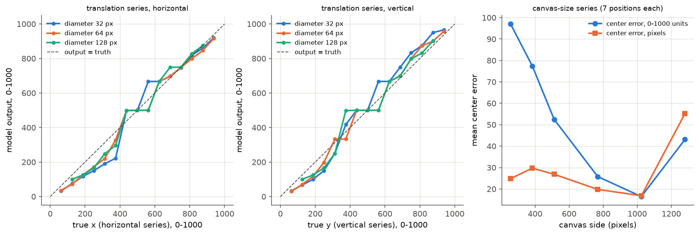

1. **单目标坐标随真实位置呈阶梯状变化。** 平移序列中，相邻多个位置给出同一输出值（例如 500、667），然后跳到下一个值；回归斜率为 1.05–1.14，截距为负，说明在空白画布上坐标向两侧拉伸，与 T6 网格中 0.85–0.98 的斜率方向相反。实验 1.3 观察到的“中心压缩”只在网格任务中成立。
2. **以 pixels 计的误差基本不随画布尺寸变化。** 画布边长 256、384、512、768、1024 时，中心误差为 25、30、27、20、17 pixels，即约 0.5–1 个 merged token；以 0–1000 计的误差因此从 97 降至 17。边长 1280 时误差升至 55 pixels。

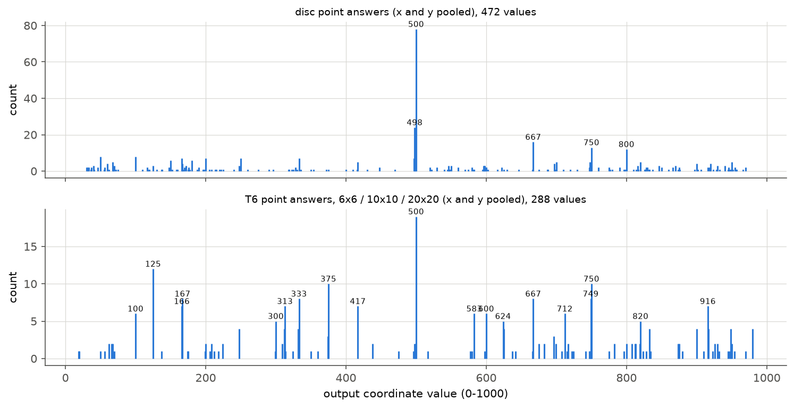

3. **坐标输出偏好少数数值。** 单目标 point 回答的 472 个坐标值共有 176 个不同取值，其中 500 出现 78 次、498 出现 24 次、667 出现 16 次、750 出现 13 次；T6 point 回答中 500、125、375、750、667、333、167 最多，这些值对应画布的二分、三分、四分、八分点或 6×6、12×12 单元中心。坐标的数字输出带有离散化的先验，连续真实位置被映射到附近的“整齐”数值，形成上图的阶梯。

### 3.2 C1：生成坐标时的 attention 与归因

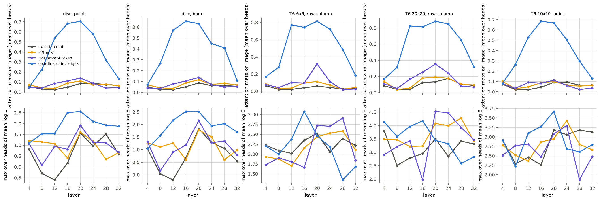

上排为图像 attention 质量（16 个 head 的平均），下排为各层中目标富集度最高的 head 的 $\log E$。数据显示：

1. **生成坐标首位数字时，模型重新读取图像。** 单目标 point 任务中，坐标首位数字在层 12、16、20、24 的图像 attention 质量为 0.54、0.68、0.70、0.58，最大 $\log E$ 为 2.5（约 12 倍富集）；问题末端、`</think>` 与最后一个 prompt token 在全部层的图像 attention 质量只有 0.02–0.14。行列任务更集中：6×6 与 20×20 的行号、列号首位数字在层 12–24 的图像 attention 质量为 0.72–0.88。
2. **读取发生在层 12–24，层 28 与 32 的读取明显减弱。** 层 4 与 8 的图像 attention 质量不超过 0.31，层 32 降至 0.11–0.32。实验 2.5a 的 patching 只测量了 prompt 内的信息流，本实验表明答案 token 在生成阶段于层 12–24 直接读取目标所在的 visual token。实验 3.4 中线性 probe 在 visual token 的 residual 上以层 14–15 读出位置的精度最高、层 19 之后下降，与这一读取窗口相符。

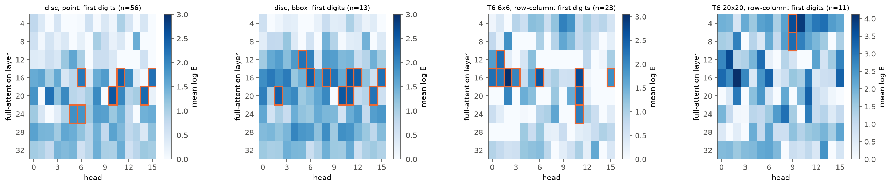

3. **候选指向型 head 集中于层 16 与 20，并在验证集上复现。** 单目标 point 任务按选择集选出的前 5 个 head 为 L20 H10、L16 H11、L20 H14、L16 H15、L16 H6，验证集上的平均 $\log E$ 为 2.46、2.37、2.25、2.22、2.12，attention 最大位置落在目标内的比例为 0.49–0.71；bbox 任务与 6×6 行列任务选出的 head 与之高度重叠（L16 H11、L20 H10、L16 H6、L20 H11、L16 H2）。20×20 行列任务答对样本只有 22 个，满足“最大位置命中率不低于 0.5”的 head 只有 L4 H9 与 L8 H9，该任务的分析改用 6×6 行列任务选出的 head。

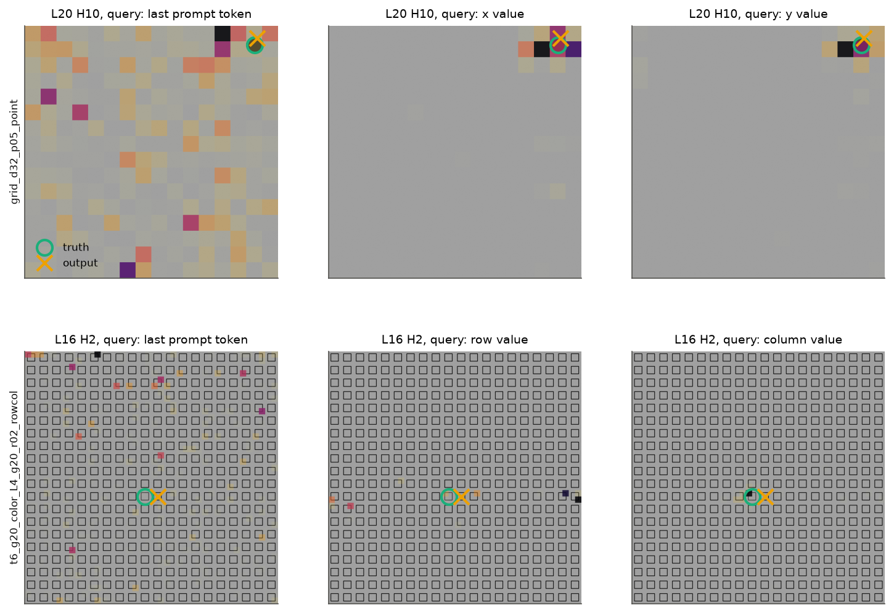

上排为一个单目标样本，下排为一个 20×20 网格中列号多计 1 的样本；圆圈为真值，叉号为模型输出。生成坐标值时，指向型 head 的 attention 集中于目标所在的 2–4 个 token。

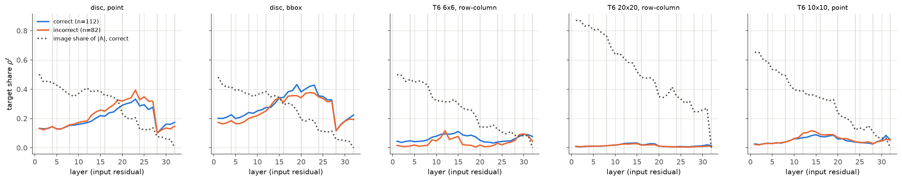

4. **目标区域的归因在层 19–23 达到峰值，层 28 之前骤降。** 单目标 point 答对样本的 $\rho^{\ell}$ 从层 1 的 0.13 升至层 23 的 0.33，层 28 输入处降至 0.10；图像归因占比从层 1 的 0.50 降至层 20 的 0.23、层 28 之后的 0.06–0.08。目标信息在层 24–27 之前已被读出到文本位置，与 attention 读取集中于层 12–24 的结果一致。答错样本的 $\rho^{\ell}$ 与答对样本几乎重合，失败与目标区域的归因不足无关。网格任务中目标只占全部 visual token 的约 0.3%（20×20）至 3%（6×6），$\rho^{\ell}$ 只有 0.01–0.11，但形状相同：20×20 行列任务的图像归因占比从层 1 的 0.87 降至层 28 之后的 0.25–0.27，答对与答错样本的 $\rho^{\ell}$ 同样重合。

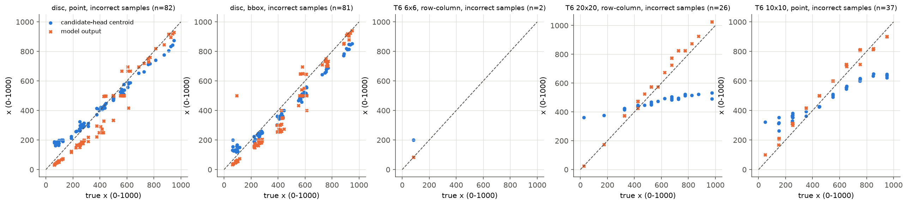

5. **答错时指向型 head 仍指向真值。** 单目标 point 答错样本（$n = 82$）中，候选 head 的 attention 质心与真值的相关为 0.995（x）与 0.991（y），平均距离为 71 个单位；与模型输出的平均距离为 130 个单位。读取阶段选对了位置，误差在读取之后产生，对应设计第 12 节“读取正确而后续表达失败”的模式。

### 3.3 C2 与 C3：位置来源的因果干预

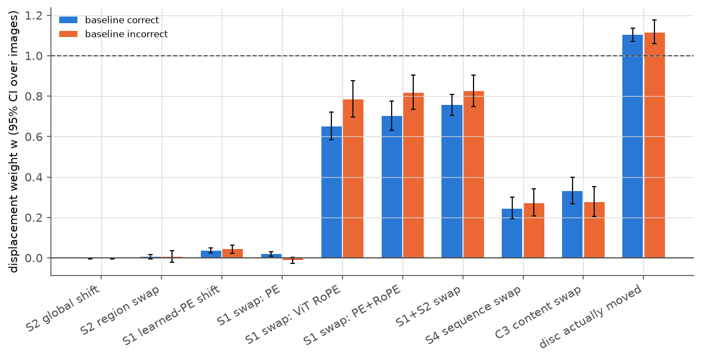

| 干预 | 基线答对（59 张） | 基线答错（49 张） | $e_{\perp}$（全部） |
| --- | --- | --- | --- |
| S2 MRoPE 整体平移 | −0.00 [−0.00, 0.00] | −0.00 [−0.00, 0.00] | 0.01 |
| S2 MRoPE 区域互换 | 0.01 [−0.00, 0.02] | 0.01 [−0.02, 0.03] | 0.02 |
| S1 learned PE 窗口平移 | 0.04 [0.02, 0.05] | 0.04 [0.02, 0.06] | 0.08 |
| S1 区域互换：只交换 PE | 0.02 [0.01, 0.03] | −0.01 [−0.03, 0.00] | 0.02 |
| S1 区域互换：只交换 ViT RoPE | 0.65 [0.58, 0.72] | 0.78 [0.70, 0.88] | 0.11 |
| S1 区域互换：PE 与 RoPE | 0.70 [0.63, 0.77] | 0.82 [0.73, 0.90] | 0.11 |
| S1 与 S2 同时互换 | 0.76 [0.71, 0.81] | 0.82 [0.75, 0.90] | 0.11 |
| S4 序列置换 | 0.24 [0.20, 0.30] | 0.27 [0.21, 0.34] | 0.06 |
| C3 内容交换 | 0.33 [0.27, 0.40] | 0.28 [0.21, 0.35] | 0.05 |
| 圆真实移动 | 1.10 [1.07, 1.13] | 1.12 [1.06, 1.18] | 0.12 |

区间为以图像为单位的 bootstrap 95% 区间；每张图像的 $w$ 先在 2–6 个互换距离与两个方向上平均。

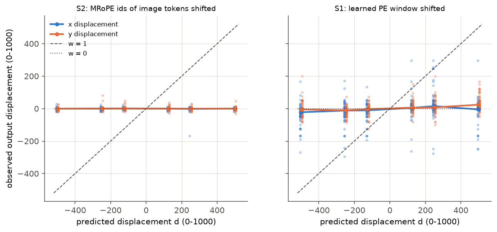

1. **MRoPE position IDs 不决定坐标。** 图像 token 的 $(p^{h}, p^{w})$ 平移 $\pm 2$、$\pm 4$、$\pm 8$ 个单位（预测位移 125–500）时，输出位移的均值在全部偏移量上接近 0；区域互换同样为 0.01。图像与问题之间的 ID 差（机制 M1）以及图像内部的相对 ID（机制 M2）均不被坐标读取使用。
2. **ViT RoPE 是单目标坐标的主要来源。** 只交换 ViT RoPE ID 时输出向 $\mathcal{T}'$ 移动 65%–78%，横向与纵向分别为 0.73 与 0.70；只交换 learned PE 的权重为 0.01，PE 窗口平移为 0.04。learned PE 并非完全无关：把 PE 改为在两倍大的虚拟画布上插值（居中窗口，PE 的空间频率减半）使输出平均移动 94 个单位，说明 PE 影响 ViT 的整体表示，但不以“绝对位置标签”的方式决定坐标。ViT RoPE 的权重随互换距离增大，2、4、6 个 token 的距离分别为 0.44、0.53、0.73（答对样本）。
3. **ViT RoPE 编码的是相对位移的尺度。** ViT RoPE ID 整体平移不改变输出（见 2.4），而以图像中心为原点把全部 ID 乘以 0.5 使输出的 y 平均下移 46 个单位、x 不变，乘以 0.8 与 1.25 的位移为 14 与 −9。
4. **两个来源近似线性叠加。** S1 与 S2 同时互换的权重 0.76 接近 S1 单独互换（0.70）与 S2 单独互换（0.01）之和，两个来源独立贡献；由于 S2 的权重为 0，冲突设计实际检验的是 S1 单独作用。
5. **序列顺序承担剩余部分，且偏重纵向。** 序列置换的权重为 0.24–0.27，横向 0.17、纵向 0.35；内容交换的权重 0.26–0.33 与序列置换相近，而 MRoPE 互换为 0，因此内容交换中“槽位”一侧的作用来自序列顺序（S4）。ViT 来源（约 0.75）与序列顺序（约 0.25）之和接近 1，与圆真实移动的 1.1 量级一致。
6. **内容交换后目标仍被识别。** “Is there a red circle in the image?” 的 Yes 与 No logit 差在标准输入上为 5.2，内容交换后为 4.1（460 个条件），位置读取的变化不是识别失败造成的。

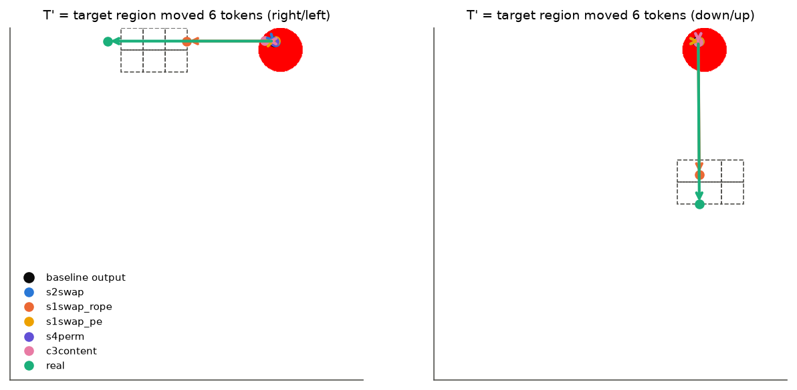

上图为一个代表性样本（ViT RoPE 互换的权重接近总体平均）：虚线框为 $\mathcal{T}'$，箭头从基线输出指向各干预条件的输出。只有 ViT RoPE 互换与真实移动使输出明显离开原位置。

### 3.4 C4：指向型 head 的消融

把单目标 point 任务的 7 个候选 head（L16 H6、H11、H15，L20 H10、H14，L24 H5、H6）的门控输出在答案位置替换为其平均值，并以相同层中随机抽取的 7 个 head 重复 10 次作为对照（108 张图像）：

| head 集合 | 中心误差变化 | 输出位移 | 命中率 | 识别 logit 差变化 |
| --- | --- | --- | --- | --- |
| 无消融 | — | — | 0.54 | — |
| 候选 head | −6.9 [−11.8, −2.1] | 34.3 [28.5, 40.7] | 0.56 | −0.12 |
| 随机 head（10 组均值的范围） | −1.4 至 5.0 | 9.6 至 18.0 | 0.50–0.56 | −0.07 至 0.21 |

消融候选 head 使输出平均移动 34 个单位，是随机 head 的 2–3 倍，但误差没有上升，命中率不变。指向型 head 参与坐标的数值，但读取路径存在冗余：单独去掉这 7 个 head 不足以破坏定位。设计中的输出 patching 尚未开展，见第 4 节。

### 3.5 网格定位失败的定向分析

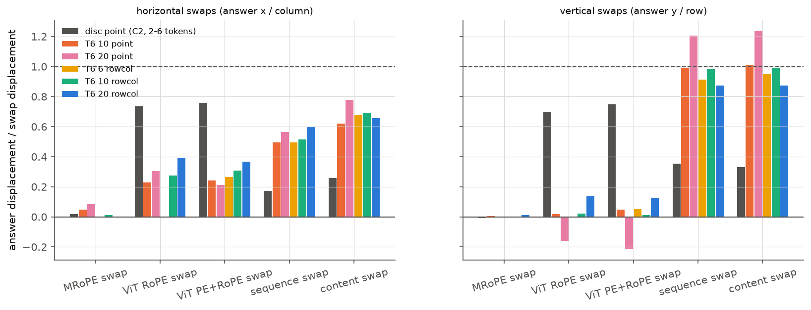

上图为各类区域互换下答案位移与互换位移之比，左为横向互换（答案的 x 或列号），右为纵向互换（答案的 y 或行号）；网格条件为相邻一个单元的互换，单目标条件取自 C2。

1. **网格任务同样不使用 MRoPE。** 20×20 行列任务在 MRoPE 平移 $\pm 2$、$\pm 4$ 个单位下 0/48 的答案改变；MRoPE 区域互换的跟随比为 −0.02–0.02。把 $p^{w}$ 压缩为 0.9 倍使列号平均变化 −0.12（8/48 改变），不足以解释多计 1 的系统偏差。
2. **网格中的行号由序列顺序决定，列号由序列顺序与 ViT RoPE 共同决定。** 20×20 行列任务中，序列置换使行号跟随 0.77–0.98、列号跟随 0.50–0.70；ViT PE 与 RoPE 同时互换使列号跟随 0.33–0.41、行号只跟随 0.02–0.23。6×6 与 10×10 行列任务给出同样的分工：序列置换的行号跟随比为 0.88–1.02、列号为 0.39–0.62，ViT 互换的列号跟随比为 0.24–0.34、行号不超过 0.05。10×10 point 任务的纵坐标在序列置换下跟随 0.90–1.07，在 ViT 互换下只有 0.03–0.06。相距 3 个单元的互换给出相同的结论：20×20 行列任务中纵向序列置换的跟随比为 0.91 与 1.02，横向为 0.47 与 0.63。与单目标图像相比，网格中 ViT RoPE 的作用明显减弱，可能因为规则网格中每个实例的局部 ViT 上下文相同，RoPE 只能在目标附近提供有限的位置差异。

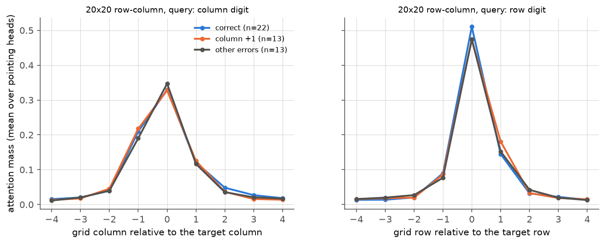

3. **列号多计 1 不是读取了相邻列。** 以 6×6 行列任务选出的 10 个指向型 head 计算 20×20 任务列号首位数字处的 attention，答对样本（$n = 22$）与列号多计 1 的样本（$n = 13$）在目标列的质量分别为 0.33 与 0.33，在右侧相邻列为 0.12 与 0.13；两组分布几乎重合，峰值都在真值列。

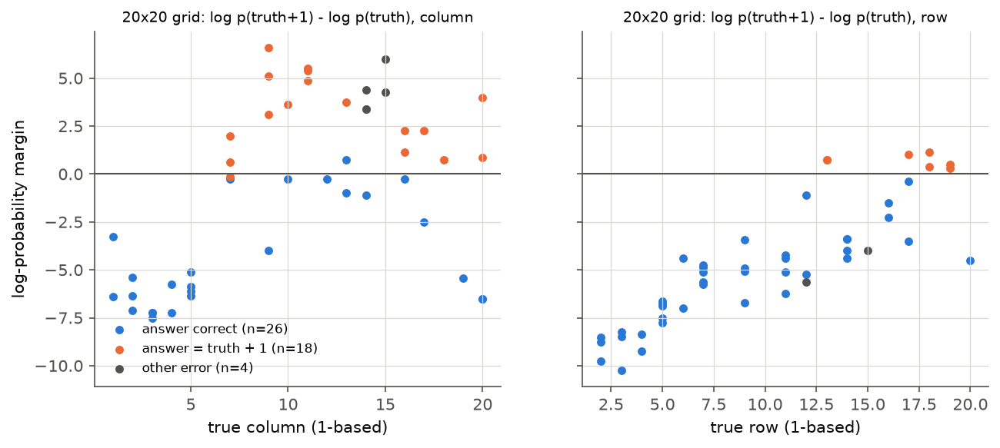

4. **多计 1 是高置信的数值错误。** 20×20 行列任务中，以 teacher forcing 比较真值列号 $c$ 与 $c + 1$ 的对数概率，列号答对的样本（$n = 26$）中 $\log p(c+1) - \log p(c)$ 平均为 −4.4，列号多计 1 的样本（$n = 18$）中为 +3.06；行号多计 1 的样本（$n = 7$）为 +0.69。另有样本在 20 列的网格中回答第 21 列，与实验 1.3 中 T0 计出 21 列的现象一致。

综合以上三点：20×20 网格的列号错误不来自 MRoPE、不来自读取相邻列，也不是两个相邻数字之间的微弱偏好。目标位置被正确读取，错误发生在把读取到的位置转换为序数的步骤中，这一步骤主要依据序列顺序与 ViT 位置。实验 1.3 的补充实验表明，多计 1 出现在任何含 20 个 64-pixel 实例的轴上（20×10 网格的行、10×20 网格的列），单元缩小到 32 pixels 时消失，且同一图像上的行列计数正确而定位多计 1；结合本节结果，多计 1 是“读取到的位置 → 序数”换算对实例数与单元尺度的系统偏差，而不是列方向特有的读取错误，20×20 方形网格中列多于行的错误比例仍待解释。10×10 point 答案平均向右下偏移 0.32 与 0.35 个单元（3.1 节），同属读取之后的数值换算偏差。

## 4. 限制与待开展部分

1. **自然图像（RefCOCO）未运行。** 设计 6.6 的自然图像全局平移与 S3 内容线索的估计尚未开展。
2. **C4 的输出 patching 与 linear attention 层消融未运行**；本次 C4 只做了答案位置的均值消融。
3. **C5 的像素层面与 position IDs 层面插行未运行。** 第 3.5 节的 MRoPE 平移与缩放已表明 position IDs 层面插行不会改变行答案，像素插行仍待检验。
4. **20×20 网格的梯度归因分两次运行。** 主运行中 20×20（约 1700 个 token）的反向传播在共享 GPU 上显存不足，相应记录先标为缺失，随后以 c1grad 阶段在显存更大的 GPU 上补算全部 96 条，未以任何值填补。
5. **单目标网格的边缘位置有裁切。** 6×6 网格外圈加抖动后，直径 64 与 128 的圆在 21/108 个 point 样本中部分超出画布，真值使用可见部分的 tight bbox。
6. **噪声水平。** bf16 下数学上等价的输入（间隙基线、ViT RoPE 整体平移）也会使坐标平均变化约 6 个单位，小幅位移不作解释。
7. **网格定向分析的 6×6 组合不完整。** 6×6 行列任务只运行了补充条件（序列置换、内容交换、ViT 同时互换，48 张）；主条件（MRoPE 平移与缩放、单独 ViT RoPE 互换、候选答案打分）只保留了中断前的早期记录（point 4 张、行列 1 张），未纳入结论。
8. **坐标单位。** 实验 1.3 的补充实验发现模型在稀疏的 768-pixel 画布上有时以绝对 pixels 作答；本实验全部单目标回答的坐标均不超过 1000，画布尺寸序列的误差也未显示这种情况。
9. **分布外输入。** ViT RoPE 互换与序列置换产生训练中未出现的输入，$e_{\perp}$ 为 0.05–0.14，处于可接受范围，但权重的绝对值仍可能受分布外效应影响。

## 5. 产物

产物位于 WORK_DIR 的 `analysis/position/2026-10-14_coordinate_readout/`：`cases.json`（全部样本与真值）、`baseline/`（C0 回答、评分与 generate 一致性抽查）、`attention/`（C1 指标与关键 query 的 attention、有效贡献与梯度归因图）、`interventions/`（C2 与 C3）、`ablation/`（C4）、`failure/`（网格定向分析）、`results.json`（全部指标与区间）、`experiment.json`（模型版本、代码摘要与运行参数）。程序为 `analysis_tools/position/coordinate_readout*.py`，入口为 `scripts/analysis/position/coordinate_readout.sh`。
