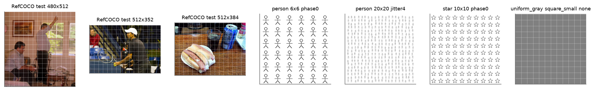
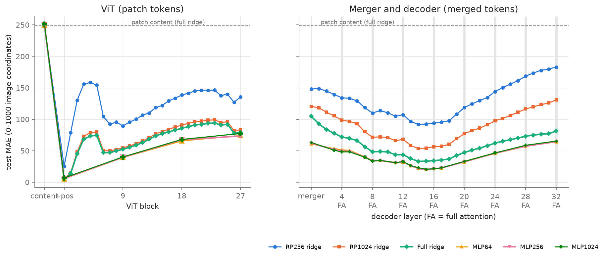
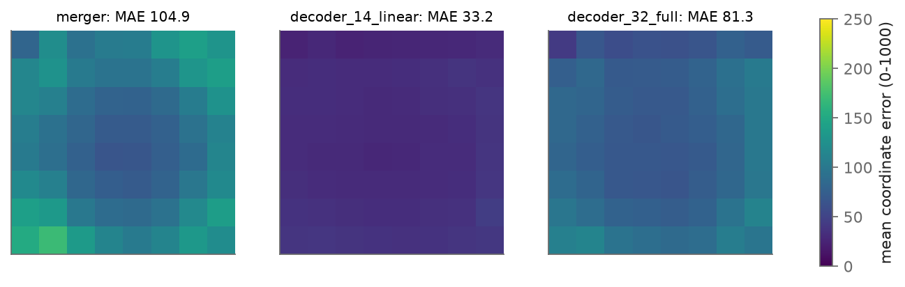
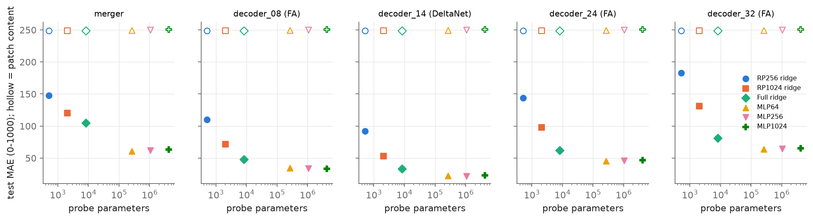
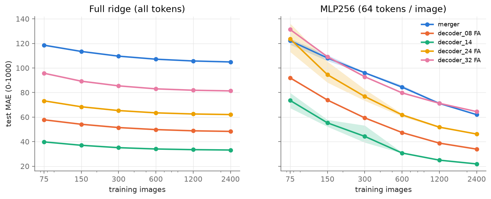
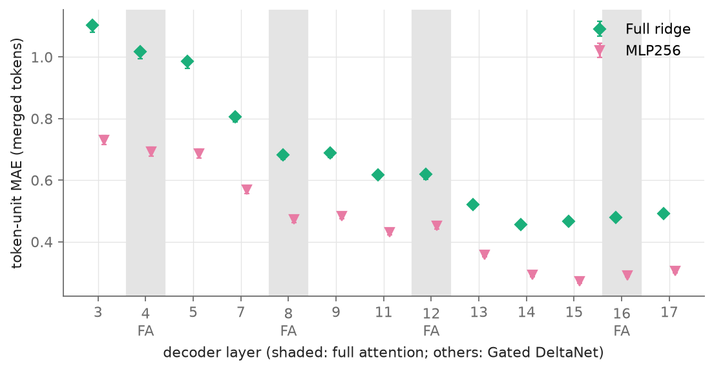
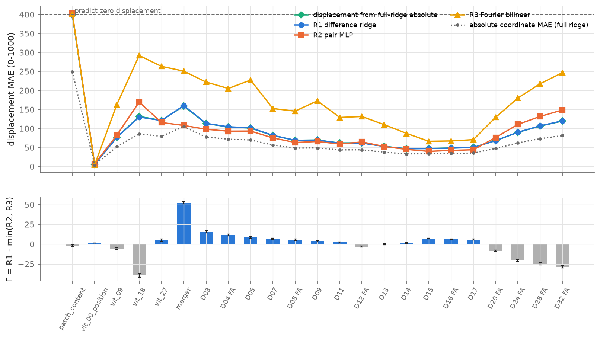
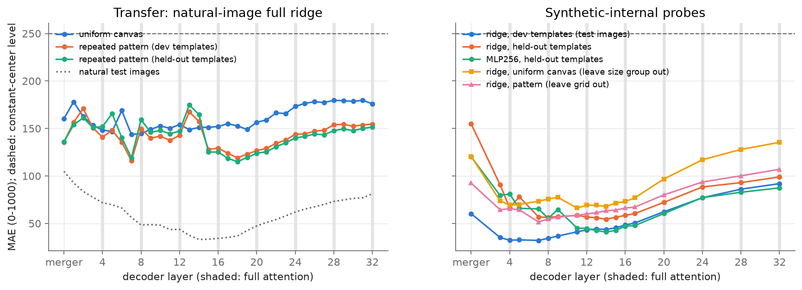
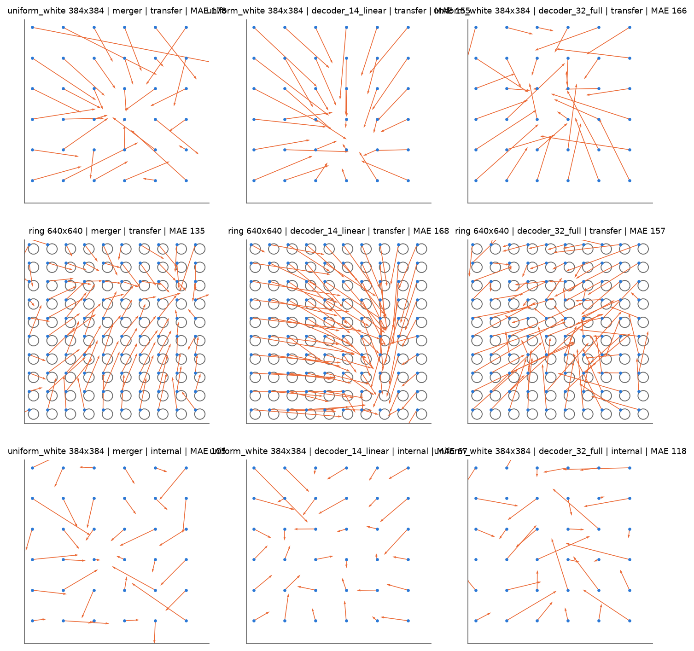

# 位置 probe 完善：容量、数据量、相对位置与内容对照

实验日期：2026-10-14。实验设计见[实验 3.4 设计](design_probe_refinement.md)，上游结果见[实验 3.3](results_2026-10-01.md)。模型为 Qwen3.5-9B，thinking off，只执行 prefill。

## 1. 结论概要

本实验在 3000 张 RefCOCO 图像与 352 张合成图像上，对 62 个提取位置测量 visual token 绝对槽位位置的可读性，主要结论如下：

1. **实验 3.3 的层间趋势在高容量 probe 下保持，深层误差上升来自表示本身。** 全维 ridge 的 decoder 最低误差位于第 14 层（0–1000 坐标下 MAE 为 33.2），第 32 层升至 81.3；MLP256 的最低误差位于第 15 层（20.0），第 32 层升至 64.5。RP256 只解释了误差绝对值的一部分：在第 14 层，RP256 的误差（92.0）约为全维 ridge 的 2.8 倍。
2. **位置读出精度在第 13–17 层达到亚 token 级。** MLP256 在第 15 层的平均误差为 0.27 个 merged token，74.2% 的 token 被定位到正确的格子，99.3% 的 token 误差不超过一格；全维 ridge 在第 14 层为 0.46 个 token 与 44.9% 的精确格子准确率。
3. **full attention 层没有单独的读出优势。** 第 4、8、12、16 层 full attention 的读出误差与相邻 Gated DeltaNet 层处于同一水平；误差的主要下降发生在第 7、8、13 层，其中两层为 DeltaNet。
4. **没有证据表明存在线性绝对读出之外的相对位置信息。** 由绝对 MLP 预测相减得到的位移误差在全部 decoder 层上低于三种相对位置 probe；深层 $\Gamma(\ell)$ 为负，深层的绝对位置退化不伴随相对位置结构的保留。
5. **自然图像训练的读出方向依赖内容分布，但位置在无内容线索的图像中仍可读出。** 自然图像 probe 迁移到合成图像时，decoder 各层误差为 115–180；在合成图像内部训练时，均匀画布上 decoder 第 11–14 层的误差为 58–78，重复图案保留模板上为 54–59。
6. **probe 读出的是归一化坐标。** 以 0–1000 归一化坐标训练的 ridge 换算到格子后，第 14 层的精确格子准确率为 44.9%；直接回归整数行列索引的 ridge 只有 28.7%。实验 3.3 中 5.59% 的精确网格准确率同时受随机投影与整数索引标签两方面的限制。

## 2. 研究问题

实验 3.3 使用 256 维随机投影、514 个参数的 ridge 与 240 张训练图像，发现 decoder 位置误差在第 14 层最低、随后上升。该结果有三种尚未区分的解释：随机投影损失了位置方向（容量不足）；训练数据不足；深层以相对形式保留位置。本实验对应地回答三个问题：

1. 在足够容量与数据量下，各层 visual token 的绝对槽位位置能被读出到什么精度，深层误差上升的趋势是否保持；
2. 绝对位置读出误差与相对位移读出误差如何随层变化；
3. 位置读出有多少依赖视觉内容提供的线索，在内容无法提供位置线索的图像中位置是否仍可读出。

此外，本实验向实验 3.5（坐标读出路径）提供逐层的位置可读性与分辨率，并单独比较 full attention 层与相邻 DeltaNet 层。

## 3. 实验设计

### 3.1 符号

| 符号 | 形状 | 含义 |
| --- | --- | --- |
| $\ell$ | 标量 | 提取位置：patch content、ViT 输入（加入 position embedding 后）、ViT 第 1–27 层、merger、decoder 第 1–32 层，共 62 个 |
| $x^{\ell}_{i,r,c}$ | $\mathbb{R}^{D}$ | 图像 $i$ 中位于第 $r$ 行、第 $c$ 列的 token 在 $\ell$ 处的 hidden state，ViT 为 $D=1152$，merger 与 decoder 为 $D=4096$ |
| $H_i, W_i$ | 标量 | 图像 $i$ 在该提取位置的网格行数与列数 |
| $y_{i,r,c}$ | $\mathbb{R}^{2}$ | token 中心的归一化图像坐标（0–1000），横坐标在前 |
| $\hat y$ | $\mathbb{R}^{2}$ | probe 的预测坐标 |

标签定义沿用实验 3.3：

$$
y_{i,r,c} = 1000\left(\frac{c + 1/2}{W_i},\ \frac{r + 1/2}{H_i}\right).
$$

### 3.2 指标

主指标为坐标 MAE，即两个坐标绝对误差的平均。为了给出以 token 为单位的分辨率，将每个坐标的误差按该图像的网格尺寸换算：

$$
e^{\mathrm{tok}} = \frac{1}{2}\left( \frac{|\hat y_x - y_x|\, W_i}{1000} + \frac{|\hat y_y - y_y|\, H_i}{1000} \right).
$$

$e^{\mathrm{tok}}$ 等于 1 表示平均偏离一个 token 的宽度。精确格子准确率将预测坐标映射回格子索引 $\lfloor \hat y_x W_i / 1000 \rfloor$ 与 $\lfloor \hat y_y H_i / 1000 \rfloor$，统计行列均正确的 token 比例；一格内准确率统计行列偏差均不超过 1 的比例。95% 区间均为以测试图像为单位的 2000 次 bootstrap。基线为训练标签均值（常数基线）与打乱训练标签后拟合的同族 probe。

### 3.3 Probe 与读出组

| 读出组 | probe | 训练数据 | 测试数据 |
| --- | --- | --- | --- |
| A 容量序列 | RP256、RP1024、全维 ridge（全部 62 个位置）；MLP64、MLP256、MLP1024（23 个特征位置） | ridge 用每张图全部 token，MLP 用每张图 64 个采样 token | 300 张测试图；另以最长边 768 pixels 的同一批图测试未见分辨率 |
| B 学习曲线 | 全维 ridge 与 RP256、MLP256 | 75–2400 张训练图，3 种组顺序 | 同上 |
| C 相对位置 | R1 差分 ridge、R2 成对 MLP、R3 Fourier 双线性 | 每张图 256 对 token，按位移长度分层抽样 | 测试图上的 76,800 对 |
| D 内容对照 | patch content 上的同族 probe；合成图迁移测试与合成图内部 probe | 见第 4 节 | 见第 4 节 |

23 个特征位置为 patch content、ViT 输入、ViT 第 9、18、27 层、merger，以及 decoder 第 3、4、5、7、8、9、11、12、13、14、15、16、17、20、24、28、32 层。各 probe 的定义与选择规则见[设计文档](design_probe_refinement.md)第 5 节。

## 4. 实验操作

### 4.1 数据

1. **自然图像。** 本地 RefCOCO 的全部 split 按原始字节 SHA-256 去重后共 9983 张图像，数量充足，未使用 COCO val2017 补充。以种子 20261014 随机抽取 3000 张（长宽比不超过 3，排除 1 张），按整图划分为 2400 张训练图、300 张验证图与 300 张测试图。其中 111 张与实验 3.3 的 360 张图重合（训练 94、验证 12、测试 5）。图像最长边缩放到 512 pixels，两边取 32 的整数倍；测试图另生成最长边 768 pixels 的版本。
2. **合成图像。** 重复图案包括 6 个模板（4 个开发模板与 2 个保留模板）、3 种网格规模（6×6、10×10、20×20）与 16 种变体（3 种网格相位与 1 种逐实例随机平移，乘以 4 种画布留白），共 288 张；均匀画布为白色与灰色各 16 种尺寸，分为正方形小尺寸、正方形大尺寸与非正方形三个尺寸组，共 32 张。
3. **输入示例。** 图 1 给出三张自然测试图与四张合成图，白线为 32 pixels 的 merged token 边界。

*图 1：输入示例。左三张为 RefCOCO 测试图，右四张依次为 6×6 person 网格、20×20 逐实例随机平移的 person 网格、10×10 保留模板 star 网格与灰色均匀画布。*

### 4.2 运行

1. **特征提取。** 提示词为 `Describe the image briefly.`，图像位于文字之前，batch size 为 1。训练与验证图像的前向传播逐图累加 62 个提取位置的 ridge 充分统计量，并保存 23 个特征位置上每张图 64 个采样 token 的特征（float16）；学习曲线位置（merger 与 decoder 第 8、14、24、32 层）按每组 75 张图分别保存统计量。测试图像与合成图像的第二次前向传播直接计算全部 ridge probe 在每个 token 上的预测，并保存特征位置上的特征。
2. **规模与耗时。** 两次特征提取共 3952 次 prefill（2700 + 300 + 300 + 352 张），用时约 56 分钟；ridge 拟合约 5 分钟；MLP、相对位置、学习曲线与合成图内部 probe 在 3 张 A800 上并行，合计约 4 GPU 小时。全部产物约 80 GB。
3. **复现。** 入口为 `scripts/analysis/position/position_probe_refinement.sh`，产物位于 WORK_DIR 的 `analysis/position/2026-10-14_probe_refinement/`，汇总指标在 `results.json`。

## 5. 结果

### 5.1 容量序列与逐层误差

图 2 给出全部提取位置上六种 probe 的测试 MAE，表 1 列出代表性位置的数值。

*图 2：逐层测试 MAE（0–1000 坐标）。左栏为 ViT patch token，右栏为 merger 与 decoder merged token；灰色竖线为 full attention 层，虚线为 patch content 上全维 ridge 的误差，绿色阴影为全维 ridge 的 bootstrap 95% 区间。MLP 只在 23 个特征位置上训练，折线连接这些位置。*

*表 1：代表性位置的测试误差。ridge 在全部测试 token（merged 位置 56,512 个，ViT 位置 226,048 个）上评估，MLP256 在每张测试图的 64 个采样 token（19,200 个）上评估；全维 ridge 在同一批采样 token 上的 MAE 与全部 token 相差不超过 0.9。*

| 位置 | RP256 | RP1024 | 全维 ridge [95% 区间] | MLP256 [95% 区间] | ridge token 误差 | MLP256 token 误差 | MLP256 精确格子 |
| --- | --- | --- | --- | --- | --- | --- | --- |
| patch content | 249.0 | 248.8 | 248.8 [248.3, 249.3] | 250.3 [249.0, 251.7] | 6.96 | 6.96 | 0.1% |
| ViT 输入 | 25.2 | 4.2 | 3.7 [3.7, 3.8] | 5.9 [5.8, 6.0] | 0.10 | 0.16 | 93.9% |
| ViT 第 9 层 | 89.5 | 54.5 | 52.4 [51.8, 53.1] | 39.7 [39.1, 40.3] | 1.47 | 1.10 | 10.4% |
| ViT 第 27 层 | 135.7 | 83.3 | 79.4 [78.7, 80.3] | 73.5 [72.3, 74.6] | 2.22 | 2.03 | 3.8% |
| merger | 148.0 | 120.5 | 104.9 [103.8, 105.9] | 62.0 [61.0, 62.9] | 1.47 | 0.86 | 19.6% |
| decoder 第 4 层（FA） | 134.2 | 98.6 | 71.9 [70.8, 72.8] | 49.4 [48.5, 50.4] | 1.02 | 0.69 | 28.2% |
| decoder 第 8 层（FA） | 110.0 | 71.4 | 48.3 [47.6, 49.0] | 33.9 [33.3, 34.6] | 0.68 | 0.47 | 45.1% |
| decoder 第 12 层（FA） | 107.3 | 68.1 | 43.8 [43.1, 44.4] | 32.3 [31.7, 32.9] | 0.62 | 0.45 | 48.8% |
| decoder 第 14 层 | 92.0 | 53.4 | 33.2 [32.7, 33.6] | 21.8 [21.5, 22.3] | 0.46 | 0.29 | 69.0% |
| decoder 第 15 层 | 92.4 | 54.3 | 33.4 [32.9, 33.9] | 20.0 [19.6, 20.4] | 0.47 | 0.27 | 74.2% |
| decoder 第 16 层（FA） | 94.0 | 56.3 | 34.3 [33.8, 34.8] | 21.4 [21.0, 21.8] | 0.48 | 0.29 | 71.3% |
| decoder 第 20 层（FA） | 118.6 | 77.1 | 47.3 [46.8, 48.0] | 32.5 [32.0, 33.1] | 0.67 | 0.46 | 47.0% |
| decoder 第 24 层（FA） | 144.1 | 97.6 | 62.0 [61.2, 62.8] | 46.2 [45.3, 47.0] | 0.88 | 0.65 | 33.4% |
| decoder 第 32 层（FA） | 183.1 | 130.9 | 81.3 [80.4, 82.2] | 64.5 [63.4, 65.5] | 1.16 | 0.91 | 21.0% |

常数基线的 MAE 为 249.6–250.0；打乱训练标签后，ridge 的 MAE 为 249.8–250.6，MLP256 为 242.8–256.4。全部 probe 在 patch content 上都停留在常数基线水平，因此设计中的位置增益 $g(\ell)$ 对各 probe 族近似等于 $250 - \mathrm{MAE}(\ell)$，容量带来的误差下降不来自视觉内容本身的位置线索。

从表 1 与图 2 可以得到四点观察：

1. **随机投影解释了误差绝对值的大部分，未解释层间趋势。** 在 decoder 中，全维 ridge 的误差约为 RP256 的 36%–54%，但第 14 层到第 32 层的误差比值在 RP256、全维 ridge 与 MLP256 下分别为 2.0、2.4 与 3.0，深层上升并未因容量提高而消失。
2. **位置信息存在非线性可读部分。** MLP 在 ViT 第 9 层之后的全部位置上都优于全维 ridge，在 merger 上降低 41%（104.9 到 62.0），在 decoder 第 14 层降低 34%；MLP64、MLP256 与 MLP1024 之间的差异不超过 4 个坐标单位，容量在 64 维隐藏层时已经足够。ViT 输入是唯一的例外：learned absolute position embedding 经插值后几乎是坐标的线性函数，全维 ridge 的 $R^2$ 为 1.000。
3. **ViT 内部的位置读出先降后升。** ViT 第 1–5 层误差由 13.6 升至 74.5，第 6 层回落到 47.0，随后单调上升至第 23 层的 94.1；ViT 后段位置信息逐渐弱化，merger 的 2×2 合并进一步使线性读出误差升至 104.9。
4. **decoder 前半段重新写入位置。** 全维 ridge 的误差从 merger 的 104.9 单调降至第 14 层的 33.2，第 13–17 层误差均不超过 37.5，第 19 层起持续上升。图 3 的空间误差图显示，merger 与第 32 层的误差集中在图像四角与边缘，第 14 层的误差在图像中均匀分布。

*图 3：全维 ridge 的空间误差图。测试 token 按真实坐标投到 8×8 网格，颜色为每格平均坐标误差（0–1000）。*

**横纵方向不对称。** 在第 14 层，MLP256 的横向误差为 14.1，纵向误差为 29.6；在第 32 层则相反，横向 76.7、纵向 52.2。decoder 前半段对列位置的读出精度高于行位置，深层的退化主要发生在横向。

**容量—误差关系。** 图 4 把同一提取位置上六种 probe 的参数量与测试误差画在一起。从 RP256 到全维 ridge 的误差下降为 43–102 个坐标单位，从全维 ridge 到 MLP64 再下降 11–44 个单位，此后随参数量增加不再下降。

*图 4：容量—误差曲线。实心标记为对应 decoder 位置的测试 MAE，空心标记为同一 probe 族在 patch content 上的 MAE。*

### 5.2 学习曲线

图 5 给出 merger 与 decoder 第 8、14、24、32 层上训练图像数与测试 MAE 的关系，阴影为 3 种组顺序的范围。

*图 5：学习曲线。左为全维 ridge（每张训练图全部 token），右为 MLP256（每张训练图 64 个 token）。*

全维 ridge 在 2400 张训练图时已经饱和：训练图像数从 1200 增至 2400 时，五个位置上的测试 MAE 相对下降为 0.7%–1.0%，低于 5% 的饱和判据。MLP256 尚未饱和，相对下降为 9.5%–12.9%，因此表 1 中的 MLP 误差是非线性可读性的上界估计，增加训练数据还会降低 MLP 误差。两族 probe 的层间排序在全部训练集大小上保持一致，第 14 层始终最低，第 32 层与 merger 始终最高，层间结论不受数据量影响。

### 5.3 full attention 层与 DeltaNet 层的分辨率

Qwen3.5-9B 的 decoder 每 4 层包含 1 层 full attention（第 4、8、…、32 层），其余为 Gated DeltaNet。图 6 与表 2 比较第 3–17 层的 token 单位误差。

*图 6：decoder 第 3–17 层的 token 单位 MAE。灰色背景为 full attention 层，误差棒为 bootstrap 95% 区间。*

*表 2：token 单位 MAE（merged token），FA 表示 full attention 层。*

| 层 | 3 | 4 FA | 5 | 7 | 8 FA | 9 | 11 | 12 FA | 13 | 14 | 15 | 16 FA | 17 |
| --- | --- | --- | --- | --- | --- | --- | --- | --- | --- | --- | --- | --- | --- |
| 全维 ridge | 1.10 | 1.02 | 0.99 | 0.81 | 0.68 | 0.69 | 0.62 | 0.62 | 0.52 | 0.46 | 0.47 | 0.48 | 0.49 |
| MLP256 | 0.73 | 0.69 | 0.69 | 0.57 | 0.47 | 0.48 | 0.43 | 0.45 | 0.36 | 0.29 | 0.27 | 0.29 | 0.31 |

full attention 层的误差与前后 DeltaNet 层相差不超过 0.08 个 token，没有出现只在 full attention 层发生的跳变。按全维 ridge 的 0–1000 MAE 计算，第 3 层之后单层下降最大的四层为第 7 层（DeltaNet，下降 9.8）、第 8 层（full attention，下降 8.1）、第 13 层（DeltaNet，下降 6.3）与第 3 层到第 4 层（下降 5.8）；第 12 层与第 16 层相对前一层分别上升 0.2 与 0.9。误差的回升从第 19 层（DeltaNet，上升 5.7）开始。可读位置信息的形成与退化都分布在两类层中，读出精度不能作为区分两类层位置作用的依据。

### 5.4 未见分辨率

以 512 pixels 图像训练的 probe 直接测试最长边 768 pixels 的同一批图像时，归一化坐标误差普遍上升：全维 ridge 在 ViT 输入从 3.7 升至 6.6，在第 14 层从 33.2 升至 56.8，在第 32 层从 81.3 升至 98.9；MLP256 在第 14 层从 21.8 升至 38.5，在第 15 层从 20.0 升至 31.7。768 pixels 图像的网格约为 512 pixels 的 1.5 倍，按 token 计算的误差在第 14 层从 0.46 升至 1.18（ridge）与从 0.29 升至 0.78（MLP256）。probe 依赖训练时的网格尺度，实验 3.5 的样本应保持与本实验相同的分辨率。

### 5.5 归一化坐标与整数行列索引

本实验的主 probe 回归归一化坐标；另按实验 3.3 的定义拟合直接回归整数行列索引的 ridge。在 ViT 输入，归一化坐标 probe 换算后的精确格子准确率为 99.5%，整数索引 probe 只有 9.8%；在 decoder 第 14 层分别为 44.9% 与 28.7%。ViT 的 position embedding 由固定大小的表双线性插值到当前网格，编码的是相对于图像宽高的位置；同一整数列索引在不同宽度的图像中对应不同的归一化位置，线性 probe 无法在不读取图像尺寸的情况下给出整数索引。decoder 中线性可读的位置同样以归一化坐标为主。坐标输出若需要整数行列计数（实验 1.3 的行列计数任务），模型需要额外结合网格尺寸。

### 5.6 相对位置

图 7 上栏比较各位置的位移 MAE，下栏为相对优势 $\Gamma(\ell)$。测试位移的平均绝对值为 399–401，即预测零位移的误差水平。

*图 7：绝对与相对位置读出。上栏绿色为全维 ridge 绝对预测之差给出的位移误差，蓝、橙、黄分别为 R1、R2、R3，灰色点线为绝对坐标 MAE；下栏为 $\Gamma(\ell)$ 与 bootstrap 95% 区间，蓝色表示 $\Gamma > 0$。*

*表 3：代表性位置的位移 MAE。最后一列为最佳宽度 MLP 绝对预测之差给出的位移误差。*

| 位置 | R1 | R2 | R3 | $\Gamma$ [95% 区间] | 全维 ridge 绝对预测相减 | MLP 绝对预测相减 |
| --- | --- | --- | --- | --- | --- | --- |
| ViT 输入 | 5.4 | 6.9 | 3.8 | 1.6 [1.5, 1.6] | 5.4 | 7.9 |
| merger | 160.3 | 108.0 | 250.9 | 52.3 [50.7, 53.9] | 159.0 | 85.8 |
| decoder 第 4 层 | 104.4 | 92.9 | 205.2 | 11.5 [10.4, 12.7] | 103.9 | 67.9 |
| decoder 第 14 层 | 46.6 | 45.0 | 87.0 | 1.6 [1.1, 2.2] | 46.8 | 30.3 |
| decoder 第 15 层 | 47.0 | 39.7 | 66.3 | 7.3 [6.8, 7.8] | 47.4 | 27.5 |
| decoder 第 24 层 | 90.1 | 110.6 | 180.2 | -20.5 [-21.8, -19.3] | 89.8 | 66.4 |
| decoder 第 32 层 | 120.1 | 148.6 | 246.9 | -28.5 [-30.0, -26.9] | 119.6 | 94.1 |

1. **R1 与绝对 ridge 等价。** 在全部位置上，R1 的位移误差与全维 ridge 绝对预测相减的误差相差不超过 1.7，差分特征上的线性读出与线性绝对读出包含同样的位移信息。
2. **$\Gamma(\ell) > 0$ 反映非线性，不反映相对结构。** $\Gamma$ 在 merger 与 decoder 第 17 层之前的大多数位置为正（第 12、13 层除外），最大为 merger 的 52.3；但在这些位置上，MLP 绝对预测相减的位移误差均低于 R2 与 R3（merger 为 85.8，R2 为 108.0）。相对 probe 的优势来自其非线性，绝对位置的非线性读出已经包含这部分信息。
3. **深层不存在被保留的相对结构。** 第 20 层起 $\Gamma$ 显著为负，R2 与 R3 的误差随层数上升得比绝对读出更快。设计中“深层只保留与 MRoPE 相容的相对位置”的解释不被支持。
4. **R3 的频率分解显示位置精度的层间变化。** R3 在 ViT 输入上取得全部读出中最低的位移误差（3.8），8 个频率的 Fourier 分量测试 $R^2$ 均在 0.83 以上。在 decoder 中，以横向余弦分量为例，第 15 层前 6 个频率的 $R^2$ 依次为 0.78、0.84、0.66、0.65、0.56、0.40；merger 与第 32 层只有前 2 个频率超过 0.2。最高可读频率与位置读出精度同步变化，R3 在 decoder 上的总体误差较高，主要因为高频分量的预测误差在 argmax 解码中造成周期性混叠。

### 5.7 内容对照：合成图像

图 8 左栏为自然图像训练的全维 ridge 在合成图像上的误差（迁移测试），右栏为在合成图像内部训练的 probe。

*图 8：合成图像上的位置读出。虚线为常数中心预测的误差水平 250，左栏点线为自然测试图上的误差。*

1. **迁移测试失败。** 自然图像训练的 decoder probe 在合成图像上的误差为 115–180，最低时也是自然测试图的 3 倍以上；均匀画布的误差在第 15 层之后始终高于重复图案。ViT 输入是例外，迁移误差为 5.7（均匀画布）与 6.5（重复图案）。MLP256 在 merger 与 decoder 上的迁移误差为 88–178，结论相同。自然图像上学到的 decoder 读出方向依赖内容分布。
2. **均匀画布上位置仍可读出，且 decoder 前半段使其更易读出。** 在均匀画布内部按尺寸组留一法训练与测试，全维 ridge 的误差在 ViT 输入为 3.5–4.2，ViT 第 27 层为 55–66，merger 为 104–139，decoder 第 3 层降至 65–82，第 11–14 层为 58–78，第 32 层升至 120–144。均匀画布的 ViT 输入 token 之间只有 position embedding 不同；merger 之后误差的下降说明 decoder 前半段在没有内容线索时仍向 visual token 写入位置，可能来源包括 MRoPE 位置编码与 DeltaNet 的顺序递推，需要实验 3.5 的干预区分。
3. **重复图案上的读出可以泛化到新模板与新网格规模。** 在开发模板内部训练时，全维 ridge 在开发模板测试图上的误差在 decoder 第 4 层最低（32.4），在保留模板上的误差在第 7–14 层为 54–59；MLP256 在保留模板上的误差在第 13–15 层最低（41.0–42.7）。按网格规模留一法测试时，第 14 层的误差为 55.9（10×10）、64.8（20×20）与 69.5（6×6）。合成图内部的层间趋势与自然图像一致：merger 误差高、decoder 前半段降低、第 17 层之后上升。

图 9 用箭头展示同一张均匀画布与一张 ring 网格上的逐 token 读出。前两行为自然图像 probe 的迁移预测，箭头大多指向图像中心或无规律方向；第三行为均匀画布内部训练的 probe，第 14 层的箭头明显缩短。

*图 9：合成图上的逐 token 读出（隔行隔列显示）。蓝点为 token 真实中心，橙色箭头指向全维 ridge 的预测位置。前两行为迁移测试，第三行为均匀画布内部 probe（训练集为另外两个尺寸组）。*

## 6. 结果解释

按设计文档第 8 节的结果模式，本实验对应以下解释：

1. **深层误差上升来自表示本身。** 全维 ridge 与 MLP 都没有使深层误差降到第 14 层的水平，实验 3.3 的层间趋势不是随机投影的产物。第 13–17 层是位置信息最易读出的层段，可以作为实验 3.5 中坐标来源的候选层。
2. **位置以部分非线性的方式编码。** MLP 稳定优于全维 ridge，且 MLP 在 2400 张图时未饱和；实验 3.5 分析 attention head 时，应同时检查线性 probe 方向与 MLP 可读的非线性结构。
3. **深层不以相对形式保留位置。** 相对 probe 在深层劣于绝对读出，深层位置信息的减少无法由相对位置结构解释。
4. **位置信号不依赖内容，读出方向依赖内容。** 均匀画布上位置仍可读出，但自然图像的读出方向不能迁移到合成图像；结论需要按图像类型分别报告。
5. **分辨率与尺度依赖。** decoder 位置的最佳读出精度约为 0.27–0.46 个 merged token，误差随测试分辨率升高而上升；位置主要以归一化坐标的形式可读。

## 7. 局限

1. **probe 的可读性不等于模型的使用。** 全部结论描述外部 probe 能从 hidden state 恢复的信息，模型生成坐标时是否使用这些信息需要实验 3.5 的干预检验。
2. **MLP 未饱和。** MLP 只使用每张图 64 个 token，学习曲线在 2400 张图时仍下降约 10%；表 1 中的 MLP 误差是非线性可读性的上界估计。MLP64 与 MLP1024 只搜索学习率，weight decay 沿用 MLP256 的选择。
3. **R3 的训练受限。** R3 在 512 维白化 PCA 子空间上训练，并以等权 argmax 解码；高频分量的混叠使其位移误差偏高，R3 的结果只说明低秩双线性形式在本设置下没有超过绝对读出，不能排除其他相对编码形式。
4. **样本相关性。** 同一图像内的 token 高度相关，全部区间以图像为单位 bootstrap；token 级比例未使用 Wilson 区间。
5. **数值精度。** ridge 统计量先以 float32 在 GPU 上对平移后的数据累加，每 25 张图换算到 float64；单元测试确认该换算与直接 float64 累加的相对误差低于 $2\times10^{-5}$。部分 ridge 的 $\lambda$ 选在网格下界 $10^{-2}$，此时验证误差对 $\lambda$ 已经不敏感。
6. **合成图规模较小。** 合成图内部 probe 的训练集为 120 张开发模板图像或 8–16 张均匀画布，误差高于自然图像的部分原因是训练数据少。
7. **MDL 未执行。** 设计以打乱标签基线、patch content 基线与学习曲线作为对照，本实验没有计算 MDL codelength。
