# 坐标数值的表征与转换

实验日期：2026-10-15。本文属于[位置信息与坐标读取](plan.md)研究，执行[实验 3.6 设计](design_coordinate_value.md)。模型为 Qwen3.5-9B，bfloat16、SDPA、greedy decoding，thinking off。

## 1. 研究问题与主要结果

实验 3.5 表明，生成坐标数字时指向型 head 读取了正确的目标位置，但输出的数值存在阶梯状的离散化、对 500、667 等数值的偏好以及随位置变化的系统偏差。本实验在白色画布上单个红色圆的密集平移序列（共 1291 张图像）上，记录预测每个坐标数字的 residual 状态，回答三个问题：坐标在 residual stream 中以何种几何形式存在（Q1）；位置在哪些层、经由哪些模块转换为数字（Q2）；逐位生成的误差来自哪一位数字（Q3）。主要结果如下：

1. **分词逐位进行，且与上下文无关。** 整数 0–1000 在 6 种上下文中全部被切分为“一个数字一个 token”（0/1001 例外）；前导空格是独立的 token，JSON 中 x 的首位数字之前是 token “ [”，y 的首位数字之前是一个只含空格的 token。
2. **residual stream 以远高于输出精度的连续线性编码保存目标坐标。** 在预测 x 首位数字的位置上，以 ridge probe 从层 12 起即可读出真实 x，留出测试集的平均绝对误差为 5–7 个单位（0–1000 坐标，约 3 pixels，不到一个 merged token 的 1/10），而模型在同一批图像上的输出误差为 21.6；prompt 最后一个位置（答案开始之前）的误差在层 24 之后同样只有 8–9。同一状态对模型自己输出值的读出误差（11–16）反而大于对真值的读出误差。
3. **表示中不存在与输出数值对应的离散簇。** PCA 显示状态沿真实位置形成一条连续的弧线（二维网格上为一张折叠的曲面），输出为 500、667、750 的样本散布在弧线上，没有聚集；相邻平移步之间的状态变化量只能以 0.45–0.75 的 AUROC 区分“输出值改变的步”，各层都远离离散编码对应的 1。
4. **误差主要产生在十位数字的读出。** 强制首位数字为真值后，x 的平均绝对误差从 32.9 只降至 23.0，此时 60% 的输出以 00 或 50 结尾；同时强制前两位数字后误差降至 3.0。模型在十位上的分布接近均匀（平均熵 2.2–2.6 bits，均匀分布为 3.3 bits），十位与真值相差不超过 1 的比例为 67%（x）与 55%（y），而从同一状态线性读出的十位达到 96%–98%。强制数字后的误差有上界，比较时需以随机读出为基准：若在真值首位固定后十位与个位均匀随机选取，期望绝对误差约为 33；若前两位固定后个位均匀随机选取，期望绝对误差约为 3.3。因此强制首位后的 23.0 只比随机十位略好，强制前两位后的 3.0 与随机个位相当，只说明误差被前两位限定，不能作为个位读出准确的证据。
5. **首位数字由层 24–32 写入，错误首位主要来自层 28–30 的 MLP。** logit lens 中输出首位数字从层 20 开始出现（与最终输出一致率 0.31），到层 32 升至 0.97；与真值首位的一致率最高只有 0.65。直接 logit 归因显示 MLP 28–30 与层 24 的 attention 把错误首位写入 logit，层 32 的 attention（主要是 L32 H10）反向抑制输出数字。
6. **坐标在层 20–24 从“读取图像”转为“读取文本位置的编码”。** 在层 12 或 16 把图像之后全部位置的 residual 替换为另一张图像的状态，输出几乎不变（随供体变化的比例为 11%–12%）；在层 24 与 28 替换时，82%–94% 的输出变为供体的输出。在两张图像之间插值时，输出在 400 以下大致连续移动，在 500、667、750 附近停留后跳变。

综合以上结果：模型在答案位置拥有精确、连续、线性可读的目标坐标，误差来自把这一连续量转换为十进制数字的读出步骤。该读出对首位数字的分区边界不准确，对十位数字几乎不提供位置信息，greedy 解码因此落在 0、5 等先验数值上，表现为阶梯与“整齐”数值偏好。

## 2. 实验设计与实际执行

### 2.1 刺激与问题

| 集合 | 图像 | 数量 |
| --- | --- | --- |
| grid2d | 512×512 白色画布，直径 64 pixels 的红色实心圆，圆心 x、y 取 32 至 480 pixels、步长 16 pixels | 841 |
| sweep_h | 圆心 y = 256，x 从 32 至 480 pixels、步长 2 pixels（3.9 个单位） | 225 |
| sweep_v | 圆心 x = 256，y 从 32 至 480 pixels、步长 2 pixels | 225 |
| T6 | 实验 1.3 的红色目标网格 point 问题（6×6、10×10、20×20 各 48 张） | 144 |

问题与实验 3.5 的单目标 point 问题相同（见设计第 4.1 节）。下图为实际输入示例，叉号为模型输出；图下给出示例答案与各“角色”所在的 token。角色 $x_k$ 指预测 x 第 $k$ 个数字的 residual 位置，例如 $x_0$ 位于 “ [” 上、预测首位数字，$x_1$ 位于首位数字上、预测十位数字。

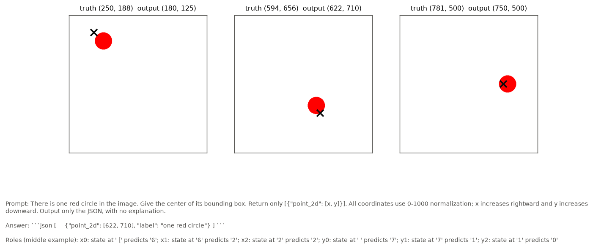

### 2.2 操作

1. **解码。** 以实验 3.5 的手写 greedy 解码器生成答案（等长 prompt 组成无 padding 的 batch，batch size 16）。随机抽取 20 个样本与参考实现 generate 比较，11/20 的坐标完全一致；不一致的 9 个样本中 4 个相差不超过 2 个单位，5 个相差 20–47 个单位（例如 375 与 416、747 与 700）。bf16 舍入差异即可使输出在两个相距数十个单位的候选数值之间切换，说明这些样本处于两个候选数值的决策边界附近，这一现象与第 3.4 节的十位读出结果一致。
2. **捕获。** 在“prompt + 模型自己的答案”上进行 teacher-forced 前向，记录 7 个角色（last、$x_0$–$x_2$、$y_0$–$y_2$）在 embedding 与 32 层输出处的 residual，以及 $x_0$、$y_0$ 处各层 attention 与 MLP 模块的输出和 full attention 层的逐 head 输出。逐层校验 $h^{\ell} = h^{\ell-1} + a^{\ell} + m^{\ell}$ 的相对误差为 0.1%–0.3%（float16 存储）。
3. **强制与干预。** 首位数字强制、steering 与插值均在模型自己的答案前缀之后续写 x（或 y），读到第一个非数字 token 为止。
4. **规模。** 生成 1435 个答案；捕获 1435 个样本（约 4.3 GB float16）；首位数字强制 1291×2 轴×3 种条件；steering 25 个基准样本 × 6 层 × 2 种方式 × 至多 11 个位移；插值 35 对图像 × 5 层 × 11 个插值权重。总计约 2 GPU 小时（共享 GPU，CPU 负载高）。

## 3. 结果

### 3.1 分词核验

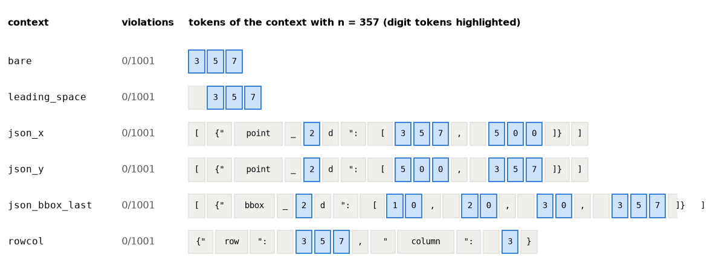

| 上下文 | 示例 | 不满足“一个数字一个 token”的整数 |
| --- | --- | --- |
| 裸数字 | 357 | 0/1001 |
| 前导空格 | “ 357” | 0/1001 |
| JSON point 的 x | [{"point_2d": [357, 500]}] | 0/1001 |
| JSON point 的 y | [{"point_2d": [500, 357]}] | 0/1001 |
| JSON bbox 的最后一个值 | [{"bbox_2d": [10, 20, 30, 357]}] | 0/1001 |
| 行列 JSON | {"row": 357, "column": 3} | 0/1001 |

数字从不与空格或标点合并：前导空格被切为单独的 “ ” token，JSON 中的左方括号与空格合并为 “ [”。因此坐标的生成必然按“首位、十位、个位”的顺序逐 token 完成，三位数的位数（两位或三位）在首位之后才由“是否继续输出数字”决定。

### 3.2 行为：阶梯、偏差与取值偏好

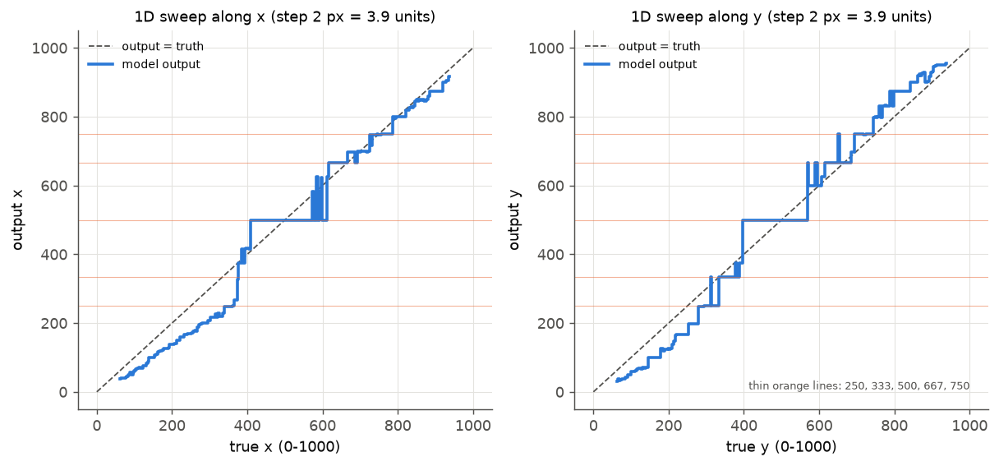

1. **输出呈阶梯状，且存在跨越百位的吸引域。** sweep_h 的 225 步中输出只有 110 个连续段；真实 x 从约 400 到 610 的 54 步中，输出以 498 与 500 为主（最长的两个连续段各 21 步），sweep_v 中 500 连续保持 35 步（约 137 个单位）。498 由首位“4”与后续“98”组成，说明 500 附近的吸引作用不受首位数字边界限制。真实 x 低于约 380 时，输出沿一条斜率约 0.7 的直线系统偏小。
2. **整体命中率与偏差。** 1291 个样本的命中率为 0.56 [0.53, 0.59]，中心误差为 59.3 [57.6, 61.0]；按任一坐标约定的诊断命中率为 0.563，其中只在 pixel 约定下命中的为 4/1291，均匀随机点的机会命中率在归一化与 pixel 约定下分别为 1.2% 与 0.3%。输出对真值的回归斜率为 1.08（x）与 1.13（y），截距为 −61 与 −53。

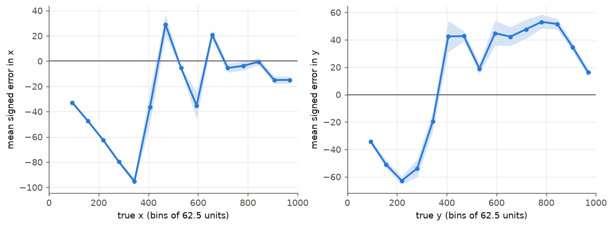

3. **偏差随位置变化。** x 方向在真值 62–375 区间平均偏小 33–95 个单位，其余位置在 ±35 以内；y 方向在真值 62–312 区间偏小 34–63 个单位，在 375–875 区间偏大 35–53 个单位。实验 3.5 在 36 个抖动位置上观察到的偏差方向与本实验不完全一致，本实验的密集采样给出的是位置依赖的偏差曲线。

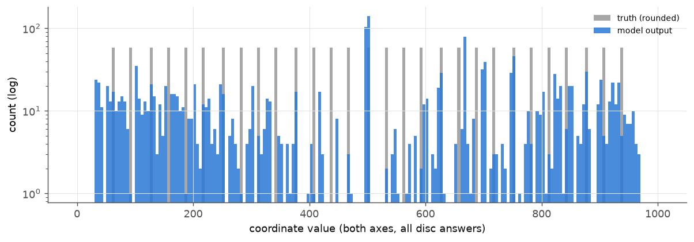

4. **输出偏好 10 与 50 的倍数。** grid2d 的 1682 个坐标值中 44% 为 10 的倍数、26% 为 50 的倍数；若输出等于四舍五入的真值，这两个比例均为 10.3%（29 个网格真值中只有 250、500、750 满足）。最常见的输出为 500（141 次）、667（75 次）、498（74 次）、750（46 次）、700（39 次）。

### 3.3 Q1：坐标在 residual stream 中的表示

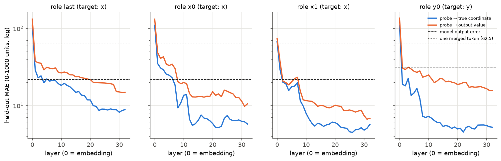

上图为 ridge probe 在留出的 sweep 图像上的平均绝对误差（对数纵轴）：蓝线读出真实坐标，橙线读出模型输出值，虚线为模型输出本身的误差，点线为一个 merged token（62.5 个单位）。probe 只在 grid2d 上训练，其 29 个真值与 sweep 的连续真值不重合，因此测试同时检验对未见坐标值的内插。

1. **真实坐标在层 8–12 之后以亚 token 精度线性可读。** 在 $x_0$ 上，真实 x 的读出误差在层 12 降至 7，层 13–32 保持在 5–7；$y_0$ 上真实 y 的误差在层 8 起为 5–7；预测十位的 $x_1$ 上在层 12 之后为 4–6。prompt 的最后一个位置（last）在答案开始之前同样携带目标坐标，误差在层 24 之后为 8–9。作为对照，模型输出在同一批图像上的误差为 21.6（x）与 31.4（y）。
2. **状态更接近真值而非模型自己的输出。** 在 $x_0$ 上，读出模型输出值的误差为 11–16，大于读出真值的 5–7；$y_0$ 上为 16–20 对 5–6。如果状态已经编码了离散的输出数值，读出输出值应当比读出真值更容易，实际情况相反。
3. **答案前缀的变体不影响以上结论。** greedy 答案的前缀有三种（代码块加四个空格缩进 987 例、代码块加制表符 294 例、无代码块 10 例），且变体的比例随目标位置变化，因此 $x_0$ 之前的 token 并不完全相同。只用四空格变体训练和测试时（576 / 411 个样本），$x_0$ 的真值读出误差在层 12、20、28、32 为 6.5、5.5、6.4、5.7，输出值读出误差为 14.0、16.0、14.2、10.6，模型误差为 22.7；$y_0$ 为 5.5、5.4、5.6、5.4 对 20.5、20.1、18.5、16.6，模型误差为 29.0。last 位置位于答案之前，不受前缀影响，给出同样的结论。

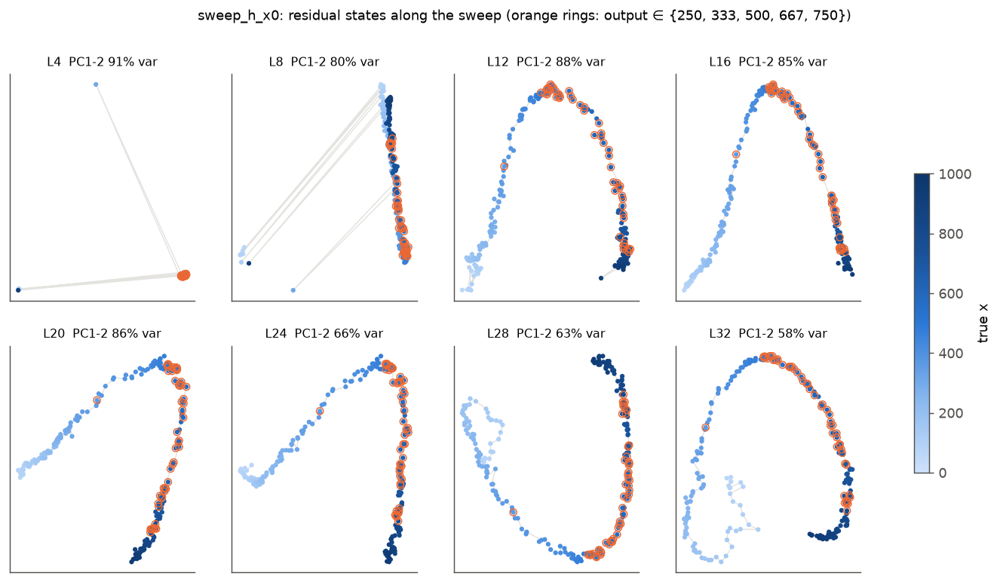

4. **几何：连续弧线，没有数值簇。** 上图为 sweep_h 在 $x_0$ 上各层状态的前两个主成分，颜色为真实 x，橙色圆圈标出输出为 250、333、500、667、750 的样本。层 12 之后状态沿真实 x 排成一条平滑弧线，前两个主成分解释 58%–88% 的方差，橙色样本沿弧线连续分布而不形成簇。层 4 与层 8 中远离主体的点为答案前缀不同的 8 个样本（1 个无代码块、7 个制表符缩进），其余 217 个样本使用四空格缩进。

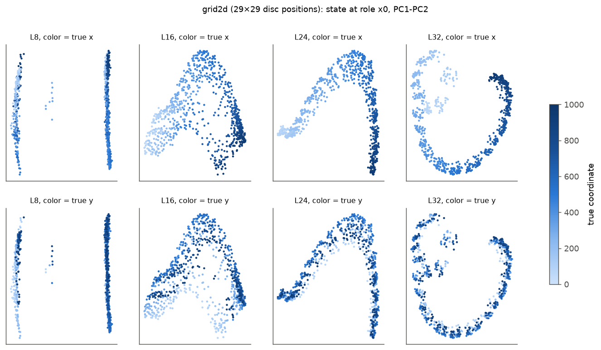

5. **二维位置形成折叠的曲面。** grid2d 的 $x_0$ 状态在前两个主成分上主要按 x 展开，y 沿弧线的法向分布；层 32 的弧线弯曲成近似环形。层 8 的两个分离的竖条对应答案前缀的两种缩进。

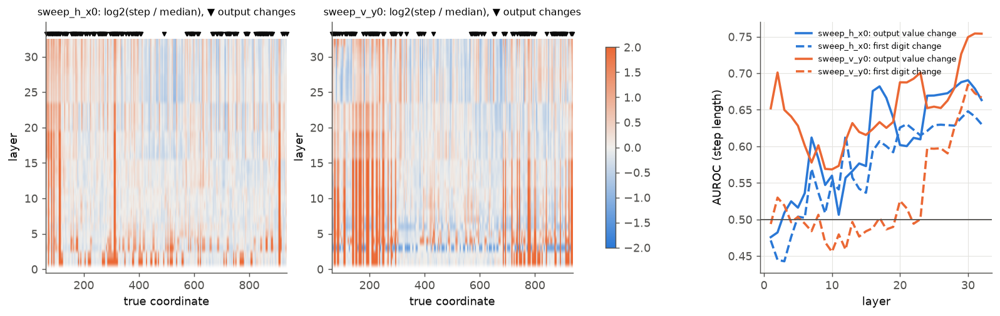

6. **状态变化与输出跳变只有弱关联。** 记相邻两步状态距离与其中位数之比为步长，左、中两图为 $\log_2$ 步长（层 × 真值），三角形标出输出值改变的位置。若状态编码离散的输出值，步长应在三角形处出现尖峰、在平台内接近 0；右图的 AUROC 衡量步长区分“输出改变的步”的能力。sweep_h 的 $x_0$ 在层 1–15 为 0.45–0.61，层 16–32 为 0.60–0.69；sweep_v 的 $y_0$ 在层 30–32 最高为 0.75；首位数字改变的步对应的 AUROC 不超过 0.68。输出阶梯在状态中只留下微弱的痕迹，主要的离散化发生在 residual 之外的读出步骤。

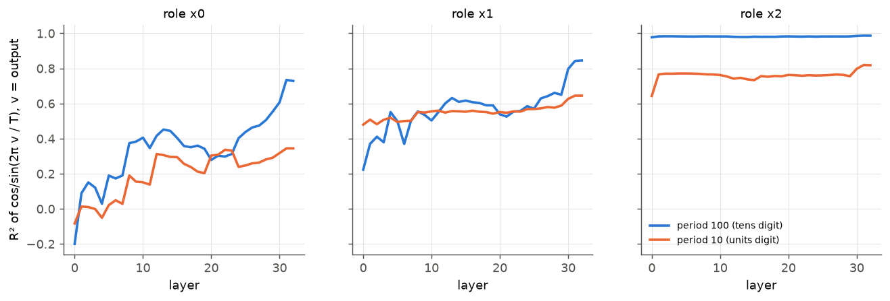

7. **周期结构在答案位置较弱。** 以 $\cos(2\pi v / T)$ 与 $\sin(2\pi v / T)$（$v$ 为输出值）为目标，$T = 100$ 的圆形可读性在 $x_0$ 上于层 8–30 为 0.3–0.6、层 32 为 0.73，在 $x_1$ 上为 0.5–0.85，层 30–32 明显上升；$T = 10$ 在 $x_0$ 与 $x_1$ 上不超过 0.65。$x_2$（预测个位）的输入已包含前两位数字，$T = 100$ 的可读性接近 1 只反映输入 token。文本 LLM 中报告的数位圆形表示在本任务中只在最后几层出现，且强度有限。
8. **答案位置的位置编码与 visual token 的槽位编码处于不同子空间。** 以 visual token 训练的槽位坐标 probe（留出图像误差 58–65，层 4–16）直接应用于 $x_0$ 时，层 4–16 的相关在 −0.88 至 0.51 之间、斜率接近 0；层 20–28 的相关升至 0.73–0.91，斜率仅 0.23–0.55。答案位置携带的坐标经过了变换，与 visual token 的槽位方向只在深层部分对齐。

### 3.4 Q3：逐位误差分解

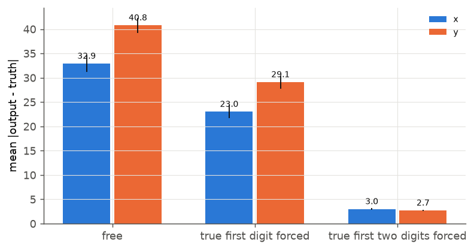

1. **首位数字错误只解释约一半的误差，且多为边界附近的舍入。** x 的首位数字（与四舍五入真值同位数且首位相同）正确率为 0.61 [0.58, 0.64]，y 为 0.60 [0.57, 0.63]；首位错误的样本贡献了 55%（x）与 54%（y）的绝对误差，其中 73%（x）与 57%（y）的真值距百位边界不超过 25 个单位。
2. **强制真值首位只部分改善误差，强制前两位则基本消除误差。**

| 条件 | x 平均绝对误差 | y 平均绝对误差 | x 末两位为 00 或 50 的比例 |
| --- | --- | --- | --- |
| 无强制续写 | 32.9 [31.1, 34.6] | 40.8 [39.2, 42.3] | 0.33 |
| 强制首位 | 23.0 [21.7, 24.4] | 29.1 [27.8, 30.4] | 0.60 |
| 强制前两位 | 3.0 [2.8, 3.2] | 2.7 [2.6, 2.9] | 0.38 |

分母为 1291（强制前两位时为 1223 个三位数真值）。强制首位后，原本首位错误的样本误差降至 20.9（x）与 25.4（y），与首位正确的样本相当；但全部样本的误差仍有 23–29，且以 00 或 50 结尾的比例从 0.33 升至 0.60（x）。强制前两位之后误差只剩 3 个单位左右，个位数字的偏差可以忽略。

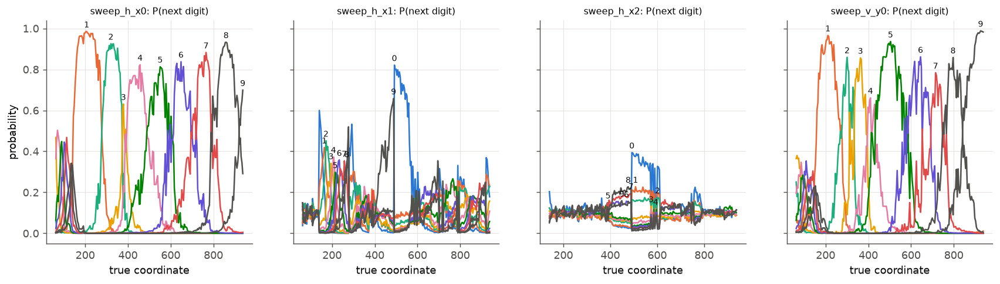

3. **首位数字的读出锐利但分区不准，十位数字的读出接近均匀。** 上图为模型在 sweep 上各数字的输出概率随真实坐标的变化。首位数字（左一与右一）在大部分位置以 0.8–1.0 的概率被选中，但分区宽度不均：x 方向首位“1”覆盖约 120–270，“3”只在 370 附近的窄区间内胜出，这与第 3.2 节中 400 以下的系统偏小一致。十位数字（左二）除 500 附近的“0”与 498 的“9”外，最大概率多在 0.2–0.4，没有随真实位置平移的调谐结构；个位（左三）接近均匀分布。
4. **十位数字的信息存在于状态中，却未被读出。** 在首位正确的三位数答案上（sweep 测试集，x 275 例、y 344 例）：

| 指标 | x | y |
| --- | --- | --- |
| 模型十位正确 | 0.53 | 0.47 |
| 模型十位相差不超过 1 | 0.67 | 0.55 |
| 模型赋予真值十位的平均概率 | 0.39 | 0.24 |
| 模型十位分布的平均熵（bits，均匀为 3.32） | 2.24 | 2.63 |
| 同一状态线性读出的十位正确（层 12–32） | 0.55–0.67 | 0.42–0.61 |
| 同一状态线性读出的十位相差不超过 1（层 12–32） | 0.94–0.98 | 0.90–0.98 |

线性 probe 以约 5 个单位的误差读出坐标，换算后的十位相差不超过 1 的比例达到 0.94–0.98；模型自己的十位读出在相差不超过 1 的意义下只有 0.55–0.67，且概率分布接近均匀。十位的选择因此主要由先验决定，greedy 解码倾向于 0 与 5，形成“整齐”数值。

### 3.5 Q2：数字在哪些层被写入

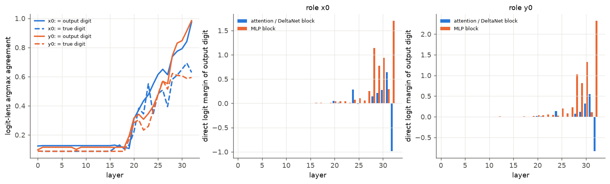

1. **首位数字在层 20 之后才出现在 logit 中。** 左图中，logit lens 的 argmax 与最终输出首位一致的比例在层 0–19 保持在 0.10–0.13（与数字频率相当），层 20 为 0.31，层 24 为 0.55，层 28 为 0.74，层 32 为 0.97；与真值首位一致的比例最高为 0.65（层 30），层 32 为 0.63。真值坐标在层 12 就已精确可读（第 3.3 节），数字选择的形成晚 8–12 层。
2. **MLP 28–30 与层 32 写入首位数字。** 中、右图为各模块对输出首位数字的直接 logit margin（相对其余 9 个数字）。$x_0$ 上 MLP 28、29、30、32 的 margin 为 1.14、0.78、0.94、1.70，attention 24、31 为 0.29、0.64，attention 32 为 −0.99；$y_0$ 的分布相同。
3. **错误首位主要由 MLP 28–30 写入。** 在首位错误的 501 个 $x_0$ 样本上，“输出数字减真值数字”的直接 margin 在 MLP 28、29、30 为 0.39、0.68、0.52，attention 24 为 0.32，其余模块不超过 0.13；$y_0$ 的 518 个样本中 MLP 28–30 为 0.29、0.42、0.70。

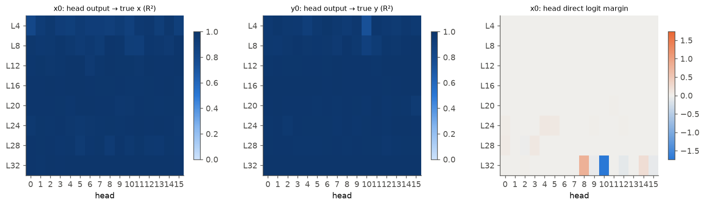

4. **位置信息遍布所有 head，数字的直接写入集中于层 32。** 左、中图中，8 个 full attention 层的 128 个 head 在 $x_0$ 上的输出读出真实坐标的 $R^2$ 为 0.82–1.00（$y_0$ 上为 0.74–1.00），绝大多数高于 0.95，head 级的位置可读性不能区分 head 的功能。右图中，直接 logit margin 集中于 L32 H8（+0.79）与 L32 H10（负值，抑制输出数字），实验 3.5 的指向型 head（L16、L20）的直接 margin 接近 0，它们读取的位置经由后续 MLP 转换为数字。

### 3.6 Q2：因果检验

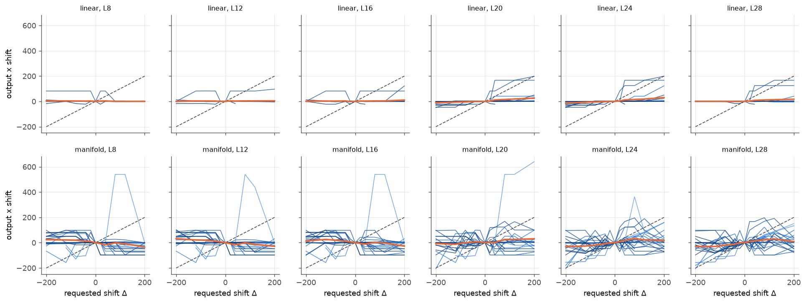

1. **只移动预测数字的状态几乎不改变输出。** 在单一层上对 $x_0$–$x_2$ 施加线性编码方向或经验流形位移，请求位移 $\pm 200$ 时输出 x 的平均变化不超过 35 个单位，斜率在 −0.15 至 0.17 之间（上图，每条细线为一个基准样本，橙线为均值）。经验流形位移在层 8–16 使输出向相反方向移动（斜率 −0.11 至 −0.15）。真值为 500 的基准样本在层 28 的流形位移下，除 $\Delta = -20$ 一个条件外，输出始终为 498 或 500。第 3.3 节表明 prompt 末端与答案前缀的每个位置都携带目标坐标，单一位置的位移会被后续层从其他位置与图像重新读取的坐标覆盖。

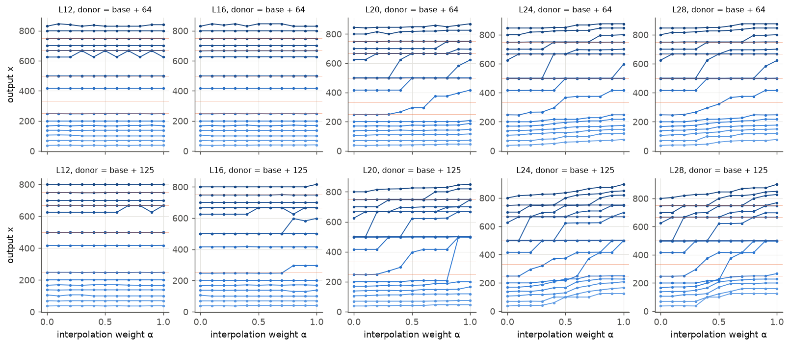

2. **把图像之后全部位置的状态换成另一张图像的状态，层 24 起输出随之改变。** 选取 sweep_h 中真实 x 相差 64 或 125 个单位的图像对，以基准图像自己的答案前缀分别前向，在某一层把图像之后全部位置（84 个，包括问题文本与答案前缀）的 residual 设为两者的插值 $(1 - \alpha) h_{\mathrm{base}} + \alpha h_{\mathrm{donor}}$，然后续写 x。

| 层 | $\alpha = 1$ 时输出等于供体输出（相差 64 / 125） | 输出移动超过 10 的图像对 | 最大单步跳变占总变化 | 中间值比例 |
| --- | --- | --- | --- | --- |
| 12 | 0.11 / 0.12 | 0/18、1/17 | — | — |
| 16 | 0.11 / 0.12 | 0/18、4/17 | 0.99（125） | 0.03（125） |
| 20 | 0.50 / 0.41 | 10/18、13/17 | 0.76 / 0.66 | 0.21 / 0.41 |
| 24 | 0.89 / 0.82 | 16/18、15/17 | 0.62 / 0.48 | 0.36 / 0.62 |
| 28 | 0.94 / 0.88 | 16/18、15/17 | 0.60 / 0.51 | 0.32 / 0.57 |

“最大单步跳变占总变化”在均匀斜坡上为 0.1、在单次跳变上为 1.0；“中间值比例”为内部插值点中输出严格位于两端之间（与两端都相差超过 5）的比例。层 12 与 16 的替换被后续层从图像重新读取的坐标覆盖，这与实验 3.5 中层 12–24 的 attention 读取相符；层 24 之后，文本位置上的编码单独决定输出。插值路径在 400 以下近似连续，在 500、667、750 附近出现平台与跳变（上图），平台的位置与第 3.2 节的吸引域一致。由于第 3.3 节表明插值经过的状态本身连续，这些平台来自读出步骤。

### 3.7 T6 网格的探索性迁移

以 grid2d 训练的真实位置 probe 应用于 T6 point 答案（144 例，命中率 0.34），层 16–24 的预测与真值的相关为 0.90–0.97（x）与 0.93–0.98（y），与模型输出的相关相近；平均绝对误差为 82–206，说明网格图像与 prompt 改变了编码的偏移与尺度，probe 不能直接迁移。网格任务的数值读出需要在网格图像上单独训练 probe 后检验。

## 4. 讨论

1. **位置 → 数字的转换是瓶颈。** 目标坐标在层 12 已经以约 5 个单位的精度线性存在于答案位置，在层 20–24 之前持续从图像刷新，层 24 之后由文本位置上的编码单独决定。模型输出的误差（22–31）是可读精度的 4–6 倍。误差的主体产生在把连续坐标写成十进制数字的读出步骤，与语言先验对位置判断的干扰无关。
2. **吸引子位于读出步骤，不位于表示几何。** 状态沿真实坐标连续变化，没有按输出值聚集；500、667、750 等平台只出现在数字输出与插值后的输出中。首位数字由 MLP 28–32 以锐利但分区不均的方式选择，十位数字几乎没有位置调谐，greedy 解码在十位上落到 0 与 5，形成“整齐”数值。
3. **与文本数值表示研究的比较。** 文本 LLM 中报告的螺旋与数位圆形表示在本任务的答案位置只在最后几层弱出现；本模型的坐标以单一线性分量为主，从这一线性分量到十位数字所需的“取模”运算（以 100 为周期）恰好是缺失的计算。这一点为改进提供了明确方向：在读出端提供从连续坐标到数位的映射（例如数值回归头、分层坐标 token 或以周期特征辅助的十位读出），可能比改进视觉表示更直接地提高坐标精度。

## 5. 限制

1. **参考实现一致性。** 手写批量解码器与 generate 的坐标一致率为 11/20，不一致样本中 5 个相差 20–47 个单位，结论使用手写解码器的答案并在其上进行 teacher forcing，内部一致。
2. **单一刺激族。** 只使用 512×512 画布与直径 64 的圆；网格与自然图像的结论需另行检验，T6 迁移只作探索。
3. **直接 logit 归因只包含直接路径**，且冻结了最终归一化尺度；MLP 28–30 写入错误首位的结论限于直接效应。
4. **steering 与插值的状态可能偏离训练分布。** 插值在供体与基准相距 64–125 个单位时进行，状态在弧线上的弦近似流形；单一位置 steering 的失效有多种可能成因，本实验只以插值结果说明“图像之后全部位置”的作用。
5. **答案前缀变体与目标位置相关**，第 3.3 节以单一变体的对照排除了其对 probe 结论的影响，PCA 图中的分离结构仍受其影响。
6. **未运行的部分。** 设计中的路径 patching（从指向型 head 到数字 unembedding）未开展；第 3.5 节以 logit lens、直接归因与 head 级读出代替。UMAP 未安装，几何可视化只使用 PCA。

## 6. 产物

产物位于 WORK_DIR 的 `analysis/position/2026-10-15_coordinate_value/`：`tokenizer_audit.json`、`cases.json`、`gen/`（答案与 generate 抽查）、`features`（链接到 DATA_DIR 的 float16 特征分片）、`force/`、`steer/`、`interp/`、`results.json`（全部指标与区间）、`analysis.npz`（作图数组）、`experiment.json`（模型版本、代码摘要与运行参数）。程序为 `analysis_tools/position/coordinate_value*.py`，入口为 `scripts/analysis/position/coordinate_value.sh`。
