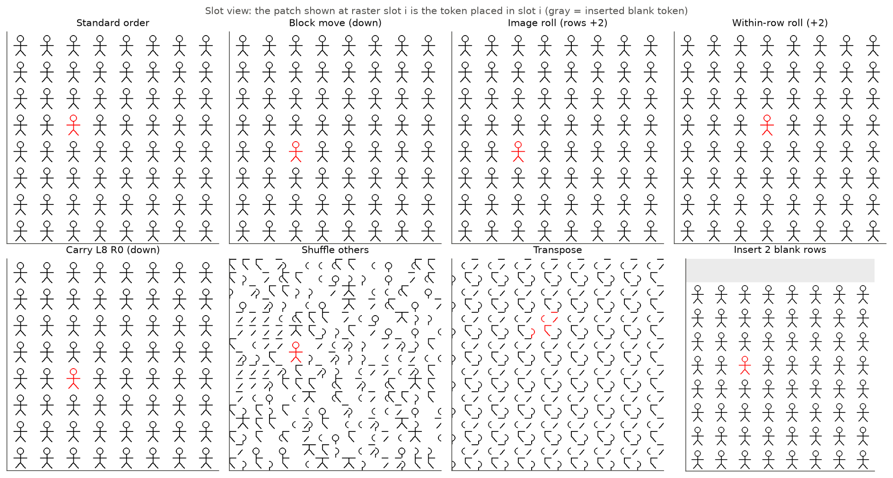
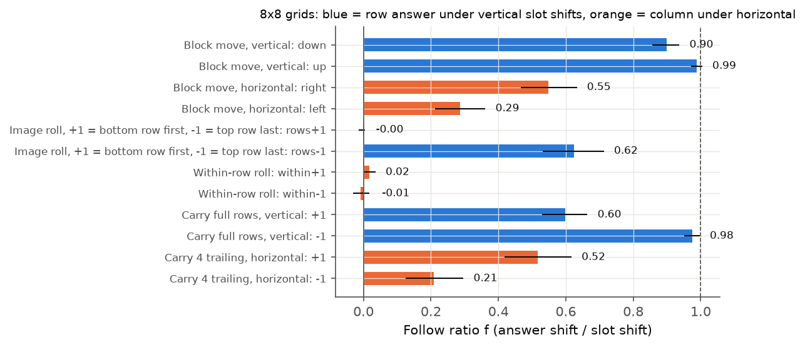
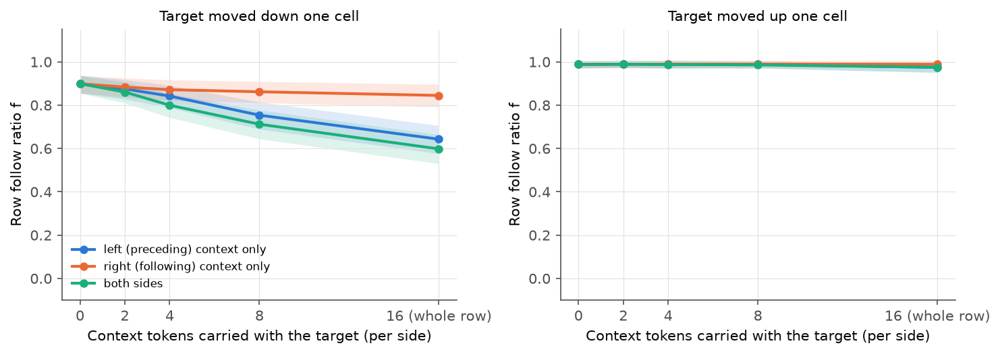
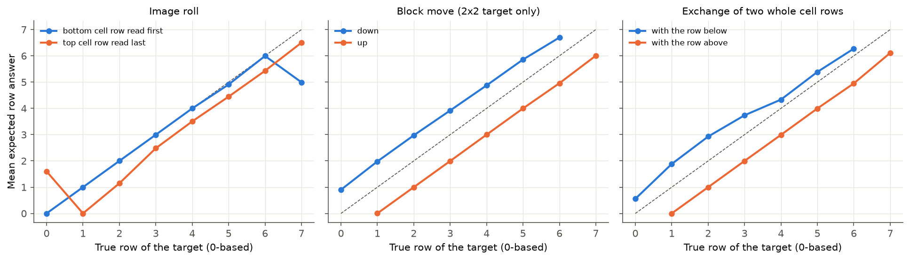
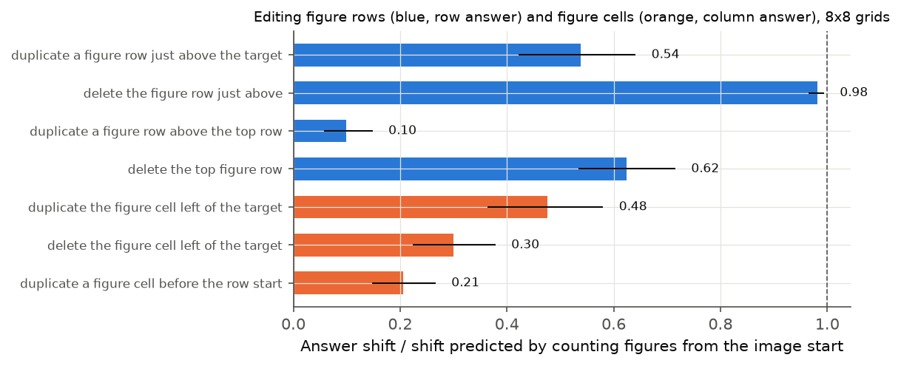
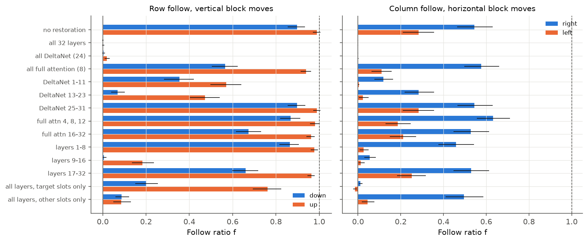
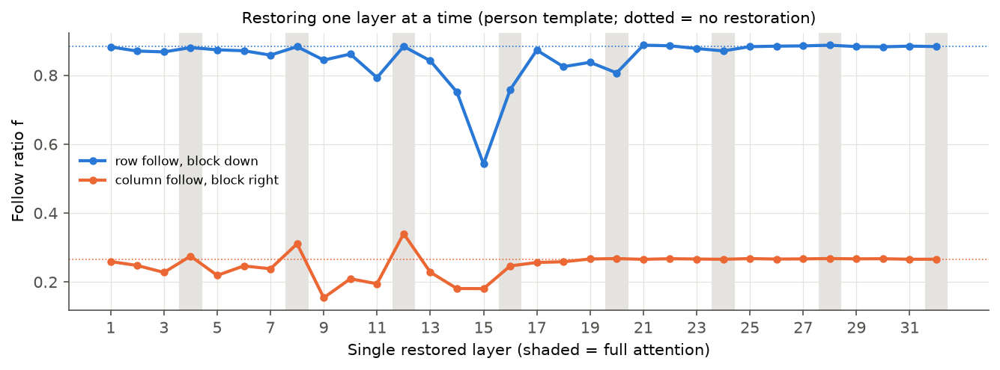
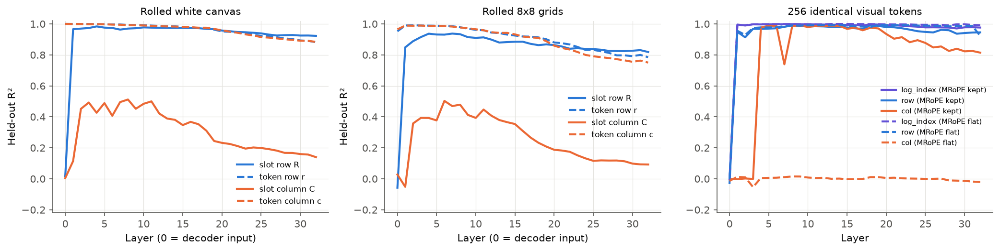
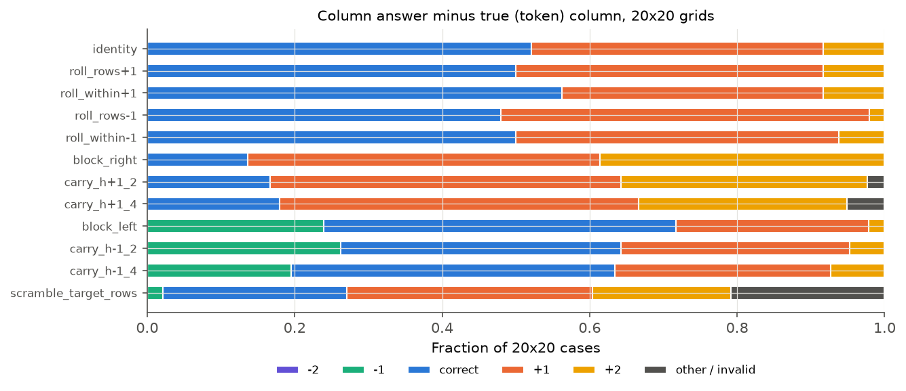

# 序列顺序的位置作用

实验日期：2026-10-15。本文属于[位置信息与坐标读取](plan.md)研究，执行[实验 3.8 设计](design_sequence_order.md)。模型为 Qwen3.5-9B，bfloat16、SDPA、greedy decoding，thinking off。

本实验的第二轮见 [results_2026-10-16_sequence_order_r2.md](results_2026-10-16_sequence_order_r2.md)：该文从 Gated DeltaNet 的门控递推解释行与列的差异，给出本文各条结论与证据的对照，并对第 1 节第 1、2 条与第 4 节第 1 条作了修正。

## 1. 研究问题与主要结果

实验 3.5 发现，在网格任务中交换目标与相邻单元在序列中的槽位后，行号几乎完全跟随槽位、列号部分跟随，而 decoder 的 MRoPE position IDs 没有因果作用。Qwen3.5-9B 的全部 token 受 causal mask 约束，32 层中 24 层为 Gated DeltaNet，因此序列顺序可以经由 causal mask 或 DeltaNet 递推转化为位置。本实验区分顺序起作用的机制、定位产生这一作用的层，并检验它与 20×20 网格列号多计 1 的关系。

主要结果如下：

1. **序列顺序以“沿序列数已读的图形行”的方式决定行号，与 visual token 的数量无关。** 在目标所在行之前删除一行图形，行号的跟随比为 0.98 [0.96, 0.99]（95/96 个样本的 greedy 行号恰好减 1）；在其前复制一行图形，跟随比为 0.54 [0.42, 0.64]（95/128 恰好加 1）。在图像开头或目标行之前插入两整行空白画布 token、32 个空白 token 或 2 个左边缘空白 token，128 张图像中只有 1–4 张的答案改变。
2. **计数从被识别为顶行的图形行开始。** 把最底的一行图形移到序列最前（整体行平移 +1），行号跟随比为 0.00 [−0.01, 0.01]；把顶行移到序列最后（整体行平移 −1），跟随比为 0.62 [0.53, 0.71]；在顶行之前复制一行图形，跟随比只有 0.10。序列开头额外出现的行不被计入，而缺少顶行时计数从序列开头算起。
3. **单纯的序号编码存在于 residual 中，但不决定答案。** 256 个完全相同的 visual token 组成的序列中，序号的对数在第 1 层之后即可被线性读出（$R^2 \geq 0.99$），说明 causal 的 DeltaNet 第 1 层已经写入“前面有多少个 token”；列内序号只有在保留 MRoPE ID 时从第 4 层（第一个 full attention 层）开始可读。然而上述插入空白 token 的条件表明，这一 token 序号编码不被行列答案使用。
4. **决定行列答案的顺序作用由层 9–16 的 DeltaNet 写入 visual token。** 把全部 24 个 DeltaNet 层在 visual 槽位上的 mixer 输出恢复为标准顺序下的值，竖直块移动的行号跟随比从 0.90 降至 0.00；恢复全部 8 个 full attention 层只降至 0.56；只恢复层 9–16 降至 0.01。逐层恢复时，单独恢复第 15 层的作用最大（0.88 降至 0.54）。恢复全部层后跟随比为 0，文本 token 对图像片段的读取本身不带来顺序作用。
5. **列号的顺序作用较弱、方向不对称且依赖模板。** 水平块移动的列号跟随比为右移 0.55、左移 0.29；person 模板为 0.27 与 0.05，ring 模板为 0.82 与 0.52。行内循环平移不改变列号（跟随比 0.02 与 −0.01）。
6. **20×20 网格的列号多计 1 与序列计数无关。** 48 个样本中标准顺序下列号多计 1 的有 19 个；整体行平移、行内平移改变了行答案或保持不变，但多计 1 的样本数为 17–24，配对比较的不一致对为 3/4、3/1、4/9 与 2/4，均无显著变化。

按设计第 6 节的停止标准，序列顺序的作用可以由“沿 causal 序列对图形行计数、以顶行为起点”这一计数机制解释，并已定位到层 9–16 的 DeltaNet；它不是 20×20 网格列号多计 1 的成因。本方向在此结束。

## 2. 实验设计与实际执行

### 2.1 符号

图像的 merged token 网格记为 $H \times W$（单位为 merged token，每个 token 覆盖 32×32 pixels）。原图第 $r$ 行第 $c$ 列的 token 称为 token $(r, c)$；序列中图像片段的第 $i$ 个位置称为槽位 $i$，其 raster 坐标为 $(R_i, C_i) = (\lfloor i / W \rfloor, i \bmod W)$。槽位顺序记为排列 $\pi$，槽位 $i$ 放入 token $\pi(i)$，token 携带自己的 visual embedding 与 MRoPE ID。网格单元为 64 pixels，即 2×2 个 token；下文的位移均以单元为单位。

期望行号 $\hat r$ 由生成行号数字时数字 1 至 $n$ 的 softmax 分布 $p_k$ 计算：

$$
\hat r = \sum_{k=1}^{n} p_k \,(k - 1),
$$

其中 $n$ 为网格行数，期望列号 $\hat c$ 同理。跟随比定义为

$$
f = \frac{\hat r - \hat r_0}{d},
$$

其中 $\hat r_0$ 为标准顺序下的期望行号，$d$ 为目标槽位的行位移（列方向同理）。$f = 1$ 表示答案完全跟随槽位，$f = 0$ 表示答案不变。序列编辑条件（复制、删除图形行或单元）以计数预测的位移 $\pm 1$ 作为 $d$。方括号为以图像为单位的 bootstrap 95% 区间，比例给出 Wilson 95% 区间。

### 2.2 刺激、问题与条件

1. **刺激。** stimuli-v1 生成的 8×8 网格（person 与 ring 模板，目标遍历 64 个单元，共 128 张，$H = W = 16$），8 行 4 列与 4 行 8 列 person 网格（各 32 张），以及实验 1.3 的 20×20 T6 行列样本 48 张。
2. **问题。** 实验 1.3 的 T6 原问题：“One figure is drawn in red. Give its position. Return only {"row": r, "column": c}, counting rows from top to bottom and columns from left to right, starting at 1. Output only the JSON, with no explanation.”。
3. **条件。** 下图以“槽位视图”展示部分条件：槽位 $i$ 的位置画出 token $\pi(i)$ 对应的 32×32 图块，因此图中看到的就是模型按 raster 顺序读到的内容。

| 条件 | 构造 |
| --- | --- |
| 块移动 | 目标的 2×2 token 与上、下、左、右相邻单元交换槽位（实验 3.5 的 S4） |
| 整体行平移 $\pm 1$ | 全部 token 行循环下移（+1，最底单元行移到序列最前）或上移（−1，顶行移到序列最后）2 个 token 行 |
| 行内平移 $\pm 1$ | 每个 token 行内部循环右移或左移 2 个 token |
| 竖直携带邻域 | 目标块上移或下移一个单元，同时携带所在 token 行中左侧 $a_L$、右侧 $a_R$ 个 token；$a_L = a_R = 16$ 即交换两个完整的单元行 |
| 水平携带邻域 | 目标块右移（左移）一个单元，同时携带其左侧（右侧）2 或 4 个 token |
| 打乱其余 | 目标槽位不变，其余 252 个 token 随机重排 |
| 全局重排 | 列优先读取（转置）、行倒序、行内倒序 |
| 插入空白 token | 白画布的 visual token：开头插入 32 个中心 token、开头或目标单元行之前插入两整行、开头插入 2 个左边缘 token |
| 编辑图形行与单元 | 在目标单元行之前或图像开头复制一行图形；删除顶行或目标之上的一行；在目标所在 token 行内复制或删除目标左侧一个单元 |

### 2.3 操作

1. **解码。** 沿用实验 3.5 的手写 greedy 解码器，以 inputs_embeds 与 $(4, B, L)$ 的 position IDs 输入，序列长度相同的条件以不含 padding 的 batch 解码（8×8 网格 batch size 16，20×20 网格 batch size 4）。插入或删除 token 后，position IDs 的第 0 行（序号）重新编号，被插入 token 复用其后一槽位的 MRoPE ID。20 个随机样本与参考实现 generate 的行列答案 20/20 一致。
2. **mixer 输出恢复。** 先在标准顺序下记录每层 token mixer（DeltaNet 层的 linear attention 模块或 full attention 层的 self-attention 模块）在每个 visual token 上的输出 $m^{\ell}_{j} \in \mathbb{R}^{4096}$；置换输入的 prefill 中，恢复第 $\ell$ 层即把槽位 $i$ 的 mixer 输出替换为 $m^{\ell}_{\pi(i)}$。MLP 逐 token 计算，不产生顺序依赖，因此恢复全部 32 层后图像片段的 residual 与标准顺序逐 token 相同。数值检验：一个样本在第 8、16、32 层的相对误差为 0（未恢复时为 0.026、0.104、0.247）。
3. **probe。** 平移输入为白画布与 8×8 网格各 40 个，每个输入做随机二维循环平移，使槽位坐标与 token 坐标解耦；在 decoder 输入与 32 层输出上以 ridge（4096 维，按输入划分 30/10 训练测试，正则系数在训练集内部选择）读出四个坐标。相同 token 序列为 256 个槽位全部放入白画布 visual embedding 的平均值，MRoPE ID 保留或全部设为同一值，随机 1/4 的槽位作测试。
4. **规模。** 8×8 与非方形网格共 192 张图像、约 6600 次解码；恢复实验 128 张图像、约 9000 次解码；20×20 网格 48 张、约 570 次解码。总计约 2.5 GPU 小时（共享 GPU）。

## 3. 结果

### 3.1 计数对象是图形行，与 token 数量无关

8×8 网格的标准顺序答对 127/128 [0.96, 1.00]（行与列均正确）。

| 条件 | 行跟随比（竖直条件） | 列跟随比（水平条件） |
| --- | --- | --- |
| 块移动，下 / 上 | 0.90 [0.86, 0.94] / 0.99 [0.97, 1.00] | — |
| 块移动，右 / 左 | — | 0.55 [0.47, 0.63] / 0.29 [0.21, 0.36] |
| 整体行平移 +1 / −1 | 0.00 [−0.01, 0.01] / 0.62 [0.53, 0.71] | — |
| 行内平移 +1 / −1 | — | 0.02 [0.00, 0.04] / −0.01 [−0.03, 0.02] |
| 交换整个单元行，与下方 / 与上方 | 0.60 [0.53, 0.66] / 0.98 [0.95, 1.00] | — |
| 水平携带 4 个 token，右 / 左 | — | 0.52 [0.42, 0.62] / 0.21 [0.13, 0.30] |

整体行平移与行内平移的统计不含循环后跨越图像边缘的目标（各 112 张）。

1. **token 序号计数被排除。** 若答案由“目标之前有多少个 visual token”换算，整体行平移 +1 与行内平移应使答案完全跟随（$f = 1$），插入 32 个空白 token 应使行号加 1。实测整体行平移 +1 与行内平移的跟随比为 0，在开头插入 32 个中心空白 token、在开头插入两整行空白 token、在目标单元行之前插入两整行空白 token、在开头插入 2 个左边缘空白 token，分别只改变 4、3、1、1 张图像的答案（共 128 张）。
2. **序列邻域借用也被排除。** 若目标从序列邻居借用位置，交换整个单元行（目标携带全部邻居）应使跟随比降为 0。实测与上方单元行交换时跟随比仍为 0.98，与下方交换时为 0.60。携带邻域的数量对上移没有影响，对下移只有在携带 8 个以上左侧 token 时才逐步降低（携带 2、4、8、16 个左侧 token 时为 0.88、0.84、0.75、0.64），见下图。

3. **答案跟随图形行的序数。** 交换整个单元行改变了目标之前的图形行数：与上方交换后目标之前少一行，答案减 1；整体行平移 −1 把顶行移到目标之后，目标之前同样少一行，答案减 1（跟随比 0.62）。下图给出各条件下期望行号随真实行号的变化。

4. **直接编辑图形行验证了计数。** 删除目标之上的一行图形，期望行号的跟随比为 0.98 [0.96, 0.99]，95/96 的 greedy 行号恰好减 1；在目标单元行之前复制一行图形，跟随比为 0.54 [0.42, 0.64]，95/128 [0.66, 0.81] 的行号恰好加 1（期望值低于 greedy 比例，因为部分样本在 $r$ 与 $r+1$ 之间分配了概率）。插入不含图形的空白行不改变答案，因此被计数的是图形行，而非 token 行。
5. **计数的起点是被识别为顶行的图形行。** 在顶行之前复制一行图形，跟随比只有 0.10 [0.06, 0.15]；整体行平移 +1 把最底一行放到顶行之前，跟随比为 0。两者说明顶行之前出现的行不被计入。删除顶行时跟随比为 0.62 [0.53, 0.72]，整体行平移 −1 为 0.62，即缺少顶行时模型部分地从序列开头开始计数。这一起点效应依赖模板：ring 模板删除顶行与整体行平移 −1 的跟随比均为 1.00，person 模板为 0.25 与 0.25。person 模板在缺少顶行时更多地保留原行号，其原因（例如 person 图形的 ViT 位置更强）尚未检验。
6. **列号同样受图形计数影响，但较弱。** 在目标左侧复制一个图形单元，列号跟随比为 0.48 [0.36, 0.58]；删除左侧一个单元为 0.30 [0.22, 0.38]；在行首之前复制一个单元为 0.21。列号的计数作用与 ViT 位置并存，模板差异明显：水平块右移的跟随比 person 为 0.27 [0.18, 0.37]、ring 为 0.82 [0.73, 0.91]。

### 3.2 破坏局部结构的重排

| 条件 | 行号正确 | 列号正确 | 行号或列号超出 8 |
| --- | --- | --- | --- |
| 打乱其余 | 15/128 | 62/128 | 67/128 |
| 转置 | 16/128 | 10/128 | 88/128 |
| 行倒序 | 18/128 | 122/128 | 9/128 |
| 行内倒序 | 32/128 | 20/128 | 36/128 |

1. **打乱其余 token 后行号失效，列号部分保留。** 目标槽位不变时行号只有 15/128 正确、67/128 的答案超出 8 行；列号 62/128 正确，答案列号与真实列号的相关为 0.95。行号依赖序列中其他图形行的完整结构，列号更多地依赖目标自身。
2. **转置后答案主要跟随槽位。** 列优先读取时，答案行号与槽位行（即目标的原列号）的相关为 0.69，与原行号的相关为 0.18；88/128 的答案超出网格范围，说明模型把列优先序列中的图形结构当成了行数不同的网格。
3. **行倒序时行号与槽位行的相关为 0.46**，列号几乎全部正确（122/128），行与列的处理相互独立。

### 3.3 非方形网格

| 网格（$H \times W$ token） | 标准顺序正确 | 块移动下 / 上 | 块移动右 / 左 | 整体行平移 +1 / −1 |
| --- | --- | --- | --- | --- |
| 8 行 4 列（16×8） | 27/32 | 0.83 / 0.99 | 0.19 / 0.07 | 0.03 / 0.49 |
| 4 行 8 列（8×16） | 32/32 | 0.97 / 0.99 | 0.43 / 0.33 | 0.00 / 0.52 |

非方形网格给出相同的模式：行号跟随块移动、不跟随整体行平移 +1，列号跟随较弱。8 行 4 列网格（每个 token 行只有 8 个 token）上列号跟随更弱，行的计数不依赖 token 行的长度 $W$。

### 3.4 产生顺序作用的层

| 恢复的层 | 行跟随，下移 | 行跟随，上移 | 列跟随，右移 | 列跟随，左移 |
| --- | --- | --- | --- | --- |
| 不恢复 | 0.90 [0.85, 0.93] | 0.99 [0.97, 1.01] | 0.54 [0.46, 0.63] | 0.28 [0.21, 0.36] |
| 全部 32 层 | 0.00 | 0.00 | 0.00 | 0.00 |
| 全部 DeltaNet（24 层） | 0.00 | 0.02 | 0.00 | 0.00 |
| 全部 full attention（8 层） | 0.56 [0.50, 0.62] | 0.94 | 0.58 | 0.11 |
| DeltaNet 1–11 | 0.35 | 0.57 | 0.12 | 0.00 |
| DeltaNet 13–23 | 0.07 | 0.47 | 0.28 | 0.02 |
| 层 9–16（全部类型） | 0.01 | 0.18 | 0.05 | 0.01 |
| 全部层，仅目标槽位 | 0.20 [0.15, 0.26] | 0.76 [0.69, 0.82] | 0.01 | −0.01 |
| 全部层，仅其余槽位 | 0.09 [0.06, 0.12] | 0.09 [0.05, 0.13] | 0.49 [0.41, 0.59] | 0.04 |

每格 112 张图像。

1. **DeltaNet 是顺序作用的来源。** 恢复全部 DeltaNet 层使四个方向的跟随比全部降至 0–0.02；恢复全部 full attention 层只使下移的行跟随比从 0.90 降至 0.56，上移几乎不变。full attention 层的 causal mask 也让 token 只看到之前的内容，但这一途径对行号的贡献较小。
2. **作用集中于层 9–16。** 恢复层 9–16 使下移与右移的跟随比降至 0.01 与 0.05；恢复 DeltaNet 25–31 不改变跟随比。这一深度与实验 3.4 中 probe 读出位置精度最高的层 13–17、实验 3.5 中坐标 token 读取图像的层 12–24 相衔接：层 9–16 写入的行序数随后在生成坐标时被读取。

3. **单层恢复的作用最大在第 15 层。** person 模板下移的行跟随比在单独恢复第 15 层时从 0.88 降至 0.54，第 14、16、11 层为 0.75、0.76、0.79，其余层不低于 0.82。单层恢复都不能完全消除跟随，计数分布在多个相邻的 DeltaNet 层上。
4. **行序数写在目标周围的 token 上，列信息写在目标 token 上。** 只恢复其余槽位使行跟随比降至 0.09，只恢复目标槽位在下移时降至 0.20、在上移时仍为 0.76；列方向相反，只恢复目标槽位即降至 0.01，只恢复其余槽位仍为 0.49。行号由周围图形行的计数状态提供，列号的顺序作用直接写入目标自身的 residual。

### 3.5 位置编码的逐层 probe

1. **相同 token 序列中，序号在第 1 层即被写入。** 256 个相同 token 的序列中，第 0 层（decoder 输入）各槽位完全相同，第 1 层输出上 $\log(1 + n)$ 的 $R^2$ 为 0.99–1.00，槽位行号为 0.95；MRoPE ID 全部设为同一值时结果相同，因此这一编码来自 causal 的 DeltaNet 第 1 层（causal 卷积与递推使序列开头附近的 token 状态不同于后面的 token）。槽位列号只有在保留 MRoPE ID 时从第 4 层起可读（$R^2 = 0.98$），设为同一值时始终为 0；这是 MRoPE 在 residual 中留下的唯一可测痕迹，而实验 3.5 已表明它对答案没有因果作用。
2. **平移输入中，槽位行与 token 行同时可读。** 白画布上槽位行 $R$ 从第 1 层起的 $R^2$ 为 0.97，token 行 $r$ 与列 $c$ 在全部层为 0.89–1.00；槽位列 $C$ 的 $R^2$ 最高约 0.5，并在第 18 层后降至 0.2 以下。8×8 网格给出相同的模式。residual 同时携带 token 序号的粗粒度编码（等价于槽位行）与 ViT 写入的位置，但第 3.1 节表明前者不被答案使用。

### 3.6 与 20×20 网格列号多计 1 的关系

| 条件 | 行号正确 | 列号正确 | 列号多计 1 | 与标准顺序的不一致对（多计 1 消失 / 出现） |
| --- | --- | --- | --- | --- |
| 标准顺序 | 39/48 | 25/48 | 19/48 [0.27, 0.53] | — |
| 整体行平移 +1 | 35/48 | 24/48 | 20/48 | 3 / 4 |
| 整体行平移 −1 | 10/48 | 23/48 | 24/48 | 4 / 9 |
| 行内平移 +1 | 36/48 | 27/48 | 17/48 | 3 / 1 |
| 行内平移 −1 | 16/48 | 24/48 | 21/48 | 2 / 4 |
| 打乱目标所在 token 行 | 30/48 | 12/48 | 16/48 | 10 / 7 |

1. **多计 1 不随序列计数改变。** 整体行平移 −1 使 32/48 的行号减 1，复现了 8×8 网格的起点效应，但列号多计 1 的样本数从 19 变为 24，配对的不一致对为 4/9（McNemar 精确检验 $p = 0.27$）；行内平移的不一致对为 3/1 与 2/4。改变列方向的计数起点（行内平移把右边缘或左边缘单元移到每行的另一端）不改变多计 1 的比例。
2. **打乱目标行内的顺序使列号更差，但不消除多计 1。** 目标所在两行 token 的其余部分随机重排后，列号正确降至 12/48，多计 1 为 16/48，多计 2 及以上增至 14/48。
3. **块移动在多计 1 之上叠加位移。** 右移一个单元后多计 1 与多计 2 分别为 21/48 与 17/48，左移后正确与多计 1 分别为 22/48 与 12/48；序列顺序的作用与多计 1 的偏差近似相加。

综合以上结果，20×20 网格列号多计 1 不来自沿序列的图形计数；它与实验 3.5 第 3.5 节的结论一致，属于读取到位置之后的序数换算偏差。

## 4. 讨论

1. **机制。** Qwen3.5-9B 在层 9–16 的 DeltaNet 中沿 causal 序列累积“已经读过几行图形”的状态，并以被识别为顶行的图形行作为起点；visual token 的行序数主要来自这一计数，而不是来自 ViT 的二维位置或 token 序号。列序数也部分来自同一类计数，但 ViT 位置的作用更大。实验 3.5 中“行号跟随槽位、列号部分跟随”的现象由此得到解释：块移动把目标放到另一图形行的计数状态中，因此行号随之改变；列方向上目标左右的图形数只变化一个，且 ViT 位置提供了独立的列信息。
2. **causal mask 与线性注意力的作用。** 两条途径都存在，但作用不同。causal 的 DeltaNet 第 1 层即写入 token 序号，这一编码可被线性读出，却不被答案使用；真正决定答案的是层 9–16 的 DeltaNet 对图形内容的计数。full attention 层的 causal mask 对行号的贡献较小（恢复全部 full attention 层后下移跟随比仍为 0.56）。
3. **对方法设计的含义。** 若在推理时只把局部窗口的 visual token 送入 LLM，窗口内的行序数会按窗口内的图形行重新计数，而不是按原图位置；方向二的窗口读取需要显式提供窗口在原图中的坐标，或保留顶行等计数起点。

## 5. 限制

1. **刺激限于规则网格。** 计数对象是规则排列的图形行；自然图像中没有明确的“行”，这一机制在自然图像上的作用未测。
2. **mixer 恢复是 path patching 的近似。** 恢复第 $\ell$ 层时，该层 mixer 的输出来自标准顺序的前向，与置换输入下该层之前的 residual 不完全一致；恢复全部层的数值检验只说明恢复本身是精确的。
3. **跟随比的分母取槽位位移。** 序列编辑条件以计数预测的 $\pm 1$ 为分母，块移动与平移以目标槽位的行列位移为分母；对计数机制而言，二者在块移动与交换整行时一致，在整体行平移时不一致，表格中的数值应按条件分别解读。
4. **20×20 样本较少。** 48 个样本只能检测较大的比例变化，多计 1 的比例变化小于约 0.2 时无法分辨。
5. **全局重排为分布外输入。** 转置、行内倒序与打乱其余使大量答案超出网格范围，只作为辅助观察。

## 6. 产物

产物位于 WORK_DIR 的 `analysis/position/2026-10-15_sequence_order/`：`behavior/records.jsonl`（槽位顺序条件）、`behavior/records_edit.jsonl`（图形行与单元的编辑）、`restore/records.jsonl` 与 `restore/check.json`（mixer 恢复）、`probe/results.json`（probe）、`fail20/records.jsonl`（20×20 样本）、`spotcheck.json`、`results.json`（全部统计）与 `experiment.json`（模型版本、代码摘要与运行参数）。程序为 `analysis_tools/position/sequence_order.py`、`sequence_order_run.py` 与 `sequence_order_analysis.py`，入口为 `scripts/analysis/position/sequence_order.sh`，测试为 `tests/analysis/position/test_sequence_order.py`。
