# ViT 位置与布局表征

实验日期：2026-10-15。本文属于[位置信息与坐标读取](plan.md)研究，执行[实验 3.7 设计](design_vit_layout.md)。主模型为 Qwen3.5-9B，对照模型为 Qwen3-VL-8B-Instruct，均为 bfloat16、SDPA、greedy decoding、thinking off。

## 1. 研究问题与主要结果

实验 3.5 测得 Qwen3.5-9B 的单目标坐标主要由 ViT 2D RoPE 决定（区域互换的位移权重 $w = 0.71$），learned absolute position embedding（PE）的互换权重只有 0.01。本实验回答三个问题：PE 为什么在互换中几乎不起作用；位置与物体布局在 ViT 内部如何表示；局部重读时应当给重新编码的窗口提供什么位置输入。主要结果如下：

1. **Qwen3.5 的 PE 是 Qwen3-VL 的 PE 按约 1/2.76 均匀缩小的结果。** 两个模型的 ViT 来自同一初始化：27 个 block 的权重矩阵与 Qwen3-VL 的余弦相似度中位数为 0.97，norm 与 bias 参数几乎不变（范数比 1.000）。PE 表与 Qwen3-VL 的逐项余弦为 0.99，但范数比为 0.36，是全部 ViT 张量中缩小最多的一个（权重矩阵的范数比中位数为 0.87，最小为 0.72）。方向不变、尺度均匀缩小，与训练中梯度很弱的参数被 weight decay 持续衰减的形态一致。PE 在 ViT 输入处只有内容向量范数的 0.21 倍（Qwen3-VL 为 0.51–0.59）。
2. **PE 在 Qwen3.5 中充当 RoPE 在均匀区域中计算位置所需的“载体”，其空间排列几乎不被使用。** 在白色画布上去除 PE 后，512 pixels 画布的命中率由 18/36 [0.34, 0.66] 降至 1/36 [0.00, 0.14]，横坐标回归斜率由 1.06 降至 0.17；把 PE 替换为本图均值后同样失效。随机打乱 PE 的空间排列却只使斜率降至 0.82，在各区域之间互换 PE 的位移权重在 256–1024 pixels 画布上均不超过 0.01，PE 放大 4 倍后互换权重仍不超过 0.06。把背景换成逐像素灰度噪声后，去除 PE 的斜率恢复到 0.90–1.03。因此在 Qwen3.5 中，模型需要的是“每个 patch 内容互不相同”，位置本身由 RoPE 的相对位置计算给出；均匀白色区域没有内容差异，此时 PE 是唯一能提供差异的输入。
3. **把 PE 放大到 Qwen3-VL 的尺度可显著提高合成图像上的定位精度，但对自然图像没有收益。** PE 乘以 2.76 后，白色画布的命中率在 256、384、512 pixels 上分别由 9/36、12/36、18/36 升至 23/36、29/36、36/36（McNemar 检验 $p \le 5 \times 10^{-4}$），768 pixels 以上的中心误差由 28–34 降至 2–9（0–1000 坐标），T2 识别不受影响。RefCOCO val 的 751 条表达式上，IoU≥0.5 的比例在 base、×2、×2.76、×4 下为 0.899、0.909、0.896、0.885，×4 显著降低平均 IoU。反向地，把 Qwen3-VL 的 PE 缩小到 Qwen3.5 的尺度（×0.36）使其 RefCOCO 由 0.908 降至 0.879（34 条变错、12 条变对）。
4. **两种模型对 PE 的依赖程度不同。** Qwen3-VL 去除 RoPE、只保留 PE 时，噪声背景 512 pixels 画布的命中率仍为 29/36 [0.65, 0.90]，而 Qwen3.5 为 1/36；打乱 PE 使 Qwen3-VL 的命中率由 28/36 降为 0/36。Qwen3-VL 的 PE 仍是一个可用的绝对位置标签，Qwen3.5 的位置几乎完全由 RoPE 计算。
5. **布局信息在 ViT 前几层即以分布式形式写入全部 token。** 在两物体图像上，背景 token 的均值与全部 token 的均值从 block 1 起即可线性读出两个物体的横坐标（$R^2 = 0.84$，ViT 输入处的标签泄漏基线为 0.24），block 8 起达到 0.96–0.99，“红圆在左”的准确率为 1.00；单个背景 token 只有 $R^2 \le 0.37$ 与 0.54–0.64 的关系准确率。物体自身的 token 在 block 8 之后也能读出另一个物体的横坐标（$R^2 = 0.76$–0.89）。去除 PE 不改变这些结论，去除 RoPE 使其明显变弱并随深度衰减。
6. **merger 输出中的位置是可与内容分离的线性子空间，但不是二维的。** 用 LEACE 在 merger 输出上擦除对 256 个槽位的全部线性信息（秩 255）后，命中率由 54/108 降至 8/108，横坐标斜率由 1.07 降至 0.22，T2 识别保持 45/48；同秩随机擦除不改变任何指标；只擦除 $(x, y)$ 两个线性方向时命中率为 23/108，位置信号分布在远多于两维的方向上。擦除后纵坐标仍保留（斜率 0.80），对应 3.5 中由序列顺序承载的纵向位置。
7. **局部重读时，窗口必须在原图上下文中编码才能得到原图坐标。** 把 256×256 窗口单独送入 ViT 时，RoPE ID 平移到原图坐标没有任何作用（$w = -0.07$），取原图 PE 窗口只得到 $w = 0.16$；在原图上编码、再只把窗口内的 64 个 token 交给 decoder 时 $w = 0.91$ [0.76, 1.08]，接近看到整张原图的 1.04。

## 2. 实验设计与实际执行

### 2.1 位置输入编辑

记第 $i$ 个 patch 的内容向量为 $x_i \in \mathbb{R}^{1152}$，PE 为 $e_i \in \mathbb{R}^{1152}$（由 $48 \times 48$ 表双线性插值得到），RoPE 的 position ID 为 patch 的行列号 $(r_i, c_i)$。ViT 输入为 $z^{(0)}_i = x_i + e_i$，27 个 block 的 attention 均按 $(r_i, c_i)$ 旋转 query 与 key。RoPE 只引入相对位移，PE 是唯一的绝对位置输入（设计第 3 节）。各条件如下表，“均值 PE”指把本图全部 patch 的 PE 平均后赋给每个 patch：

| 条件 | PE | RoPE ID |
| --- | --- | --- |
| base | 默认插值 | 默认 |
| pe_zero、pe_mean、pe_shuffle | 0、本图均值、随机置换 | 默认 |
| pe_native | 居中取 1:1 子表（画布 ≤ 768 pixels） | 默认 |
| pe_x2、pe_x2.76、pe_x4、pe_x0.36 | 乘以对应倍数 | 默认 |
| rope_zero 及其组合 | 默认、×4、均值或 0 | 全部为 0 |

编辑通过向 ViT 前向传入 RoPE ID 与插值权重实现，对每张图像按其 patch 网格单独计算，因此可用于批量生成，并在 Qwen3-VL 中同时作用于 merger 与 DeepStack 的输入。将 PE 写成“原画布上的窗口”并令窗口等于整张画布时，ViT 各 block 输出与默认前向逐元素相同，证明替换路径本身不引入差异。

### 2.2 刺激与问题

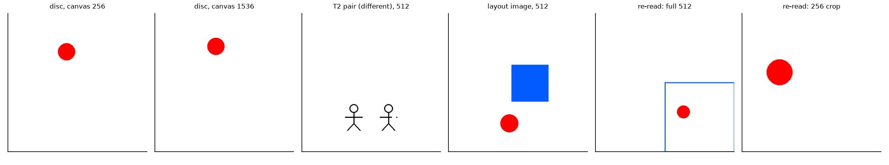

从左到右依次为：256 与 1536 pixels 画布上的单目标圆；512 pixels 画布上的 T2 图形对（不同）；两物体布局图像；局部重读的原图（蓝框为窗口）与窗口。

| 部分 | 输入 | 问题 | 规模 |
| --- | --- | --- | --- |
| 坐标输出 | 白色方形画布，边长 256–1536，圆直径为边长的 1/8，圆心为 $6 \times 6$ 等距位置加抖动；另有灰度噪声背景（256、512、1024） | 3.5 的 point 问题 | 每个画布与条件 36 张；Qwen3.5 共 3456 次生成，Qwen3-VL 共 2124 次 |
| 互换（仅 Qwen3.5） | 同上，256–1024 | 同上 | 每个画布 36 张，每张 16 个条件 |
| 识别对照 T2 | 两个并排图形，一半相同，一半有缺口或 45° 旋转 | “Are the two figures exactly identical? Answer with only Yes or No.” | 每个画布 48 对 |
| RefCOCO | 实验 4.2 的 RefCOCO val 751 条表达式 | 4.2 的 bbox 问题 | 每个条件 751 条 |
| 位置 probe | 实验 3.4 的 RefCOCO 图像，中心方形区域缩放到 512×512 | 只运行 ViT | 训练 320、验证 80、测试 100 张 |
| 布局 probe | 红色圆与蓝色正方形，位置与尺寸随机 | 只运行 ViT | 1600 张（训练 960、验证 240、测试 400） |
| 线性擦除 | 拟合：320 张自然图像 + 320 张布局图像；测试：圆直径 32、64、128 各 36 张，T2 48 对 | point 问题、T2 | 6 个擦除条件 |
| 局部重读 | 512 画布中直径 48 的圆，256×256 窗口 | point 问题 | 48 个样本 × 8 个条件 |

坐标指标沿用 3.5：命中率为输出点落在圆内的比例（严格评分只接受 0–1000 归一化约定与单个 point），中心误差以 0–1000 坐标计。按计划第 6.9 条另计“任一坐标约定命中”，Qwen3.5 在全部条件下与严格命中相同（没有以 pixel 约定作答的输出），下文不再单列。Qwen3-VL 有 36%–56% 的回答把同一个点重复两次（例如 `[{"point_2d": [156, 48]},{"point_2d": [156, 48]}]`），严格评分记为格式错误；下文 Qwen3-VL 的坐标数字使用诊断解析（全部点相同时取该点），严格结果保存在 results.json 中。

### 2.3 数值一致性

1. **批量生成。** 坐标阶段使用 left padding 的 `generate_batch`（batch size 8；Qwen3-VL 的 RefCOCO 阶段为 16）。随机抽取 20 个“样本 × 条件”与逐条 `generate` 比较，Qwen3.5 有 14/20 [0.48, 0.85] 答案完全相同，其余 6 个的坐标相差 2–20 个单位；Qwen3-VL 为 17/20。这一差异量级与 3.5 中 bf16 噪声（中心差均值约 6 个单位）相当，下文只解释远大于该量级的变化。
2. **运行规模。** 共约 5 GPU 小时（共享 GPU），另有约 1 GPU 小时用于小规模冒烟测试。

## 3. 结果

### 3.1 PE 表与两个模型的 ViT 权重

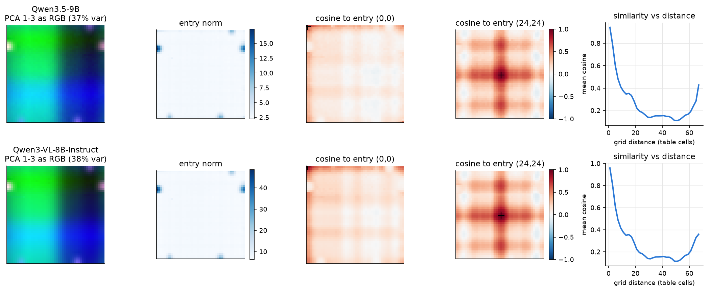

1. **PE 表的结构几乎完全由行与列决定。** 前三个主成分（解释 37% 的方差）给出平滑的二维坐标图；任意一项与其余各项的余弦相似度呈“十字形”，即与同行、同列的项相似；把表写成“行向量 + 列向量”的加性形式可解释 73% 的方差。低频成分占主导：$8 \times 8$ 个最低的二维 DCT 频率占 77% 的能量。左右边缘第 9–11 行有少数异常大的项，范数是中位数的 5–7 倍。
2. **Qwen3.5 与 Qwen3-VL 的 PE 表方向相同、尺度相差 2.76 倍。** 两张表逐项余弦的平均为 0.988，以单个标量拟合时残差为 15%，平均每项范数为 2.63 与 7.25。

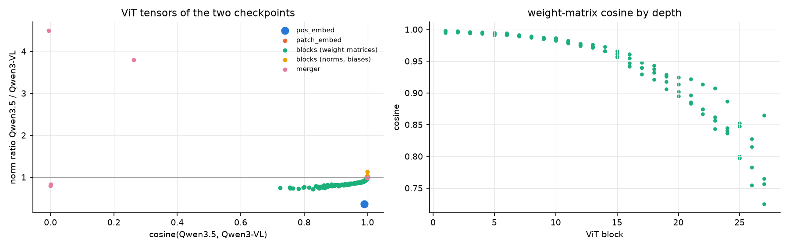

3. **Qwen3.5 的 ViT 由 Qwen3-VL 的 ViT 继续训练得到，merger 重新初始化。** 下表为两个 checkpoint 对应张量的余弦与范数比（Qwen3.5 / Qwen3-VL）：

| 张量组 | 个数 | 余弦中位数 | 范数比中位数 | 范数比最小值 |
| --- | --- | --- | --- | --- |
| PE 表 | 1 | 0.989 | 0.363 | 0.363 |
| patch embedding | 2 | 0.999 | 0.982 | 0.964 |
| block 权重矩阵 | 108 | 0.966 | 0.871 | 0.721 |
| block 的 LayerNorm 与 bias | 216 | 1.000 | 1.000 | 0.984 |
| merger | 6 | 0.132 | 0.993 | 0.805 |

LayerNorm 与 bias 通常不施加 weight decay，其范数不变；权重矩阵在继续训练中缩小约 13%；PE 缩小 64%，且方向保持不变。一个参数在 weight decay 下按比例收缩而方向不变，说明它在继续训练中得到的梯度很小，不足以抵消衰减。结合第 3.3 节，Qwen3.5 的训练没有依赖 PE 携带位置，PE 因而逐渐萎缩；RoPE 的作用不受 weight decay 影响。

### 3.2 PE 的数值占比与对各层表示的影响

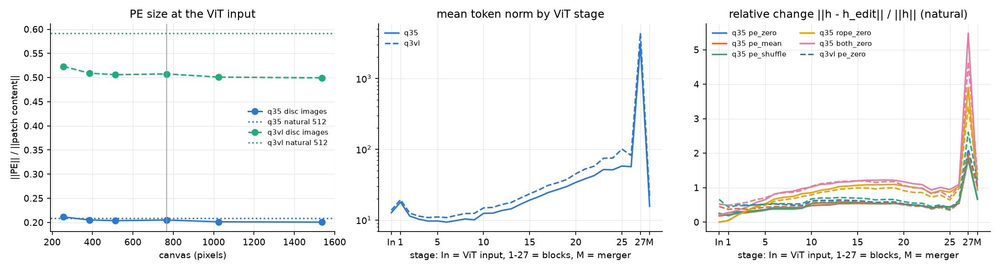

1. **PE 在输入处的占比与画布尺寸无关。** Qwen3.5 中 $\lVert e_i \rVert / \lVert x_i \rVert$ 在 256–1536 pixels 的单目标图像上为 0.20–0.21，自然图像为 0.21；Qwen3-VL 为 0.50–0.52 与 0.59。插值不改变 PE 的大小，原生尺寸 768 pixels 没有特殊之处。
2. **去除 PE 对表示的影响远大于其输入占比。** 自然图像上，去除 PE 使 block 13 的输出相对变化 0.54、merger 输出变化 0.67；均值 PE 与打乱 PE 的变化几乎相同（merger 均为 0.66–0.67）。去除 RoPE 的变化更大（merger 0.93）。第 27 个 block 的相对变化达到 1.8–5.5，该层的 token 范数在第 26 个 block 出现约 $10^{3}$ 量级的尖峰，随后回落，两个模型相同。这一指标只说明表示整体被改变，不区分位置与其他信息，第 3.3–3.5 节分别检验位置与识别。

### 3.3 坐标输出

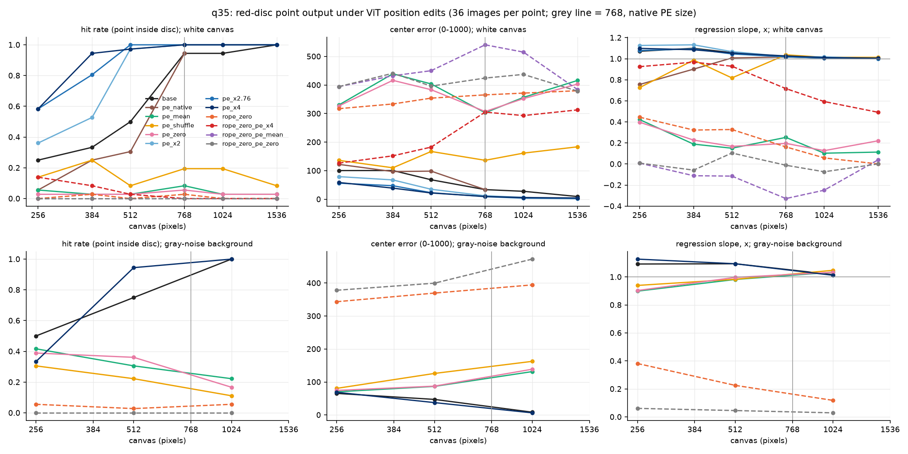

上排为白色画布，下排为噪声背景；左为命中率，中为中心误差，右为横坐标的回归斜率（1 表示输出随真值等比例移动，0 表示输出与位置无关）。

| 画布 | base | pe_zero | pe_mean | pe_shuffle | pe_native | pe_x2 | pe_x2.76 | pe_x4 | rope_zero | rope_zero_pe_x4 | rope_zero_pe_zero |
| --- | --- | --- | --- | --- | --- | --- | --- | --- | --- | --- | --- |
| 256 | 9 / 100 | 1 / 326 | 2 / 330 | 4 / 137 | 2 / 122 | 12 / 79 | 23 / 56 | 21 / 58 | 0 / 318 | 5 / 128 | 0 / 394 |
| 384 | 12 / 101 | 1 / 416 | 1 / 439 | 9 / 110 | 9 / 97 | 19 / 68 | 29 / 47 | 34 / 39 | 1 / 334 | 3 / 152 | 0 / 441 |
| 512 | 18 / 68 | 1 / 383 | 1 / 404 | 3 / 168 | 9 / 99 | 35 / 35 | 36 / 23 | 35 / 22 | 0 / 354 | 1 / 183 | 0 / 396 |
| 768 | 34 / 34 | 2 / 307 | 3 / 303 | 7 / 136 | 34 / 34 | 36 / 12 | 36 / 9 | 36 / 10 | 1 / 365 | 0 / 305 | 0 / 424 |
| 1024 | 34 / 28 | 1 / 353 | 1 / 357 | 7 / 162 | — | 36 / 7 | 36 / 4 | 36 / 6 | 0 / 372 | 0 / 293 | 0 / 437 |
| 1536 | 36 / 10 | 1 / 403 | 1 / 416 | 3 / 184 | — | 36 / 3 | 36 / 2 | 36 / 5 | 0 / 380 | 0 / 313 | 0 / 379 |

每格为“命中数（共 36）/ 中心误差均值”。

1. **去除 PE 或只保留其均值，坐标在横向上几乎失去位置。** 512 pixels 时 pe_zero 的命中为 1/36 [0.00, 0.14]，斜率横向 0.17、纵向 0.65；1024 与 1536 pixels 时横向斜率为 0.13 与 0.22，纵向为 0.75 与 0.51。与 base 成对比较，768 pixels 以上每个画布有 32–35 张图像由命中变为未命中（McNemar $p < 10^{-9}$）。纵向残留的位置与 3.5 中序列顺序主要承载纵向位置的结论一致。
2. **PE 的空间排列只贡献精度。** pe_shuffle 保留了 PE 的分布与 patch 间差异，只破坏其与位置的对应。它使中心误差升至 110–184，但横纵斜率仍为 0.73–1.12、相关系数为 0.94–0.99，输出仍随目标移动，与 pe_zero 的崩溃形成对照。
3. **区域互换中 PE 不携带位置，即使放大或去除 RoPE 也是如此。**

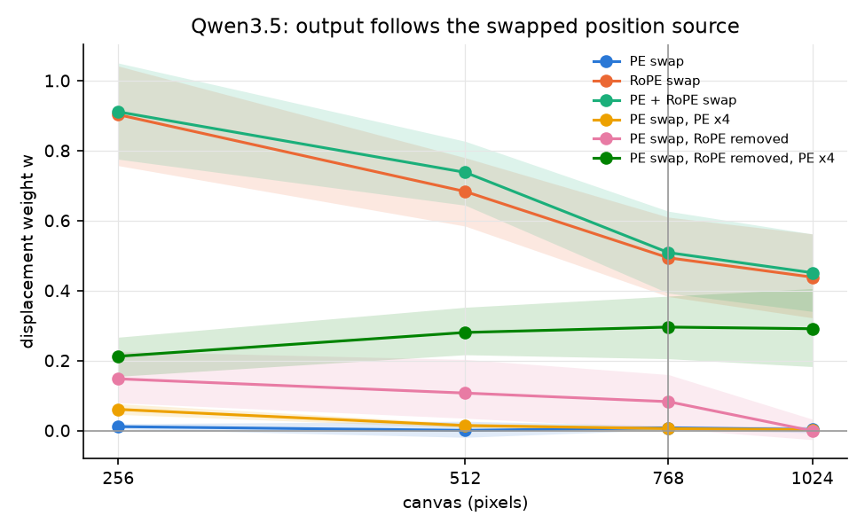

| 画布 | PE 互换 | RoPE 互换 | 二者互换 | PE 互换，PE ×4 | PE 互换，去除 RoPE | PE 互换，去除 RoPE、PE ×4 |
| --- | --- | --- | --- | --- | --- | --- |
| 256 | 0.01 [0.00, 0.02] | 0.90 [0.76, 1.04] | 0.91 [0.78, 1.05] | 0.06 [0.05, 0.08] | 0.15 [0.08, 0.23] | 0.21 [0.16, 0.27] |
| 512 | 0.00 [−0.02, 0.03] | 0.68 [0.58, 0.78] | 0.74 [0.64, 0.83] | 0.01 [0.01, 0.02] | 0.11 [0.04, 0.20] | 0.28 [0.22, 0.35] |
| 768 | 0.01 [0.00, 0.01] | 0.49 [0.38, 0.61] | 0.51 [0.39, 0.63] | 0.01 [0.00, 0.01] | 0.08 [0.01, 0.16] | 0.30 [0.21, 0.38] |
| 1024 | 0.00 [−0.01, 0.01] | 0.44 [0.32, 0.56] | 0.45 [0.34, 0.56] | 0.00 [−0.00, 0.01] | −0.00 [−0.03, 0.03] | 0.29 [0.18, 0.41] |

互换距离为 merged 网格边长的 1/4，区间为以图像为单位的 bootstrap 95% 区间。PE 互换的权重在原生尺寸 768 pixels 上同样为 0.01，原生分辨率不使 PE 更重要。即使去除 RoPE 并把 PE 放大 4 倍，PE 互换也只使输出移动 21%–30%，而此时基线命中率已降到 0–6/36。RoPE 互换的权重随画布增大由 0.90 降到 0.44；256 pixels 画布上有 8–9/72 个 RoPE 互换输出同时报告了原位置与新位置两个圆，按格式错误计入。

4. **噪声背景使去除 PE 后的粗定位恢复。** 噪声背景下 pe_zero 的横坐标斜率为 0.90、1.00、1.03（256、512、1024 pixels），相关系数 0.98–0.99；命中率由 base 的 27/36 [0.59, 0.86] 降至 13/36 [0.22, 0.52]（512 pixels），即粗位置完整、精度下降。去除 RoPE 在噪声背景上仍使位置崩溃（512 pixels 斜率 0.23、命中 1/36）。这验证了设计第 3 节的推论：attention 的 value 在内容相同的区域中相同，RoPE 无法在其中产生位置差异；只要 patch 之间存在差异（噪声、打乱的 PE 或自然图像内容），RoPE 就能计算出位置。Qwen3.5 的 PE 在这里的作用是为白色背景提供这种差异。
5. **放大 PE 使定位更精确。** pe_x2.76 在 256、384、512 pixels 上相对 base 分别新增 15、20、18 个命中、丢失 1、3、0 个（McNemar $p = 5 \times 10^{-4}$、$5 \times 10^{-4}$、$8 \times 10^{-6}$）；768 pixels 以上中心误差降到 2–9 个单位。PE 越大，均匀区域中 patch 之间的差异越大，RoPE 产生的位置特征越清晰；这一解释与第 4 点一致，也与 PE 的空间排列几乎不被使用（第 3 点）一致。

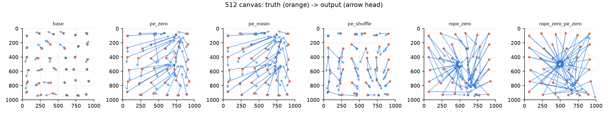

512 pixels 画布上的真值（橙点）与输出（箭头）。pe_zero、pe_mean 与 rope_zero 的输出向中部收缩，pe_shuffle 仍保留位置的排列。

### 3.4 识别对照与自然图像

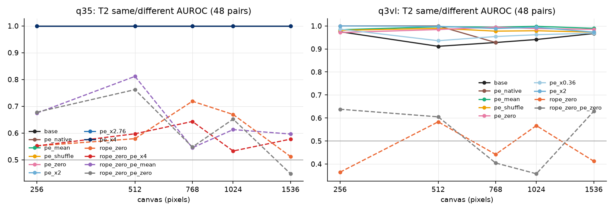

1. **PE 的编辑不损伤识别，RoPE 的去除损伤一切。** Qwen3.5 在 5 种画布尺寸上，pe_zero、pe_mean、pe_shuffle、pe_native、pe_x2、pe_x2.76 的 T2 AUROC 均为 1.00；pe_x4 的 AUROC 仍为 1.00，但在 256 pixels 上回答偏向 No（Yes 比例 0.27）。去除 RoPE 后 AUROC 降到 0.45–0.72，且全部回答 No。因此 PE 编辑引起的坐标变化是位置特异的，RoPE 去除属于一般性损伤，其坐标结果只能作为参照。Qwen3-VL 的模式相同（PE 编辑后 AUROC 0.93–1.00，去除 RoPE 后 0.36–0.58）。

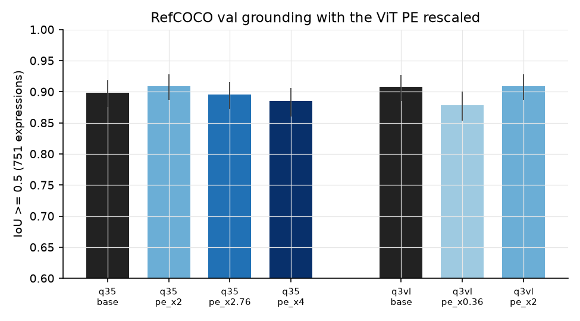

2. **自然图像的 grounding 不受益于放大 PE。** Qwen3.5 在 RefCOCO val 751 条表达式上 IoU≥0.5 的比例为：base 675/751 [0.88, 0.92]，×2 为 683/751（18 条变对、10 条变错，平均 IoU 差 0.000 [−0.010, 0.010]），×2.76 为 673/751，×4 为 665/751（平均 IoU 降低 0.037 [−0.049, −0.025]）。自然图像本身提供丰富的 patch 间差异，RoPE 不缺少载体，与第 3.3 节第 4 点一致。base 的结果与实验 4.2 的同一批数据一致（同为 675/751 量级）。
3. **Qwen3-VL 的 PE 缩小后自然图像 grounding 变差。** Qwen3-VL 的 base 为 682/751 [0.89, 0.93]，×0.36 为 660/751 [0.85, 0.90]（34 条变错、12 条变对，平均 IoU 降低 0.050 [−0.063, −0.037]），×2 为 683/751。

### 3.5 Qwen3-VL 对照

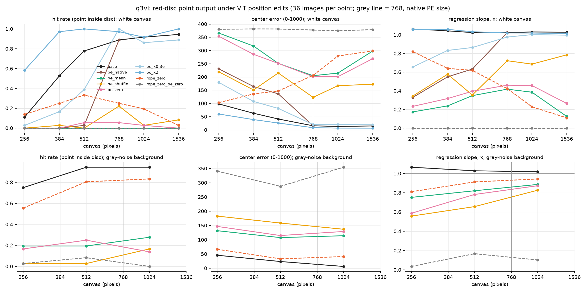

Qwen3-VL 的数字使用诊断解析（第 2.2 节）。

1. **Qwen3-VL 的 PE 是可用的绝对位置标签。** 512 pixels 白色画布上 base 命中 28/36 [0.62, 0.88]，pe_shuffle 为 0/36 [0.00, 0.10]（Qwen3.5 的 pe_shuffle 仍保留排列，见第 3.3 节）；去除 RoPE、只保留 PE 时，噪声背景 512 与 1024 pixels 的命中为 29/36 与 30/36，斜率 0.91–1.00，而 Qwen3.5 的相应结果为 1/36 与 0/36。
2. **两种模型都在去除 PE 后失去白色画布上的位置**（Qwen3-VL 512 pixels pe_zero 命中 2/36、横向斜率 0.40），但 Qwen3-VL 在噪声背景上不能像 Qwen3.5 那样恢复（512 pixels pe_zero 命中 9/36、斜率 0.78），说明它在内容充足时仍依赖 PE 的绝对位置。
3. **尺度互换给出对称的结果。** Qwen3-VL 的 PE 缩小到 Qwen3.5 的尺度后，256–512 pixels 的命中率下降（512 pixels 由 28/36 降至 14/36），1024 与 1536 pixels 基本不变；Qwen3.5 的 PE 放大后精度提高（第 3.3 节）。

### 3.6 ViT 各层的位置可读性

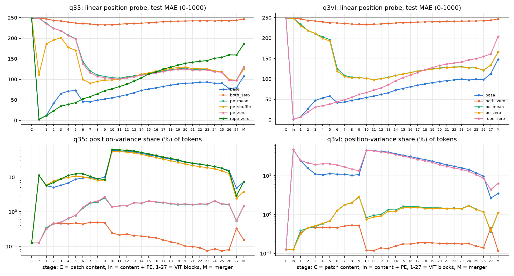

上排为线性 probe 在 100 张测试图像上的 MAE（0–1000 坐标；常数基线约为 250），下排为位置方差占比 $\rho^{(\ell)}$（槽位均值之间的方差占 token 总方差的比例，对数刻度）。横轴依次为内容向量 C、ViT 输入 In、27 个 block 与 merger M。

1. **内容向量中没有线性可读的位置**（MAE 249），加上 PE 后 MAE 为 3（PE 本身就是坐标表）。base 下误差在 block 1–5 升至 73，block 6 降回 45，此后随深度单调上升至 merger 的 107（Qwen3-VL 为 148）。
2. **去除 PE 后，RoPE 在 block 6–8 建立起可读的位置。** pe_zero 的 MAE 由 block 1 的 235 降至 block 8 的 107，此后保持在 97–129；pe_mean 与 pe_zero 的曲线重合，pe_shuffle 的曲线在 block 6 之后与二者重合。PE 的空间排列只在 block 1–5 提供可读位置，block 6 之后可读的位置来自 RoPE。
3. **去除 RoPE 后，PE 提供的位置随深度衰减。** rope_zero 的 MAE 由 block 1 的 12 升至 merger 的 186；二者都去除时全部层均为 233–249，ViT 对 patch 置换等变，验证了实现。
4. **block 10 之后的大部分“位置方差”来自少数固定位置的高范数 token。** base 的 $\rho^{(\ell)}$ 在 block 9 为 8%，block 10 跳到 56%，随后下降，merger 为 7%；pe_zero 下只有 1.4%–2.6%。merger 输出的槽位均值偏离主要集中在左上角、右下角与第一行（偏离范数为其余槽位的 5–15 倍），去除 PE 后消失。PE 因此还决定了 ViT 在图像角落生成一类固定位置的高范数 token，这类 token 的作用与注意力汇聚或 register token 相似，尚待专门检验。

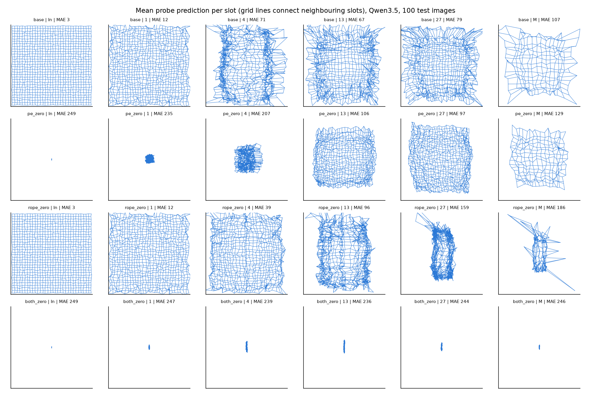

每幅图为测试图像上 probe 预测的槽位平均位置，网格线连接相邻槽位。去除 PE 时（第二行），位置网格从图像中心向外逐层“展开”，block 13 之后接近完整；去除 RoPE 时（第三行），网格逐层向中间收缩。

### 3.7 布局的表示方式

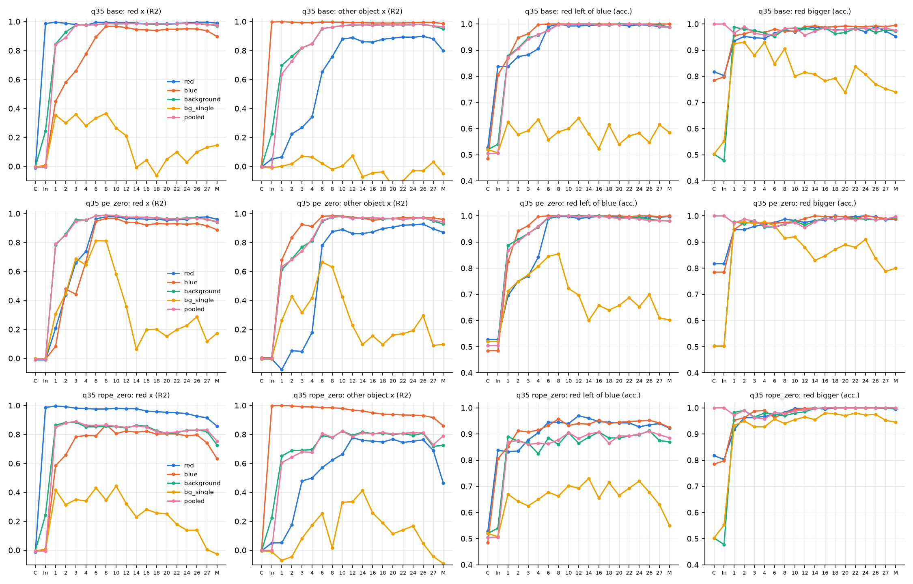

三行分别为 base、pe_zero、rope_zero；四列分别为读出红圆横坐标（$R^2$）、读出蓝方横坐标（$R^2$）、“红圆在蓝方左侧”（准确率）与“红圆更大”（准确率）。五条曲线分别为红圆 token 均值、蓝方 token 均值、背景 token 均值、单个背景 token 与全部 token 均值。测试集 400 张，准确率的 Wilson 区间半宽约为 0.05。

1. **背景 token 与 pooled 特征从 block 1 起携带全部物体的位置与关系。** base 下背景均值读出红圆横坐标的 $R^2$ 在 ViT 输入处为 0.24（背景 patch 位置与物体位置负相关造成的泄漏），block 1 为 0.84，block 4 为 0.98；“红圆在左”的准确率在输入处为 0.54，block 1 为 0.88，block 8 起为 1.00。全部 token 均值的结果与之几乎相同（输入处 $R^2 = 0$，block 8 起 0.99）。
2. **布局信息分布在大量背景 token 上，单个背景 token 只含其中一小部分。** 单个背景 token 读出红圆横坐标的 $R^2$ 在 block 1–8 为 0.28–0.37，block 14 之后接近 0，关系准确率为 0.54–0.64。均值读出接近完美而单个 token 读出很弱，说明每个背景 token 只以其与物体的相对位移为条件携带少量物体信息，平均之后才组成完整的布局编码。
3. **物体 token 在中层获得对方的位置。** 红圆 token 读出蓝方横坐标的 $R^2$ 在 block 4 为 0.34，block 8 为 0.76，block 10–27 为 0.86–0.89，merger 为 0.80；蓝方 token 读出红圆横坐标在 block 8 达到 0.97。“红圆在左”可以从任一物体的 token 中以 0.99–1.00 的准确率读出。From What to Which 在 LLM 中观察到实例身份分布在多个上下文化 token 中，本结果表明这种分布式布局编码在 ViT 的前 8 个 block 中已经形成。
4. **布局编码由 RoPE 写入。** 去除 PE 时上述结论不变（背景均值 block 8 的 $R^2 = 0.99$），单个背景 token 在 block 6–8 反而达到 0.81；去除 RoPE 时背景均值的 $R^2$ 停在 0.81–0.86，物体 token 读出对方位置的 $R^2$ 在 merger 降至 0.46，关系准确率降至 0.87–0.94。Qwen3-VL 的 base 结果与 Qwen3.5 几乎相同。

### 3.8 位置子空间与线性擦除

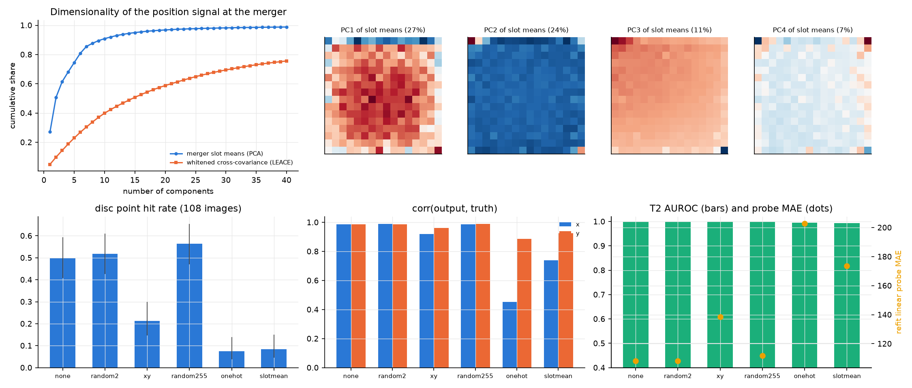

1. **位置信号的维数。** merger 输出的 256 个槽位均值中，前 2 个主成分解释 51%，前 10 个解释 91% 的方差；但其中第 1、2 个主成分主要由角落与第一行的高范数 token 决定（左上图），第 3 个主成分才是平滑的对角梯度。按白化后的交叉协方差（LEACE 实际擦除的方向）计，前 10 个方向只占 40%，前 40 个占 76%，在模型的度量下位置信息分散在数十个方向上。
2. **擦除结果。**

| 擦除 | 秩 | 命中（108 张） | 中心误差变化 | 横 / 纵斜率 | T2 正确（48 对） | 重新拟合 probe 的 MAE |
| --- | --- | --- | --- | --- | --- | --- |
| 无 | — | 54/108 [0.41, 0.59] | — | 1.07 / 1.09 | 48/48 | 108 |
| 随机 2 维 | 2 | 56/108 | −2.6 [−5.7, −0.3] | 1.07 / 1.10 | 48/48 | 108 |
| $(x, y)$ 线性方向 | 2 | 23/108 [0.15, 0.30] | +72 [56, 89] | 0.97 / 1.02 | 48/48 | 138 |
| 随机 255 维 | 255 | 61/108 | −5.7 [−10.9, −0.2] | 1.05 / 1.09 | 47/48 | 112 |
| 槽位 one-hot | 255 | 8/108 [0.04, 0.14] | +264 [228, 301] | 0.22 / 0.80 | 45/48 | 203 |
| 减去槽位均值（不白化） | 255 | 9/108 | +196 [169, 223] | 0.45 / 0.91 | 44/48 | 174 |

3. **解释。** 槽位 one-hot 擦除使横坐标几乎失去位置，而同秩随机擦除没有任何影响，说明效应来自位置方向本身，而非 255 维的改动量；T2 只由 48/48 降到 45/48，位置与识别所需的内容在 merger 输出中线性可分。只擦除 $(x, y)$ 的两个方向时坐标保持了斜率但精度明显下降，模型使用的位置信息并非“两个坐标轴方向”这种最简形式，而是对位置的非线性（多方向）编码。擦除后纵坐标斜率仍为 0.80，这部分来自 decoder 中的序列顺序，与 3.5 的结论一致；对 ViT 输入去除全部位置（rope_zero_pe_zero）时横纵斜率都接近 0，说明序列顺序需要 ViT 写入的位置特征作为基础才能发挥作用，其机制属于实验 3.8 的范围。

### 3.9 局部重读的位置输入

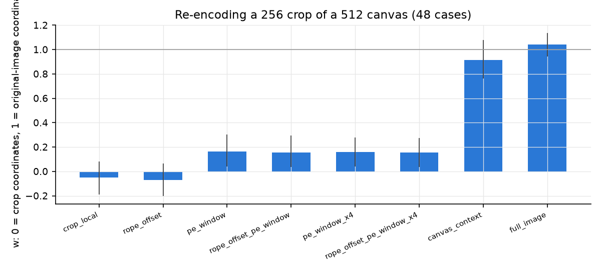

| 条件 | $w$（0 = 窗口坐标，1 = 原图坐标） | 相对窗口真值的误差 | 相对原图真值的误差 |
| --- | --- | --- | --- |
| crop_local | −0.05 [−0.19, 0.08] | 108 | 317 |
| rope_offset | −0.07 [−0.20, 0.06] | 107 | 321 |
| pe_window | 0.16 [0.04, 0.30] | 113 | 268 |
| rope_offset_pe_window | 0.16 [0.03, 0.30] | 114 | 269 |
| pe_window_x4 | 0.16 [0.04, 0.28] | 100 | 256 |
| canvas_context | 0.91 [0.76, 1.08] | 271 | 148 |
| full_image（参照） | 1.04 [0.94, 1.14] | 306 | 79 |

48 个样本均给出可解析的答案。RoPE 只编码相对位移，平移不改变 ViT 输出，rope_offset 与 crop_local 的差别处于 bf16 噪声范围；PE 是唯一的绝对输入，但在 Qwen3.5 中太弱，放大 4 倍也只有 $w = 0.16$。在原图上编码时，窗口 token 的位置由 RoPE 相对于整张图像的边界与内容计算得到，decoder 只看到 64 个 token、序列顺序指向窗口坐标，输出仍以 91% 的程度跟随原图坐标。

## 4. 解释

综合第 3 节，Qwen3.5 ViT 中的位置机制可以概括为三点：

1. **位置由 RoPE 在 patch 之间的相对关系中计算。** RoPE 只提供相对位移；一个 token 的绝对位置来自它与图像边界及其他内容之间的相对关系，经过前 6–8 个 block 写入每个 token，并以分布式方式写入全部背景 token 的布局编码。只要 patch 之间存在差异，这一计算就能完成。
2. **PE 在 Qwen3.5 中只承担“打破均匀区域对称性”的作用。** 它的空间排列几乎不被使用，在合成白色背景上它是唯一的差异来源，因此去除它会使位置崩溃，放大它会提高精度；在自然图像中内容已经提供差异，它的作用很小。这一状态与 PE 的权重在继续训练中被均匀衰减到 Qwen3-VL 的 0.36 倍相吻合。Qwen3-VL 的 PE 仍足够大，是一个可用的绝对位置标签。
3. **ViT 输出的位置是一个与内容可分离的多方向线性子空间。** 擦除它会去除横向位置而保留识别，纵向位置由 decoder 的序列顺序部分补偿。

对 PE 的去留，本实验给出的证据是：在 Qwen3.5 现有训练下，PE 不是位置的主要来源，但完全去除它会使均匀背景上的定位失效，因此“保留并放大”与“去除并为均匀区域提供其他差异来源”都是可检验的方向。对 BabyVision 中大面积留白的合成图像（迷宫、连线、找不同），均匀背景正是 RoPE 失效的情形，这一点值得在行为层面专门检验。

## 5. 限制

1. **合成刺激。** 坐标与布局主要在单目标或两物体的合成图像上测量。PE 放大的收益没有推广到 RefCOCO，结论的适用范围是“大面积均匀背景”的图像。
2. **去除 RoPE 是一般性损伤。** rope_zero 条件下 T2 也失效，其坐标结果只用于说明 PE 单独能提供多少位置，不用于估计 RoPE 的贡献大小。
3. **Qwen3-VL 的格式问题。** Qwen3-VL 常重复输出同一个点，严格评分下有效率只有 44%–69%；文中 Qwen3-VL 的坐标数字使用诊断解析，严格结果另存。Qwen3-VL 没有运行互换、擦除与重读实验。
4. **PE 缩小的成因是推断。** 权重形态与 weight decay 一致，但没有训练日志可以核实；Qwen3.5 的 ViT 是否另有冻结或学习率设置也未知。
5. **位置方差占比受固定位置高范数 token 支配。** 第 3.6 节的 $\rho^{(\ell)}$ 与第 3.8 节前两个主成分主要反映角落 token，平滑位置信号的维数应以白化后的方向数（第 3.8 节第 1 点）为准。
6. **批量生成的数值差异。** 批量与逐条生成的答案一致率为 14/20，差异为 2–20 个单位，对上文的效应量（数十至数百个单位）没有影响，但个别条件下 1–2 个命中的差别不作解释。
7. **局部重读只测了单一窗口尺寸与白色背景。** canvas_context 在白色背景上与原图像素完全相同，自然图像中“窗口外内容不同”的情形尚未检验。

## 6. 由结果导出的下一步

1. **均匀背景下的 RoPE 失效在 BabyVision 任务中的作用。** 在实验 1.3 的网格与 BabyVision 迷宫、连线图像上比较 base 与 PE ×2.76 的行为，检验放大 PE 是否改善大面积留白图像的定位，同时以 RefCOCO 与 T1/T2 监测副作用。
2. **角落高范数 token 的作用。** 在 block 10 之后识别并消融这些 token，检验其是否为 attention sink，以及 PE 中左右边缘第 9–11 行的异常大项与之是否有关。
3. **序列顺序依赖 ViT 位置的机制**（与实验 3.8 衔接）：rope_zero_pe_zero 下纵向位置也消失，而 one-hot 擦除后纵向位置保留，二者差别说明序列顺序利用的是 ViT 输出中非线性可擦除的部分，需要在 decoder 中定位。
4. **方向二的窗口编码。** 本实验支持“缓存在原图上编码的视觉特征、按窗口取出”的读取方式；若需要以更高分辨率重新编码窗口，需要提供窗口外的上下文或额外的绝对位置输入，可在 Qwen3-VL（PE 仍有效）上对比 pe_window 的效果。

## 7. 产物

产物位于 WORK_DIR 的 `analysis/position/2026-10-15_vit_layout/`：`table/`（PE 表）、`norms/`、`coord/`（坐标记录与批量生成抽查）、`t2/`、`swap/`、`probe/`（各条件的 probe 结果、测试预测与 merger 槽位均值）、`layout/`（特征与样本）、`leace/`（擦除器、坐标、T2 与 probe）、`reread/`、`refcoco/`、`results.json`、`results_figures.json`，以及记录模型版本、代码摘要与参数的各阶段元数据。程序为 `analysis_tools/position/vit_layout*.py`，入口为 `scripts/analysis/position/vit_layout.sh`，测试为 `tests/analysis/position/test_vit_layout.py`。
