# 坐标数值的数位输出机制（实验 3.6 第二轮）

实验日期：2026-10-16。本文属于[位置信息与坐标读取](plan.md)研究，执行[实验 3.6 设计](design_coordinate_value.md)第 10 节，承接[第一轮结果](results_2026-10-15_coordinate_value.md)与[实验 3.5](results_2026-10-14_coordinate_readout.md)。模型为 Qwen3.5-9B，bfloat16、SDPA、greedy decoding，thinking off，全部提示为只要求输出答案的 direct-answer 提示。

## 通俗讲述

模型回答单个红色圆的位置时，要把圆心的 x 坐标（例如 357）写成三个 token：“3”“5”“7”。第一轮实验发现一个看似矛盾的现象：在模型即将写出第一个数字的位置上，用一个线性 probe 就能从 hidden state 中以约 5 个单位的精度读出真实坐标，而模型自己写出的数字平均偏差 20–30 个单位，第二个数字几乎是随机的。本轮的任务是解释这一差距从何而来。

首先检查“尺子”本身。把许多张图像在同一位置上的 hidden state 投影到前三个主成分上，状态按真实坐标排成一条平滑的曲线，相邻位置的状态相邻，没有在 500、667 这类常见输出值处聚成团（图 1–3）。这条曲线就像一把刻度精细的尺子：沿曲线的位置以 5–8 个单位的精度对应真实坐标。尺子没有问题，问题出在把尺子上的读数写成十进制数字的那一步。

为什么第一个数字尚可、第二个数字近乎随机？可以把模型的数字输出想象成十条直线的竞赛：每个数字 token 的 logit 随坐标近似线性变化，哪条线最高就输出哪个数字。十条直线的最高者只能按顺序换手一次，因此每个数字只能赢得坐标轴上连续的一段。首位数字恰好需要这种模式：0–99 输出“0”，100–199 输出“1”，依此类推，一个随坐标单调变化的分量足以产生它。第二个数字需要的模式完全不同：它必须在 0–9、100–109、200–209……这十个互不相连的区间上都输出“0”，形成以 100 为周期反复的锯齿。直线竞赛无法产生锯齿；要产生它，模型需要一个随坐标周期变化的信号（类似钟表的分针，每过 100 个单位转一圈），或者先从坐标中减去已写出的首位数字对应的数值（例如 357 减去 300 得到 57），再以十倍的精细程度读出。实验 3.12 的图 [theory](figures/digit_failure/theory.png) 直观地展示了这三种读出。来自图像的坐标在答案位置只以单调的“尺子”形式存在，没有周期信号；实验 3.12 进一步表明，模型走的是第二条路：第二个数字随“坐标减去已写出的首位数值”变化，但变化的幅度只有理想值的三分之一，在一个百位区间内几乎分辨不出 10 个单位宽的数位，模型因此大多退回到“不看图时会写什么”的先验，即最接近 500 的数字。

“读出分辨率约为 100 个单位”概括的正是这一现象：尺子的刻度精确到 5 个单位，但从尺子通往数字 token 的通路只在首位上读得清楚，就像一个人拿着毫米刻度的尺子却只读到厘米。实验 3.12 把这一分辨率细化为两部分：首位数字的切换本身很陡（约 10–30 个单位），个别切换点的位置偏移了 70–80 个单位；第二位数字的有效分辨率约为 50 个单位，是该数位宽度的 5 倍。格式对照（第 3.2 节）给出同样的规律：无论数位在数字中的位置如何（0–1000 的百位、两位小数的十分位、0–10 的唯一一位），只要一个数位代表 100 个单位，真值数字的概率就在 0.40–0.55；只要代表 10 个单位，就降到 0.11–0.14，接近十选一的随机水平。同样的三位数，如果数值由文本给出（提示中写明像素坐标、要求换算），十位的真值概率达到 0.93。可见逐位写数字本身没有困难，困难在于连续的视觉量到数字 logit 的映射精度不足。

从线性代数的角度看，模型的输出层只能看到 hidden state 在十个数字 unembedding 方向上的投影。首位数字所需的粗粒度坐标信息有 13%–15% 落在这些方向上，细粒度信息则几乎全部位于与之正交的方向（第 3.3 节）：probe 可以利用任意方向读出精细坐标，而模型的输出层看不到这些方向。电路层面，首位数字由层 28–32 的约 300 个 MLP 神经元按宽 100–200 个单位的“位置带”写入，第二个数字的位置上没有这样随坐标变化的神经元（第 3.4–3.5 节）。实验 3.12 在此基础上进一步检验了第二个数字的先验来源、先验对收缩与吸附的作用，以及这一缺陷能否通过数据或读出方法消除。

## 1. 研究问题与主要结论

第一轮表明，在预测坐标首位数字的位置上，目标坐标以约 5 个单位（0–1000 坐标）的精度线性可读，模型输出的误差却为 22–31 个单位，十位数字的输出分布接近均匀。本轮回答六个问题：坐标表示的几何（Q1）；十位均匀的成因（Q2）；probe 与 logit lens 结论的调和（Q3）；位置到数字的电路（Q4）；MLP 神经元的作用（Q5）；以 next-token prediction 输出坐标的机制性限制（Q6）。主要结论如下，括号内为支持该结论的小节与图。

1. **第一轮 PCA 使用的是 residual stream。** 具体为预测首位数字的位置（$x_0$）上各 decoder layer 的输出 $h^{\ell}$（最终 RMSNorm 之前，未做标准化）。attention 模块输出、MLP 模块输出与 L20 H11 的 head 输出上，坐标同样构成低维、平滑的曲线，信号占比 0.92–0.97。曲线在层 12–20 近似一维弧线（参与比 1.5–2.4），层 24 之后弯曲并升维（参与比 3–5）。L20 H11 对 y 的编码比对 x 更直、更精确（第 3.1 节，图 1–3）。
2. **几何不能解释输出的压缩与吸附。** 线性 probe 读数对真值的斜率在 x < 380 与 x ≥ 380 两段均为 0.98–1.03，模型输出在 x < 380 段的斜率为 0.78。层 24 之后，曲线在图像中心 400–610 区间的局部速度降至区间外的 0.7 倍，但局部分辨阈值仍为 5–8 个单位，远小于模型在该区间的平台宽度（输出对真值的斜率为 0.27）（第 3.1 节，图 4、5）。
3. **数位锐利与否由数位宽度决定，与数位在数字中的位置无关。** 对应 100 个单位的数位，无论是 0–1000 的百位、两位小数的十分位、0–10 的唯一一位，还是 0–100 的十位，真值数字概率均为 0.40–0.55（RefCOCO 百位为 0.64）。对应 10 个单位的数位，无论是 0–1000 的中间位、两位小数的末位，还是 0–100 的末位，均为 0.11–0.14，接近均匀。数值由文本给出时，每一位都锐利：百位、十位、个位分别为 0.96、0.93、0.68。限制因此不在逐位生成本身，而在“连续视觉量 → 数字”的读出只具有约 100 个单位的分辨率（第 3.2 节，图 6）。
4. **十位信息位于数字 unembedding 看不到的子空间。** 在答案各自变化的那条 sweep 上，模型的第二位数字正确率只有 0.13（x）与 0.09（y），与多数类基线 0.12–0.13 相当。全维 probe 换算出的第二位数字相差不超过 1 的比例为 0.90–0.99。以十个 logit lens logit 训练的线性分类器只有 0.08–0.25，与 10 个随机方向相当。坐标编码方向落在数字 unembedding 子空间中的平方范数占比，在第二位数字位置的层 12–28 内为 0.0006–0.0075，与随机方向的 0.0022 同量级（第 3.3 节，图 8）。第一轮第 3.4 节的十位统计混入了另一条 sweep 上恒为 500 的坐标，模型十位正确率因多数类而虚高为 0.47–0.53；本轮的数值为修正后的结果。
5. **MLP 28–30 放大在其输入中已经占优的首位数字，错误首位在此之前已经形成。** L20 H11 的效应有 70%–76% 经由首位数字之前的位置传递，MLP 20–32 在首位数字位置上合计中介 51%，其中 MLP 28–30 中介 32%、MLP 32 中介 30%；L32 H10 反向抵消 28%。消融 MLP 28–30 使首位正确率从 0.62 降至 0.57（McNemar p = 0.019），分布熵从 1.08 升至 1.39 bits；86 个错误样本中只有 4 个被纠正，140 个正确样本中有 15 个被破坏（第 3.4 节，图 9、10）。
6. **少数 MLP 神经元以粗粒度的“位置带 → 数字”方式写入首位数字。** MLP 28 中前 10 个神经元（共 12288 个）解释其直接数字写入方差的 85%，前 100 个解释 99%。消融层 24–32 中最重要的 300 个神经元，与消融全部 MLP 20–32 的效果相同（首位正确率均为 0.54），数目匹配的随机神经元无影响。神经元沿坐标平铺成宽 100–200 个单位的位置带，key 与 value 的顺序相关只在 x 上显著（ρ = 0.28，p = 0.03）。第二位数字位置上的神经元没有这种结构（ρ = −0.04），其写入跟随模型自己选出的数字，与真值无关（第 3.5 节，图 11、12）。

**解释（非测量结论）。** 坐标在 residual stream 中以亚 token 精度存在，但只有约 100 个单位分辨率的分量进入了数字 unembedding 所能读到的方向。首位数字由少数 MLP 神经元按位置带粗粒度地写入，第二位数字缺少依赖坐标的写入，其分布由与图像无关的数字先验主导。逐位生成的格式使这一分辨率限制表现为“首位尚可、后续数位均匀”。

## 2. 实验设计与执行

### 2.1 刺激与问题

| 集合 | 内容 | 数量 | 用途 |
| --- | --- | --- | --- |
| 第一轮 grid2d / sweep_h / sweep_v | 512×512 白色画布、直径 64 pixels 的红色圆（第一轮第 2.1 节） | 841 / 225 / 225 | Q1、Q3（第一轮特征）、Q5（神经元捕获） |
| 格式实验：sweep 子集 | sweep_h 与 sweep_v 每隔一步取一张 | 226 张 × 6 种格式 | Q2 |
| 格式实验：RefCOCO | 实验 3.5 的 RefCOCO 测试图 point 问题 | 300 × 2 种格式 | Q2 的自然图像对照 |
| 格式实验：计数 | 1–50 个直径 24 pixels 的不重叠红色圆，每个数目 5 张 | 250 | Q2 的计数对照 |
| 空白画布先验 | 强制首位数字 1–9 | 9 × 2 种格式 | Q2 |
| 消融 / 神经元消融 | 两条 sweep 每隔一步 | 226 | Q4、Q5 |
| path patching | 每条 sweep 60 对（相距 38 步，约 148 个单位） | 120 对 | Q4 |

各格式的提示见设计第 10.5 节。下图为实际输入示例，图下为模型的 greedy 答案与真值字符串。

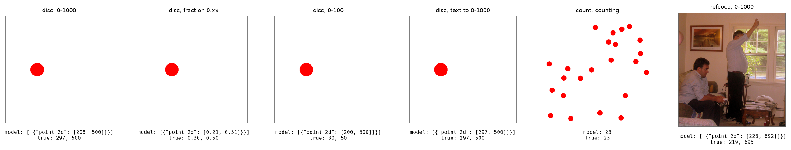

*图 0：格式实验的输入示例。从左至右依次为 0–1000、两位小数、0–100、文本换算（提示中给出像素坐标 (152, 256)）、计数（23 个圆）与 RefCOCO（“sitting man”）。0–100 提示下模型仍输出 0–1000 的数值（200 对应真值 30）。*

### 2.2 操作与规模

1. **格式实验。** 以第一轮的手写 greedy 解码器生成答案（等长 prompt 组成无 padding 的 batch，batch size 16），再在“提示 + 真值答案”上做一次 teacher-forced 前向（右侧 padding 的 batch，batch size 16；因果 attention 与因果 DeltaNet 使右侧 padding 不影响真实位置）。右侧 padding 的批量前向与第一轮单样本前向的数字 log 概率最大相差 0.13 nats，argmax 全部一致（4 个样本的抽查）。
2. **神经元捕获。** 1291 个圆形刺激，以模型自己的答案 teacher forcing，batch size 16。以 down_proj 重建的 MLP 输出与第一轮记录的 MLP 输出的相对误差为 1.5%–3.3%（float16 存储）。
3. **消融、path patching 与神经元消融。** 干预只作用于 prefill；消融条件以每个基准的 31 个（神经元消融为 19 个）条件组成一个 batch 并 greedy 续写该坐标；path patching 每对 3 + 80 行，每次前向至多 32 行。
4. **GPU 用量。** 共享的 A40（GPU 4）上：formats 52 分钟，neurons 12 分钟，ablate 17 分钟，pathpatch 21 分钟，neuron_ablate 9 分钟；另有约 20 分钟的冒烟测试与机制核验，合计约 2.2 GPU 小时。CPU 分析在模型卸载后单独运行。
5. **与参考实现的一致性。** 格式实验的手写解码器与参考实现 generate 的 20 例抽查未能在本轮完成（运行结束时所有非保留 GPU 的空闲显存均不足以载入模型），解码器与第一轮相同，第一轮的抽查结果为 11/20 完全一致、不一致者多为两个候选数值的决策边界附近的样本（第一轮第 2.2 节）。本轮 Q2 的主要指标来自 teacher-forced 真值答案，不依赖 greedy 解码；greedy 答案只用于格式遵从率与答案模板。

### 2.3 统计

比例报告 Wilson 95% 区间；均值报告 2000 次 bootstrap 95% 区间；配对差异使用 sign-flip 置换检验（20000 次）；首位正确率的配对比较使用 McNemar 精确检验。消融共 31 个条件，按 Bonferroni 校正的显著性阈值约为 0.0016；下文对未通过校正的 p 值单独说明。

## 3. 结果

### 3.1 Q1：坐标表示的几何

**第一轮 PCA 的对象。** 第一轮第 3.3 节的 PCA 以 sweep_h 的 $x_0$ 为样本，对每层 decoder layer 的输出 $h^{\ell}$ 做 PCA。该状态位于最终 RMSNorm 之前，只减去均值，未做标准化。本节在同一位置上比较 residual stream、token mixer 模块输出 $a^{\ell}$、MLP 模块输出 $m^{\ell}$ 与 L20 H11 的 head 输出（256 维，o_proj 之前）。

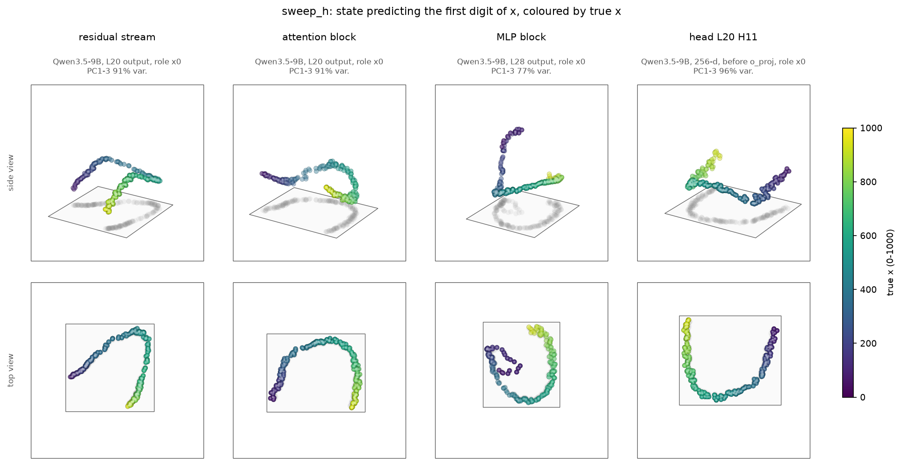

*图 1：sweep_h 上预测 x 首位数字的状态（$x_0$）在四个位点的前三个主成分，颜色为真实 x（viridis，0–1000），上行为侧视、下行为俯视，灰色为点云在地面平面上的投影。每个点为一张图像（答案前缀相同的 217 张）。*

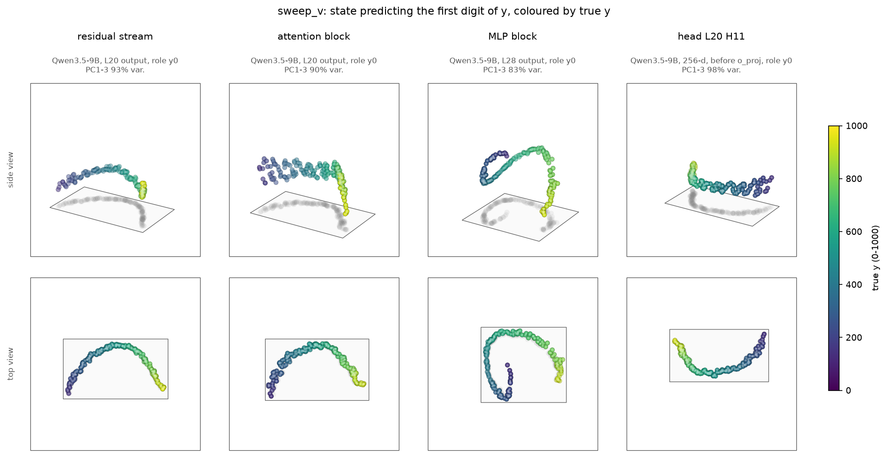

*图 2：sweep_v 上预测 y 首位数字的状态（$y_0$），各元素含义同图 1。*

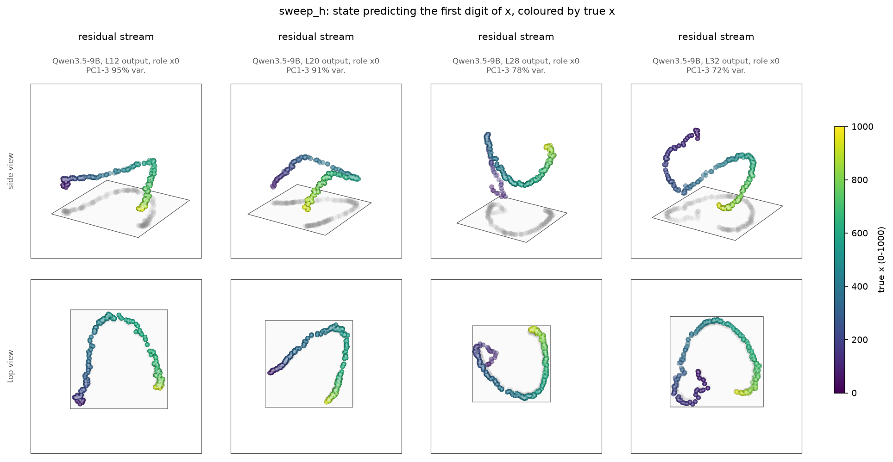

*图 3：$x_0$ 处 residual stream 在层 12、20、28、32 的前三个主成分，各元素含义同图 1。*

测量结果（图 4 为全部层的曲线）：

| 位点（$x_0$ / $y_0$） | 信号占比 | 参与比 | 弧长/弦长 | 切向余弦（相距 250） | 局部阈值 $\delta$（中位数，单位） | probe 误差（单位） |
| --- | --- | --- | --- | --- | --- | --- |
| residual L12 | 0.98 / 0.94 | 2.2 / 1.7 | 3.7 / 2.5 | −0.09 / 0.16 | 4.8 / 7.6 | 7.1 / 6.0 |
| residual L20 | 0.95 / 0.95 | 2.4 / 1.5 | 3.9 / 2.4 | −0.09 / 0.31 | 6.4 / 5.3 | 7.1 / 4.7 |
| residual L28 | 0.94 / 0.95 | 3.5 / 2.9 | 5.4 / 4.2 | −0.17 / −0.19 | 5.1 / 6.4 | 6.5 / 5.1 |
| residual L32 | 0.95 / 0.96 | 4.1 / 3.4 | 6.3 / 5.2 | −0.20 / −0.19 | 4.9 / 5.9 | 6.4 / 4.8 |
| attention L20 | 0.94 / 0.92 | 1.9 / 1.6 | 3.3 / 3.0 | 0.05 / 0.29 | 6.9 / 6.3 | 8.5 / 6.7 |
| MLP L28 | 0.95 / 0.96 | 3.8 / 3.2 | 5.4 / 4.5 | −0.23 / −0.33 | 5.3 / 6.3 | 7.2 / 6.2 |
| L20 H11 | 0.97 / 0.97 | 1.8 / 1.3 | 2.7 / 2.0 | 0.13 / 0.51 | 6.7 / 5.9 | 14.8 / 10.6 |
| L20 H10 | 0.77 / 0.85 | 2.7 / 1.5 | 4.9 / 3.8 | −0.15 / 0.61 | 14.2 / 15.0 | 23.4 / 22.0 |

1. **所有位点上的坐标都是一条平滑的低维曲线。** 层 12 之后，residual、attention 输出与 MLP 输出的信号占比为 0.92–0.98：每个模块的输出主要由目标坐标决定。曲线在层 12–20 参与比为 1.5–2.4，前三个主成分解释 91% 的方差（图 1）。层 24 之后参与比升至 3–5，弧长与弦长之比从 2.4–3.9 升至 5–6，相距 250 个单位的切向量余弦为负，曲线在更多维度上折叠（图 3）。
2. **attention 输出近似一维弧线，MLP 输出更弯曲。** L20 attention 输出的参与比为 1.9（x）与 1.6（y）。L28 MLP 输出为 3.8 与 3.2，在 x < 200 处出现一段单独的回折（图 1 第三列）。
3. **L20 H11 以一条近似直的曲线编码 y，对 x 的编码更弯曲、更粗糙。** 该 head 输出的信号占比为 0.97。y 的参与比为 1.3，相距 250 个单位的切向余弦为 0.51；x 分别为 1.8 与 0.13。256 维输出的 probe 误差 y 为 10.6、x 为 14.8。这与实验 3.5 中替换 L20 H11 后 y 的跟随权重（0.58）高于 x（0.40）一致（图 1、2 第四列）。
4. **x 与 y 的编码方向在层 20 之后正交。** 在 grid2d 的 $x_0$ 上，x 与 y 编码方向的余弦在层 12 为 0.38、层 16 为 0.22，层 20–32 为 −0.05 至 0.03；在 $y_0$ 上为 −0.20 至 0.04。二维位置因此在层 20 之后展开为两条近似独立的轴（图 5）。y 的 residual probe 误差（4.7–5.1）略小于 x（6.4–7.1）。

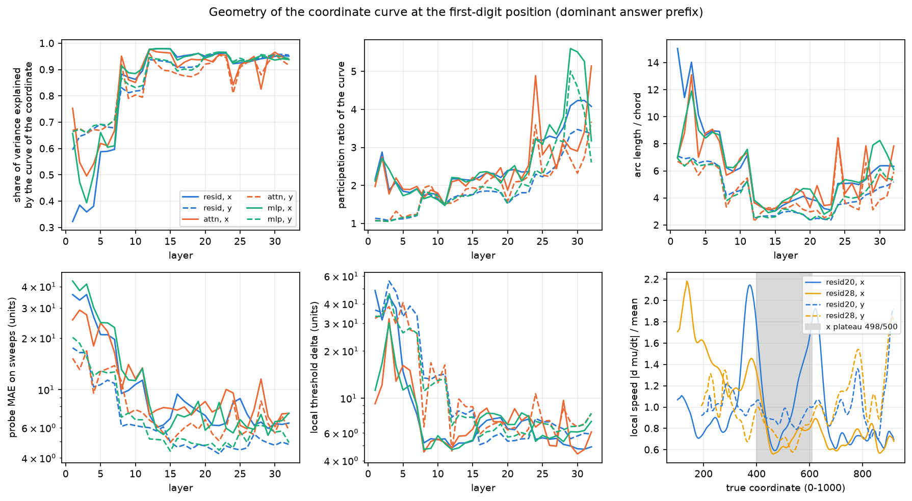

*图 4：几何指标随层的变化。蓝、橙、绿分别为 residual、token mixer 输出与 MLP 输出；实线为 x（$x_0$，sweep_h），虚线为 y（$y_0$，sweep_v）。右下：层 20（蓝）与层 28（黄）residual 曲线的局部速度（除以沿轴均值），灰色区间为 x 输出停留在 498 与 500 的范围（400–610）。*

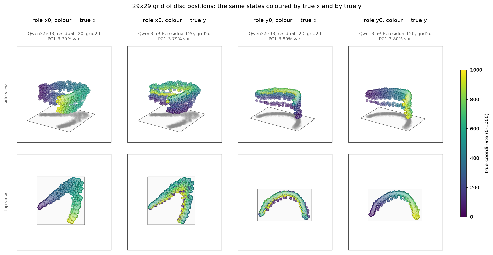

*图 5：grid2d 的 29×29 个位置在层 20 residual 的前三个主成分；左两列为 $x_0$，右两列为 $y_0$，分别按真实 x 与真实 y 着色（viridis）。*

**几何能否解释压缩、吸附与列号多计 1。**

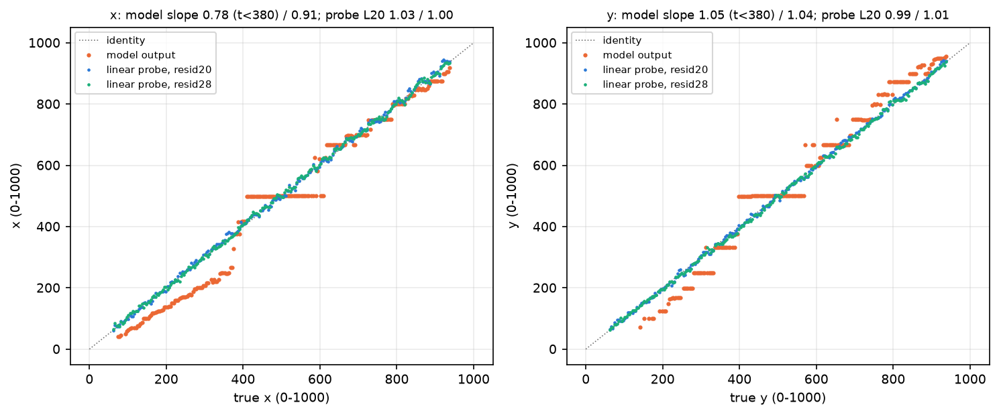

*图 6a：sweep 上的模型输出（橙）与线性 probe 读数（蓝：层 20；绿：层 28）对真值的关系，灰色虚线为恒等线。*

1. **压缩。** 模型输出 x 对真值的斜率在 x < 380 段为 0.78、在 x ≥ 380 段为 0.91。各位点 probe 读数的斜率在两段均为 0.97–1.03，例如 residual L20 为 1.03 与 1.00（图 6a）。压缩不存在于线性可读的几何中，产生于此后的读出。
2. **吸附到 500。** 层 24 之后，residual 与 MLP 28 输出的曲线在 400–610 区间内的局部速度为区间外的 0.68–0.72 倍（x 与 y 相同），层 12–20 无此现象（0.88–1.12）；该区间内的局部阈值 $\delta$ 为 5.0–7.8 个单位，probe 误差为 4.9–8.2 个单位。模型输出在该区间对真值的斜率为 0.27（x）与 0.56（y）（图 4 右下）。中心区域的几何在深层存在约 30% 的轻度收缩，但收缩后的曲线仍以 5–8 个单位的精度区分位置，不足以产生宽约 200 个单位的输出平台。
3. **列号多计 1。** 该现象属于行列序号任务，由实验 1.5 研究；单个圆的刺激没有行列结构，本节不作判断。

### 3.2 Q2：十位数字均匀的成因

**格式遵从。** 0–1000、0–10、两位小数与文本换算的答案全部有效且使用所要求的尺度（226/226）。0–100 与像素提示即使给出示例，模型仍主要输出 0–1000 的数值：答案更接近所要求尺度真值的比例只有 0.06 [0.04, 0.10]（0–100）与 0.01 [0.00, 0.04]（像素），RefCOCO 的 0–100 提示为 0/300。两种格式的 greedy 答案因此不能代表所要求的尺度，下文只用其 teacher-forced 真值答案上的数字分布，并单独标注。

| 格式 | 平均绝对误差（0–1000 单位） |
| --- | --- |
| 0–1000 | 26.2 [23.8, 28.8] |
| 两位小数 | 24.0 [22.1, 25.9] |
| 0–10 | 33.6 [30.6, 36.7]（取整误差的期望约为 25） |
| 文本换算 | 3.8 [1.3, 6.8] |
| RefCOCO 0–1000 | 30.2 [25.5, 35.3] |
| 计数 | 2.16 [1.86, 2.47] 个 |

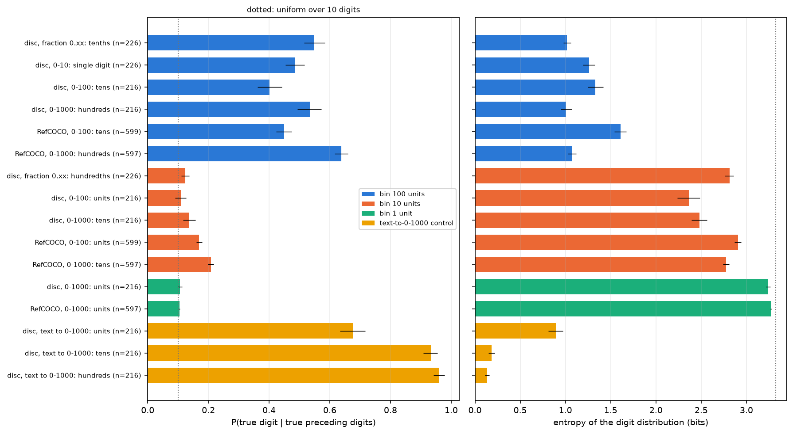

*图 6：在真值前缀条件下，各格式每一数位上真值数字的平均概率（左）与分布熵（右），误差线为 bootstrap 95% 区间。蓝：数位宽度 100 个单位；橙：10 个单位；绿：1 个单位；黄：文本换算对照。点线为十个数字均匀分布。sweep 上只统计沿该轴变化的坐标；像素格式因不遵从而未列入，样本数少于 20 的组未列入。*

| 数位（宽度） | 格式 | $n$ | $P(\text{true})$ | argmax 正确率 | 熵（bits） |
| --- | --- | --- | --- | --- | --- |
| 100 个单位 | 0–1000 百位 | 216 | 0.53 [0.49, 0.57] | 0.65 [0.58, 0.71] | 1.01 |
| | 两位小数 十分位 | 226 | 0.55 [0.52, 0.58] | 0.62 [0.56, 0.68] | 1.02 |
| | 0–10 唯一一位 | 226 | 0.49 [0.45, 0.52] | 0.61 [0.54, 0.67] | 1.26 |
| | 0–100 十位（不遵从） | 216 | 0.40 [0.36, 0.44] | 0.43 [0.36, 0.49] | 1.33 |
| | RefCOCO 0–1000 百位 | 597 | 0.64 [0.62, 0.66] | 0.76 [0.73, 0.79] | 1.07 |
| 10 个单位 | 0–1000 十位 | 216 | 0.14 [0.12, 0.16] | 0.14 [0.10, 0.20] | 2.48 |
| | 两位小数 百分位（末位） | 226 | 0.12 [0.11, 0.14] | 0.15 [0.11, 0.20] | 2.81 |
| | 0–100 个位（末位，不遵从） | 216 | 0.11 [0.09, 0.13] | 0.13 [0.09, 0.18] | 2.37 |
| | RefCOCO 0–1000 十位 | 597 | 0.21 [0.20, 0.22] | 0.34 [0.30, 0.38] | 2.78 |
| 1 个单位 | 0–1000 个位 | 216 | 0.11 [0.10, 0.11] | 0.13 [0.10, 0.19] | 3.24 |
| 文本换算 | 百位 / 十位 / 个位 | 216 | 0.96 / 0.93 / 0.68 | 0.97 / 0.95 / 0.74 | 0.13 / 0.18 / 0.89 |

1. **宽度 10 个单位的数位在任何位置都接近均匀。** 两位小数的百分位是末位，0–1000 的十位是中间位，二者的真值概率均为 0.12–0.14。宽度 100 个单位的数位无论是首位（0–1000 百位、0–100 十位）还是小数点后的第一位（十分位），真值概率均为 0.40–0.55。由此，“倒数第二位锐利、最后一位均匀”的描述不成立，决定锐利程度的是数位宽度。
2. **数字输出本身不是瓶颈。** 文本换算要求把像素坐标乘以 1000/512，输出格式与 0–1000 坐标完全相同，十位的真值概率为 0.93、平均误差 3.8 个单位。逐位生成数字、乃至在逐位生成中完成乘法，对模型都不构成困难；困难只出现在数值来自图像时。
3. **计数呈现同样的结构。** 10–50 的计数中，十位（宽度 10 个计数）真值概率为 0.85 [0.81, 0.88]，个位为 0.22 [0.19, 0.25]；1–9 的个位为 0.58。计数的绝对误差约为 2 个，个位因此模糊，十位锐利。计数中的“锐利数位”同样由数位宽度与读出精度的比值决定（图 7a）。
4. **自然图像的结论相同。** RefCOCO 0–1000 的百位、十位、个位真值概率为 0.64、0.21、0.10，与合成刺激的模式一致；RefCOCO 的十位略高于合成刺激，一种可能的解释是自然图像的目标中心分布不均匀，使十位的先验更集中（未检验）。
5. **信息在 residual 中存在。** 在宽度 10 个单位的数位位置上，以 5 折交叉验证的 ridge probe 读出坐标（误差 4–8 个单位），换算出的数字相差不超过 1 的比例为 0.88–0.98（0–1000 十位）、0.94–1.00（两位小数百分位）。宽度 1 个单位的个位，probe 换算的正确率也只有 0.04–0.12，此时 probe 的误差本身已大于数位宽度。

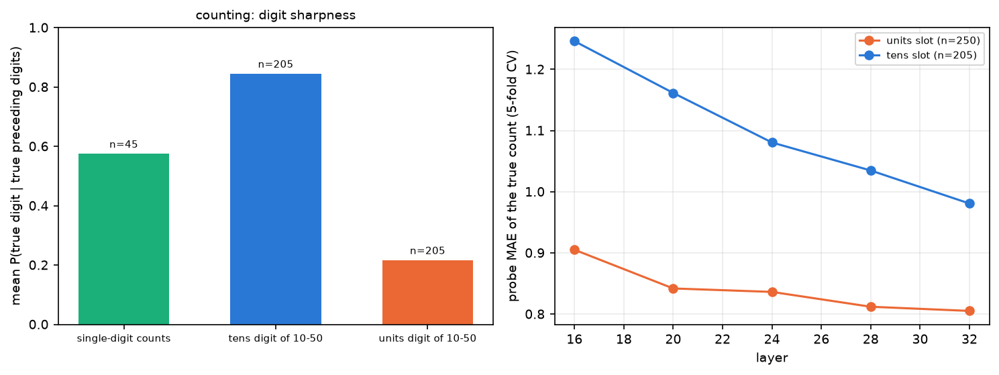

*图 7a：计数任务。左：三类数位的真值数字平均概率；右：计数位置 residual 上 probe 读出真实计数的误差（5 折交叉验证）。*

**与数字先验和 unembedding 几何的关系。**

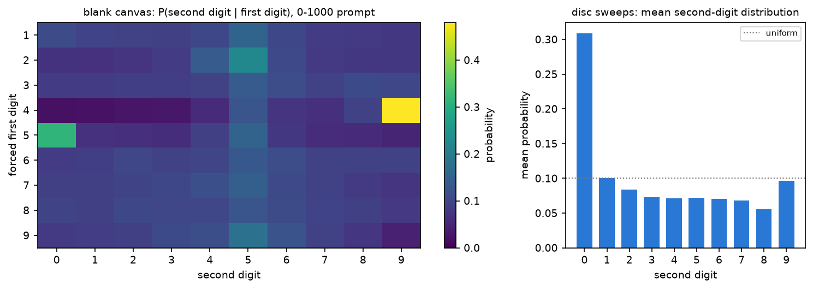

*图 7b：左：空白画布、0–1000 提示下强制首位数字后第二位数字的分布（颜色为概率，viridis）；右：sweep 上第二位数字分布的平均。*

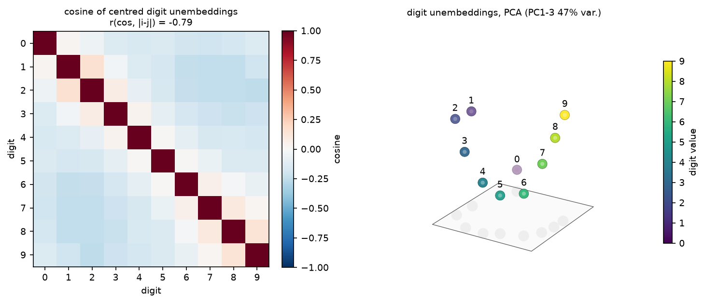

*图 7c：左：中心化后十个数字 unembedding 行的余弦矩阵（蓝负红正）；右：其前三个主成分，颜色为数字值（viridis），灰色为地面投影。*

1. **第二位数字的分布接近与图像无关的先验。** 空白画布上第二位数字分布的熵为 3.17 bits，0 与 5 合计占 0.26。sweep 上每个样本的第二位数字分布与“同一首位数字下空白画布先验”的余弦为 0.79 [0.77, 0.80]，KL 散度为 0.38 nats，低于其到均匀分布的 0.59 nats。模型在十位上输出的是先验略作调整后的分布，这正是第一轮观察到的 0 与 5 偏好的来源（图 7b）。
2. **数字 unembedding 具有有序的数轴几何。** 中心化后，数字 unembedding 两两余弦与数值距离的相关为 −0.79，相邻数字的平均余弦为 0.07，相距不少于 5 的为 −0.21。前三个主成分中，1–9 按顺序排成一条弧，0 位于弧的内侧（图 7c）。数字 token 的输入 embedding 同样有序（相关 −0.82）。
3. **解释。** 有序的 unembedding 使一个沿某方向连续变化的状态能够平滑地把概率从一个数字移向相邻数字，因此首位数字可以由一个随坐标单调变化的分量产生，误差主要表现为相邻数字之间的混淆：首位相差不超过 1 的比例为 0.94–0.95。十位数字需要的是随坐标以 100 为周期循环的读出，单调分量无法提供，而第 3.3 节表明对应的细粒度信息不在 unembedding 能看到的方向上。

### 3.3 Q3：probe 与 logit lens 的调和

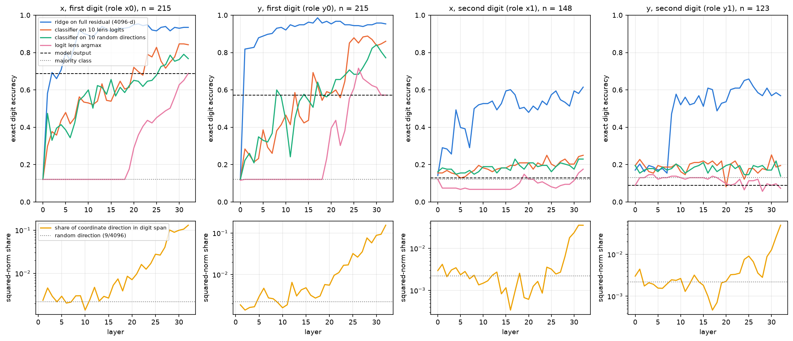

*图 8：上行：四种读出在各层的数字正确率（蓝：全维 ridge probe；橙：以十个 logit lens logit 为特征的线性分类器；绿：以 10 个随机方向为特征的同一分类器；粉：logit lens 的 argmax），黑色虚线为模型输出，灰色点线为多数类基线。下行：坐标编码方向落在数字 unembedding 子空间中的平方范数占比（黄），点线为随机方向的期望 9/4096。测试集为沿该轴变化的 sweep。*

| 读出（层 32） | x 首位 | y 首位 | x 第二位 | y 第二位 |
| --- | --- | --- | --- | --- |
| 全维 probe | 0.93 | 0.95 | 0.61（±1：0.97） | 0.57（±1：0.99） |
| 十个 lens logit 上的分类器 | 0.84 | 0.86 | 0.25 | 0.20 |
| 10 个随机方向上的分类器 | 0.77 | 0.77 | 0.23 | 0.14 |
| logit lens argmax | 0.69 | 0.57 | 0.18 | 0.07 |
| 模型输出 | 0.69 [0.62, 0.75] | 0.57 [0.51, 0.64] | 0.13 [0.08, 0.19] | 0.09 [0.05, 0.15] |
| 多数类基线 | 0.12 | 0.12 | 0.12 | 0.13 |
| $n$（测试） | 215 | 215 | 148 | 123 |

“信息存在而未被读出”可以分解为两个环节：

1. **子空间环节：信息是否进入数字 unembedding 能看到的方向。** probe 是有监督的最优线性读出，可以使用 residual 中任意方向，包括方差很小的方向。模型自己的读出则固定为 $W_U(g \odot h / \operatorname{rms}(h))$，只能看到 $h$ 在十个数字 unembedding 行张成的子空间（中心化后 9 维）中的分量。首位数字只需区分 100 个单位的区间，对应坐标的主要方差方向；到层 32，坐标编码方向有 13%–15% 的平方范数落在数字子空间中（随机方向期望 0.22%），十个 lens logit 即可支持 0.84–0.86 的首位正确率。第二位数字需要 10 个单位的分辨率，所依赖的是 residual 中方差很小的细粒度分量：10 个随机方向只能读出接近机会水平的第二位数字（0.14–0.23），十个 lens logit 同样如此（0.20–0.25），编码方向在数字子空间中的占比到层 28 仍只有 0.3%–0.6%。
2. **读出环节：进入子空间的信息是否被 argmax 用对。** 在首位数字上，同样十个 logit 的最优线性组合可达 0.84–0.86，模型自己的 argmax 只有 0.57–0.69。差距来自分区边界的位置：模型把每个数字对应的坐标区间划得不均匀（第一轮第 3.4 节中“1”覆盖约 120–270，“3”只在 370 附近胜出）；十个 logit 中的信息足以支持更准确的分区。

据此，probe 与 logit lens 的结论并不矛盾：probe 回答“residual 中是否有方向编码了该信息”，logit lens 回答“模型固定的读出方向看到了什么”。当信息只存在于与 unembedding 近似正交、方差很小的方向上时，前者为是、后者为否。直接归因（第一轮第 3.5 节）同样只沿固定的 unembedding 方向计算，因此与 logit lens 给出相同的图景。

### 3.4 Q4：位置到数字的电路

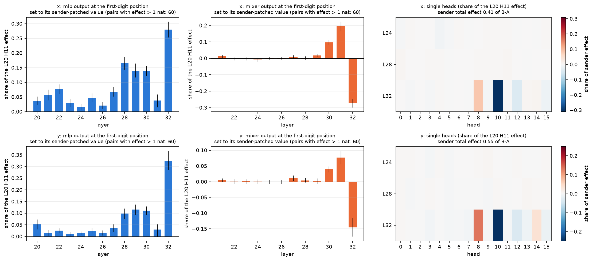

*图 9：L20 H11 的 path patching。左、中：把首位数字位置上某层 MLP（蓝）或 token mixer（橙）的输出设为其在 sender 干预运行中的值时，再现的 sender 效应份额，误差线为 bootstrap 95% 区间；右：层 24、28、32 的单个 head 的份额（红正蓝负）。上行为 x，下行为 y，每行 60 对。*

1. **sender 总效应。** 在 A 中替换 L20 H11（prompt 最后一个 token 至首位数字位置）为 B 的输出，首位数字的 logit 差移动了 B 与 A 之差的 0.41 [0.37, 0.44]（x）与 0.55 [0.50, 0.60]（y），首位数字变为 B 的首位的比例为 0.15（9/60）与 0.35（21/60）。y 的效应大于 x，与实验 3.5 一致。
2. **效应主要经由首位数字之前的位置。** 只在首位数字之前的位置替换 L20 H11 时，再现 0.70 [0.67, 0.74]（x）与 0.76 [0.73, 0.80]（y）的效应；只在首位数字位置替换时为 0.32 与 0.22。L20 H11 先把坐标写入问题与答案模板的 token，后续层在首位数字位置从这些 token 读取，这与实验 3.5 的结论一致。
3. **首位数字位置上的中介。**

| 中介（首位数字位置） | x 份额 | y 份额 |
| --- | --- | --- |
| MLP 20–32 合计 | 0.54 [0.49, 0.58] | 0.49 [0.46, 0.53] |
| MLP 28–30 合计 | 0.36 [0.32, 0.39] | 0.28 [0.24, 0.31] |
| MLP 28 / 29 / 30 | 0.17 / 0.14 / 0.14 | 0.10 / 0.12 / 0.11 |
| MLP 32 | 0.28 [0.25, 0.31] | 0.32 [0.28, 0.37] |
| DeltaNet 30 / 31 | 0.10 / 0.20 | 0.04 / 0.08 |
| attention 32（全部 head） | −0.27 [−0.30, −0.25] | −0.15 [−0.18, −0.12] |
| L32 H10 | −0.31 [−0.34, −0.28] | −0.25 [−0.27, −0.23] |
| L32 H8 | 0.08 [0.07, 0.09] | 0.13 [0.12, 0.15] |
| 阻断 MLP 28–30 后剩余 | 0.67 [0.64, 0.70] | 0.72 [0.68, 0.76] |
| 阻断 MLP 24–31 后剩余 | 0.62 [0.58, 0.65] | 0.71 [0.67, 0.75] |

层 21–29 的 token mixer 在首位数字位置的份额均不超过 0.02，层 24 与 28 的单个 head 均不超过 0.05。L20 H11 的效应在首位数字位置主要由 MLP 28–30 与 MLP 32 承接，L32 H10 稳定地抵消约四分之一的效应。阻断 MLP 24–31 后仍剩余 0.62–0.71，说明这些 MLP 不是唯一的通路。把层 21–32 的全部 token mixer 在首位数字位置固定为 A 的值时，剩余份额为 0.81（x）与 0.68（y），高于只在首位数字位置替换 sender 的 0.32 与 0.22。各通路的份额不可加：固定 token mixer 同时去掉了 L32 attention 的反向作用（−0.15 至 −0.27）。在一对样本上的核验确认了干预的正确性：同时固定 token mixer 与 MLP 后 logit 差与 A 完全相同。

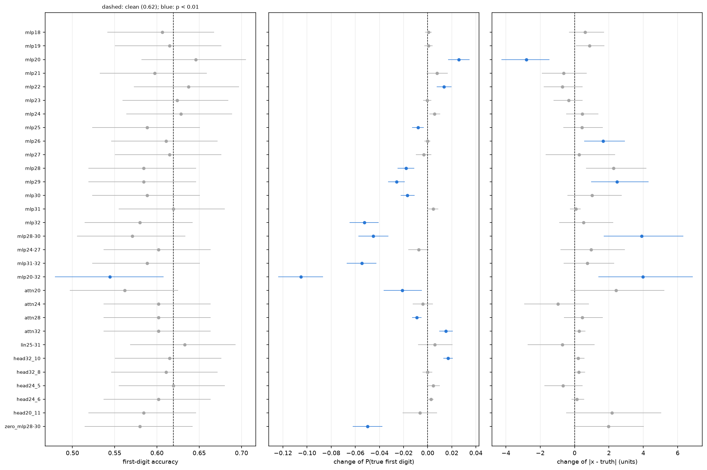

*图 10：首位数字位置的组件均值消融（226 个基准）。左：首位正确率与 Wilson 区间；中：真值首位概率的变化；右：坐标绝对误差的变化（bootstrap 区间）。黑色虚线为无干预条件，蓝色为 p < 0.01（McNemar 或 sign-flip 检验，未校正）。*

4. **“错误首位来自 MLP 28–30”的因果核验。**

| 条件 | 首位正确率 | McNemar p | 纠正 / 破坏 | 真值首位概率变化 | 熵（bits） | 绝对误差变化 |
| --- | --- | --- | --- | --- | --- | --- |
| 无干预 | 0.62 [0.55, 0.68] | — | — | — | 1.08 | — |
| MLP 28–30 均值消融 | 0.57 [0.51, 0.63] | 0.019 | 4/86、15/140 | −0.045 [−0.057, −0.033]，p < 0.001 | 1.39 | +3.9 [1.7, 6.3]，p < 0.001 |
| MLP 28–30 零消融 | 0.58 [0.51, 0.64] | 0.035 | 3/86、12/140 | −0.050，p < 0.001 | 1.43 | +2.0 |
| MLP 32 | 0.58 [0.51, 0.64] | 0.064 | 5/86、14/140 | −0.052，p < 0.001 | 1.38 | +0.5 |
| MLP 20–32 | 0.54 [0.48, 0.61] | 0.0015 | 5/86、22/140 | −0.105，p < 0.001 | 1.73 | +4.0，p = 0.004 |
| MLP 20 | 0.65 [0.58, 0.71] | 0.21 | 11/86、5/140 | +0.026，p < 0.001 | 1.11 | −2.8 [−4.3, −1.5]，p < 0.001 |
| attention 24 | 0.60 [0.54, 0.66] | 0.42 | 5/86、9/140 | −0.004，p = 0.34 | 1.17 | −1.0，p = 0.34 |
| L32 H10 | 0.62 [0.55, 0.68] | 1.0 | 2/86、3/140 | +0.017，p < 0.001 | 0.98 | +0.2 |
| L20 H11（只在首位数字位置） | 0.58 [0.52, 0.65] | 0.20 | 11/86、19/140 | −0.007，p = 0.39 | 1.20 | +2.2，p = 0.13 |

- **MLP 28–30 承担首位数字的写入，其消融极少纠正错误。** 消融使真值首位概率下降、分布熵上升（经 Bonferroni 校正后显著），首位正确率下降 0.05（McNemar p = 0.019，未通过校正）。若错误首位由这些 MLP 引入，消融应主要纠正错误样本；实际只纠正了 86 个错误中的 4 个，而破坏了 140 个正确中的 15 个。在错误样本上，真值首位相对于原输出首位的 log 概率差在消融后增大 0.59 nats，但这一变化主要来自分布整体变平，几乎没有改变 argmax。第一轮直接归因中“MLP 28–30 把错误首位写入 logit”的观察成立，含义为：这些 MLP 放大了在其输入中已经占优的首位数字，无论该数字正确与否。
- **MLP 20 在首位数字位置引入系统误差。** 消融 MLP 20 纠正 11 个错误、破坏 5 个正确，绝对误差下降 2.8 个单位（p < 0.001），是 31 个条件中唯一同时改善三项指标的组件。
- **attention 24 不承担错误首位的写入。** 第一轮直接归因中 attention 24 对错误首位的贡献（0.32）在消融中没有对应的效应（p = 0.34）。
- **L32 H10 起校准作用。** 消融 L32 H10 使分布变得更尖锐（熵从 1.08 降至 0.98），真值首位概率上升 0.017，首位正确率不变。结合 path patching 中 −0.25 至 −0.31 的份额，该 head 稳定地压低当前占优的数字，作用类似于 copy suppression。

### 3.5 Q5：MLP 神经元

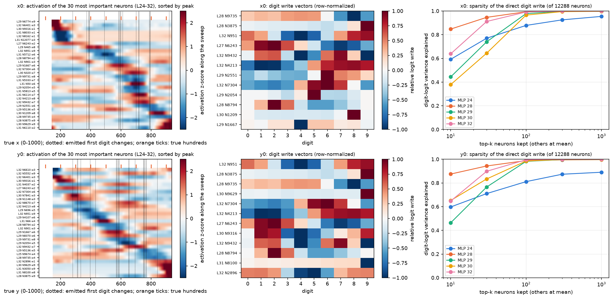

*图 11：首位数字位置（上行 $x_0$，下行 $y_0$）的 MLP 神经元。左：层 24–32 中最重要的 30 个神经元沿 sweep 的激活（z-score，红高蓝低），按 key 排序，行标签中 w 为写入向量的最大正分量所对应的数字；黑色点线为模型输出首位数字改变处，顶部橙色刻度为真值百位边界。中：最重要的 12 个神经元的数字写入向量（行归一化，红正蓝负）。右：只保留前 $k$ 个神经元时该层 MLP 直接数字写入方差的解释比例。*

1. **数字写入高度稀疏。** 在 $x_0$ 上，MLP 28 的前 10 个神经元解释其直接数字写入方差的 85%，前 30 个解释 95%，前 100 个解释 99%；MLP 29、30、32 的前 100 个解释 97%–99%（图 11 右）。$y_0$ 上的数值相近。x 与 y 共用同一批神经元：L28 N9735、L28 N3875 与 L32 N951 同时位于两条轴的前三名，L27 N6243 位于 x 的第 4 名与 y 的第 7 名。
2. **神经元以位置带的形式平铺坐标。** 按 key 排序后，最重要的 30 个神经元的激活构成一条对角带：每个神经元在宽约 100–200 个单位的坐标区间内强烈偏离均值（图 11 左）。写入向量多数有一个主峰，部分呈“相邻数字为正、远处为负”的形状，例如 L32 N4213 对 6–9 为正、对 0–3 为负（图 11 中）。
3. **key→value 顺序只部分成立。** 前 60 个神经元的 key 与其写入数字的 Spearman 相关在 x 上为 0.28（置换 p = 0.03），在 y 上为 0.18（p = 0.18）；57%（x）与 53%（y）的神经元的 key 落在其写入数字真值区间中心 ±100 个单位以内。神经元的 key 与写入数字之间存在粗粒度的对应，但位置带宽于 100 个单位的百位区间，边界与真值百位边界不对齐。这为首位数字只有约 100 个单位分辨率、且分区边界偏移提供了神经元层面的对应（解释）。
4. **第二位数字位置上没有依赖坐标的神经元写入。** $x_1$ 处各层 MLP 直接写入的十位数字的 argmax 与真值十位的一致率为 0.07–0.19（机会水平约 0.1），与模型输出十位的一致率为 0.07–0.53（层 29–30 最高，为 0.47–0.53）。前 60 个神经元的 key 与写入数字无关（ρ = −0.04，p = 0.73），只有 27% 的 key 落在对应区间 ±100 个单位以内。十位的 MLP 写入跟随模型自己选出的数字（先验），而不跟随坐标。
5. **因果：数百个神经元承担 MLP 的全部数字作用。**

| 消融的神经元（层 24–32，首位数字位置） | 首位正确率 | McNemar p | 纠正 / 破坏 | 真值首位概率变化 | 熵（bits） |
| --- | --- | --- | --- | --- | --- |
| 无干预 | 0.62 [0.55, 0.68] | — | — | — | 1.08 |
| 前 10 个 | 0.60 [0.53, 0.66] | 0.48 | 7 / 11 | −0.017 [−0.026, −0.008] | 1.22 |
| 前 30 个 | 0.58 [0.51, 0.64] | 0.12 | 6 / 14 | −0.044 [−0.055, −0.032] | 1.33 |
| 前 100 个 | 0.56 [0.49, 0.62] | 0.024 | 8 / 21 | −0.069 [−0.084, −0.053] | 1.48 |
| 前 300 个 | 0.54 [0.48, 0.61] | 0.0037 | 6 / 22 | −0.087 [−0.104, −0.070] | 1.60 |
| 随机 300 个（3 组之一） | 0.61 [0.55, 0.67] | 1.0 | 0 / 1 | −0.001 [−0.003, 0.000] | 1.08 |
| 随机 100 个（3 组之一） | 0.62 [0.55, 0.68] | 1.0 | 1 / 1 | −0.000 | 1.08 |

消融层 24–32 中最重要的 300 个神经元（约占这些层 110592 个神经元的 0.3%）使首位正确率降至 0.54，与消融整个 MLP 20–32 的 0.54 相同；数目匹配的随机神经元在全部 9 组对照中均无影响（真值首位概率变化不超过 0.001）。与组件消融相同，这些神经元的消融主要破坏正确样本、很少纠正错误样本：它们承担首位数字的写入，错误在其输入中已经形成（图 12）。

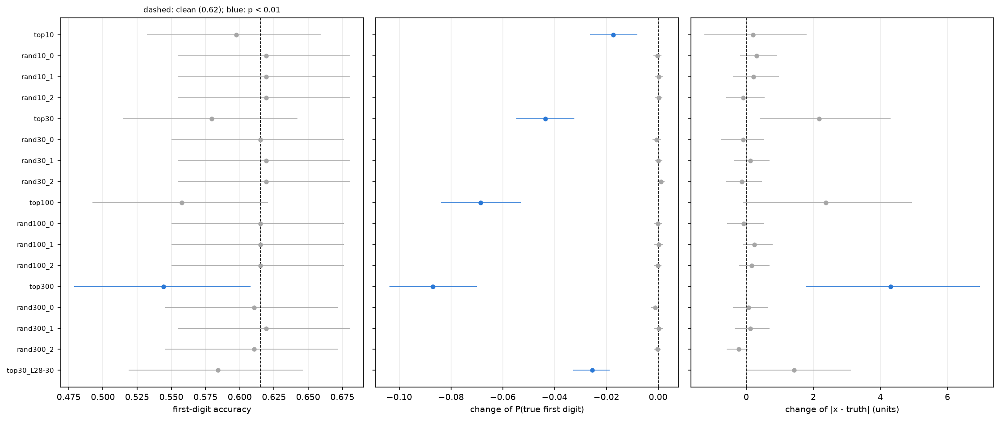

*图 12：神经元均值消融，各元素含义同图 10。*

6. **神经元调谐能否解释吸附。** 位置带的宽度（100–200 个单位）与首位数字的分辨率一致，可以解释“首位正确、后续数位由先验决定”这一总体现象；在 498/500 平台对应的 400–610 区间内，没有观察到单独覆盖该区间、写入“5”或“4”的神经元。吸附到 500 的直接成因在本轮的神经元分析中未能确定。

### 3.6 Q6：以 next-token prediction 输出坐标的机制性限制

本节归纳本轮与此前实验的证据，供实验 3.9 引用。每条限制后列出支持它的测量。

1. **读出分辨率约为 100 个单位，远低于表示精度。** residual 以 4–8 个单位的精度编码坐标（第一轮第 3.3 节；本轮第 3.1 节），但只有宽度约 100 个单位的数位能被模型稳定读出：宽度 100 个单位的数位真值概率为 0.40–0.64，宽度 10 个单位的为 0.11–0.21（第 3.2 节，图 6）。限制与格式无关（0–1000、两位小数、0–100、0–10），在 RefCOCO 上同样存在。
2. **逐位输出把分辨率限制转化为“首位决定一切”。** 首位数字只能以约 100 个单位的粒度选择，选错首位即产生至少数十个单位的误差；后续数位的分布接近与图像无关的先验（与空白画布先验的余弦 0.79），greedy 解码因此偏向 0 与 5（第 3.2 节，图 7b）。
3. **细粒度坐标信息位于数字 unembedding 看不到的方向。** 第二位数字所需的信息在全维 probe 中存在（±1 正确率 0.90–0.99），在十个 logit lens logit 中不存在（0.08–0.25）；坐标编码方向在数字子空间中的占比与随机方向同量级（第 3.3 节，图 8）。
4. **首位数字的分区边界有偏，且错误在 MLP 写入之前已经形成。** 十个数字 logit 的最优线性组合可达 0.84–0.86 的首位正确率，模型 argmax 只有 0.57–0.69（第 3.3 节）；负责写入的 MLP 28–30 与约 300 个神经元在消融时几乎不纠正错误（第 3.4、3.5 节）。
5. **输出尺度绑定于 0–1000 的训练格式。** 即使给出示例，0–100 与像素提示的答案中只有 6% 与 1% 使用所要求的尺度（第 3.2 节）。
6. **数字输出本身没有限制。** 当数值来自文本时，同样的逐位输出达到 3.8 个单位的误差（第 3.2 节）。限制专属于“连续视觉量 → 数字 token”的转换。

**对读出工具的含义（解释）。** 坐标信息在 residual 中以远高于输出精度的形式存在，并在层 24 之后集中于文本位置（第一轮第 3.6 节）。外部工具若以线性回归直接读取首位数字位置或 prompt 末端的 residual，可绕过上述 1–4 条限制；按本项目规定，这种读出只能作为外部可调用的工具实现，不作为模型的附加输出头。

## 4. 讨论

1. **“看得准但答不准”的瓶颈位置。** 本轮把第一轮“误差产生于读出步骤”的结论细化为两个可分离的环节：细粒度坐标信息没有进入数字 unembedding 能看到的子空间；首位数字的分区边界有偏。两者都发生在 L20 H11 把坐标写入文本位置之后、层 24–32 的数字写入阶段。
2. **与文本数值研究的比较。** 文本 LLM 中报告的数位圆形表示对应“数值已经以 token 形式存在”的情形。本模型在文本换算任务中同样能精确输出每一位，说明相应的计算存在；从图像得到的坐标则只以连续、低维的曲线形式存在，缺少把细粒度分量映射为周期性数位的读出。
3. **与稀疏神经元研究的关系。** 首位数字写入集中于约 300 个神经元，与 Arora 等人报告的约 $10^2$ 个神经元控制一个行为的量级一致。本任务中，这些神经元对应“粗粒度位置带 → 数字”这一步，分辨率约为 100 个单位；第二位数字没有对应的神经元结构。

## 5. 限制

1. **0–100 与像素格式不被遵从**，这两种格式的 teacher-forced 数字分布反映的是模型在 0–1000 的倾向下被强制写入另一种尺度时的分布，只作参照。数位宽度的结论主要由两位小数、0–10 与 0–1000 三种被遵从的格式支持。
2. **greedy 解码器与参考实现的 20 例抽查未在本轮完成**（第 2.2 节）；Q2 的主要指标来自 teacher-forced 真值答案，不受影响。
3. **path patching 的份额不可加**，且以首位数字位置为唯一的接收位置；首位数字之前位置上的中介未逐一分解。
4. **神经元重要性基于直接写入**（冻结最终归一化尺度），未包含神经元经后续层的间接作用；key 以激活偏离均值最大处定义，对多峰的调谐曲线只取一个峰。
5. **多重比较。** 消融的 31 个条件中，只有 MLP 20–32 与神经元前 300 个的首位正确率变化通过 Bonferroni 校正；真值首位概率与熵的变化对 MLP 28–30、MLP 32、L32 H10 等条件均通过校正。
6. **只研究了 direct-answer 提示。** 允许先推理再作答的提示下，坐标可能经由文本中间结果输出，本轮未检验。
7. **自然图像只覆盖 Q2**；Q1、Q3–Q5 的结论基于单个红色圆的合成刺激。

## 6. 产物

产物位于 WORK_DIR 的 `analysis/position/2026-10-16_coordinate_value_r2/`：`formats/`（cases、greedy 答案、teacher-forced 数字分布与 residual 分片）、`ablate/`、`pathpatch/`、`neuron_ablate/`、`neuron_sets.json` 与 `neuron_means.npz`、`results.json`（全部指标与区间）、`analysis.npz`（作图数组）、`format_rows.json`、`experiment.json`（模型版本、代码摘要、batch size 与运行参数）；`features` 链接到 DATA_DIR 的神经元激活。程序为 `analysis_tools/position/coordinate_value_r2*.py`，入口为 `scripts/analysis/position/coordinate_value_r2.sh`，测试为 `tests/analysis/position/test_coordinate_value_r2.py`。
