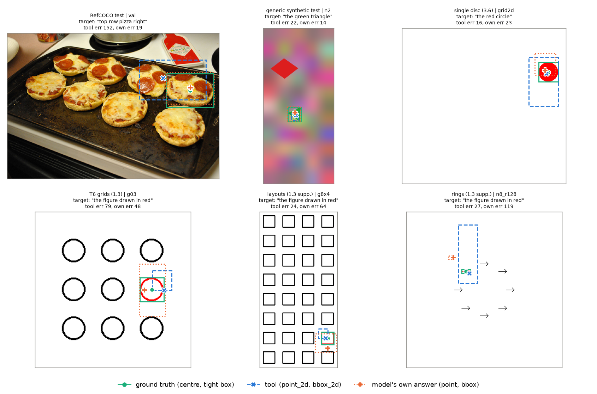
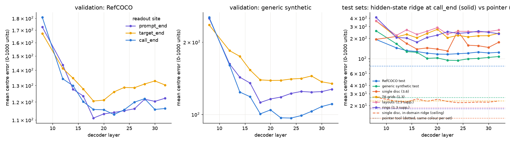
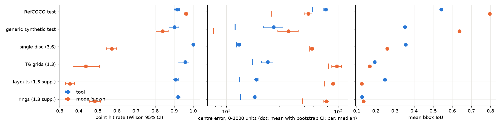
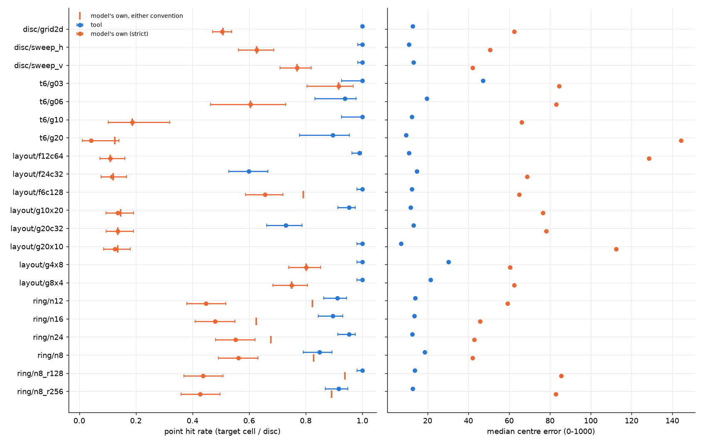
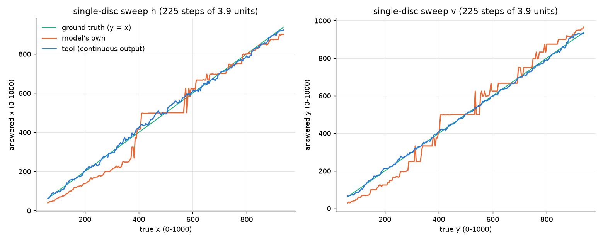
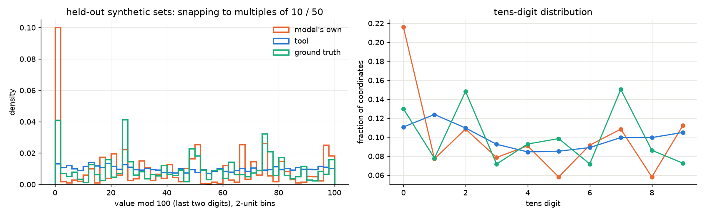
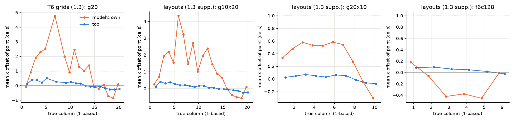
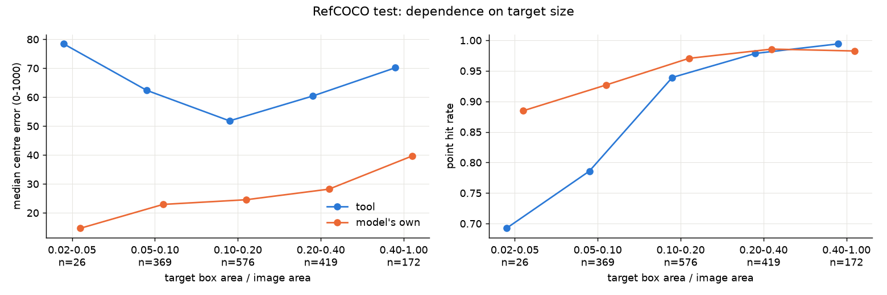
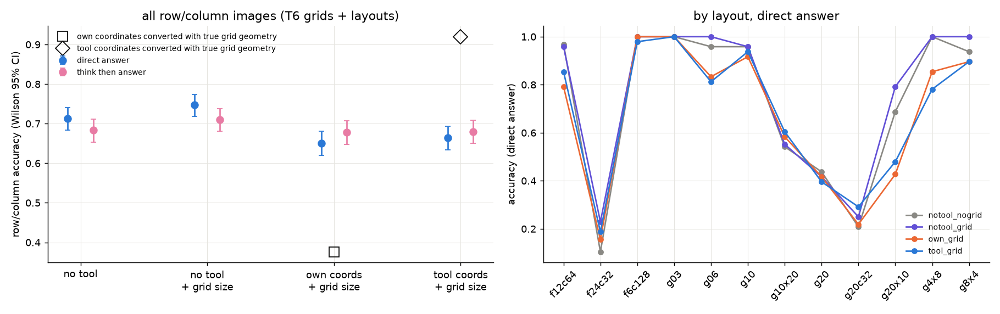
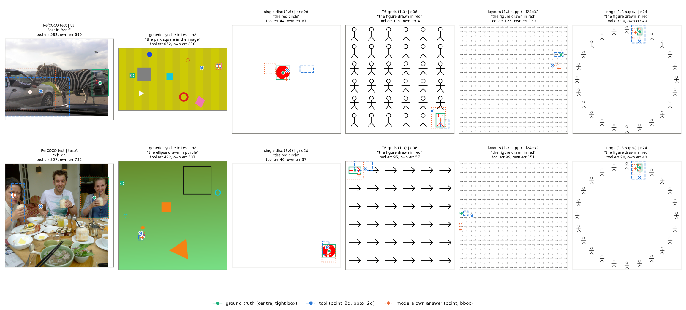

# 坐标读出工具

实验日期：2026-10-16 至 2026-10-17。本文属于[位置信息与坐标读取](plan.md)研究，执行[实验 3.9 设计](design_readout_tool.md)。模型为 Qwen3.5-9B，bfloat16、SDPA、greedy decoding，thinking off。上游结果见[实验 3.6](results_2026-10-15_coordinate_value.md)、[实验 3.5](results_2026-10-14_coordinate_readout.md)与[实验 3.4](results_2026-10-14_probe_refinement.md)。

## 1. 研究问题与主要结果

实验 3.6 表明模型在答案位置拥有精确的连续坐标，误差来自逐 token 写出数字的步骤。本实验构建一个由模型以原生 function calling 调用的外部工具 `locate(target)`：工具读取调用过程中模型自己的内部状态，以在 RefCOCO 与通用合成场景上训练的读出器给出 0–1000 坐标，作为 tool response 写回上下文。评估在训练中未出现的 5 类合成任务与 RefCOCO 测试集上进行，并与模型在同一问题主体下自己写出的答案配对比较。主要结果如下：

1. **调用位置的 hidden state 不足以作为工具的输入。** 在 3 个读取位置 × 12 层上拟合的 ridge 中，验证误差最低的是 `</tool_call>` 处层 22 的状态（RefCOCO 验证 112.9，通用合成验证 96.8）；按验证集选出的 4 个 hidden-state 读出器（单层与三层的 ridge 与 MLP）在分布外合成任务上的误差为 124–251，与预测图像中心的误差（250–370）处于同一量级。即使在单目标画布内部训练与测试（实验 3.6 的协议），该位置的误差也只能降到 22–27（第 3.2 节）。坐标在调用阶段并没有以可泛化的线性形式存在于 residual 中。
2. **工具改为读取“模型看向哪里”：目标描述末 token 的 attention。** 模型写出调用参数的最后一个 token 时，层 12–16 的 full-attention head 把 77%–90% 的 attention 放在 visual token 上。在这 128 个 head 的 attention 图上训练的逐 token 打分器（下称 pointer 工具）在验证集上误差最低（RefCOCO 79.8，通用合成 27.4），被选为最终工具。
3. **在 4 类分布外合成任务上，工具全面优于模型自己写出的坐标。** 命中率由 0.35–0.57 升至 0.91–1.00，平均中心误差由 59–97 降至 13–23（精确 McNemar 与符号检验 $p < 10^{-27}$）。单目标画布上命中率为 1291/1291，平移序列中的阶梯与 500 吸引域完全消失（第 3.3 节）。
4. **工具消除了第 2 节列出的三类数字读出缺陷。** 模型输出的坐标 44.6% 为 10 的倍数、25.1% 为 50 的倍数，工具为 10.2% 与 2.0%，与真值的 12.4% 与 9.2% 相当；网格点答案换算到单元后，模型有 22%–29% 的答案落在目标右侧一列，工具为 2%–4%；圆环布局中只在 pixel 约定下命中的模型答案为 360/1152，工具的输出单位由构造决定，不存在此类答案。
5. **在 RefCOCO 上工具不如模型。** 命中率为 0.915 对 0.964，平均中心误差为 77.8 对 54.3（中位数 59.4 对 25.6），bbox 平均 IoU 为 0.54 对 0.80。自然图像中模型的数字读出误差远小于合成画布，工具的 token 级分辨率成为主要误差来源。在答案槽位（实验 3.6 的 $x_0$）读取 attention 的变体 B 用约三分之一的 RefCOCO 训练数据把 RefCOCO 误差降至 60.2，说明答案槽位是自然图像中更好的读取位置（第 3.6 节）。
6. **工具坐标写入上下文后，模型并不使用它来回答行列问题。** 在 960 张网格图像上，tool response 中的工具点按真实网格几何换算后行列正确率为 0.92，但模型读到该 response 后的行列正确率只有 0.665（直接作答）与 0.680（先推理后作答），低于不调用工具、只给出网格尺寸时的 0.747 与 0.710；模型的答案与 response 所在单元一致的比例只有 0.64–0.65。坐标精度的提升需要由确定性的换算（工具直接返回行列号）兑现，不能依赖模型自己把坐标转换为序号（第 3.7 节）。
7. **模型主动调用工具。** 带调用指令时调用率为 658/688，不带指令时为 225/230；带指令时自由调用的工具误差与规范调用相同，不带指令时合成任务的误差上升约 50%（第 3.8 节）。

## 2. 实验设计与实际执行

### 2.1 工具与读取位置

工具的接口、符号与选择流程见设计第 3–4 节。下图为工具调用的实际文本（canonical call），目标描述为 RefCOCO 的第一条 referring expression，合成任务统一为 “the figure drawn in red”，单目标画布为 “the red circle”：

```
<|im_start|>user
<image>Locate the object described as: {target}. Call the locate tool to find it.<|im_end|>
<|im_start|>assistant
<think>

</think>

<tool_call>
<function=locate>
<parameter=target>
{target}
</parameter>
</function>
</tool_call>
```

系统提示中含 `locate` 的 JSON schema（Qwen3.5 chat template 的 Tools 段）。可行性检查中，模型在该问题下以与上面完全相同的格式发出调用（3/3），不加调用指令时同样调用（1/1）；第 3.8 节给出自由调用的系统测量。

三个读取位置为生成提示末 token（`prompt_end`）、目标描述末 token（`target_end`）与 `</tool_call>`（`call_end`）。capture 在每个位置记录 hidden state，并记录 full-attention 层（层 4、8、…、32）从三个位置出发的 attention：每个 head 在 visual token 上的总质量、质心、标准差与峰值位置，以及 `target_end` 处全部 128 个 head 在 visual token 上的完整 attention 图。hidden state 与 attention 两类输入的比较见第 3.2 节。

### 2.2 pointer 工具

设图像的 merged visual token 网格为 $g_h \times g_w$，共 $N_v = g_h g_w$ 个 token，第 $j$ 个 token 的中心为 $c_j \in \mathbb{R}^2$（0–1000 单位）。记 $a_{k j}$ 为第 $k$ 个 head（$k = 1, \dots, 128$，8 个 full-attention 层 × 16 个 head）从 `target_end` 出发分配给 token $j$ 的 softmax attention。pointer 工具的计算为

$$
\phi_{kj} = \log\big(N_v\, a_{kj} + 10^{-3}\big), \qquad u_j = \big[\phi_{\cdot j},\ \bar\phi_{\cdot j}\big] \in \mathbb{R}^{256},
$$

$$
[s_j, m_j] = g_\theta(u_j), \qquad \alpha_j = \frac{\exp s_j}{\sum_{j'} \exp s_{j'}}, \qquad \hat p = \sum_j \alpha_j c_j .
$$

其中 $\phi_{kj}$ 为 head $k$ 对 token $j$ 的 attention 相对均匀分布的对数比，乘以 $N_v$ 使特征与图像的 token 数无关；$\bar\phi_{\cdot j}$ 为 $\phi_{\cdot j}$ 在 token 网格上 3×3 邻域的平均，为每个 token 提供邻居的信息；$g_\theta$ 为逐 token 共享的两层 MLP（隐层 64，输出 2 个 logit）；$\alpha \in \mathbb{R}^{N_v}$ 为 pointer 分布；$\hat p \in \mathbb{R}^2$ 为工具返回的点。边界框取 mask 概率 $\sigma(m_j) \ge \tau$ 的 token 单元的外接矩形，$\tau$ 在验证集上按平均 IoU 选为 0.6。

训练损失为

$$
\mathcal{L} = -\sum_j q_j \log \alpha_j + \lambda\, \frac{\lVert \hat p - p^\ast \rVert_1}{100} + \mathrm{BCE}\big(m_j,\ [\,o_j \ge 0.5\,]\big),
$$

其中 $o_j \in [0, 1]$ 为目标 tight box 覆盖 token $j$ 单元的比例，$q_j = o_j / \sum_{j'} o_{j'}$ 为目标分布，$p^\ast$ 为目标中心，$\lambda = 1$。第一项使 pointer 分布集中在目标覆盖的 token 上；第二项直接约束加权质心，使 $\alpha$ 在目标边界 token 之间的分配反映亚 token 的位置；第三项训练边界框所需的 mask。

选择这一形式的理由有三点。第一，实验 3.5 表明生成坐标时层 12–24 的指向型 head 读取目标 token，工具直接读取同类 head 的 attention，不经过把位置转换为数字的 MLP 28–30（实验 3.6 第 3.5 节）。第二，打分器作用于每个 token 的“被注视程度”，不读取 token 的内容或绝对位置，因此不依赖图像尺寸与任务布局。第三，输出是 token 中心的凸组合，天然落在图像内，单位固定为 0–1000。

### 2.3 数据与规模

| 集合 | 用途 | 规模 |
| --- | --- | --- |
| RefCOCO（5000 张训练图像，长边 384–768） | 训练 | 8071 条 referring 记录 |
| 通用合成场景 | 训练 | 5000 张 |
| RefCOCO 验证（实验 3.4 验证图像）+ 通用合成验证 | 选择 | 478 + 500 |
| RefCOCO 测试（实验 3.4 测试图像 300 张 + 新增 700 张，长边 512） | 评估 | 1562 条 |
| 通用合成测试 | 评估（分布内） | 500 张 |
| 单目标画布、T6 网格、行列布局、圆环布局 | 评估（分布外） | 1291、192、1536、1152 张 |

图像按 SHA-256 划分，训练、验证与测试互不重叠。RefCOCO 训练集中有 9 张图像在长边 384 时面积低于处理器的最小像素数（65536），这些图像改用更大的长边（`fix_small_refcoco.json`）。

### 2.4 操作与核验

1. **capture。** 20282 个样本各做一次 teacher-forced 前向，记录 3 个位置 × 12 层的 hidden state 与 attention（float16 hidden，共约 6 GB）。left-padded batch 与逐个前向的 hidden state 在 8 个混合尺寸样本上的相对误差为 2.3%–3.0%（cosine 不低于 0.998），为 bfloat16 下 padding 改变 kernel 路径的数值差异。
2. **own。** 6233 个评估样本各生成 point 与 bbox 答案（`generate_batch`，batch 不超过 32，按 visual token 数分组）。随机 20 个答案与参考 `generate` 比较：10/20 文本完全一致，9/20 的坐标相差 1–9 个单位，1/20 相差 125 个单位（一个 6×6 网格中两个候选单元之间的切换），与实验 3.6 第 2.2 节的观察一致。
3. **fit（CPU）。** 设计第 4.5 节的选择（含 pointer 工具），外加 attention 摘要上的 ridge 与单个 head 的 attention 质心两个对照；数据消融与单目标画布上的分布内上限。
4. **slot（GPU，变体 B）。** 在 point 问题后 teacher-force 前缀 `[{"point_2d": [`，读取预测 x 首位数字的 token（实验 3.6 的 $x_0$）的 hidden state 与 attention；训练使用 2500 条 RefCOCO 与 1500 张通用合成，评估使用 RefCOCO 全部测试记录与每个合成集 200 个样本。
5. **loop（GPU）。** 第 3.7 节的行列工具回路（960 张图像 × 8 种条件）与第 3.8 节的自由调用。工具在每个对话中实时读取。

GPU 用量约 7 GPU 小时（A800 与 A40，与其他用户共享；capture 前半段因显存不足把权重分在两张卡上运行）。

## 3. 结果

### 3.1 输入示例



上图每个评估集随机取一例。绿色实线框与圆点为目标的 tight box 与中心，蓝色虚线框与叉号为工具返回的 bbox 与点，橙色点线框与加号为模型自己的 bbox 与点答案。工具的 bbox 由 token 单元拼成，在小目标上明显偏大（第 3.4 节）。

### 3.2 读取位置与读出器



左、中两图为 hidden-state ridge 在两个验证集上的误差，紫、黄、蓝三色分别为 `prompt_end`、`target_end` 与 `call_end`；右图实线为 `call_end` 上的 ridge 在 6 个测试集上的误差，点线为 pointer 工具在同一测试集上的误差（颜色与实线相同），橙色虚线为单目标画布的分布内上限。纵轴为对数刻度。

| 读出器 | 输入 | RefCOCO 验证 | 合成验证 | RefCOCO 测试 | 单目标画布 | T6 | 布局 | 圆环 |
| --- | --- | --- | --- | --- | --- | --- | --- | --- |
| ridge，单层 | `call_end` 层 22 | 112.9 | 96.8 | 115.9 | 129.8 | 204.2 | 231.2 | 251.0 |
| ridge，三层 | `call_end` 层 18、22、24 | 102.9 | 88.9 | 105.6 | 154.5 | 203.9 | 236.1 | 206.9 |
| MLP，三层 | 同上 | 93.7 | 77.1 | 98.4 | 144.2 | 212.0 | 232.1 | 129.9 |
| ridge | 三个位置的 attention 摘要（2688 维） | 106.8 | 133.1 | 107.8 | 93.9 | 113.8 | 113.1 | 130.3 |
| 单个 head 的质心（不训练） | `target_end` 中验证误差最低的 head | 125.1 | 209.5 | 124.2 | 107.3 | 61.5 | 66.1 | 155.2 |
| pointer | `target_end` 的 128 个 attention 图 | **79.8** | **27.4** | **77.8** | **13.0** | **23.4** | **18.5** | **17.9** |

表中为平均中心误差（0–1000 单位）。三点观察：

1. **hidden state 中的坐标不能泛化。** 三个位置的 hidden-state 读出在 RefCOCO 上都停留在 100 以上；按验证集选出的 4 个 hidden-state 读出器在分布外合成任务上为 124–251，全部 36 个（位置，层）组合中最低的也只有 99.6（`target_end` 层 28，单目标画布）；始终预测图像中心的误差约为 250–370。单目标画布内部训练、在平移序列上测试时，`call_end` 各层的误差为 22.1–26.6，远高于实验 3.6 中 $x_0$ 的 5–7。调用位置的 residual 只携带粗略、任务特异的位置信息。
2. **attention 携带可泛化的位置。** 即使不训练任何参数，`target_end` 上单个 head 的 attention 质心在 T6 与布局上也有 61–66 的误差，好于全部 hidden-state 读出器；pointer 工具把多个 head 组合后，在分布外任务上达到 13–23。
3. **两类训练数据都是必要的。** 只用 RefCOCO 训练的 pointer 在合成任务上误差为 117–149；只用通用合成训练的 pointer 在 RefCOCO 上误差为 126.5，在合成任务上与混合训练相当（12.5–27.0）。混合训练在两类数据上同时接近各自的最好结果。hidden-state ridge 的同一消融给出相同方向的结论（只用 RefCOCO：合成任务 233–324；只用通用合成：RefCOCO 255）。

**解释。** 这一对比给出关于坐标表示的一个新的机制结论：在 tool call 阶段，目标位置以“attention 指向哪些 visual token”的形式存在，而不以 residual 中的线性坐标存在；实验 3.6 在答案位置读到的精确线性坐标，是生成坐标时由指向型 head 临时写入的，并且其读出方向依赖任务（3.6 只在单目标画布内部训练与测试）。

### 3.3 主要结果：工具与模型的配对比较



蓝色为工具，橙色为模型自己的答案。左图为点命中率与 Wilson 95% 置信区间，中图为中心误差（圆点为均值及 bootstrap 95% 置信区间，竖线为中位数，对数横轴），右图为平均 bbox IoU。

| 集合 | $n$ | 命中率：工具 | 命中率：模型（任一约定） | 只有工具命中 / 只有模型命中 | 平均误差：工具 | 平均误差：模型 | 配对差值（模型 − 工具） | bbox IoU：工具 / 模型 |
| --- | --- | --- | --- | --- | --- | --- | --- | --- |
| RefCOCO 测试 | 1562 | 0.915 [0.901, 0.928] | 0.964（0.964） | 24 / 100 | 77.8 | 54.3 | −23.3 [−26.8, −19.7] | 0.54 / 0.80 |
| 通用合成测试 | 500 | 0.902 [0.873, 0.925] | 0.840（0.880） | 61 / 30 | 26.5 | 36.1 | 10.1 [4.5, 16.1] | 0.35 / 0.64 |
| 单目标画布 | 1291 | 1.000 [0.997, 1.000] | 0.572（0.574） | 552 / 0 | 13.0 | 58.5 | 45.5 [43.7, 47.2] | 0.36 / 0.26 |
| T6 网格 | 192 | 0.958 [0.920, 0.979] | 0.438（0.458） | 103 / 3 | 23.5 | 97.3 | 73.8 [63.3, 84.0] | 0.19 / 0.17 |
| 行列布局 | 1536 | 0.909 [0.893, 0.922] | 0.354（0.374） | 869 / 16 | 18.5 | 90.1 | 71.5 [68.2, 75.0] | 0.25 / 0.13 |
| 圆环布局 | 1152 | 0.921 [0.904, 0.935] | 0.484（0.797） | 544 / 41 | 17.9 | 78.7 | 60.8 [56.5, 65.2] | 0.13 / 0.14 |

命中率的配对差异全部显著（精确 McNemar，RefCOCO $p = 3 \times 10^{-12}$ 方向为模型更好，其余 $p \le 0.002$ 方向为工具更好）；误差差值的置信区间均不含 0，符号检验 $p \le 2 \times 10^{-5}$。模型答案无法解析的样本计为未命中（RefCOCO point 5 条、bbox 81 条，通用合成 1 条），误差只在可解析的答案上配对。圆环的“最近实例”指标中工具为 1152/1152，模型为 0.768。

模型答案的问题主体与工具相同（“Locate the object described as: …”）。前序实验的原问题（“One figure is drawn in red. Give the center …”）下的已存答案命中率为 T6 0.49、布局 0.33、圆环 0.48，与本实验的 0.44、0.35、0.48 相近，问题措辞不改变结论。



上图为合成任务按条件分组的点命中率（左）与中位误差（右），橙色竖线为模型答案按任一坐标约定的命中率。工具的两个薄弱条件是单元 32 pixels 的密集网格：f24c32（24×24，命中率 0.60）与 g20c32（20×20，0.73），其余条件不低于 0.85。在这两个条件中一个实例恰好占一个 merged token，pointer 质心的 token 级分辨率与单元尺寸相同（第 4 节）。模型在 20×20、10×20 等大网格上的命中率只有 0.04–0.14。

### 3.4 缺陷诊断

**十位读出与取整。**



上图为单目标画布的两条平移序列（每步 3.9 个单位）：绿色为真值，橙色为模型输出，蓝色为工具的连续输出（四舍五入之前）。模型的输出在 x 约 400–580、y 约 400–550 处停在 500，在 400 以下沿斜率约 0.7 的直线偏小（与实验 3.6 第 3.2 节相同）；工具的输出贴合真值，没有平台，平均误差在 sweep_h 与 sweep_v 上为 10.9 与 13.1（中位数）。



左图为 4 个分布外合成集全部坐标值的末两位分布（2 个单位一格），右图为十位数字的分布；橙色为模型，蓝色为工具，绿色为真值。真值本身在 0、25、50、75 附近有峰，来自网格单元中心的位置。

| 指标 | 模型 | 工具 | 真值 |
| --- | --- | --- | --- |
| 10 的倍数比例 | 0.446 | 0.102 | 0.124 |
| 50 的倍数比例 | 0.251 | 0.020 | 0.092 |
| 十位分布的熵（bits，均匀为 3.32） | 3.21 | 3.31 | 3.26 |
| 最常见的数值（次数） | 500（839）、875（172）、100（168）、498（167） | 无集中 | — |

RefCOCO 上模型坐标中 33.2% 为 10 的倍数、13.0% 为 50 的倍数，工具为 9.5% 与 1.5%。

**列与行偏移。**



上图为 4 种网格中点答案沿 x 方向的平均偏移（单位为单元宽度），按真值列号分组；橙色为模型，蓝色为工具，灰色实线为 0，点线为偏移 1 个单元。模型在 20 列的网格中，第 2–14 列的平均偏移为 1–4.8 个单元，越过一整列；工具的偏移在 ±0.5 个单元以内。按单元统计：

| 集合 | 来源 | 列 +1 | 列 −1 | 行 +1 | 平均 x 偏差（单位） | 平均 y 偏差（单位） |
| --- | --- | --- | --- | --- | --- | --- |
| T6 网格 | 模型 | 0.224 | 0.073 | 0.214 | 14.6 | 40.8 |
| T6 网格 | 工具 | 0.036 | 0.000 | 0.000 | 9.0 | −1.7 |
| 行列布局 | 模型 | 0.286 | 0.079 | 0.206 | 20.5 | 47.1 |
| 行列布局 | 工具 | 0.024 | 0.027 | 0.027 | 4.4 | −1.8 |

模型的点答案同样把目标报告在更靠右、更靠下的位置，与 1.3 补充第 5 节中“行列 +1 与中心点沿轴偏大方向一致”的观察相同；工具没有这一偏向。

**坐标约定。** 模型答案中只按 pixel 约定命中的数量为：圆环 360/1152、行列布局 31/1536（其中 f6c128 为 26/192）、通用合成 20/500、T6 4/192、单目标画布 2/1291、RefCOCO 0/1562。通用合成场景中这类答案集中在物体少的场景（1–3 个物体时 12/92，8 个以上时 1/270）。工具的输出单位由训练目标决定，不存在这类答案。

### 3.5 自然图像



上图按目标 bbox 占图像面积的比例分组：

| 面积比例 | $n$ | 命中率：工具 / 模型 | 中位误差：工具 / 模型 |
| --- | --- | --- | --- |
| 0.02–0.05 | 26 | 0.69 / 0.89 | 78.4 / 14.7 |
| 0.05–0.10 | 369 | 0.79 / 0.93 | 62.4 / 22.9 |
| 0.10–0.20 | 576 | 0.94 / 0.97 | 51.8 / 24.5 |
| 0.20–0.40 | 419 | 0.98 / 0.99 | 60.4 / 28.2 |
| 0.40–1.00 | 172 | 0.99 / 0.98 | 70.2 / 39.6 |

1. **模型在自然图像上读得准。** RefCOCO 上模型的中位误差为 23.7–27.8（四个原始划分），远小于合成画布上的 42–144，取整与吸引值的比例也更低。实验 3.5 中 RefCOCO 的坐标由目标内容所在的序列槽位决定，单目标画布的坐标由 ViT RoPE 决定；两种来源下数字读出的精度不同，本实验的结果与此一致。
2. **工具的误差在大小目标上都偏高。** 小目标（面积比例低于 0.10）上命中率比模型低 0.14–0.20；大目标上命中率与模型相同，但中位误差仍高 30 左右。一种可能的解释（未经检验）是：小目标上 pointer 分布散布到相邻的同类物体（第 3.9 节的失败案例），大目标上 pointer 质心偏向目标中受注视最多的部分，与 tight box 的中心不一致。
3. **testA（人）与 testB（物体）没有差异。** 工具命中率为 0.952 与 0.924，模型为 0.976 与 0.956。

### 3.6 变体 B：答案槽位上的读取

| 读出器（slot 训练集：2500 RefCOCO + 1500 合成） | RefCOCO 测试 | 通用合成 | 单目标画布 | T6 | 布局 | 圆环 |
| --- | --- | --- | --- | --- | --- | --- |
| $x_0$ hidden state，ridge，层 20 | 74.7 | 68.8 | 86.6 | 174.9 | 190.9 | 121.6 |
| $x_0$ attention，pointer | **60.2** | 26.1 | 13.3 | 31.9 | 30.7 | **13.2** |
| 最终工具（`target_end` pointer，全部训练数据），同一批样本 | 77.8 | 27.2 | 12.3 | 23.4 | 19.4 | 16.6 |
| 模型自己的答案（全部样本） | 54.3 | 36.1 | 58.5 | 97.3 | 90.1 | 78.7 |

合成测试集每个取 200 个样本（T6 为全部 192 个），RefCOCO 为全部 1562 条。$x_0$ 是模型即将写出坐标首位数字的位置，实验 3.5 表明该位置的指向型 head 在 RefCOCO 上 60%–70% 的 attention 落在图像 token 上。在只有约三分之一训练数据的条件下，$x_0$ pointer 把 RefCOCO 误差从 77.8 降到 60.2，与模型的 54.3 接近；合成任务上两种读取位置相当。$x_0$ 处的 hidden-state ridge 同样好于 `call_end`（RefCOCO 74.7 对 105.6），但在分布外合成任务上仍然失效。

**解释。** 模型在“开始写坐标”时比在“说出目标描述”时更精确地注视目标。方案 B 在自然图像上的精度优势，与它不属于主动调用的缺点（设计第 3 节）构成取舍；一个兼顾二者的接口是在 tool call 的参数中加入一个由模型填写的粗略坐标槽位，工具在该槽位读取 attention（第 5 节）。

### 3.7 行列答案的工具回路



左图为 960 张行列图像（T6 网格 192 张，8 种布局各 96 张）在 4 种条件下的行列正确率，蓝色为直接作答，粉色为先推理后作答（Wilson 95% 置信区间）；空心方块与空心菱形分别为 tool response 中模型自己的点与工具点按真实网格几何换算后的正确率。右图为直接作答按布局分组的正确率，灰、紫、橙、蓝分别为四种条件。

| 条件 | 直接作答 | 先推理后作答 | 与 notool_grid 的配对差异（直接 / 推理） |
| --- | --- | --- | --- |
| notool_nogrid（原问题） | 0.713 [0.683, 0.740] | 0.683 [0.653, 0.712] | 21 对 54，$p = 2 \times 10^{-4}$ / 51 对 77，$p = 0.03$ |
| notool_grid（加网格尺寸） | 0.747 [0.718, 0.773] | 0.710 [0.681, 0.738] | — |
| own_grid（response 为模型自己的坐标） | 0.651 [0.620, 0.681] | 0.678 [0.648, 0.707] | 50 对 142，$p = 2 \times 10^{-11}$ / 74 对 105，$p = 0.02$ |
| tool_grid（response 为工具坐标） | 0.665 [0.634, 0.694] | 0.680 [0.650, 0.709] | 60 对 139，$p = 2 \times 10^{-8}$ / 70 对 99，$p = 0.03$ |

“$a$ 对 $b$”表示只有该条件答对的样本数与只有 notool_grid 答对的样本数（精确 McNemar 检验）。

| 条件 | response 换算正确率 | 朴素换算正确率 | 答案与 response 单元一致 | 答案无效 |
| --- | --- | --- | --- | --- |
| own_grid，直接 | 0.376 | 0.380 | 0.357 | 71/960 |
| tool_grid，直接 | 0.920 | 0.920 | 0.643 | 84/960 |
| own_grid，推理 | 0.376 | 0.380 | 0.364 | 2/960 |
| tool_grid，推理 | 0.911 | 0.911 | 0.651 | 6/960 |

1. **工具在行列对话中同样准确。** 工具在行列问题的对话中实时读取（问题措辞与训练时不同），返回的点有 0.91–0.92 落在目标单元内，与第 3.3 节的命中率一致。朴素换算（假设网格铺满画布）与按真实几何换算的结果相同，因为布局图像的网格从画布原点开始，T6 网格的边距只有半个单元。
2. **模型不按 response 中的坐标作答。** 即使 response 的单元正确率为 0.92，模型的答案只有 64%–65% 与 response 的单元一致，正确率反而低于不调用工具的条件。直接作答下 84/960 个答案为再次调用工具而非给出行列号，计为无效；只在有效答案上计算时 tool_grid 的正确率为 0.73，仍不高于 notool_grid。
3. **先推理后作答不改变这一结论。** 推理文本显示模型在拿到 response 后重新逐行扫描图像、数出行列，并不使用 response 的数值，例如在 4 行 8 列的网格中，response 为 [933, 595]（对应第 3 行第 8 列），模型写出“在第四行中，最后一个图形是红色的”，回答 {"row": 4, "column": 8}。在本实验的网格上，先推理后作答的正确率低于直接作答（0.710 对 0.747）。
4. **按布局分组，工具 response 的副作用集中在模型原本答得好的布局。** g20x10、g4x8 与 g06 上 tool_grid 的直接作答正确率比 notool_grid 低 0.19–0.31，而模型原本答错的 g10x20、g20、f24c32、g20c32 上各条件都在 0.1–0.6 之间，没有被工具改善。

**解释。** 坐标到序号的换算需要“除以单元尺寸”的算术，模型在直接作答与自由推理下都没有执行这一算术；推理文本显示它回到自己的视觉计数过程，计数中的 +1 与 −1 错误因此保留。工具若要改善行列答案，应直接返回行列号（由工具在已知网格几何时换算），或在 tool response 中给出单元编号；这与 PI 关于“工具处理模型自己的表征以辅助推理”的设想一致，但需要工具承担换算。

### 3.8 自由调用

从 6 个评估集抽取 688 个样本，只给出工具声明与问题，由模型自己生成调用；其中三分之一（230 个）另以不含调用指令的问题测试。

| 问法 | 调用率 | 目标描述与规范描述相同 | 工具误差：自由调用 / 规范调用（同一样本） |
| --- | --- | --- | --- |
| 含调用指令 | 658/688 = 0.956 [0.938, 0.969] | 616/658 | RefCOCO 86.7 / 85.7，通用合成 22.6 / 21.4，单目标 12.9 / 12.9，T6 23.7 / 23.6，布局 20.0 / 20.0，圆环 20.1 / 20.1 |
| 不含调用指令 | 225/230 = 0.978 [0.950, 0.991] | 204/225 | RefCOCO 79.3 / 77.3，通用合成 34.3 / 32.2，单目标 16.5 / 13.7，T6 30.6 / 22.3，布局 34.1 / 21.6，圆环 17.8 / 16.6 |

1. **模型在绝大多数情况下主动调用工具，且格式完全符合模板。** 未计为调用的 35 个样本全部以自然语言推理开头（“Okay, I need to find …”），在 64 个生成 token 内没有出现调用。
2. **模型通常逐字复制问题中的目标描述。** 不一致的描述几乎都是去掉通用合成描述末尾的 “in the image” 或 RefCOCO 描述中的附加评论；合成任务的 “the figure drawn in red” 在两种问法下都被逐字复制（384/384）。带调用指令时自由调用与规范调用的误差相同。
3. **不含调用指令时，即使目标描述相同，误差也会上升。** T6 与布局上的误差从 22 升至 31–34。两种问法只差一句 “Call the locate tool to find it.”，读取的 token 相同而上文不同，说明 `target_end` 的 attention 受问题上文影响，工具对问题措辞有一定敏感性。部署时应固定调用指令，或在多种问法上训练读出器（第 5 节）。

### 3.9 失败案例



每个评估集取工具误差最大的两例，颜色与第 3.1 节相同。失败分为三类：

1. **选错物体。** RefCOCO 中 “car in front”“child” 等描述在图中有多个候选，工具与模型选中同一个错误物体（两例的模型误差同样为 690 与 782）。通用合成中有两例的描述存在歧义：生成器中长宽比接近 1 的 rectangle 与 ellipse 在视觉上与 square、circle 无法区分，“the pink square” 实际可指两个物体；这是通用合成数据的一个标注缺陷，对工具与模型的影响相同。
2. **token 级分辨率。** f24c32 等 32-pixel 单元的网格中，工具落在相邻单元；单目标画布中最大的误差只有 44，为圆盘位于 token 边界时 pointer 分布的不对称。
3. **小网格中的系统偏移。** T6 的 3×3 与 6×6 网格中，工具的点偏向目标单元的右侧或下侧（中位误差 47.2 与 19.6），pointer 分布同时覆盖目标与相邻实例的边缘 token。

## 4. 讨论

1. **工具在内容稀少、排列规则的场景中修复了数字读出缺陷。** 单目标画布、网格与圆环中，模型的 attention 已经指向目标（实验 3.5、1.4），但写出的数字带有取整、吸引值、沿轴偏大与单位混用；工具绕开写出数字的步骤后，这四类误差同时消失（第 3.3–3.4 节）。这直接证实了实验 3.6 的结论：误差来自读出，而不在读取。
2. **可泛化的位置在 attention 中，不在 residual 中。** hidden-state 读出器即使在分布内也明显差于 attention 读出器，在分布外完全失效（第 3.2 节）。对工具设计的含义是：读出应当针对“模型看向哪里”，而不是“模型此刻的状态向量”。对机制研究的含义是：实验 3.6 中答案位置的线性坐标是由读取头写入的临时量，它的读出方向不跨任务共享。
3. **坐标工具不能直接修复序号答案。** 模型拿到准确的坐标后仍按自己的视觉计数回答行列号（第 3.7 节）。对序号类问题，工具应完成从坐标到序号的换算，或返回单元级的结果；把算术留给模型会让工具的精度在最后一步丢失。
4. **自然图像上模型本身较准，工具不能替代模型的输出。** 合理的使用方式是按场景选择：在规则排列、内容稀少的视觉推理任务（例如 BabyVision 的网格、迷宫、找不同）中使用工具，在自然图像 grounding 中保留模型的输出，或使用答案槽位上的读取（第 3.6 节）。

## 5. 限制

1. **工具的分辨率受 token 网格限制。** 点由 token 中心加权得到，bbox 由 token 单元拼成；32-pixel 单元的密集网格与小目标的 bbox 是主要短板。读取 ViT 或 merger 输出中的亚 token 位置（实验 3.4：层 13–17 的平均误差 0.27 个 token）可以作为细化步骤。
2. **读取位置与调用格式、问题措辞绑定。** 工具在单一问法下的 canonical call 上训练；去掉调用指令后合成任务的误差上升约 50%（第 3.8 节）。训练时混合多种问法与目标描述可以缓解。
3. **变体 B 只在缩减的数据上运行。** 第 3.6 节的 $x_0$ 读出使用约三分之一的训练数据与每个合成集 200 个样本，与最终工具的比较限于同一批样本。
4. **通用合成数据的描述存在歧义**（第 3.9 节），验证集上的误差因此偏高，但不影响分布外评估集。
5. **数值噪声。** `generate_batch` 与参考 `generate` 在 20 个样本中有 10 个坐标不完全相同，其中 1 个相差 125 个单位；模型答案的命中率因此在单个样本上有不确定性，但对数百个样本的汇总统计影响很小。

## 6. 产物

- 代码：`analysis_tools/position/readout_tool.py`（工具、数据、pointer）、`readout_tool_run.py`（GPU 阶段）、`readout_tool_analysis.py`（拟合与评估）、`readout_tool_figures.py`；测试 `tests/analysis/position/test_readout_tool.py`；入口 `scripts/analysis/position/readout_tool.sh`。
- 产物：`$WORK_DIR/analysis/position/2026-10-16_readout_tool/`，含 `cases.jsonl`、`own.jsonl`、`rowcol.jsonl`、`freecall.jsonl`、`eval_cases.jsonl`、`results.json`、`tool/tool.pt`（最终工具）、`tool/fit.json`、`tool/sweep.json`、`tool/slot.json`、`tool/predictions*.json`；hidden state、attention 与图像位于 `$DATA_DIR/scratch/analysis/position/2026-10-16_readout_tool/`。
- 图：`docs/analysis/position/figures/readout_tool/`。
