# 序列顺序的位置作用（第二轮）：Gated DeltaNet 的行序数机制

实验日期：2026-10-16。本文属于[位置信息与坐标读取](plan.md)研究，为实验 3.8 的第二轮，在[第一轮结果](results_2026-10-15_sequence_order.md)（设计见 [design_sequence_order.md](design_sequence_order.md)）的基础上展开。模型为 Qwen3.5-9B，bfloat16、SDPA、greedy decoding，thinking off。

## 0. 通俗讲述

Qwen3.5-9B 的 decoder 中每四层有三层是 Gated DeltaNet，即带门控的线性注意力。图像被切成 token 后按“从左到右、从上到下”的顺序排成一条序列送入 decoder，而第一轮实验已经发现，网格任务中的行号几乎完全跟随目标在这条序列中的位置，目标 token 自身由 ViT 写入的位置几乎不被使用。本轮的假设是：行号由 DeltaNet 沿序列的递推“数”出来，而递推的结构决定了行与列只能以不同的方式得到。

DeltaNet 的每个 head 维护一个固定大小的状态矩阵，可以理解为一个边读边记的笔记本。每读入一个 token，head 先把旧笔记整体乘以一个衰减系数 $\alpha$，再按写入强度 $\beta$ 把当前 token 的内容写进去；两个系数都由当前 token 的内容决定。把递推展开可以看到，位置 $t$ 能看到的历史 token $s$ 的权重是两者之间所有 $\alpha$ 的乘积，因此只要中间有一个 token 的 $\alpha$ 接近 0，此前的历史就被完全切断；反过来，要把顶行的信息带到第 7 行，需要 $\alpha$ 在两百多个 token 上都非常接近 1。由此推出三条预测：在每个 token 行开头擦除笔记的 head 只能提供“本行之内”的信息，适合表示列；行号只能由几乎从不擦除的长记忆 head 跨行携带，并且同一行图形的所有 token 共享同一个行号状态；如果破坏长记忆 head 的递推，每一行的增量都会打折扣，少计的行数应随目标行号累积增长。

实验依次检验这些预测。测量门控发现，许多 head 恰好在每个 token 行的行首把 $\alpha$ 降到 0.3–0.5，这一结构在白画布和自然图像上同样存在，是由 ViT 编码的“左边缘”触发的通用换行信号；另有一类 head 只在每一行图形的开头擦除，只出现在网格上。在第 9–16 层令所有 $\alpha = 1$ 或令所有 $\beta = 0$，行号正确率从 0.99 降到 0.39 与 0.29，错误全部是少计，且少计量随目标行号线性增长，而列号基本不受影响。按距离恢复 token mixer 的输出表明，行号信号位于目标之后同一行图形的 token 上，列号信号位于目标自身及其后紧邻的少数 token 上。删除或复制一行图形后，probe 读出的行号偏移随距离逐行衰减，说明行号是“上一行加一”与“本行自身的 ViT 行位置”两者的加权估计，而不是从顶行开始的精确计数。把目标 token 换成 ViT 位置相差一格的红色图形 token 后，行列答案都不变。允许模型先写推理时，行号仍然跟随序列位置，推理文本只是复述已经确定的行号。综合起来，行号是 DeltaNet 中逐行传递、并被每行 ViT 位置校准的估计；列号由行内递推与周围 token 中的 ViT 上下文共同提供。这一机制与实验 1.5 中计数行为的关系、按 head 类别的门控干预以及不依赖语言推理的“隐式计数”，由实验 3.10（[行列序号的统一机制](results_2026-10-20_rowcol_mechanism.md)）进一步检验。

## 1. 研究问题与主要结果

第一轮表明，网格任务中的行号几乎完全跟随目标 token 在序列中的槽位，列号只部分跟随，且这一顺序作用由层 9–16 的 Gated DeltaNet 写入。第一轮没有回答三个问题：

1. 行与列为何不同：为什么行号的顺序作用写在目标周围的 token 上，列号写在目标自身；
2. DeltaNet 以什么计算提供行序数：门控递推的哪些成分负责“跨行累积”，哪些负责“行内”；
3. 第一轮的每条结论分别由哪个实验支持，哪些结论缺少直接证据。

本轮从 Gated DeltaNet 的递推公式出发推导可实现的位置信号（第 2 节），测量层 9–16 中每个 head 的衰减 $\alpha_t$ 与写入强度 $\beta_t$（实验 E5），用事先登记预测的门控干预检验因果作用（E6、E6b），用 probe 测量行序数在表示中的形式（E7），用按距离划分的 mixer 恢复定位行列信号所在的 token（E8），用 ViT 位置移植检验目标自身的 ViT 位置是否参与（E9、E9b），并比较 direct-answer 与 think-then-answer 两种问题（E10）。主要结果如下：

1. **DeltaNet 的门控按内容标记行结构。** 132/768 个 DeltaNet head 在每个 token 行的第一个 token 处把 $\alpha$ 降低 0.2 以上（最大降幅 0.65，例如层 9 head 4 的 $\alpha$ 从行内约 0.9 降到行首约 0.3），即在行首擦除大部分状态；这一结构在白画布（29 个 head）与 RefCOCO 自然图像（60 个 head）上同样存在，各 head 的行首降幅在网格与自然图像之间的相关为 0.79，说明它由 ViT embedding 中的行首位置驱动，属于通用的“换行”信号。层 9–16 中另有 27 个 head 只在每个单元行的第一个 token 行处复位（顶部与底部 token 行的行首 $\alpha$ 平均相差 0.31），这一结构只出现在网格上（白画布与自然图像上均为 0 个 head），对应“新的一行图形开始”。插入的空白单元行上，层 9–16 中 98% 的 head 写入更弱（$\beta$ 平均低 0.15）、遗忘更少，空白 token 几乎不改变状态（E5，图 5.1–5.3）。
2. **破坏层 9–16 的递推使行号系统性少计，且少计量随目标行号增大。** 在层 9–16 令所有 image token 的 $\alpha = 1$（不遗忘），行号正确率从 0.99 降至 0.39，期望行号在第 7 行平均少 2.2 行、第 2 行少 0.3 行；令 $\beta = 0$（不写入）时第 7 行少 1.7 行；在每个 token 行起点复位状态时第 7 行少 0.8 行。列号正确率保持在 0.78–1.00。同样的干预放在层 1–8 或层 17–24 时作用小得多；只在单元行的顶部 token 行禁止写入使行号正确率降至 0.74，只在底部 token 行禁止写入为 0.98。少计量随行号累积增长，是“逐行累加”的直接因果证据。全部 24 个 DeltaNet 层禁止 image token 写入后，下移块移动的行跟随比从 0.90 降至 0.04（E6、E6b，图 5.4–5.5）。
3. **计数不保存在任何单一的递推状态中。** 在第 $k$ 个单元行的起点把全部 24 个 DeltaNet 层的状态清零，若行号由一个从头累加的计数器给出，答案应变为 $r - k$；实测跟随比为 −0.05 [−0.08, −0.02]，208 个样本中只有 1 个答出 $r-k$。行序数在每一行由前面各行的表示重新推出，单点清零后可由其他层恢复（E6，第 5.2 节）。
4. **行序数是逐行传递并被 ViT 行位置重新校准的估计。** 删除或复制一行图形之后，probe 读出的行号偏移随距离衰减：层 16 上，被删除行之后第 1 至第 4 个单元行的偏移为计数预测的 0.62–0.67、0.46–0.49、0.24–0.26 与 0.14。答案层面，person 模板删除顶行只影响距离 2 行以内的目标（目标在第 1、2、3 行时跟随比为 0.99、0.74、0.04），ring 模板影响所有行（0.94–1.10）。第一轮“从被识别为顶行的图形行开始计数”的表述据此修正为：行号估计沿序列逐行传递（“上一行加一”），同时被每行自身的 ViT 行位置拉回，两者的权重依赖模板（E7，图 5.6–5.7）。
5. **行号由目标之后的 token 读出，列号由目标自身的状态读出。** 竖直块移动后，把目标之后同一单元行的 token 恢复为标准顺序下的 mixer 输出，下移的行跟随比从 0.89 降至 0.28（只恢复层 9–16 时为 0.42），恢复目标之前的 token 不改变跟随比（0.88）；跟随信号主要位于目标之后第 8 至第 32 个 token 之间。右移的列跟随比在只恢复目标槽位时降为 0.02，恢复其他任何 token 都不改变；左移的列信号位于紧随目标的 2–16 个 token（E8，图 5.8）。
6. **目标自身的 ViT 位置不参与行列答案。** 把目标的 4 个 token 换成另一张图像中相邻单元的红色图形 token（ViT 位置相差一个单元，序列顺序与其他 token 不变），行跟随比为 0.00–0.01，列跟随比为 0.01–0.04。保留目标 token、把其余 token 全部换成红色图形位于相邻单元的图像的 token 时，行号仍不变（0.00），列号向相邻单元跟随 0.30 [0.22, 0.38]（右）与 0.09（左），其中 person 模板为 0.55 与 0.16，ring 模板为 0.04 与 0.01。ViT 对列号的贡献经由上下文 token 中关于红色图形位置的关系信息进入，不经由目标自身；它的权重依赖模板，并与列号的序列顺序作用此消彼长（第一轮右移的列跟随比 person 0.27、ring 0.82）。第一轮“列号中 ViT 位置的作用更大”只对 person 模板、且只在上下文的意义上成立（E9、E9b，表 5.9）。
7. **逐步推理不改变行号的顺序作用。** think-then-answer 问题下，块移动后行号仍有 30/32 跟随槽位（direct-answer 为 32/32），推理文本以枚举行标签的形式复述已确定的行号；列跟随从 22/32 与 11/32 降至 18/32 与 6/32，差异不显著（E10，第 5.6 节）。

按第 1 节的三个问题，本轮的回答是：行号需要跨越 32–224 个 token 的记忆，只能由长记忆 head 在单元行之间逐行传递，同一单元行的 token 共享这一状态，因此读出行号的是目标之后同一行的 token；列号所需的序列信息只存在于当前 token 行之内，由行首复位的递推在目标处汇集，因此只写在目标及其后紧邻的 token 上；另一部分列信息来自其他 token 中由 ViT 写入的上下文。“行来自计数、列是难以计数的余数”在机制上不准确：行号也不是精确计数，而是逐行传递的估计；列号不是总计数的余数，而是由行内递推单独提供。各条第一轮结论与证据的对应见第 6 节。

## 2. Gated DeltaNet 的递推与可实现的位置信号

### 2.1 符号与递推

Qwen3.5-9B 的每个 Gated DeltaNet 层有 32 个 value head，16 个 key head（每个 key head 被两个相邻的 value head 共用），key 与 value 的维度均为 128。以下针对单个层的单个 value head 讨论，序列位置记为 $t$。

1. **输入。** $x_t \in \mathbb{R}^{4096}$ 为该层 token mixer 的输入（RMSNorm 之后的 residual）。
2. **query、key 与 value。** $x_t$ 经线性投影后，再经长度为 4 的 depthwise causal 卷积与 SiLU，得到 $q_t, k_t \in \mathbb{R}^{128}$ 与 $v_t \in \mathbb{R}^{128}$；$q_t$ 与 $k_t$ 再做 L2 归一化，即 $\lVert q_t \rVert = \lVert k_t \rVert = 1$。causal 卷积使 $q_t, k_t, v_t$ 只依赖 $x_{t-3}, \dots, x_t$。
3. **门控。** 衰减系数 $\alpha_t \in (0, 1)$ 与写入强度 $\beta_t \in (0, 1)$ 均为标量，由 $x_t$ 逐 token 计算：

$$
\alpha_t = \exp\!\big(-e^{A}\,\operatorname{softplus}(w_a^\top x_t + b)\big), \qquad \beta_t = \sigma(w_b^\top x_t),
$$

其中 $w_a, w_b \in \mathbb{R}^{4096}$ 为该 head 的投影向量，$A$ 与 $b$ 为该 head 的标量参数，$\sigma$ 为 sigmoid。两者都只取决于当前 token 的内容，因此模型可以让某些 token（例如行首 token）具有与其他 token 不同的门控。

4. **状态递推。** 递推状态 $S_t \in \mathbb{R}^{128 \times 128}$（行对应 key 维度，列对应 value 维度），$S_0 = 0$。transformers 实现（`modeling_qwen3_5.py` 中的 `torch_recurrent_gated_delta_rule`）逐 token 执行

$$
S_t = \alpha_t S_{t-1} + \beta_t\, k_t \big(v_t - \alpha_t S_{t-1}^\top k_t\big)^\top
= \alpha_t \big(I - \beta_t k_t k_t^\top\big) S_{t-1} + \beta_t\, k_t v_t^\top .
$$

第一个等号的含义是：先把旧状态整体乘以 $\alpha_t$（遗忘），再读出旧状态在 $k_t$ 方向上存储的 value $\alpha_t S_{t-1}^\top k_t$，用新 value $v_t$ 与它的差（delta）按 $\beta_t$ 的比例写回 $k_t$ 方向。第二个等号是 Gated DeltaNet 论文（Yang, Kautz & Hatamizadeh, arXiv:2412.06464）给出的等价形式：$\alpha_t$ 负责快速擦除全部记忆，$\beta_t$ 负责对单一 key 方向做定向改写。

5. **输出。** 该 head 的读出与 mixer 输出为

$$
o_t = \frac{1}{\sqrt{128}}\, S_t^\top q_t \in \mathbb{R}^{128}, \qquad
y_t = W_o \big[\operatorname{RMSNorm}(o_t^{(h)}) \odot \operatorname{SiLU}(z_t^{(h)})\big]_{h=1}^{32},
$$

其中 $z_t^{(h)} \in \mathbb{R}^{128}$ 为第 $h$ 个 head 的输出门，$W_o \in \mathbb{R}^{4096 \times 4096}$ 为输出投影，$y_t \in \mathbb{R}^{4096}$ 加回 residual。DeltaNet 层不使用任何位置编码，序列顺序只能经由 $S_t$ 的递推进入 $y_t$。

### 2.2 展开式：带数据依赖衰减的线性注意力

若忽略 delta 项（即假设各 token 的 key 近似正交，$S_{t-1}^\top k_t \approx 0$），递推可以展开为

$$
o_t \approx \frac{1}{\sqrt{128}} \sum_{s \le t} \gamma_{s \to t}\, \beta_s\, (q_t^\top k_s)\, v_s, \qquad
\gamma_{s \to t} = \prod_{u = s+1}^{t} \alpha_u .
$$

$o_t$ 是此前所有 value 的加权和，权重由三项相乘：写入强度 $\beta_s$、query 与 key 的匹配 $q_t^\top k_s$，以及从 $s$ 到 $t$ 之间所有 token 的衰减之积 $\gamma_{s \to t}$。由此可以直接读出两条性质：

1. **一个 $\alpha_u \approx 0$ 的 token 切断它之前的全部历史。** 若 $\alpha_u = 0$，则对所有 $s < u \le t$ 有 $\gamma_{s \to t} = 0$，位置 $t$ 只能看到 $u$ 及其之后的 token。若模型在每个 token 行的行首令 $\alpha \approx 0$，该 head 在任一位置的读出只包含当前 token 行内、行首到该位置的内容。
2. **跨越 $n$ 个 token 的记忆要求 $\alpha$ 接近 1。** 一行有 $W = 16$ 个 token，一个单元行有 $2W = 32$ 个 token，第 $r$ 个单元行之前有 $32r$ 个 token。若要让顶行的信息在第 7 个单元行仍保留一半，需要 $\bar\alpha^{224} \ge 0.5$，即平均 $\bar\alpha \ge 0.997$。

### 2.3 三种可实现的位置信号

以下三种构造都只用到上式中的数据依赖门控，均可由一个 head 实现。记 $u \in \mathbb{R}^{128}$ 为某个固定的单位 key 方向，$m_t = S_t^\top u \in \mathbb{R}^{128}$ 为状态在 $u$ 方向上存储的 value。

1. **行内“自行首以来”的信号。** 设行首 token 的 $\alpha \approx 0$，行内其余 token 的 $\alpha < 1$ 且以 key $u$、value $v^\ast$ 写入。则行内第 $C$ 个 token 处的 $m_t$ 是行首以来 $C$ 次写入的指数加权和，单调地依赖 $C$。这种 head 编码的是“距本行行首多远”，即列方向的量；它在每个行首被清空，无法携带行号。
2. **饱和计数器。** 设只有“事件” token（例如每个单元行的第一个 token）以 key $u$、value $v^\ast$、写入强度 $\beta$ 写入，其余 token 的 key 与 $u$ 正交且 $\alpha \approx 1$。代入递推，第 $n$ 次事件之后

$$
m^{(n)} = (1 - \beta)\, m^{(n-1)} + \beta\, v^\ast
\quad \Longrightarrow \quad
m^{(n)} = \big(1 - (1 - \beta)^n\big)\, v^\ast .
$$

$m^{(n)}$ 随事件数 $n$ 单调增加并趋于 $v^\ast$；$\beta$ 较小时近似线性，$m^{(n)} \approx n \beta v^\ast$。相邻计数之间的差为 $\beta (1-\beta)^{n} \lVert v^\ast \rVert$，随 $n$ 增大而缩小，即计数越大越难区分。delta 规则在这里的作用是把同一方向上的反复写入变成有界的累积；若 $\beta = 1$，每次写入完全覆盖旧值，状态只记得最近一次事件，不能计数。

3. **跨行链式传递。** 若 $v_t$ 本身携带当前 token 对自身行号的估计（例如来自 ViT 行位置与前一层的计数），则一个 $\alpha \approx 1$、$\beta$ 适中的 head 在第 $k$ 个单元行处读出的是前若干行估计值的加权平均。下一层再把这一读出与当前行的 ViT 行位置合成新的估计，就得到形如

$$
\hat r_k = \lambda\, (\hat r_{k-1} + 1) + (1 - \lambda)\, \rho_k
$$

的跨行递推，其中 $\hat r_k$ 为第 $k$ 个单元行的行号估计，$\rho_k$ 为该行 ViT 行位置给出的估计，$\lambda \in [0, 1]$ 为序列上下文的权重。$\lambda = 1$ 对应纯计数，序列中任何一处编辑都会传播到其后所有行；$\lambda < 1$ 时编辑的影响按 $\lambda^j$ 随距离 $j$ 衰减。这一形式是对第 5 节实测传播曲线的解释性模型，不是模型参数的直接读出。

### 2.4 行与列的不对称：理论预测

raster 顺序下，递推每经过 $W$ 个 token 换一行。结合上面三种构造，可以得到三条可检验的预测。

1. **行号只能由长记忆 head 跨行携带。** 行首复位的 head 只保留行内信息；行号必须由 $\alpha \approx 1$ 的 head 跨越 32 至 224 个 token 传递。
2. **行号在一行内近似为常数，列信息逐 token 变化。** 计数器或链式估计只在单元行的边界改变，同一单元行的 32 个 token 共享同一行号状态；因此行号冗余地存在于目标周围的所有 token 上。列方向的量在每个 token 处都不同，只有目标自身（以及紧随其后的少数 token）携带目标的列信息。
3. **“行来自计数、列是难以计数的余数”只在一个意义上成立。** 若一个长记忆 head 对所有图形写入，其状态是已读图形总数 $n = 8r + c$ 的饱和函数；行号 $\lfloor n/8 \rfloor$ 与列号 $n \bmod 8$ 都要从同一个标量读出，而 $n \bmod 8$ 不是 $n$ 的单调函数，且相邻计数之差随 $n$ 缩小，无法被线性读出。模型因此需要其他来源提供列：行首复位的 head 提供行内的相对位置，ViT 在编码时写入周围 token 的上下文提供红色图形相对其他图形的位置（第 5.5 节的实测表明后者经由上下文 token 起作用，而目标 token 自身的 ViT 位置不被使用）。

## 3. 通俗解释：线性注意力递推如何处理按行展开的图像

本节用不含公式的语言说明第 2 节的机制，并解释块移动为何改变行号、只部分改变列号。下图为示意图，曲线形状为示意，数值取自第 5 节的实测结果。

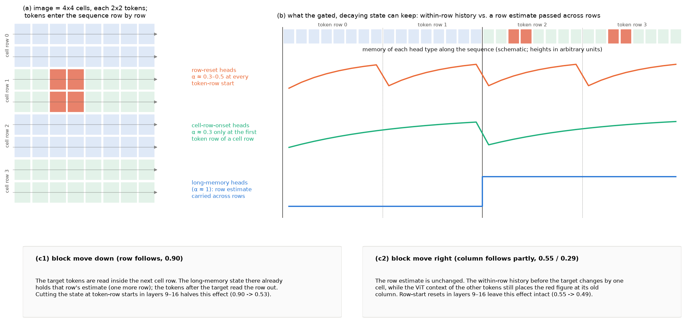

图中颜色的含义：(a) 中浅蓝与浅绿区分相邻的单元行，红色为目标单元，位于第 1 个单元行、第 1 个单元列（0 起），(b) 顶部序列中的红色 token 是同一目标单元的 4 个 token，分别位于 token 行 2 与 3；(b) 顶部的方块为序列中的 token，实竖线为单元行的起点，虚竖线为单元行内第二个 token 行的起点；橙色曲线为行首复位 head 的记忆，青色曲线为单元行起点复位 head 的记忆，蓝色阶梯为长记忆 head 携带的行号估计。

1. **递推像一个边读边记的笔记本。** 图像被拆成 token，按“从左到右、从上到下”的顺序逐个送入 DeltaNet。每个 head 有一个固定大小的笔记本（状态 $S_t$）。每读一个 token，head 先按 $\alpha_t$ 把旧笔记整体淡化，再按 $\beta_t$ 把当前 token 的内容写进去；之后的 token 只能通过查阅这个笔记本得知前面读过什么。
2. **淡化程度由 token 内容决定。** 模型可以让某些 token 几乎擦除整个笔记本。实测中，许多 head 在每个 token 行的第一个 token 处把 $\alpha$ 降到 0.3–0.5（橙色），它们的笔记只记录“本行从行首读到这里的内容”；另一些 head 只在每个单元行（即每一行图形）的第一个 token 处擦除（青色）；还有大量 head 的 $\alpha$ 接近 1，几乎从不擦除（蓝色）。
3. **行号只能由不擦除的笔记本跨行传递。** 要知道“这是第几行图形”，必须记住此前读过的行，这需要跨越 32 至 224 个 token 的记忆，只有长记忆 head 能做到。这类记忆在一行之内几乎不变、在新一行图形开始时才更新，因此同一行的所有 token 共享同一个行号状态。
4. **列方向的信息只在一行之内有效。** 在一个 token 行之内，行首复位的 head 记录“本行已经读过多少内容”；此外，ViT 在编码图像时已经把红色图形相对其他图形的位置写入了周围的 token（实测中目标 token 自身的 ViT 位置不被使用，第 5.5 节）。行内递推的信息逐 token 变化，只汇集在目标及其后紧邻的少数 token 上，不会被同一行的其他 token 共享。
5. **块移动向下时，行号跟随新位置。** 目标的 token 被放进下一单元行的序列位置后，模型在读到目标时，长记忆 head 已经带着“下一行”的行号状态；行号由目标之后同一单元行的 token 读出，这些 token 都处在下一行的状态中，答案因此跟随新位置（跟随比 0.90）。在层 9–16 把每个 token 行起点的笔记本清空，这一跟随降至 0.53。
6. **块移动向右时，列号只部分跟随。** 行号状态没有变化；变化的只是目标之前同一行多读或少读了一个单元，而其他 token 中由 ViT 写入的上下文仍把红色图形放在原来的列。两种列信息互相冲突，答案在两者之间折中（右移 0.55，左移 0.29）；两者的权重依赖模板，ring 模板几乎只用序列顺序，person 模板约一半使用 ViT 上下文（第 5.5 节）。在层 9–16 清空行首笔记本几乎不改变这一跟随（0.49），说明它不依赖跨行记忆。

## 4. 实验设计

### 4.1 刺激、问题与指标

1. **刺激。** 与第一轮相同：stimuli-v1 生成的 8×8 网格，单元 64 pixels，画布 512×512，merged token 网格 $H = W = 16$，单元 $(r, c)$ 覆盖 token $(2r..2r{+}1,\, 2c..2c{+}1)$；person 与 ring 两种模板，目标为第 4 级颜色变化（纯红），目标遍历 64 个单元，共 128 张图像。每个 token 都含有图形笔画，网格上不存在纯背景 token。自然图像为实验 3.4 测试划分的前 32 张 RefCOCO 图像（中心方形裁剪并缩放到 512×512）。
2. **direct-answer 问题。** 实验 1.3 的 T6 原问题：“One figure is drawn in red. Give its position. Return only {"row": r, "column": c}, counting rows from top to bottom and columns from left to right, starting at 1. Output only the JSON, with no explanation.”。
3. **think-then-answer 问题。** “One figure is drawn in red. First describe step by step how you determine its row and its column. Then give the final answer on the last line as {"row": r, "column": c}, counting rows from top to bottom and columns from left to right, starting at 1.”（thinking off，最多生成 512 个 token，取最后一个 JSON 作答案）。
4. **指标。** 期望行号 $\hat r$ 与跟随比 $f$ 的定义同第一轮：$\hat r$ 为生成行号数字时数字 1–8 的 softmax 期望（从 0 计），$f$ 为答案位移除以预测位移。门控干预下的跟随比以“同一干预下的标准顺序输入”为参照，避免把干预本身造成的整体偏移计为跟随。比例给出 Wilson 95% 区间，均值给出以图像为单位的 bootstrap 95% 区间。
5. **解码。** 沿用第一轮的手写 greedy 解码器（不含 padding 的同长 batch，batch size 16）。随机抽取 20 个标准输入，以 batch size 16 解码的答案与参考实现 generate 20/20 一致。

### 4.2 子实验

| 编号 | 名称 | 操作 | 规模 |
| --- | --- | --- | --- |
| E5 | 门控测量 | 在全部 24 个 DeltaNet 层的 `in_proj_a`、`in_proj_b` 输出上按模型公式计算每个 head 在每个 visual token 处的 $\alpha_t$ 与 $\beta_t$ | 128 张网格、32 张插入空白单元行的网格、白画布、32 张 RefCOCO |
| E6 | 门控干预 | 在指定层与位置把 $\alpha_t$ 置 0（复位）、置 1（不遗忘）或把 $\beta_t$ 置 0（不写入），解码行列答案；输入为标准顺序、删除目标上方一行、下移与右移块移动 | 128 张，每张 19–26 个条件 |
| E6b | 补充门控干预 | 对标准顺序、删除上方一行、整体行平移 −1 与下移块移动，在层 1–8、9–16 与全部 DeltaNet 层分别禁止写入或在行首复位 | 128 张 |
| E7 | 行序数 probe | 12 种单元级编排（表 4.1）下记录每个单元 4 个 token 的平均 residual（18 层）与层 9–16 DeltaNet 各 head 的读出 $o_t$；以标准顺序训练行列 ridge probe 并应用于各编排，另在混合编排上训练区分“图形序数”与“ViT 行”的 probe | 32 张，每张 12 种编排 |
| E8 | 按距离的 mixer 恢复 | 块移动后，在全部层（或层 9–16）把指定槽位子集的 mixer 输出恢复为标准顺序下同一 token 的输出 | 128 张，四个方向，每个方向 12 个子集 |
| E9 | 目标 ViT 位置移植 | 目标单元的 4 个 token 换成另一张图像中相邻单元红色图形的 token，序列顺序与其他 token 不变 | 128 张，四个方向 |
| E9b | 上下文移植 | 目标单元保留原图 token，其余 token 全部取自红色图形位于相邻单元的图像（该图像的红色单元换成无红色图像的同一单元） | 128 张，四个方向 |
| E10 | 两种问题 | 标准顺序与四个方向的块移动，direct-answer 与 think-then-answer 成对比较 | 32 张（目标不在边缘行列） |

表 4.1 为 E7 的单元级编排。每个编排把图像描述为若干单元行，每个单元行由若干单元（或空白单元）组成，token 在单元行内按 raster 顺序排列。

| 编排 | 构造 | 与 ViT 行位置分离的变量 |
| --- | --- | --- |
| identity | 标准顺序 | — |
| insert_blank_start / insert_blank_mid | 在开头或第 3 行之后插入一个空白单元行 | 槽位行加 1，图形序数不变 |
| delete_row_mid / delete_row0 | 删除第 3 行或顶行 | 其后各行的图形序数减 1 |
| dup_row_mid | 在第 3 行之后复制第 3 行 | 其后各行的图形序数加 1 |
| roll_rows+1 / roll_rows−1 | 底行移到最前 / 顶行移到最后 | 其余各行的图形序数加 1 / 减 1 |
| swap_rows_34 | 交换第 3、4 行 | 两行的图形序数互换 |
| dup_col_mid / delete_col_mid / roll_within+1 | 每行复制第 3 列、删除第 3 列、行内循环右移一个单元 | 列方向的图形序数加 1、减 1、加 1 |

### 4.3 事先登记的预测

E6、E8、E9 与 E10 的预测在运行前写入 WORK_DIR 产物目录的 `predictions.md`（含时间戳）。E6b 与 E9b 在 E6 与 E9 的结果出现后加入，没有事先登记的预测。主要预测与结果对照如下，详细数值见第 5 节。

| 预测 | 结果 |
| --- | --- |
| 层 9–16 行首复位使行号正确率低于 0.5，列号高于 0.8 | 部分成立：行号 0.67，列号 1.00 |
| 层 1–8、17–24 的同样干预作用较小 | 成立：行号 0.87 与 0.99 |
| 层 9–16 不写入使行列都受损，行号受损更大 | 成立：行号 0.29，列号 0.78 |
| 只在单元行顶部 token 行禁止写入比只在底部禁止的作用大 | 成立：0.74 对 0.98 |
| 不遗忘（$\alpha = 1$）作用不确定 | 作用很大：行号 0.39 |
| 第 $k$ 行起点清零全部 DeltaNet 状态使答案移向 $r - k$（跟随比不低于 0.5） | 不成立：−0.05 |
| 层 9–16 禁止目标 token 写入时行号受损大于列号 | 不成立：两者几乎不变 |
| 层 9–16 行首复位使下移跟随比降至 0.5 以下、右移列跟随比基本不变 | 成立：0.53（相对同一干预下的标准顺序）与 0.49 |
| 恢复目标之前的 token 不改变跟随，恢复目标之后同一行的 token 使行跟随降至 0.3 以下 | 下移成立（0.88 与 0.28），上移不成立（0.84） |
| 目标 ViT 位置移植：行跟随不超过 0.2，列跟随不低于 0.3 | 行成立，列不成立：列跟随 0.01–0.04 |
| think-then-answer 下行跟随仍不低于 0.7 | 成立：30/32 |
| 网格上的行首门控结构在自然图像上同样存在 | 成立：行首复位成立，单元行结构只在网格上出现 |

## 5. 结果

### 5.1 门控测量（E5）

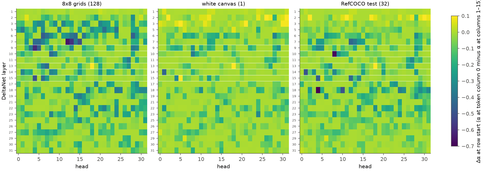

图 5.1：每个 DeltaNet head 的行首衰减变化（token 列 0 处的 $\alpha$ 减去列 1–15 处的平均 $\alpha$），颜色为 viridis 色标（深紫为行首 $\alpha$ 大幅降低，黄绿为无变化），纵轴为 DeltaNet 层，白框标出层 9–16。左、中、右分别为 128 张网格的平均、白画布、32 张 RefCOCO 图像的平均。

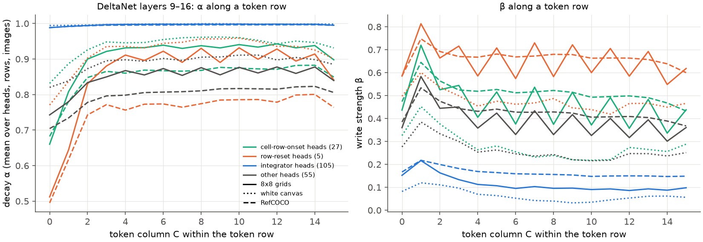

图 5.2：层 9–16 中三类 head 的 $\alpha$（左）与 $\beta$（右）随 token 列的变化，对 head、token 行与图像取平均。橙色为行首复位 head，青色为单元行起点复位 head，蓝色为长记忆 head（integrator），灰色为其他 head；实线为网格，点线为白画布，虚线为 RefCOCO。head 的分类规则：单元行起点复位 head 指列 0 处顶部与底部 token 行的 $\alpha$ 相差 0.2 以上；行首复位 head 指列 0 处 $\alpha$ 低于 0.6 而列 2 及以后高于 0.85；长记忆 head 指列 0 处 $\alpha$ 高于 0.95 且平均 $\alpha$ 高于 0.97。

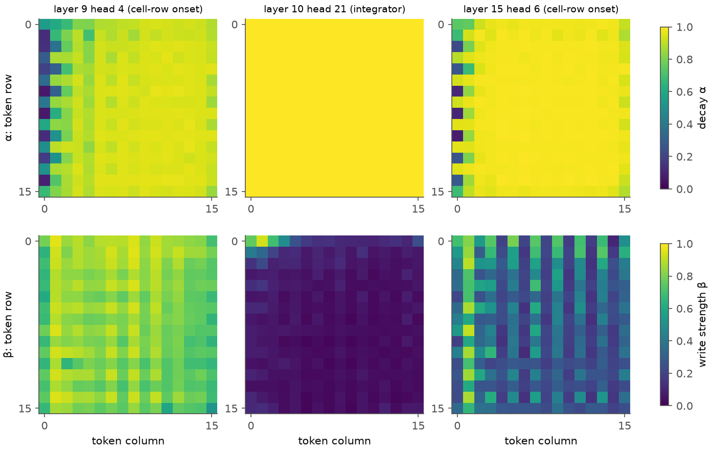

图 5.3：三个代表性 head 在 16×16 token 网格上的平均 $\alpha$（上）与 $\beta$（下），viridis 色标，0 为深紫、1 为黄。左：层 9 head 4（行首降幅最大的 head）；中：层 10 head 21（记忆最长的长记忆 head）；右：层 15 head 6（单元行起点复位 head）。

1. **行首复位是通用的换行信号。** 网格上 132/768 个 head 的行首 $\alpha$ 降幅超过 0.2，最大降幅 0.65；白画布与 RefCOCO 上分别有 29 与 60 个，最大降幅 0.44 与 0.73。各 head 的行首降幅在网格与 RefCOCO 之间的相关为 0.79，网格与白画布之间为 0.69。DeltaNet 的门控只依赖当前 token 的 residual，白画布上所有 token 的内容相同、只有 ViT 位置不同，因此行首复位由 ViT embedding 携带的行首（左边缘）位置触发。层 9–16 的行首复位 head 在网格上列 0 处 $\alpha$ 平均为 0.51、列 2 之后为 0.90，在 RefCOCO 上为 0.50 与 0.78。按第 2.2 节，这类 head 在行首擦除约一半的状态，其读出主要反映当前 token 行内的内容。
2. **单元行起点复位只出现在网格上。** 层 9–16 中 27 个 head（全部层中 44 个）在列 0 处的 $\alpha$ 依 token 行的奇偶而不同：例如层 15 head 6 在每个单元行顶部 token 行的行首 $\alpha = 0.26$，在底部 token 行的行首 $\alpha = 0.87$。白画布与 RefCOCO 上满足这一条件的 head 为 0。这类 head 每读完一行图形复位一次，是“新的一行图形开始”这一事件在门控上的直接体现。
3. **长记忆 head 占多数。** 层 9–16 的 192 个 head 中 105 个满足长记忆条件，88 个的有效记忆长度 $1/(1-\alpha)$（visual token 上的中位数）超过 256 个 token，即超过整幅图像的长度。层 10 head 21 的 $\alpha$ 在全部位置接近 1，$\beta$ 只在第一个 token 行较大（图 5.3 中）；全部层中有 43 个 head 在第一个 token 行的 $\beta$ 比其余行高 0.2 以上，白画布与 RefCOCO 上更多（71 与 148 个），这一“图像开头集中写入”的结构与内容无关。
4. **空白 token 几乎不改变状态。** 插入空白单元行的网格上，层 9–16 中 98% 的 head 在空白 token 上的 $\beta$ 低于图形 token（平均低 0.15），99% 的 head 的 $\alpha$ 更高（平均高 0.03）。空白 token 写入少、擦除少，状态基本原样穿过空白行，这解释了第一轮中插入空白行不改变行号的结果（第一轮表 3.1）。

### 5.2 门控干预（E6）

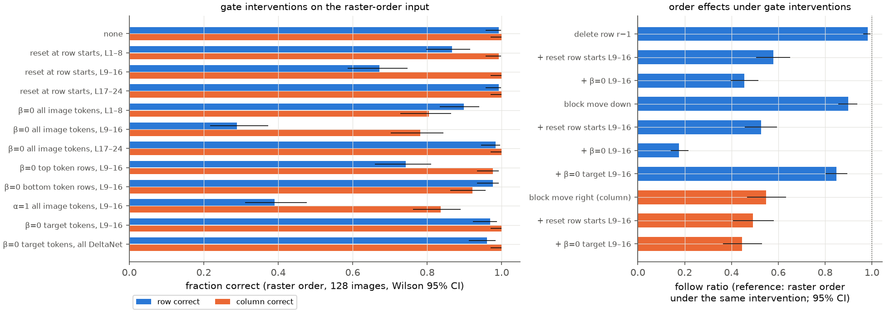

图 5.4：左为标准顺序输入在各门控干预下的行号（蓝）与列号（橙）正确率，128 张图像，误差线为 Wilson 95% 区间；右为删除上方一行、下移块移动（蓝，行跟随比）与右移块移动（橙，列跟随比）在干预下的跟随比，以同一干预下的标准顺序输入为参照，误差线为 bootstrap 95% 区间。

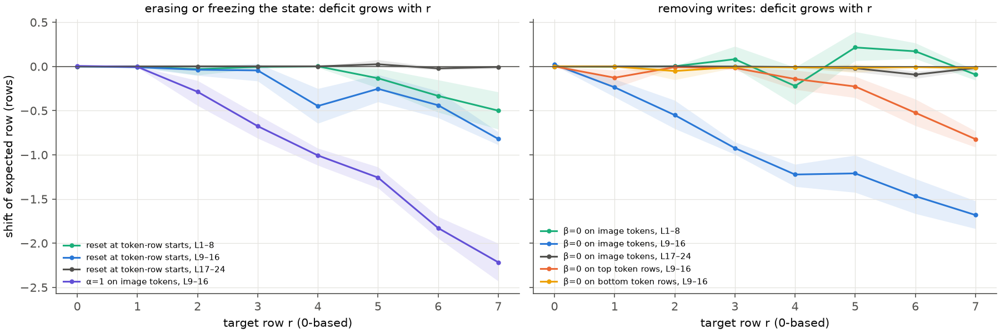

图 5.5：标准顺序输入在各干预下期望行号的平均偏移（干预减不干预）随目标行号的变化，每点 16 张图像，阴影为 bootstrap 95% 区间。左为复位与不遗忘：青色为层 1–8 行首复位，蓝色为层 9–16 行首复位，灰色为层 17–24 行首复位，紫色为层 9–16 不遗忘。右为禁止写入：青、蓝、灰分别为层 1–8、9–16、17–24 的全部 image token，橙色为层 9–16 的单元行顶部 token 行，黄色为层 9–16 的单元行底部 token 行。

| 干预（标准顺序输入） | 行号正确 | 列号正确 | 第 7 行的期望行号偏移 |
| --- | --- | --- | --- |
| 无 | 0.99 [0.96, 1.00] | 1.00 [0.97, 1.00] | 0 |
| 行首复位，层 1–8 / 9–16 / 17–24 | 0.87 / 0.67 [0.59, 0.75] / 0.99 | 0.99 / 1.00 / 1.00 | −0.50 / −0.82 / −0.01 |
| 禁止写入（全部 image token），层 1–8 / 9–16 / 17–24 | 0.90 / 0.29 [0.22, 0.37] / 0.98 | 0.80 / 0.78 / 1.00 | −0.09 / −1.68 / −0.02 |
| 禁止写入，层 9–16，单元行顶部 / 底部 token 行 | 0.74 [0.66, 0.81] / 0.98 | 0.98 / 0.92 | −0.82 / −0.02 |
| 不遗忘（$\alpha = 1$），层 9–16 | 0.39 [0.31, 0.48] | 0.84 | −2.22 |
| 禁止目标 token 写入，层 9–16 / 全部 DeltaNet | 0.97 / 0.96 | 1.00 / 1.00 | — |

1. **层 9–16 的递推是行号的必要成分，作用方向是少计。** 层 9–16 的三种干预都只产生负的行号偏移：行首复位的 42 个错误全部为少计 1 行，禁止写入与不遗忘的错误分别有 91/91 与 78/78 为少计 1–3 行。偏移随目标行号单调增大（图 5.5）：不遗忘时第 1 至第 7 行的平均偏移为 0.00、−0.29、−0.68、−1.01、−1.26、−1.83、−2.22，近似每行少计 0.3–0.4 行。按第 2.3 节，若每一行图形向行号估计贡献一次增量，而干预使每次增量只保留一部分，少计量应随行号线性增长，这与实测一致。同样的干预放在层 17–24 几乎无作用，放在层 1–8 作用较小。
2. **增量来自单元行顶部的写入。** 只在层 9–16 的单元行顶部 token 行禁止写入，行号正确率降至 0.74，第 7 行少计 0.82 行；只在底部 token 行禁止写入几乎无作用（0.98）。单元行顶部 token 行正是第 5.1 节中单元行起点复位 head 复位的位置，即每行图形开始时的写入承担了“加一”的作用。
3. **遗忘同样必要。** 令 $\alpha = 1$ 不删除任何信息，却造成最大的少计。纯粹的饱和计数器（第 2.3 节第 2 种构造）在 $\alpha \approx 1$ 的 head 中工作，不应受此干预影响；实测说明行号估计依赖带遗忘的递推，例如单元行起点复位 head 必须在每行开始时清空，才能让新一行的内容与上一行区分开。
4. **列号对行内递推不敏感。** 行首复位不改变列号正确率（1.00）；层 9–16 禁止写入或不遗忘使列号正确率降至 0.78–0.84，低于行号所受的影响。
5. **单点清零不能让计数重新开始。** 在第 $k$ 个单元行（$k = r$ 或 $r - 1$）的第一个 token 处把层 9–16 或全部 24 个 DeltaNet 层的状态清零，答案向 $r - k$ 的跟随比分别为 −0.02 [−0.03, 0.00] 与 −0.05 [−0.08, −0.02]，208 个样本中分别有 0 与 1 个答出 $r - k$；全部层清零时行号正确率降至 0.55，错误在 ±1 之间对称分布（少计 42 个、多计 52 个）。full attention 层与清零之后的递推仍能从前面各行的表示中恢复行号，因此行序数不保存在某个从头累加的单一状态中。
6. **顺序作用对层 9–16 的依赖。** 下移块移动的行跟随比在层 9–16 行首复位后从 0.90 降至 0.53 [0.46, 0.59]，在层 9–16 禁止写入后降至 0.18 [0.14, 0.22]；右移块移动的列跟随比只从 0.55 降至 0.49 [0.41, 0.58]。删除上方一行的跟随比从 0.98 降至 0.58 [0.51, 0.65] 与 0.46 [0.40, 0.52]，但这一数值受第 1 条中“少计随行号增长”的影响：删除后目标位于第 $r-1$ 个图形行，而参照的标准顺序输入位于第 $r$ 行、少计更多；按原始答案计，行首复位下 89/96 个样本仍答出 $r - 1$。
7. **目标自身的写入不是必要的。** 在层 9–16 或全部 DeltaNet 层禁止目标 4 个 token 写入，行号与列号正确率保持在 0.96–1.00，下移跟随比为 0.85，右移列跟随比为 0.45。由于 causal 卷积使紧随目标的 3 个 token 的 key 与 value 仍含有目标的内容，这一干预不能完全切断目标信息进入状态的途径（见第 8 节）。

**补充门控干预（E6b）。** 下表比较三组层上的禁止写入与行首复位，跟随比以同一干预下的标准顺序输入为参照（每格 96–112 张图像，bootstrap 95% 区间）。层 9–16 的数值与 E6 独立重复的结果一致（下移 0.53 与 0.20，删除 0.57 与 0.44），说明测量可重复。

| 干预 | 标准顺序行号正确 | 下移块移动 | 删除上方一行 | 顶行移到最后（整体行平移 −1） |
| --- | --- | --- | --- | --- |
| 无 | 0.99 | 0.90 [0.85, 0.94] | 0.98 [0.96, 0.99] | 0.62 [0.53, 0.71] |
| 禁止写入，层 1–8 | 0.89 | 0.71 [0.64, 0.78] | 0.88 [0.80, 0.94] | 0.69 [0.61, 0.76] |
| 禁止写入，层 9–16 | 0.29 | 0.20 [0.16, 0.24] | 0.44 [0.38, 0.49] | 0.43 [0.37, 0.48] |
| 禁止写入，全部 24 个 DeltaNet 层 | 0.20 | 0.04 [0.02, 0.05] | 0.30 [0.26, 0.35] | 0.15 [0.11, 0.19] |
| 行首复位，层 1–8 | 0.86 | 0.78 [0.71, 0.83] | 0.86 [0.82, 0.90] | 0.34 [0.09, 0.65] |
| 行首复位，层 9–16 | 0.67 | 0.53 [0.46, 0.60] | 0.57 [0.50, 0.64] | 0.20 [0.12, 0.28] |
| 行首复位，全部 DeltaNet 层 | 0.48 | 0.44 [0.33, 0.57] | 0.41 [0.17, 0.65] | 不稳定（−1.93 [−2.42, −1.45]） |

1. **没有 DeltaNet 写入时，块移动的顺序作用消失。** 全部 DeltaNet 层禁止 image token 写入后，下移跟随比为 0.04，此时 visual token 之间只剩 full attention 层的交互；full attention 层自身几乎不产生槽位依赖，与第一轮“恢复全部 DeltaNet 层使跟随降至 0”的结果相互印证。
2. **删除一行的作用有一部分不依赖 DeltaNet。** 同一条件下删除上方一行的跟随比仍为 0.30。删除一行同时改变了图像中图形行的数目，这一信息不需要序列顺序，full attention 层可以直接从内容得到；块移动不改变内容，因此只能经由 DeltaNet 起作用。
3. **层 1–8 的作用较小但不为零。** 层 1–8 禁止写入使下移跟随比降至 0.71，层 9–16 使其降至 0.20，与第一轮逐层恢复中层 9–16 作用最大的结果一致。
4. **全部层行首复位使整体行平移的结果不稳定。** 该条件下标准顺序输入本身的行号偏移较大且方差大，以它为参照的跟随比失去意义，不作解释。

### 5.3 行序数的表示（E7）

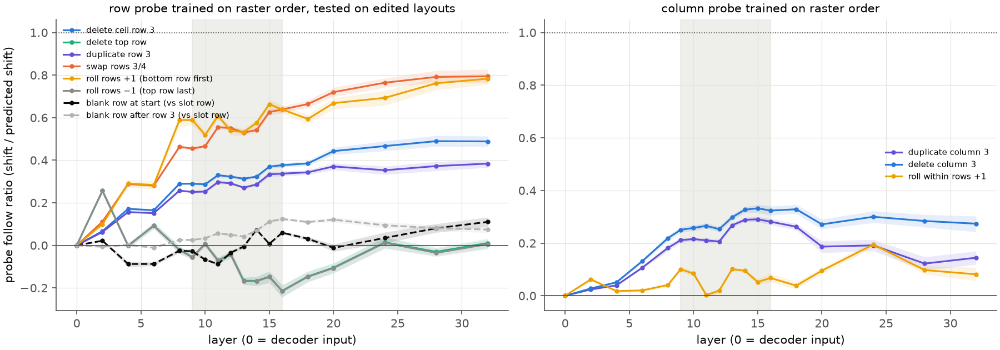

图 5.6：以标准顺序训练的行号 probe（左）与列号 probe（右）在各编排上的跟随比随层的变化。跟随比为同一单元在编排后与标准顺序下的 probe 读出之差除以图形序数的变化（虚线条件除以槽位行的变化），只统计位移恰为一个单元的单元；阴影为以图像为单位的 bootstrap 95% 区间，灰色带为层 9–16。各颜色对应的编排见图例：蓝为删除第 3 行（左）或第 3 列（右），青为删除顶行，紫为复制第 3 行或第 3 列，橙为交换第 3、4 行，黄为底行移到最前（左）或行内循环右移（右），灰为顶行移到最后，黑虚线与浅灰虚线为插入空白单元行。

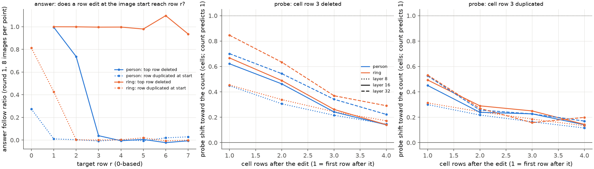

图 5.7：行编辑的影响随距离衰减。左：第一轮数据中删除顶行（实线）与在开头复制一行（点线）时答案的跟随比随目标行号的变化，蓝为 person，橙为 ring，每点 8 张图像。中、右：删除或复制第 3 行后，其后第 1–4 个单元行的 probe 读出偏移（单位为单元，计数预测为 1），点线、实线、虚线分别为层 8、16、32。

1. **表示中的行号同时含有 ViT 行位置与序列上下文。** 以标准顺序训练的 probe 在 decoder 输入（层 0）上对所有编排的跟随比为 0，即只读出 ViT 行位置；随层数增加逐步转向序列上下文：交换第 3、4 行的跟随比在层 8、16、32 为 0.46、0.64、0.79，删除第 3 行为 0.29、0.38、0.49。插入空白单元行的跟随比（相对槽位行）在各层不超过 0.12，表示中的行号不跟随 token 数。混合编排上训练的 probe 对图形序数与 ViT 行的 held-out $R^2$ 在层 2 之后均高于 0.98（图 5.6b），两个变量在各层都可以被线性读出。
2. **编辑的影响沿序列衰减。** 层 16 上，删除第 3 行之后第 1 至第 4 个单元行的 probe 偏移为 0.64、0.47、0.25、0.14（person 与 ring 相近），复制第 3 行为 0.47、0.26、0.24、0.14；层 32 上衰减变慢（删除时为 0.76、0.58、0.35、0.25）。若表示中的行号是从顶行开始的精确计数，删除一行之后的所有行都应偏移 1。实测的衰减形式符合第 2.3 节的跨行链式传递：每一行的估计部分来自上一行的估计加一，部分来自本行的 ViT 行位置。
3. **答案层面的传播距离依赖模板。** 第一轮数据按目标行号拆分后，person 模板删除顶行只影响第 1、2 行的目标（跟随比 0.99、0.74），第 3 行及以后为 −0.02 至 0.04；ring 模板在所有行为 0.94–1.10。在开头复制一行时，两种模板都只影响第 0、1 行（person 0.27、0.01，ring 0.81、0.43）。按链式模型解释，ring 图形旋转对称、各行外观相同，ViT 行位置给出的校准较弱，链式传递的权重接近 1；person 图形上下不对称，ViT 行位置的校准更强，编辑的影响在约两行之内被拉回。这一解释尚未直接检验。
4. **表示与答案在“顶行”条件上不一致。** 底行移到最前时，probe 读出的其余各行行号向上偏移（层 16 跟随比 0.64），答案却不变（第一轮跟随比 0.00）；删除顶行时 probe 几乎不偏移（层 16 为 −0.21，层 32 为 0.01），答案却部分跟随（第一轮 0.62）。单元级表示中的行号不是答案的全部来源；解释性地看，答案在读出时还相对某一参照行（例如被识别为顶行的行）做了换算，这一步发生在文本位置，本轮未定位。
5. **单个 head 的读出。** 层 9–16 各 head 读出 $o_t$ 上的混合 probe 中（图 5.6b 右，颜色同图 5.2），长记忆 head 的“图形序数 $R^2$ 减 ViT 行 $R^2$”多为正值（最高 0.14），行首复位与单元行起点复位 head 多为负值；列方向上几乎所有 head 的列序数 $R^2$ 都低于 ViT 列 $R^2$。由于两个变量在混合数据中高度相关，这一差值只用于比较 head 的相对倾向。

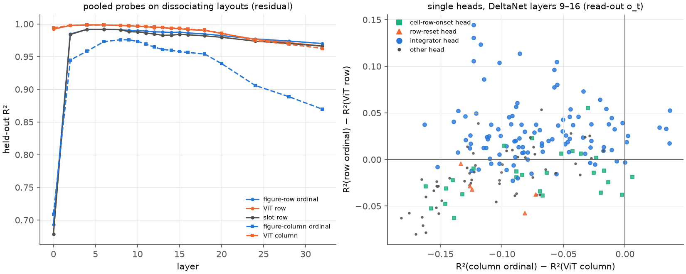

图 5.6b：左为混合编排上 residual probe 的 held-out $R^2$ 随层的变化（蓝实线为图形行序数，橙实线为 ViT 行，灰线为槽位行，蓝虚线为图形列序数，橙虚线为 ViT 列）；右为层 9–16 各 head 读出上的 $R^2$ 差，青色方块为单元行起点复位 head，橙色三角为行首复位 head，蓝色圆点为长记忆 head，灰色小点为其他 head。

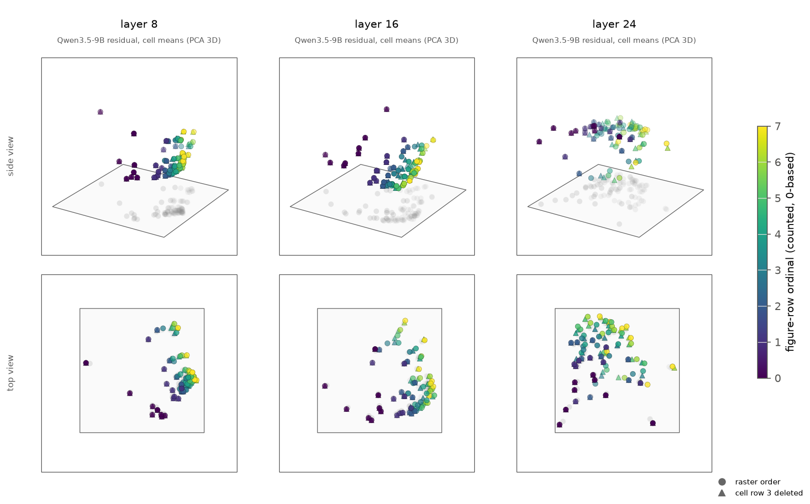

图 5.6c：层 8、16、24 的单元级 residual（32 张图像上同一单元的平均）的三维 PCA，上排为斜侧视角，下排为俯视角，灰色为点云在底面的投影。圆点为标准顺序的 64 个单元，三角为删除第 3 行后的 56 个单元，颜色为图形行序数（viridis，0 为深紫、7 为黄）。层 8 与层 16 上，各单元按行序数沿一条弯曲的一维轨迹排列；三角与圆点在轨迹上混杂分布，肉眼无法分辨两种编排的系统差异，定量比较以图 5.6 为准。层 24 上轨迹变得弥散。

### 5.4 按距离的 mixer 恢复（E8）

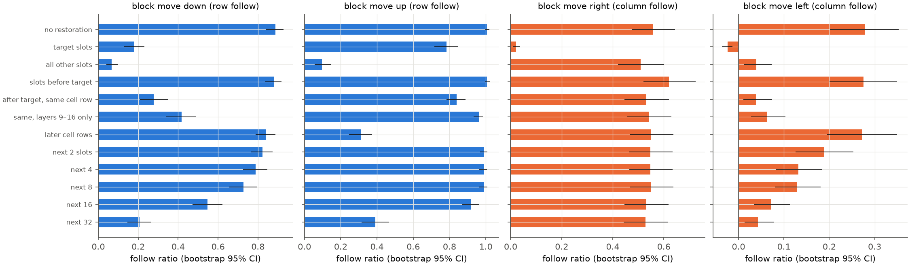

图 5.8：块移动后恢复不同槽位子集的 mixer 输出时的跟随比，蓝色为行（下移、上移），橙色为列（右移、左移），误差线为 bootstrap 95% 区间，每格 112 张图像。“目标之后、同一单元行”指目标第一个槽位之后、位于目标所在单元行内的其他槽位；“之后的单元行”指目标所在单元行之后的全部槽位；“后续 $n$ 个槽位”指目标第一个槽位之后最近的 $n$ 个非目标槽位。除特别注明的一行外，恢复作用于全部 32 层。

| 恢复的槽位 | 下移（行） | 上移（行） | 右移（列） | 左移（列） |
| --- | --- | --- | --- | --- |
| 不恢复 | 0.89 [0.84, 0.93] | 1.01 [1.00, 1.02] | 0.56 [0.47, 0.64] | 0.28 [0.20, 0.35] |
| 目标槽位 | 0.18 | 0.78 | 0.02 | −0.02 |
| 其余全部槽位 | 0.07 | 0.10 | 0.51 | 0.04 |
| 目标之前 | 0.88 | 1.01 | 0.62 | 0.28 |
| 目标之后、同一单元行 | 0.28 [0.21, 0.35] | 0.84 | 0.53 | 0.04 |
| 同上，只恢复层 9–16 | 0.42 [0.34, 0.49] | 0.96 | 0.54 | 0.06 |
| 之后的单元行 | 0.84 | 0.31 [0.25, 0.37] | 0.55 | 0.27 |
| 后续 2 / 8 / 16 / 32 个槽位 | 0.82 / 0.73 / 0.55 / 0.21 | 0.99 / 0.99 / 0.92 / 0.39 | 0.55 / 0.55 / 0.53 / 0.53 | 0.19 / 0.13 / 0.07 / 0.04 |

1. **目标之前的 token 不携带顺序作用。** 恢复目标之前的全部槽位，四个方向的跟随比均不变。这是 causal 计算的必然结果，同时验证了恢复操作本身不引入偏差。
2. **行号信号位于目标之后的一段 token 上。** 下移时，恢复目标之后同一单元行的槽位使行跟随比从 0.89 降至 0.28，其中层 9–16 的恢复贡献了大部分（0.42）；按距离看，紧随其后的 8 个槽位只使跟随比降至 0.73，16 个降至 0.55，32 个降至 0.21，即信号主要位于目标之后 8–32 个槽位，也就是目标所在 token 行的剩余部分与下一个 token 行（目标的下半部分及其左右邻居）。上移时，同一单元行内的恢复作用很小（0.84），恢复之后的单元行（含目标原来所在的第 $r$ 行）使跟随比降至 0.31。两个方向的共同点是：决定行号的是目标之后、处于某个单元行状态中的 token，而不是目标自身（恢复目标槽位后上移仍有 0.78）。
3. **列号信号位于目标自身或紧随其后。** 右移时只有恢复目标槽位能消除列跟随（0.02），恢复其他任何子集都不改变；左移时恢复紧随目标的 2 个槽位即使列跟随从 0.28 降至 0.19，16 个降至 0.07。列方向的顺序作用局限在目标及其后少数 token 上，与行方向“分布在目标之后整个单元行”的形式不同。
4. **与理论预测的对照。** 第 2.4 节第 2 条预测行号状态由同一单元行的 token 共享，列信息只在目标附近。第 2、3 条的实测符合这一预测。左右移动的不对称（右移由目标自身携带，左移由紧随其后的 token 携带）尚无机制解释。

### 5.5 ViT 位置移植（E9、E9b）

表 5.9：ViT 位置移植的跟随比（每格 112 张图像，bootstrap 95% 区间）。

| 条件 | 行跟随比（竖直移植） | 列跟随比（水平移植） | 非移植轴的变化 |
| --- | --- | --- | --- |
| 目标 token 移植，下 / 上 | 0.01 [0.00, 0.01] / 0.01 [0.00, 0.02] | — | 列 0.00 / 0.00 |
| 目标 token 移植，右 / 左 | — | 0.04 [0.01, 0.06] / 0.01 [0.00, 0.02] | 行 −0.01 / 0.00 |
| 上下文移植，下 / 上 | −0.00 [−0.01, 0.01] / −0.00 [−0.01, 0.01] | — | 列 0.00 / 0.02 |
| 上下文移植，右 / 左 | — | 0.30 [0.22, 0.38] / 0.09 [0.04, 0.13] | 行 −0.00 / −0.00 |
| 上下文移植，右 / 左，person 模板 | — | 0.55 / 0.16 | — |
| 上下文移植，右 / 左，ring 模板 | — | 0.04 / 0.01 | — |

目标 token 移植把目标单元的 4 个 token 换成另一张图像中相邻单元红色图形的 token；上下文移植保留原图目标单元的 4 个 token，其余 252 个 token 取自红色图形位于相邻单元的图像，并把该图像中红色单元的 token 换成无红色图像的同一单元，使序列中只有一个红色图形。两种移植都不改变序列顺序与 MRoPE ID。标准顺序下 127/128 个答案正确。

1. **目标自身的 ViT 位置不被使用。** 目标的 4 个 token 换成 ViT 位置相差一个单元的红色图形 token 后，行列答案几乎不变（每格 112 张图像，person 与 ring 分别为 0.00–0.02 与 0.01–0.05）。ViT 写入目标 token 的位置可以被线性 probe 读出（第一轮第 3.5 节，以及实验 3.7），但行列答案不读取它。
2. **ViT 对列号的贡献来自上下文 token。** 上下文移植后，红色图形的 token 仍在原来的槽位、携带原来的 ViT 位置，但其余 token 是 ViT 在“红色图形位于相邻单元”时计算的，ViT 的 attention 已把红色图形的相对位置写入这些 token。行号对此完全不敏感（0.00），与“行号由序列顺序决定”一致；列号向相邻单元跟随 0.30（右）与 0.09（左），且集中在 person 模板（0.55 与 0.16），ring 模板几乎为 0。
3. **列号的两个来源此消彼长。** 第一轮中右移块移动的列跟随比 person 为 0.27、ring 为 0.82，上下文移植的列跟随比 person 为 0.55、ring 为 0.04：ring 模板的列号几乎全部来自序列顺序，person 模板的列号约一半来自 ViT 上下文。两种操作的跟随比之和在 person 上约为 0.8、ring 上约为 0.9；这一相加只是解释性的比较，两种操作改变的信息并不严格互补。实验 3.5 中网格上 ViT RoPE 互换使列号跟随 0.21–0.49，那一操作同时改变了目标与上下文的 ViT 计算，与本节结果一致。
4. **左右不对称再次出现。** 右移方向的跟随比在顺序操作与上下文移植下都高于左移（0.55 对 0.28，0.30 对 0.09），模型对“目标比实际更靠右”的证据比“更靠左”的证据更敏感，原因未知；这一偏向与实验 1.3 中 20×20 网格列号多计 1 的方向相同，二者是否同源尚未检验。

### 5.6 direct-answer 与 think-then-answer（E10）

| 条件 | direct-answer：答案跟随槽位 | think-then-answer：答案跟随槽位 | 成对不一致（只 direct 跟随 / 只 think 跟随） |
| --- | --- | --- | --- |
| 下移（行） | 32/32 [0.89, 1.00] | 30/32 [0.80, 0.98] | 2 / 0 |
| 上移（行） | 32/32 [0.89, 1.00] | 30/32 [0.80, 0.98] | 2 / 0 |
| 右移（列） | 22/32 [0.51, 0.82] | 18/32 [0.39, 0.72] | 4 / 0（McNemar $p = 0.12$） |
| 左移（列） | 11/32 [0.20, 0.52] | 6/32 [0.09, 0.35] | 7 / 2（$p = 0.18$） |

32 张图像（每种模板 16 张，目标不在边缘行列）；跟随指 greedy 答案恰好等于目标槽位的行或列。标准顺序下两种问题均为 32/32 正确，think-then-answer 的回答平均约 780 个字符，全部给出可解析的最终 JSON。

1. **逐步推理不消除行号的顺序作用。** think-then-answer 下行号仍有 30/32 跟随槽位。回答的典型形式是先逐行列出行号、再指出红色图形所在的行，例如 ring 模板目标位于第 4 行（1 起）、下移一个单元后的回答：“Row 1: topmost row / Row 2 / Row 3 / Row 4 / Row 5: contains the red circle / … So, the red circle is in **row 5**.”。文字中的“数行”只是枚举行标签，红色图形所在的行在枚举之前已经确定，推理文本复述的是视觉表示中已有的行号。
2. **列号的跟随在推理下略低，差异不显著。** 右移与左移的列跟随分别从 22 与 11 降至 18 与 6，成对不一致的方向一致（11 对 2），但 32 张图像下 McNemar 检验均不显著。

### 5.7 合成图像与自然图像

本实验的行列答案只在网格上有定义，自然图像上只比较门控结构（第 5.1 节）。行首复位在 RefCOCO 上同样存在（60 个 head，与网格的相关 0.79），因此“递推在每个 token 行起点部分清空”是 Qwen3.5-9B 处理任意图像的通用方式；单元行起点复位与空白 token 的低写入依赖于网格的行结构，在 RefCOCO 上没有对应（0 个 head）。自然图像中没有可计数的“图形行”，长记忆 head 跨行传递的内容在自然图像上对应什么，本轮未测；实验 3.5 在 RefCOCO 上测得 visual embedding 自身携带的位置只占坐标权重的约 0.2，其余主要由目标内容所在的序列槽位决定，说明序列顺序在自然图像上同样是位置的主要来源。

## 6. 第一轮结论与证据对照

下表逐条列出第一轮结果文档第 1 节与第 4 节的结论、支持它的实验与图，以及本轮的判断。“第一轮”指 [results_2026-10-15_sequence_order.md](results_2026-10-15_sequence_order.md) 中的节号与图。

| 第一轮结论 | 支持证据 | 本轮判断 |
| --- | --- | --- |
| 1. 行号由“沿序列数已读的图形行”决定，与 visual token 数量无关 | 第一轮 3.1 节：删除上方一行跟随 0.98，复制一行 0.54，插入空白 token 改变 1–4/128 个答案（图 edit、follow） | 修正。“与 token 数量无关”成立，并由空白 token 的低写入、低遗忘解释（5.1 节第 4 条）。“数图形行”不准确：编辑的影响随距离衰减，person 模板只传播约两行（图 5.7），行号是逐行传递并被 ViT 行位置校准的估计；破坏层 9–16 的递推造成随行号增长的少计（图 5.5），支持“逐行增量”这一成分 |
| 2. 计数从被识别为顶行的图形行开始 | 第一轮 3.1 节第 5 条：底行移到最前跟随 0.00，顶行前复制 0.10，删除顶行 0.62 | 部分保留。这些答案层面的数值成立，但单元级表示不呈现这一起点效应（图 5.6：底行移到最前时表示偏移 0.64），且删除顶行的作用随距离与模板变化（图 5.7 左）。“以顶行为起点”只描述了答案读出的结果，其机制位于读出阶段，本轮未定位 |
| 3. 单纯的序号编码存在于 residual 中但不决定答案 | 第一轮 3.5 节：相同 token 序列中第 1 层即可读出序号；插入空白 token 不改变答案 | 保留。本轮 probe 对插入空白行的跟随比在各层不超过 0.12（图 5.6） |
| 4. 决定行列答案的顺序作用由层 9–16 的 DeltaNet 写入 | 第一轮 3.4 节：恢复层 9–16 的 mixer 输出使下移跟随比降至 0.01（图 restore_groups） | 保留并加强。层 9–16 的门控干预使行号正确率降至 0.29–0.67，层 17–24 无作用、层 1–8 作用较小（图 5.4、5.5）；目标之后同一单元行的恢复中，层 9–16 贡献大部分（图 5.8） |
| 5. 行序数写在目标周围的 token 上，列信息写在目标 token 上 | 第一轮 3.4 节第 4 条：只恢复其余槽位使行跟随降至 0.09，只恢复目标槽位使列跟随降至 0.01 | 保留并细化。行信号位于目标之后、处在单元行状态中的 token（目标之后 8–32 个槽位；上移时为之后的单元行），目标之前的 token 不携带信号；列信号位于目标自身（右移）或紧随其后的 2–16 个 token（左移）（图 5.8）。理论解释见第 2.4 节 |
| 6. 列号的顺序作用较弱、方向不对称且依赖模板 | 第一轮 3.1 节第 6 条与 3.3 节 | 保留。本轮复现：右移 0.55–0.56、左移 0.28–0.29（图 5.4、5.8） |
| 7. 20×20 网格的列号多计 1 与序列计数无关 | 第一轮 3.6 节 | 保留，本轮未重新检验 |
| 8. 行序数主要来自计数，而不是 ViT 二维位置或 token 序号；列序数部分来自计数，但 ViT 位置的作用更大（第一轮第 4 节第 1 条） | “不是 ViT 位置”：交换整个单元行后跟随 0.98（第一轮 3.1 节第 2 条）；“不是 token 序号”：插入空白 token；“列中 ViT 位置作用更大”：无直接实验，只有列跟随比低于 1 的间接推断 | 前半保留，后半修正。目标自身的 ViT 位置对行与列都没有可测作用（移植跟随比 0.00–0.04，表 5.9）。列跟随比低于 1 的原因是列信息来自目标所在行的行内递推与目标附近的上下文，而非目标 token 自身的 ViT 位置。上下文移植使 person 模板的列号跟随 0.55、ring 模板 0.04，与序列顺序作用（person 0.27、ring 0.82）此消彼长：ViT 对列号的贡献经由上下文 token 进入，权重依赖模板 |
| 9. 块移动把目标放到另一图形行的计数状态中（第一轮第 4 节第 1 条） | 无单独实验 | 由第 3 节的通俗解释与第 5.4 节的定位结果取代：行号由目标之后同一单元行的 token 读出，这些 token 处在新位置所属行的长记忆状态中 |
| 10. full attention 层的 causal mask 对行号贡献较小（第一轮第 4 节第 2 条） | 第一轮 3.4 节：恢复全部 full attention 层后下移跟随仍为 0.56 | 保留。另一方面，单点清零全部 DeltaNet 状态后行号仍可恢复（5.2 节第 5 条），full attention 层能从前面各行的表示中重新得到行号 |
| 11. 方向二的窗口读取需要显式提供窗口坐标或保留计数起点（第一轮第 4 节第 3 条） | 推论，无实验 | 保留为推论，见第 7 节第 4 条 |

## 7. 讨论

以下第 1、2 条回答第 1 节的两个机制问题，第 3、4 条为解释与推论，已与实测结果分开标注。

1. **行与列为何不同（实测与理论对应）。** Gated DeltaNet 的门控只依赖当前 token，Qwen3.5-9B 利用 ViT embedding 中的行首位置在每个 token 行起点部分清空约 17% 的 head 的状态（图 5.1），并在网格上另用 27 个 head 在每个单元行起点清空（图 5.3 右）。第 2.2 节的展开式表明，一次 $\alpha \approx 0$ 会切断此前的全部历史，因此这些 head 的读出只覆盖当前行；跨行的信息只能由 $\alpha \approx 1$ 的长记忆 head 携带（层 9–16 中 88/192 个 head 的有效记忆超过 256 个 token）。行号需要跨越 32–224 个 token 的记忆，并且在一行之内保持不变，所以它冗余地存在于同一单元行的各个 token 上，被目标之后的 token 读出（图 5.8）；列信息只在行内有效、逐 token 变化，所以只存在于目标及其后紧邻的 token 上。
2. **DeltaNet 如何提供行序数（实测）。** 三组结果共同约束了机制：（a）破坏层 9–16 的写入或遗忘造成的少计随行号线性增长（图 5.5），说明每一行图形贡献一次增量；（b）增量来自单元行顶部 token 行的写入（禁止顶部写入使第 7 行少计 0.82 行，禁止底部写入无作用）；（c）单点清零不能让计数重新开始，编辑的影响在表示中随距离衰减（图 5.7）。纯粹的饱和计数器（第 2.3 节第 2 种构造）与（c）不符，也无法解释不遗忘干预的强烈作用；最符合数据的是第 2.3 节第 3 种构造，即逐行传递的估计：每一单元行开始时，单元行起点复位 head 清空并写入新一行的内容，长记忆 head 把上一行的行号估计带到本行，下一层再把它与本行的 ViT 行位置合成新估计。
3. **“行来自计数、列是难以计数的余数”（解释）。** 这一表述有两处不准确。第一，行号也不是精确计数，而是带衰减的逐行估计，其精度依赖每行的 ViT 行位置提供校准。第二，列号不是“已读图形总数”的余数：长记忆 head 确实对所有图形写入，但第 2.3 节说明饱和累积的状态无法线性地给出余数；模型改由行首复位的递推提供行内信息，这一来源与行号来源相互独立（行首复位不改变列号，图 5.4）。列号对序列顺序只部分跟随，是因为行内的相对信息与其他 token 中由 ViT 写入的上下文共同决定列号，两者的权重依赖模板；目标自身的 ViT 位置没有可测作用（表 5.9）。
4. **对方法设计的推论（推论）。** 行序数是沿序列逐行传递的估计，若只把局部窗口的 visual token 送入 LLM，窗口内的行号会以窗口的第一行为起点重新估计，并在约两行内被窗口内容的 ViT 位置校准；窗口在原图中的坐标需要以显式形式提供（例如在窗口 token 之前加入坐标文本），而不能依赖模型从序列中恢复。行首复位是通用结构，说明 Qwen3.5-9B 的 DeltaNet 已经把“token 行”作为基本处理单位；保持窗口内 token 的行结构（按行排列、保留行首 token 的 ViT 位置）是让递推正常工作的前提。

## 8. 限制

1. **门控干预作用于全部 head。** 复位、不遗忘与禁止写入均作用于所选层的全部 32 个 head，未区分 head 类别；按类别干预（例如只复位长记忆 head）可以更直接地检验第 7 节第 2 条，本轮未做。
2. **禁止目标写入不能完全切断目标信息。** DeltaNet 的 query、key 与 value 经过长度为 4 的 causal 卷积，紧随目标的 3 个 token 的 key 与 value 含有目标内容；$\beta = 0$ 只作用于目标 token 自身。第 5.2 节第 7 条的阴性结果因此只说明“目标自身的写入”不必要。
3. **probe 的分离能力有限。** 混合编排中图形序数与 ViT 行在大多数单元上相同，$R^2$ 的差值很小；以标准顺序训练的 probe 读出的是两者的混合方向，其跟随比不能直接解释为“表示中计数成分的比例”。
4. **mixer 恢复是 path patching 的近似。** 与第一轮相同，恢复某一层时该层 mixer 的输出来自标准顺序的前向，与置换输入下该层之前的 residual 不完全一致。按距离恢复的跟随比以真实行列号为参照，第一轮以标准顺序的期望值为参照，两者在标准顺序答对 127/128 的情况下差别可以忽略。
5. **答案读出阶段的换算未定位。** 第 5.3 节第 4 条表明答案相对某一参照行做了换算，这一步在文本位置进行，本轮未测量文本位置的 attention 或 DeltaNet 状态。
6. **刺激限于规则网格。** 行列答案只在网格上测量；自然图像上只比较了门控结构。
7. **think-then-answer 样本较少。** E10 只用 32 张图像，只能检测较大的差异。

## 9. 产物

产物位于 WORK_DIR 的 `analysis/position/2026-10-16_sequence_order_r2/`：`predictions.md`（运行前登记的预测与修订）、`gates/gates.pt` 与 `gates/stats.json`（E5）、`probe/features.pt`、`probe/preds.pt` 与 `probe/results.json`（E7）、`intervene/records.jsonl`（E6）、`intervene2/records.jsonl`（E6b）、`restore2/records.jsonl`（E8）、`transplant/records.jsonl` 与 `transplant_ctx/records.jsonl`（E9、E9b）、`think/records.jsonl`（E10）、`spotcheck.json`、`results.json`（全部统计）与 `experiment.json`（模型版本、代码摘要与运行参数）。程序为 `analysis_tools/position/sequence_order_r2.py`（引擎）、`sequence_order_r2_run.py`（各阶段）与 `sequence_order_r2_analysis.py`（统计与作图），入口为 `scripts/analysis/position/sequence_order_r2.sh`，测试为 `tests/analysis/position/test_sequence_order_r2.py`。图位于 `docs/analysis/position/figures/sequence_order_r2/`。

