# ViT 位置与布局表征（第二轮）：合成图像与自然图像

实验日期：2026-10-16。本文属于[位置信息与坐标读取](plan.md)研究，执行[实验 3.7 设计](design_vit_layout.md)第 7 节，并完成实验 3.5 在自然图像上的后续检验。主模型为 Qwen3.5-9B，对照模型为 Qwen3-VL-8B-Instruct，均为 bfloat16、SDPA、greedy decoding、thinking off；全部问题均为只输出答案的 direct-answer 格式。第一轮结果见 [results_2026-10-15_vit_layout.md](results_2026-10-15_vit_layout.md)。

## 通俗讲述

本节以叙述方式概括全文，细节与数值见第 1–7 节。

实验 3.5 留下了一个矛盾：在白色画布上的单个红圆中，交换 ViT 的旋转位置编码（RoPE）会让模型输出的坐标跟着移动，说明坐标来自 ViT 计算的位置；在自然图像（RefCOCO）上做同样的交换，坐标几乎不动，坐标反而跟随目标内容所在的序列槽位。本实验要回答：两类图像为何表现不同，ViT 到底把位置写在了哪里，decoder 又从哪里读取它。

检验的思路是把“ViT 写入的位置”拆成两部分分别移动。ViT 的 attention 是全局的，目标移动后，目标 token 自身的表示会改变，周围上下文 token 的表示也会改变。实验先在 ViT 中整体移动目标，再分别只把目标 token、或只把上下文 token 换成移动后的版本交给 decoder。同时，用一个线性 probe 读出 ViT 输出中目标 token 的位置，确认 ViT 是否算对了位置。刺激从白色画布上的圆逐级过渡到真实照片，以找出差异出现在哪一步。

结果分三层。第一，ViT 在所有图像上都把目标位置正确写进了目标 token，probe 读出的位置会随移动而移动；但只交换目标 token 时，模型输出几乎不动，decoder 基本不使用目标 token 自身携带的 ViT 位置。第二，白色、棋盘格等均匀背景上，大量空白 token 通过 RoPE 计算出了“目标在哪里”的分布式编码，decoder 会读取这些上下文 token，ViT 位置于是在白色画布上显得很重要；背景一旦含有自然内容，这种编码就不再形成。第三，在 decoder 内部，读取坐标的 head（L20 H11）先按内容找到目标，再从被注视 token 的 value 中取出位置成分，而这一成分主要由 token 所在的序列槽位决定。由此，两类图像的差别由背景是否均匀决定，与目标是否为自然物体、与场景布局先验都无关。场景先验的检验（上下翻转照片）也支持这一点：翻转后定位方式不变。对后续工作的含义是：坐标的主要载体是 token 在序列中的槽位以及上下文 token 中的分布式编码，单个目标 token 携带的 ViT 位置几乎不被使用。

## 1. 研究问题与主要结果

实验 3.5 在 RefCOCO 上测得：只交换目标区域的 ViT RoPE ID 时，输出向新位置移动的位移权重为 $w = 0.16$，单目标白色画布上为 0.71；把目标的 visual embedding 移入另一组序列槽位（内容交换）时 $w = 0.78$。第二轮回答四个问题：为什么自然图像上由序列槽位决定坐标；“Qwen3-VL 依赖 PE、Qwen3.5 依赖 RoPE”是否成立；merger 输出中的位置子空间有何结构、decoder 的指向型 head 如何使用它；一个实例只占一个 token 时均匀背景的影响（低优先级）。主要结果如下（“实测”与“解释”分开标注）：

1. **ViT 在所有图像上都把目标的位置正确写入目标 token，但 decoder 几乎不从目标 token 读取这一位置。** 实测：同时交换 PE 与 RoPE（vit_swap，等价于在 ViT 中把目标移到 $\mathcal{T}'$）后，线性 probe 读出的目标 token 位置在 Qwen3.5 的 9 种刺激上跟随 0.74–1.05（自然图像 0.85），而只把这些目标 token 交给 decoder（vit_swap_target）时输出只跟随 0.02–0.20（第 3.1、3.2 节，图 ladder_w、ladder_probe）。
2. **合成图像上 ViT 位置之所以起作用，是因为均匀背景中的上下文 token 携带了目标位置的分布式编码，decoder 读取的是这些上下文 token。** 实测：在白色背景的圆上，Qwen3.5 只把上下文 token 换成 vit_swap 版本即使输出跟随 0.51 [0.44, 0.59]，只换目标 token 为 0.06；上下文 token 均值对圆横坐标的线性读出 $R^2$ 在白色、棋盘格、噪声背景上为 0.97–0.98，在块置换照片、完整照片、白底自然物体与自然图像上为 −0.07 至 0.05。背景一旦含有自然内容，这一编码消失，输出改由槽位决定（圆贴在照片上时内容交换 $w = 0.98$）。Qwen3-VL 的模式相同（第 3.1、3.2 节）。
3. **场景布局先验不能解释槽位的主导。** 实测：上下翻转自然图像不改变 RoPE 互换与内容交换的权重（Qwen3.5 0.15 与 0.65，正常图像 0.15 与 0.75），翻转后定位命中率仍为 84/87；去除全部位置编码后，内容只能以相关 0.17–0.18 读出纵坐标、不能读出横坐标，翻转图像上该相关变为 −0.13 至 −0.14（第 3.3 节）。把目标交换到均匀区域或复杂区域的权重无差异，3.5 的 237 个互换与 $\mathcal{T}'$ 纹理的 Spearman 相关为 0.03（置换检验 $p = 0.61$）。
4. **“Qwen3-VL 依赖 PE、Qwen3.5 依赖 RoPE”在自然图像上成立，但 Qwen3.5 也需要 PE。** 实测（RefCOCO 300 张，bbox IoU≥0.5）：去除 RoPE 时 Qwen3.5 由 271 降到 19，Qwen3-VL 由 272 降到 117；白底物体上 Qwen3-VL 去除 RoPE 后仍有 198/263，去除 PE 后只有 36。Qwen3-VL 的 PE 打乱与去除同样有害（153 与 153），Qwen3.5 的 PE 打乱比去除轻（219 与 199）。本地缓存的 Qwen3.5-4B/9B/27B 与 Qwen3.8-27B 的 PE 表都是同尺寸 Qwen3-VL 表按 0.23–0.37 缩小的结果（余弦 0.988–0.996）（第 3.4 节）。
5. **merger 位置子空间是低维、跨图像稳定的低频坐标场，自然图像与合成图像只部分共享。** 实测：Qwen3.5 自然图像槽位均值前 10 维子空间在两半训练图像之间重叠 0.97，与上下翻转图像 0.82，与两类合成图像只有 0.22–0.27（随机 0.002）；去除高范数槽位后，前 10 个主成分 51% 的空间功率位于每张图 1–2 个周期（不高于 0.13 周期/token），合成图像只有 25%；以自然图像拟合的 LEACE 擦除器使圆的定位从 54/108 降到 4/108，以合成图像拟合的擦除器使 RefCOCO 从 292/300 降到 188/300（第 3.5 节）。
6. **L20 H11 按内容选择目标，再从目标 token 的 value 中取出位置成分。** 实测：H11 attention logit 在图像 token 间的方差中，位置成分只占 0.19（RefCOCO）与 0.07（圆），只用内容成分计算 softmax 时目标富集度为 4.1 与 16.0，与完整 key（4.8 与 15.6）接近；该 head 的输出中，由 value 的位置成分组成的部分读出目标横坐标的 $R^2 = 0.88$，由内容成分组成的部分为 0.74。擦除 merger 的位置子空间后 H11 的 attention 选择不变（质心与真值相关 0.94），但输出可读的横坐标 $R^2$ 由 0.84 降到 0.66（第 3.6 节）。
7. **一个实例只占一个 token 时，去除 PE 的损害与较大实例相同。** 白色背景上去除 PE 使直径 16–64 pixels 的圆的横向斜率都降到 0.04–0.21，噪声背景上都恢复到 1.0 以上；PE×2.76 在全部尺寸上把中心误差降低 32–47 个单位（第 3.7 节）。

**综合解释（推断）。** decoder 读取坐标的方式在两类图像上是同一个：先按内容找到目标所在的 token（L20 H11 的 key 内容成分），再以该 token 所在序列槽位及 ViT 写入的位置成分给出坐标；ViT 写入目标 token 的位置在这一读出中权重很小，槽位权重很大。均匀背景是一个例外：大面积空白 token 通过 RoPE 计算出“目标在何处”的分布式编码，decoder 也会读取它，于是 ViT 位置在白色画布上表现为主导来源。“自然图像带有语言对齐与场景布局先验”这一假设在本实验中没有得到支持：布局先验很弱，翻转图像不改变读出方式；决定差异的是背景是否为均匀区域。

## 2. 实验设计与实际执行

### 2.1 位置来源的分解

记与目标 bbox 重叠的 merged token 集合为 $\mathcal{T}$，其平移副本为 $\mathcal{T}'$（3.5 的规则：横向平移目标宽度加一个 token，不可行时纵向），互换位移为 $d \in \mathbb{R}^{2}$（0–1000 坐标）。位移权重沿用 3.5 的定义

$$
w = \frac{(\hat y - \hat y_0)^{\mathsf T} d}{\lVert d \rVert^{2}},
$$

其中 $\hat y_0, \hat y \in \mathbb{R}^{2}$ 为基线与干预后的输出坐标。$w = 1$ 表示输出完全跟随被干预的来源，$w = 0$ 表示不受影响。条件如下：

| 条件 | 操作 | 衡量的来源 |
| --- | --- | --- |
| rope_swap | 交换 $\mathcal{T}$ 与 $\mathcal{T}'$ 全部 patch 的 RoPE ID | 3.5 的 ViT RoPE 互换 |
| pe_swap | 交换两区域的 PE | PE 作为绝对标签 |
| vit_swap | 同时交换 PE 与 RoPE ID；ViT 输出等于“像素互换后编码、再把 token 换回原槽位” | ViT 写入的位置（全部 token） |
| vit_swap_target | $\mathcal{T} \cup \mathcal{T}'$ 内的 token 取自 vit_swap，其余取自基线 | 目标 token 自身的 ViT 位置 |
| vit_swap_context | $\mathcal{T} \cup \mathcal{T}'$ 内取自基线，其余取自 vit_swap | 上下文 token 中的目标位置编码 |
| content_swap | 交换两区域 merged token 的 embedding，槽位与 MRoPE ID 不动 | 序列槽位 |
| move | 把目标按 $d$ 真实移动后重新绘制 | 总效应参照 |

vit_swap 与 content_swap 依次作用等于真实移动，因此二者之和应接近 move（第 3.1 节验证）。全部交换与拼接在 vision tower 的输出上进行，Qwen3-VL 的三层 DeepStack 特征随 merger 输出一起交换，两种模型使用同一实现。

### 2.2 刺激阶梯

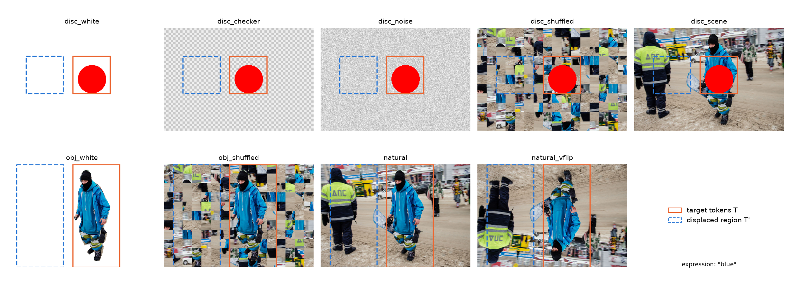

上图为同一张 RefCOCO 图像派生的 9 种刺激，橙色实线框为 $\mathcal{T}$，蓝色虚线框为 $\mathcal{T}'$。

| 刺激 | 构造 | 问题 |
| --- | --- | --- |
| disc_white / disc_checker / disc_noise | 红色实心圆位于被指物体 bbox 中心，直径为 bbox 短边的 0.8 倍（32–96 pixels）；背景为白色、周期 16 pixels 的灰色棋盘格（每个 patch 像素相同）或逐像素灰度噪声 | “There is one red circle in the image. Give the center of its bounding box. Return only [{"point_2d": [x, y]}]. All coordinates use 0-1000 normalization; x increases rightward and y increases downward. Output only the JSON, with no explanation.” |
| disc_shuffled / disc_scene | 同一个圆贴在本图 32×32 块随机置换后的图像或本图上 | 同上 |
| obj_white / obj_shuffled | 被指物体按 RefCOCO 分割多边形取出，位于原位置，背景为白色或本图的块置换 | “Locate the object described as: {expression}.” 加上述 point 格式 |
| natural / natural_vflip | 原图；上下翻转（表达式含 top、below、front、near 等方位或远近词的样本剔除） | 同上 |

样本取自实验 3.4 测试划分的 300 张 RefCOCO 图像（长边 512 pixels，与 3.5 相同）。要求 9 种刺激的 $\mathcal{T}'$ 都位于图像内，215 张满足，取前 120 张；natural_vflip 剔除方位词后余 87 张。natural 另选两个 $\mathcal{T}'$：同一轴上 $\mathcal{T}'$ 内 token 灰度标准差均值最小与最大的平移副本（104 张有两个以上候选）。每张图像运行 69–76 行，两种模型各 8996 次生成。

**ViT 层面的读出。** 每一行记录 merger 输出在 $\mathcal{T}$、$\mathcal{T}'$ 与其余 token 上的均值。token 位置 probe 以基线图像的 merger token（每张随机 64 个）回归其自身坐标，应用于 $\mathcal{T}$ 的均值 token；上下文 probe 以基线图像其余 token 的均值回归目标中心。二者均为 ridge 回归、按图像 5 折交叉验证，其位移权重分别记为 $w_{\mathrm{probe}}$ 与 $w_{\mathrm{ctx}}$。

### 2.3 其余阶段

| 阶段 | 输入 | 规模 |
| --- | --- | --- |
| 整图编辑（Q2） | 3.5 的 300 张 RefCOCO 图像与 obj_white，bbox 问题（“Locate the object described as: {expression}.” 加 bbox 格式） | 8 个条件 × 2 种刺激 × 300，两种模型 |
| 位置子空间（Q3） | 512×512 输入（等比例拉伸以保留全部内容）：RefCOCO 训练 320 张、测试 100 张及其翻转与块置换版本；第一轮的两物体图像 320 张；单目标圆 108 张 | 只运行 ViT；自然图像另运行去除 PE 与 RoPE 的条件 |
| 擦除（Q3） | 300 张 512×512 RefCOCO（point 问题）与 108 张单目标圆（直径 32、64、128） | 6 个擦除条件，Qwen3.5 |
| L20 H11（Q3） | 同上，以模型自己的回答做 teacher forcing，取生成横坐标首位数字的 query | 无擦除与 one-hot 擦除，Qwen3.5 |
| 小目标（Q4） | 512×512 白色与噪声背景，直径 16、24、32、64 的圆，36 个位置 | 4 个条件，Qwen3.5 |
| 布局（Q2） | 第一轮的 1600 张两物体图像 | Qwen3-VL 的 pe_zero 与 rope_zero |

### 2.4 实现与数值检查

1. **实现等价。** 钩子实现的 rope_swap 与 vit_swap 与 3.5 引擎（`coordinate_readout.swap_vit`）在 2 张图像上的 merger 输出相对最大差为 $1.0 \times 10^{-9}$。
2. **批量生成。** 同一图像的全部条件在同一 left-padded batch 中解码（Qwen3.5 batch size 24，Qwen3-VL 16），拼接条件只引用同一 batch 的行。随机 20 个基线行与逐条 `generate` 比较：Qwen3.5 有 4/20 [0.08, 0.42] 文本完全相同，坐标差中位数 4.5、均值 6.8 个单位；Qwen3-VL 为 12/20，中位数 0、均值 5.2。差异与 3.5 的 bf16 噪声（均值约 6 个单位）同量级，下文不解释小于约 0.05 的 $w$ 差别。
3. **解析。** point 答案以严格解析为主，Qwen3-VL 重复同一点时按诊断解析取该点（与第一轮相同）；阶梯中 Qwen3.5 的严格可解析率为 0.98–1.00，Qwen3-VL 为 0.55–0.98。整图编辑阶段的生成上限为 40 个新 token，bbox 回答在 label 字段处被截断（Qwen3.5 只有 62/300 是完整 JSON），因此以“答案中第一个完整的 bbox_2d 四元组”评分，四个坐标均在截断位置之前生成；严格可解析数另存于 results.json。
4. **运行规模。** 共约 5.5 GPU 小时（共享 A40，其中约 0.3 小时为冒烟测试），GPU 1 未使用。

## 3. 结果

### 3.1 刺激阶梯上的位移权重

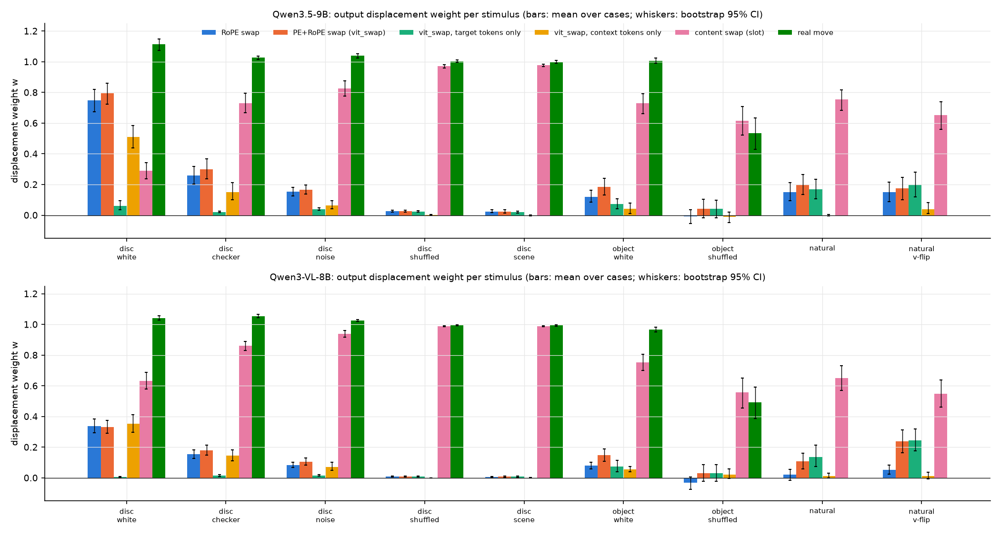

柱为 120 张图像（natural_vflip 87 张）的平均 $w$，须线为以图像为单位的 bootstrap 95% 区间；颜色依次为 RoPE 互换（蓝）、vit_swap（橙）、vit_swap_target（绿）、vit_swap_context（黄）、内容交换（粉）、真实移动（深绿）。

Qwen3.5-9B 的主要数值：

| 刺激 | 基线命中 | rope_swap | vit_swap | 只换目标 token | 只换上下文 token | content_swap | move |
| --- | --- | --- | --- | --- | --- | --- | --- |
| disc_white | 93/120 | 0.75 [0.67, 0.82] | 0.79 | 0.06 | 0.51 [0.44, 0.59] | 0.29 | 1.11 |
| disc_checker | 116/120 | 0.26 | 0.30 | 0.02 | 0.15 | 0.73 | 1.03 |
| disc_noise | 119/120 | 0.15 | 0.17 | 0.04 | 0.07 | 0.83 | 1.04 |
| disc_shuffled | 120/120 | 0.03 | 0.02 | 0.02 | 0.00 | 0.97 | 1.00 |
| disc_scene | 119/120 | 0.02 | 0.02 | 0.02 | −0.00 | 0.98 | 1.00 |
| obj_white | 118/120 | 0.12 | 0.18 | 0.07 | 0.04 | 0.73 | 1.01 |
| obj_shuffled | 105/120 | −0.01 | 0.04 | 0.04 | −0.01 | 0.62 | 0.53 |
| natural | 117/120 | 0.15 [0.10, 0.21] | 0.20 | 0.17 [0.11, 0.23] | 0.00 | 0.75 [0.68, 0.82] | — |
| natural_vflip | 84/87 | 0.15 | 0.17 | 0.20 | 0.04 | 0.65 | — |

pe_swap 在全部刺激上为 −0.00 至 0.02。Qwen3-VL-8B 的对应数值为：disc_white 的 rope_swap 0.34、vit_swap 0.33、只换目标 0.01、只换上下文 0.35、content_swap 0.63；natural 为 0.02、0.11、0.14、0.01、0.65；disc_scene 与 disc_shuffled 的 content_swap 均为 0.99。

1. **3.5 的两个端点在同一批样本上复现。** Qwen3.5 白色画布的 RoPE 互换为 0.75、自然图像为 0.15，自然图像的内容交换为 0.75，与 3.5 的 0.71、0.16、0.78 一致。
2. **分解关系成立。** vit_swap 与 content_swap 之和与真实移动的差在 7 种可移动刺激上为 −0.09 至 0.00（obj_shuffled 为 +0.13，见第 5 节限制 3），区间多数包含 0。两个来源的总和接近 1，自然图像上的变化是两者之间的重新分配。
3. **ViT 位置的作用随背景中的自然内容迅速消失。** 从白色到棋盘格、噪声、块置换照片、照片，Qwen3.5 的 vit_swap 依次为 0.79、0.30、0.17、0.02、0.02，content_swap 依次为 0.29、0.73、0.83、0.97、0.98。同一个合成红圆贴在照片上时与自然物体的行为相同，目标本身是否为合成物体不决定结果。棋盘格的每个 patch 像素相同，但其 vit_swap 已降到 0.30，说明 patch 层面的均匀性不足以维持白色画布上的效应。
4. **在均匀背景上，ViT 位置主要经上下文 token 传给 decoder；在自然图像上只经目标 token。** 白色画布上只换上下文 token 的权重（0.51）远大于只换目标 token（0.06），二者之和（0.57）小于 vit_swap（0.79），存在正向的交互：目标 token 自身的 ViT 位置只有在上下文一致时才被使用。自然图像上的情形相反：只换目标 token 为 0.17，只换上下文为 0.00。
5. **交换到均匀区域与交换到复杂区域没有差异。** natural 的 homog 与 textured 两个 $\mathcal{T}'$ 下，Qwen3.5 的 RoPE 互换为 0.15 与 0.16（成对差 −0.01 [−0.09, 0.06]），vit_swap 为 0.20 与 0.27，内容交换为 0.68 与 0.63，Qwen3-VL 同样没有差异。

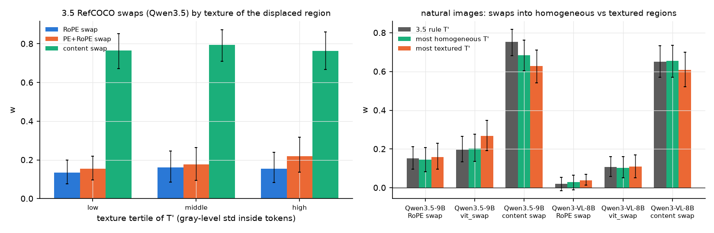

左图为 3.5 的 237 个 RefCOCO 互换按 $\mathcal{T}'$ 纹理三等分的平均 $w$（蓝：RoPE 互换，橙：PE 与 RoPE 互换，绿：内容交换），右图为本实验 natural 的三种 $\mathcal{T}'$（灰：3.5 规则，绿：最均匀，橙：最复杂）。RoPE 互换的 $w$ 与 $\mathcal{T}'$ 纹理的 Spearman 相关为 0.03（置换检验 $p = 0.61$），与互换距离的相关为 0.18。homog 的平均位移（525）大于 textured（465）与 3.5 规则（388），由于 $w$ 随距离略增，这一差别不改变“无纹理效应”的结论。

### 3.2 ViT 写入了什么：目标 token 与上下文 token 的读出

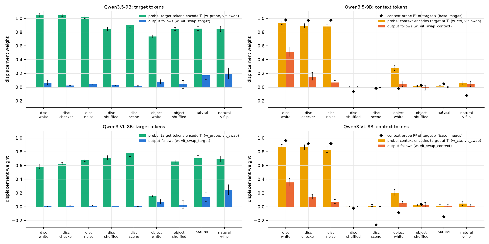

左列：绿柱为 vit_swap 下 token 位置 probe 读出的目标 token 位置向 $\mathcal{T}'$ 移动的比例 $w_{\mathrm{probe}}$，蓝柱为只换目标 token 时的输出 $w$。右列：黄柱为 vit_swap 下上下文 probe 读出的目标位置的移动比例 $w_{\mathrm{ctx}}$，红柱为只换上下文 token 时的输出 $w$，黑色菱形为上下文 probe 在基线图像上读取目标横坐标的交叉验证 $R^2$。须线为 bootstrap 95% 区间。

1. **ViT 对所有图像都把目标的位置写入目标 token。** Qwen3.5 的 $w_{\mathrm{probe}}$ 在三种均匀背景上为 1.02–1.05，在其余 6 种刺激上为 0.74–0.90（natural 0.85）；Qwen3-VL 为 0.58–0.79（obj_white 为 0.16）。基线图像上该 probe 读出目标 token 位置的平均误差为 35–66 个单位。“自然图像上 RoPE 互换不起作用”因此不能归因于 ViT 未能计算位置：目标 token 中的 ViT 位置在自然图像上与合成图像上同样清楚地指向 $\mathcal{T}'$，decoder 不使用它。
2. **上下文 token 的目标位置编码只在均匀背景上存在。** 上下文均值读取目标横坐标的 $R^2$：Qwen3.5 在白色、棋盘格、噪声背景上为 0.98、0.97、0.97，vit_swap 下 $w_{\mathrm{ctx}}$ 为 0.88–0.93；在 disc_shuffled、disc_scene、obj_white、obj_shuffled、natural、natural_vflip 上为 −0.12 至 0.05。白底自然物体（obj_white）的背景同样是白色，但上下文 token 不能读出物体位置（$R^2 = -0.02$），这一编码只在“大面积均匀背景上的单个红圆”中形成。第一轮第 3.7 节发现背景 token 均值能读出两物体位置，与此处白底圆的结果一致；本节表明它不推广到自然物体与自然背景。
3. **decoder 使用上下文编码的程度还取决于背景本身。** 噪声背景上上下文编码同样完整（$R^2 = 0.97$，$w_{\mathrm{ctx}} = 0.88$），但只换上下文 token 的输出权重只有 0.07，白色背景为 0.51。

### 3.3 场景布局先验

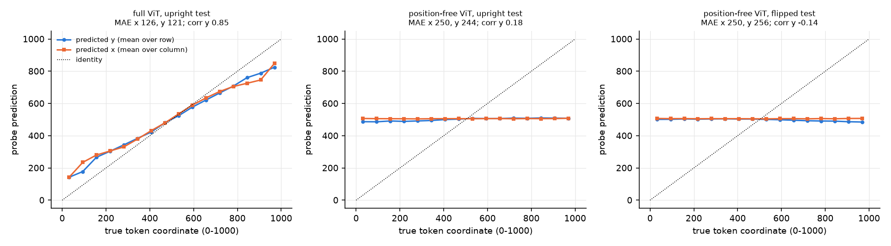

三幅图分别为：完整 ViT 的 merger 输出、去除 PE 与 RoPE 的 merger 输出（ViT 对 patch 置换等变，可读位置只能来自内容）在正立测试图像上、以及后者在上下翻转图像上的线性 probe 预测（蓝：按行平均的预测纵坐标，橙：按列平均的预测横坐标，虚线为恒等线）。

1. **内容几乎不携带绝对位置，只有很弱的纵向先验。** 去除位置编码后，Qwen3.5 的 probe 横纵误差为 250 与 244（常数预测为 250），横坐标相关 0.01，纵坐标相关 0.18；翻转图像上纵坐标相关变为 −0.14，说明这部分纵向信息确实来自“上方是什么内容”的场景统计。Qwen3-VL 为 0.17 与 −0.13。
2. **翻转图像不改变定位行为。** natural_vflip 的基线命中为 84/87，RoPE 互换、vit_swap 与内容交换的权重与 natural 的成对差为 0.00、−0.01、−0.14（Qwen3.5）。如果槽位的主导依赖于场景先验，物体处于非典型位置时 ViT 位置的权重应上升，实测没有上升。
3. **完整模型的位置 probe 对翻转与块置换同样有效。** 在正立训练图像上拟合的 probe 用于翻转图像时横纵误差为 125 与 127，与正立测试图像（126 与 121）相同，用于块置换图像为 120 与 128。ViT 的位置由 RoPE 计算，与内容排列无关。

### 3.4 PE 与 RoPE 依赖

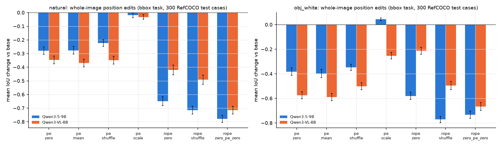

柱为相对 base 的平均 IoU 变化（成对 bootstrap 95% 区间），蓝为 Qwen3.5，橙为 Qwen3-VL；pe_scale 对 Qwen3.5 为 ×2.76，对 Qwen3-VL 为 ×0.36。

| 条件 | Qwen3.5 natural | Qwen3.5 obj_white | Qwen3-VL natural | Qwen3-VL obj_white |
| --- | --- | --- | --- | --- |
| base | 271/300 | 272/300 | 272/300 | 263/300 |
| pe_zero | 199（−0.28） | 126（−0.38） | 153（−0.35） | 36（−0.57） |
| pe_mean | 196（−0.28） | 130（−0.40） | 132（−0.37） | 30（−0.59） |
| pe_shuffle | 219（−0.22） | 142（−0.35） | 153（−0.35） | 60（−0.50） |
| pe_scale | 270（−0.02） | 274（+0.04） | 268（−0.03） | 181（−0.25） |
| rope_zero | 19（−0.65） | 28（−0.58） | 117（−0.42） | 198（−0.21） |
| rope_shuffle | 17（−0.72） | 8（−0.77） | 84（−0.49） | 61（−0.50） |
| rope_zero_pe_zero | 4（−0.78） | 7（−0.73） | 5（−0.72） | 15（−0.67） |

每格为 IoU≥0.5 的数量，括号内为平均 IoU 变化；全部变化的区间半宽不超过 0.04。

1. **Qwen3.5 的位置几乎完全依赖 RoPE。** 去除或打乱 RoPE 后 Qwen3.5 只剩 4–28 个正确框，Qwen3-VL 在自然图像上仍有 84–117 个，在白底物体上去除 RoPE 后仍有 198 个。第一轮“Qwen3-VL 的 PE 是可用的绝对位置标签”在自然图像与自然物体上成立。
2. **Qwen3.5 在自然图像上也需要 PE，其中 PE 的存在比其空间排列更重要。** 去除 PE 使 Qwen3.5 的自然图像正确数由 271 降到 199（76 条变错、4 条变对），把 PE 替换为均值同样有害（196），打乱 PE 的损失较小（219）；Qwen3-VL 打乱与去除的损失相同（153 与 153）。第一轮在合成图像上的结论（Qwen3.5 的 PE 主要提供 patch 之间的差异，空间排列贡献较小）在自然图像上同样成立；第一轮第 3.4 节只检验了放大 PE（对 RefCOCO 无收益）；本节的去除条件表明 PE 在自然图像上同样是必要的输入。
3. **尺度互换的效果不对称。** Qwen3.5 的 PE×2.76 使白底物体的平均 IoU 提高 0.04 [0.03, 0.06]，自然图像不变；Qwen3-VL 的 PE×0.36 使白底物体的正确数由 263 降到 181，自然图像只降 0.03。均匀背景越多，PE 的尺度越重要，与第一轮第 3.3 节一致。
4. **布局编码在两种模型中都由 RoPE 写入。**

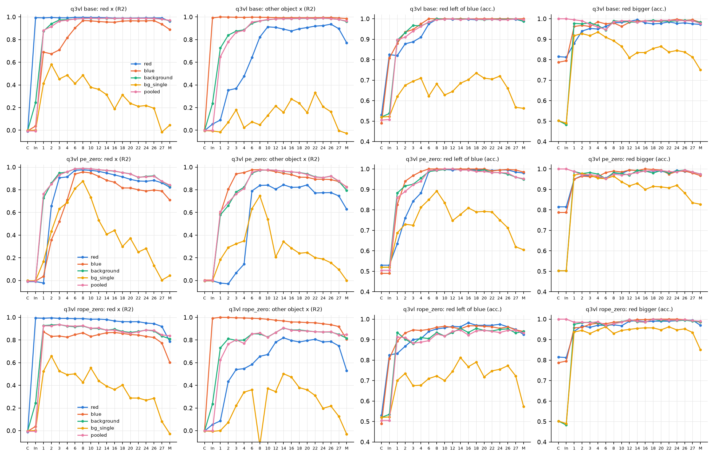

三行为 Qwen3-VL 的 base（第一轮）、pe_zero 与 rope_zero；四列与第一轮相同（红圆横坐标 $R^2$、另一物体横坐标 $R^2$、“红圆在左”与“红圆更大”的准确率），五条曲线为红圆 token、蓝方 token、背景均值、单个背景 token 与全部 token 均值。去除 PE 时背景均值读取红圆横坐标的 $R^2$ 在 block 8 为 0.99，merger 为 0.84（Qwen3.5 为 0.94）；去除 RoPE 时 block 8 为 0.92、merger 为 0.81，物体 token 读取另一物体横坐标在 merger 由 0.77 降到 0.53。与 Qwen3.5 的第一轮结果相同，布局的分布式编码主要依赖 RoPE；Qwen3-VL 对 PE 的依赖体现在单个 token 的绝对位置上，不体现在布局编码上。

5. **其他 checkpoint 的 PE 表。**

| checkpoint | PE 表形状 | 平均每项范数 | 相对同尺寸 Qwen3-VL 的范数比 | 逐项余弦 |
| --- | --- | --- | --- | --- |
| Qwen3-VL-4B-Instruct | 2304 × 1024 | 16.80 | 1 | 1 |
| Qwen3-VL-8B-Instruct | 2304 × 1152 | 7.25 | 1 | 1 |
| Qwen3.5-4B | 2304 × 1024 | 3.94 | 0.23 | 0.996 |
| Qwen3.5-9B | 2304 × 1152 | 2.63 | 0.36 | 0.988 |
| Qwen3.5-27B | 2304 × 1152 | 2.63 | 0.36 | 0.988 |
| Qwen3.8-27B | 2304 × 1152 | 2.71 | 0.37 | 0.988 |

Qwen3.5 系列的 PE 表均保持 Qwen3-VL 表的方向、范数缩小到 0.23–0.37 倍；Qwen3.5-9B 与 27B 的表逐项余弦为 0.977，是两个分别训练的张量。PE 萎缩在 Qwen3.5 系列的各个尺寸上都出现，属于该系列训练方案的共同结果。

6. **与文献和社区的关系。** RoPE-ViT（Heo et al., 2024，arXiv 2403.13298，第 4.1 节）在从头训练的 ViT 上发现 absolute PE 与 RoPE-Mixed 并用有利于低分辨率插值、略损高分辨率外推，但没有在并用训练的模型上移除 PE；CoMP（arXiv 2503.18931，Table 5a）在 768 pixels 上只用 RoPE-2D 时 ChartQA / DocVQA 为 8.2 / 11.9，并用为 32.2 / 33.2，其理由是保持预训练权重的连续性；Qwen2-VL（arXiv 2409.12191，第 2.1 节）曾移除 absolute PE，Qwen3-VL 技术报告（arXiv 2511.21631，第 2 节）按 CoMP 重新引入。Meta Perception Encoder（arXiv 2504.13181）与 EVA-02 同样保留原有 PE 并加入 RoPE，DINOv3 的图像主干只用 RoPE。这些工作都只比较训练前的设计选择；本实验在训练后的模型上给出两点补充：同一初始化的 ViT 经不同继续训练后，可以分别处于“PE 为绝对标签”（Qwen3-VL）与“PE 只提供 patch 差异”（Qwen3.5）两种状态；后者的 PE 范数被均匀衰减，而去除它仍使均匀背景与自然图像的定位变差。社区方面，mlx-vlm PR #2304 报告量化误差把 Qwen3.8-27B 的 PE 插值权重置零，merger 输出的相对误差由 0.13 升到 0.39，与本实验 pe_zero 的大幅表示变化一致；未检索到官方对 Qwen3.5 PE 缩小或移除 DeepStack 的说明。IVC-Prune（arXiv 2602.03060）认为 LVLM 经 RoPE 形成隐式视觉坐标系，与第 3.6 节“坐标由 value 中的位置成分携带”的结果方向一致。

### 3.5 merger 输出的位置子空间

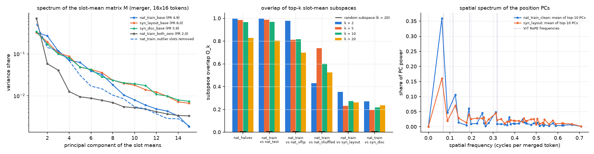

左：槽位均值矩阵 $M$ 的方差占比（对数刻度；图例中 PR 为参与比，虚线为去除 7 个偏离范数超过中位数 3 倍的高范数槽位后的谱）。中：两个集合前 $k$ 个方向的子空间重叠 $O_k$（颜色为 $k = 2, 5, 10, 20$，黑色短线为 $k = 20$ 的随机期望）。右：前 10 个主成分排回 $16 \times 16$ 网格后的平均功率谱（蓝：自然图像，去除高范数槽位；橙：两物体图像），紫色点线为网格可分辨范围内的 ViT RoPE 频率 $\omega_i / \pi$（0.32、0.19、0.11、0.07 周期/token）。

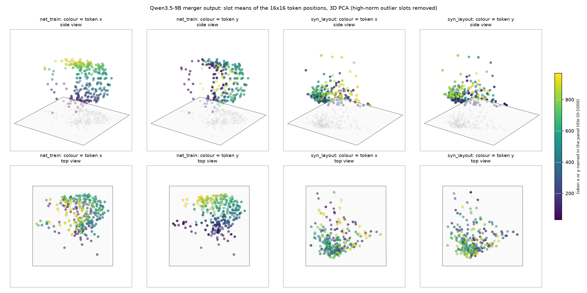

Qwen3.5 merger 输出 256 个槽位均值（去除高范数槽位）的三维 PCA，上排为斜视图，下排为俯视图，灰色点为点云在底面上的投影，颜色（viridis）为面板标题所示的 token 横坐标或纵坐标（0–1000）。左两列为 RefCOCO 训练图像，右两列为两物体图像。

1. **自然图像的位置是一个光滑的二维坐标场，合成图像的槽位均值没有这种结构。** 自然图像的槽位均值在前三个主成分中排成一张随横、纵坐标连续变化的曲面；两物体图像的槽位均值在前三个主成分中没有按坐标排列（流形图）。两者的槽位方差占比分别为 0.07 与 0.15，合成图像中“只由槽位决定”的方差更大，但其主方向由物体位置分布与少数高范数槽位决定。参与比为 4.9（自然）与 6.0（合成），去除位置编码后为 2.0。
2. **自然图像的子空间跨图像高度稳定，与合成图像只部分共享。** Qwen3.5 自然图像两半的 $O_{10} = 0.97$，训练与测试 0.97，与翻转图像 0.82，与块置换图像 0.60，与两物体图像 0.27，与单目标圆 0.22；去除高范数槽位后自然与合成的 $O_{10}$ 为 0.25。Qwen3-VL 对应为 0.93、0.93、0.78、0.53、0.15、0.12。线性 probe 的迁移是不对称的：自然图像上拟合的 probe 用于合成图像时误差由 126 升到 172–192，合成图像上拟合的 probe 用于自然图像时误差为 490–605（相关 0.50–0.58），合成图像的位置编码只覆盖自然图像位置编码的一部分。
3. **自然图像的位置主成分以低频为主。** 去除高范数槽位后，自然图像前 10 个主成分的平均空间功率中，不高于 0.13 周期/token（每张图像 1–2 个周期）的部分占 51%，其中最低频率占 36%；高于 0.19 周期/token 的部分占 41%，0.32 与 0.19 周期/token 两个 RoPE 频率所在的频带合计占 14%。两物体图像的低频部分只有 25%，高于 0.19 周期/token 的部分占 67%。低频结构与第一轮 PE 表 77% 能量集中在 $8 \times 8$ 个最低 DCT 频率的形态相近；由于 $16 \times 16$ 网格无法分辨更低的 RoPE 频率，本结果只能说明位置子空间由平滑的低频坐标组成，不能把它归于某一组 RoPE 频率。
4. **擦除的因果效应跨图像类型迁移。**

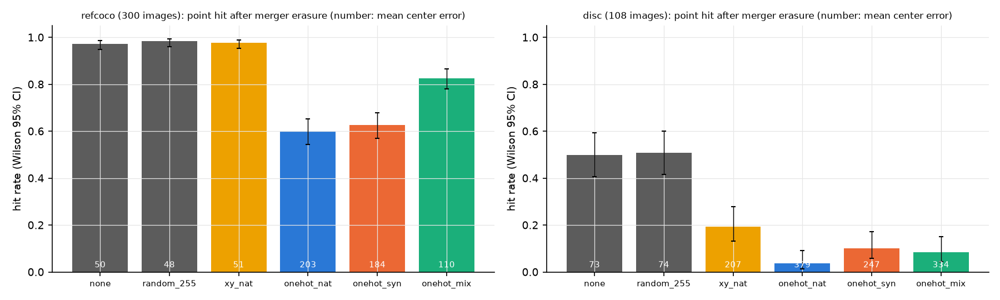

柱为命中率（Wilson 95% 区间），柱内数字为平均中心误差；颜色：灰为无擦除与同秩随机擦除，黄为 $(x, y)$ 二维擦除，蓝、橙、绿为分别以自然图像、合成图像与二者合并拟合的槽位 one-hot 擦除（秩 255）。

| 擦除器 | RefCOCO 命中（300） | 中心误差变化 | 横 / 纵斜率 | 圆命中（108） | 中心误差变化 | 横 / 纵斜率 |
| --- | --- | --- | --- | --- | --- | --- |
| 无 | 292 [0.95, 0.99] | — | 1.02 / 0.97 | 54 [0.41, 0.59] | — | 1.07 / 1.11 |
| 随机 255 维 | 295 | −2 [−5, 1] | 1.02 / 0.97 | 55 | +1 | 1.07 / 1.12 |
| $(x, y)$，自然 | 293 | +1 [−4, 8] | 1.00 / 0.99 | 21 | +134 | 0.67 / 1.03 |
| one-hot，自然 | 180 [0.54, 0.65] | +153 [135, 171] | 0.48 / 0.81 | 4 [0.01, 0.09] | +306 | 0.08 / 0.87 |
| one-hot，合成 | 188 [0.57, 0.68] | +133 [117, 150] | 0.57 / 0.62 | 11 | +175 | 0.59 / 0.93 |
| one-hot，合并 | 248 [0.78, 0.87] | +60 [50, 71] | 0.90 / 0.95 | 9 | +262 | 0.18 / 0.85 |

擦除 merger 的位置子空间同样严重破坏自然图像的定位（292 降到 180），而同秩随机擦除没有影响。以自然图像拟合的擦除器对圆的破坏（4/108）大于以合成图像拟合的擦除器（11/108），以合成图像拟合的擦除器也使 RefCOCO 降到 188/300：两类图像的子空间虽然只部分重叠（第 2 点），decoder 依赖的位置方向在两类图像之间是共享的。合并拟合的擦除器对 RefCOCO 的效应较小（248/300），LEACE 的白化度量由合并协方差决定，其擦除方向与单独拟合的方向不同，这一差别的来源未进一步分析。$(x, y)$ 二维擦除不影响自然图像、却使圆的横向斜率降到 0.67，与第一轮“位置信号分布在远多于两维的方向上”一致。

### 3.6 L20 H11 如何使用位置

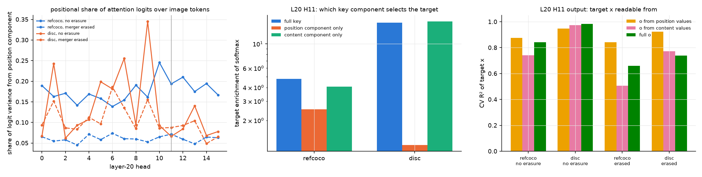

左：layer 20 的 16 个 head 在图像 token 上 attention logit 的方差中位置成分所占比例（蓝为 RefCOCO，橙为圆；实线无擦除，虚线为 merger one-hot 擦除后；灰色竖线标出 H11）。中：H11 分别用完整 key、只用 key 的位置成分、只用内容成分计算 softmax 时的目标富集度（对数刻度）。右：H11 输出中由 value 的位置成分组成的部分（黄）、由内容成分组成的部分（粉）与完整输出（绿）读取目标横坐标的 5 折交叉验证 $R^2$。位置成分以留一法槽位均值定义（设计第 7.5 节第 4 点）。

1. **H11 按内容选择目标。** RefCOCO 上 H11 的 logit 方差中位置成分占 0.19、内容成分占 0.70；只用内容成分的富集度为 4.1，只用位置成分为 2.5，完整 key 为 4.8。圆上位置成分只占 0.07，只用内容成分的富集度为 16.0，只用位置成分为 1.2。16 个 head 的位置占比都在 0.06–0.35，没有一个 head 主要依据位置成分分配 attention。
2. **坐标由被注视 token 的 value 中的位置成分携带。** RefCOCO 上 H11 输出的位置部分读取目标横坐标 $R^2 = 0.88$、纵坐标 0.66，内容部分为 0.74 与 0.55；圆上二者均为 0.95–0.98。H11 的 attention 质心与目标中心的相关为 0.94（横）与 0.83（纵）。
3. **merger 位置子空间是这一位置成分的主要来源。** one-hot 擦除后，layer 20 key 中位置成分的方差占比由 0.20–0.27 降到 0.08–0.11，value 由 0.08–0.15 降到 0.03–0.05；H11 的 attention 选择基本不变（富集度 4.6，质心相关 0.94），但完整输出读取横坐标的 $R^2$ 由 0.84 降到 0.66，圆上由 0.98 降到 0.74。擦除后残留的位置成分来自序列顺序与 MRoPE 旋转（key 已施加旋转，同一槽位的旋转在各图像中相同，因此被计入位置成分）。
4. **解释（推断）。** “按内容找到目标、从目标 token 的 value 取出位置”与第 3.1 节的行为一致：内容交换把目标内容移到 $\mathcal{T}'$ 的槽位，H11 随内容注视 $\mathcal{T}'$；此时取出的位置成分是该槽位的位置（槽位的序列顺序与 MRoPE 旋转，以及 $\mathcal{T}'$ 原有上下文写入的 ViT 位置无法随内容移动的部分），因而输出跟随槽位。vit_swap_target 只改变目标 token 自身的 ViT 位置，其权重只有 0.06–0.17，说明 value 中可用的位置成分大部分由槽位决定，token 自身 ViT 位置的贡献较小。这一推断尚需在 decoder 中直接定位“槽位位置”写入 value 的路径（与实验 3.8 衔接）。

### 3.7 一个实例占一个 token

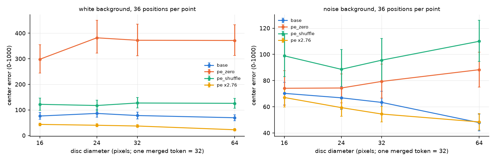

左为白色背景，右为噪声背景；横轴为圆的直径（对数刻度，一个 merged token 为 32 pixels），纵轴为中心误差（0–1000，bootstrap 95% 区间）；颜色为 base（蓝）、pe_zero（橙）、pe_shuffle（绿）与 PE×2.76（黄）。

| 直径 | 白色 base | 白色 pe_zero | 白色 PE×2.76 | 噪声 base | 噪声 pe_zero | 白色 pe_zero 横向斜率 |
| --- | --- | --- | --- | --- | --- | --- |
| 16 | 76 | 298 | 44 | 70 | 74 | 0.21 |
| 24 | 86 | 382 | 40 | 67 | 74 | 0.04 |
| 32 | 78 | 373 | 37 | 63 | 79 | 0.19 |
| 64 | 70 | 372 | 23 | 48 | 88 | 0.16 |

去除 PE 在白色背景上使全部尺寸的横向位置几乎消失（斜率 0.04–0.21），噪声背景上全部恢复（斜率 1.00–1.06）。损害程度与实例大小无关，均匀背景的对称性破缺在一个实例只占一个 token 时没有变得更重要。PE×2.76 在全部尺寸上降低误差，对最小的圆降低 32 个单位、对 64 pixels 的圆降低 47 个单位。小圆的命中率很低（36 张中 0–7 张），这里以中心误差为主要指标。

## 4. 解释

综合第 3 节，两类图像的差别可以用三个可检验的成分概括（均为推断，括号内为支持它的结果）：

1. **ViT 计算位置的方式在两类图像上相同。** RoPE 把每个 patch 的位置写入其 token，目标 token 的 ViT 位置在自然图像上与合成图像上同样准确（第 3.2 节第 1 点）；内容自身几乎不携带绝对位置（第 3.3 节）。
2. **decoder 以“内容选择 + 槽位位置”读取坐标。** 指向型 head 按 key 的内容成分注视目标，再从 value 的位置成分取出坐标（第 3.6 节）；目标 token 自身的 ViT 位置在这一读出中权重很低（vit_swap_target 0.02–0.20，第 3.1 节），槽位决定大部分坐标（内容交换 0.62–0.98）。
3. **均匀背景提供了第二条通路。** 大面积空白 token 由 RoPE 计算出“目标在何处”的分布式编码，decoder 会读取它（只换上下文 0.51，第 3.1 节第 4 点；上下文 $R^2 = 0.98$，第 3.2 节第 2 点）。在白色画布上这条通路与槽位竞争，使 ViT 位置看起来是主导来源；背景含有任何自然内容时，这一编码不再形成，槽位通路成为唯一的来源。

按这一解释，3.5 中“单目标画布由 ViT RoPE 决定、自然图像由槽位决定”的差异由背景是否均匀决定；目标是否为自然物体（disc_scene 与 natural 相同，第 3.1 节第 3 点）与场景先验（第 3.3 节）都不能解释这一差异。对 BabyVision 一类大面积留白的合成图像，这意味着模型在这类图像上依赖一条在自然图像训练中几乎不出现的上下文通路，PE 尺度与均匀区域的对称性破缺直接影响这条通路（第 3.4 节第 3 点、第 3.7 节）。对方向二的局部重读，第一轮第 3.9 节的“在原图上编码后取出窗口 token”保留了槽位与 ViT 位置的对应；本轮结果进一步提示，窗口 token 在 decoder 中占据的序列槽位与其 MRoPE ID 才是坐标的主要载体，重读接口需要显式地给出与原图坐标一致的槽位位置信息。

## 5. 限制

1. **direct-answer 格式。** 全部问题只要求输出坐标，没有检验 think-then-answer 格式；在允许推理时 decoder 可能以文字中间结果读取位置。
2. **“位置成分”的定义。** 第 3.6 节的位置成分是留一法槽位均值，包含 MRoPE 旋转与序列顺序带来的槽位差异，不能区分 ViT 位置与 decoder 位置；擦除实验只能说明 merger 子空间贡献了其中的一部分。
3. **块置换背景含有目标碎片。** obj_shuffled 的背景由本图块置换得到，包含被指物体自身的块，真实移动后输出只跟随 0.53，模型部分地指向背景中的碎片；该刺激的数值只作参考。disc_shuffled 的目标是贴上的红圆，不受此影响。
4. **擦除与识别。** 第一轮在合成图像上确认擦除不破坏 T2 识别，本轮没有在 RefCOCO 上单独检验指称识别，RefCOCO 擦除后的失败可能部分来自识别错误。
5. **bbox 截断。** 整图编辑阶段的 bbox 回答被 40 个 token 的上限截断在 label 字段，评分使用答案中第一个完整的坐标四元组；坐标本身不受截断影响，但严格 JSON 格式的有效率不可与其他实验比较。
6. **批量生成一致性。** Qwen3.5 的批量与逐条生成只有 4/20 文本完全相同，坐标差均值 6.8 个单位，对 $w$ 的影响约为 0.02（互换距离 300–500 个单位）。
7. **上下文编码的成因。** 第 3.2 节发现上下文编码只在白底红圆上形成、在白底自然物体上不形成，原因（红色的高显著性、简单形状或训练数据）未检验。

## 6. 由结果导出的下一步

1. **decoder 中槽位位置的写入路径。** 在 layer 1–20 定位把序列顺序与 MRoPE 转换为 value 位置成分的层与 head（实验 3.8 第二轮），并检验以“只交换槽位位置成分”的 patching 能否复现内容交换的效应。
2. **上下文通路与 BabyVision。** 在实验 1.6 的网格与迷宫图像上测量只换上下文 token 的权重，检验大面积留白图像上的定位与比较任务是否依赖这条通路，以及 PE 尺度如何影响它。
3. **think-then-answer 对照。** 在内容交换与 vit_swap_context 上比较允许推理与只输出答案两种格式，检验推理文本是否改变位置来源的权重。

## 7. 产物

产物位于 WORK_DIR 的 `analysis/position/2026-10-16_vit_layout_r2/`：`cases.json`（3.4 测试图像、表达式、分割多边形）、`ladder/`（区域方案 `plans.json`、逐行记录 `{q35,q3vl}_rows.jsonl`、每个样本的 merger 读出 `feats/`、批量抽查与实现等价检查 `*_spot.jsonl`）、`edits/`、`capture/`（512×512 图像集合的 merger 输出与槽位统计）、`erase/`（擦除器与生成记录）、`l20/`、`smalldisc/`、`layout/`（Qwen3-VL 的 pe_zero 与 rope_zero 特征）、`results_parts/` 与 `results.json`，以及记录模型版本、代码摘要与参数的各阶段元数据。程序为 `analysis_tools/position/vit_layout_r2*.py`，入口为 `scripts/analysis/position/vit_layout_r2.sh`，测试为 `tests/analysis/position/test_vit_layout_r2.py`，图位于 `figures/vit_layout_r2/`。
