# 坐标读出的信息流

实验日期：2026-10-20。本文属于[位置信息与坐标读取](plan.md)研究，执行[实验 3.11 设计](design_coordinate_flow.md)。模型为 Qwen3.5-9B（bfloat16、SDPA、greedy decoding、thinking off），全部问题为只输出答案的 direct-answer 格式。上游结果为[坐标读取路径](results_2026-10-14_coordinate_readout.md)（3.5）、[“看得准但答错”的检验](../representation/results_2026-10-16_sees_right.md)（2.5e）、[坐标数值的数位输出机制](results_2026-10-16_coordinate_value_r2.md)（3.6 第二轮）与 [ViT 位置与布局表征第二轮](results_2026-10-16_vit_layout_r2.md)（3.7 第二轮）。

## 通俗讲述

本节以叙述方式概括全文，细节与数值见第 1–5 节。

模型在回答“目标在哪里”时会写出一个 0–1000 的坐标。已有实验知道坐标在第 20 层附近从图像中读出，也知道其中一个 attention head（L20 H11）作用最大，但从图像 token 到最终数字的完整路径并不清楚。本实验用同一种因果方法把这条路径逐段测量：准备两张只有目标位置不同的图像，让模型在第一张图像上作答，再把第二张图像中某一部分的内部状态替换进来，观察坐标的首位数字向第二张图像的答案移动了多少。被替换的部分可以是单个 head 的输出，也可以是某一组图像 token 在某一层的 key 与 value。

第一个结论是读取几乎集中在一层、一个 head 上。全部 128 个 full attention head 中，L20 H11 单独就能传递横坐标差异的 0.4–0.6、纵坐标差异的 0.2–0.7；其余 head 单独替换时除 L20 H10 与 L32 H8（不超过 0.18）外都不超过 0.1，L32 H8 是唯一在全部条件中都出现的次要成员。第 20 层整层替换已经覆盖大部分效果，第 24 层补充一部分，其余层可以忽略。

第二个结论是横坐标与纵坐标的读取方式不同，差别由坐标轴决定，与先输出哪个坐标无关。读横坐标时，H11 的注意力集中在目标上，目标 token 的 key 与 value 携带约一半的差异；读纵坐标时，注意力铺开在目标所在的整行上，并明显偏向每行最左端的 token；在网格图像上，目标 token 本身几乎不携带纵坐标差异，差异存放在同一行、位于目标之后的 token 中。把输出顺序从 [x, y] 改成 [y, x]、从“行、列”改成“列、行”，这一分工基本不变。一种解释是：Qwen3.5 的线性 attention 层按光栅顺序逐行扫描图像，同一行的 token 在序列中相邻，目标信息沿行向后扩散，纵向位置于是成为一整行共享的属性；横向位置则需要直接看目标本身。

第三个结论回答了“图像 attention 随深度下降”与“深层坐标集中在文本位置”之间的表面矛盾。图像之后的 prompt 文本在各层只把 12–25% 的 attention 放在图像上，这一比例很低；而正在写坐标数字的位置在第 12–24 层把 50–78% 的 attention 放在图像上，形成一次专门的“第二次观察”。这次观察在第 20 层完成因果上最重要的读取，第 28、32 层虽然仍有 10–45% 的 attention 落在图像上，替换这两层的图像 key 与 value 却几乎不改变答案。读取完成后，坐标保存在答案位置的 residual 中，再由后几层的 MLP 写成数字。

第四个结论是 attention 本身常常比模型的答案更准。在 10×10 网格上，用 H11 attention 的峰值位置直接换算坐标，命中率为 0.92，而模型自己写出的 point 坐标只有 0.24；在 20×20 网格上，最佳 head 的 attention 命中率为 0.94，模型只有 0.05。这说明在这些条件下，失败主要发生在“看到之后”的读出环节，attention 已经找到了目标。自然图像是例外：模型更准（0.97），H11 的 attention 峰值经常落在物体的醒目部位，与物体中心相距较远。

最后，本实验检验了图像 token 内部的“位置地图”是否在答错的图像上质量更差。用一个线性解码器读出每个图像 token 自认为所处的位置，答对与答错的图像在地图的有序程度与压缩程度上没有可靠差别；唯一的弱信号出现在 20×20 网格上：列号多计 1 的回答中，目标 token 的解码位置平均偏右约一个单元格。

## 1. 研究问题与主要结果

本实验以 teacher-forced 首位数字 logit 差的恢复比例 $r$（定义见第 2.1 节）测量 head 输出与图像 KV 子集的因果作用，并以 2.5e 已记录的 attention 与 residual 做描述性分析。主要结果如下，实测与解释分开标注：

1. **坐标由层 20 的单个 head L20 H11 主读，L32 H8 为稳定的次要成员，其余 126 个 head 单独作用都很小。** 实测：全部 128 个 head 的输出 patching 恢复 0.87–1.00；在合成图像上，H11 单独恢复 0.40–0.59（横向）与 0.21–0.68（纵向），从全部 head 中去掉 H11 时恢复下降 0.24–0.64，去掉其他任一 head 的下降都不超过 0.16；层 20 整层恢复 0.15–0.93，层 24 恢复 0.06–0.33（第 3.1 节，图 heads_single、heads_loo）。RefCOCO 上 H11 单独只恢复 0.07（横向）与 0.15（纵向），读取分散到层 20 与层 24 的多个 head。
2. **行与列的 attention 差异普遍存在，纵向读取偏向目标行的行首 token。** 实测：层 16 与层 20 的几乎全部 head 在目标 token 行上的 attention 质量都高于目标 token 列（行列格式与单目标圆中比例为 1.00，10×10 point 的横坐标 query 为 0.69）；在纵坐标或行号的 query 处，层 20 的 head 平均把 0.35–0.42 的图像 attention 放在第 0 列（均匀分布为 0.02–0.06），横坐标 query 处为 0.03–0.11，接近均匀（第 3.1 节，图 rowcol_profile、aligned_attention）。
3. **合成网格上 attention 解码的坐标显著优于模型答案，模型答错时 attention 仍然指向目标。** 实测：以 H11 attention 峰值 3×3 邻域的加权中心解码，10×10 网格 point 的命中率为 0.92 [0.87, 0.95]，模型为 0.24 [0.18, 0.31]，模型答错的 122 个回答中 attention 命中 0.93；20×20 网格 point 上最佳 head（L16 H0）为 0.94，模型为 0.05。RefCOCO 上模型更准（0.97 与 0.86），单目标圆上二者都低（0.33 与 0.36，最佳 head L16 H11 为 0.79）（第 3.2 节，图 attention_answer）。
4. **横坐标的信息位于目标 token，纵坐标的信息位于目标所在 token 行中光栅顺序之后的 token；自然图像上两个坐标都位于目标 token。** 实测：只替换目标 token 的图像 KV，横向恢复 0.30–0.42（真实移动）与 0.55–0.86（decoder 拼接对照），纵向在 10×10 网格行列格式中只有 0.04 与 0.06；纵向差异由目标行的其他 token 携带（row_left 0.12–0.23、row_right 0.21–0.31），拼接对照下目标之前的 token（above）恢复精确为 0.00。RefCOCO 内容交换下目标 token 恢复 0.73（横向）与 0.84（纵向），其余图像 token 约为 0（第 3.3 节，图 kv_groups、kv_rows_cols）。
5. **横纵分工由坐标轴决定，与输出顺序无关。** 实测：纵坐标先输出时目标 token 份额为 0.04–0.08，后输出时为 0.05–0.27；横坐标在两种顺序下都为 0.26–0.42。若存在顺序效应，其方向也与“先输出的坐标读目标”相反（第 3.4 节，图 order、layer_group_per_value、step_attention）。
6. **答案位置在层 12–24 对图像做一次专门的第二次观察，因果读取集中在层 20，层 28–32 的图像 KV 不再被使用。** 实测：坐标首位数字 query 的图像 attention 占比在层 16–24 为 0.65–0.78，图像之后的 prompt 文本只有 0.16–0.22；只替换单层图像 KV 时，层 20 恢复 0.11–0.96，层 24 恢复 0.01–0.23，层 28 与 32 恢复不超过 0.08（第 3.5 节，图 flow，表 5）。
7. **位置场质量总体上不能预测失败。** 实测：从 visual token 状态解码的位置场的局部失序、压缩与目标偏差，在去除目标位置的影响后区分答对与答错的 AUROC 在 10×10 point 上不超过 0.61；单目标圆上 0.81 的 AUROC 来自目标直径的混杂；唯一的弱关联是 20×20 行列格式中列号多计 1 的回答，其目标 token 在 site 12 的解码横坐标约偏右 1 个单元格（AUROC 0.72 [0.63, 0.80]）（第 3.6 节，表 7）。

**综合解释（推断）。** 坐标的读出可以概括为三步。第一步，图像 token 在 ViT 与 decoder 前 16 层中形成两类位置载体：目标 token 自身携带可被直接读取的横向信息；Gated DeltaNet 按光栅顺序把目标的存在沿 token 行向后传播，纵向信息于是成为目标所在整行共享的属性。第二步，答案位置在层 16–24 以 L20 H11 为主对图像 KV 做一次读取：横坐标 query 注视目标，纵坐标 query 注视目标行（尤其是行首）。第三步，读到的坐标保存在答案位置的 residual 中，层 24 之后由 MLP 写出首位数字（3.6 第二轮）。合成网格上 attention 已经找到目标而模型仍然答错，说明这些失败发生在第三步或第二步的数值换算中。

## 2. 实验设置与实际执行

### 2.1 配对与恢复比例

全部因果测量采用设计文档第 2.1 节的配对设计，这里只给出符号。

- **run A 与 run B。** run A 为原始输入；合成图像的 run B 把目标重新画在沿横向或纵向移动后的位置（单目标圆移动 4 个 merged token；10×10 网格移动 2 个单元，即 4 个 token）；RefCOCO 的 run B 为实验 3.5 的内容交换。两次运行都以 run A 的 greedy 答案 teacher forcing。
- **变化 token 集合 $\mathcal{D}$。** 目标在 run A 与 run B 中覆盖的 merged token 之并。
- **拼接对照（splice）。** 全部 visual embedding 取自 run A，只有 $\mathcal{D}$ 取自真实移动的 run B。ViT 的 attention 是全局的，真实移动会改变全部 visual embedding；拼接对照只让 $\mathcal{D}$ 不同，因而 $\mathcal{D}$ 以外的任何差异都由 decoder 产生。RefCOCO 的内容交换天然属于这一类。

记坐标值 $k$ 首位数字的 query 位置为 $m_k$，$z \in \mathbb{R}^{V}$ 为 $m_k$ 处的 logits（$V$ 为词表大小），$d_A$ 为 run A 的首位数字，$d_B$ 为 run B 在同一位置 logit 最大的数字。定义

$$
\mathrm{LD} = z_{d_B} - z_{d_A}, \qquad r_e = \frac{\mathrm{LD}_e - \mathrm{LD}_A}{\mathrm{LD}_B - \mathrm{LD}_A},
$$

其中 $\mathrm{LD}_A$、$\mathrm{LD}_B$ 分别为 run A 与 run B 的 logit 差，$\mathrm{LD}_e$ 为对 run A 施加干预 $e$ 后的 logit 差。$r_e = 1$ 表示被替换的组件携带了两次运行在该数字上的全部差异，$r_e = 0$ 表示没有作用。只统计沿位移轴的坐标值，并排除 $d_A = d_B$ 或 $\lvert \mathrm{LD}_B - \mathrm{LD}_A \rvert < 2$ 的数值；表中 $n$ 为满足条件的坐标值个数。

两类干预如下：

- **head 输出 patching。** 在 prompt 最后一个 token 及之后的位置，把 run A 的某个 head 输出（gate 之后、output projection 之前）替换为 run B 的值。
- **图像 KV 子集 patching。** 以 run A 的 prompt 建立 KV cache，把某个 visual token 子集在全部 8 个 full attention 层（或指定的单层）的 key 与 value 换成 run B 的值，再以 cache 前向答案部分。Gated DeltaNet 层的递归状态保持 run A 的值，因此该干预只测量答案位置经 full attention 从图像读取的路径。

### 2.2 实际样本

| 子实验 | 条件 | 计划样本 | 实际样本 |
| --- | --- | --- | --- |
| 生成 | 11 个格式条件 | disc 48、网格 40、RefCOCO 48 | 同计划，496 个回答全部给出所要求的键 |
| E1 head patching | disc point、10×10 行列、10×10 point、RefCOCO point | 每条件 40–48 张 | disc 32 张，其余每条件 24 张（见第 5 节） |
| E4 KV patching（完整组） | 同 E1 | 每条件 40–48 张 | 每条件 24 张 |
| E5 KV patching（输出顺序） | 其余 7 个格式条件 | 每条件 40–48 张 | 每条件 20 张 |
| E6 全过程 | disc、10×10 point、RefCOCO | 2.5e 全部回答 | 240、160、298 个回答 |
| E2、E3 | 2.5e 的记录 | 全部 | 14 个条件，2054 个回答 |

批量生成的答案与逐条 greedy 生成的答案在抽查的 20 条中完全相同 11 条，其余 9 条只在非首位数字上不同，首位数字 20/20 一致；全部因果测量只使用首位数字，并以批量生成的答案 teacher forcing。

### 2.3 数值检查

- 拼接对照下 above 组（$\mathcal{D}$ 外接矩形上方的全部 token）的恢复比例在全部条件中为 0.00，与 causal decoder 的预期一致。
- 全部 128 个 head 的输出 patching 恢复 0.87–1.00，全部图像 KV patching 恢复 0.74–1.01；二者都接近 1，说明首位数字差异几乎全部经由答案位置读取图像 KV 的路径传递。

## 3. 结果

### 3.1 Q1：L20 H11 的特殊性与行列 attention

**L20 H11 是唯一的主读 head。** 表 1 给出各条件的整体与分层恢复比例。全部 head 的恢复接近 1，而 H11 单独恢复与“去掉 H11 时的下降”量级相同，二者合起来说明 H11 既充分承担了一大部分读取，又在其余 head 中没有替代者。单个 head 恢复之和在合成条件中为 0.46–1.15，与全部 head 的恢复相差不大，读取在合成图像上近似加性（10×10 行号的 0.46 是例外）；RefCOCO 横向的单 head 之和只有 0.35，而全部 head 恢复 0.87，读取在自然图像上以非加性的组合完成（实测，图 heads_single、heads_loo）。

表 1　head 输出 patching 的恢复比例 $r$（均值）。“去掉 H11”为全部 head 恢复减去“全部 head 去掉 H11”的恢复。

| 条件与坐标轴 | $n$ | 全部 head | 层 20 | 层 24 | 层 32 | L20 H11 | L32 H8 | 去掉 H11 的下降 | 单 head 之和 |
| --- | --- | --- | --- | --- | --- | --- | --- | --- | --- |
| disc point，x | 32 | 0.93 | 0.51 | 0.18 | −0.11 | 0.42 | 0.14 | 0.49 | 0.57 |
| disc point，y | 32 | 1.00 | 0.93 | 0.06 | −0.07 | 0.67 | 0.13 | 0.58 | 0.96 |
| 10×10 行列，列号 | 24 | 0.98 | 0.54 | 0.33 | −0.09 | 0.40 | 0.07 | 0.28 | 0.86 |
| 10×10 行列，行号 | 24 | 0.96 | 0.35 | 0.27 | −0.06 | 0.21 | 0.09 | 0.24 | 0.46 |
| 10×10 point，x | 24 | 0.96 | 0.64 | 0.23 | −0.09 | 0.59 | 0.17 | 0.56 | 0.94 |
| 10×10 point，y | 24 | 0.98 | 0.81 | 0.13 | −0.12 | 0.68 | 0.12 | 0.64 | 1.15 |
| RefCOCO point，x | 21 | 0.87 | 0.15 | 0.31 | −0.16 | 0.07 | 0.18 | 0.24 | 0.35 |
| RefCOCO point，y | 22 | 0.99 | 0.38 | 0.32 | −0.08 | 0.15 | 0.18 | 0.19 | 0.73 |

表中层 4–16 与层 28 的整层恢复都不超过 0.12，没有列出。从全部 head 中去掉其他任一 head 时，恢复的下降都不超过 0.16。

**层 32 的 H10 与 H8 作用相反。** 实测：L32 H10 单独替换的恢复在全部条件中为负（−0.09 至 −0.29），L32 H8 为正（0.07–0.18，在 RefCOCO 上是单独恢复最大的 head），层 32 整层为 −0.06 至 −0.16。解释：层 32 中存在把首位数字推离 run B 方向的成分；[数位输出失败分析](results_2026-10-20_digit_failure.md)（3.12）把以 500 为中心的先验归于 MLP 27–31 与 L32 H8，L32 H10 的负恢复可能属于同一机制，本实验没有进一步分析。

**行与列的 attention 差异普遍存在。** 表 2 统计 2.5e 记录的层 20 attention。在网格与单目标圆中，层 16 与层 20 的全部 head 在目标 token 行（不含目标）上的 attention 质量都高于目标 token 列，横坐标 query 与纵坐标 query 都是如此。差别在于目标本身：横坐标 query 处 H11 把 0.38–0.69 的 attention 放在目标上，纵坐标 query 处只有 0.04–0.36，attention 转向整行（实测，图 rowcol_profile、aligned_attention）。

表 2　层 20 的 attention 在目标、目标 token 行与目标 token 列上的质量（占图像 attention 的比例）。“行首”为第 0 列 token 的质量，括号内为均匀分布下的值。

| 条件 | query | H11 目标 / 行 / 列 | 层 20 head 平均 目标 / 行 / 列 | 层 16、20 中行 > 列的 head 比例 | 层 20 行首质量 |
| --- | --- | --- | --- | --- | --- |
| 10×10 行列 | 列号 | 0.69 / 0.16 / 0.13 | 0.14 / 0.36 / 0.18 | 1.00 | 0.04 (0.05) |
| 10×10 行列 | 行号 | 0.11 / 0.64 / 0.02 | 0.02 / 0.38 / 0.05 | 1.00 | 0.42 (0.05) |
| 20×20 行列 | 列号 | 0.46 / 0.31 / 0.18 | 0.08 / 0.36 / 0.16 | 1.00 | 0.03 (0.02) |
| 20×20 行列 | 行号 | 0.04 / 0.67 / 0.01 | 0.01 / 0.34 / 0.03 | 1.00 | 0.36 (0.02) |
| 10×10 point | x | 0.51 / 0.20 / 0.23 | 0.09 / 0.19 / 0.22 | 0.69 | 0.06 (0.05) |
| 10×10 point | y | 0.29 / 0.57 / 0.02 | 0.08 / 0.40 / 0.05 | 1.00 | 0.35 (0.05) |
| disc point | x | 0.38 / 0.36 / 0.14 | 0.32 / 0.24 / 0.14 | 1.00 | 0.11 (0.06) |
| disc point | y | 0.36 / 0.48 / 0.07 | 0.17 / 0.32 / 0.09 | 1.00 | 0.39 (0.06) |
| RefCOCO point | x | 0.93 / 0.04 / 0.02 | 0.81 / 0.11 / 0.04 | 1.00 | 0.07 (0.07) |
| RefCOCO point | y | 0.90 / 0.05 / 0.03 | 0.62 / 0.23 / 0.07 | 0.88 | 0.09 (0.07) |

**纵向 query 的行首偏好以目标行为中心。** 实测：10×10 网格行列格式中，层 20 head 平均落在目标所在行行首 token 上的质量为 0.132，目标下方第 2 行的行首为 0.082，远离目标行时继续下降；行首质量最高的 head 为 L8 H3、L20 H15、L16 H12 与 L20 H0。单目标圆的横坐标 query 中，H11 的 attention 沿目标行向目标左侧延伸约 4 个 token，在目标右侧第 2 个 token 处骤降（图 rowcol_profile 左上）。

**行列差异的来源（解释）。** 两条证据指向架构造成的表示差异，与问题询问哪个坐标无关。其一，横坐标 query 也偏向行而非列，说明这一偏好是 key 的性质，与 query 所求坐标无关。其二，第 3.3 节的拼接对照表明，decoder 把目标信息写入同一 token 行中光栅顺序之后的 token，而不写入下方各行；Gated DeltaNet 按光栅顺序递归，同一行的 token 在序列中相邻，下一行同列的 token 相隔一整行，且 3.8 第二轮观察到 DeltaNet 状态在行首处重置。行首 token 是每行递归的起点，L20 的纵向 query 读取行首，与“行号由该行的递归状态表示”这一解释相容。ViT 的 2D RoPE 对行与列是对称的，不能单独解释这一不对称。

### 3.2 Q2：attention 解码的答案与模型答案

**合成网格上 attention 解码显著优于模型答案。** 表 3 以 2.5e 的 14 个直接作答条件比较模型答案与 attention 解码。“命中”的定义与 2.5e 相同：行列格式为行号与列号都正确，point 格式为解码坐标落在目标单元格（单目标圆为目标 bbox）内。H11 的局部中心为 attention 峰值所在 token 的 3×3 邻域按 attention 加权的中心；最佳 head 在一半图像上选出、在另一半图像上评估（交叉拟合）（实测，图 attention_answer）。

表 3　模型答案与 attention 解码的命中率（Wilson 95% CI）。误差中位数为解码坐标（行列格式取所答单元格的中心）与目标中心的欧氏距离，单位为 0–1000 坐标；McNemar 检验比较 H11 局部中心与模型答案的配对命中。

| 条件 | $n$ | 模型 | H11 局部中心 | H11（模型答错子集） | 最佳 head | 误差中位数 H11 / 模型 | McNemar $p$ |
| --- | --- | --- | --- | --- | --- | --- | --- |
| disc point | 240 | 0.33 [0.27, 0.39] | 0.36 [0.30, 0.43] | 0.39 (n=161) | 0.79 (L16 H11) | 88 / 63 | 0.52 |
| 6×6 行列 | 160 | 0.99 [0.96, 1.00] | 0.93 [0.88, 0.96] | 1.00 (n=2) | 0.90 (L16 H2) | 3 / 3 | 0.022 |
| 6×6 point | 160 | 0.60 [0.52, 0.67] | 0.97 [0.93, 0.99] | 0.97 (n=64) | 0.96 (L16 H0) | 51 / 83 | 2.5e-15 |
| 10×10 行列 | 160 | 0.91 [0.86, 0.95] | 0.88 [0.81, 0.92] | 0.93 (n=14) | 0.95 (L16 H2) | 2 / 2 | 0.38 |
| 10×10 point | 160 | 0.24 [0.18, 0.31] | 0.92 [0.87, 0.95] | 0.93 (n=122) | 0.91 (L16 H0) | 35 / 70 | 9.2e-29 |
| 20×20 行列 | 160 | 0.42 [0.35, 0.50] | 0.71 [0.64, 0.78] | 0.71 (n=93) | 0.71 (L20 H11) | 1 / 49 | 3.0e-07 |
| 20×20 point | 160 | 0.05 [0.03, 0.10] | 0.69 [0.61, 0.75] | 0.68 (n=152) | 0.94 (L16 H0) | 22 / 146 | 1.4e-28 |
| 5 类形状 3×3 行列 | 83 | 0.75 [0.64, 0.83] | 0.87 [0.78, 0.92] | 0.52 (n=21) | 0.87 (L20 H10) | 4 / 6 | 0.0063 |
| 5 类形状 3×3 point | 83 | 0.67 [0.57, 0.77] | 0.52 [0.41, 0.62] | 0.22 (n=27) | 0.47 (L20 H14) | 88 / 115 | 0.015 |
| 5 类形状 6×6 行列 | 75 | 0.84 [0.74, 0.91] | 0.87 [0.77, 0.93] | 0.67 (n=12) | 0.87 (L16 H0) | 4 / 4 | 0.79 |
| 5 类形状 6×6 point | 77 | 0.60 [0.49, 0.70] | 0.94 [0.86, 0.97] | 0.90 (n=31) | 0.91 (L20 H11) | 49 / 84 | 8.7e-07 |
| 5 类形状 10×10 行列 | 74 | 0.81 [0.71, 0.88] | 0.88 [0.78, 0.93] | 0.86 (n=14) | 0.77 (L16 H11) | 2 / 2 | 0.36 |
| 5 类形状 10×10 point | 75 | 0.19 [0.11, 0.29] | 0.81 [0.71, 0.89] | 0.82 (n=61) | 0.89 (L16 H0) | 31 / 71 | 5.5e-12 |
| RefCOCO point | 298 | 0.97 [0.95, 0.99] | 0.86 [0.81, 0.89] | 0.38 (n=8) | 0.91 (L20 H2) | 224 / 25 | 1.9e-08 |

表 3 支持三点结论：

1. **网格 point 格式的失败发生在 attention 找到目标之后。** 在 6×6、10×10、20×20 的 point 格式中，模型答错的回答里 H11 仍有 0.68–0.97 命中，说明 H11 已经注视目标单元格，坐标在之后的换算中出错；这与 2.5e 的“看得准但答错”一致，并给出了“看得准”的位置在 H11 与层 16 的若干 head（L16 H0、L16 H2）。
2. **行列格式中 attention 与模型几乎一致。** 6×6 与 10×10 行列格式中二者命中率与误差中位数相同，读出环节在这种格式下没有额外损失。20×20 行列是例外：H11 命中 0.71，模型 0.42，模型答错时误差中位数 49 个 0–1000 单位，约 1 个单元格，与 3.5 的“列号多计 1”一致。
3. **单目标圆与 RefCOCO 上 H11 不是最好的解码器。** 单目标圆上 H11 局部中心与模型一样低（0.36 与 0.33），层 16 的 H11 达到 0.79；RefCOCO 上 H11 的峰值常落在物体的醒目部位（如人脸），误差中位数 224，远大于模型的 25，模型的坐标显然整合了多于一个峰值 token 的信息，这与表 1 中 RefCOCO 读取分散到多个 head 一致。

### 3.3 Q3：位置信息在 visual token 上的分布

**横坐标与纵坐标的载体不同。** 表 4 给出主要 token 组的恢复比例（token 组定义见设计文档第 2.2 节）。真实移动同时包含 ViT 全局上下文与 decoder 内部的传递，拼接对照只包含 decoder 内部的传递（实测，图 kv_groups）。

表 4　图像 KV 子集 patching（8 个 full attention 层同时替换）的恢复比例（均值）。“行左 / 行右”为 $\mathcal{D}$ 外接矩形所在 token 行中位于其左侧 / 右侧的 token；“上方”为外接矩形上方的全部行；“下方”为外接矩形下方的全部行；ring5p 为与 $\mathcal{D}$ 的 Chebyshev 距离不小于 5 的 token。

| 条件 | 配对 | 轴 | $n$ | 全部图像 | 目标 | 目标以外 | 上方 | 行左 | 行右 | 下方 | ring1 | ring5p | 文本 |
| --- | --- | --- | --- | --- | --- | --- | --- | --- | --- | --- | --- | --- | --- |
| disc point | 真实移动 | x | 24 | 0.82 | 0.30 | 0.48 | 0.12 | 0.03 | 0.01 | 0.04 | 0.28 | 0.01 | 0.11 |
| disc point | 拼接 | x | 15 | 0.82 | 0.86 | 0.07 | 0.00 | 0.00 | 0.02 | 0.02 | 0.06 | 0.00 | 0.08 |
| disc point | 真实移动 | y | 24 | 0.99 | 0.14 | 0.89 | 0.03 | 0.66 | 0.05 | 0.09 | 0.22 | 0.25 | 0.00 |
| disc point | 拼接 | y | 10 | 1.01 | 0.84 | 0.38 | 0.00 | 0.34 | 0.04 | 0.11 | 0.00 | 0.21 | 0.01 |
| 10×10 行列 | 真实移动 | 列号 | 24 | 0.96 | 0.42 | 0.49 | 0.08 | 0.04 | 0.02 | 0.06 | 0.31 | 0.01 | 0.01 |
| 10×10 行列 | 拼接 | 列号 | 24 | 0.91 | 0.59 | 0.12 | 0.00 | 0.01 | 0.02 | 0.03 | 0.06 | 0.01 | 0.01 |
| 10×10 行列 | 真实移动 | 行号 | 24 | 0.95 | 0.04 | 0.86 | 0.00 | 0.23 | 0.31 | 0.07 | 0.01 | 0.45 | 0.01 |
| 10×10 行列 | 拼接 | 行号 | 24 | 0.78 | 0.06 | 0.55 | 0.00 | 0.12 | 0.21 | 0.06 | 0.02 | 0.23 | 0.01 |
| 10×10 point | 真实移动 | x | 24 | 0.82 | 0.40 | 0.39 | 0.12 | 0.02 | 0.01 | 0.07 | 0.24 | 0.03 | 0.14 |
| 10×10 point | 拼接 | x | 24 | 0.76 | 0.55 | 0.08 | 0.00 | 0.01 | 0.01 | 0.02 | 0.04 | 0.01 | 0.17 |
| 10×10 point | 真实移动 | y | 24 | 0.97 | 0.19 | 0.62 | 0.01 | 0.16 | 0.29 | 0.01 | 0.01 | 0.33 | 0.00 |
| 10×10 point | 拼接 | y | 24 | 0.95 | 0.31 | 0.36 | 0.00 | 0.05 | 0.23 | 0.01 | 0.03 | 0.12 | 0.00 |
| RefCOCO point | 内容交换 | x | 21 | 0.74 | 0.73 | 0.00 | 0.00 | 0.00 | 0.00 | 0.00 | 0.00 | 0.00 | 0.12 |
| RefCOCO point | 内容交换 | y | 22 | 0.93 | 0.84 | 0.06 | 0.00 | 0.03 | 0.06 | 0.01 | 0.02 | 0.03 | 0.01 |

各 token 组之间有重叠（ring 组与行列组交叉），各列之和不等于“全部图像”。表 4 支持以下结论：

1. **横坐标主要由目标 token 携带，真实移动时 ViT 把一部分信息扩散到紧邻 token。** 拼接对照下目标 token 恢复 0.55–0.86，目标以外只有 0.07–0.12；真实移动时目标 token 降到 0.30–0.42，紧邻的 ring1 上升到 0.24–0.31。这部分差异来自 ViT 全局 attention 改写了目标周围的 token，与 3.7 第二轮“均匀背景上上下文 token 携带目标位置”一致。
2. **网格中的纵坐标几乎不由目标 token 携带，而由目标所在 token 行中光栅顺序之后的 token 携带。** 10×10 行列格式中目标 token 对行号的恢复在真实移动与拼接对照下都只有 0.04–0.06；拼接对照下行右（0.21）、行左（0.12）与远处的 ring5p（0.23）承担了大部分恢复，而目标下方各行只有 0.06，上方精确为 0。图 kv_rows_cols 的逐行替换给出更直接的证据：纵向位移时，单个 token 行的恢复在 run B 目标所在的两行（相对 $\mathcal{D}$ 首行偏移 +4、+5）达到峰值，其余行接近 0。由于拼接对照中只有 $\mathcal{D}$ 不同，目标行其他 token 上的差异只能由 decoder 的 DeltaNet 层沿光栅顺序向后写入；行左 token 位于 $\mathcal{D}$ 第二行的左侧，在光栅顺序上同样位于 $\mathcal{D}$ 首个 token 之后。
3. **单目标圆的纵坐标载体取决于配对方式。** 拼接对照下目标 token 恢复 0.84，真实移动时只有 0.14，而行左恢复 0.66。解释：白色背景上 ViT 把目标的纵向位置写入目标左侧同行的空白 token（3.7 第二轮的分布式编码），decoder 读取的正是这些 token；拼接对照去掉了这种 ViT 上下文，decoder 只能读取目标本身。
4. **自然图像上两个坐标都只由目标 token 携带。** RefCOCO 内容交换下目标 token 恢复 0.73 与 0.84，目标以外接近 0，行右只有 0.06。这与 3.7 第二轮“自然图像上坐标由目标内容所在的序列槽位决定”一致；自然图像中目标行的其他 token 有自身的内容，目标信息没有沿行向后扩散到可被读取的程度。
5. **decoder 读取光栅顺序之后的 token，这与 causal mask 的方向一致，但只发生在网格类刺激的纵向读取中。** 横向读取与自然图像中的读取都集中在目标本身。causal mask 决定了信息只能沿光栅顺序向后传递；目标行之后的 token 能携带纵向信息，是这一方向性的直接后果。按设计中的停止条件，本实验没有继续分析 DeltaNet 写入的具体机制。

文本组（图像之后的 prompt 文本的 KV）在横向读取中恢复 0.08–0.17，纵向读取中约为 0，说明 prefill 阶段已有少量横向信息被写入文本 token，但答案位置主要直接从图像 KV 读取。

### 3.4 Q4：输出顺序

**“先输出的坐标读目标、后输出的坐标复用已读内容”不成立；分工由坐标轴决定。** 图 order 比较两种输出顺序下每个数值的目标 token 份额与目标以外份额。合成图像上，横坐标（x、x_min、列号）在两种顺序下的目标 token 份额都为 0.26–0.42；纵坐标（y、y_min、行号）先输出时为 0.04–0.08，后输出时为 0.05–0.27，始终低于同一回答中的横坐标。纵坐标后输出时份额略高（10×10 point 0.19 与 0.04，bbox 的 y_min 0.27 与 0.08，单目标圆 point 0.06 与 0.05），方向与上述假设相反。RefCOCO 的四个数值都为 0.73–0.87（实测）。

表 5　交换输出顺序后各数值的目标 token 份额（真实移动或内容交换，8 层同时替换）。

| 刺激 | 横坐标先输出的格式 | 横坐标 / 纵坐标 | 纵坐标先输出的格式 | 纵坐标 / 横坐标 |
| --- | --- | --- | --- | --- |
| 单目标圆 | point_xyk | 0.29 / 0.06 | point_yxk | 0.05 / 0.26 |
| 单目标圆 | bbox（x_min、y_min） | 0.35 / 0.27 | bbox_yxk（y_min、x_min） | 0.08 / 0.32 |
| 10×10 网格 | 列行（列号、行号） | 0.40 / 0.06 | 行列（行号、列号） | 0.04 / 0.42 |
| 10×10 网格 | point | 0.40 / 0.19 | point_yxk | 0.04 / 0.41 |
| RefCOCO | point | 0.73 / 0.84 | point_yxk | 0.79 / 0.87 |

bbox 的 x_max 与 y_max 很少改变首位数字（满足条件的数值只有 1–4 个），不作统计。disc bbox 的 y_min 目标份额 0.27 高于其他纵坐标，原因可能是 bbox 的 y_min 需要目标上边缘的位置，与目标中心的纵向位置不同（解释）。

**逐数值的“层 × token 组”归因表明每个数值都在层 20 读取一次。** 图 layer_group_per_value 中，每个面板给出一个输出数值在只替换单层图像 KV 时的恢复比例。全部合成条件的首位数字都以层 20 为主（全部图像 KV 0.23–0.94），层 24 补充 0.03–0.19；10×10 行号的读取更分散（层 16、20、24、32 分别为 0.09、0.23、0.11、0.08，单层之和约 0.53，低于 8 层同时替换的 0.95，非加性）。RefCOCO 的读取在层 20 与层 24 之间分配（0.17–0.39 与 0.11–0.22）。第二个输出数值同样在层 20 重新读取图像，并没有沿用第一个数值读到的内容。

**每个答案位置的 attention 去向与因果分工一致。** 图 step_attention 给出层 20 head 平均的 attention 在目标、目标行、目标列、其他图像与文本上的分配。全部合成条件中，横坐标 query 在目标上的质量高于纵坐标 query，纵坐标 query 把更多质量放在目标行上，与输出顺序无关；层 20 的图像 attention 占比在全部数字 query 上为 0.56–0.88。

### 3.5 Q5：全过程

**“图像 attention 递减”与“深层坐标集中于文本位置”分别描述了不同的位置。** 表 6 与图 flow 按层段给出答案位置与 prompt 文本的 attention 去向、坐标的线性可读位置与因果组件（实测，除“因果组件”一列引用 3.6 第二轮外）。

表 6　分层段的信息流（单目标圆 / 10×10 point / RefCOCO）。图像 attention 占比为该层 16 个 head 的平均；线性可读性为以 ridge（图像奇偶二折交叉验证）从该层输出 residual 预测目标 $(x, y)$ 的 $R^2$，只列 RefCOCO（合成图像在第 4 层之后全部位置都在 0.93 以上，见下文）；单层 KV 恢复为只替换该层图像 KV 的恢复比例在表 4 全部条件、配对与坐标轴上的范围。

| 层段 | 数字 query 的图像 attention | prompt 文本的图像 attention | RefCOCO $R^2$：目标 token / prompt 文本 / x query / y query | 单层图像 KV 恢复（合成 / RefCOCO） | 因果组件 |
| --- | --- | --- | --- | --- | --- |
| 4–8 | 0.03–0.33 | 0.11–0.17 | 0.90–0.92 / 0.06–0.35 / <0 / <0.36 | ≤0.01 / ≤0.01 | 无 |
| 12–16 | 0.50–0.71 | 0.21–0.25 | 0.94–0.95 / 0.63–0.73 / 0.63–0.75 / 0.75–0.80 | ≤0.17 / ≤0.07 | 层 16 少量（纵向） |
| 20 | 0.65–0.75 | 0.16–0.18 | 0.94 / 0.75 / 0.77 / 0.83 | 0.11–0.96 / 0.17–0.24 | L20 H11 为主 |
| 24 | 0.38–0.78 | 0.18–0.20 | 0.91 / 0.67 / 0.70 / 0.78 | 0.01–0.23 / 0.11–0.22 | 层 24 的若干 head |
| 28–32 | 0.09–0.46 | 0.13–0.19 | 0.84–0.88 / 0.62–0.64 / 0.55–0.64 / 0.77–0.79 | ≤0.08 / ≤0.06 | MLP 28–30 写入首位数字（3.6 第二轮） |

表 6 支持以下结论：

1. **prompt 文本在全部层上都只把少量 attention 放在图像上，2.5b 的“图像 attention 递减”描述的是这一部分位置。** 图像之后的 prompt 文本在各层的图像 attention 占比为 0.11–0.25，prompt 最后一个 token 为 0.02–0.15。RefCOCO 上坐标在 prompt 文本 residual 中的线性可读性由层 4 的 0.06 上升到层 16 的 0.73，说明 prefill 阶段的文本 token 在层 16 之前已经读取了目标位置，与表 4 中文本 KV 对横坐标有 0.08–0.17 的恢复一致。
2. **答案位置在层 12–24 对图像做第二次观察。** 坐标数字 query 的图像 attention 占比在层 16–24 达到 0.65–0.78，是同层 prompt 文本的 3–4 倍。纵坐标 query 的占比在层 24 先行下降（单目标圆 0.38，横坐标 query 0.72），与纵坐标读取更集中于层 20 一致。
3. **第二次观察的因果作用集中在层 20，层 28–32 的图像 attention 不传递坐标。** 层 28 与层 32 的数字 query 仍有 0.09–0.46 的 attention 落在图像上，单层 KV 替换的恢复却不超过 0.08。坐标在答案位置 residual 中的线性可读性在层 20 达到最高（RefCOCO x query 0.77、y query 0.83），之后缓慢下降，3.6 第二轮“层 24 之后坐标集中于文本位置”描述的正是读取完成后的这一状态。

合成图像上线性可读性在第 4 层之后几乎处处饱和（单目标圆与 10×10 point 的全部位置组 $R^2 \geq 0.78$，多数在 0.95 以上），包括与目标无关的文本 token。原因是单目标图像中目标位置决定了整幅图像的内容分布，任何汇总了图像信息的 residual 都可以线性预测目标位置，因此合成图像上的线性可读性不能区分“读取过”与“相关”，表 6 只列 RefCOCO。

### 3.6 Q6：位置场质量与正确性

**位置场质量总体上不能预测失败；唯一的弱关联出现在 20×20 行列格式的列号多计 1 上。** E7 以图像奇偶二折训练从 visual token 状态到其自身位置（0–1000）的 ridge 解码器，在留出折上得到每张图的位置场（图 field_t6g10_point、field_t6g20_rowcol），并在目标周围 Chebyshev 距离 3 以内计算三类指标：相邻 token 解码坐标不递增的比例（局部失序）、沿目标行或列的解码斜率相对名义值的比值（压缩）、目标 token 的解码位置与真实位置之差（偏差）。目标位置本身与失败相关（例如 10×10 point 中 $\lvert x - 500 \rvert$ 区分答对与答错的 AUROC 为 0.76），因此表 7 同时给出以目标真实位置的二次多项式回归去除位置影响之后的 AUROC。AUROC 取 $\max(A, 1 - A)$，即不论方向的区分能力。

表 7　位置场指标区分答对与答错的 AUROC（site 0、4、8、12、16、20 与 6 个指标中的最大值）。

| 条件 | 回答数（答错） | site 4–20 的位置场 MAE | 最大 AUROC（原始） | 最大 AUROC（去除位置后） | 列号多计 1 对答对：目标横向偏差的 AUROC（去除位置后） |
| --- | --- | --- | --- | --- | --- |
| 单目标圆 point | 240 (161) | 47–63 | 0.80（bias_x，site 12） | 0.81（bias_x，site 12） | — |
| 10×10 point | 160 (122) | 61–77 | 0.70 | 0.61 | 0.51–0.59（site 12–20；92 对 38） |
| 20×20 行列 | 160 (93) | 66–82 | 0.66 | 0.68 | 0.72 [0.63, 0.80]（site 12）、0.65–0.66（site 16–20；69 对 67） |

表 7 的解读如下：

1. **单目标圆上的高 AUROC 来自目标直径。** 目标偏差 bias_x 与直径的相关为 −0.88 至 −0.93（site 0–12），而直径 32 pixels 的圆答错 106/120、64 pixels 的圆答错 55/120；在同一直径内，bias_x 的 AUROC 降到 0.53–0.77，且目标偏差与模型的有符号横向误差在去除位置后的相关只有 −0.13 至 0.06。位置场的偏差不能解释误差的方向，单目标圆上的结果为阴性。
2. **10×10 point 上为阴性。** 去除位置后最大 AUROC 为 0.61，列号多计 1 与答对的区分为 0.51–0.59，置信区间包含 0.5。这与 3.12 的结论一致：10×10 point 的列号多计 1 来自输出吸附到单元格右边缘，发生在读出阶段。
3. **20×20 行列格式的列号多计 1 与目标的横向偏差有弱关联。** 去除位置后，列号多计 1 的回答中目标 token 在 site 12 的解码横坐标平均偏右 34 个单位，答对的回答偏左 25 个单位，二者之差约为 1 个单元格（50 个单位）；site 12 的 AUROC 为 0.72 [0.63, 0.80]，site 16–20 为 0.65–0.66。纵向偏差与行号误差的相关在 site 12 为 0.37。这一关联只在 6 个 site 中的 3 个超过 0.65，位置场的单 token 误差（MAE 66–82）与关联量级相当，因此只作为弱证据：20×20 网格中的一部分列号多计 1 可能已经存在于 decoder 中层的 token 位置表示中，与 3.10“行列计数探针在 +1 与精确答案之间无差异”的结论并不矛盾，因为二者测量的是不同的表示（解释）。

位置场本身在单 token 尺度上并不有序：即使在答对的图像中，目标附近相邻 token 的横向失序比例也有 0.27–0.45，图 field_t6g10_point 中解码的 x 在中间各列近似平坦（约 500–600），呈现明显的中心压缩，答对与答错的图像都是如此。

## 4. 讨论

- **与 3.10 的关系。** 3.10 在输出顺序上给出的结论同样是“坐标轴决定读取方式”；本实验以 KV 子集与逐数值的层归因从因果上确认了这一点，并定位了纵坐标的载体在目标行中光栅顺序之后的 token。
- **与 3.8 第二轮的关系。** 3.8 第二轮观察到 DeltaNet 状态在行首处重置；本实验观察到纵坐标的载体局限在目标所在 token 行、纵向 query 偏好行首 token。二者共同支持“行号以逐行递归状态表示”的解释，但本实验没有直接测量 DeltaNet 状态。
- **与 2.5e 目标局部编辑的关系。** 2.5e 在单目标圆上把目标 token 的 value 换成相邻位置的 value 时坐标几乎不动（$w = 0.03$–$0.05$），而本实验在拼接对照下只替换目标 token 的 KV 即恢复横坐标差异的 0.86。二者测量的对象不同，结论相容。第一，2.5e 的 value 复制把 4 个 token 之外的空白 token 的 value 写入目标槽位，同时改变了内容与位置，key 保持不变；本实验替换的是目标被画在新位置后计算出的完整 key 与 value。第二，拼接对照令 $\mathcal{D}$ 以外的 visual embedding 在两次运行中完全相同，按构造去掉了 ViT 把目标位置写入上下文 token 的途径，因此它回答的是“上下文不变时 decoder 从哪里读取”，不代表真实图像中位置的分布。真实移动时，单目标圆横坐标的目标 token 份额只有 0.30，紧邻的 ring1 为 0.28，目标以外合计 0.48（表 4），这与 2.5e 的小 $w$ 一致：在均匀背景上，ViT 把目标位置同时写入了目标及其周围的空白 token，只编辑目标不足以移动输出。第三，2.5e 的 $w$ 以 greedy 输出的完整坐标计算，本实验的 $r$ 以 teacher forcing 下首位数字的 logit 差计算，后者对部分移动更敏感。综合两组结果（解释）：横坐标的主要载体是目标及其紧邻 token（真实移动时二者合计 0.58–0.73），分散于整幅图像的情形只出现在均匀背景的单目标圆中；网格纵坐标的载体是目标行中光栅顺序之后的 token；自然图像上两个坐标都由目标 token 承载（0.73 与 0.84，2.5e 的 value 复制为 0.44）。attention 峰值所在的目标 token 对横坐标是因果相关的，并非伴随现象。
- **与 3.7 第二轮的关系。** 单目标圆真实移动时，目标以外的 token（ring1、行左）承担了大部分恢复，拼接对照下目标 token 承担大部分恢复；这一差别正是 3.7 第二轮所说的均匀背景上 ViT 写入的分布式编码。RefCOCO 上目标以外的 token 几乎不携带位置，与 3.7 第二轮一致。
- **与 3.6 第二轮及 3.12 的关系。** 读取在层 20（RefCOCO 延续到层 24）完成，之后坐标保存在答案位置的 residual 中；3.6 第二轮在层 28–30 的 MLP 中找到首位数字的写入。合成网格上 attention 已命中而模型答错的回答（10×10 point 中 122 个答错回答的 0.93）应当在这两步之间寻找误差来源，可作为 3.12 的输入。
- **对视觉读取接口（方向二）的含义（解释）。** 坐标读取依赖一次集中在层 20 的 attention，而合成网格上 attention 的定位明显优于最终答案；一个可调用的读取工具可以直接利用 L20 H11 或 L16 H0 的 attention 峰值作为定位信号。纵坐标信息分散在目标行之后的 token 中，局部窗口读取若只取目标附近的 token，会丢失这部分信息。

## 5. 限制

- head 与 KV patching 的样本量低于设计（每条件 20–32 张图像；满足 $\lvert \mathrm{LD}_B - \mathrm{LD}_A \rvert \geq 2$ 与 $d_A \neq d_B$ 的数值在 RefCOCO 上只有 15–22 个），head 级结论对合成条件较稳，RefCOCO 的分 head 结论只作参考。
- 度量为 teacher-forced 首位数字 logit 差，只反映首位数字；3.6 第二轮表明其余数位几乎不依赖图像，但本实验没有测量完整坐标的位移权重。
- KV patching 只替换 full attention 层的 key 与 value，DeltaNet 层的递归状态保持 run A；因此“答案位置经 DeltaNet 读取图像”的路径不在测量范围内。全部图像 KV 替换恢复 0.74–1.01，说明该路径的作用较小。
- 拼接对照的 run B 在 ViT 中不自洽（只有 $\mathcal{D}$ 来自移动后的图像），它测量的是 decoder 对这一输入的反应。
- 行列 attention 不对称的来源以相容性论证给出，没有直接干预 DeltaNet 的行内传递。

## 6. 运行与产物

- 入口：`scripts/analysis/position/coordinate_flow.sh`（`STAGE=cases|gpu|analyze|figures`，参数集中在脚本顶部）。
- 代码：`analysis_tools/position/coordinate_flow.py`（GPU 阶段 gen、spotcheck、heads、kv、flow、field）、`coordinate_flow_analysis.py`（CPU 分析，输出 `summary.json`）、`coordinate_flow_figures.py`（作图）；测试 `tests/analysis/position/test_coordinate_flow.py`。
- 产物：`$WORK_DIR/analysis/position/2026-10-20_coordinate_flow/`，包括 `gen.jsonl`、`spotcheck.jsonl`、`heads.jsonl`、`kv.jsonl`、`kv_attn/`、`flow/`、`summary.json` 与运行日志。
- 图：`docs/analysis/position/figures/coordinate_flow/`。
- 计算量：在与其他任务共享的 A800 与 A40 上约 4.5 GPU 小时。

### 图

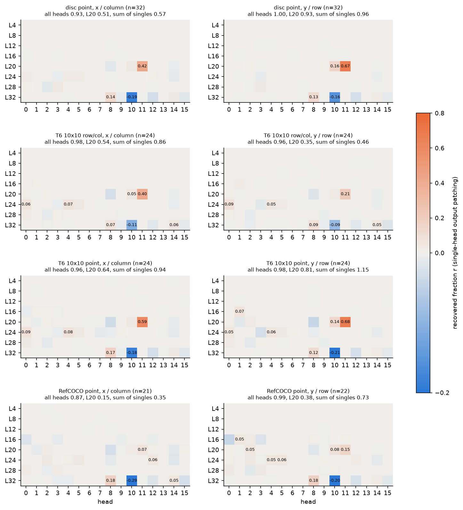

图 heads_single：128 个 full attention head 单独输出 patching 的恢复比例 $r$。每行一个条件，左列为横坐标（x 或列号），右列为纵坐标（y 或行号）；纵轴为层，横轴为 head 编号。发散色标：橙色为正恢复，蓝色为负恢复，灰色为 0；单元格中标出 $\lvert r \rvert \geq 0.05$ 的值。

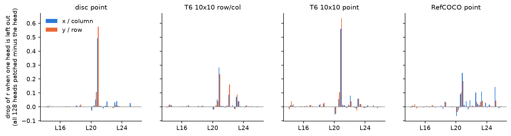

图 heads_loo：从全部 128 个 head 中去掉一个 head（层 16、20、24 的 48 个 head）时恢复比例的下降。蓝色为横坐标，橙色为纵坐标；横轴刻度标在每层 head 0 的位置。

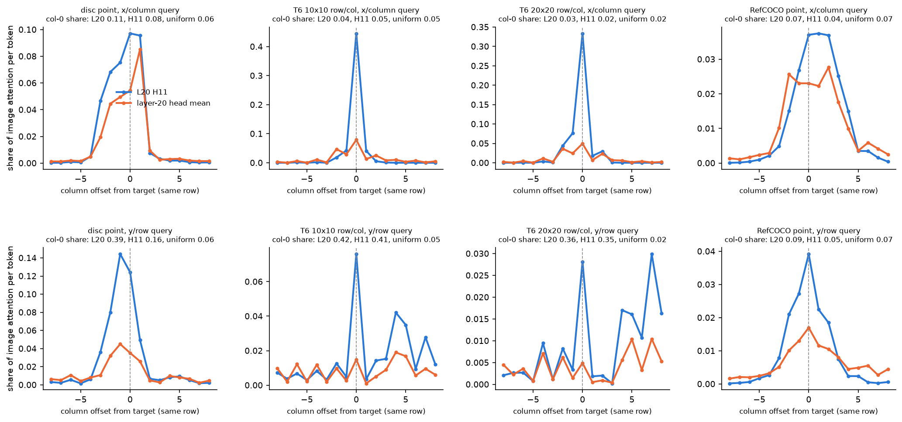

图 rowcol_profile：目标所在 token 行上，各列相对目标的 attention 分布（2.5e 的记录）。上行为横坐标 query，下行为纵坐标 query；蓝色为 L20 H11，橙色为层 20 的 head 平均；纵轴为每个 token 占图像 attention 的比例；标题给出第 0 列（行首）的质量及其均匀分布值。

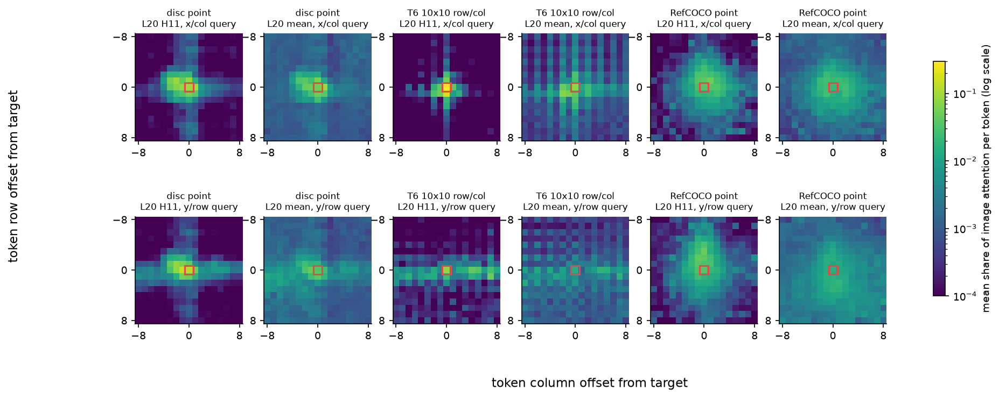

图 aligned_attention：以目标 token 为中心对齐后平均的层 20 attention（±8 个 token）。色标为 viridis 对数刻度，单位为每个 token 占图像 attention 的比例；红框为目标 token。

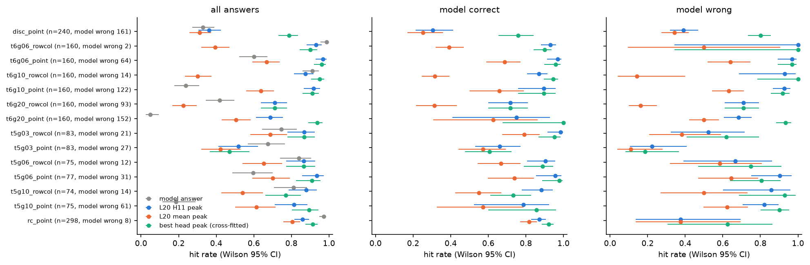

图 attention_answer：模型答案与 attention 解码的命中率（Wilson 95% CI）。左为全部回答，中为模型答对的回答，右为模型答错的回答；灰色为模型答案，蓝色为 L20 H11 峰值，橙色为层 20 head 平均峰值，绿色为交叉拟合的最佳 head 峰值。

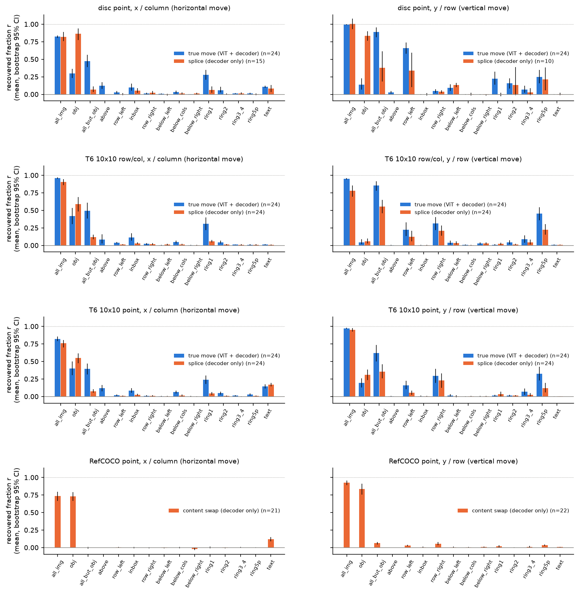

图 kv_groups：图像 KV 子集 patching 的恢复比例（均值与 bootstrap 95% CI）。蓝色为真实移动，橙色为拼接对照或 RefCOCO 内容交换；左列为横向位移，右列为纵向位移。

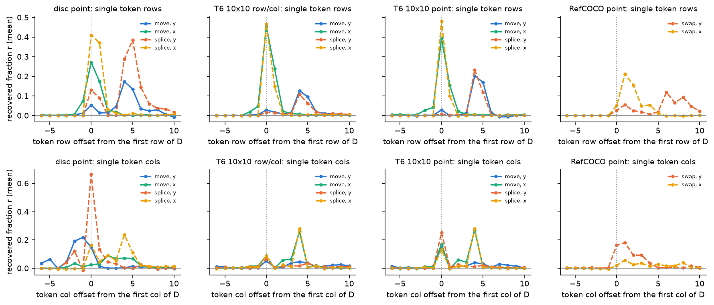

图 kv_rows_cols：只替换单个 token 行（上行）或单个 token 列（下行）全部 token 的 KV 时的恢复比例，横轴为相对 $\mathcal{D}$ 首行或首列的偏移。实线为真实移动，虚线为拼接对照或内容交换；颜色区分配对与坐标轴（见图例）。

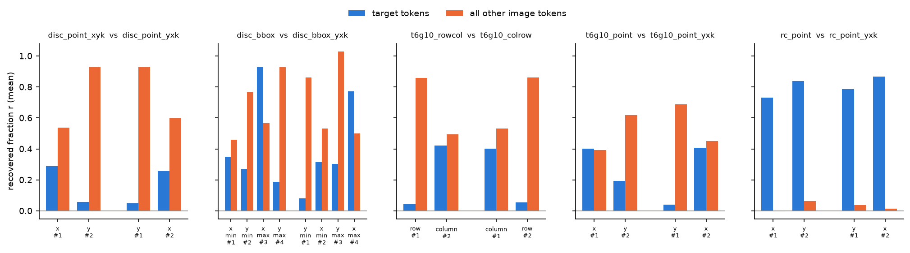

图 order：交换输出顺序后每个数值的恢复比例。蓝色为只替换目标 token 的 KV，橙色为只替换目标以外全部图像 token 的 KV；横轴标签为数值名与其输出序号。

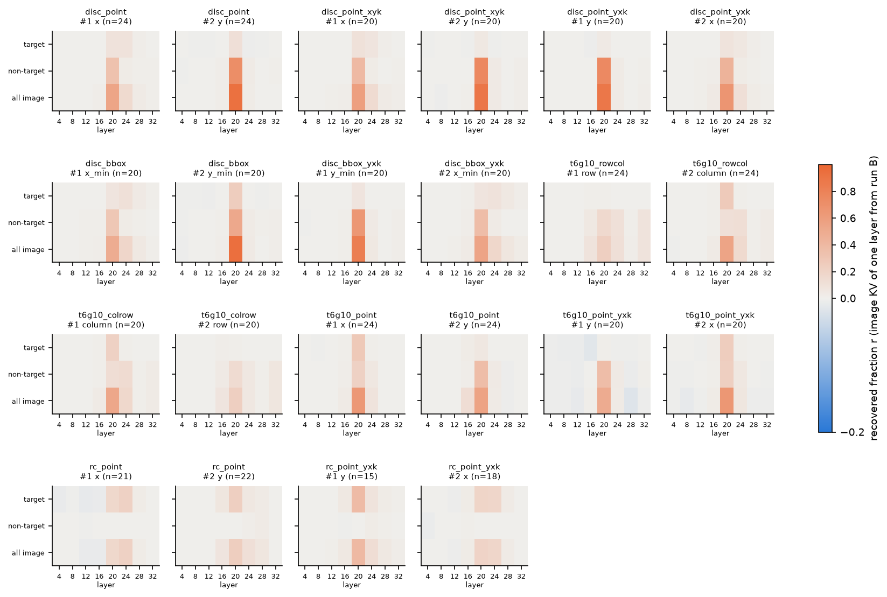

图 layer_group_per_value：每个输出数值的“层 × token 组”归因。每个面板的行依次为目标 token、目标以外的图像 token、全部图像 token，列为只替换该 full attention 层的 KV；发散色标同图 heads_single，单位为恢复比例 $r$。只列出满足条件的数值不少于 5 个的面板。

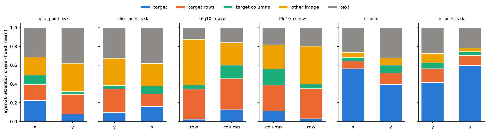

图 step_attention：每个坐标数字 query 处层 20 head 平均的 attention 分配。蓝色为目标，橙色为目标 token 行，绿色为目标 token 列，黄色为其他图像 token，灰色为文本。

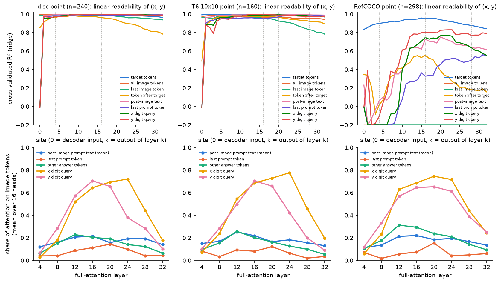

图 flow：上行为各 site（0 为 decoder 输入，$k$ 为第 $k$ 层输出）上目标 $(x, y)$ 的交叉验证 ridge $R^2$，颜色区分位置组（见图例），纵轴下限截断在 −0.2；下行为各 full attention 层 16 个 head 平均的图像 attention 占比，颜色区分 query 位置组。

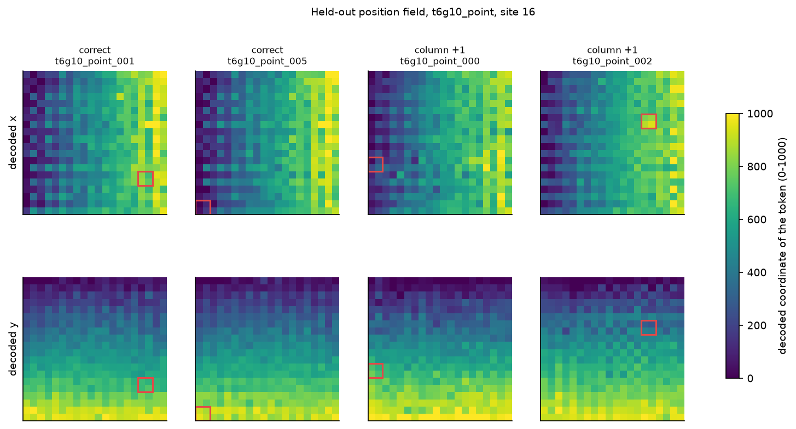

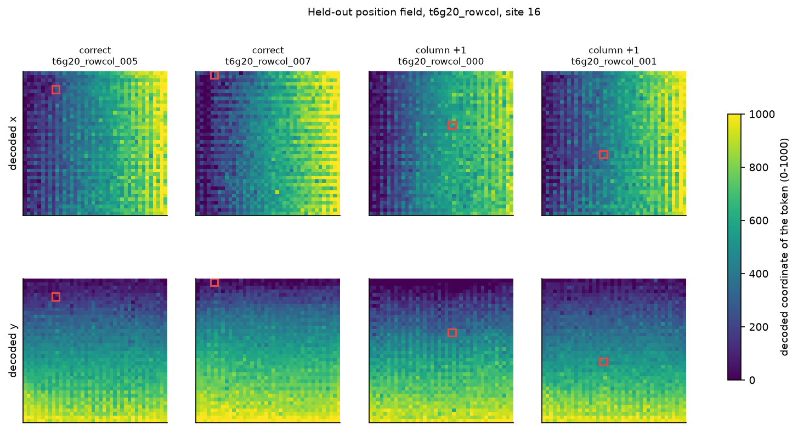

图 field_t6g10_point 与 field_t6g20_rowcol：site 16 留出折上解码的位置场，左两列为答对的图像，右两列为列号多计 1 的图像；上行为每个 visual token 解码的 x，下行为解码的 y。色标为 viridis，单位为 0–1000 坐标；红框为目标 token。
