# 坐标数字读出的失败机理（实验 3.12）

实验日期：2026-10-20。本文属于[位置信息与坐标读取](plan.md)研究，执行[实验 3.12 设计](design_digit_failure.md)，承接[实验 3.6 第一轮](results_2026-10-15_coordinate_value.md)、[第二轮](results_2026-10-16_coordinate_value_r2.md)与[实验 3.9](results_2026-10-16_readout_tool.md)。第二位数字的信息来源、读出几何与中心先验的机制由[实验 3.12 第二轮](results_2026-10-21_digit_failure_r2.md)进一步分析。模型为 Qwen3.5-9B，bfloat16、SDPA、greedy decoding，thinking off，全部提示为 direct-answer 提示。

## 通俗讲述

Qwen3.5 回答“红色圆在哪里”时，内部状态以约 5 个单位（0–1000 坐标）的精度知道圆心位置，写出的数字却会向 500 吸附、在图像左侧整体偏小、在网格中落到右侧一列，而且第二个数字几乎是随机的。实验 3.6 已经排除了表示本身的问题：状态沿真实坐标排成一条平滑、精确的曲线。本实验要回答的是，把这条曲线上的读数写成“3”“5”“7”三个 token 的过程中，信息在哪里丢失，四类缺陷各自来自哪一步。

我们的出发点是一个简单的数学事实。数字 token 的 logit 是最后一层 hidden state 的线性函数；若读出相关的变化只有一维，即读出看到的是一个随坐标单调变化的量 $z$，每个数字 token 的 logit 就是 $z$ 的线性函数，哪条直线最高就输出哪个数字。十条直线的最高者只能按顺序换手，每个数字只能赢得坐标轴上连续的一段。“一维”是经验假设：第二轮实测首位数字的 logit 轨迹是一段二维圆弧，数字按相位排成一圈，坐标转动的角度只覆盖一圈多，因此同样每个数字只赢得一段，分带的结论不变（第二轮第 3.1 节）。首位数字恰好需要这种“分带”模式，十位数字却需要以 100 为周期的锯齿：数字“0”要同时赢得 0–9、100–109、200–209 等十个互不相连的区间。单调量的线性读出产生不了锯齿（图 1）。要写出十位，网络必须利用已经写出的首位数字 $k$，计算“组内偏移” $x - 100k$，再以十倍于首位的增益分带；或者拥有一个周期为 100 的分量。

为了看清模型实际计算了什么，我们设计了“首位数字析因”：对同一张图像，把首位数字依次强制为 1–9，记录模型在第二位上的分布。这一操作同时提供了三类比较：保持 $k$ 交换图像，测量图像对第二位的作用；保持图像交换 $k$，测量已写出的首位对第二位的作用；强制错误的 $k$，观察第二位如何反应，从而判断第二位是按数位复制、按组内偏移计算，还是只依赖先验。我们还以空白画布作为“内容为空的输入”，测量模型不看图时的数字先验，并在计数、文本给出像素坐标、纯文本位置三类任务上做同样的测量。

结果给出一条清楚的因果链。第一，第二位数字确实按组内偏移计算：$k$ 偏小时它偏向 9，$k$ 偏大时偏向 0，图像与 $k$ 的交互作用占第二位 logit 方差的 65%–82%。但这一计算的增益只有理想值的三分之一，在正确的百位区间内，期望第二位随偏移的斜率为 0.34（理想为 1），相当于约 50 个单位的读出分辨率；一个只有 10 个单位宽的数位因此几乎读不出来，模型落回先验。第二，先验是数值层面的“中心先验”：空白画布上强制首位为 4 时，第二位为 9 的概率为 0.58（y 为 0.91）；强制首位为 5 时，第二位为 0 的概率为 0.51（y 为 0.97）。这正是 498 与 500 平台的来源。以空白画布做 contextual calibration（减去先验的 log 概率）后，真值位于 400–610 时输出落在 480–520 的比例由 0.89 降到 0.33（x），由 0.78 降到 0.15（y）。第三，图像左侧的整体偏小与先验无关：首位数字在 200 与 300 两个边界上的切换位置向右偏了 70–80 个单位，切换本身却很陡（过渡宽度约 10 个单位），校准不改变这一偏移。它是首位读出映射的参数性偏差，线性 probe 读出的表示没有这种偏差。第四，网格中的“列号多计 1”来自另一种吸附：10×10 网格中 90% 的点答案落在单元边界上（$n/10$ 的整百数），6×6 网格中落在 167、333、500 等 $1/6$ 的倍数上，答案是“第几列 ÷ 列数”的换算值，取到了单元边界而非中心。

把计数与文本换算放在一起看，可以回答“这是否是逐位输出的固有缺陷”。数位的锐利程度由“数位宽度 ÷ 该步读出分辨率”决定：文本给出像素坐标时两位读出分辨率为 2–5 个单位，两位都锐利（真值概率 0.96 与 0.97）；计数的读出分辨率约为 3 个，十位锐利、个位模糊；图像坐标的第二位读出分辨率约为 50 个单位，而该位宽度只有 10 个单位。逐位输出格式本身并不阻止精确输出，缺陷在于从视觉连续量到数字 logit 的映射增益太低。由于第二位已经具备按组内偏移计算的结构，并且所需信息在该位置可以线性读出（probe 换算的第二位相差不超过 1 的比例为 0.95），这一缺陷更像是训练信号不足造成的参数问题，而不是更多数据也无法消除的结构限制。纯文本位置任务在首位上就已失败（首位正确率 0.11），说明文本 LLM 在长序列中数位置的能力本身不足，这一对照不能用于判断数字输出。

## 1. 研究问题与主要结论

本实验回答 PI 的七个问题：从表示与权重两方面解释压缩、吸附、列号多计 1 与十位均匀（Q1）；直观解释第二位数字为什么均匀（Q2）；第二位先验的来源与图像、上下文的贡献（Q3）；这是否是逐位输出的固有缺陷（Q4）；第二位数字所需信息在哪里丢失（Q5）；数据与结构哪一个是限制（Q6）；500 吸附、压缩与列号多计 1 分别属于表示问题还是参数问题（Q7）。主要结论如下，括号内为支持该结论的小节与图。

1. **单调坐标的线性读出只能产生“分带”，第二位数字需要组内偏移或周期分量（理论与模拟，第 3.1 节，图 1）。** 在合成数据上（不涉及模型激活），以一维单调编码训练的线性 softmax 读出百位的正确率为 0.95，读出十位为 0.11（机会水平 0.10）；加入首位数字的 one-hot 后，十位可以达到 0.95，但需要大到抵消 $100k$ 的偏置，抵消项与决定数字的 logit 差之比为 86；以周期为 100 的特征读出十位为 0.61（表示噪声 5 个单位下的上限）。这一结果把“第二位均匀”转化为一个可检验的问题：模型是否计算了组内偏移，增益是否足够。
2. **第二位数字按组内偏移计算，但增益只有理想值的三分之一（第 3.3 节，图 3、4）。** 图像与首位数字的交互作用占第二位 logit 方差的 65%–82%，图像主效应只占 2%。强制错误的首位时，$k$ 偏小使第二位为 9 的概率升至 0.21，$k$ 偏大使第二位为 0 的概率升至 0.18–0.23。在正确的百位区间内，期望第二位随组内偏移的斜率为 0.34（x 与 y），RefCOCO 为 0.57，文本换算为 0.99。拟合的高斯证据宽度为 50 个单位，是第二位宽度的 5 倍。
3. **第二位的先验是以 500 为中心的数值先验，由 MLP 27–31 依据已写出的首位数字写入（第 3.2、3.7 节，图 2、7；机制见第二轮第 3.5 节）。** 空白画布上 $P(9 \mid 4) = 0.58$、$P(0 \mid 5) = 0.51$（y 为 0.91 与 0.97），其余首位之后第二位近乎均匀（最大 0.16）。在 sweep 图像上平均，同样的两个概率为 0.30–0.61。DLA 显示这一“4 之后为 9、5 之后为 0”的额外 logit（1.1–2.6 nats）主要由 MLP 27–31 写入；L32 H8 的正向贡献较小（0.1–0.4 nats），同样读取首位 token 的 L32 H10 以更大的负向贡献抑制先验（第二轮第 3.5 节）。保持图像与首位不变、只把前缀中的 x 值从 200 改为 500 或 800，第二位分布的 JS 散度为 0.105 bits，与交换图像的 0.105–0.124 相当，上下文只占 4% 的方差。
4. **500 吸附是先验造成的，压缩是首位读出边界的参数性偏移，两者都不在表示中（第 3.5 节，图 5、6）。** 空白画布校准使 400–610 区间的输出落在 480–520 的比例从 0.89 降至 0.33（x）、从 0.78 降至 0.15（y，真值比例 0.19），首位的 500 边界本身只偏 −8（x）。x 的 200 与 300 边界向右偏 80 与 70 个单位，过渡宽度只有 8–10 个单位，校准后不变；x < 380 段输出斜率在校准前后为 0.81 与 0.75。实验 3.6 第二轮已表明同一位置的 probe 读数斜率为 0.98–1.03。
5. **网格的列号多计 1 来自吸附到单元边界（第 3.6 节，图 8）。** 10×10 网格中 18/20 的点答案更接近单元边界，12/20 落在右侧一列；6×6 网格的答案到最近边界的中位距离为 0.002 个单元。空白画布校准不改变网格的首位正确率（0.45 对 0.45），吸附依赖图像，对应“列序号 ÷ 列数”的换算；实验 3.11 显示同一类图像上 L20 H11 的 attention 峰值落在正确单元的比例为 0.92，读取本身正确。
6. **数位锐利度由“数位宽度 ÷ 该步读出分辨率”决定，逐位输出本身不是缺陷（第 3.4 节，图 5 右）。** 拟合的读出分辨率：文本换算两位为 5.4 与 2.0 个单位（真值概率 0.96、0.97），计数为 2.6 与 3.3 个（0.85、0.22），图像坐标第二位为 50（disc）与 31（RefCOCO）个单位（0.13–0.22）。全部族的点落在同一条“高斯证据”理论曲线附近。
7. **第二位所需信息到达了该位置，丢失发生在 MLP 把它转换为数字 logit 的一步（第 3.7、3.8 节，图 7、9、10；第二轮第 3.3、3.4 节）。** $q_1$ 处 ridge 读出坐标的误差为 4.4–5.5 个单位，换算出的第二位相差不超过 1 的比例为 0.95–0.99，模型自己为 0.27–0.41。$q_1$ 在层 12–20 仍把 46%–52% 的 attention 放在图像上。图像使首位真值数字的 logit 平均提高 4.5 nats，使第二位真值数字只提高 0.37–0.46 nats；两者的写入者都是 MLP 28–32。第二轮的 patching 表明，$q_1$ 处的坐标信息因果地来自前一位置 $q_0$ 的后层状态（经层 25–31 的 DeltaNet 短卷积），第二位读出的主要是首位读出偏向相邻数字的程度。

**解释（非测量结论）。** 四类缺陷来自读出端的三个参数性成分：首位读出的少数边界位置偏移（压缩），依据首位写入的中心先验（500 吸附与 498），以及第二位读出增益不足（第二位均匀）。网格的边界吸附是第四种：读出走“序号 ÷ 列数”的换算。表示中具备全部所需信息，第二位已经具有正确的条件计算结构，只是增益太低；这与“训练标注本身只有数十个单位的精度、交叉熵的最优第二位分布因此接近先验”的解释一致，提示以精确标注的数据训练可以提高增益。这一解释没有直接检验（第 4 节）。第二轮把“增益低”具体化为：第二位读出的主要是首位读出偏向相邻数字的程度，其分辨率由首位边界宽度决定（第二轮第 3.4 节）。

## 2. 实验设计与执行

### 2.1 输入

设计见[第 4.1 节](design_digit_failure.md)。下图为各输入族的实际输入，右侧为答案前缀与两个文本任务的提示（截断）。

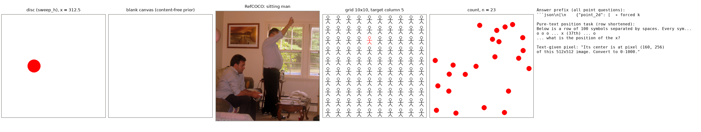

*图 0：输入示例。从左至右：单个红色圆（sweep_h，x = 312.5）、空白画布、RefCOCO（“sitting man”）、10×10 网格（红色目标位于第 5 列）、计数（23 个圆）、答案前缀与文本任务。所有 point 问题的答案前缀为四空格缩进的代码块，前缀之后接被强制的首位数字。*

### 2.2 操作与规模

1. **首位数字析因。** 804 个输入单元、6909 行（每行一次强制首位），记录 $q_0$ 与 $q_1$ 的数字分布、层 8–32 的 residual 与逐组件 DLA。DLA 之和与数字 logit 的相对误差为 0.3%；批量前向与单行前向的数字 log 概率最大相差 0.13 nats。行按提示长度组成右侧 padding 的 batch（每 batch 至多 6000 个 token）。
2. **与实验 3.6 的一致性。** 析因中 $q_0$ 的 arg-max 首位与 3.6 第一轮 greedy 答案一致的比例为 112/113（x）与 108/113（y），前两位一致为 97/103 与 84/102，说明统一答案前缀没有改变模型的数字选择。
3. **网格 greedy 答案。** 72 张网格图以手写批量 greedy 解码（等长 prompt，无 padding）。与参考 generate 的 20 例抽查中 13 例坐标完全一致，其余 7 例中 5 例相差不超过 12 个单位，2 例在两个候选值之间切换（667 对 833，500 对 417）。
4. **attention。** 264 个单元在 full-attention 层重新计算 $q_0$、$q_1$ 的 softmax attention，与模块输出的相对误差不超过 1.9%。
5. **GPU 用量。** GPU 紧张，析因在两张 A800 上以权重拆分方式运行约 37 分钟，网格解码与 attention 约 8 分钟，冒烟测试约 5 分钟，合计约 1.5 GPU 小时。混合 A800 与 A40 的拆分因 Triton kernel 的 shared memory 限制失败，未产生数据。CPU 分析在模型卸载后运行。

### 2.3 统计

比例报告 Wilson 95% 区间；均值报告 bootstrap 95% 区间；解码变体与 greedy 的配对差异用 sign-flip 置换检验。方差份额为在数字维度中心化后的平方和份额。

## 3. 结果

### 3.1 理论：单调编码能读出哪些数位

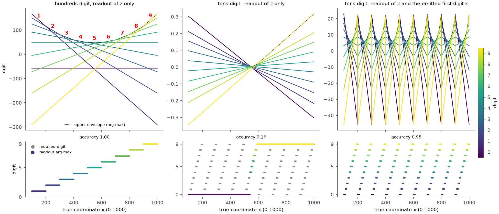

*图 1：线性 softmax 读出的模拟（合成数据，不涉及模型激活）。每个面板是在合成数据上拟合的多项 logistic 回归：输入为 $z = x$（无噪声，$x$ 取 100–999.9 之间等距的 2001 个点），标签为 $x$ 的真实百位（左）或十位（中、右）数字，L2 正则 $10^{-6}$，L-BFGS 优化；正确率为同一组点上 arg-max 与标签一致的比例。上行：十个数字的 logit 随 $x$ 的变化（颜色为数字，viridis，0–9），黑色点线为上包络，左图红色数字标出包络上每一段的胜出数字；下行：灰点为所需数字，彩色点为读出的 arg-max。左：百位，只读 $z$；中：十位，只读 $z$；右：十位，读 $z$ 与已写出首位的 one-hot（每个百位区间内 logit 为直线，跨区间时偏置跳变）。模型实际的读出几何见第二轮图 1。*

| 读出（表示噪声 5 个单位） | 正确率 | 相差不超过 1 | 抵消比 |
| --- | --- | --- | --- |
| 百位，读 $z$ | 0.95 | 1.00 | 27 |
| 十位，读 $z$ | 0.11 | 0.32 | 5 |
| 十位，读 $z$ 与 $k$（正则化 $10^{-4}$） | 0.36 | 0.79 | 86 |
| 十位，读 $z$ 与 $k$（正则化 $10^{-6}$，无噪声） | 0.95 | — | — |
| 十位，读 $\cos(2\pi z/100)$、$\sin(2\pi z/100)$ | 0.61 | 0.99 | 10 |

表中各行在 $x \sim U[100, 1000)$ 的 20000 个合成样本上计算，$z = x + \epsilon$，$\epsilon \sim \mathcal{N}(0, 5^2)$ 模拟表示噪声（第一行至第三行与第五行），前一半样本拟合、后一半测试；第四行与图 1 相同，为无噪声、弱正则的拟合。“抵消比”为单个 logit 项的最大绝对值与前两名 logit 之差的比值，用于衡量读出依赖多大的相互抵消。

1. **百位可以由单调编码线性读出，十位不能。** 一维情形下每个数字的获胜区域是若干半直线的交集，即一个区间；十位要求每个数字占据十个区间，任何参数都做不到，正确率停在机会水平。
2. **以首位为条件能恢复十位，但需要精确抵消。** 在第 $k$ 个百位区间内令十位的 logit 为 $s\, d\, (z - 100k)$，就能画出十条宽 10 的带。偏置必须精确抵消 $s\, d\, 100k$；在适度正则化下读出只能达到 0.36，抵消比为 86。网络更可能的实现方式是先在表示中算出组内偏移，再以较大的增益分带。第 3.3 节在模型中检验这一点。

**中间面板（十位，只读 $z$）为什么与左面板不同。** 百位要求每个数字占一段连续区间，十条直线的上包络恰好能做到。十位要求每个数字占十段互不相连的区间，而直线的上包络中每个数字至多出现一次，不存在任何参数能画出锯齿。优化器因此只能找到退化解：所有直线几乎交于一点（斜率只有 ±0.3），左半段写 0、右半段写 9，正确率 0.16，接近机会水平 0.10。这一面板说明，十位数字可以仅仅因为读出形式而失败，表示中并不缺少信息。

**右面板（锯齿）与“先定百位区间、再在区间内读十位”的两阶段过程。** 右面板的读出同时看到 $z$ 与首位数字的 one-hot，logit 的形式为

$$
\ell_d(z, k) = a_d\, z + b_{d,k} ,
$$

其中 $a_d$ 是数字 $d$ 的斜率，对所有首位 $k$ 相同；$b_{d,k}$ 是首位为 $k$ 时数字 $d$ 的偏置，即 one-hot 的权重。拟合得到的偏置满足 $b_{d,k} \approx -100\, a_d\, k + c_d$（相邻首位的偏置差 $b_{\cdot,k+1} - b_{\cdot,k}$ 与 $-100\, a$ 的相关为 1.000，范数比为 1.00），代入得

$$
\ell_d(z, k) \approx a_d\, (z - 100k) + c_d .
$$

这正是两阶段过程：先由首位确定百位区间，再以组内偏移 $z - 100k$ 读十位。两种写法在数学上完全等价——one-hot 使直线在每个百位区间内整体平移，与“先减去 $100k$ 再读”是同一个函数。图中每个区间内的十条直线形状相同，只是被平移到该区间；锯齿完全来自逐区间的平移。两阶段写法同时揭示了代价：十个数字挤在 100 个单位内，斜率 $a_d$ 必须约为百位读出的十倍，偏置 $-100 a_d k$ 随之增大，需要与 $a_d z$ 精确抵消。

**两阶段过程在模型前向计算中的对应物。** 首位数字 $k$ 是 $q_1$ 位置的输入 token，它的 embedding 从第 0 层起就在 $q_1$ 的 residual 中；这个位置既是首位数字 token 所在的位置，也是预测第二位的位置，因此不需要 attention 去读取它。坐标信息则由前一位置 $q_0$ 的后层 hidden state 经 DeltaNet 层 25–31 的短卷积传入 $q_1$（第二轮第 3.3 节）。二者在 $q_1$ 的 MLP 27–31 中相遇，对应于上式中“减去 $100k$”的组合。第二轮的平移检验表明，远离 500 时把图像右移 100 个单位并把 $k$ 加 1，第二位 logit 只留下单独移图像时 21%–41% 的变化，模型部分实现了这一减法；但模型中的组合是非线性的，第二位读出的主要是首位读出偏向相邻数字的程度（第二轮第 3.2、3.4 节）。

### 3.2 模型实际输出的数字

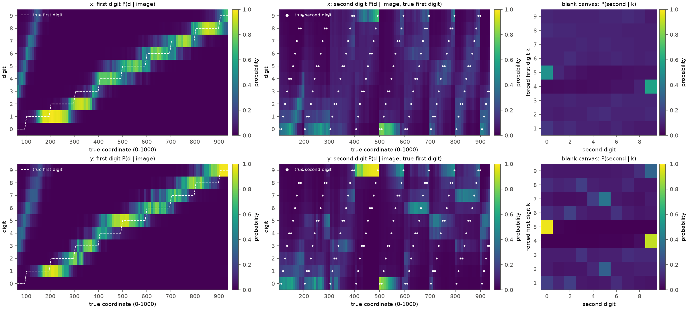

*图 2：sweep 上的数字分布（颜色为概率，viridis，0–1）。左：首位数字 $P(d \mid \text{image})$，白色虚线为真值首位；中：首位强制为真值时的第二位分布，白点为真值第二位；右：空白画布上强制首位 $k$ 后的第二位分布。上行 x，下行 y。*

1. **首位数字分带清楚，第二位数字没有锯齿。** 首位真值概率为 0.53（x）与 0.49（y）。第二位真值概率为 0.145 与 0.128，熵为 2.68 与 2.29 bits（均匀为 3.32）。中图中真值白点构成清晰的锯齿，而概率的亮带只出现在 400–600 区间：首位为 4 时第二位为 9，首位为 5 时第二位为 0。
2. **空白画布上的第二位先验集中于“最接近 500”的数字。** x 的先验 $P(9 \mid 4) = 0.58$、$P(0 \mid 5) = 0.51$，y 为 0.91 与 0.97；其余首位之后第二位近乎均匀（最大 0.16）。y 的首位先验也几乎全部压在 5 上（0.80），x 为 4 与 5 各 0.20。模型不看图时回答“图像中心”，在首位被强制时取允许范围内最接近 500 的值：先验作用在数值上，并通过逐位分解表现为“4 之后是 9、5 之后是 0”。

### 3.3 第二位数字的来源：图像、首位与上下文

**结论：写第二位数字时，坐标信息来自写出首位数字的前一位置 $q_0$ 的 hidden state，图像与前缀中的其他数值都不直接提供信息；已写出的首位数字 $k$ 提供“位于哪个百位区间”的条件，二者在 $q_1$ 的 MLP 27–31 中组合。** 本节的析因数据给出相关层面的证据：图像对第二位几乎没有独立于 $k$ 的作用（主效应 2%–3%），图像的作用随 $k$ 改变方向（交互 65%–82%），前缀中其他数值的作用很小（4%）。因果证据来自第二轮第 3.3 节的 patching（disc，64 对）：在第二位这一步替换全部图像 key/value，第二位分布只恢复运行 $B$ 变化的 0.03，经 L20 H11 的路径为 0.01；替换 $q_0$ 在层 25–31 的 DeltaNet 短卷积状态恢复 0.70，替换全部 DeltaNet 状态恢复 0.95。第二位读到的主要是首位读出偏向相邻数字的程度（第二轮第 3.4 节）。下面的表格与图是这一结论的析因证据。

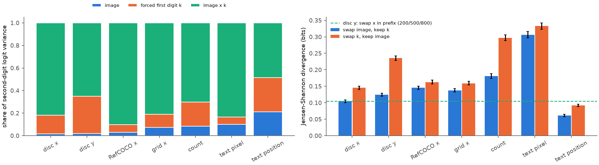

*图 3：左：第二位 logit 方差的份额（蓝：图像主效应；橙：首位数字主效应；绿：图像 × 首位交互）。右：Jensen–Shannon 散度（蓝：保持首位、交换图像；橙：保持图像、交换首位；绿色虚线：disc y 保持图像与首位、只交换前缀中的 x 值），误差线为 bootstrap 95% 区间。*

| 输入族 | 图像 | 首位 $k$ | 交互 | JS 交换图像 | JS 交换 $k$ |
| --- | --- | --- | --- | --- | --- |
| disc x | 0.02 | 0.17 | 0.82 | 0.105 | 0.145 |
| disc y | 0.02 | 0.33 | 0.65 | 0.124 | 0.235 |
| RefCOCO x | 0.03 | 0.07 | 0.90 | 0.145 | 0.163 |
| 网格 x | 0.07 | 0.12 | 0.81 | 0.137 | 0.159 |
| 计数 | 0.09 | 0.21 | 0.70 | 0.181 | 0.297 |
| 文本换算 | 0.10 | 0.07 | 0.84 | 0.306 | 0.333 |
| 纯文本位置 | 0.21 | 0.30 | 0.48 | 0.061 | 0.092 |

1. **第二位几乎不存在独立于首位的图像效应，主要是图像与首位的交互。** 图像主效应只有 2%–3%（disc、RefCOCO）。交互份额高说明图像的作用随 $k$ 改变方向，这正是组内偏移计算的特征：同一张图像在 $k$ 偏小时推向 9，在 $k$ 偏大时推向 0。
2. **文本上下文的作用小。** disc y 中只改变前缀里的 x 值（200、500、800）时，上下文主效应占 4%，JS 散度 0.105 bits，与交换图像相当，远小于交换首位的 0.235。第二位的“先验”因此主要由已写出的首位决定，前面写出的其他数值几乎不影响它。

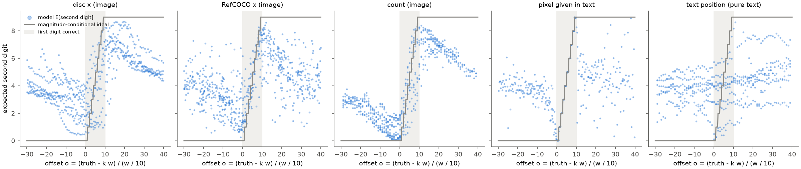

*图 4：clamp 测试。横轴为以第二位宽度为单位的组内偏移 $o = (x - k w)/(w/10)$，灰色区域为首位正确（$0 \le o < 10$）；蓝点为模型的期望第二位，每点为一个（图像，$k$）组合；灰线为按组内偏移精确计算时的理想阶梯。*

| 输入族 | 区间内斜率（理想 1） | 区间内相关 | $o \in [-5, 0)$ 时期望 | $o \in [10, 15)$ 时期望 | 远离区间时期望 |
| --- | --- | --- | --- | --- | --- |
| disc x | 0.34 | 0.47 | 2.5 | 6.4 | 4.2–4.6 |
| disc y | 0.34 | 0.40 | 2.8 | 6.9 | 4.0 |
| RefCOCO x | 0.57 | 0.82 | 2.3 | 6.8 | 4.3–4.6 |
| 网格 x | 0.20 | 0.21 | 3.1 | 6.1 | 3.8–4.3 |
| 计数 | 0.58 | 0.73 | 0.9 | 6.9 | 3.0–5.1 |
| 文本换算 | 0.99 | 1.00 | 2.0 | 4.9 | 4.3–4.5 |
| 纯文本位置 | 0.12 | 0.21 | 3.6 | 4.0 | 4.1–5.3 |

3. **图像坐标的第二位是组内偏移的平滑、低增益函数。** disc 的期望第二位在 $o$ 从约 −10 到 +15 的范围内由 2 升到 7，跨度约 25 个第二位单位（250 个坐标单位），远离区间后回到约 4.5 的先验均值。按组内偏移计算的结构存在，增益约为理想值的三分之一。
4. **文本给出的数值走另一条路径。** 文本换算在区间内精确（斜率 0.99），强制错误首位时第二位分散（真值第二位概率 0.10），没有向 0 或 9 收拢：模型沿着文本数字的换算路径逐位写出结果，这条路径不包含与图像坐标同类的数值比较。计数介于两者之间，$k$ 偏大时第二位为 0 的概率达到 0.52。
5. **纯文本位置任务在首位就已失败。** 首位 arg-max 的正确率为 0.11，与真值的相关为 −0.20，模型没有从 100 个符号中得到 x 的位置，第二位因此无从比较。

### 3.4 读出分辨率与数位锐利度

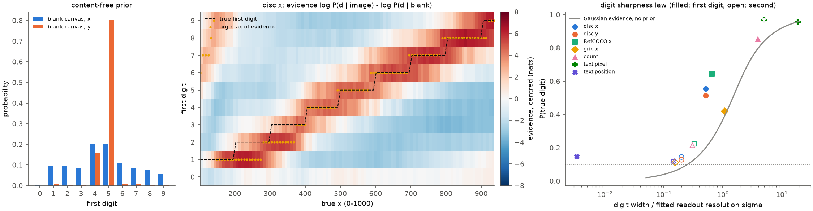

*图 5：左：空白画布的首位先验（蓝 x，橙 y）。中：disc x 的首位证据 $\ell^{(0)} - \pi^{(0)}$（每行减去行均值，红正蓝负，单位 nats），黑色虚线为真值首位，黄点为证据的 arg-max。右：各输入族的真值数字概率对“数位宽度 ÷ 拟合的读出分辨率 $\sigma$”（实心为首位，空心为第二位），灰线为无先验的高斯证据理论曲线，点线为 0.1。*

| 输入族 | 首位宽度 | 首位 $\sigma$ | 首位真值概率 | 第二位宽度 | 第二位 $\sigma$ | 第二位真值概率 |
| --- | --- | --- | --- | --- | --- | --- |
| disc x / y | 100 | 196 / 196 | 0.56 / 0.51 | 10 | 50 / 50 | 0.145 / 0.128 |
| RefCOCO x | 100 | 153 | 0.64 | 10 | 31 | 0.22 |
| 网格 x | 100 | 93 | 0.42 | 10 | 64 | 0.11 |
| 计数 | 10 | 2.6 | 0.85 | 1 | 3.3 | 0.22 |
| 文本换算 | 100 | 5.4 | 0.96 | 10 | 2.0 | 0.97 |
| 纯文本位置 | 10 | ≥ 3000 | 0.15 | 1 | 6.9 | 0.12 |

$\sigma$ 为第 4.4 节高斯证据模型的拟合值（坐标为 0–1000 单位，计数为个数，文本位置为序号）。图像坐标的首位拟合较差（KL 0.89–1.02 nats，只有先验时为 1.4）：首位的误差主要是边界的位置偏移（第 3.5 节），单一的 $\sigma$ 把偏移也计入宽度，因此首位的 $\sigma$ 只作参照。第二位的拟合可靠（KL 0.22–0.29，只有先验时 0.30–0.46）。

1. **第二位读出分辨率约为 50 个单位，是该位宽度的 5 倍。** RefCOCO 为 31 个单位，略好于合成刺激，与其第二位真值概率较高（0.22）一致。第 3.3 节的斜率给出同一结论：分辨率约为 $10 / 0.34 \approx 30$ 个单位。实验 3.6 第二轮所说的“约 100 个单位的读出分辨率”应当细化：首位切换本身很陡（第 3.5 节），模糊的是第二位。
2. **各族的点落在同一条曲线附近。** 文本换算的两位都远在曲线右端；计数的首位在右端、个位在 $w/\sigma \approx 0.3$；图像坐标的第二位在 0.2 左右。数位是否锐利取决于该步读出看到的数值精度相对数位宽度有多大，与该数位是第几位、数值是否逐位输出无关。

### 3.5 Q7：500 吸附、压缩与先验

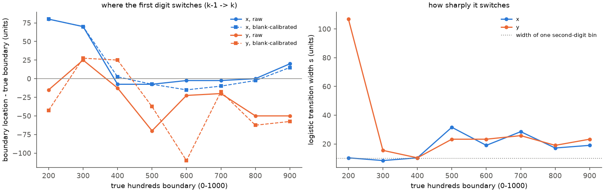

*图 6a：首位数字的切换边界。左：对 $P(\text{first} \ge k)$ 拟合 logistic 曲线得到的切换位置减去真值边界（蓝 x，橙 y；实线未校准，虚线为空白画布校准后）；右：logistic 过渡宽度 $s$，点线为第二位的宽度 10。*

| 边界 | 200 | 300 | 400 | 500 | 600 | 700 | 800 | 900 |
| --- | --- | --- | --- | --- | --- | --- | --- | --- |
| x 位置偏移（未校准 / 校准） | +80 / +80 | +70 / +70 | −8 / +2 | −8 / −8 | −2 / −15 | −2 / −10 | 0 / −2 | +20 / +15 |
| x 过渡宽度 | 10 | 8 | 10 | 32 | 19 | 28 | 17 | 19 |
| y 位置偏移（未校准 / 校准） | −15 / −42 | +25 / +28 | −12 / +25 | −70 / −38 | −22 / −110 | −20 / −18 | −50 / −62 | −50 / −58 |
| y 过渡宽度 | 107 | 16 | 10 | 23 | 23 | 26 | 19 | 23 |

1. **首位切换很陡，但个别边界位置偏移。** x 的过渡宽度为 8–32 个单位，首位读出能以约一个第二位宽度的精度切换。x 的 200 与 300 边界分别晚了 80 与 70 个单位：真值 200–280 仍写“1”，300–370 仍写“2”，这就是 x < 380 段的系统偏小。y 的边界整体偏早 20–70 个单位，对应 y 方向在中部以下的偏大。
2. **边界偏移不是先验造成的。** 空白画布校准后 x 的 200、300 边界不动（+80、+70）。x 的首位先验在 1–3 上近乎平坦（0.08–0.10），无法解释 1 与 2 的带被拉长。偏移来自首位读出映射本身；实验 3.6 第二轮第 3.1 节表明同一位置的线性 probe 读数对真值的斜率为 0.98–1.03，表示中没有这种偏移。因此压缩属于参数问题，位于从坐标表示到首位 logit 的读出映射。

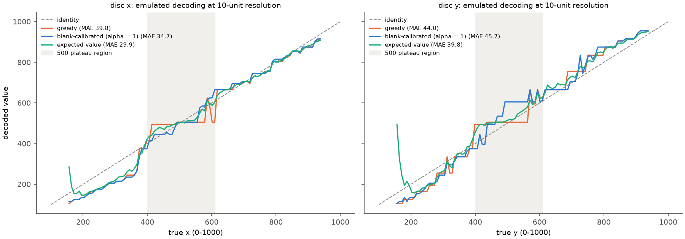

*图 6b：以析因数据模拟的解码（10 个单位分辨率，数值记为 $100k + 10t + 5$）。橙：greedy；蓝：空白画布校准（$\alpha = 1$）；绿：期望值解码；灰色虚线为恒等线，灰色区域为 500 平台区间。真值低于 150 的 12 个样本被排除（模型在这一范围常写两位数，三位数模拟不能表示）。*

| 解码（disc，$n = 101$） | x 平均绝对误差 | x 首位正确率 | x 平台比例 | y 平均绝对误差 | y 平台比例 |
| --- | --- | --- | --- | --- | --- |
| greedy | 39.8 [33.7, 46.1] | 0.71 | 0.89 | 44.0 [39.4, 48.7] | 0.78 |
| 空白画布校准，$\alpha = 1$ | 34.7（−5.1，p = 0.008） | 0.73 | 0.33 | 45.7（+1.7，p = 0.57） | 0.15 |
| 空白画布校准，$\alpha = 0.5$ | 35.8（−4.0，p = 0.011） | 0.70 | 0.59 | 41.2（−2.8，p = 0.11） | 0.52 |
| 图像平均分布校准 | 33.7（−6.0，p = 0.002） | 0.74 | 0.52 | 40.5（−3.6，p = 0.015） | 0.63 |
| 只校准首位 | 38.4（−1.3，p = 0.41） | 0.73 | 0.81 | 46.9（+2.9，p = 0.25） | 0.30 |
| 期望值 | 29.9（−9.8，p < 0.001） | 0.71 | 0.48 | 39.8（−4.2，p = 0.28） | 0.52 |
| 校准 + 期望值 | 28.8（−11.0，p < 0.001） | 0.71 | 0.22 | 53.0（+9.0，p = 0.07） | 0.04 |

“平台比例”为真值在 400–610 时输出落在 480–520 的比例，真值本身的比例为 0.19。

3. **500 吸附由第二位的中心先验产生。** 首位的 500 边界只偏 −8（x），平台来自第二位：首位为 4 时写 9（498），首位为 5 时写 0（500）。校准两位数字时平台比例降到 0.33 与 0.15，只校准首位则基本不变（0.81），说明吸附几乎全部发生在第二位。
4. **校准是去偏工具，对精度的改善有限。** 校准消除了吸附，但 x 的平均误差只降低 5–6 个单位，y 在 $\alpha = 1$ 时变差：y 的空白画布先验极端集中（首位为 5 的概率 0.80），全额减去会过度矫正。RefCOCO 与网格上校准不改善误差（附表见 `results.json` 的 decoding 段）。压缩与第二位的低增益都不在先验里，校准无法触及。

### 3.6 Q7：网格的列号多计 1

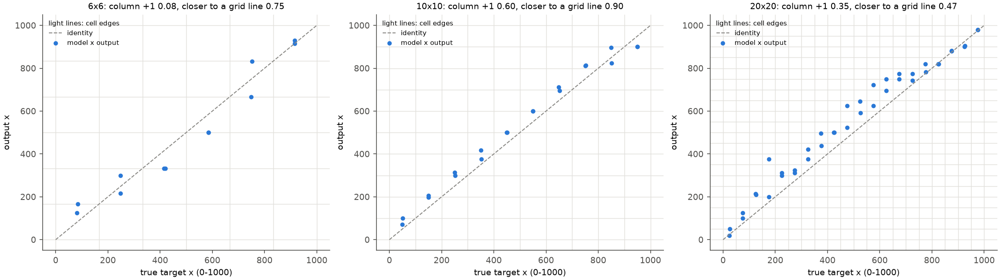

*图 8：网格点答案的 x 输出对真值。浅灰线为单元边界，灰色虚线为恒等线，蓝点为模型输出。*

| 网格 | $n$ | 列号正确 | 多计 1 | 少计 1 | 平均误差（单元） | 到最近边界的中位距离（单元） | 更接近边界的比例 |
| --- | --- | --- | --- | --- | --- | --- | --- |
| 6×6 | 12 | 0.75 | 0.08 | 0.17 | −0.09 | 0.002 | 0.75 |
| 10×10 | 20 | 0.40 | 0.60 [0.39, 0.78] | 0.00 | +0.37 | 0.035 | 0.90 |
| 20×20 | 40 | 0.28 | 0.35 [0.22, 0.51] | 0.00 | +1.13 | 0.31 | 0.48 |

1. **6×6 与 10×10 网格的点答案吸附到单元边界。** 6×6 的答案为 167、333、500、667、833，即 $j/6$ 的倍数；10×10 的答案为 100、200、…、900，是目标单元的右边界 $n/10$（$n$ 为从 1 开始的列号）。右边界属于下一列，列号因此多计 1。与 sweep 上的中心先验不同，这种吸附依赖图像：空白画布校准不改变网格的首位正确率（10×10 为 0.45 对 0.45）。
2. **解释（未直接检验）。** 输出值等于“列序号 ÷ 列数”，说明网格上的坐标走的是计数路线：实验 1.5 表明序号来自计数实例，实验 3.11 显示 L20 H11 的 attention 峰值以 0.92 的比例落在正确单元，读取本身正确。换算时取到了单元边界，没有加上半个单元。20×20 网格没有边界吸附，平均右偏 1.1 个单元，属于另一种误差，本实验未分析其成因。

### 3.7 Q5：组件与权重

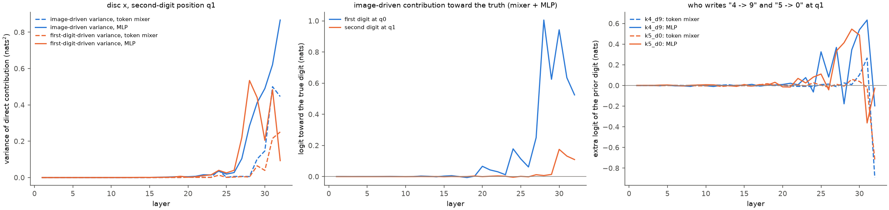

*图 7：disc x 的直接 logit 归因。左：$q_1$ 处各层 token mixer（虚线）与 MLP（实线）的贡献随图像变化的方差（蓝）与随首位数字变化的方差（橙）；中：图像驱动部分朝向真值数字的平均 logit（蓝：$q_0$ 的首位；橙：$q_1$ 的第二位），每层为 mixer 与 MLP 之和；右：“4 之后为 9”（蓝）与“5 之后为 0”（橙）的额外 logit 按层分解。*

1. **图像对第二位 logit 的推动只有首位的十分之一。** 图像驱动部分朝向真值数字的 logit 之和在 $q_0$ 为 4.5（x）与 4.8（y）nats，在 $q_1$ 为 0.46 与 0.37 nats。图像驱动的总方差在 $q_0$ 为 67–80 nats²，在 $q_1$ 为 4.4–4.8 nats²。两处的主要写入者都是 MLP 28–32 与 token mixer 31–32。
2. **中心先验写在 MLP 27–31 中。** “4 之后为 9”的额外 logit 合计 1.5（x）与 2.5（y）nats，主要来自 MLP 31、30、27、29 与 L32 H8；“5 之后为 0”合计 1.1 与 2.6 nats，来自 MLP 29、30、28、27。这些 MLP 依据 $q_1$ 处已写出的首位 token 写入先验，但写入强度受输入调制：空白画布与单个圆盘上最强，RefCOCO、文本换算与计数上接近零。第二轮第 3.5 节把先验分解为继承自首位读出的邻位偏向与 MLP 27–31 中 256 个按首位条件激活的神经元，并表明 L32 H10 以更大的负向贡献抑制先验。
3. **第二位位置上的计算资源不缺。** 第二位 logit 中随首位变化的方差主要来自 MLP 28、29、31（0.44–0.61 nats²），与首位位置上写入首位数字的是同一批层。它们在第二位位置上写入的主要是依赖首位的先验与低增益的偏移信号，没有写出锐利的第二位。

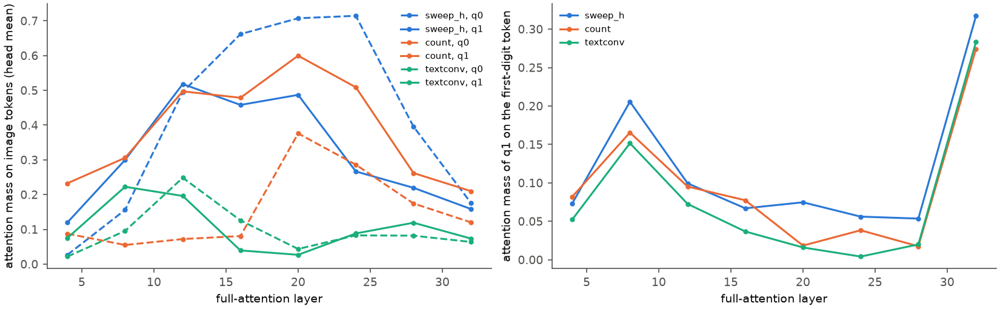

*图 9：左：full-attention 层的 attention 落在 image tokens 上的质量（head 平均；虚线 $q_0$，实线 $q_1$）；右：$q_1$ 落在首位数字 token 上的质量。蓝：disc x；橙：计数；绿：文本换算。*

4. **第二位的步骤仍在读取图像。** disc x 的 $q_1$ 在层 12–20 把 46%–52% 的 attention 放在图像上（$q_0$ 为 50%–71%），层 24 之后降至 16%–27%；层 32 有 32% 落在首位 token 上。文本换算的 $q_1$ 只有 3%–22% 落在图像上。信息的获取没有中断，问题出在后续的转换。

### 3.8 Q6：信息上界

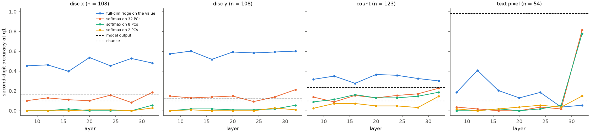

*图 10：$q_1$ 处读出第二位的正确率。蓝：5 折交叉验证的全维 ridge 读出坐标后换算；橙、绿、黄：前 32、8、2 个主成分上的 softmax；黑色虚线为模型；点线为机会水平。*

| 读出（层 32） | disc x | disc y | 计数 | 文本换算 |
| --- | --- | --- | --- | --- |
| 模型第二位正确 / 相差不超过 1 | 0.17 / 0.41 | 0.12 / 0.27 | 0.24 / 0.59 | 0.98 / 1.00 |
| ridge 换算第二位正确 / 相差不超过 1 | 0.48 / 0.95 | 0.60 / 0.95 | 0.30 / 0.78 | 0.06 / 0.28 |
| ridge 坐标误差 | 5.5 | 4.6 | 1.0 个 | 46 |
| 8 个主成分上的 softmax | 0.06 | 0.06 | 0.19 | 0.78 |

1. **第二位所需的信息在该位置可以线性读出。** disc 的 ridge 读数误差为 4.6–5.5 个单位，换算出的第二位相差不超过 1 的比例为 0.95，层 8–32 都是如此；模型自己的第二位与 ridge 换算的差距是 0.31–0.48 的正确率。这是“外部线性读出”可达到的上界，也是实验 3.9 读出工具的依据。
2. **图像数值与文本数值在该位置的编码方式不同。** 图像坐标以连续量编码（ridge 好、少数主成分无效，信息位于方差很小的方向，与 3.6 第二轮一致）；文本换算的结果在层 32 以类别方式编码（8 个主成分上的 softmax 达到 0.78，ridge 读不出数值）。这与文本 LLM 中按数位表示数字的报告（Levy 与 Geva，2024）一致：文本数值以数位存在，图像坐标只以连续量存在。主成分上的 softmax 在 disc 上处于或低于机会水平，108 个样本不足以拟合 10 类分类器，只作参照。

## 4. 讨论

### 4.1 统一机制

本实验把坐标数字读出写成三个可分离的参数性成分：首位读出映射（边界位置，决定压缩）、依据已写出首位的中心先验（决定 500 吸附与 498）、第二位的组内偏移读出（增益约为理想值的三分之一，决定第二位均匀）。表示中的坐标精确且无偏，attention 在第二位步骤仍读取图像，信息在该位置可以线性读出；三处缺陷都发生在 MLP 27–32 把表示转换为数字 logit 的映射中。网格的边界吸附说明读出还可以走计数换算的路线，并在换算中引入半个单元的系统误差。

### 4.2 Q4：是否为逐位输出的固有缺陷

不是逐位输出本身的缺陷。文本换算以同样的三位数格式输出，两位的读出分辨率为 2–5 个单位；计数以同样的方式输出两位数，十位锐利。数位锐利度由该步读出分辨率决定（第 3.4 节）。逐位格式的影响体现在两点：首位一旦选错不可恢复（3.6 第一轮中首位错误贡献 55% 的误差）；第二位的读出必须在表示中完成组内偏移的计算，要求比首位高约十倍的增益（第 3.1 节）。纯文本位置任务在首位上就失败，不能用于这一比较。像素尺度的格式不被模型遵从（3.6 第二轮：1% 的答案使用所要求的尺度），teacher forcing 下像素格式的十位真值概率为 0.10，说明读出映射绑定于 0–1000 的训练格式，这本身就是读出由训练数据塑造的证据。

### 4.3 Q6：数据还是结构

**以机制论证，第二位均匀更可能是数据可以修复的参数问题。** 理由有三。第一，信息存在：$q_1$ 处线性读出的第二位相差不超过 1 的比例为 0.95。第二，结构存在：第二位已经按组内偏移计算（交互份额 65%–82%，$k$ 偏小推向 9、偏大推向 0），只是增益不足；增益是参数的量，不需要新的计算路径。第三，同一模型在文本数值上能写出锐利的第二位，相应的 MLP 容量存在。

**解释（未检验）。** 增益不足的一个自然来源是训练目标：grounding 标注的框中心本身有数十个单位的误差，交叉熵的最优第二位分布接近经噪声平滑后的先验，模型因此学到低增益的第二位读出与强的中心先验。若如此，同类标注的数据再多也不会提高增益，需要的是精确标注的数据（例如合成数据的精确坐标）。本实验没有训练模型，这一判断以机制证据为依据，需由小规模微调（实验 3.13）验证。

**结构因素的作用。** 结构上的因素有三点，它们决定失败的形式，但都不阻止精确读出。

1. **逐位 tokenization 的分解。** 数值以三个数字 token 逐个输出，模型只能把数值分布写成 $P(\text{首位}) \cdot P(\text{第二位} \mid \text{首位})$。任何以 500 为中心的数值先验在这种分解下都只能表现为“4 之后偏向 9、5 之后偏向 0”，这是 498/500 双峰的形式来源；首位一旦写出也不可恢复（3.6 第一轮中首位错误贡献 55% 的误差），解码层面的边际化可以部分缓解。
2. **组内偏移计算对精度的要求。** 第 3.1 节表明，以首位为条件读出十位，等价于先计算 $z - 100k$ 再以十倍于首位的增益分带；在单步线性读出中这需要大幅抵消（抵消比 86）。网络可以在表示中分步计算组内偏移来避免抵消，文本换算任务（第二位真值概率 0.97）说明这一计算在同一模型中可以实现。
3. **Gated DeltaNet 短卷积提供的捷径。** 第二轮第 3.3 节表明，第二位的坐标信息经层 25–31 的短卷积从前一位置 $q_0$ 的后层状态传入，第二位读出的主要是首位读出偏向相邻数字的程度（第二轮第 3.4 节）。这条通道让“复用首位读出的状态”比“重新读取精确坐标”更容易被学到；这种读法的分辨率由首位边界宽度决定，并把首位读出在 4 与 5 之间的犹豫放大为 500 吸附。

**参数与结构的划分及其确定程度。** 第二轮的消融表明，MLP 27–31 中 256 个按首位条件激活的神经元因果地产生约一半的 500 吸附，去掉它们不提高第二位精度；“借用首位读出”的读法同样由 MLP 参数实现。由此，第二位均匀与 500 吸附属于参数问题（中等确定程度：信息、通道与计算容量都已测量到，训练能否改变读法尚待 3.13 验证）；逐位分解与短卷积属于结构，它们使失败以现在的形式出现并使捷径易于学习，但不构成精确数据无法消除的限制。详细分析见第二轮第 3.5、3.6 节。

### 4.4 由机制得到的读出方法

以下方法都与任务无关，不增加模型结构。

1. **数字 token 的 contextual calibration。** 以内容为空的输入（空白图像）估计数字先验，在两位数字上减去 $\alpha$ 倍的 log 先验。它直接针对第 3.5 节的中心先验，消除了 500 吸附（平台比例 0.89 → 0.33），实现上只需一次额外的前向。先验过度集中时（y 的首位先验 0.80）需取 $\alpha < 1$，或使用图像平均分布作先验（x、y 的误差都显著降低）。它不能修复压缩与第二位的低增益。
2. **逐位边际化解码。** 期望值解码把第二位的不确定性按概率平均，在 x 上把平均误差从 39.8 降到 29.9；其副作用是把模型的偏差平滑进数值，y 上不显著。
3. **外部读出工具。** 第二位所需信息在 $q_1$ 与 $q_0$ 的 residual 中以约 5 个单位的精度存在（第 3.8 节），实验 3.9 第二轮以外部可调用工具读取它是合理的；本实验的机制说明它应当读取答案槽位的 residual，并且只需要线性读出。
4. **训练端。** 以精确标注的数据提高第二位读出增益；网格类图像需要在训练数据中覆盖“单元中心 = (列号 − 0.5) ÷ 列数”的换算。

### 4.5 与其他实验的一致与冲突

1. **与 3.6 第二轮。** 一致：读出端是瓶颈，MLP 28–32 写入数字，第二位没有锐利的图像依赖写入。细化：3.6 第二轮的“读出分辨率约为 100 个单位”在本实验中分解为首位的边界偏移（切换宽度 8–32 个单位）与第二位约 50 个单位的分辨率；3.6 第二轮“第二位分布接近与图像无关的先验”在本实验中细化为：先验以 500 为中心，由已写出首位决定，第二位还含有一个低增益的组内偏移信号。
2. **与 3.11（坐标信息流）。** 一致：3.11 报告 L20 H11 的 attention 峰值在 T6 10×10 point 上以 0.92 落在正确单元，而模型为 0.24，读取正确、输出错误；本实验指出输出错误来自吸附到单元边界。
3. **与 2.5e（看得准但答错）。** 一致：2.5e 中 10×10 point 答错样本的层 20 解码有 0.79 落在目标单元内，说明表示正确。
4. **与 3.9（读出工具）。** 一致：3.9 的工具消除了 10 与 50 的倍数偏好与右侧一列；本实验给出其机制依据（先验与边界吸附位于读出端）。3.9 中工具坐标写入上下文后模型仍不采用，与本实验中“前缀里的数值只占 4% 的方差”一致：数字先验主要由已写出的首位决定，上下文中的其他数值影响很小。

## 5. 限制

1. **强制首位的输入不在训练分布内。** clamp 测试利用了这一点；“$k$ 偏离真值时的反应”只说明计算的类型，不代表自然生成中的行为。
2. **个位与两位数未纳入。** 解码模拟以 10 个单位的分辨率进行，排除真值低于 150 的样本（每轴 12 个）。
3. **首位的高斯证据拟合较差**，首位 $\sigma$ 只作参照；第二位与非图像族的拟合可靠。
4. **网格样本少**（12、20、40 张），列号结论的区间较宽；20×20 的右偏成因未分析。
5. **纯文本位置任务失败于首位**，没有提供“纯文本中由连续量得到数值”的有效对照；更合适的纯文本对照需另行设计。
6. **数据与结构的判断没有经过训练实验验证**（第 4.3 节）。
7. **直接 logit 归因只含直接路径**，冻结了最终归一化尺度。

## 6. 产物

产物位于 WORK_DIR 的 `analysis/position/2026-10-20_digit_failure/`：`factorial/`（`units.json` 与 `rows.jsonl`，每行含两处数字分布）、`features`（链接到 DATA_DIR 的 residual 与 DLA 分片）、`grid/`（greedy 答案与 generate 抽查）、`attn/attn.jsonl`、`results.json`、`analysis.npz`、`experiment.json`（模型版本、代码摘要、token 预算与运行参数）。程序为 `analysis_tools/position/digit_failure*.py`（引擎、理论、GPU 阶段、CPU 分析与作图），入口为 `scripts/analysis/position/digit_failure.sh`，测试为 `tests/analysis/position/test_digit_failure.py`。
