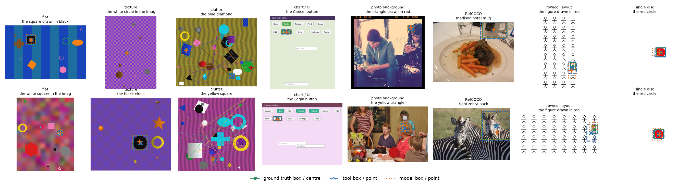
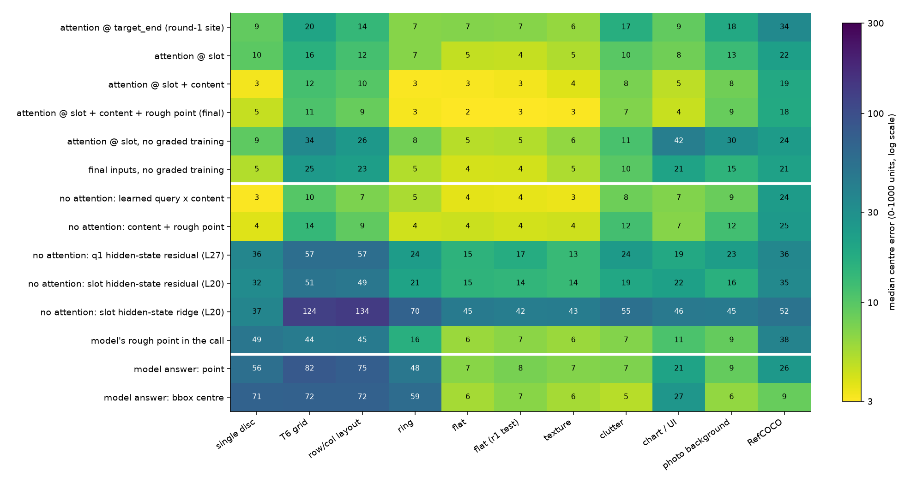
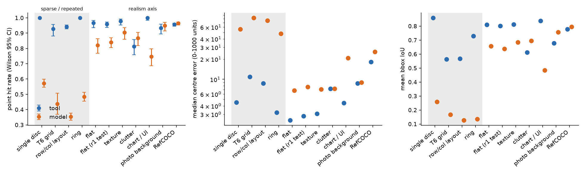
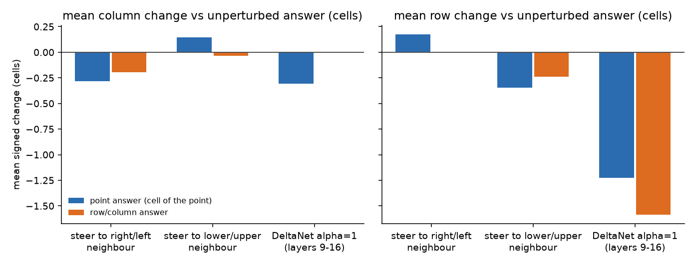
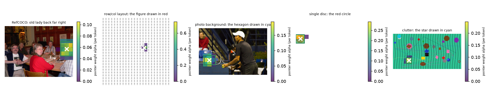

# 实验 3.9 第二轮：坐标读出工具的机制依据、适用范围与坐标–序号解离

设计见[坐标读出工具设计文档第 10 节](design_readout_tool.md)，第一轮结果见[实验 3.9 第一轮结果](results_2026-10-16_readout_tool.md)。数位读出机制见[实验 3.12](results_2026-10-20_digit_failure.md)，行列计数机制见[实验 3.10](results_2026-10-20_rowcol_mechanism.md)，答案阶段的信息流见[实验 3.11](results_2026-10-20_coordinate_flow.md)。

## 通俗讲述

模型写坐标分三步：先“看向”目标，再把“看向的那一块”换算成一个数，最后把这个数一位一位写出来。前序实验表明第一步通常做得很好；问题出在后两步。第二步换算依赖目标周围的上下文，背景空白或物体重复排列时换算变粗；第三步写十位数字时几乎是在猜，还会被拉向 500 这个“中间值”。

本实验的工具只借用第一步：在模型准备写坐标的那一刻，取出它“看向哪里”的 attention 分布，再加上每个图像 token 在网格中的已知位置，直接算出坐标。工具既不需要模型换算，也不需要模型写十位，所以第二、三步的毛病被整体绕开。

第二轮把工具改成模型先写一个粗略坐标再调用，读取位置挪到写坐标之前的那个 token，并用更丰富的合成数据训练一个小卷积读出器。结果是：

1. 在 RefCOCO 自然图像上，工具与模型基本持平：点的命中率 0.956 对 0.964（差异不显著），平均误差更小，但 bbox 略差，且模型自己 bbox 的中心比工具的点更准。
2. 在单个物体的空白画布、重复排列的网格和图表界面上，工具大幅领先（命中率 0.93–1.00 对 0.35–0.75）。
3. 在物体相互重叠的杂乱场景和贴在照片上的几何形上，工具略差。

因此，工具的优势恰好出现在“换算”困难的图像上，自然图像上并无收益。这说明模型的坐标失败是一个可以学会的读出问题，规模化的解决办法是补充合成布局、图表类训练数据；工具则适合作为诊断手段和一个廉价的外挂。

关于行列号：干预实验显示，模型回答“第几行第几列”时并不先算坐标再换算，坐标和序号读的是同一份上游计数信息，但各自有独立的读出。网格上的坐标本身也部分来自数实例，所以把工具的坐标写进上下文不会改善序号。

## 1. 问题与结论

本轮回答四个问题，结论按金字塔结构先列出，各节给出证据。

1. **工具为何能消除三类数位缺陷。** 工具的点为 $\hat p = \sum_j \alpha_j (c_j + \delta_j)$，其中 token 中心 $c_j$ 由网格下标精确给出，因此工具只使用“选择”阶段的结果，绕开“下标 → 数值”的换算与数位读出（设计文档第 10.1 节）。证据有三：工具输出不再集中在 10 与 50 的倍数和 500 附近（第 5.2 节）；在 1.5 的 delL/shift 刺激上，工具读数跟随目标的真实像素位置，模型的点答案跟随实例计数（第 5.1 节）；工具的优势集中在换算困难的图像上（第 4 节）。
2. **通用性。** 在 RefCOCO 上，最终工具的点命中率与模型无显著差异、平均中心误差更低，bbox IoU 低 0.017；在刺激阶梯上，flat、texture、chart_ui 显著优于模型，clutter 与 photo_bg 的 bbox 劣于模型（第 3、4 节）。工具对自然图像没有普遍改进。
3. **更便宜的输入。** 不使用 attention 权重、只用 visual token 内容特征的读出器接近 attention 读出器（验证集平均误差 31.0 对 25.6），与 flash attention 兼容；读取 decoder hidden state 的读出器，包括 3.12 提出的首位数字处残差修正，都没有超过模型自己的粗略坐标（第 6 节）。
4. **坐标与序号。** 两者共享上游的计数表示，读出相互独立：计数消融同时移动两种答案的行（相关系数 0.63），答案阶段的 attention 转移对点答案的扰动大于对序号的扰动；网格上的坐标部分由实例计数得到（第 7 节）。

**总体判断：坐标失败可以由训练数据解决，工具是诊断手段与可选外挂。** 解释：工具在自然图像上没有收益，在合成布局上的大幅收益来自绕开换算与数位读出；3.12 表明这两步的缺陷位于读出参数而非表示，3.11 表明答案阶段的读取已经找到目标（L20 H11 峰值在模型答错时仍有 0.88–0.93 命中）。读出参数的缺陷正是监督数据能够修正的对象，因此规模化的修正方式是加入合成布局、图表与界面类的坐标监督（第 9 节）。

## 2. 设计与执行

### 2.1 工具与读出器

符号沿用设计文档第 10 节：图像有 $N_v$ 个 merged visual token，排成 $g_h \times g_w$ 的网格，token $j$ 的中心为 $c_j \in [0, 1000]^2$；模型在调用中写出的粗略坐标为 $a \in [0, 1000]^2$；读出器输出 pointer 分布 $\alpha \in \mathbb{R}^{N_v}$、亚 token 偏移 $\delta_j \in \mathbb{R}^2$ 与 bbox 边距。

1. **调用接口。** `locate` 增加必填参数 `approx_point`；工具在 `[` 之后、首位数字之前的 slot token 处读取。
2. **读出器。** 4 个残差膨胀卷积块（宽 96，约 35 万参数）作用于 token 网格。
3. **输入特征组合。** 下表列出本轮比较的读出器；“attention”指 8 个 full-attention 层共 128 个 head 从读取位置出发的 attention 对数比，“内容”指层 0 与层 16 的 visual token 状态的 PCA-64 投影（解释方差 0.774 与 0.612），“粗略坐标”指 $(c_j - a)/100$。

| 读出器 | 输入 | 是否需要 attention 权重 |
| --- | --- | --- |
| attention @ target_end | 第一轮读取位置的 attention | 是 |
| attention @ slot | slot 处的 attention | 是 |
| attention @ slot + content | slot attention + 内容 | 是 |
| 最终工具 | slot attention + 内容 + 粗略坐标 | 是 |
| learned query × content | slot hidden state（层 20）生成 query，与内容特征做点积得到 pointer | 否 |
| content + rough point | 内容 + 粗略坐标的卷积读出器 | 否 |
| q1 residual (L20–L28) | 首位数字处 hidden state 与 $a$ 上的 ridge，预测 $p - a$ | 否 |
| slot residual / ridge | slot hidden state 上的残差 ridge 或直接 ridge | 否 |
| model rough point | 直接使用 $a$ | 否 |

最终工具在不只输出点的读出器中按验证集平均中心误差选择（RefCOCO、合成、刺激阶梯三组的平均）。

### 2.2 数据与规模

1. **采集。** 共 25,328 个样本（RefCOCO 训练、验证、测试，第一轮的合成集，刺激阶梯 5 级），两路分片在 Qwen3.5-9B 上 teacher forcing 到 slot，thinking off，约 0.5–0.6 s/样本。
2. **测试集。** RefCOCO 1562 条记录；单目标画布 1291、T6 网格 192、行列布局 1536、圆环 1152；flat（第一轮测试）500；刺激阶梯每级 240。
3. **数位残差。** 在 3500 个训练样本与约 2600 个测试样本上采集首位数字处的 hidden state。
4. **解离实验。** 200 张网格图像 × 2 种问题 × 4 种条件；1.5 刺激 320 张（5 种条件 × 64 张底图）。
5. **GPU 用量。** 约 8–9 GPU 小时（采集约 4，干预与模型自答约 1，1.5 与数位采集约 1，读出器训练约 1，其余为显存不足时的等待与重启）。

## 3. 主结果：最终工具与模型

最终工具为 attention @ slot + content + rough point（验证集平均中心误差 25.6）。下表为测试集结果；命中指点落在真值 bbox 内，误差单位为 0–1000 坐标，括号内为配对差异（模型减工具）的 95% bootstrap 置信区间。

| 测试集 | 命中（工具 / 模型） | McNemar p | 平均误差（工具 / 模型） | 中位误差（工具 / 模型 / 模型 bbox 中心） | bbox IoU（工具 / 模型） |
| --- | --- | --- | --- | --- | --- |
| RefCOCO | 0.956 / 0.964 | 0.12 | 40.2 / 54.3 [11.1, 17.4] | 18.2 / 25.6 / 8.8 | 0.779 / 0.796 [−0.029, −0.005] |
| 单目标画布 | 1.000 / 0.572 | <1e-100 | 4.6 / 58.5 | 4.5 / 55.9 / 70.7 | 0.859 / 0.259 |
| T6 网格 | 0.927 / 0.438 | <1e-20 | 18.9 / 97.3 | 10.9 / 82.4 / 71.6 | 0.564 / 0.168 |
| 行列布局 | 0.941 / 0.354 | <1e-100 | 15.0 / 90.1 | 8.7 / 75.4 / 72.2 | 0.567 / 0.127 |
| 圆环 | 1.000 / 0.484 | <1e-100 | 3.7 / 78.7 | 3.2 / 47.9 / 59.2 | 0.730 / 0.136 |
| flat（第一轮测试） | 0.958 / 0.840 | <1e-11 | 21.0 / 36.1 | 2.8 / 7.7 / 6.9 | 0.802 / 0.638 |
| flat | 0.967 / 0.821 | <1e-8 | 13.9 / 31.2 | 2.5 / 6.8 / 5.6 | 0.811 / 0.656 |
| texture | 0.979 / 0.904 | <1e-4 | 10.4 / 20.0 | 3.1 / 7.1 / 5.6 | 0.812 / 0.684 |
| clutter | 0.812 / 0.867 | 0.002 | 70.6 / 63.7 [−20.9, 7.0] | 7.2 / 7.3 / 4.9 | 0.612 / 0.695 |
| chart_ui | 1.000 / 0.746 | <1e-18 | 5.8 / 50.9 | 4.4 / 20.6 / 26.5 | 0.837 / 0.483 |
| photo_bg | 0.933 / 0.950 | 0.42 | 29.1 / 31.2 [−4.6, 9.6] | 8.7 / 8.9 / 6.4 | 0.679 / 0.756 |

*图 1：样例。绿色实线框与圆点为真值 bbox 与中心，蓝色虚线框与叉号为工具的 bbox 与点，橙色点线框与加号为模型直接回答的 bbox 与点。每列为一个测试集，每列两个样本随机抽取。*

**RefCOCO 上工具与模型持平。** 解释：命中率差异不显著（p = 0.12）。工具点的平均误差低 14.1（置信区间不含 0），主要来自模型点答案的长尾；中位误差上模型 bbox 中心（8.8）明显优于工具的点（18.2），bbox IoU 工具低 0.017（置信区间不含 0）。与第一轮相比，RefCOCO 平均误差由 77.8 降到 40.2，IoU 由 0.54 升到 0.78，这一提升主要来自读取位置与训练数据（第 4.2 节、图 2）。自然图像上模型自己的 bbox 已经足够好，工具没有提供实际收益。

**工具的大幅领先只出现在换算困难的图像上。** 解释：单目标画布、网格、布局、圆环与 chart_ui 上，模型的中位误差为 20–82，工具为 3–11。这些图像的共同点是目标周围缺少可区分的上下文（空白背景、重复实例或大面积均匀区域），对应设计文档第 10.1 节的阶段 2。工具在这些图像上同样依赖模型 attention 选对目标，说明阶段 1 在这些图像上是成功的，这与 3.11 中 L20 H11 峰值在 T6 10×10 上命中 0.92、模型只有 0.24 的结果一致。

**clutter 与 photo_bg 上工具劣于模型。** 解释：clutter 上中位误差相同（7.2 对 7.3），但工具命中率低 0.055（p = 0.002），失败样本为 pointer 落在相邻的同色或重叠形状上，即阶段 1 的选择错误被工具继承（推论 3）；两组的 bbox IoU 都低约 0.08，工具在边界模糊、遮挡多的情况下估计的 bbox 偏小（解释性判断，依据图 1 的样例）。

## 4. 读出器比较与适用范围

### 4.1 读出器比较

*图 2：各读出器在各测试集上的中位中心误差（0–1000 单位，对数色标，黄色为低误差）。白线把读出器分为三组：需要 attention 权重的读出器（含去掉刺激阶梯训练数据的两个消融），不需要 attention 权重的读出器，以及模型自己的答案（点答案与 bbox 中心）。*

**读取位置从 target_end 移到 slot 是最大的单项改进。** 解释：两者输入格式相同，只是读取的 token 不同；RefCOCO 中位误差由 34 降到 22，验证集平均误差由 43.4 降到 29.9。slot 处模型即将写坐标，3.11 测得此时数字 query 在 L16–24 把 0.65–0.78 的 attention 放在图像上，而问题文本只有 0.11–0.25；target_end 处模型还没有进入“读坐标”的状态。这说明工具应读取模型执行答案阶段读取的那个位置。

**内容特征改善 bbox 与亚 token 精度，粗略坐标只带来小幅改进。** 解释：加入内容后单目标画布与圆环的中位误差由 7–10 降到 3，验证集平均误差由 29.9 降到 27.1；再加入 $a$ 后为 25.6。内容特征提供物体边界，使 $\delta_j$ 与 bbox 边距有依据。

**训练数据的多样性是泛化的必要条件。** 解释：去掉刺激阶梯的 2400 张训练场景后，同一读出器在 chart_ui 上的中位误差由 4 升到 21（最终输入）或 42（slot attention），在行列布局上由 9 升到 23，在 T6 上由 11 升到 25，在 photo_bg 上由 9 升到 15；RefCOCO 只变化 3。读出器在未见过的图像族上不能外推，这一点同样适用于工具本身：工具的通用性受其训练分布约束。

### 4.2 合成图像的分级与适用范围

*图 3：工具（蓝色）与模型（橙色）在各测试集上的命中率（左，误差棒为 Wilson 95% 置信区间）、中位中心误差（中，对数坐标）与平均 bbox IoU（右）。灰色底纹为内容稀少或实例重复的测试集，其余按真实感由低到高排列，最右为 RefCOCO。*

“合成图像”沿两条轴变化（定义见设计文档第 10.3 节）：

1. **真实感轴（flat → texture → clutter → chart_ui → photo_bg → RefCOCO）。** 工具的优势随真实感增加而减小：flat 与 texture 上中位误差约为模型的 0.4 倍，clutter、photo_bg 与 RefCOCO 上与模型相当或劣于模型。chart_ui 是例外，其中条形与按钮大小相近、排列规则，性质上接近重复排列。
2. **稀疏–重复轴（单目标画布、T6、布局、圆环）。** 模型在这一轴上全面失败，工具全面成功。

**工具的适用范围为“上下文不能区分目标位置”的图像。** 解释：两条轴的结果共同说明，工具的收益取决于阶段 2 的难度，与图像是否“合成”没有直接关系。同为合成的 clutter 与 photo_bg 拥有丰富的局部上下文，模型的换算已经准确；内容稀少或重复排列的图像，以及图表、界面这类实际应用场景，才是工具有收益的范围。

## 5. 机制证据：工具绕开换算与数位读出

### 5.1 1.5 刺激上的工具读数

下表为各条件相对 base 的平均变化（单元），真值一列为目标像素位置的变化；序号变化取自实验 1.5 的直接答案。

| 刺激组 | 条件 | 真值 | 模型点答案（均值 / 中位） | 工具读数 | 模型序号（均值） |
| --- | --- | --- | --- | --- | --- |
| H32 | delL | 0 | −0.65 / −0.21 | +0.04 | −3.17 |
| H64 | delL | 0 | −1.17 / −0.42 | +0.01 | −2.28 |
| V64 | delL | 0 | −0.57 / −0.42 | −0.18 | −1.05 |
| H32 | delR | 0 | +0.95 / +0.50 | −0.08 | +0.38 |
| H64 | delR | 0 | +0.71 / +0.05 | −0.04 | −0.03 |
| H32 | shift | +1 | +0.69 / +0.33 | +0.99 | −0.09 |
| H64 | shift | +1 | +1.03 / +0.19 | +0.98 | +0.06 |
| H96 | shift | +1 | +1.21 / +0.47 | +0.97 | +0.23 |
| H32 | insL | +1 | +0.15 / +0.20 | +1.02 | −2.95 |
| H64 | insL | +1 | −0.74 / 0.00 | +1.02 | −1.17 |

其余组（H96、V32 的全部条件，V64 的 delR、shift、insL）结论相同：工具读数在全部 20 个组合中与真值的差不超过 0.3 个单元，其中 15 个不超过 0.1。

**工具读数跟随目标的像素位置，模型的点答案跟随实例计数。** 解释：delL 与 delR 中目标像素位置不变，模型点答案却分别向前、向后移动（delL 均值 −0.57 至 −1.17），说明模型把坐标估计为“目标之前与之后的实例数之比”一类的量；shift 中目标真实右移一个单元，模型点答案的中位变化只有 0.19–0.71。工具读数在三种条件下都与真值一致。这直接验证了第 1 节的推论：工具只使用 attention 选中的 token 和 token 的已知中心，模型的换算阶段在重复布局上依赖计数，工具绕开了这一阶段。3.11 的 KV 实验给出了对应的载体：网格上的行坐标位于目标之后同一行的 token 中，而非目标 token 中，模型写出的坐标因此混入了目标以外 token 的计数信息。

### 5.2 数位统计

| 输出 | 样本数 | 10 的倍数占比 | 50 的倍数占比 | 十位的熵（bits） |
| --- | --- | --- | --- | --- |
| 工具 | 14,866 | 0.105 | 0.031 | 3.31 |
| 模型 | 16,944 | 0.397 | 0.194 | 3.26 |

均匀分布下两种占比分别为 0.1 与 0.02。

**工具输出不再吸附到整数与 500。** 解释：模型 39.7% 的坐标是 10 的倍数，频数最高的取值依次为 500（1058 次）、100、750、700、625、875，对应 3.12 的中心先验与网格单元边缘吸附；工具的 10 的倍数占比 0.105 接近均匀。工具的最常见取值为 497–501（共约 760 次），来自第一轮合成集中位于画布中心的目标，是真值分布而非先验。十位的熵相近，说明模型的十位并非集中在少数值上，其问题在于与真值无关（3.6 第二轮的真值概率 0.11–0.14），这一点只能由误差而非熵反映（图 2）。

## 6. 更便宜的输入与成本

### 6.1 不使用 attention 权重的读出器

| 读出器 | 验证集平均误差 | RefCOCO 中位 | 单目标画布中位 | 行列布局中位 | flat 中位 |
| --- | --- | --- | --- | --- | --- |
| 最终工具（attention） | 25.6 | 18 | 5 | 9 | 2 |
| learned query × content | 31.0 | 24 | 3 | 7 | 4 |
| content + rough point | 31.6 | 25 | 4 | 9 | 4 |
| q1 residual L27 | 44.3 | 36 | 36 | 57 | 15 |
| slot residual L20 | 44.3 | 35 | 32 | 49 | 15 |
| model rough point | 43.2 | 38 | 49 | 45 | 6 |
| slot ridge L20 | 63.6 | 52 | 37 | 134 | 45 |

**visual token 的内容特征足以支撑 pointer。** 解释：learned query × content 用 slot hidden state 生成一个 query，与层 16 visual token 的 PCA 特征做点积得到 pointer，本质上是在工具内部重做一次 attention。它在合成集上与 attention 读出器相当，RefCOCO 上差 6 个单位。这与 3.11 一致：答案阶段的选择由一个主导 head（L20 H11）完成，其 logit 主要由内容决定（3.7 第二轮），一个学习得到的 query 可以复现。

**读取 hidden state 的读出器不能泛化到不同图像族。** 解释：slot 处直接 ridge 在行列布局上中位误差 134，比模型的粗略坐标还差；残差形式（预测 $p - a$）把验证集误差降到 44 左右，与 $a$ 本身（43.2）相当。3.12 提出的首位数字处残差修正（层 20–28 的验证集误差 44.3–45.6）在单目标画布上把均值从 51.5 降到 40.9，在 RefCOCO 上从 68.2 降到 58.2，但在 flat 上从 22.7 升到 28.8、在 photo_bg 上从 33.3 升到 47.6。3.12 的 ridge probe 在单一图像族的 sweep 上把第二位数字估计到 ±1 以内，跨图像族训练时线性残差失效，说明 hidden state 中坐标的编码方式随图像族变化（解释性判断；第一轮的 ridge 回归器也有同样现象）。坐标信息存在于 hidden state 中，但其线性读出方向随图像族变化；pointer 形式的工具借助 $c_j$ 这一图像无关的几何先验，因而能够泛化。

### 6.2 成本

以 1024 个 visual token、序列长度 1300 计：

| 项 | 计算量 | 存储（fp16） | 说明 |
| --- | --- | --- | --- |
| 模型 prefill | 23.4 TFLOPs | — | 参照 |
| 每生成一个 token | 18 GFLOPs | — | 参照 |
| slot 的 attention 行（8 层 × 16 head） | 85 MFLOPs | 256 KB | 由 KV cache 与 slot query 重算，可在 flash attention 之外单独计算 |
| 内容特征 PCA 投影（2 层） | 1.07 GFLOPs | 256 KB | 不需要 attention 权重 |
| 卷积读出器 | 0.71–0.73 GFLOPs | 约 35 万参数 | CPU 单样本约 2 ms |

**工具的额外开销不到生成一个 token 的 0.1 倍。** 解释：最贵的一项为 PCA 投影（1.07 GFLOPs），合计约 1.9 GFLOPs，相当于 prefill 的十万分之一。attention 读出器需要从 KV cache 重算 slot 这一行的 attention 概率；内容读出器只需要两层 visual token 的 hidden state，与 flash attention 完全兼容。

## 7. 坐标与序号

### 7.1 干预实验

*图 4：200 张网格图像上，三种干预下点答案所在单元（蓝色）与行列答案（橙色）相对未干预答案的平均列变化（左）与行变化（右），单位为单元。无可见柱表示均值为 0（例如计数消融下的列序号）。*

未干预时，点答案落在目标单元内的比例为 0.475，行列答案正确率为 0.94。

| 干预 | 点答案：移动比例 | 点答案：落到相邻实例 | 序号：移动比例 | 序号：落到相邻实例 | 行变化相关系数 |
| --- | --- | --- | --- | --- | --- |
| 转向右/左邻居 | 0.57 | 0.04 | 0.30 | 0.00 | 0.15 |
| 转向下/上邻居 | 0.55 | 0.07 | 0.39 | 0.01 | 0.21 |
| 计数消融（层 9–16） | — | — | — | — | 0.63 |

计数消融下，点答案的行平均变化 −1.23、列 −0.31；序号的行 −1.59、列 0.00。

**计数消融同时移动两种答案的行。** 解释：在 image token 上令层 9–16 的 Gated DeltaNet $\alpha = 1$，序号行减少 1.59，点答案的行也减少 1.23，逐图像的相关系数 0.63（n = 194）。3.10 证明该干预破坏的是 visual token 上的行计数；点答案随之移动说明网格上的 y 坐标同样读取这一计数。列方向上序号不变、点答案移动 0.31，说明列序号与 x 坐标的上游来源不完全相同（3.10 的列计数在局部视觉边界处重置，3.11 的 x 位于目标 token 中）。

**答案阶段的 attention 转移不能把答案引向邻居。** 解释：在层 12、16、20、24 中把目标 token 的 logit 减 8、邻居加 8，两种答案落到邻居的比例都不超过 0.07。干预扰动了答案（点答案 0.55–0.57 发生移动），但没有把读取位置替换为邻居。可能的原因是 3.11 测得的单层读取（L20 为主）与 3.12 的中心先验会把被扰动的读数拉回或拉散（解释性判断）。因此该干预只能说明点答案比序号对答案阶段的读取更敏感，不能作为“读取位置”被替换的检验。

### 7.2 结论与 1.5、3.10 的关系

**坐标输出与序号输出是两项读出，共享上游计数。** 解释：

1. 若序号由坐标换算，第 5.1 节的 shift 条件中坐标变化应带动序号变化；实际上模型点答案平均右移 0.69–1.21 个单元，序号不变的比例为 0.59–0.84。delR 中点答案右移而序号基本不变。因此序号不是由坐标换算得到的。
2. 反过来，坐标在重复布局上部分由计数得到：delL 中目标像素不变而点答案前移，计数消融同时降低两种答案的行。
3. 两项读出的差别在于计数范围：序号只用目标之前的实例数（1.5 中 delR 不改变序号），坐标同时受目标之前与之后的实例数影响（delR 使点答案右移），与一个比例式的估计相符（解释性判断）。

这解释了第一轮的现象：把工具坐标写进上下文后，模型回答行列号时仍沿用自己的计数读出，不会把上下文中的坐标除以单元尺寸。行列号的错误应在计数读出处修正（3.10 指出 +1 加在读出阶段），坐标工具不能替代它。

## 8. 措辞鲁棒性与自由调用

1. **训练外措辞。** 在同一批测试样本上，以训练中未出现的措辞提问时，最终工具的 RefCOCO 平均误差为 42.6，规范措辞为 42.1（n = 300）；其余 10 个测试集上两种措辞的平均误差差异在 −9.6 至 +2.6 之间（每组 50–100 个样本），没有一致的劣化方向。
2. **自由调用。** 440 个提问中模型全部调用了 `locate`，全部写出可解析的 `approx_point`；371 个调用的 target 文本与 teacher forcing 前缀一致；83 个在调用前先输出了一段推理文本，此时 slot 前缀与训练分布不同，本实验没有单独评估这一子集。
3. **模型自答的可复现性。** 模型直接回答的基线由批量生成得到；随机抽取 20 个样本以 batch size 1 重新生成，7 个答案完全相同，其余坐标的最大差异不超过 7 个单位，对第 3 节的比较没有实质影响。

## 9. 讨论与总体判断

1. **机制上的一致性。** 本轮与 3.10–3.12 构成同一幅图景：选择阶段由 L20 H11 等指向型 head 完成，并且在模型答错的网格上仍然选对（3.11）；换算阶段在重复布局上依赖计数（本实验第 5.1 节、3.10）；数位读出存在 1/3 增益与中心先验（3.12）。工具保留选择阶段、以精确几何替换后两步，其收益分布与这幅图景完全吻合。
2. **为何是训练数据。** 后两步的缺陷都在读出：3.12 中 hidden state 足以把第二位数字估计到 ±1 以内，3.10 中 +1 在计数表示中不存在，本实验中一个 35 万参数的读出器在见过的图像族上就能修正。模型在自然图像上已经准确，说明它的读出可以被训练好；它在稀疏、重复与图表图像上失败，最直接的解释是训练数据中缺少这类图像的坐标监督。补充这类合成数据不需要改动架构，并且会同时作用于点、bbox 与序号输出。
3. **工具的定位。** 工具适合作为诊断手段：工具与模型的差异可以把坐标错误定位到选择阶段或读出阶段。在部署层面，内容读出器与 flash attention 兼容、开销可以忽略，可以作为图表与界面定位的外挂；但它的泛化同样受训练分布约束（第 4.1 节），并且在自然图像上没有收益。
4. **对方向二的启示。** 工具的成功说明“模型自己知道看哪里”，失败只在把读取位置变成数值的环节。方向二中保存每一步读取窗口的设计应直接保存位置（例如 $c_j$ 与 $\alpha$），避免让模型把位置写成数字再读回来。

## 10. 限制

1. 第一轮 pointer 读出器没有在第二轮数据上重训作对照（CPU 训练过慢而中止），与第一轮的比较跨越了数据与读取位置两项变化；第 4.1 节的 target_end 读出器使用第二轮数据，可部分替代。
2. attention 转移干预没有实现读取位置的替换，第 7.1 节对它的使用仅限于敏感性比较。
3. 解离实验只覆盖网格图像，结论不推广到自然图像中的“第几个”问题。
4. 自由调用中先推理再调用的 83 个样本没有单独评估。
5. 刺激阶梯每级只有 240 张测试图像，clutter 与 photo_bg 上 bbox 劣势的成因只作了样例层面的解释。
6. 结论只针对 Qwen3.5-9B，thinking off。

## 11. 产物

1. 代码：`analysis_tools/position/readout_tool_r2.py`（协议、刺激阶梯、读出器），`readout_tool_r2_run.py`（GPU 阶段），`readout_tool_r2_dissoc.py`（解离干预），`readout_tool_r2_analysis.py`（拟合与评估），`readout_tool_r2_figures.py`（作图）；测试 `tests/analysis/position/test_readout_tool_r2.py`。
2. 运行入口：`scripts/analysis/position/readout_tool_r2.sh`。
3. 结果：`$WORK_DIR/analysis/position/2026-10-20_readout_tool_r2/`，其中 `tool_r2/results_r2.json` 汇总全部数字，`tool_r2/readers_*.json` 为各读出器的验证与测试误差，`dissoc.jsonl`、`ordcoord.jsonl`、`freecall.jsonl` 为原始生成。缓存特征位于 `$DATA_DIR/scratch` 下同名目录。
4. 图：`docs/analysis/position/figures/readout_tool_r2/`（examples、readers、applicability、pointer、dissoc）。

*图 5：最终工具的 pointer 分布 $\alpha$（色标为每个 token 的权重，无单位，低于最大值 2% 的 token 不着色），白色叉号为工具的点。从左到右为 RefCOCO、行列布局、photo_bg、单目标画布与 clutter 的样本。*
