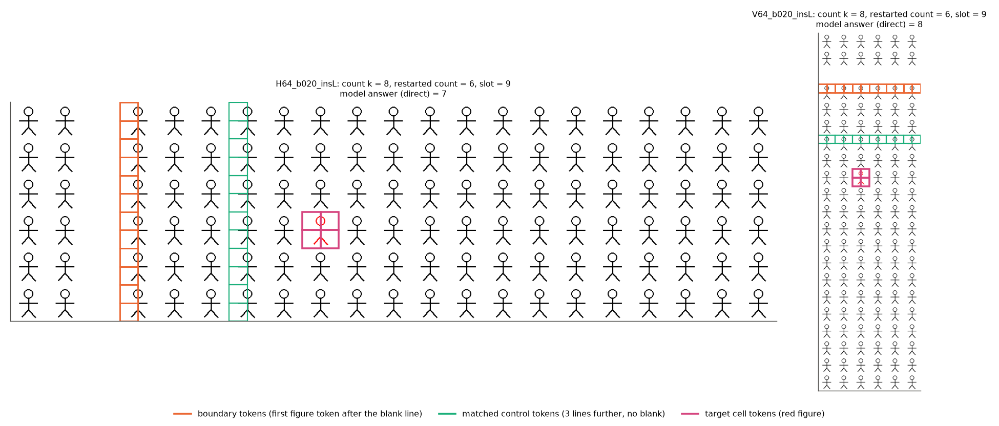
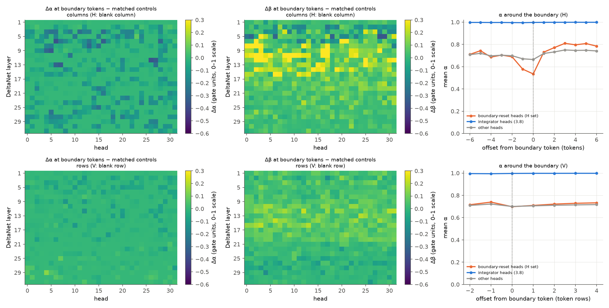
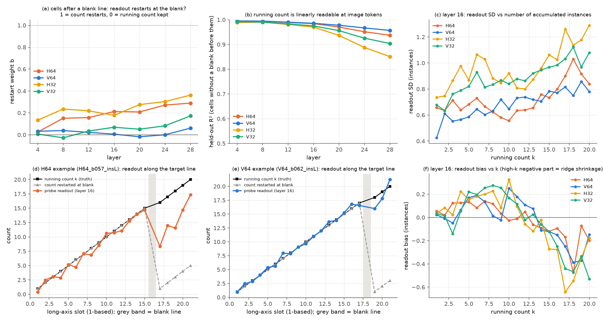
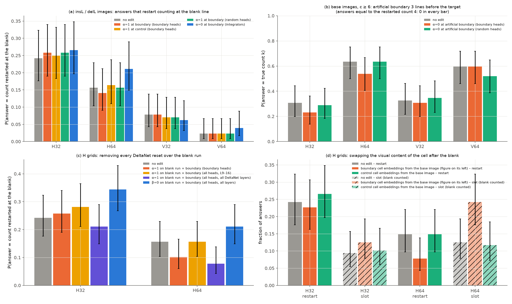
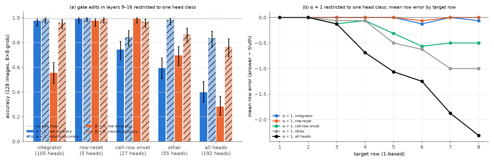
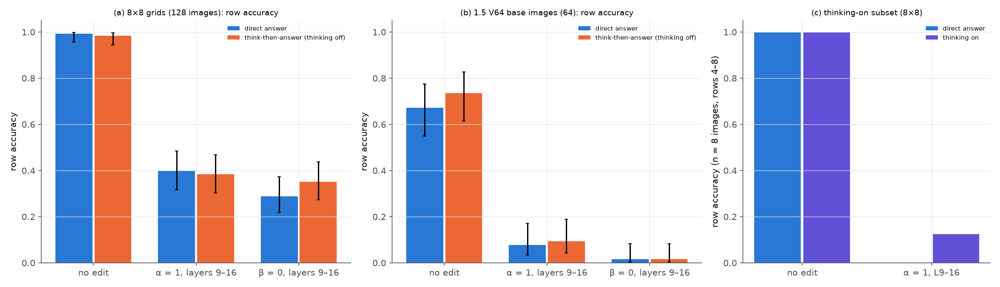
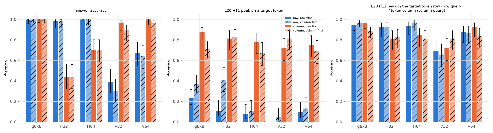
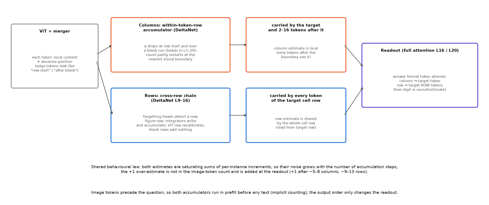

# 行列序号的统一机制

实验日期：2026-10-20。本文属于[位置信息与坐标读取](plan.md)研究，编号为实验 3.10，执行[实验设计](design_rowcol_mechanism.md)。模型为 Qwen3.5-9B，bfloat16、SDPA、greedy decoding，默认 thinking off。前置结果为[行列序号的机理](../behavior/results_2026-10-16_ordinal_mechanism.md)（下称“1.5”）、[序列顺序的位置作用第二轮](results_2026-10-16_sequence_order_r2.md)（下称“3.8”）、[patching 扩展](../representation/results_2026-10-15_patching_extension.md)（下称“2.5b”）、[“看得准但答错”的系统检验](../representation/results_2026-10-16_sees_right.md)（下称“2.5e”）与[序号偏差与 token 网格](../behavior/results_2026-10-15_ordinal_token_grid.md)（下称“1.4”）。

## 0. 通俗讲述

此前的实验留下了一个看似矛盾的局面。从行为上看，行号与列号的错误服从同一条规律：目标在前约 5 个图形之内时序号精确，之后误差随序号增大，并出现“多数一”的偏差。从内部看，两者却由完全不同的 token 携带、被不同的 attention 模式读出：列号的信息停留在目标 token 上，行号的信息散布在目标所在的整行上。本文的假设是，行与列各由一个“累加器”产生，两个累加器建在同一种计算部件（Gated DeltaNet 的门控递推）上，但因为图像按行展开成序列，它们的结构不同。列方向的累加器在每个 token 行内从左向右累加，每到行首就被清零；行方向的累加器跨越整幅图像，每遇到新的一行图形就加一，并被这一行自身的 ViT 行位置拉回校准。

把这个假设写成数学模型，可以推出几条可检验的结论。DeltaNet 的状态在每个 token 处先按衰减系数 $\alpha$ 淡化，再按写入强度 $\beta$ 写入；$\alpha$ 接近 0 时历史被清空。若一个 head 在每个新图形处写入一次，$n$ 次写入后状态是 $n$ 的饱和函数，相邻计数之差随 $n$ 几何缩小，读出噪声折算成的计数误差随 $n$ 几何增长，因此“前几个精确、之后近似”是累加器本身的性质，行与列都应如此，这解释了两者为什么服从同一条行为规律。差别在于复位：门控只看当前 token 的内容，若空白之后的第一个图形 token 看起来像行首，列累加器就可能在这里清零，答案变成“从空白之后数起”；行累加器的增量来自“新的一行图形开始”的检测，空白行上没有图形，增量为零，链式估计原样跨过空白。最后，图像 token 在序列中位于问题之前，两个累加器都在模型读到问题之前完成，因此不写推理文本时模型也能数数，写出推理文本也无法绕开它们。

实验从四个方向检验这一模型：测量空白前后的门控，并在空白处做门控与视觉内容的因果编辑；用 probe 读取图像 token 上的运行计数；按 head 类别破坏行方向的递推；在只要求答案与允许先推理两种问题下施加同样的 prefill 门控干预；交换输出顺序，看行列的读出差异是否随轴而定。结果支持模型的主体。列方向的“从空白重新计数”确实是累加器在局部视觉边界处的部分复位，空白之后第一个图形 token 的视觉内容与 DeltaNet 跨过空白时的遗忘各自承担了单元 64 pixels 网格中约一半的重新计数；行方向的空白不引起复位。行方向的计数由一种分工完成：带遗忘的 head 检测“新的一行图形”，长记忆 head 把每行的增量写入并累积，禁止长记忆 head 写入或让检测 head 不再遗忘都使行号少计，少计量随行号增长。隐式计数成立：在 prefill 中破坏这一递推后，先推理再作答与开启 thinking 都不能恢复行号，推理文本甚至报告更少的总行数。行与列的读出差异随轴而定，与先输出哪个轴无关。仍未解释的是单元 32 pixels 网格中的重新计数，以及计数器之外由读出阶段加上的比例高估。

## 1. 主要结果

1. **列方向的“局部边界”是行内累加器的部分复位，行方向没有对应的复位。** 39 个 DeltaNet head 在内部空白列之后的第一个图形 token 上把 $\alpha$ 降低 0.2 以上（H64，最大降幅 0.36；H32 为 38 个，两种单元尺寸之间各 head 降幅的相关为 0.92），空白行之后没有任何 head 满足这一条件（V32、V64 均为 0 个）。图像 token 上的运行计数 probe 在空白列之后部分重新开始计数（重新计数权重 $b$ 在 H64 第 16 层为 0.21），空白行之后不重新开始（V64 为 0.01）。这一结果说明，1.5 中“列从空白重新计数、行不受空白影响”在图像 token 的表示中已经形成，并且与门控的复位位置一致（第 3.1、3.2 节，图“边界门控”“运行计数 probe”）。
2. **在单元 64 pixels 的网格中，复位由空白之后图形 token 的视觉内容触发，并经 DeltaNet 跨过空白时的遗忘实现。** 把空白之后单元的视觉 embedding 换成同一位置“左侧有图形”的 embedding，重新计数的回答从 19/128 降到 10/128（9 个消失、0 个新增，$p = 0.004$）；在空白段与边界 token 上令全部 DeltaNet 层全部 head 的 $\alpha = 1$，从 20/128 降到 10/128（10 个消失、0 个新增，$p = 0.002$）。只在边界 token 一处令边界 head 不遗忘、或在无空白的图像中人为制造复位，都不改变回答。复位因此是一段 token 上的分布式遗忘，触发它的是“左侧为空白”这一视觉内容；单元 32 pixels 网格中两种编辑都无作用，那里的重新计数另有来源（第 3.3 节，图“边界干预”）。
3. **行方向的计数是“检测加累积”的分工。** 在层 9–16 中只禁止 105 个长记忆 head（integrator）写入，行号正确率从 0.99 降至 0.55，57 个错误全部为少计；只让 27 个单元行起点复位 head 不再遗忘降至 0.74，让 55 个其他 head 不再遗忘降至 0.59；让 integrator 不遗忘几乎无作用（0.98）。3.8 中“不遗忘造成最大少计”的原因由此确定：被破坏的是检测新一行图形的带遗忘 head，累积本身由 integrator 的写入完成（第 3.4 节，图“head 类别”）。
4. **计数在 prefill 中完成，语言推理无法绕开它（隐式计数）。** 在层 9–16 令图像 token 的 $\alpha = 1$，8×8 网格的行号正确率在 direct 下为 0.40，在 think-then-answer 下为 0.38（成对不一致 7 对 5，$p = 0.77$）；20 行网格（V64）为 0.08 与 0.09；8 张图像的 thinking-on 回答为 1/8，direct 为 0/8。受干预时推理文本照样逐行列举，并报告“有 6 行”（8×8）或“有 10 行”（20 行网格）。图像 token 位于问题之前，计数结果对两种 prompt 完全相同；推理文本复述的是 prefill 中已经形成的行数与行号，连总行数也由同一个累加器给出（第 3.5 节，图“隐式计数”）。
5. **行列读出的差异随轴而定，与输出顺序无关。** 把答案格式改为先输出列号，L20 H11 在行查询处的 attention 峰值落在目标 token 上的比例从 0.00–0.23 变为 0.05–0.41，列查询处从 0.72–0.88 变为 0.67–0.83；行查询的峰值落在目标所在 token 行的比例在两种顺序下均为 0.66–0.97。同一图像在两种顺序下的行号相同的比例为 0.66–1.00，H64 的列 +1 为 0.28 与 0.28，V64 的行 +1 为 0.27 与 0.27。行号读出不看目标 token，是因为行号本来就由整行 token 共享（第 3.6 节，图“输出顺序”）。
6. **+1 偏差不在图像 token 的计数中，行与列相同。** 在目标之前没有空白、计数不小于 8 的目标上，回答 $k + 1$ 与回答 $k$ 的样本在同一 $k$ 下的 probe 读出之差为 −0.34 至 0.04 个实例，四个条件的 95% 区间都包含 0（第 3.2 节）。1.4 对列号得到的“+1 发生在读取之后”在行号上同样成立。
7. **行与列的同一行为规律来自同一类计算的两种实现。** 两个累加器都在 DeltaNet 层 9–16 中、在 prefill 内完成；图像 token 上计数读出的标准差随已累积的实例数增大（V64 从 0.42 增至 0.75–0.86，H64 在第 15 个实例之后从约 0.65 增至 0.80–1.03），整数精度由答案位置的取整给出。二者的差别只在复位与载体：列累加器在行首与视觉边界处复位、信息停留在目标附近；行累加器跨行积累、空白行不复位、信息由整行共享（第 4 节，图“综合”）。

## 2. 实验设计概要

刺激为 1.5 的 6×21（H，长轴水平，序号为列号）与 21×6（V，长轴竖直，序号为行号）槽位网格，单元 32 或 64 pixels，每个条件 64 个 base、各派生 shift、insL、delL、delR 四个变体，共 1280 张；以及 3.8 的 8×8 网格（单元 64 pixels，person 与 ring 模板，128 张）。insL 与 delL 的目标之前有一条内部空白线，其真实计数 $k$、从空白之后重新计数的 $k_{\mathrm{gap}}$ 与槽位序号互不相同。下图为两张 insL 图像，橙色方框为边界 token（空白之后第一个图形 token），青色方框为匹配对照 token（向后 3 条实例线、前面没有空白），粉色方框为目标单元。左图 H64 中模型回答 7，介于真实计数 8 与重新计数 6 之间；右图 V64 中模型回答真实计数 8。

子实验见设计第 3 节：E1 边界门控（1280 张）、E2 运行计数 probe（同一批 prefill）、E3 边界门控干预（insL 与 delL 各条件 128 张，base 中 $c \ge 6$ 的 52 张）、E3b 空白段门控干预与 E3c 视觉内容替换（H32、H64 的 insL 与 delL 各 128 张）、E4 head 类别干预（8×8，128 张，11 种条件）、E5 隐式计数（8×8 128 张、V64 base 64 张，direct 与 think 各三种 prefill 条件，thinking-on 8 张两种条件）、E6 输出顺序（8×8 128 张与四个条件的 base 各 64 张，两种顺序）。direct prompt 与 1.5 相同；think prompt 要求先逐步说明如何确定行与列，thinking 仍为 off，输出上限 768 tokens；thinking-on 上限 2048 tokens。

全部解码使用不含 padding 的同长 batch greedy 解码器（batch size 16）。与参考实现 generate 对照的 20 个样本（1.5 图像的两种输出顺序与 8×8 网格）答案与文本全部一致（20/20）；16 张 8×8 图像上 batch size 16 与 batch size 1 的答案 16/16 一致。不同阶段中同一无干预条件因 batch 组成不同有 0–1 个答案差异（例如 H64 insL 与 delL 的重新计数在 E3 与 E3c 中为 20 与 19），比较均在同一阶段内成对进行。推理在共享的 GPU 2 上运行约 0.6 GPU hours。

## 3. 结果

### 3.1 边界门控（E1）

图“边界门控”：左两列为每个 DeltaNet head 在边界 token 与匹配对照 token 之间的 $\alpha$ 差（第一列）与 $\beta$ 差（第二列），viridis 色标（深紫为边界处更低，黄为更高，单位为门控值本身，取值 0–1），上排为 H 条件（空白列），下排为 V 条件（空白行），每格为 H32 与 H64（或 V32 与 V64）的平均。右列为三类 head 的 $\alpha$ 随相对边界 token 偏移的变化，橙色为 H 条件选出的边界复位 head，蓝色为 3.8 的 integrator，灰色为其余 head；H 的偏移单位为 token，V 的偏移单位为 token 行。

| 条件 | 图像数 | $\alpha$ 降幅超过 0.2 的 head | 最大降幅 | 3.8 行首复位 head 的平均 $\Delta\alpha$ | integrator 的平均 $\Delta\alpha$ |
| --- | --- | --- | --- | --- | --- |
| H32 | 128 | 38 | 0.38 | −0.22 | 0.00 |
| H64 | 128 | 39 | 0.36 | −0.17 | 0.00 |
| V32 | 128 | 0 | 0.18 | −0.02 | 0.00 |
| V64 | 127 | 0 | 0.12 | −0.02 | 0.00 |

V64 的一张 insL 图像因空白线位置使匹配对照 token 越出网格，不参与统计。

1. **空白列之后，行内复位的 head 再次复位。** 两种单元尺寸合并选出 35 个边界复位 head（8 个属于 3.8 的行首复位类，5 个属于单元行起点复位类，22 个属于其他类，0 个 integrator）。3.8 的 18 个行首复位 head 中有 44% 在空白列之后同样降低 $\alpha$。右上图显示，选出的 head 的 $\alpha$ 在空白段最后一个 token（偏移 −1）与边界 token（偏移 0）连续下降，由约 0.70 降至 0.53，之后回升到 0.75–0.80。门控只依赖当前 token 的 residual，这一下降说明空白之后的 token 在表示上与行首 token 相似。
2. **边界处的写入同时增强。** 层 9–16 中大量 head 在边界 token 上的 $\beta$ 高于对照（H32 与 H64 分别有 76 与 71 个 head 高 0.2 以上），即“清空并重新写入”。
3. **空白行之后没有复位。** V 条件下没有 head 满足复位条件，右下图中三类 head 的 $\alpha$ 在空白行前后保持不变；空白行 token 上的 $\beta$ 也只比其他 token 高 0.04–0.05。H 与 V 条件下各 head 的 $\Delta\alpha$ 的相关只有 0.32。这与 3.8 中“空白单元行写入弱、遗忘少”的结果一致：行方向的递推原样跨过空白。

### 3.2 运行计数 probe（E2）

图“运行计数 probe”：(a) 空白之后单元的重新计数权重 $b$ 随层的变化（定义见设计第 4 节，1 为完全重新计数，0 为保持运行计数）；(b) 前面没有空白的单元上交叉验证的 $R^2$；(c) 第 16 层读出误差的标准差随真实计数 $k$ 的变化；(d)(e) H64 与 V64 各一张 insL 图像中目标所在长轴线上的读出，黑色方块为真实计数，灰色三角为重新计数，彩色圆点为 probe 读出，灰色竖带为空白线；(f) 第 16 层读出偏差随 $k$ 的变化。颜色：橙 H64，黄 H32，蓝 V64，绿 V32。probe 为 256 个主成分上的 ridge 回归，只在“前面没有内部空白”的单元上训练，按 base 做 5 折交叉验证，每个条件约 1.2 万个单元。

| 条件 | $R^2$（层 16） | 重新计数权重 $b$（层 8 / 16 / 28） | 槽位偏移 $a$（层 16） | 读出标准差，$k \le 5$ / $k \ge 16$（层 16） |
| --- | --- | --- | --- | --- |
| H64 | 0.98 | 0.15 / 0.21 / 0.29 | 0.42 | 0.66 / 0.90 |
| H32 | 0.97 | 0.24 / 0.18 / 0.36 | 0.99 | 0.84 / 1.18 |
| V64 | 0.99 | 0.04 / 0.01 / 0.06 | 0.40 | 0.55 / 0.79 |
| V32 | 0.98 | −0.03 / 0.07 / 0.17 | 0.68 | 0.74 / 1.04 |

1. **列的部分重新计数在图像 token 上已经存在。** H 条件的 $b$ 在第 8–28 层为 0.15–0.36，大体随层数增大；V 条件在第 4–24 层不超过 0.08。图 (d) 中，H64 的读出在空白之后从 14.7 跌到 8.3，再沿着后续实例回升；图 (e) 中 V64 的读出跨过空白行连续上升。行为上，H 条件中 14%–24% 的 insL 与 delL 回答等于 $k_{\mathrm{gap}}$，V 条件为 2%–8%（第 3.3 节表），与 $b$ 的轴间差异一致。
2. **图像 token 上的计数与像素位置混合。** 第 16 层的截距 $a$ 为 0.40–0.99，且在层之间波动较大（0.26–1.15），说明空白之后单元的读出有相当一部分偏向槽位序号；probe 读出的是位置与计数的混合量，$a$ 只作定性描述。这与 1.5 第 3.3 节一致：连续位置处处可读，整数序号只在答案位置形成。
3. **精度随累积的实例数下降。** 读出标准差在四个条件中都随 $k$ 增大，前 5 个实例平均为 0.55–0.84，第 16 个实例之后为 0.79–1.18；误差在 0.5 以内的比例从 0.48–0.66 降至 0.38–0.43。这一趋势符合设计第 2.2 节的饱和累加器预测，但图像 token 上的读出在任何 $k$ 上都达不到 1.5 中前 5 个实例的行为精度（delL 精确减一 0.79–0.83），说明“前几个实例精确”还依赖答案位置的进一步读出。图 (f) 中 $k \ge 14$ 的负偏差主要来自 ridge 回归向均值的收缩，不作解释。
4. **+1 偏差不在图像 token 的计数中。** 目标之前没有空白且 $k \ge 8$ 的目标上，按 $k$ 分层后，回答 $k + 1$ 与回答 $k$ 的样本在第 16 层的读出差为 H64 0.02 [−0.21, 0.27]、V64 0.04 [−0.17, 0.24]、H32 −0.34 [−0.73, 0.03]、V32 −0.24 [−0.55, 0.07]，第 24 层同样包含 0（每组 29–77 个样本）。+1 在行与列上都发生在图像 token 的计数之后。

### 3.3 边界处的因果编辑（E3、E3b、E3c）

图“边界干预”：纵轴为回答等于重新计数 $k_{\mathrm{gap}}$ 的比例（(b) 为回答等于真实计数的比例），误差线为 Wilson 95% 区间。(a) 只在边界 token 上编辑；(b) base 图像中在目标之前 3 条线处人为制造复位；(c) 在空白段全部 token 与边界 token 上编辑；(d) 替换空白之后单元（目标所在短轴行除外）的视觉 embedding。各颜色对应的编辑见图例。

| 编辑（insL 与 delL，每格 128 张） | H32 重新计数 | H64 重新计数 | V32 重新计数 | V64 重新计数 |
| --- | --- | --- | --- | --- |
| 无 | 0.24 | 0.16 | 0.08 | 0.02 |
| 边界 token，边界 head $\alpha = 1$ | 0.26 | 0.14 | 0.08 | 0.02 |
| 对照 token，边界 head $\alpha = 1$ | 0.25 | 0.16 | 0.07 | 0.02 |
| 边界 token，随机 head $\alpha = 1$ | 0.26 | 0.16 | 0.07 | 0.02 |
| 边界 token，integrator $\alpha = 0$ | 0.27 | 0.21 | 0.06 | 0.04 |
| 空白段与边界，边界 head $\alpha = 1$ | 0.26 | 0.10（7 消失 / 0 新增，$p = 0.016$） | — | — |
| 空白段与边界，层 9–16 全部 head $\alpha = 1$ | 0.28 | 0.16 | — | — |
| 空白段与边界，全部层全部 head $\alpha = 1$ | 0.21 | 0.08（10 / 0，$p = 0.002$） | — | — |
| 空白段与边界，全部层全部 head $\beta = 0$ | 0.34（6 / 19，$p = 0.015$） | 0.21 | — | — |
| 空白之后单元换成“左侧有图形”的 embedding | 0.23 | 0.08（9 / 0，$p = 0.004$） | — | — |
| 对照单元换成 base 图像的 embedding | 0.27 | 0.15 | — | — |

括号内为相对“无”的成对变化（失去重新计数的回答数 / 新出现的回答数）与精确 McNemar 检验；E3c 的“无”条件为 H32 0.24、H64 0.15。

1. **单点门控编辑无效。** 只在边界 token 一处令边界 head 不遗忘，四个条件的重新计数比例都不变；在 52 张无空白的 base 图像中于目标之前 3 条线处令边界 head 的 $\alpha = 0$，没有一个回答等于重新计数（0/52），H64 回答等于真实计数的比例从 0.63 降至 0.54。门控图中的复位跨越空白段的两个 token（第 3.1 节），单个 token 上的编辑不足以改变状态。
2. **单元 64 pixels 时，跨过空白的遗忘与“左侧为空白”的视觉内容各承担约一半。** 在空白段与边界 token 上取消全部 DeltaNet 层的遗忘，H64 的重新计数从 20 个降到 10 个，只取消边界 head 的遗忘降到 13 个，只取消层 9–16 全部 head 的遗忘不变；35 个边界 head 中 17 个位于层 3–7，层 9–15 与层 19–29 各 9 个（图“边界门控”左上），复位主要依赖层 9–16 之外的 head。把空白之后单元的 embedding 换成“左侧有图形”的版本，重新计数从 19 个降到 10 个，同时回答等于槽位（把空白也计为一列）的比例从 0.12 升至 0.24；替换对照单元没有作用。两种编辑作用于同一因果链的两端：视觉内容决定门控，门控决定状态是否跨过空白保留。
3. **单元 32 pixels 时两种编辑都无效。** H32 的空白只有一个 token 宽，取消遗忘与替换内容都不减少重新计数，禁止空白段写入反而使其增加（0.24 → 0.34）。这类网格中的重新计数来自另一条路径，本实验未定位。
4. **行方向的边界编辑同样无效，但 integrator 复位产生多计。** 在空白行之后令 integrator 的 $\alpha = 0$，V32 与 V64 的重新计数不变（0.06 与 0.04），平均误差由 +1.06 与 +0.70 变为 +2.83 与 +3.66，回答等于真实计数的比例由 0.22 与 0.48 降至 0.16 与 0.18。清空长记忆状态不会让行计数从空白之后重新开始；这与 3.8 第 5.2 节第 5 条“单点清零后行号由其他层恢复”一致，多计的方向尚无解释。

### 3.4 行计数的 head 分工（E4）

图“head 类别”：(a) 层 9–16 中只对一类 head 编辑时的行号（实心）与列号（斜线）正确率，蓝色为 $\alpha = 1$，橙色为 $\beta = 0$，虚线为无编辑的行号正确率；(b) $\alpha = 1$ 时平均行号误差随目标行号的变化，蓝、橙、绿、灰、黑分别为 integrator、行首复位、单元行起点复位、其他与全部 head。head 类别取自 3.8 的门控分类，层 9–16 中 integrator 105 个、行首复位 5 个、单元行起点复位 27 个、其他 55 个。

| 编辑（层 9–16，128 张） | 行号正确 | 列号正确 | 平均行号误差 | 少计 / 多计 |
| --- | --- | --- | --- | --- |
| 无 | 0.99 | 1.00 | −0.01 | 1 / 0 |
| integrator，$\alpha = 1$ / $\beta = 0$ | 0.98 / 0.55 [0.47, 0.64] | 0.99 / 0.96 | −0.02 / −0.46 | 3 / 0；57 / 0 |
| 单元行起点复位，$\alpha = 1$ / $\beta = 0$ | 0.74 [0.66, 0.81] / 0.99 | 0.84 / 0.97 | −0.26 / −0.01 | 33 / 0；1 / 0 |
| 其他，$\alpha = 1$ / $\beta = 0$ | 0.59 [0.51, 0.68] / 0.70 | 0.98 / 0.87 | −0.41 / −0.30 | 52 / 0；39 / 0 |
| 行首复位，$\alpha = 1$ / $\beta = 0$ | 0.99 / 0.98 | 1.00 / 0.99 | −0.01 / −0.02 | 1 / 0；3 / 0 |
| 全部 head，$\alpha = 1$ / $\beta = 0$ | 0.40 / 0.28 | 0.84 / 0.77 | −0.91 / −0.94 | 77 / 0；92 / 0 |

1. **integrator 的写入承担累积。** 禁止 integrator 写入造成全部为少计的错误，误差从第 3 行开始出现，在第 6 行达到 −1.12 行。integrator 的 $\alpha$ 本已接近 1，令其 $\alpha = 1$ 不改变任何计算，对应的无作用是预期内的对照。
2. **带遗忘的 head 承担检测。** 单元行起点复位 head 与其他 head 不再遗忘时，行号同样只少计，且少计随行号增长（图 (b)）；它们的写入被禁止时作用较小。按设计第 2.3 节的链式模型，这些 head 依靠遗忘把当前一行与上一行区分开，从而产生“新的一行图形”的增量 $\delta_j$；不遗忘使每行的增量打折扣。3.8 中全部 head 不遗忘造成最大少计，主要来自这两类 head；integrator 不遗忘的作用接近 0。
3. **5 个行首复位 head 对行号无作用。** 行首复位服务于行内信息，与行计数无关；单元行起点复位 head 不遗忘时列号正确率也降至 0.84，说明这类 head 同时参与列方向的行内信息。

### 3.5 隐式计数：direct 与 think 在同一 prefill 干预下（E5）

图“隐式计数”：(a) 8×8 网格与 (b) V64 base 图像的行号正确率，蓝色为 direct，橙色为 think-then-answer（thinking off）；(c) 8 张 8×8 图像（目标在第 4–8 行）上 direct（蓝）与 thinking on（紫）的行号正确率。干预只作用于 prefill 中的图像 token，生成阶段不做任何编辑。

| 图像集与 prefill 条件 | direct 行号正确 | think 行号正确 | 成对不一致（只 direct 对 / 只 think 对） | think 中达到输出上限 |
| --- | --- | --- | --- | --- |
| 8×8，无 | 0.99 (127/128) | 0.98 (126/128) | 1 / 0 | 0 |
| 8×8，层 9–16 $\alpha = 1$ | 0.40 (51/128) | 0.38 (49/128) | 7 / 5（$p = 0.77$） | 15 |
| 8×8，层 9–16 $\beta = 0$ | 0.29 (37/128) | 0.35 (45/128) | 7 / 15（$p = 0.13$） | 3 |
| V64，无 | 0.67 (43/64) | 0.73 (47/64) | 2 / 6（$p = 0.29$） | 0 |
| V64，层 9–16 $\alpha = 1$ | 0.08 (5/64) | 0.09 (6/64) | 2 / 3 | 16 |
| V64，层 9–16 $\beta = 0$ | 0.02 (1/64) | 0.02 (1/64) | 0 / 0 | 11 |

达到输出上限的回答没有最终答案，计入分母、计为错误。

1. **direct 答案本身依赖 prefill 中的计数。** 图像 token 位于问题之前，干预只改变图像 token 上的计算；direct 的行号随之大幅少计（8×8 平均 −0.92 行，V64 平均 −3.61 行）。不写任何推理文本时，行号已经由 prefill 中图像 token 上的 DeltaNet 递推给出，这是“隐式计数”的直接证据；第 3.2 节的 probe 进一步显示，运行计数在读到问题之前即可从图像 token 上线性读出。
2. **think-then-answer 与 thinking on 都不能恢复行号。** 两种干预下 think 与 direct 的正确率相差不超过 0.06，成对检验不显著；8 张 thinking-on 回答中只有 1 张恢复正确行号（direct 为 0 张），其余 7 张同样少计 1–3 行。
3. **推理文本复述被破坏的累加器输出，包括总行数。** 8×8 网格中，think 回答在受干预时仍有 101/128 逐行列举行标签，但只有 28 个答对；无干预时 90 个列举、88 个答对。明确写出总行数的回答中，无干预时 46/47 写“8 rows”，$\alpha = 1$ 时为“6 rows”（36）与“5 rows”（14），$\beta = 0$ 时为“7 rows”（87）；V64 中无干预时写“20 rows”（23），受干预时为“10 rows”与“12 rows”。thinking-on 的一条回答在 $\alpha = 1$ 下写道“Row 1: All black … Row 7: All black … Ah, I see a red figure. It's in the 4th row from the top”，逐行枚举只到第 7 行。语言推理逐行“数”的对象是 prefill 中由同一累加器给出的行结构，文字层面的枚举不包含独立于这一结构的计数。
4. **CoT 的增益只在未受干预时的大行号上出现。** V64 无干预时 think 比 direct 多答对 4 张（成对 6 对 2），差别集中在第 14–18 行（direct 5/20，think 8/20），对应的 +1 从 11 降至 7。CoT 在序号接近取整阈值时可以略微修正读出，但不能弥补累加器本身的损失。

### 3.6 输出顺序（E6）

图“输出顺序”：左为答案正确率，中为 L20 H11 在预测数值首位数字时的 attention 峰值落在目标 token 上的比例，右为峰值落在目标所在 token 行（行查询）或 token 列（列查询）上的比例；蓝色为行，橙色为列，实心为先输出行（默认），斜线为先输出列。

| 图像集 | 行号正确：先行 / 先列 | 列号正确：先行 / 先列 | 行查询峰值在目标上：先行 / 先列 | 列查询峰值在目标上：先行 / 先列 | 行查询峰值在目标行：先行 / 先列 |
| --- | --- | --- | --- | --- | --- |
| 8×8（128） | 0.99 / 1.00 | 1.00 / 1.00 | 0.23 / 0.37 | 0.88 / 0.71 | 0.95 / 0.97 |
| H32（64） | 0.98 / 0.98 | 0.44 / 0.44 | 0.11 / 0.41 | 0.81 / 0.83 | 0.92 / 0.92 |
| H64（64） | 1.00 / 1.00 | 0.70 / 0.70 | 0.08 / 0.11 | 0.78 / 0.67 | 0.94 / 0.97 |
| V32（64） | 0.39 / 0.30 | 0.97 / 0.89 | 0.00 / 0.05 | 0.72 / 0.81 | 0.69 / 0.66 |
| V64（64） | 0.67 / 0.64 | 1.00 / 0.97 | 0.09 / 0.13 | 0.75 / 0.69 | 0.88 / 0.87 |

1. **读出差异随轴而定。** 在全部五个图像集中，无论先输出哪个轴，列查询的峰值落在目标 token 上的比例（0.67–0.88）都远高于行查询（0.00–0.41），行查询的峰值稳定地落在目标所在的 token 行上。行号在两种顺序下相同的比例为 0.66–1.00，H 与 V 的长轴 +1 比例在两种顺序下完全相同（H64 列 +1 0.28，V64 行 +1 0.27）。
2. **输出顺序只轻微改变读出位置。** 行号放在第二位时，行查询落在目标 token 上的比例在 8×8 与 H32 上升高（0.23 → 0.37，0.11 → 0.41）；列号放在第一位时，列查询的比例在 8×8 与 H64 上降低（0.88 → 0.71，0.78 → 0.67）。解释：先输出的数值之后，答案位置的 query 中已含有目标所在单元的信息，后一个轴的读出更容易对准目标 token；这一调制不改变答案。
3. **原因在图像 token 的表示。** 图像 token 在序列中位于问题之前，行列信息的载体（2.5b 第 3.5 节、3.8 第 5.4 节）与问题文本和输出顺序无关。行号由整个单元行的 token 共享，读出只需看向目标所在行；列号只存在于目标及其后紧邻的 token 上，读出必须对准目标。

## 4. 综合：行列序号读出的统一解释

### 4.1 机制

图“综合”：灰框为 ViT，橙框为列方向的行内累加器及其载体，蓝框为行方向的跨行链式估计及其载体，紫框为答案位置的 full attention 读出；底部两行文字为两者共有的行为规律（噪声随累积步数增长、+1 在读出阶段加入）与 prefill 中的隐式计数。

以下按信息流的顺序把各实验的结论合成一个解释，括号内为支持它的实验与图。

1. **ViT 写入局部内容与位置。** 每个 merged token 的 embedding 含有局部图形内容与绝对位置；“左侧没有图形”的 token（图像左缘或空白之后）在表示上相似，并触发 DeltaNet 的复位（3.8 E5；本文第 3.1 节，图“边界门控”）。目标 token 自身的 ViT 位置不被行列答案使用（3.8 E9）。
2. **DeltaNet 层 9–16 在 prefill 中运行两个累加器。** 列累加器在 token 行内累加，在行首与“左侧为空白”的位置复位，复位跨越空白段的若干 token，并由多层的 head 共同完成（第 3.3 节）；它的输出停留在目标及其后紧邻的 token 上（3.8 E8）。行累加器由带遗忘的 head 检测新的一行图形、由 integrator 写入并跨行累积（第 3.4 节），同时被每行的 ViT 行位置校准，编辑的影响随距离衰减（3.8 E7）；它的输出由整个单元行的 token 共享，空白行不产生增量（第 3.1、3.2 节）。
3. **两个累加器的精度都随累积步数下降。** 图像 token 上计数读出的标准差随已累积的实例数增大（第 3.2 节），对应设计第 2.2 节中饱和累加器的几何误差增长；这是行与列服从同一行为规律（1.5 第 3.1、3.6 节）的共同原因。
4. **答案位置读出并取整。** 生成阶段，坐标数值之前的格式 token 在 full attention 第 16 与 20 层读取图像 token（2.5b 第 3.4 节）：列号读出对准目标 token，行号读出对准目标所在行（2.5e 第 4.2 节；本文第 3.6 节），读出方式由信息的载体决定，与输出顺序无关。整数序号在答案位置第 16–28 层形成（1.5 第 3.3 节），+1 偏差在这一步加入（1.4 第 3.6 节；本文第 3.2 节第 4 条），读到的内容决定输出（2.5e 第 4.5 节）。
5. **语言推理复述 prefill 的结果。** 由于第 2 步在读到问题之前完成，direct 作答时计数是隐式的；think 与 thinking-on 的文本以图像 token 上已有的行结构为对象，不能恢复被破坏的累加器（第 3.5 节）。

### 4.2 同一行为规律，两种实现

1.5 中“行与列的偏差服从同一规律”与 2.5b、2.5e、3.8 中“行与列被不同地处理”并不矛盾。行为规律由累加器的数值性质决定：每多累积一个实例，读出噪声折算到计数上的误差就增大一些，前几个实例低于取整阈值、之后越过阈值，这一性质对两种累加器都成立。机制差异由累加器的拓扑决定：raster 顺序下列方向的历史只在一个 token 行之内有效，行方向的历史必须跨越整幅图像。拓扑差异带来三个可观察的后果，每一个都已在实验中出现：列在视觉边界处复位而行不复位（1.5 的 $k_{\mathrm{gap}}$ 命中 17%–30% 对 0%–9%；本文第 3.1–3.3 节）；列信息集中在目标附近而行信息由整行共享（2.5b 第 3.5 节；3.8 E8）；读出列号时 attention 对准目标、读出行号时对准目标行（2.5e；本文第 3.6 节）。行 +1 的起点晚于列（1.5 第 3.6 节），按链式模型解释为行估计每一步都被 ViT 行位置拉回、误差累积较慢；V64 的读出标准差在前 5 个实例低于 H64（0.55 对 0.66），与这一解释相符，但两者在大计数处相近，这一点只是弱支持。

### 4.3 架构因素是否损害 grounding

decoder 序列的 causal 顺序与线性注意力的递推决定了行列信息存放在哪里、出错时错成什么样，但在本文的合成任务中只造成次要的错误。证据有三。第一，无干预时 20 行网格的行号正确率与 20 列网格的列号正确率相近（V64 0.67 对 H64 0.70，V32 0.39 对 H32 0.44，第 3.6 节表），行号并未因为需要跨越数百个 token 的记忆而系统性地更差。第二，两轴的主要错误（+1）都在读出阶段加入（第 3.2 节第 4 条），与累加器的拓扑无关。第三，拓扑只带来各自特有的次要错误：列方向在空白处重新计数（H 条件 14%–24%），行方向较多地把空白行计入（V 条件回答等于槽位 12%–15%，平均误差为正）。对目标定位本身，2.5e 显示横向读出在答错样本中仍对准目标、纵向读出对准目标行；行方向的读出不对准目标 token 是信息载体的结果，不构成定位误差。上述判断限于规则网格；自然图像中没有可计数的行列，坐标答案的机制见实验 3.6 与 3.11。

### 4.4 与其他实验的一致与冲突

1. **3.8。** 本文与 3.8 的链式模型一致，并补全了其限制第 1 条：按 head 类别的干预确定了 integrator 负责累积、带遗忘的 head 负责检测。3.8 第 2.3 节把“不遗忘造成最大少计”解释为单元行起点复位 head 需要清空，本文显示其他类别的带遗忘 head 贡献同样大。
2. **1.5。** 本文为 1.5 第 3.1 节第 4 条中标注为“未经直接检验”的解释（列以最近的视觉边界为起点、行沿序列累积）提供了直接证据，并限定为单元 64 pixels；1.5 将 +1 归为比例高估，本文的 probe 显示这一高估不在图像 token 的计数中。
3. **2.5e。** 2.5e 的“纵向读出指向目标所在行”由本文第 3.6 节在交换输出顺序后复现，两种输出顺序下结果相同，原因在于信息载体。
4. **3.11（坐标答案的输出顺序）。** 本文的结论已写入共享记录供比较；在坐标答案上，x 与 y 的读出是否同样随轴而定，以 3.11 的结果为准。

### 4.5 仍未解释的部分

1. 单元 32 pixels 网格中的重新计数（H32 约 24%）不受门控与视觉内容编辑影响，来源未定位；候选是图像跨度内 full attention 层对局部窗口的计数。
2. 1.5 中前 5 个实例的行为精度高于图像 token 上的 probe 精度，答案位置如何把带噪声的计数读成精确整数，以及 +1 的比例高估由哪个组件加入，尚未定位。
3. 空白行之后清空 integrator 状态产生多计（第 3.3 节第 4 条），方向尚无解释。
4. 图像 token 上的计数读出与像素位置混合（第 16 层截距 0.40–0.99），probe 不能把两者完全分开；“计数在图像 token 上形成”的因果证据来自门控干预，probe 只提供相关性证据。

## 5. 限制

1. 边界复位 head 由 insL 与 delL 图像选出，并在同一批图像上做干预，选择与检验未分开；随机 head 与匹配位置对照部分弥补了这一点。
2. head 类别沿用 3.8 在 8×8 网格上的分类阈值，层 9–16 中行首复位 head 只有 5 个，对这一类的阴性结果效力有限。
3. 输出顺序只在行列序号上检验，attention 只记录了层 16 与 20，本文只报告 L20 H11。
4. thinking-on 只有 8 张图像、两种条件；think 回答在受干预时有 3–16 个达到输出上限，计为错误。
5. probe 只在 256 个主成分上进行（随机化 PCA，固定随机种子），ridge 收缩使大计数处的偏差不可解释；精度曲线只作趋势描述。
6. 只使用合成网格。行首复位在自然图像上同样存在（3.8 E5），但计数累加器在自然图像上对应什么未测。
7. 与设计的偏离：E3 只在边界 token 一处编辑的阴性结果出现后，加入了空白段编辑（E3b）与视觉内容替换（E3c），二者没有事先登记的预测；base 图像的人工边界只用 $c \ge 6$ 的 52 张。

## 6. 产物

产物位于 WORK_DIR 的 `analysis/position/2026-10-20_rowcol_mechanism/`：`gates/`（每张图像的 $\alpha$、$\beta$ 与 42 个单元的 residual 平均，float16，以及 records.jsonl）、`boundary_heads.json` 与 `boundary_gate_stats.npz`（E1）、`gapgate/`、`gapgate2/`、`gapswap/`（E3、E3b、E3c）、`headclass/`（E4）、`implicit/`（E5，含全部推理文本）、`order/`（E6，records.jsonl 与 maps/ 下层 16、20 的 attention）、`spotcheck.json`、`results.json`（全部统计）与 `experiment.json`（模型版本、代码摘要与运行参数）。程序为 `analysis_tools/position/rowcol_mechanism.py`、`rowcol_mechanism_run.py` 与 `rowcol_mechanism_analysis.py`，入口为 `scripts/analysis/position/rowcol_mechanism.sh`，测试为 `tests/analysis/position/test_rowcol_mechanism.py`。

