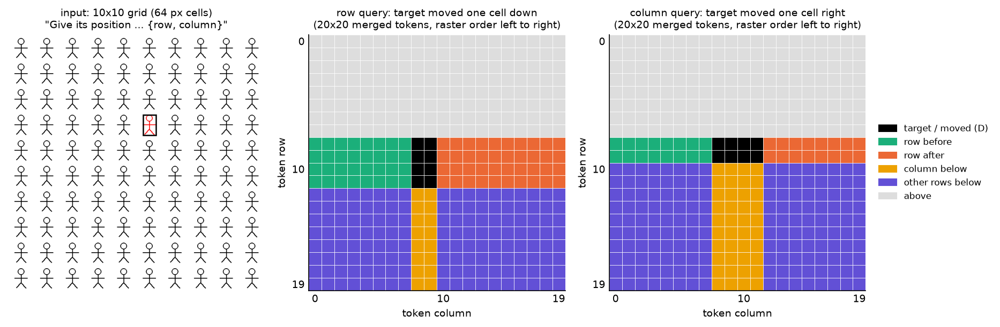
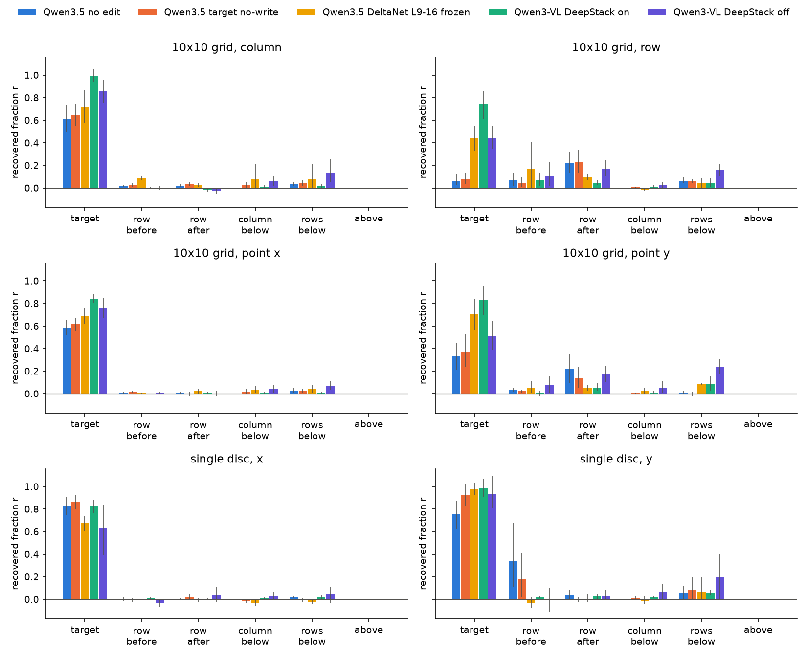
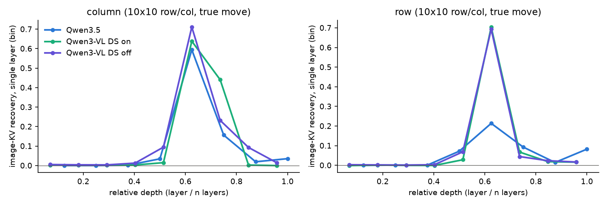
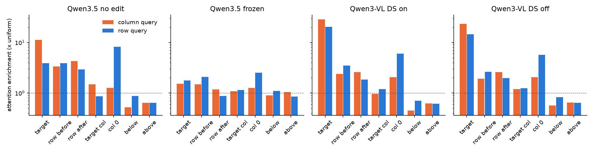
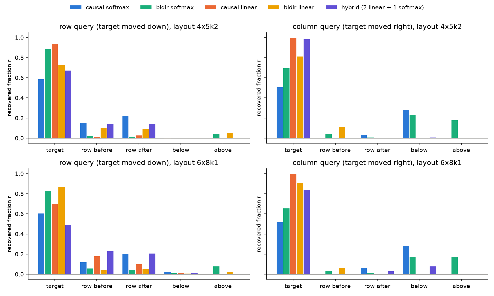
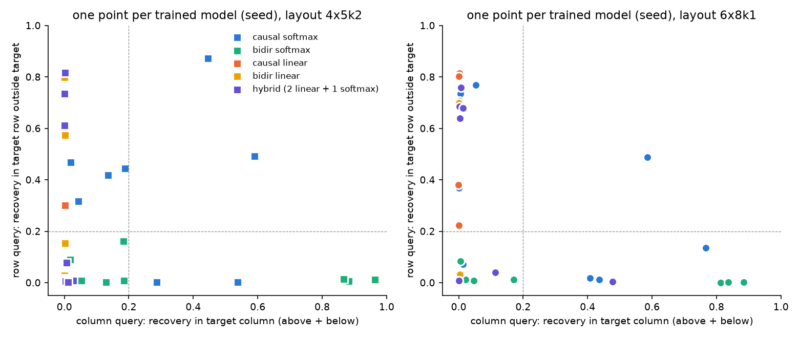
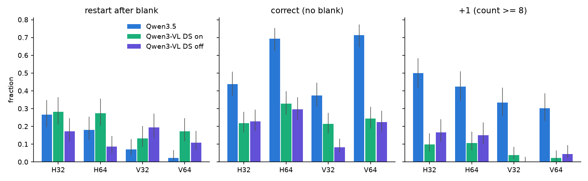
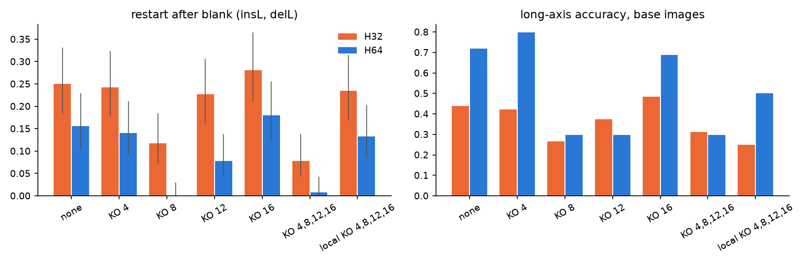

# 因果掩码与线性注意力

实验日期：2026-10-21。本文属于[位置信息与坐标读取](plan.md)研究，执行[实验 3.14 设计](design_causal_vs_linear.md)，理论推导与符号定义见设计文档第 2 节。比较对象为 Qwen3.5-9B（24 个 Gated DeltaNet 层与 8 个 full attention 层，均为 causal）与 Qwen3-VL-8B-Instruct（36 个 full attention 层，causal，带 DeepStack）。两个模型均使用 bfloat16、SDPA、greedy decoding 与 thinking off，全部问题为只输出答案的 direct-answer 格式。上游结果为[坐标读出的信息流（3.11）](results_2026-10-20_coordinate_flow.md)、[行列序号机制（3.10）](results_2026-10-20_rowcol_mechanism.md)与[行列序号的机理（1.5）](../behavior/results_2026-10-16_ordinal_mechanism.md)。

第二轮（[results_2026-11-03_causal_vs_linear_r2.md](results_2026-11-03_causal_vs_linear_r2.md)）以架构、机制与证据的顺序重写了本文第 1–4 节的论证，并加入读取 head 的 attention 对照；小模型、32 pixels 网格与序号行为的细节仍以本文第 5、6 节为准。

## 通俗讲述

本节以叙述方式概括全文，细节与数值见第 1–6 节。

实验 3.11 在 Qwen3.5 上发现了一个不对称：模型写横坐标时，信息取自目标图形所在的 token；写纵坐标时，信息几乎不在目标 token 上，而在目标所在 token 行中、按光栅顺序位于目标之后的 token 上。这一现象可能有两个来源。第一个来源是 causal 顺序：decoder 中每个 token 只能看到排在它前面的 token，图像又按从左到右、从上到下的顺序排成一列。第二个来源是 Qwen3.5 特有的线性注意力 Gated DeltaNet：它把前面的信息压进一个随序列不断衰减、并在每行开头被清空的状态中，信息因此只能沿着序列“流”向后面的 token。两种来源在 Qwen3.5 中同时存在，需要分开。

理论分析先回答“各自能做到什么”。causal mask 只规定信息能不能到达，不规定怎样到达：目标之前的 token 一定不含目标信息，但目标之后的 token 不论在同一行还是在目标正下方，都可以直接 attend 到目标，而且 softmax attention 不在乎两者在序列中相隔多远。因此，单有 causal mask 只能预言“载体在目标之后”，预言不了“纵坐标在行后、横坐标在目标”。Gated DeltaNet 则不同：目标写入状态的内容按序列距离逐步衰减，并在下一行开头被清空，于是同一行中目标之后的 token 自动共享“本行有目标”这一信息，而目标正下方的 token 与目标相隔一整行，什么也收不到。线性注意力本身也不依赖 causal mask：它的递推形式根本没有 mask，因果性来自扫描方向；把扫描改成正反两次即可得到双向版本，视觉 Mamba 类模型已经这样做。双向扫描会让目标前后两侧同时收到信息，但目标所在的列仍然收不到，只有再加入按列的扫描，行列不对称才会消失。

第一组实验直接比较两个模型。Qwen3-VL 只有 causal full attention，没有线性注意力。在同一批网格图像上，Qwen3-VL 读纵坐标时目标 token 携带了 0.74 的差异，行后 token 只有 0.05；Qwen3.5 正好相反，目标 token 只有 0.06，行后为 0.21。目标上方的 token 在两个模型中都恰好为 0，这是 causal 顺序的硬性后果。因此，**“纵坐标住在行后”这一现象属于 Gated DeltaNet，causal 顺序只负责“载体不在目标之前”**。一个附带的发现是，Qwen3-VL 读纵坐标时同样把较多 attention 放在每行开头的 token 上，这一 attention 模式两个模型共有，不能作为 DeltaNet 的标志；但在 Qwen3-VL 中，替换行首 token 并不能移动答案。

第二组实验在 Qwen3.5 内部只编辑 DeltaNet。只在第 9–16 层冻结 DeltaNet（不衰减也不写入）后，纵坐标的信息从行后回到目标 token（目标份额由 0.06 升至 0.44），这符合理论；但这一编辑同时让行列答案几乎全部出错，所以只能作为方向性的证据。只禁止目标 token 自身写入 DeltaNet 状态时，答案与载体都没有变化，说明行后 token 拿到的目标信息不必经过目标自己的状态写入，更可能经过宽度为 4 的局部卷积或 full attention 传递，这一点仍待确认。取消全部衰减时，理论预言信息会扩散到下方各行，实测没有出现，原因尚不清楚。

第三组实验在合成的光栅网格上从头训练小模型，只改变混合器的结构。8 个随机种子、两种布局下，用线性注意力（无论 causal 还是双向）训练的 32 个模型中，没有一个把横坐标信息放在目标所在的列上；用 softmax attention 训练的 32 个模型中有 14 个这样做。纵坐标信息出现在目标行的比例在 causal 线性注意力中为 5/16，在 causal softmax 中为 10/16，说明 softmax 同样可以学出“行后”解，但线性注意力不允许“列上”解。双向 softmax 模型把信息同时放在目标上方与下方，体现了去掉 causal mask 后的前后对称。这组结果与理论一致：线性注意力的光栅递推结构性地排除了列载体，softmax 则在多种解之间由训练决定。

最后一部分关注单元为 32 pixels 的网格。此时 ViT 的 2×2 合并恰好把一个图形压成一个 token，3.10 发现的“遇到空白列后从头计数”在这种网格上不受 DeltaNet 门控影响。Qwen3-VL 在同一批图像上也会从空白处重新计数，而且行列两个方向都会，因此这一行为不依赖 DeltaNet。在 Qwen3.5 中逐层去掉图像 token 之间的 full attention，只有第 8 层的去除让重新计数几乎消失（64 pixels 由 0.16 降至 0），但它同时把无空白图像的正确率由 0.72 降到 0.30，并且图像 token 上的运行计数 probe 并未改变。因此第 8 层的全局 attention 是重新计数在行为上出现的必要条件，但它不是“只看左边几个 token”的局部计数，后者被单独屏蔽时没有作用。读出阶段的比例高估（多计 1）在 Qwen3-VL 中几乎不存在，它反而倾向少计，说明多计 1 是 Qwen3.5 特有的读出偏差。

## 1. 研究问题与主要结果

本实验以 teacher-forced 首位数字 logit 差的恢复比例 $r$（定义见第 2.2 节）测量图像 KV 子集的因果作用，以答案位置的 attention 质量做描述性分析，并以序号行为与运行计数 probe 检验 32 pixels 网格。主要结果如下，实测与解释分开标注：

1. **Qwen3-VL 不存在“纵坐标在行后”的载体不对称，横纵两个坐标都主要由目标 token 携带。** 实测：10×10 行列格式的拼接对照中，Qwen3-VL（DeepStack 开）纵坐标的目标份额为 0.74 [0.62, 0.86]、行后为 0.05 [0.02, 0.07]（16 个回答）；Qwen3.5 为 0.06 [0.03, 0.10] 与 0.21 [0.15, 0.28]（3.11，25 个回答）。横坐标的目标份额分别为 1.00 与 0.58。10×10 point 格式的纵坐标目标份额为 0.83 对 0.30。两个模型在所有条件下“上方”恢复均为 0.00。解释：causal 顺序只决定载体不在目标之前；行后载体需要 Gated DeltaNet 的递推，第 2.5 节的预测 P1、P2 成立。
2. **关闭 DeepStack 后，Qwen3-VL 的纵坐标载体扩散到目标之后的多个位置，但仍不形成行局部性。** 实测：纵坐标目标份额由 0.74 降至 0.45 [0.35, 0.55]，行后 0.17、下方各行 0.16 [0.10, 0.21]，目标正下方的列只有 0.02；point 格式下方各行为 0.24。解释：DeepStack 提供的逐 token 绝对位置（4.4）使目标 token 自身足以给出纵坐标；去掉后，causal full attention 把位置估计分摊到目标之后的 token，但没有偏向同一行。
3. **纵坐标 query 对行首 token 的 attention 偏好在两个模型中都存在，它不是 DeltaNet 的标志，在 Qwen3-VL 中也不具有因果作用。** 实测：图像 attention 占比最高的层中，纵坐标 query 在第 0 列上的 attention 富集为 Qwen3.5 8.3 倍、Qwen3-VL 6.0 倍（DeepStack 关 5.7 倍），而 Qwen3-VL 的行后与行前 KV 合计恢复不超过 0.12。预测 P3 不成立。
4. **Qwen3.5 中行后载体依赖第 9–16 层的 DeltaNet，但不依赖目标 token 自身的状态写入。** 实测：第 9–16 层冻结后纵坐标目标份额升至 0.44 [0.33, 0.55]、行后降至 0.10（5 个回答；point 格式 0.70 与 0.05，7 个回答），但行列答案正确率由 38/40 降至 0/40；只在目标 token 上令 $\beta = 0$ 时答案（38/40）与载体（目标 0.08、行后 0.23）均不变。取消全部衰减时目标份额 0.29、行后 0.09，下方各行 0.06，未出现预测 P5 的向下扩散。解释：预测 P4 在方向上成立，但证据被行为破坏所混淆。
5. **从头训练的小模型中，线性注意力从不把横坐标放在目标列上，softmax attention 则经常这样做。** 实测：8 个种子 × 2 种布局，横坐标目标列份额超过 0.2 的模型在线性混合器中为 0/32、softmax 混合器中为 14/32、混合结构中为 1/16；纵坐标目标行份额超过 0.2 的模型为 causal 线性 5/16、causal softmax 10/16、混合结构 8/16、双向线性 3/16、双向 softmax 1/16。全部模型在两个问题上的准确率均为 1.00。解释：预测 P6 的结构部分成立，行后解对两类混合器都可学，列解只对 softmax 可学。
6. **32 pixels 网格上的“从空白重新计数”不依赖 DeltaNet，在 Qwen3.5 中需要第 8 层图像 token 之间的全局 full attention，但不是局部计数。** 实测：Qwen3-VL 的重新计数比例为 H32 0.28、H64 0.27、V32 0.13、V64 0.17（各 128 张）；Qwen3.5 去掉第 8 层图像间 attention 后 H32 由 0.25 降至 0.12、H64 由 0.16 降至 0.00（McNemar p = 5×10⁻⁴ 与 2×10⁻⁶），四层同时去掉为 0.08 与 0.01；只屏蔽同行左侧 1–3 个 token 时不变（0.23、0.13）。第 8 层的去除同时使 H64 无空白图像的正确率由 0.72 降至 0.30，运行计数 probe 的重新计数权重基本不变。
7. **读出阶段的比例高估是 Qwen3.5 特有的。** 实测：无空白图像中序号不小于 8 的目标，Qwen3.5 多计 1 的比例为 0.30–0.50，Qwen3-VL（DeepStack 开）为 0.02–0.11，少计 1 的比例为 0.22–0.33。

**综合解释（推断）。** 光栅顺序的 causal decoder 只施加一条结构性约束，即载体位于目标之后；在这条约束之内，full attention 模型可以把两个坐标都留在目标 token 上，Qwen3-VL 借助 DeepStack 的绝对位置正是如此。Gated DeltaNet 的递推额外施加第二条约束：目标信息只能沿序列向后、在一行之内传播，目标列在结构上不可达。Qwen3.5 的纵坐标读取因此依赖“目标行中目标之后的 token 共享本行的行号”这一由递推自然产生的解。这一区分对方向二的含义是：若读取窗口内只有 DeltaNet 状态承载行号，窗口必须包含目标之后的同行 token，或另行携带原图坐标；full attention 架构没有这一要求。

## 2. 实验设置与实际执行

### 2.1 刺激、模型模式与输入示例

坐标刺激沿用 3.11 的 cases：

- **10×10 网格。** 单元 64 pixels、640×640 画布、20×20 个 merged token，目标为红色图形，覆盖 2×2 个 token；格式为行列（row 先输出，另有 column 先输出的 colrow）与 point（0–1000 坐标）。
- **单目标圆。** 512×512 画布上一个直径 32 pixels 的红色圆，point 格式。
- **RefCOCO。** 自然图像的 point 格式，run B 为同图另一指代对象（content swap）。

序号刺激为 1.5 的槽位网格 H32、H64、V32、V64（H 为横向、V 为纵向，32 与 64 为单元 pixels），每个条件 320 张，变体 base、shift、insL、delL、delR 的定义见 [1.5 第 2 节](../behavior/results_2026-10-16_ordinal_mechanism.md)，配对示例见该文的变体示例图。

模型模式如下：

- **Qwen3-VL。** DeepStack 开（`ds_on`，原生行为）与关（`ds_off`，decoder 前 3 层不加入 ViT 中间层特征）。图像经 `inputs_embeds` 输入时 DeepStack 由手工注入，抽查 20 个样本，注入版与原生 generate 的首位数字 20/20 一致、完整答案 17/20 一致，其余 3 个只在末位数字上不同。
- **Qwen3.5。** 无编辑；全部冻结（图像 token 上全部 24 个 DeltaNet 层 $\alpha = 1, \beta = 0$）；不衰减（$\alpha = 1$）；第 9–16 层冻结；目标 token 不写入（只在目标 token 上令全部 DeltaNet 层 $\beta = 0$）。门控编辑通过在 $\alpha$、$\beta$ 的 pre-activation 上加 $\pm 10^4$ 实现，同时作用于 run A、run B 与全部干预行。

*图 1：输入示例与 token 组定义。左：一张 10×10 行列格式的输入图像，黑框为红色目标，问题要求只输出行号与列号的 JSON。中、右：20×20 merged token 网格上的 token 组，按 3.11 的 `token_groups` 计算（示意位置，非实测）。黑色为变化 token 集合 $D$（目标在 run A 与 run B 中的位置之并），绿色为行前（$D$ 所在 token 行中位于 $D$ 左侧），橙色为行后（位于 $D$ 右侧），黄色为列下（$D$ 所在 token 列中位于 $D$ 下方），紫色为其余下方各行，灰色为上方。文中“下方各行”指黄色与紫色之并。读纵坐标时 run B 把目标下移一个单元，读横坐标时右移一个单元。*

### 2.2 恢复比例与统计

恢复比例沿用 3.11 的定义：

$$
r_e = \frac{\mathrm{LD}_e - \mathrm{LD}_A}{\mathrm{LD}_B - \mathrm{LD}_A}, \qquad \mathrm{LD} = z_{d_B} - z_{d_A}.
$$

其中 $z \in \mathbb{R}^{V}$ 为预测坐标首位数字的位置上的 logits（$V$ 为词表大小），$d_A$ 为 run A 的首位数字，$d_B$ 为 run B 在同一位置 logit 最大的数字。$\mathrm{LD}_A$、$\mathrm{LD}_B$、$\mathrm{LD}_e$ 分别为 run A、run B 与干预 $e$ 之后的 run A 的 logit 差，干预 $e$ 把某个 token 组在 full attention 层中的 key 与 value 换成 run B 的值（Qwen3.5 为全部 8 层，Qwen3-VL 为全部 36 层）。$r_e = 1$ 表示该组携带了全部差异，$r_e = 0$ 表示没有携带。排除 $d_A = d_B$ 或 $\lvert \mathrm{LD}_B - \mathrm{LD}_A \rvert < 2$ 的数值，因此表中的 $n$ 为有效数值个数，小于回答数。

主要结论使用 decoder 拼接对照：run B 的图像只在 $D$ 上取 run B 的 merged embedding（Qwen3-VL 同时拼接 DeepStack 特征），其余 token 取 run A。由于 decoder 是 causal 的，位于 $D$ 第一个 token 之前的 token 在两个 run 中完全相同，“上方”组的恢复比例必须为 0，这一精确对照用于检验实现。

比例给出 Wilson 95% 区间；恢复比例给出均值与按回答的 bootstrap 95% 区间；成对比较用精确 McNemar 检验。失败与截断的回答计入分母。

### 2.3 实际执行

| 子实验 | 内容 | 规模 |
| --- | --- | --- |
| E1、E2 | 答案位置 attention 剖面与图像 KV 子集 patching | Qwen3-VL 两种模式、Qwen3.5 五种模式；每条件 16 个回答（DeepStack 关与 Qwen3.5 编辑模式只测主要 token 组） |
| E3 | Qwen3.5 DeltaNet 编辑下的生成正确率 | 10×10 行列与 point 各 40 张，单目标圆 48 张 |
| E4 | 小模型 | 5 种混合器 × 2 种布局 × 8 个种子，每个模型 3000 步，载体测量 150 对，CPU |
| E5 | 槽位网格的序号行为与运行计数 probe | Qwen3-VL 两种模式，各 1280 张 |
| E6 | 32 pixels 的 full attention knockout | Qwen3.5，H32 与 H64 的 base、insL、delL 各 192 张 × 7 种条件 |

GPU 用量约 4.5 GPU 小时：Qwen3-VL 约 2.5 小时（A40），Qwen3.5 约 1.5 小时，其余为因显存不足而失败的启动。Qwen3.5 的无编辑、全部冻结与不衰减模式使用 FLA kernel（A800），目标不写入、第 9–16 层冻结与 E6 因 A40 的 shared memory 不足使用纯 PyTorch 的 chunked gated delta rule；两者实现同一算法，但未逐样本比对。Qwen3.5 无编辑模式在本实验中的复测与 3.11 一致（纵坐标目标 0.06、行后 0.22，n = 16），下文的 Qwen3.5 参考值取 3.11 的较大样本。

## 3. Qwen3-VL 与 Qwen3.5 的对照（Q1）

### 3.1 图像 KV 载体

*图 2：decoder 拼接对照下各 token 组的恢复比例 $r$（由模型激活经 teacher-forced patching 测得）。每个子图为一种刺激与一个坐标轴，横轴为 token 组（定义见图 1，“rows below”为下方全部各行），误差线为 bootstrap 95% 区间。蓝色为 Qwen3.5 无编辑，橙色为 Qwen3.5 目标 token 不写入，黄色为 Qwen3.5 第 9–16 层 DeltaNet 冻结，绿色为 Qwen3-VL DeepStack 开，紫色为 Qwen3-VL DeepStack 关。黄色在 10×10 网格上只有 4–9 个有效数值。*

| 条件 | 坐标 | Qwen3.5（3.11） | Qwen3-VL DeepStack 开 | Qwen3-VL DeepStack 关 |
| --- | --- | --- | --- | --- |
| 10×10 行列 | 纵 | 目标 0.06 [0.03, 0.10]，行后 0.21 [0.15, 0.28]，行前 0.12，列下 0.01（n = 25） | 目标 0.74 [0.62, 0.86]，行后 0.05，行前 0.07，下方各行 0.05（n = 16） | 目标 0.45 [0.35, 0.55]，行后 0.17，行前 0.11，下方各行 0.16，列下 0.02（n = 14） |
| 10×10 行列 | 横 | 目标 0.58 [0.49, 0.68]（n = 25） | 目标 1.00 [0.94, 1.05]（n = 16） | 目标 0.86，下方各行 0.14（n = 16） |
| 10×10 point | 纵 | 目标 0.30，行后 0.25（n = 26） | 目标 0.83，行后 0.05（n = 16） | 目标 0.51，行后 0.17，下方各行 0.24（n = 15） |
| 10×10 point | 横 | 目标 0.54（n = 26） | 目标 0.84（n = 16） | 目标 0.76（n = 16） |
| 单目标圆 | 纵 / 横 | 目标 0.83 / 0.86 | 目标 0.98 / 0.83 | 目标 0.93 / 0.63 |
| RefCOCO（content swap） | 横 / 纵 | 目标 0.73 / 0.84 | 目标 0.62 / 0.83 | 未测 |

全部条件、全部模型的“上方”恢复为 0.00。真实移动（ViT 重新编码整幅图像）给出相同的分工：Qwen3-VL 纵坐标目标 0.52、行后 0.04，Qwen3.5 目标 0.04、行后 0.31。column 先输出的 colrow 格式中，Qwen3-VL 纵坐标目标 0.58、横坐标 0.93（真实移动，n = 12），输出顺序不改变分工，与 3.11 对 Qwen3.5 的结论相同。

**Qwen3-VL 的两个坐标都从目标 token 读取，行列载体不对称只出现在 Qwen3.5 中。** 设计文档第 2.2 节推出 causal full attention 只规定载体不能在目标之前；Qwen3-VL 恰好只有这一约束，它的纵坐标载体集中在目标 token 上，行后只有 0.05。Qwen3.5 的纵坐标几乎不在目标 token 上，二者的区间不重叠。两个模型共享光栅顺序、causal mask 与相同的 ViT 合并方式，差别在于 decoder 是否含有 Gated DeltaNet，以及训练数据与 DeepStack；因此这一对照证明行后载体不是 causal 顺序的必然结果，但单凭模型对照还不能把差别全部归因于 DeltaNet，第 4、5 节分别从架构内编辑与受控小模型补足这一点。

**关闭 DeepStack 后，Qwen3-VL 的纵坐标向目标之后扩散，但扩散方向不偏向同一行。** DeepStack 关时目标份额降至 0.45，差异分摊到行后（0.17）与下方各行（0.16，point 格式 0.24），二者相当；列下只有 0.02，说明扩散到下方的部分落在目标列以外的位置。这与 4.4 的结论一致：DeepStack 注入的特征主要充当逐 token 的绝对位置，去掉后目标 token 自身的位置信号减弱，模型转而依赖目标之后的上下文。该模式下生成正确率很低（行列 5/40，point 4/40），载体测量只在仍满足有效条件的回答上进行，结论限于“去掉 DeepStack 后的残余机制”。

### 3.2 读取层

*图 3：只在单层（Qwen3.5）或单个 4 层分组（Qwen3-VL）中替换全部图像 token 的 key 与 value 时的恢复比例（10×10 行列格式、真实移动，由模型激活测得）。横轴为相对深度（层号除以总层数，Qwen3-VL 取分组中点），蓝色为 Qwen3.5，绿色为 Qwen3-VL DeepStack 开，紫色为 Qwen3-VL DeepStack 关。*

两个模型的坐标读取都集中在相对深度约 0.6 处（Qwen3.5 第 20 层，Qwen3-VL 第 21–24 层）。Qwen3-VL 在这一分组中两个坐标都恢复 0.64–0.71；Qwen3.5 的横坐标在第 20 层恢复 0.59，纵坐标只恢复 0.21，其余部分分散在第 16、24 与 32 层。**读取深度相同，纵坐标读取在 Qwen3.5 中更分散。** 解释：当纵坐标分布在一整行的 token 上时，单层单 head 难以一次读全，读取被多个层分担；Qwen3-VL 的纵坐标集中在目标 token 上，一次读取即可完成。

### 3.3 答案位置的 attention 剖面

*图 4：10×10 行列格式中，坐标首位数字 query 在各 token 组上的 attention 富集（由模型激活测得）。富集定义为该组的 attention 质量占图像 attention 的比例除以该组 token 占图像 token 的比例，1 表示均匀；对每个模型取图像 attention 占比最高的四分之一 full attention 层（Qwen3.5 为第 12 与 20 层，Qwen3-VL 为第 14–24 层中的 9 层），再对层、head 与 16 个回答取平均，纵轴为对数刻度。橙色为横坐标（column）query，蓝色为纵坐标（row）query。第二个子图为 Qwen3.5 全部冻结，该模式下模型已失去正确回答的能力（第 4 节），仅作对照。*

| 模型 | 横坐标 query：目标 | 纵坐标 query：目标 | 纵坐标 query：第 0 列 | 横坐标 query：第 0 列 |
| --- | --- | --- | --- | --- |
| Qwen3.5 | 11.3 | 3.9 | 8.3 | 1.3 |
| Qwen3-VL DeepStack 开 | 28.6 | 20.4 | 6.0 | 2.1 |
| Qwen3-VL DeepStack 关 | 23.4 | 14.6 | 5.7 | 2.1 |

**纵坐标 query 偏向行首 token 的 attention 是两个模型共有的读取模式，它在 Qwen3-VL 中不承载因果作用。** Qwen3-VL 纵坐标 query 在第 0 列上的富集为 6.0，与 Qwen3.5 的 8.3 同一量级，设计文档预测 P3 不成立。但 Qwen3-VL 的纵坐标 query 同时以 20.4 倍的富集关注目标，KV patching 显示差异由目标 token 携带，行前与行后合计不超过 0.12。解释：行首 token 的 attention 可能对应一种通用的“定位本行”的读取，它在 Qwen3.5 中与 DeltaNet 写入行首的行号相配合而成为载体，在 Qwen3-VL 中只是 attention 上的伴随现象；attention 质量与因果作用的这种分离与 3.11 的观察一致。

### 3.4 生成正确率

| 模式 | 10×10 行列 | 10×10 point | 单目标圆 point | RefCOCO point |
| --- | --- | --- | --- | --- |
| Qwen3.5 无编辑 | 38/40（0.95 [0.83, 0.99]） | 15/40（0.38 [0.24, 0.53]） | 17/48（0.35 [0.23, 0.50]） | — |
| Qwen3-VL DeepStack 开 | 8/40（0.20 [0.10, 0.35]） | 37/40（0.93 [0.80, 0.97]） | 23/48（0.48 [0.34, 0.62]） | 42/48（0.88 [0.75, 0.94]） |
| Qwen3-VL DeepStack 关 | 5/40（0.13 [0.05, 0.26]） | 4/40（0.10 [0.04, 0.23]） | 3/48（0.06 [0.02, 0.17]） | — |

Qwen3-VL 在 point 格式上远好于 Qwen3.5、在行列格式上远差于 Qwen3.5，与 4.2 的端到端对照一致。**载体位置与正确率没有对应关系**：Qwen3-VL 的两个坐标都从目标读取，point 格式正确率 0.93，行列格式却只有 0.20；行列格式需要的是序号（计数），第 6 节显示 Qwen3-VL 的计数本身较弱。

## 4. Qwen3.5 内的 DeltaNet 编辑（Q3b）

| 模式 | 10×10 行列 | 10×10 point | 单目标圆 | 纵坐标载体（行列，拼接） | 纵坐标载体（point，拼接） |
| --- | --- | --- | --- | --- | --- |
| 无编辑 | 38/40 | 15/40 | 17/48 | 目标 0.06，行后 0.21（n = 25） | 目标 0.30，行后 0.25（n = 26） |
| 目标 token 不写入 | 38/40 | 19/40 | 17/48 | 目标 0.08 [0.04, 0.14]，行后 0.23 [0.14, 0.34]（n = 16） | 目标 0.37，行后 0.14（n = 16） |
| 第 9–16 层冻结 | 0/40 | 1/40 | 3/48 | 目标 0.44 [0.33, 0.55]，行后 0.10 [0.07, 0.13]（n = 5） | 目标 0.70 [0.56, 0.84]，行后 0.05（n = 7） |
| 不衰减（全部层） | 4/40 | 5/40 | 3/48 | 目标 0.29 [0.20, 0.38]，行后 0.09，下方各行 0.06（n = 10） | 目标 0.54，行后 0.11（n = 13） |
| 全部冻结 | 0/40 | 0/40 | 2/48 | 有效数值 0 个 | 有效数值 1 个 |

横坐标在各编辑模式下都保持在目标 token 上（目标份额 0.61–0.90），编辑主要改变纵坐标的载体。

**冻结第 9–16 层的 DeltaNet 使纵坐标的载体由行后移回目标，方向符合 DeltaNet 写入行后载体的预言。** 第 9–16 层是 3.8 与 3.10 确定的行计数层。冻结后，目标份额由 0.06 升至 0.44，行后由 0.21 降至 0.10，point 格式的变化更大（目标 0.70、行后 0.05）。限制在于这一编辑同时使行列答案几乎全部出错，有效数值只有 5–7 个：模型失去了行计数，残余的纵坐标信号只能来自目标 token 自身的 ViT 位置，载体回到目标既可能说明“行后载体由这些层写入”，也可能只是“行计数被破坏后剩下的唯一来源”。两种读法都要求行后载体依赖这些层，但无法区分它是否由 DeltaNet 状态直接写入。

**只禁止目标 token 写入 DeltaNet 状态，答案与载体都不变。** 若行后 token 上的“本行含有目标”来自目标在 DeltaNet 状态中的写入，令目标 token 的 $\beta = 0$ 应削弱行后载体；实测行后份额 0.23 与无编辑相同，答案也不变。解释（未经检验）：行后 token 获得目标信息的候选通路有三条，一是每个 DeltaNet 层在 $q, k, v$ 上宽度为 4 的 causal 短卷积，它把目标的特征直接混入其后 3 个 token 的 key 与 value，再由这些 token 写入状态；二是 full attention 层；三是行计数本身并不需要目标信息，行后 token 只是携带了“本行行号”，而 run B 的目标所在行改变了行后 token 所属的行。第三种读法与 3.10 的“行号由跨行累加器承载、在目标之后的 token 上可读”相符，此时载体反映的是行号的存放位置，而不是目标内容的传播。

**取消衰减没有使纵坐标载体扩散到下方各行，预测 P5 不成立。** 理论预言 $\alpha = 1$ 时目标写入不再在行首被清空，下方各行也应携带目标信息；实测下方各行只有 0.06，与无编辑相同，目标份额反而上升。解释：取消衰减同时让所有 token 的写入无限累积，状态被大量无关写入淹没，行计数被破坏（正确率 4/40），其结果与冻结相似。该编辑无法孤立“行首清空”这一个因素；精确检验需要只在行首位置取消衰减，本实验未做。

## 5. 小模型（Q3c）

*图 5：小模型中读出层各 token 组的恢复比例（由小模型激活经拼接与 KV patching 测得，每个模型 150 对，对 8 个种子取平均）。上行为 4×5 单元、每单元 2×2 token 的布局，下行为 6×8 单元、每单元 1 个 token 的布局；左列为行 query（目标下移），右列为列 query（目标右移）。蓝色为 causal softmax，绿色为双向 softmax，橙色为 causal 线性注意力，黄色为双向线性注意力，紫色为混合结构（两层 causal 线性注意力加一层 causal softmax）。*

*图 6：每个点为一个训练好的小模型（一个种子）。横轴为列 query 时目标列（上方与下方）的恢复比例之和，纵轴为行 query 时目标行中目标以外 token 的恢复比例之和，虚线为 0.2 的阈值，颜色同图 5。左图为 4×5 单元布局（方块），右图为 6×8 单元布局（圆点）。*

| 混合器 | 横坐标在目标列（>0.2） | 纵坐标在目标行（>0.2） |
| --- | --- | --- |
| causal softmax | 8/16 | 10/16 |
| 双向 softmax | 6/16 | 1/16 |
| causal 线性注意力 | 0/16 | 5/16 |
| 双向线性注意力 | 0/16 | 3/16 |
| 混合结构 | 1/16 | 8/16 |

全部 80 个模型在行与列两个问题上的准确率均为 1.00，载体差异不来自任务失败。

**线性注意力在光栅顺序下不允许“列载体”，这一点在 32 个线性模型中无一例外。** 设计文档第 2.3 节推出，目标写入的内容到达目标正下方的 token 时必须跨过整整一行，并在行首被清空；小模型的线性混合器（无论 causal 还是正反两次扫描）在 32 次训练中都没有把横坐标放在目标列上（最大份额 0.006）。softmax 混合器在 14/32 次训练中这样做，causal softmax 把信息放在目标下方，双向 softmax 放在目标上方与下方，这与“softmax attention 不在乎序列距离”的推论一致。混合结构只有 1/16，说明只要多数层是线性注意力，学出的解就以行为单位组织，与 Qwen3.5 的 3:1 结构对应。

**行载体对两类混合器都是可学的解，causal 顺序只决定它位于目标哪一侧。** causal softmax 在 10/16 次训练中把纵坐标放在目标行，次数多于 causal 线性注意力的 5/16，说明“行后”本身不是线性注意力的专属结果，softmax 也可以学出；不同之处在于 softmax 同时可以学出列解，线性注意力不能。双向模型的行载体同时出现在目标两侧（图 5 中黄色与绿色的行前份额），双向线性注意力在“上方”组上的恢复最高为 0.05，因果性消失后目标之前的 token 也可携带信息。

**小模型的种子差异很大，解的选择由训练决定。** 同一结构的 8 个种子中，行载体份额从接近 0 到 0.8 不等（图 6），只有“线性注意力不产生列载体”这一否定性结论在所有种子上成立。因此小模型适合检验结构上“能”与“不能”，不能用来推断大模型中“会”选择哪种解。

## 6. 32 pixels 网格与读出阶段的高估（Q4）

### 6.1 Qwen3-VL 的序号行为

*图 7：槽位网格上的序号行为（由模型生成答案统计）。左：insL 与 delL 变体中答案等于“空白之后的实例数”的比例（重新计数，每条件 128 张）；中：无空白 base 图像中长轴答案正确的比例（192 张）；右：序号不小于 8 的无空白目标中答案恰好多 1 的比例（132 张）。蓝色为 Qwen3.5（1.5 的结果），绿色为 Qwen3-VL DeepStack 开，紫色为 Qwen3-VL DeepStack 关，误差线为 Wilson 95% 区间。*

| 模型 | 重新计数 H32 / H64 / V32 / V64 | 无空白正确率 H32 / H64 / V32 / V64 | 多计 1（序号 ≥ 8） | 少计 1（无空白） |
| --- | --- | --- | --- | --- |
| Qwen3.5 | 0.27 / 0.18 / 0.07 / 0.02 | 0.44 / 0.69 / 0.38 / 0.71 | 0.30–0.50 | 0.00–0.06 |
| Qwen3-VL DeepStack 开 | 0.28 / 0.27 / 0.13 / 0.17 | 0.22 / 0.33 / 0.21 / 0.24 | 0.02–0.11 | 0.22–0.33 |
| Qwen3-VL DeepStack 关 | 0.17 / 0.09 / 0.20 / 0.11 | 0.23 / 0.30 / 0.08 / 0.22 | 0.00–0.17 | 0.04–0.30 |

**Qwen3-VL 同样从空白处重新计数，而且在纵向上更明显，因此重新计数不依赖 DeltaNet。** Qwen3-VL 的横向重新计数（0.27–0.28）与 Qwen3.5 相当，纵向（0.13–0.17）高于 Qwen3.5（0.02–0.07）。Qwen3.5 在纵向上几乎不重新计数，与 3.10 的“行计数由跨行累加器给出、空白行不引起复位”一致；Qwen3-VL 没有这一累加器，两个方向的行为相似。需要注意的是，Qwen3-VL 本身倾向少计（无空白时少计 1 的比例为 0.22–0.33），重新计数给出的答案也小于真实序号，两种错误在数值上部分重叠，因此 Qwen3-VL 的重新计数比例是上界。

**读出阶段的比例高估是 Qwen3.5 特有的。** 1.5 把 Qwen3.5 的多计 1 解释为对实例总数高估 3%–8% 的比例估计；Qwen3-VL 在同一批图像上几乎不多计（0.02–0.11），反而少计。两个模型的计数偏差方向相反，说明这一偏差属于具体模型的读出校准，而不是光栅顺序计数的普遍性质。

运行计数 probe（在第 9、18、27 层的图像 token 上，以 128 个主成分做 ridge 回归、按 base 图像 5 折交叉验证）在 Qwen3-VL DeepStack 开时的重新计数权重为：H32 0.12、0.20、0.33，H64 0.03、0.05、0.19，V32 与 V64 不超过 0.06；无空白图像上的 $R^2$ 为 0.93–0.99。**Qwen3-VL 的纵向重新计数不在图像 token 的表征中，横向重新计数随深度逐渐写入表征。** 解释：纵向的重新计数发生在答案位置的读出阶段，横向则部分在图像 token 上完成。

### 6.2 Qwen3.5 的 full attention knockout

*图 8：Qwen3.5 在 full attention knockout 下的序号行为（由模型生成答案统计，E6）。KO $\ell$ 表示在第 $\ell$ 层令图像 query 只能 attend 自身与文本 token，KO 4,8,12,16 为四层同时；local KO 只屏蔽同一 token 行中左侧 1–3 个 token。左：重新计数比例（insL 与 delL，各 128 张），误差线为 Wilson 95% 区间；右：无空白 base 图像的长轴正确率（64 张）。橙色为 H32，蓝色为 H64。*

| knockout | 重新计数 H32 / H64 | McNemar（失去 / 获得，p） | 无空白正确率 H32 / H64 | 短序号正确率 H32 / H64（192 张） | probe 重新计数权重 $b$（H32 / H64） |
| --- | --- | --- | --- | --- | --- |
| 无 | 0.25 / 0.16 | — | 28/64 / 46/64 | 191 / 192 | 0.29–0.34 / 0.20–0.33 |
| L4 | 0.24 / 0.14 | 不显著 | 27/64 / 51/64 | 190 / 192 | 不变 |
| L8 | 0.12 / 0.00 | H32 20/3，p = 5×10⁻⁴；H64 20/0，p = 2×10⁻⁶ | 17/64 / 19/64 | 130 / 153 | 0.23–0.29 / 0.17–0.22 |
| L12 | 0.23 / 0.08 | H64 13/3，p = 0.02 | 24/64 / 19/64 | 87 / 88 | 不变 |
| L16 | 0.28 / 0.18 | 不显著 | 31/64 / 44/64 | 190 / 192 | 不变 |
| L4、8、12、16 | 0.08 / 0.01 | H32 25/3，p = 3×10⁻⁵；H64 20/1，p = 2×10⁻⁵ | 20/64 / 19/64 | 110 / 125 | 0.21–0.29 / 0.14–0.19 |
| 局部（同行左侧 1–3 个） | 0.23 / 0.13 | 不显著 | 16/64 / 32/64 | 191 / 192 | 不变 |

probe 在第 8、12、16、20 层的图像 token 上训练，$b$ 的范围为四层的取值范围。

**第 8 层图像 token 之间的全局 full attention 是重新计数在行为上出现的必要条件。** 去掉第 8 层后，64 pixels 的重新计数由 20/128 降至 0/128，32 pixels 由 32/128 降至 15/128；其他单层没有可比的作用，第 12 层只在 64 pixels 上有较弱的作用。这一结果的解释受两点限制：

1. **knockout 同时破坏了计数本身。** 第 8 层 knockout 使短序号正确率由 191/192 降至 130/192，无空白正确率降至 0.30，H64 的多计 1 由 17/64 升至 32/64；重新计数的消失与一般计数能力的下降同时发生，不能把第 8 层解释为“专门负责重新计数”的位置。
2. **图像 token 上的运行计数表征几乎不变。** probe 的重新计数权重在第 8 层与四层 knockout 下为 0.14–0.29，无编辑时为 0.20–0.34，只有小幅下降，说明重新计数的表征仍在图像 token 上，被改变的是答案位置对这一表征的使用方式，或其他尚未测量的通路。

**重新计数不来自局部计数。** 设计文档第 2.7 节提出，一个实例恰为一个 token 时，“局部计数”可能由 full attention 在相邻 token 上完成；只屏蔽同行左侧 1–3 个 token 的 knockout 不改变重新计数（0.23 与 0.13），这一假设不成立。结合 3.10 的“DeltaNet 门控编辑不影响 32 pixels 的重新计数”与 Qwen3-VL 也重新计数，32 pixels 的重新计数更可能是一种与具体混合器无关的估计偏差：当实例与 token 一一对应时，空白 token 成为计数序列中最显著的边界，读出阶段倾向以它为起点。这一解释尚未直接检验。

## 7. 对四个问题的回答

| 问题 | 回答 | 确定程度 |
| --- | --- | --- |
| Qwen3-VL 是否有行列不对称 | 没有。两个坐标都由目标 token 携带；“上方”为 0 的 causal 约束相同；纵坐标 query 对行首的 attention 偏好相同但不具因果作用 | 高（n = 14–16，区间与 Qwen3.5 不重叠） |
| 根源是线性注意力还是 raster causal 顺序 | 二者分工：causal 顺序决定载体不在目标之前；线性注意力的光栅递推决定载体以行为单位、目标列不可达。只有 causal full attention 时，行列不对称不是结构性的 | 结构部分高（理论与 32 个线性小模型一致）；Qwen3.5 的具体实现中等（架构内编辑破坏行为） |
| 线性注意力是否依赖 causal mask，能否双向 | 不依赖。递推形式没有 mask，因果性是扫描方向的属性；双向扫描在小模型中同样完成任务（准确率 1.00），载体分布在目标两侧，列仍不可达 | 高 |
| 每个因素单独能否产生行列差异 | causal softmax 单独可以学出行载体（10/16），也可以学出列载体（8/16），由训练决定；线性递推单独（含双向）只产生行载体、从不产生列载体 | 小模型中高；大模型中只观察到“Qwen3-VL 选择了目标载体” |
| 32 pixels 的重新计数 | 不依赖 DeltaNet，也不依赖局部 full attention；Qwen3.5 中需要第 8 层的全局图像间 attention，但该 knockout 同时破坏计数；Qwen3-VL 两个方向都重新计数 | 中 |
| 读出阶段的比例高估 | Qwen3.5 特有，Qwen3-VL 偏向少计 | 高（行为层面） |

**参数或数据问题与架构限制的区分。** “目标列不可达”是光栅顺序线性递推的架构限制，在任何参数下都成立（确定程度高）；Qwen3.5 选择行后载体则是在这一限制内训练得到的解。Qwen3-VL 选择目标载体、Qwen3.5 的多计 1、Qwen3-VL 的少计 1 都属于参数或训练数据层面的差异，没有证据表明它们由架构强制（确定程度中）。32 pixels 的重新计数在两种架构中都出现，更可能是训练数据或读出校准的问题（确定程度中低）。

## 8. 与已有结论的关系

- **3.11。** 一致：Qwen3.5 无编辑模式的复测与 3.11 的载体数值相同。修正：3.11 把行列分工归于“decoder 的光栅因果顺序”，本实验表明 causal 顺序只解释“上方为 0”，行后载体需要 Gated DeltaNet，Qwen3-VL 在相同 causal 顺序下没有这一分工。3.11 的“读纵坐标时 attention 偏向行首 token”在 Qwen3-VL 中同样存在，因此它不能作为 DeltaNet 机制的直接证据。
- **3.10 与 3.8。** 一致：冻结第 9–16 层 DeltaNet 破坏行计数并把纵坐标载体移回目标，与“行号由第 9–16 层的跨行累加器承载”相符。补充：目标 token 自身的 DeltaNet 写入不是行后载体的必要条件；32 pixels 的重新计数在不含 DeltaNet 的 Qwen3-VL 中同样出现。
- **1.5。** 补充：1.5 的比例高估在 Qwen3-VL 中不存在，它是 Qwen3.5 的读出校准，而不是光栅计数的普遍性质。
- **4.4。** 一致：关闭 DeepStack 后 Qwen3-VL 的纵坐标目标份额由 0.74 降至 0.45、point 正确率由 0.93 降至 0.10，与“DeepStack 主要充当逐 token 的绝对位置”相符。
- **2.6 与 2.7。** 一致：两者报告的“比较按光栅顺序进行”只依赖 causal 顺序，与本实验的“上方恰为 0”相同，不需要 DeltaNet；2.7 报告第 1–8 层 DeltaNet 对 raster 之前实体的 $\beta = 0$ 有作用，与本实验“目标自身不写入无作用”并不矛盾，二者编辑的位置不同。

## 9. 限制

1. **Qwen3.5 的 DeltaNet 编辑破坏行为。** 第 9–16 层冻结、不衰减与全部冻结都使正确率降至 0–0.13，载体测量只有 0–13 个有效数值，第 4 节的结论只能作为方向性证据；能在保持行为的同时孤立“行首清空”的编辑（只在行首位置取消衰减）未做。
2. **两种 DeltaNet kernel 混用。** FLA 与纯 PyTorch 实现在不同模式间混用，未逐样本比对；Qwen3.5 无编辑模式在 FLA 下的载体与 3.11 一致，在纯 PyTorch 下的序号行为（重新计数 H32 0.25、H64 0.16）与 1.5 的 0.27、0.18 一致，这降低了但没有排除实现差异的影响。
3. **样本量。** 每条件 16 个回答，排除无效数值后为 4–16 个；主要对照（Qwen3-VL 与 Qwen3.5 的纵坐标目标份额）区间不重叠，次要组之间的差异多不显著。
4. **模型对照的混淆。** Qwen3-VL 与 Qwen3.5 在训练数据、规模与 DeepStack 上都不同，模型对照只能证明行后载体不是 causal 顺序的必然结果，不能单独归因到 DeltaNet；该归因依赖小模型与架构内编辑的共同支持。
5. **knockout 的破坏性。** 第 8 层 knockout 同时降低一般计数能力，只能给出必要条件；Qwen3-VL 的重新计数比例与其少计倾向部分重叠，应视为上界。
6. **小模型。** 小模型的输入只有内容与可学习的绝对位置，没有 ViT、MRoPE 与预训练；种子间差异大，只用于检验结构性的“能”与“不能”。

## 10. 产物

- 代码：`analysis_tools/position/causal_vs_linear.py`（门控编辑、knockout、KV patching 与 attention 剖面）、`causal_vs_linear_run.py`（GPU 阶段 gen、spotcheck、kv、ordinal）、`causal_vs_linear_toy.py`（小模型）、`causal_vs_linear_analysis.py`（统计与作图）；测试 `tests/analysis/position/test_causal_vs_linear.py`。
- 运行入口：`scripts/analysis/position/causal_vs_linear.sh`，参数 `JOB` 取 vl、q35_gate、q35_knock、toy、analyze。
- 结果：`WORK_DIR/analysis/position/2026-10-21_causal_vs_linear/`，其中 `summary.json` 汇总全部统计，`kv_<mode>.jsonl` 为逐回答的恢复比例，`kv_attn_<mode>/` 为 attention 剖面，`ordinal/` 为序号回答与 probe 特征，`toy/` 为小模型结果。
- 图：`docs/analysis/position/figures/causal_vs_linear/`。
