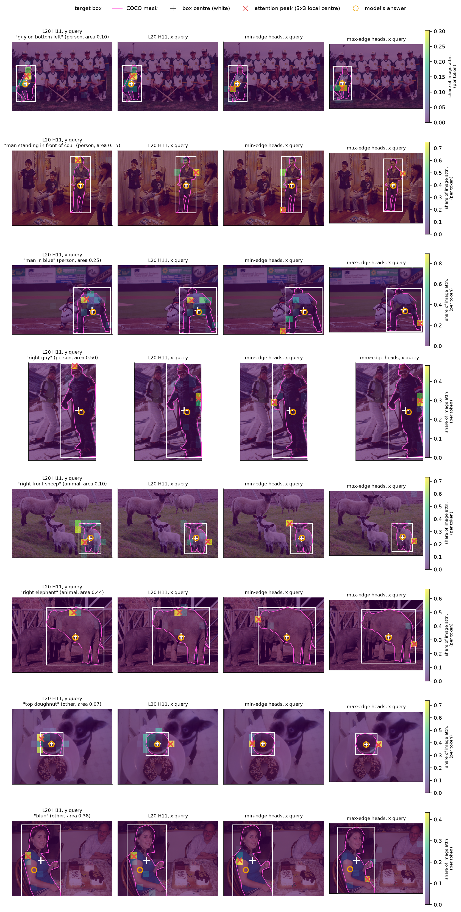
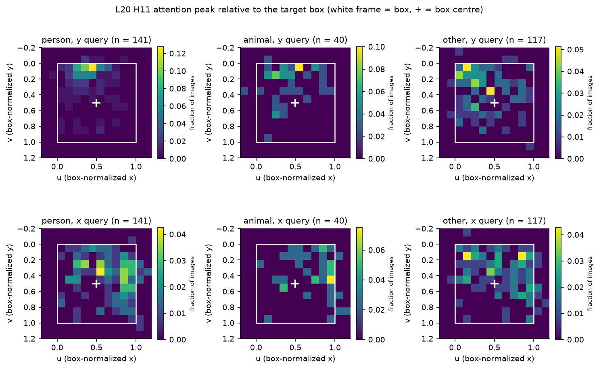
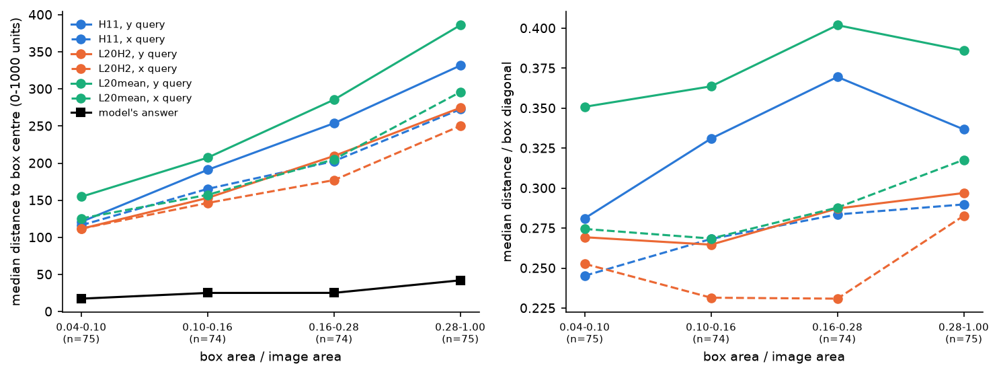
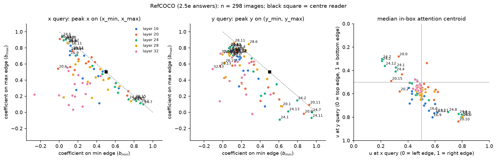
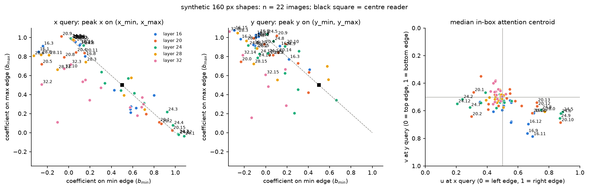
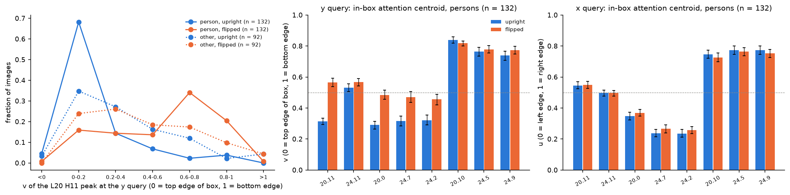
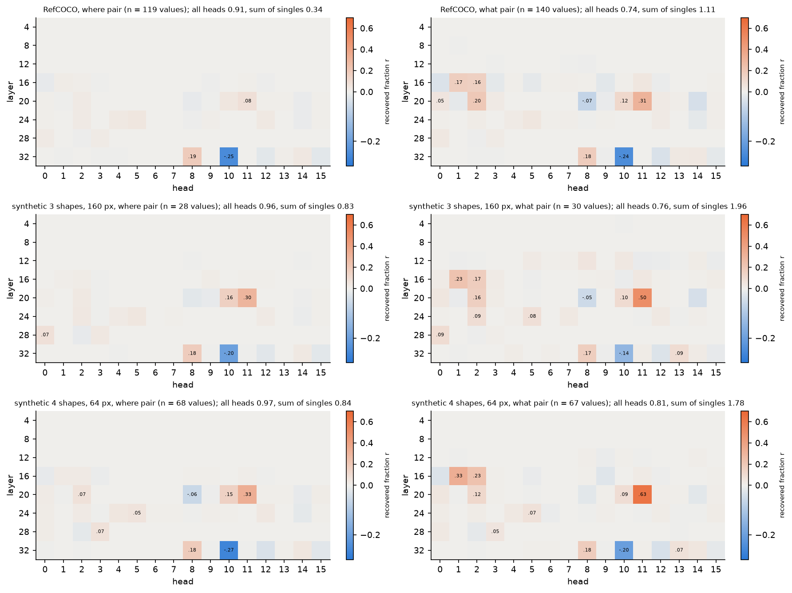
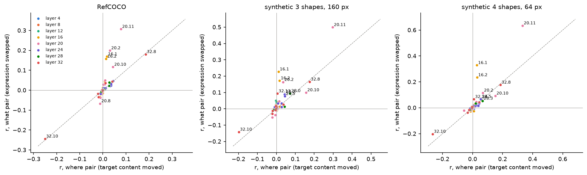
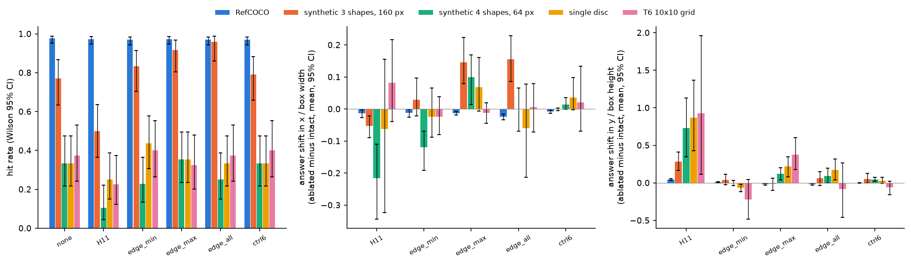

# 自然图像上的坐标读出

实验日期：2026-10-21。本文属于[位置信息与坐标读取](plan.md)研究，是[坐标读出的信息流](results_2026-10-20_coordinate_flow.md)（3.11）的第二轮。模型为 Qwen3.5-9B（bfloat16、SDPA、greedy decoding、thinking off），全部问题为只输出答案的 direct-answer 格式。上游结果为 3.11 第一轮、[“看得准但答错”的检验](../representation/results_2026-10-16_sees_right.md)（2.5e）与[数位输出失败](results_2026-10-20_digit_failure.md)（3.12）。

## 通俗讲述

第一轮实验在合成图像上找到了一个几乎独自完成坐标读取的 attention head：第 20 层的 H11。到了 RefCOCO 自然图像上，这个 head 单独只能传递很小一部分坐标差异，读取分散到第 20 层与第 24 层的许多 head 上，而且各 head 的作用不能相加。第一轮还观察到，在自然图像上 H11 的 attention 峰值常常落在物体的醒目部位（例如人的头部），离物体中心很远，模型给出的中心坐标却很准。本轮要回答两个问题：自然图像上的读取由哪些组件完成、各自做什么；“峰值落在醒目部位”这一说法是否成立、该如何精确地表述。

第一个发现是，自然图像上的许多读取 head 读的是物体的边缘。我们对每个 head 做了一个简单的回归：在 298 张 RefCOCO 图像上，把该 head 在坐标首位数字处 attention 峰值的横坐标，表示成目标框左边缘与右边缘横坐标的加权和。如果一个 head 读中心，两个系数都应接近 0.5；如果它读左边缘，左边缘的系数应接近 1、右边缘接近 0。结果中出现了两组非常干净的 head：第 24 层的 H7、H2、H1、H12 与第 20 层的 H0 读左边缘与上边缘，第 24 层的 H5、H6、H8、H9 与第 20 层的 H10、第 28 层的 H0 读右边缘与下边缘，主系数在 0.71–0.95 之间，接近纯粹的边缘读取。把一个左上边缘 head 组与一个右下边缘 head 组的峰值取平均，不经任何训练就得到命中率 0.94、中位误差 45 的中心估计，而单独使用 H11 峰值的中位误差是 224。也就是说，对占据大片区域的物体，“框的中心”可以由“读两条对边、再取中点”得到，这解释了自然图像上读取为什么需要多个 head 共同参与、且单个 head 的作用不能相加：任何一条边单独都不足以确定中心。合成图像中的目标只有 2×2 个 token，左右边缘与中心几乎重合，一个 head 就够了。

第二个发现澄清了“醒目部位”。提示词明确要求“Give the center of its bounding box”，模型的答案也确实贴近框中心（中位距离 25，比到分割掩码质心的距离更近）。H11 在纵坐标处的峰值对人有 83% 落在框的上三分之一，确实落在头部附近；但这一现象有两种解释：H11 读的是“头”这一语义部位，或者读的是“上边缘”这一几何位置，而人的头恰好在上边缘。我们把图像上下翻转后重新提问，人的头就到了框的底部。翻转后，H11 峰值的中位位置从框高的 0.10 移到 0.65，多数图像中的峰值跟随头部移动到了下方，说明 H11 确实被语义上醒目的部位吸引；与之对照，右下边缘 head 的注视位置在翻转前后几乎不变（0.84 与 0.82），它们是纯粹的几何边缘读取器。峰值偏离中心的距离随物体面积线性增大（按面积四分位从 116 增加到 273 个 0–1000 单位），相对于框对角线的比例却稳定在 0.25–0.29，这正是“读物体上某个固定部位”的特征：小物体上部位与中心接近，大物体上相距更远。

第三个发现回答了“what”与“where”是否可分。我们设计了两种配对：一种保持图像不变，把指代表达换成同一图像中另一个物体的表达（what 配对，模型需要改选另一个物体）；另一种保持表达不变，把目标物体的内容移到另一处（where 配对，被选中的物体不变，位置变了）。答案位置上，H11 单独可以传递 what 配对差异的 0.31，却只传递 where 配对差异的 0.08；更显著的差别在层类型上：把答案位置全部 Gated DeltaNet 层的输出换成 what 配对另一侧的值，可以传递 0.94 的差异，而 where 配对中这一比例只有 0.24，并且几乎全部来自最后 8 层（与 3.12 第二轮发现的“后段 DeltaNet 把已读出的坐标向数字位置接力”一致）。因此，“选哪个物体”主要以文本侧的递归状态进入答案位置，并决定 full attention head 去看哪里；“物体在哪里”由第 20、24 层的 full attention head 从图像 KV 中联合读出。在 head 层面也能看到分工：第 16 层的 H1、H2 只对“换一个物体”有反应（what 配对恢复 0.16–0.33，where 配对不超过 0.03，三个图像组一致），可以视为只传递“选了哪个物体”的 what head；H11 对两种配对都有反应，既跟随所指物体又读其位置；右下边缘读取器 L20 H10 在合成图像上对 where 的反应大于 what。与此同时，第 12–24 层的大多数 head 都会随所指物体移动 attention（选择性 0.3–0.46），选择本身是这些 head 共享查询方向的结果。

合成多形状图像提供了对照。这些图像同样要求模型按颜色和形状从几个物体中选出一个，但 H11 单独仍能传递 where 配对差异的 0.30–0.33，各 head 的作用近似可加，160 像素的大形状与 64 像素的小形状差别很小。因此，自然图像上读取的分散不能单独归因于“需要选择”或“物体较大”，自然图像丰富的纹理与部件结构是剩余的候选原因。

最后，消融实验给出了一个清楚的对照：在答案位置把 H11 替换为其平均输出，RefCOCO 的命中率几乎不变（0.98 与 0.97），只是答案平均向下移动了框高的 4.5%，这与 H11 在纵向读上边缘的角色一致；同样的消融却让合成图像上的大形状命中率从 0.77 降到 0.50、小形状从 0.33 降到 0.10。自然图像上的坐标读取高度冗余，合成图像上的读取依赖 H11 这一单点。

## 1. 研究问题与主要结果

研究问题如下：

- **Q1（组件与分工）**：L20 H11 是否参与自然图像上的坐标读取？其他读取 head 承担什么角色？是否存在分别负责“选择所指物体”（what）与“读取其位置”（where）的可分离组件？
- **Q2（醒目部位）**：“attention 峰值落在物体醒目部位、因而不如模型答案准确”这一说法是否成立？醒目部位如何具体定义与量化？该偏离如何依赖物体大小？

主要结果如下，实测与解释分开标注：

1. **自然图像上的读取 head 分为左上边缘读取器与右下边缘读取器，中心由对边取中点得到。** 实测：以 attention 峰值对目标框两条边缘做线性回归，L24 H7 的系数在横向为 0.90/0.10、纵向为 0.95/0.00，L24 H5、H6、H8、H9 与 L20 H10 的右（下）边缘系数为 0.71–0.94；交叉拟合的边缘对解码命中 0.94 [0.91, 0.96]、中位误差 45，L20 H11 峰值解码命中 0.86、中位误差 224，模型命中 0.97、中位误差 25（第 3.2 节，图 head_edges、salient_gallery）。
2. **L20 H11 的纵向峰值落在人的头部，翻转实验表明它跟随语义部位；右下边缘读取器只跟随几何边缘。** 实测：H11 纵向峰值在人的框中位置 $v$ 的中位数为 0.11（83% 位于上三分之一）；在翻转前后都命中的 132 张人物图像上，该中位数从 0.10 变为 0.65；右下边缘 head 的框内 attention 质心在翻转前后为 0.84 与 0.82（L20 H10）（第 3.3 节，图 flip、salient_uv）。
3. **峰值偏离中心的距离与物体尺寸成正比。** 实测：按面积四分位，H11 横向峰值到框中心的中位距离为 116、165、203、273，与框对角线之比为 0.25–0.29；模型答案的中位误差为 17–42（第 3.1 节，图 salient_size）。
4. **“选择所指物体”主要经由 Gated DeltaNet 的文本侧状态进入答案位置，“读取位置”由 full attention head 联合完成。** 实测：答案位置的输出 patching 中，what 配对的全部 DeltaNet 输出恢复 0.94、全部 full attention head 恢复 0.74、L20 H11 单独 0.31，单 head 之和 1.11；where 配对中三者为 0.24、0.91、0.08，单 head 之和只有 0.34（第 3.4 节，图 patch_heads、what_where）。
5. **L16 H1 与 L16 H2 是只传递 what 的 head；注视所指物体的行为则广泛分布。** 实测：L16 H1、H2 在三个图像组的 what 配对中单独恢复 0.16–0.33，where 配对中只有 0.01–0.03；L20 H11 两种配对都有（RefCOCO 0.31 与 0.08，合成 0.50–0.63 与 0.30–0.33）。what 配对中，第 12–24 层 64 个 head 的 attention 选择性 $S$ 大多在 0.3–0.46，第 28、32 层降到 0.02–0.28（第 3.4 节，图 what_where）。
6. **需要选择与物体尺寸都不足以让读取分散。** 实测：合成多形状图像的 where 配对中 H11 单独恢复 0.30（160 px）与 0.33（64 px），单 head 之和 0.83 与 0.84，接近全部 head 的 0.96–0.97（第 3.4 节）。
7. **自然图像上的读取高度冗余，合成图像上的读取依赖 H11。** 实测：答案位置均值消融 H11 后，RefCOCO 命中 0.98→0.97，合成大形状 0.77→0.50（McNemar $p = 2.4 \times 10^{-4}$），合成小形状 0.33→0.10（$p = 0.003$）；消融 11 个边缘 head 时 RefCOCO 命中仍为 0.97，中位误差 25→48（第 3.5 节，图 ablate）。

**综合解释（推断）。** 自然图像上的坐标读出由三类机制组合而成。第一，所指物体的身份在 prompt 阶段由文本与图像共同确定，并以 DeltaNet 递归状态与文本 residual 的形式进入答案位置；它决定第 12–24 层 full attention head 的查询方向，使这些 head 共同注视同一物体；L16 H1、H2 是这一选择信息在答案位置上的专门载体。第二，在被注视的物体上，不同的 head 读取不同的几何部位：一部分读左上边缘，一部分读右下边缘，H11 读横向接近中心、纵向接近上沿的醒目部位；输出的中心坐标是这些部位读数的组合。第三，合成图像中目标很小，这些部位在 token 尺度上重合，读取退化为单个 head 的单点读取。这一图景也解释了第一轮的两个现象：RefCOCO 上单 head 作用非加性，以及 H11 峰值比模型答案差得多。

## 2. 实验设置

### 2.1 提示词与样本

RefCOCO 与合成多形状图像使用同一提示词模板，与 2.5e、3.5 完全相同（`{expr}` 为指代表达）：

```text
Locate the object described as: {expr}. Give the center of its bounding box. Return only [{"point_2d": [x, y]}]. All coordinates use 0-1000 normalization; x increases rightward and y increases downward. Output only the JSON, with no explanation.
```

提示词明确要求框的中心，因此系统地偏离框中心的读数与任务要求不符。

| 组 | 来源 | 图像数 | 有 what 配对 | 用途 |
| --- | --- | --- | --- | --- |
| rc | 2.5e 的 300 个 RefCOCO test 点坐标问题（3.4 的 512 像素副本） | 300 | 109 | Q1、Q2 |
| ms_small | 白底 4 个形状（红、蓝、绿、橙 × 圆、方、三角、菱形，颜色与形状在图内唯一），边长 64 像素 | 48 | 48 | Q1 对照 |
| ms_large | 同上，3 个形状，边长 160 像素（5×5 个 merged token） | 48 | 48 | Q1 对照、边缘对照 |
| disc、t6g10 | 3.11 第一轮的单目标圆与 10×10 网格点坐标问题 | 48、40 | 0 | 消融对照 |

RefCOCO 的 COCO 分割掩码与同一图像中其他被标注物体的框取自本地 RefCOCO parquet（按 3.4 记录的 shard 与行号回溯，并核对框坐标误差不超过 1 像素）。本地数据中 185 张图像没有第二个被标注物体，因此 what 配对只有 109 张图像。物体类别没有直接标注，人、动物、其他三类由指代表达中的关键词判定（启发式；141、40、117 张）。

批量生成与逐条 `generate` 的抽查中，20 条答案中 12 条完全相同，其余 8 条只在非首位数字上相差 1–22 个单位，首位数字 20/20 一致；全部因果测量只使用首位数字。

### 2.2 what 配对与 where 配对

两类配对都沿用第一轮的度量。记 run A 为原始输入、run B 为配对输入，二者都以 run A 的 greedy 答案 teacher forcing；在预测坐标值首位数字的位置，$d_A$ 为 run A 的首位数字，$d_B$ 为 run B 在同一位置 logit 最大的数字，$z \in \mathbb{R}^{V}$ 为该位置的 logits（$V$ 为词表大小）。定义

$$
\mathrm{LD} = z_{d_B} - z_{d_A}, \qquad r_e = \frac{\mathrm{LD}_e - \mathrm{LD}_A}{\mathrm{LD}_B - \mathrm{LD}_A},
$$

其中 $\mathrm{LD}_e$ 为对 run A 施加干预 $e$ 后的 logit 差。$r_e = 1$ 表示干预涉及的组件携带了两次运行在首位数字上的全部差异。只统计 $d_A \neq d_B$ 且 $\lvert \mathrm{LD}_B - \mathrm{LD}_A \rvert \geq 2$ 的坐标值。

- **what 配对。** run B 的图像不变，指代表达换成同一图像中另一个物体的表达；该物体与目标的框中心在至少一个坐标轴上相距不少于 100 个 0–1000 单位，从而保证该轴的首位数字不同。图像 token 位于文本之前，causal decoder 中全部图像 token 的状态在两次运行中完全相同，答案处的差异只能来自文本。
- **where 配对。** run B 的表达不变，把目标框覆盖的 merged token 的视觉 embedding 与一个等大区域交换（3.5 与第一轮的内容交换），沿横向或纵向各一个；只统计沿位移轴的坐标值。
- **干预。** 在 prompt 最后一个 token 及之后的全部答案位置，把 run A 的某个组件输出替换为 run B 的值：单个 full attention head 的输出（gate 之后、output projection 之前），整层 16 个 head，全部 128 个 head，留一集合，以及 Gated DeltaNet 的整层 mixer 输出（全部 24 层或每 8 层一组）。run B 在自己的前向中捕获，两次运行的 prompt 长度可以不同。全部 mixer 同时替换时 $r$ 应恒为 1，实测 0.99–1.01，作为数值检查。

### 2.3 边缘回归与框内质心

对第 $i$ 张图像、head $h$ 与坐标轴 $k \in \{x, y\}$，记 $p_{ihk}$ 为该 head 在坐标值 $k$ 首位数字 query 处、在图像 token 上归一化的 attention 峰值位置（峰值 token 3×3 邻域的加权中心，像素），$e^{\min}_{ik}$ 与 $e^{\max}_{ik}$ 为目标框在该轴上的两条边缘（像素）。对每个 head 与坐标轴，用全部图像做最小二乘拟合

$$
p_{ihk} = b^{\min}_{hk} \, e^{\min}_{ik} + b^{\max}_{hk} \, e^{\max}_{ik} + c_{hk} + \epsilon_{ihk}.
$$

其中 $b^{\min}_{hk}$、$b^{\max}_{hk}$ 为标量系数，$c_{hk}$ 为截距。选择这一形式的原因是：框中心等于两边缘的平均，读中心的 head 应满足 $b^{\min} = b^{\max} = 0.5$；只读一条边缘的 head 应在该边缘的系数上接近 1、另一系数接近 0；读物体内部某个固定比例位置的 head 满足 $b^{\min} + b^{\max} \approx 1$，比例由两系数之比决定。回归在全部图像上进行，因此系数描述的是 head 在不同物体之间的稳定倾向，不受单张图像噪声支配。

框内质心用于描述 head 在物体上的注视位置。把一个 head 的 attention 限制在中心落在目标框内的 token 上并重新归一化，计算这些 token 中心的加权平均，再换算到框归一化坐标：$u = (x - x_{\min}) / (x_{\max} - x_{\min})$，$v = (y - y_{\min}) / (y_{\max} - y_{\min})$。横坐标 query 处取 $u$，纵坐标 query 处取 $v$；$u = 0$ 为左边缘，$v = 0$ 为上边缘。框内少于 4 个 token 中心的图像不参与。

边缘 head 组按 RefCOCO 上第 16–32 层 head 的中位框内质心划分：横向 $u < 0.35$ 且纵向 $v < 0.4$ 记为左上边缘组（L20 H0、L24 H1、H2、H7、H12），横向 $u > 0.65$ 且纵向 $v > 0.65$ 记为右下边缘组（L20 H10、L24 H5、H6、H8、H9、L28 H0）。边缘对解码把两组 attention 图分别平均、各取峰值，再取两峰值的中点；组的划分在一半图像上确定、在另一半图像上评估（按图像序号奇偶交叉拟合）。

### 2.4 翻转、消融与选择性

- **上下翻转。** 把 RefCOCO 与 ms_large 图像上下翻转、表达不变，生成答案并记录全部 128 个 head 在两个首位数字 query 处的 attention。翻转后人的头部位于框的底部，用于区分“语义部位”与“几何上边缘”。只使用翻转前后答案都命中的图像。
- **均值消融。** 在答案位置把选定 head 的输出替换为该组全部答案位置的平均输出（每组 64 个回答上 teacher forcing 计算），重新 greedy 生成。答案偏移以框尺寸归一化：$\Delta_x = (\hat{x}_{\mathrm{abl}} - \hat{x}_{\mathrm{none}}) / w$，$\hat{x}$ 为答案横坐标，$w$ 为框宽（均为 0–1000 单位），纵向同理。
- **选择性。** what 配对中，记 $m_X(Y)$ 为某 head 在 run $X$ 中落在物体 $Y$ 框内 token 上的 attention 份额（占该 head 图像 attention 的比例，两个物体框重叠的 token 不计）。定义

$$
S = \tfrac{1}{2} \big[ (m_A(A) - m_A(B)) + (m_B(B) - m_B(A)) \big],
$$

$S$ 衡量表达改变时 attention 从物体 A 转向物体 B 的程度；只看图像中醒目物体、与表达无关的 head 满足 $S \approx 0$。取横、纵两个 query 的平均。

## 3. 结果

### 3.1 Q2：attention 峰值的位置与物体尺寸

**H11 的峰值落在框内，但系统地偏离中心，模型答案则贴近中心。** 表 1 汇总 298 个 RefCOCO 回答。H11 横向与纵向 query 的峰值分别有 89% 与 91% 落在框内，有 67% 与 61% 落在分割掩码覆盖过半的 token 上；但峰值到框中心的中位距离为 173 与 213 个单位。按第一轮的方式以横向 query 的峰值横坐标与纵向 query 的峰值纵坐标拼成一个点，命中率为 0.86、中位误差 224；模型的答案中位误差为 25，并有 60% [54%, 65%] 的回答离框中心比离掩码质心更近（实测，图 salient_gallery、salient_uv）。

表 1　RefCOCO 上 attention 峰值与模型答案相对目标的位置（$n = 298$）。距离单位为 0–1000 坐标；“掩码 token”为掩码覆盖过半的 token；$v$ 为峰值在框内的纵向位置（0 = 上边缘）。

| 读数 | 峰值在框内 | 峰值在掩码 token | 峰值到框中心（中位） | 质心到框中心（中位） | 人：$v$ 中位 / 上三分之一 | 动物 | 其他 |
| --- | --- | --- | --- | --- | --- | --- | --- |
| H11，纵向 query | 0.91 | 0.61 | 213 | 113 | 0.11 / 0.83 | 0.16 / 0.68 | 0.29 / 0.57 |
| H11，横向 query | 0.89 | 0.67 | 173 | 95 | 0.36 / 0.44 | 0.37 / 0.47 | 0.32 / 0.51 |
| L20 H2，纵向 query | 0.90 | 0.66 | 174 | 87 | 0.69 / 0.11 | 0.64 / 0.14 | 0.68 / 0.11 |
| 模型答案 | 命中 0.97 | — | 25 | — | — | — | — |

表 1 支持以下结论：

1. **“醒目部位”的说法在人身上成立，并可具体化为头部。** H11 纵向 query 的峰值对人的中位 $v$ 为 0.11，83% 位于框的上三分之一，图 salient_gallery 中可直接看到峰值落在人的头部或肩部；动物为 0.16，其他物体为 0.29，偏上的程度依次减弱。这说明 H11 的纵向峰值偏向物体上部，在人身上对应头部。由于头部总在框的上沿，这一统计本身还不能区分语义部位与几何上沿，第 3.3 节用翻转实验区分二者。
2. **提示词要求中心，模型也确实回答中心。** 模型答案离框中心更近（中位 25，离掩码质心 31），H11 的峰值偏离与任务定义无关。峰值偏离与模型偏离之间的相关很弱（横向 0.27、纵向 0.18），模型答案没有跟随峰值的偏离方向。
3. **不同 head 注视物体的不同部位。** L20 H2 纵向 query 的峰值偏下（$v$ 中位 0.64–0.69），与 H11 相反。第 3.2 节表明这是一种普遍的分工。

**峰值偏离与物体尺寸成正比。** 表 2 按框面积占图像面积的四分位分组。RefCOCO 物体普遍较大（面积比例最小的四分之一也在 4–10% 之间），峰值到中心的距离从最小组的 116 增加到最大组的 273，与框对角线之比在各组保持 0.25–0.29（实测，图 salient_size）。这一比例不随尺寸变化，说明峰值落在物体上一个相对固定的部位：小物体上该部位与中心的绝对距离小，大物体上距离大。合成小形状（2×2 token）上该距离按构造不超过约 1 个 token，第一轮中 H11 在合成图像上的高命中率与此一致。

表 2　按面积四分位的峰值偏离（H11 横向 / 纵向 query），每组约 75 张图像。

| 面积比例 | 峰值到中心（中位） | 与框对角线之比 | 峰值在框内 | 模型中位误差 | 模型命中 |
| --- | --- | --- | --- | --- | --- |
| 0.04–0.11 | 116 / 121 | 0.25 / 0.28 | 0.84 / 0.88 | 17 | 0.97 |
| 0.11–0.16 | 165 / 191 | 0.27 / 0.33 | 0.86 / 0.92 | 25 | 0.96 |
| 0.16–0.28 | 203 / 254 | 0.28 / 0.37 | 0.89 / 0.91 | 25 | 0.99 |
| 0.28–1.00 | 273 / 332 | 0.29 / 0.34 | 0.96 / 0.95 | 42 | 0.97 |

### 3.2 Q1：边缘读取 head

**大多数读取 head 读物体边缘，中心由对边组合得到。** 图 head_edges 给出第 16–32 层每个 head 的回归系数 $(b^{\min}, b^{\max})$ 与框内质心。读取 head 沿 $b^{\min} + b^{\max} = 1$ 的虚线分布，说明它们读的都是物体上某个比例位置；它们集中在虚线的两端，中点 $(0.5, 0.5)$ 附近的 head 很少（实测）。

表 3　典型 head 的边缘回归系数 $(b^{\min}, b^{\max})$ 与框内质心（RefCOCO，$n = 298$）。

| head | 横向 $(b^{\min}, b^{\max})$ | 纵向 $(b^{\min}, b^{\max})$ | $u$（横向 query） | $v$（纵向 query） | 角色 |
| --- | --- | --- | --- | --- | --- |
| L24 H7 | 0.90, 0.10 | 0.95, 0.00 | 0.21 | 0.30 | 左上边缘 |
| L24 H2 | 0.82, 0.14 | 0.79, 0.15 | 0.21 | 0.32 | 左上边缘 |
| L20 H0 | 0.73, 0.21 | 0.87, −0.02 | 0.33 | 0.28 | 左上边缘 |
| L24 H6 | 0.03, 0.94 | 0.11, 0.81 | 0.77 | 0.77 | 右下边缘 |
| L24 H9 | 0.09, 0.86 | 0.07, 0.80 | 0.80 | 0.78 | 右下边缘 |
| L20 H10 | 0.06, 0.90 | 0.07, 0.82 | 0.77 | 0.84 | 右下边缘 |
| L20 H11 | 0.38, 0.63 | 0.92, 0.10 | 0.54 | 0.34 | 横向近中心，纵向上沿 |
| L24 H11 | 0.35, 0.58 | 0.95, −0.07 | 0.50 | 0.56 | 纵向上沿 |

表 3 支持以下结论：

1. **存在两组互补的边缘读取器。** 左上边缘组与右下边缘组的回归系数在 0.73–0.95 之间，接近纯粹的单边读取；两组都位于第 20、24 层，正是第一轮中自然图像读取所在的层。纵向 query 处，大多数其他 head 的系数偏向下边缘（$b^{\max} \approx 0.6$–0.85，图 head_edges 中图），上沿读取只由少数 head（L20 H0、H11，L24 H7、H11、H2）承担。
2. **边缘对足以恢复中心。** 交叉拟合的边缘对解码命中 0.94 [0.91, 0.96]、中位误差 45，远好于单个 H11 峰值（0.86、224），接近模型本身（0.97、25）。这一解码不含任何训练参数，说明物体的延展范围已经由边缘 head 的 attention 位置显式给出。
3. **该机制解释了第一轮观察到的非加性。** 单独替换一个边缘 head 只移动中心估计的一半（另一条边缘仍来自 run A），而中心的首位数字是否改变取决于两条边缘的组合，因此单 head 的恢复比例之和远小于全部 head 同时替换（第 3.4 节 where 配对：0.34 与 0.91）。这是对实测非加性的一种机制解释（推断）。

### 3.3 Q2：语义部位与几何边缘的区分

**H11 的纵向峰值跟随人的头部，右下边缘读取器只跟随几何边缘。** 图 flip 比较 132 个人物回答在翻转前后的读数（翻转后模型命中率为 0.87 [0.83, 0.90]，低于原图的 0.97）。翻转后人的头部位于框底部。H11 纵向峰值的中位 $v$ 从 0.10 变为 0.65：原图中 68% 的峰值位于上五分之一，翻转后 34% 位于 0.6–0.8、20% 位于 0.8–1.0，只有 16% 留在上五分之一（实测）。若 H11 读的是几何上沿，翻转后峰值应留在上方；若读的是头部，应移到 0.85–1.0 附近。实测分布主要移到了下半部，说明 H11 被语义上醒目的部位（头部与上身）吸引，同时有一部分图像仍读上沿。

表 4　翻转前后的框内质心（人，$n = 132$，均值与 bootstrap 95% CI）。

| head | 纵向 $v$：原图 | 纵向 $v$：翻转 | 横向 $u$：原图 | 横向 $u$：翻转 |
| --- | --- | --- | --- | --- |
| L20 H11 | 0.31 | 0.57 [0.54, 0.59] | 0.55 | 0.55 |
| L20 H0 | 0.29 | 0.48 [0.46, 0.51] | 0.35 | 0.37 |
| L24 H7 | 0.32 | 0.47 [0.43, 0.51] | 0.24 | 0.27 |
| L20 H10 | 0.84 | 0.82 [0.80, 0.83] | 0.75 | 0.73 |
| L24 H5 | 0.77 | 0.78 [0.75, 0.80] | 0.77 | 0.76 |
| L24 H9 | 0.74 | 0.77 [0.75, 0.80] | 0.77 | 0.75 |

表 4 表明两组边缘读取器对语义的依赖不同。右下边缘组在翻转前后几乎不变，是纯粹的几何读取器；左上边缘组与 H11 的纵向质心在翻转后都向中部移动 0.15–0.26，说明它们的纵向读取部分被头部吸引。横向读取在翻转前后全部不变，与上下翻转不改变横向结构一致。“醒目部位”可以因此表述为：H11 与左上边缘组的纵向读取偏向物体在语义上醒目的上部（人的头部），右下边缘组读取几何边缘（解释）。其他类别物体的 H11 峰值在翻转后也下移（中位 0.26→0.40），幅度较小，与这些物体缺少稳定的醒目部位一致。

### 3.4 Q1：what 与 where

**选择所指物体与读取其位置走不同的通道。** 表 5 给出答案位置输出 patching 的恢复比例（实测，图 patch_heads、what_where）。

表 5　答案位置输出 patching 的恢复比例 $r$（均值）。DN 为 Gated DeltaNet 的 mixer 输出；“单 head 之和”为 128 个 head 单独替换的恢复之和。

| 组与配对 | 数值数 / 图像数 | 全部 head | 层 16 | 层 20 | 层 24 | L20 H11 | L32 H8 | 单 head 之和 | DN 全部 | DN 9–16 | DN 17–24 | DN 25–32 |
| --- | --- | --- | --- | --- | --- | --- | --- | --- | --- | --- | --- | --- |
| RefCOCO，what | 140 / 107 | 0.74 | 0.11 | 0.53 | 0.26 | 0.31 | 0.18 | 1.11 | 0.94 | 0.23 | 0.26 | 0.27 |
| RefCOCO，where | 119 / 108 | 0.91 | 0.01 | 0.19 | 0.32 | 0.08 | 0.19 | 0.34 | 0.24 | 0.01 | 0.02 | 0.21 |
| 合成 160 px，what | 30 / 22 | 0.76 | 0.21 | 0.75 | 0.29 | 0.50 | 0.17 | 1.96 | 0.99 | 0.41 | 0.31 | 0.40 |
| 合成 160 px，where | 28 / 19 | 0.96 | 0.04 | 0.43 | 0.21 | 0.30 | 0.18 | 0.83 | 0.32 | −0.01 | 0.05 | 0.26 |
| 合成 64 px，what | 67 / 48 | 0.81 | 0.19 | 0.85 | 0.26 | 0.63 | 0.18 | 1.78 | 0.98 | 0.40 | 0.20 | 0.44 |
| 合成 64 px，where | 68 / 46 | 0.97 | 0.06 | 0.49 | 0.29 | 0.33 | 0.18 | 0.84 | 0.34 | 0.00 | 0.05 | 0.31 |

表 5 支持以下结论：

1. **L20 H11 参与自然图像上的读取，但它的作用集中在“跟随所指物体”上。** RefCOCO 的 what 配对中 H11 单独恢复 0.31 [0.28, 0.34]，是 128 个 head 中最大的；where 配对中只有 0.08 [0.06, 0.10]。从全部 head 中去掉 H11，两种配对的恢复分别下降 0.15 与 0.19，同样是所有 head 中最大的。也就是说，H11 在自然图像上仍是不可替代的成员，但同一物体移动位置时，它单独携带的位置差异很少；位置差异需要它与其他 head 共同传递。
2. **what 差异经由 DeltaNet 通道进入答案位置，where 差异经由 full attention 通道。** 只替换答案位置全部 DeltaNet 层的输出，what 配对恢复 0.94 [0.93, 0.95]，其中第 9–16、17–24、25–32 层分别贡献 0.23、0.26、0.27；where 配对只恢复 0.24，且几乎全部来自第 25–32 层（0.21）。这一分工在三个组中一致（合成组 what 0.98–0.99、where 0.32–0.34）。解释：表达改变后，DeltaNet 在 prompt 阶段累积的递归状态已经编码了新的所指物体，答案位置读取这一状态后，其 residual 的查询方向随之改变，第 12–24 层的 full attention head 于是注视另一个物体；而对同一物体的位置变化，DeltaNet 的中段层不携带差异，第 25–32 层的贡献与 3.12 第二轮报告的“后段 DeltaNet 卷积把已读出的坐标从前一 token 接力到数字位置”一致。
3. **自然图像上的位置读取非加性，合成多物体图像上近似加性。** where 配对中单 head 恢复之和在 RefCOCO 上为 0.34，远低于全部 head 的 0.91；在合成 160 px 与 64 px 组为 0.83 与 0.84，接近全部 head 的 0.96–0.97。RefCOCO where 配对中留一下降仅次于 H11 的是 L24 H12（左上边缘组，0.10）、L24 H5 与 L20 H10（右下边缘组，0.10 与 0.09），与第 3.2 节的边缘分工对应：边缘读取器单独作用小，但在全部 head 的组合中不可缺少。
4. **需要“选择”本身不会让读取分散。** 合成组同样需要按颜色与形状从 3–4 个物体中选择，H11 在 where 配对中仍单独恢复 0.30–0.33，与第一轮单目标合成图像的 0.40–0.59 量级相近，远高于 RefCOCO 的 0.08。160 px 大形状（5×5 token）上 H11 的恢复只比 64 px 小形状低 0.03，单 head 之和也同样接近加性。因此，自然图像上读取的分散与非加性，不能单独归因于选择需求或物体尺寸，自然图像的内容（纹理、部件与语义的丰富程度）是剩余的候选原因（解释，确定性中等：RefCOCO 物体的面积中位约为图像的 16%，略大于 160 px 形状的 10%）。
5. **L32 H8 与 L32 H10 在 what 与 where 中作用相同。** L32 H8 在全部组与配对中恢复 0.17–0.19，L32 H10 为 −0.20 至 −0.27，与第一轮及 3.12 第二轮的“先验写入与抑制”角色一致；它们位于读取之后，与 what/where 无关。

**存在只传递 what 的 head，注视所指物体的行为则分布在大量 head 上。** 图 what_where 中，L16 H1、L16 H2 与 L20 H2 明显位于对角线上方：它们在 RefCOCO what 配对中单独恢复 0.17、0.16、0.20，where 配对中只有 0.02、0.01、0.03；L16 H1 与 H2 在两个合成组中同样如此（what 0.17–0.33，where 0.01–0.03）。这些 head 的输出改变所指物体时足以移动坐标的首位数字，物体移动时却几乎不携带差异，说明它们写入答案位置的是“选了哪个物体”的信息，其坐标效应要经过后续读取 head 才能实现（解释）。相对地，L20 H10（右下边缘读取器）在合成组中 where 恢复 0.15–0.16，大于 what 的 0.09–0.10，偏向 where。注视层面，what 配对中，第 12–24 层 64 个 head 的选择性 $S$ 大多在 0.3–0.46（L20 H11 为 0.45 [0.41, 0.48]，最大值 0.46 属于 L20 H14），第 28 层降到 0.10–0.28，第 32 层降到 0.02–0.17。表达一旦改变，几乎所有中层 head 都把 attention 从原物体移到新物体上，说明所指物体由答案位置 residual 中的共享查询方向决定（实测与解释）。因此，what 与 where 的分离在两个层面上成立：在通道层面，what 主要由 DeltaNet 携带的文本侧状态进入答案位置，where 由 full attention head 从图像 KV 读出；在 head 层面，L16 H1、H2 只传递 what，边缘读取器偏向 where，L20 H11 两者兼有。

### 3.5 消融

**自然图像上的读取冗余，合成图像上依赖 H11。** 表 6 给出答案位置均值消融后的命中率与答案偏移（实测，图 ablate）。

表 6　均值消融的结果。命中率括号内为 Wilson 95% CI；$\Delta_x$、$\Delta_y$ 为相对未消融答案的偏移（框宽 / 框高的比例，均值）；$p$ 为与未消融配对的 McNemar 检验。

| 组 | 消融集合 | 命中率 | $\Delta_x$ | $\Delta_y$ | 中位误差 | McNemar $p$ |
| --- | --- | --- | --- | --- | --- | --- |
| RefCOCO（300） | 无 | 0.98 [0.95, 0.99] | — | — | 25 | — |
| RefCOCO | L20 H11 | 0.97 [0.95, 0.99] | −0.013 | +0.045 | 38 | 1 |
| RefCOCO | 左上边缘组（5 个） | 0.97 [0.94, 0.98] | −0.012 | +0.009 | 34 | 0.50 |
| RefCOCO | 右下边缘组（6 个） | 0.97 [0.95, 0.99] | −0.014 | −0.018 | 40 | 1 |
| RefCOCO | 两组合并（11 个） | 0.97 [0.94, 0.98] | −0.024 | −0.018 | 48 | 0.69 |
| RefCOCO | 对照 6 个（同层、居中注视） | 0.97 [0.94, 0.98] | −0.008 | 0.000 | 25 | 0.50 |
| 合成 160 px（48） | 无 | 0.77 [0.63, 0.87] | — | — | 119 | — |
| 合成 160 px | L20 H11 | 0.50 [0.36, 0.64] | −0.053 | +0.282 | 193 | 2.4e-4 |
| 合成 160 px | 右下边缘组 | 0.92 [0.80, 0.97] | +0.145 | −0.015 | 97 | 0.016 |
| 合成 160 px | 两组合并 | 0.96 [0.86, 0.99] | +0.155 | +0.060 | 96 | 0.012 |
| 合成 64 px（48） | 无 | 0.33 [0.22, 0.47] | — | — | 102 | — |
| 合成 64 px | L20 H11 | 0.10 [0.05, 0.22] | −0.216 | +0.729 | 158 | 0.003 |
| 合成 64 px | 左上边缘组 | 0.23 [0.13, 0.37] | −0.120 | −0.002 | 104 | 0.13 |
| 单目标圆（48） | L20 H11 | 0.25 [0.15, 0.39]（无消融 0.33） | −0.062 | +0.870 | 93（无消融 56） | 0.34 |
| 10×10 网格（40） | L20 H11 | 0.23 [0.12, 0.38]（无消融 0.38） | +0.082 | +0.930 | 86（无消融 68） | 0.07 |

表 6 支持以下结论：

1. **H11 是合成图像读取的单点，自然图像上的读取可以绕过它。** 消融 H11 后，合成 160 px 与 64 px 组的命中率分别下降 0.27 与 0.23，答案纵向平均移动 0.28 与 0.73 个框高；RefCOCO 的命中率不变，答案纵向只移动 0.045 个框高。纵向偏移为正（向下），与 H11 在纵向读取物体上部的角色一致：去掉一个上部读数后，组合出的中心向下偏。
2. **边缘读取器单独消融的方向预测只部分成立。** 若中心是两条边缘读数的平均，消融右下边缘组应使答案向左上移动，消融左上边缘组应使答案向右下移动。RefCOCO 上右下边缘组的偏移为 $\Delta_x = -0.014$、$\Delta_y = -0.018$，方向符合预测；左上边缘组的纵向偏移 +0.009 符合预测，横向偏移 −0.012 与预测相反。全部偏移都小于框尺寸的 2.5%，命中率不变，中位误差从 25 增加到 34–48。合成 160 px 组上消融右下边缘组反而使答案右移 0.145 个框宽并提高命中率（0.77→0.92），与预测相反。均值消融把这些 head 的输出替换为一个固定的平均输出，该平均输出本身也指向某个平均位置，因此消融效应混合了“去掉读数”与“写入平均读数”两部分；单独的消融方向不足以检验边缘组合的假设，第 3.2 节的边缘对解码与第 3.4 节的留一下降是更直接的证据（解释）。
3. **对照集合几乎没有作用。** 同层 6 个居中注视的 head 被消融后，各组命中率与中位误差都不变（RefCOCO 25→25），说明上述效应特定于被选中的 head。

## 4. 讨论

- **与 3.11 第一轮的关系。** 第一轮在 RefCOCO 上观察到读取分散到层 20 与层 24、单 head 作用非加性，以及 H11 峰值误差远大于模型。本轮给出了这两个现象的统一解释：读取 head 分别读取物体的不同几何部位（左上边缘、右下边缘、上部醒目部位），中心由这些读数组合得到；单个部位不能确定中心，因此单 head 作用非加性，H11 峰值也系统地偏离中心。第一轮 KV patching 中 RefCOCO 的两个坐标都由目标 token 承载（0.73 与 0.84），与边缘读取器注视目标边缘 token 的结果一致。
- **与 3.9 第三轮（读取工具）的关系。** 3.9 第三轮报告只用 L20 H11 的 attention 加 layer 0/16 的内容特征即可达到 128 head 工具的精度，并指出不加内容特征时 H11 的峰值落在物体上部（框归一化位置约为 (0.60, 0.29)），自然图像需要物体的延展范围信息。本轮的 H11 测量与之一致（纵向框内质心 0.31，人物峰值中位 0.11）。两者互补：3.9 第三轮从内容特征中学到延展范围，本轮表明延展范围已经显式地存在于两组边缘读取器的 attention 位置中，无训练的边缘对解码即可达到命中 0.94、中位误差 45。对工具的输入建议是加入 1–2 个左上边缘 head（L24 H7）与 1–2 个右下边缘 head（L20 H10 或 L24 H9），只需读取 3–5 个 head，满足可部署性的要求。
- **与 3.12 第二轮的关系。** 3.12 第二轮发现坐标在数字前 1–2 个 token 读出，再由第 25–32 层 DeltaNet 的短卷积接力到数字位置。本轮 where 配对中 DeltaNet 的贡献全部来自第 25–32 层（0.21–0.31），与这一接力一致；what 配对中第 9–24 层 DeltaNet 的额外贡献（0.43–0.71）属于所指物体身份的通道，不属于接力。L32 H8 与 H10 的作用在 what 与 where 中相同，与 3.12 第二轮的先验写入与抑制角色一致。
- **与 3.13 的关系。** 3.13 用约 3000 个精确坐标样本微调后，合成图像上的读出缺陷基本消失，RefCOCO 上变化很小。本轮的消融表明 RefCOCO 的读取高度冗余，任一 head 组被消融后命中率都不变，与“自然图像读取已经可靠、合成图像的失败在读出参数中”一致。
- **参数问题还是架构限制。** 边缘读取与 H11 的醒目部位偏好都是参数学到的读取策略：同一组 head 在合成大形状上同样表现为左右边缘读取器（图 head_edges_ms_large，L24 H7 与 H2 的横向 $b^{\min} = 1.03$，L24 H5、H6、H9 与 L20 H10 的横向 $b^{\max} = 0.97$–0.99），说明它是通用的几何读取机制，与自然图像的统计无关。本轮没有发现架构层面的限制：what 与 where 分别经由 DeltaNet 状态与 full attention 读取，两条通道在全部组中都完整工作（全部组件同时替换时恢复为 1）。这一判断的确定性中等，因为本轮只考察了答案位置的组件。
- **与 what/where 双通路的类比（解释）。** 认知神经科学中腹侧通路负责“是什么”、背侧通路负责“在哪里”。本轮在 Qwen3.5 中观察到的分离发生在组件类型上：所指物体的身份由文本侧的 DeltaNet 递归状态携带并决定查询方向，位置由 full attention 对图像 KV 的读取给出。head 层面也有对应物：L16 H1、H2 只传递所指物体的选择，边缘读取器偏向位置。这一对应只是功能层面的类比；与生物通路不同，L20 H11 等主读取 head 同时承担“注视所指物体”与“读出其位置”两件事。

## 5. 限制

- what 配对只有 109 张 RefCOCO 图像（本地数据中多数图像没有第二个被标注物体），where 配对满足首位数字条件的数值为 119 个（108 张图像）；合成组的 what 与 where 数值较少，分 head 结论只作参考。
- 人、动物、其他的类别来自表达关键词，存在误判；“头部”的判断依据翻转实验与可视化，没有关键点标注。
- 边缘 head 组在 RefCOCO 上按 attention 位置选出，消融也在同一批 RefCOCO 图像上进行；合成组与边缘对解码的交叉拟合不受这一问题影响。
- 均值消融只作用于答案位置；prompt 阶段文本 token 对图像的读取没有被消融，消融结果衡量的是答案时刻的冗余度。
- 翻转改变了图像的自然统计，模型命中率下降到 0.87；翻转结果只在翻转前后都命中的人物图像上统计。
- 度量为 teacher-forced 首位数字 logit 差，与第一轮相同。

## 6. 运行与产物

- 入口：`scripts/analysis/position/coordinate_flow_natural.sh`（`STAGE=cases|gpu|analyze|figures`，参数集中在脚本顶部）。
- 代码：`analysis_tools/position/coordinate_flow_natural.py`（case 构建与 GPU 阶段 gen、spotcheck、patch、means、ablate、flip）、`coordinate_flow_natural_analysis.py`（CPU 分析，输出 `summary.json` 与 `salient_rows.json`）、`coordinate_flow_natural_figures.py`（作图）；测试 `tests/analysis/position/test_coordinate_flow_natural.py`。
- 产物：`$WORK_DIR/analysis/position/2026-10-21_coordinate_flow_natural/`，包括 `cases.json`、`gen.jsonl`、`spotcheck.jsonl`、`patch.jsonl`、`attn/`、`flip.jsonl`、`flip_attn/`、`means.npz`、`ablate.jsonl`、`summary.json` 与运行日志。Q2 的原图 attention 来自 2.5e 的 `readout/maps/`。
- 图：`docs/analysis/position/figures/coordinate_flow_natural/`。
- 计算量：在与其他任务共享的 A800 与 A40 上约 4 GPU 小时（多次因显存被占用而重启，全部阶段按记录续跑）。

### 图



图 salient_gallery：8 个 RefCOCO 例子（人 4 个、动物 2 个、其他 2 个，按面积分位选取）。每行从左到右为 L20 H11 在纵坐标首位数字 query 处的 attention、L20 H11 在横坐标 query 处的 attention、左上边缘组 5 个 head 在横坐标 query 处的平均 attention、右下边缘组 6 个 head 的平均 attention。attention 取自 2.5e 记录的模型激活，在图像 token 上归一化，按 viridis 色标叠加（色条单位为每个 token 占该 head 图像 attention 的比例，每个面板按自身最大值缩放）。白框为目标框，粉色线为 COCO 分割掩码，白色加号为框中心，红色叉为 attention 峰值（峰值 token 3×3 邻域的加权中心），黄色圆圈为模型答案。



图 salient_uv：L20 H11 峰值在框归一化坐标中的二维直方图（由模型 attention 计算），上行为纵坐标 query，下行为横坐标 query，列为人、动物、其他。白框为目标框（$u, v \in [0, 1]$），白色加号为框中心；色标为该格中图像数占该类别图像数的比例。



图 salient_size：按框面积四分位分组的峰值到框中心的中位距离（左，0–1000 单位）及其与框对角线之比（右）。蓝色为 L20 H11，橙色为 L20 H2，绿色为第 20 层 16 个 head 的平均 attention；实线为纵坐标 query，虚线为横坐标 query；黑色方块为模型答案的中位误差。全部数值由模型 attention 与答案直接计算。



图 head_edges：第 16–32 层每个 head 的边缘回归系数（左：横坐标 query，中：纵坐标 query）与中位框内质心（右）。系数由第 2.3 节的最小二乘拟合得到（298 张 RefCOCO 图像，attention 峰值对两条框边缘回归）；颜色区分层（见图例）；黑色方块为中心读取器 $(0.5, 0.5)$，灰色虚线为 $b^{\min} + b^{\max} = 1$。右图中 $u$ 为横坐标 query 的框内质心，$v$ 为纵坐标 query 的框内质心，纵轴向下增大以与图像方向一致。



图 head_edges_ms_large：与图 head_edges 相同的拟合，数据为 22 张合成 160 px 形状图像在 patch 阶段 run A 中记录的 attention。



图 flip：上下翻转实验（由模型 attention 计算）。左：L20 H11 纵坐标 query 峰值的框内纵向位置分布，蓝色为原图、橙色为翻转图，实线为人（132 张）、点线为其他物体（92 张）；只用翻转前后答案都命中的图像。中、右：8 个 head 在人物图像上的框内质心（中为纵坐标 query 的 $v$，右为横坐标 query 的 $u$），蓝色为原图、橙色为翻转图，误差线为 bootstrap 95% CI；灰色虚线为框中线。



图 patch_heads：答案位置单 head 输出 patching 的恢复比例 $r$（第 2.2 节定义，由激活替换实验测得），每个面板为一个组与配对，纵轴为层、横轴为 head；发散色标中橙色为正、蓝色为负、浅灰为 0，单元格内标出 $\lvert r \rvert \geq 0.05$ 的值。标题给出全部 head 同时替换的恢复与单 head 恢复之和。



图 what_where：每个 full attention head 在 where 配对（横轴）与 what 配对（纵轴）中的单 head 恢复比例 $r$（激活替换实验）；颜色区分层，灰色虚线为对角线。位于对角线上方的 head 对“换一个物体”更敏感。



图 ablate：答案位置均值消融后重新生成的结果。左：命中率（Wilson 95% CI）；中、右：答案相对未消融答案的横向与纵向偏移（以框宽、框高归一化，均值与 bootstrap 95% CI）。颜色区分组（见图例）：RefCOCO、合成 160 px、合成 64 px、单目标圆、10×10 网格。
