# 坐标数字的逐位读出机理（实验 3.12 第二、三轮）

实验日期：2026-10-21（第二轮）；2026-11-03（第三轮：补充实验与全文重述）。本文属于[位置信息与坐标读取](plan.md)研究，是[实验 3.12 第一轮](results_2026-10-20_digit_failure.md)（以下简称“第一轮”）的续篇，设计与干预协议见[实验 3.12 设计](design_digit_failure.md)，其中第 7 节给出本文使用的 prefill-then-step、activation patching、读取位置扫描与 steering 的完整协议。第二轮复用第一轮的首位数字析因数据（residual、直接 logit 归因与数字分布）。模型为 Qwen3.5-9B，bfloat16、SDPA，thinking off，全部提示为 direct-answer 提示。

## 通俗讲述

Qwen3.5 回答“红色圆在哪里”时，内部状态以约 5 个单位（0–1000 坐标）的精度知道圆心位置，写出的坐标却只有首位数字可靠：第二位数字接近随机，并且在 500 附近吸附成 498 或 500。坐标以三个数字 token 逐个写出，例如“3”“1”“2”。本文要回答的问题是：模型写每一位数字时，各自读取了什么信息，这些信息从哪里来，又在哪一步失去了精度。

我们先为每一位数字提出几种可能的读法，再用实验逐一区分。首位数字可能在它被写出的那一步直接读取图像，也可能在更早的 token 处读取、再沿答案传过来。第二位数字有三种候选：重新读取图像；从上一位置取得精确坐标，再减去首位所代表的百位；或者读取上一位置“首位数字读出”的中间结果。第三种候选并非凭空设想，它有两个来自模型本身的理由。第一，Qwen3.5 的 Gated DeltaNet 层有一个只覆盖最近 4 个 token 的短卷积，它把上一个 token 在后层的投影直接送给当前 token，是一条现成的“上一位置到当前位置”通道。第二，首位数字的读出在数字 logit 空间里是一段圆弧，十个数字按角度排成一圈；可以推导出，首位 $k$ 两侧数字的 logit 之差，即“首位 logit 的相邻差” $m = \ell(k+1) - \ell(k-1)$，近似等于坐标偏离数字 $k$ 中心角度的正弦，因此它本身就是一个随组内偏移增大的量。个位数字的候选与之对应：重新读取图像，从第二位那一步接力，或者完全不含坐标信息。

实验给出一条清楚的链。首位数字的图像信息主要在答案前缀末尾的两三个 token 处读入，再经短卷积逐 token 传到写首位的位置；那里的读出把坐标转成圆弧上的角度，角度随坐标单调转动不到一圈，所以每个数字只赢得连续的一段坐标，首位天然分带。写第二位时，替换整张图像的 key/value 几乎没有作用（恢复比例 0.03）；只替换短卷积中上一位置的那一格就恢复 0.70。在这一通道上读到的主要是首位 logit 的相邻差：它解释期望第二位 70%–87% 的方差，真实组内偏移只解释 0%–67%。本轮新增的阻断实验表明，沿相邻差方向推动上一位置的 residual 后，第二位的变化 100% 经由短卷积传递，recurrent state 与 full attention 的 key/value 都不参与。

第二位为什么不准，也由此得到定量解释。相邻差平均而言随组内偏移线性增长，但同一偏移下不同图像之间的散布很大，折算成坐标约为 25–42 个单位；第二位数字的宽度只有 10 个单位，因此读不出来。把“第二位对相邻差的斜率”与“相邻差对偏移的斜率”相乘，得到 0.39–0.49，与实测的第二位增益 0.35–0.55 一致。个位数字把同样的机制再走一遍：它经短卷积读取第二位那一步的相邻差，但第二位那一步几乎不含坐标信息，于是个位在图像任务中完全均匀（真值概率 0.10–0.11，机会水平 0.10），只是略偏向 0，greedy 解码因此在 43%–69% 的样本中写出 0，这正是坐标答案中“整十数”过多的来源。同一模型对文本给出的数值能写出精确的个位（真值概率 0.72），说明逐位输出本身没有阻止精确读数。500 吸附则是首位读出在 4 与 5 之间犹豫、经相邻差传给第二位后的结果，另有 MLP 27–31 中一小组按首位条件激活的神经元加强它。

## 1. 问题、假设与主要结论

### 1.1 问题

第一轮已经确定，坐标数字的缺陷发生在“内部位置表示 → 数字 token”的读出环节：$q_1$ 处的线性 probe 以 4.4–5.5 个单位的误差读出坐标，模型写出的第二位真值概率却只有 0.13–0.22。本文的问题是这一读出环节的机制：每一位数字读取什么量、该量经哪条通道到达、精度在哪一步丢失。

### 1.2 假设与检验结果

| 数位 | 假设 | 主要检验 | 结果 |
| --- | --- | --- | --- |
| 首位 | H1a：在写首位的位置 $q_0$ 直接读取图像 | $q_0$ 单步 patching，读取位置扫描 | 部分成立（$q_0$ 处图像 key/value 恢复 0.29） |
| 首位 | H1b：在 $q_0$ 之前的前缀 token 读取图像，经短卷积传到 $q_0$ | 同上 | 主要成立（前一位置的卷积槽位恢复 0.57，前移 3 个 token 的可见性恢复 0.78–0.94） |
| 十位 | H2a：在 $q_1$ 重新读取图像 | $q_1$ 单步 patching | 否定（0.03） |
| 十位 | H2b：从 $q_0$ 取得精确坐标，减去 $100k$ 后读出 | 回归、平移检验 | 部分成立：存在依赖组内偏移的成分，但期望第二位与真实偏移只弱相关 |
| 十位 | H2c：读取 $q_0$ 首位读出的相邻差 $m$ | 回归、steering、通道阻断 | 成立（$R^2$ 0.70–0.87；steering 斜率 0.58–0.69；短卷积传递 1.00） |
| 个位 | H3a：在 $q_2$ 重新读取图像 | $q_2$ 单步 patching | 否定（0.13，且图像引起的变化本身很小） |
| 个位 | H3b：读取 $q_1$ 第二位读出的相邻差 | $q_2$ 单步 patching、steering | 成立（卷积槽位恢复 0.79；steering 斜率 0.64，随机方向 0.07） |
| 个位 | H3c：不含坐标信息 | 个位分布与偏移的关系 | 在图像任务中成立（个位与偏移的 $R^2$ 不超过 0.02），原因是 H3b 的来源本身不含坐标信息 |

### 1.3 主要结论

1. **数字 logit 是归一化 hidden state 的线性函数，因此每个数字胜出的区域是一个凸锥；坐标沿一条曲线穿过这些锥，经过几次就赢得几段坐标（第 2.2 节，图 1）。** 这一结论来自模型结构，不依赖数据。它把“首位为什么分带、第二位为什么需要周期结构”变成一个可以测量的问题：数字 logit 随坐标画出的曲线在锥之间转了几圈。

2. **首位读出的 logit 轨迹是一段二维圆弧，坐标对应弧上的角度，150–940 内只转 330°–358°（第 4.1 节，图 2）。** 前两个奇异方向占 logit 变化的 0.87，角度与坐标的 Spearman 相关为 0.9998，每 100 个单位转 43°–45°。曲线转不满一圈，每个数字只被经过一次，所以首位分带；要写出第二位的锯齿，需要一个每 100 个单位转一圈的分量，首位读出中不存在这样的分量。

3. **首位的图像信息主要在 $q_0$ 之前两三个 token 处读入，经 Gated DeltaNet 短卷积传到 $q_0$（第 4.1 节，图 4）。** 在 $q_0$ 单步替换图像 key/value 只恢复 0.29，替换短卷积中前一 token 的槽位恢复 0.57，二者合计 0.87。这说明“写首位时看图”只是部分事实，读取主要发生在更早的前缀 token 上。

4. **第二位不重新读取图像，它通过第 25–31 层的短卷积读取 $q_0$ 的状态（第 4.2 节，图 4、5）。** $q_1$ 单步替换全部图像 key/value 恢复 0.03，替换第 25–31 层短卷积中 $q_0$ 的槽位恢复 0.70，替换全部 DeltaNet 状态恢复 0.95。

5. **第二位读到的主要是首位 logit 的相邻差 $m$，并且这一信号 100% 经短卷积传递（第 4.2 节，图 6–8）。** $m$ 单独解释期望第二位 0.70–0.87 的方差；沿 $m$ 的读出方向推动 $q_0$，第二位按自然数据中的比例移动（斜率 0.58–0.69 对 0.53–0.62）；阻断 $q_0$ 的卷积槽位后这一作用完全消失（剩余 −0.01），只放入卷积槽位就完全复现（1.00）。

6. **第二位的增益与分辨率由 $m$ 的质量决定（第 4.2 节，图 7）。** $m$ 对组内偏移的斜率为每 10 个单位 0.72–0.80 nats，同一偏移下的散布为 2.0–3.1 nats，折算的分辨率为 25–42 个单位；两段斜率之积 0.39–0.49 与实测增益 0.35–0.55 一致。精度丢失在“坐标表示 → 首位 logit”的读出中：表示的精度约 5 个单位，$m$ 的精度只有 25–42 个单位。

7. **个位重复同一机制，并因此在图像任务中完全均匀（第 4.3 节，图 9、10）。** 个位真值概率 0.10–0.11，与偏移无关；$q_2$ 处的信息来自 $q_1$ 的卷积槽位（0.79），推动 $q_1$ 的第二位相邻差使个位按斜率 0.64 移动。个位分布略偏向 0（0.11–0.13），greedy 解码在 43%–69% 的样本中写 0；文本给出的数值则有精确的个位（0.72）。

8. **500 吸附由两种成分组成：首位读出在 4 与 5 之间的犹豫经相邻差传给第二位，以及 MLP 27–31 中 256 个按首位条件激活的神经元（第 4.4 节，图 11）。** 均值消融这些神经元把 500 平台比例由 0.89 降到 0.44（x），但不提高第二位的真值概率。

9. **缺陷属于参数（训练）问题，结构决定了失败的形式（第 5.2 节）。** 相邻差接力是 Qwen3.5 在逐位格式与短卷积下学到的读法；实验 3.13 以 3200 条精确坐标样本做 LoRA 训练后，第二位增益升到 0.99，而相邻差对第二位的解释力保持在 0.80，说明训练保留了这条接力通道、使首位读出的相邻差本身变得精确。

## 2. 预备知识与实验操作

### 2.1 符号

| 符号 | 形状 | 含义 |
| --- | --- | --- |
| $x$ | 标量 | 坐标真值（0–1000） |
| $k, t, u$ | 标量 | 首位（百位）、第二位（十位）与个位数字；被强制写入时取真值或指定值 |
| $q_0$ | 序列位置 | 预测首位数字的位置，即答案前缀的最后一个 token（x 为 “ [”，y 为 “, ” 之后的空格） |
| $q_1$ | 序列位置 | 首位数字 $k$ 所在的位置，预测第二位数字 |
| $q_2$ | 序列位置 | 第二位数字 $t$ 所在的位置，预测个位数字 |
| $h$ | $\mathbb{R}^{4096}$ | 某一位置第 32 层输出的 residual（最终 RMSNorm 之前） |
| $g$ | $\mathbb{R}^{4096}$ | 最终 RMSNorm 的增益 |
| $n$ | $\mathbb{R}^{4096}$ | 归一化 hidden state，$n = g \odot h / \operatorname{rms}(h)$ |
| $w_c$ | $\mathbb{R}^{4096}$ | 数字 $c$ 的 unembedding 行；$W \in \mathbb{R}^{10 \times 4096}$ 由十行组成 |
| $\ell$ | $\mathbb{R}^{10}$ | 十个数字的 logit，$\ell = W n$；$\ell^{(0)}$、$\ell^{(1)}$ 分别指 $q_0$、$q_1$ 处 |
| $o$ | 标量 | 以第二位宽度为单位的组内偏移，$o = (x - 100k)/10$；首位正确时 $o \in [0, 10)$ |
| $m$ | 标量 | 首位 logit 的相邻差，$m = \ell^{(0)}_{k+1} - \ell^{(0)}_{k-1}$（第 3.2 节） |
| $E[t]$ | 标量 | $q_1$ 处第二位数字的期望值 $\sum_{d} d\, P_1(d)$，$P_1$ 为十个数字上重新归一化的分布 |

### 2.2 线性读出与凸锥

**结构事实。** 数字 logit 由最后一层 residual 经最终 RMSNorm 与 unembedding 得到，unembedding 不含偏置：

$$
\ell_c = w_c^{\top} n, \qquad n = g \odot \frac{h}{\operatorname{rms}(h)}, \qquad c = 0, \dots, 9 .
$$

因此每个数字 logit 都是 $n$ 的线性函数。模型写出 logit 最大的数字（greedy 解码），于是数字 $c$ 胜出，当且仅当它的 logit 不小于其余每一个数字：

$$
\mathcal{C}_c = \{\, n \in \mathbb{R}^{4096} : (w_c - w_d)^{\top} n \ge 0,\ \ d = 0, \dots, 9,\ d \ne c \,\}.
$$

**这个式子的含义。** 每一个不等式 $(w_c - w_d)^{\top} n \ge 0$ 都把空间沿一个过原点的超平面切成两半，保留“$c$ 比 $d$ 大”的那一半，称为一个半空间。数字 $c$ 胜出的区域 $\mathcal{C}_c$ 是 9 个这样的半空间的交集。它有两个性质：第一，若 $n$ 在区域内，则 $2n$、$0.5n$ 也在区域内，因为不等式两边同乘正数不改变方向，所以区域由从原点出发的射线组成，形如一个锥；第二，区域内任意两点的连线仍在区域内，即区域是凸的。二者合起来称为凸锥。最终 RMSNorm 中除以 $\operatorname{rms}(h)$ 的一步只缩放长度，因此决定输出的只是 residual $h$ 的方向，即 $n$ 落在哪个锥里。

**为什么这对数位重要。** 随着坐标 $x$ 变化，$n(x)$ 画出一条曲线。曲线进入 $\mathcal{C}_c$ 几次，数字 $c$ 就在坐标轴上赢得几段区间。图 1 用一个二维的模拟例子说明这一点：上行的曲线绕原点转不满一圈，每个数字被经过一次，输出是“分带”，恰好是首位数字需要的模式；下行的曲线转三圈，每个数字被经过三次，输出是“锯齿”，这正是第二位数字需要的模式（数字 0 必须同时赢得 100–109、200–209 等互不相连的区间）。所以线性读出本身允许锯齿，前提是曲线在读出相关的方向上转很多圈；读出能否写出第二位，取决于 logit 轨迹的几何，这需要测量（第 4.1 节）。

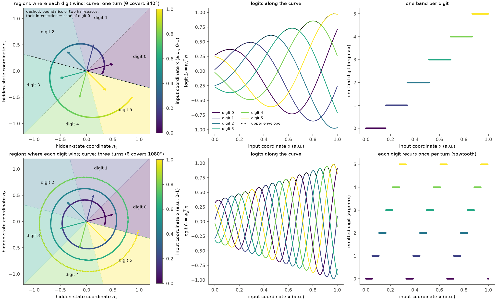

*图 1：线性 logit 的胜出区域与曲线（模拟，不涉及模型）。二维 hidden state 空间中 6 个数字的读出向量 $w_c$ 为单位向量（彩色箭头，相位间隔 60°），背景色为 arg-max 区域，每个区域是从原点出发的楔形，即二维中的凸锥；左上图的两条黑色虚线是“数字 0 比数字 1 大”与“数字 0 比数字 5 大”两个半空间的边界，二者的交集就是数字 0 的锥。曲线颜色为输入坐标 $x$（viridis，0–1）。上行：曲线转 340°；下行：曲线转 1080°（半径随 $x$ 增大，以便看清三圈）。中列：沿曲线的六条 logit（颜色为数字）与上包络（黑色点线）；右列：写出的数字。*

### 2.3 Gated DeltaNet 层与短卷积

Qwen3.5-9B 有 32 个 decoder 层，其中第 4、8、…、32 层为 full attention，其余 24 层为 Gated DeltaNet。一个 DeltaNet 层在位置 $i$ 上的计算分三步。

1. **输入投影。** 层输入 $x_i \in \mathbb{R}^{4096}$ 经线性投影得到 $c_i = W_{\mathrm{qkv}}\, x_i \in \mathbb{R}^{8192}$，其中 2048 维为 query（16 个 head × 128），2048 维为 key（16 × 128），4096 维为 value（32 × 128）。
2. **短卷积。** 对每一维单独做长度为 4 的因果卷积（depthwise convolution）：

$$
\hat{c}_i = \operatorname{SiLU}\Big( \sum_{j=0}^{3} a_j \odot c_{i-j} \Big), \qquad a_j \in \mathbb{R}^{8192} .
$$

   其中 $a_j$ 为卷积核的第 $j$ 个系数向量，$\odot$ 为逐元素乘。$\hat{c}_i$ 再拆成 query $\hat{q}_i$、key $\hat{k}_i$ 与 value $\hat{v}_i$。
3. **gated delta rule。** 每个 head 维护一个 recurrent state $S_i \in \mathbb{R}^{128 \times 128}$，按 $S_i = \alpha_i\, S_{i-1} (I - \beta_i \hat{k}_i \hat{k}_i^{\top}) + \beta_i\, \hat{v}_i \hat{k}_i^{\top}$ 更新，输出 $S_i \hat{q}_i$；$\alpha_i, \beta_i \in (0, 1)$ 是由输入算出的衰减门与写入强度。

**短卷积为什么能传递上一 token 的信息。** 解码时，cache 为每个 DeltaNet 层保存一个短卷积状态，形状为 $8192 \times 4$，存放最近几个 token 的投影 $c_{i-1}, c_{i-2}, c_{i-3}$。位置 $i$ 计算 $\hat{c}_i$ 时直接用到 $c_{i-1}$，而 $c_{i-1}$ 是上一 token 在该层的层输入的线性投影。因此，在第 $l$ 层，当前 token 可以不经 attention、不经 recurrent state 的压缩，直接读到上一 token 在第 $l - 1$ 层输出的 residual 的一个线性投影。本文所说的“前一位置的卷积槽位”就是 $c_{i-1}$ 这一列；“经短卷积传递”指的是这条通道。recurrent state $S$ 则是之前全部 token 的压缩，是另一条通道；full-attention 层的 key/value 是第三条通道。

### 2.4 实验操作

全部 GPU 实验采用设计文档[第 7.1 节](design_digit_failure.md#71-先-prefill后单步)的“先 prefill、后单步”方案：把研究步之前的 token prefill 一次，得到每层的 key/value、recurrent state 与短卷积状态，复制成若干行并逐行编辑，再只运行研究的那一步。单步 logit 与第一轮批量前向的数字 log 概率最大相差 0.07–0.13 nats（bfloat16 批量差异）。

1. **activation patching（设计文档[第 7.2 节](design_digit_failure.md#72-activation-patching)）。** 运行 $A$ 与 $B$ 是只有红色圆盘位置不同的一对输入，token 序列等长，强制写入的数字相同。在研究步把 $B$ 的某一类状态复制进 $A$，以恢复比例 $r$ 度量这类状态携带了多少“$B$ 相对 $A$ 的变化”：

$$
r = \frac{\sum_{\text{pairs}} \langle \tilde{\ell}_{X} - \tilde{\ell}_{A},\ \tilde{\ell}_{B} - \tilde{\ell}_{A} \rangle}{\sum_{\text{pairs}} \lVert \tilde{\ell}_{B} - \tilde{\ell}_{A} \rVert^{2}} .
$$

   其中 $\tilde{\ell} \in \mathbb{R}^{10}$ 为研究步的数字 log 概率减去十个数字上的均值，下标 $A$、$B$ 为两次未编辑的运行，$X$ 为编辑后的运行；$r = 1$ 表示被复制的状态足以复现 $B$ 的全部变化，$r = 0$ 表示没有作用。区间为以配对为单位的 bootstrap 95% 区间。
2. **读取位置扫描（第 7.3 节）。** 运行 $B$ 的图像 key/value 只对答案中位置 $s$ 及之后的 token 可见，扫描 $s$，定位图像在答案的哪个位置被读入。
3. **steering 与通道阻断（第 7.4 节）。** 在某一位置的 residual 上沿某个方向加入向量，观察下一位置的数字如何变化；再把 steering 留下的某一类状态换回未 steering 的状态，测量该通道是否承载这一作用。

| 实验 | 轮次 | 规模 | 产物 |
| --- | --- | --- | --- |
| 读出几何（CPU） | 第二轮 | 每轴 108 张圆盘图像，第一轮记录的 $q_0$、$q_1$ residual | `arrays.npz` |
| $q_0$、$q_1$ 单步 patching | 第二轮 | $q_0$ 32 对、$q_1$ 64 对，每对 31 种编辑 | `patch.jsonl` |
| 读取位置扫描 | 第二轮 | 96 对 | `tail.jsonl` |
| 首位相邻差 steering | 第二轮 | 每轴 89 张图像 × 2 层 × 4 幅度 × 2 方向 | `steer.jsonl` |
| 先验神经元与消融 | 第二轮 | 386 个输入单元，10 种消融 | `capture.jsonl`、`ablate.jsonl` |
| 通道阻断 | 第三轮 | 178 张圆盘图像（真值 150–849），15 行 | `relay.jsonl` |
| 个位读出与 $q_1$ steering | 第三轮 | 圆盘 216、RefCOCO 60、文本换算 54 个单元 | `units.jsonl` |
| $q_2$ 单步 patching | 第三轮 | 96 对 | `patch3.jsonl` |

GPU 用量：第二轮在 2–3 张同型卡上以权重拆分方式运行，按卡计约 2.5 GPU 小时（含一次因他人进程占满显存而中断后续跑的消融）；第三轮在一张空闲 A40 上运行约 10 分钟（冒烟测试一次因他人进程同时占用该卡而 OOM，未产生数据，换卡重跑）。

## 3. 假设及其理论依据

### 3.1 首位数字

**H1a：$q_0$ 直接读取图像。** 这是最直接的设想：写首位数字的那一步，full-attention 层（尤其是实验 3.11 定位的 L20 H11）读取图像 token，MLP 把读到的坐标转为数字 logit。

**H1b：图像在 $q_0$ 之前读取，再传给 $q_0$。** 答案前缀以 “```json [ {"point_2d": [” 开头，$q_0$ 之前有十几个 token。第 2.3 节说明短卷积为每个 token 提供上一 token 后层状态的直接副本，因此前缀 token 读到的坐标可以逐 token 传到 $q_0$。实验 3.11 的 patching 把图像对答案前缀的全部 token 同时可见，无法区分 H1a 与 H1b。

**读出几何的预期。** 不论图像在哪里读入，$q_0$ 的读出都要把坐标转成首位数字。由第 2.2 节，若 logit 轨迹 $\ell^{(0)}(x)$ 在 0–1000 内转不满一圈，首位就分带；分带正是首位所需要的，因此预期轨迹转约一圈。

### 3.2 第二位数字

**H2a：$q_1$ 重新读取图像。** 第一轮观察到 $q_1$ 在第 12–20 层把 46%–52% 的 attention 放在图像 token 上，这是 H2a 的直接依据。

**H2b：从 $q_0$ 取得精确坐标，减去 $100k$ 后读出。** 第一轮的理论（第一轮第 3.1 节）表明，以首位 $k$ 为条件，读出 $x - 100k$ 就能画出锯齿；$q_0$ 的 residual 中有精度约 5 个单位的坐标表示（第一轮第 3.8 节），$k$ 是 $q_1$ 的输入 token，两者都在 $q_1$ 可得。若 H2b 成立，期望第二位应当与真实组内偏移 $o$ 线性相关，斜率接近 1。

**H2c：读取 $q_0$ 首位读出的相邻差 $m$。** 这一假设来自模型本身的两点结构。

1. **通道。** 第 2.3 节的短卷积让 $q_1$ 在第 $l$ 层直接读到 $q_0$ 在第 $l-1$ 层的状态。第 25–32 层的 $q_0$ 状态正在形成首位 logit（第一轮：MLP 28–32 写入首位），所以 $q_1$ 可以读到首位读出的中间结果。
2. **相邻差携带组内偏移。** 若首位 logit 的轨迹是圆弧（第 4.1 节实测成立），每个数字的 logit 可以写成角度 $\theta$ 的余弦：

$$
\ell^{(0)}_c(x) \approx \rho(x)\, A_c \cos\big(\theta(x) - \varphi_c\big) + \mu_c .
$$

   其中 $\theta$ 是轨迹在圆弧平面上的角度，$\rho$ 为半径，$\varphi_c$ 与 $A_c$ 为数字 $c$ 的读出方向在该平面上的角度与长度，$\mu_c$ 为常数（第 4.1 节给出这些量的精确定义）。设相邻数字的相位间隔为 $\delta$，即 $\varphi_{k \pm 1} = \varphi_k \pm \delta$，并设 $A_{k+1} \approx A_{k-1} \approx A$。由余弦差公式：

$$
m = \ell^{(0)}_{k+1} - \ell^{(0)}_{k-1} \approx 2 \rho A \sin\delta \cdot \sin\big(\theta - \varphi_k\big) + (\mu_{k+1} - \mu_{k-1}) .
$$

   这个式子的含义是：相邻差正比于当前角度偏离数字 $k$ 中心相位的正弦。坐标位于百位区间中心时 $\theta \approx \varphi_k$，$m$ 接近常数项；坐标向下一个百位靠近时 $\theta - \varphi_k$ 变大，$m$ 增大；向上一个百位靠近时 $m$ 减小。由于 $\theta$ 随 $x$ 单调转动，在一个百位区间内 $\sin(\theta - \varphi_k)$ 近似是组内偏移的线性函数。所以 $m$ 本身就是一个“距离下一个百位有多近”的量，并且已经以 logit 的形式存在于 $q_0$ 的后层状态中。对 $q_1$ 而言，读 $m$ 比从坐标表示重新计算 $x - 100k$ 便宜：$k$ 的 embedding 只需选出 $k$ 两侧的两个数字，相当于在圆弧上标出“当前百位”的位置。

**为什么用“相邻差”这个量。** 在首位为 $k$ 的条件下，第二位要回答“坐标在第 $k$ 个百位区间的哪个位置”。首位读出中与这一问题直接相关的只有 $k$ 两侧的数字：坐标靠近区间上端时 $k+1$ 的 logit 升高，靠近下端时 $k-1$ 的 logit 升高。$m$ 把这两个信号合成一个有符号的量；由于 softmax 对 logit 的平移不变，$m$ 也等于 $\log P_0(k+1) - \log P_0(k-1)$，与是否在十个数字上重新归一化无关。回归中同时使用两个单侧差 $\Delta^{+} = \ell^{(0)}_{k+1} - \ell^{(0)}_{k}$ 与 $\Delta^{-} = \ell^{(0)}_{k-1} - \ell^{(0)}_{k}$，$m = \Delta^{+} - \Delta^{-}$ 是二者的单变量合成。

**三种假设的可检验差异。** H2a 预测 $q_1$ 单步替换图像 key/value 有大的恢复比例；H2b 预测期望第二位主要由真实偏移 $o$ 决定；H2c 预测期望第二位主要由 $m$ 决定，并且只改变 $m$（不改变坐标表示）的干预会按同一比例改变第二位，且该干预的作用经短卷积传递。H2b 与 H2c 不互斥：$m$ 与 $o$ 本来相关，因此需要用 steering 把二者分开。

### 3.3 个位数字

个位的三种候选与第二位一一对应：H3a 在 $q_2$ 重新读取图像；H3b 经短卷积读取 $q_1$ 第二位读出的相邻差 $\ell^{(1)}_{t+1} - \ell^{(1)}_{t-1}$；H3c 个位不含坐标信息，只反映数字的先验。若 H3b 成立，个位能达到的精度受 $q_1$ 的第二位读出所限；由于第二位读出本身已经接近均匀，H3b 预言个位在图像任务中近乎均匀，但对 $q_1$ 的扰动仍会传到个位。个位在前两轮都没有被测量，第三轮补充这一部分（第 4.3 节）。

## 4. 实验与证据

### 4.1 首位数字：读出几何与读取位置

**logit 轨迹矩阵。** 对每个轴取 $N = 108$ 张圆盘图像（$100 \le x < 1000$），由第一轮记录的 $q_0$ 第 32 层 residual，经权重中的 $g$ 与 $W$ 精确重算十个数字的 logit（与模型 logit 的最大差 0.07 nats），排成矩阵 $L \in \mathbb{R}^{N \times 10}$，第 $i$ 行是第 $i$ 张图像的 $\ell^{(0)}$。做两次中心化：

$$
\tilde{L}_{ic} = L_{ic} - \frac{1}{10} \sum_{d} L_{id} - \bar{\ell}_c, \qquad \bar{\ell}_c = \frac{1}{N} \sum_{i} \Big( L_{ic} - \frac{1}{10} \sum_{d} L_{id} \Big).
$$

第一次减去每行在十个数字上的均值，因为 softmax 只依赖 logit 之差，整行加同一常数不改变输出；第二次减去各数字在全部图像上的均值 $\bar{\ell} \in \mathbb{R}^{10}$，只保留随图像变化的部分。由于 sweep 中各图像只有圆心位置不同，$\tilde{L}$ 的变化全部由坐标 $x$ 引起。

**奇异值分解及其含义。** 对 $\tilde{L}$ 做奇异值分解：

$$
\tilde{L} = U \Sigma V^{\top} = \sum_{j} \sigma_j\, u_j v_j^{\top}, \qquad U \in \mathbb{R}^{N \times 10},\ \ \Sigma = \operatorname{diag}(\sigma_1 \ge \sigma_2 \ge \dots \ge 0),\ \ V \in \mathbb{R}^{10 \times 10} .
$$

每一项 $\sigma_j u_j v_j^{\top}$ 是一个秩为 1 的矩阵：$v_j \in \mathbb{R}^{10}$ 是十个数字上的一种 logit 变化模式（单位向量），$u_j \in \mathbb{R}^{N}$ 给出每张图像在这一模式上的系数，$\sigma_j$ 给出这一模式的总幅度。$\tilde{L}$ 的总平方和等于 $\sum_j \sigma_j^2$，因此第 $j$ 个方向的方差份额是 $\sigma_j^2 / \sum_i \sigma_i^2$，前两个方向的份额之和（下称“前二份额”）度量 logit 随坐标的变化有多大比例落在一个平面内。若前二份额接近 1，每张图像的十维 logit 变化就可以用两个数描述：

$$
z_{i1} = \sigma_1 u_{i1}, \qquad z_{i2} = \sigma_2 u_{i2}, \qquad \tilde{L}_i \approx z_{i1} v_1 + z_{i2} v_2 .
$$

$z_{i1}, z_{i2}$ 也可以写成 residual 的投影：$z_{ij} = v_j^{\top}(\ell_i - \bar{\ell}) = (W^{\top} v_j)^{\top} n_i - v_j^{\top} \bar{\ell}$（$\ell_i$ 先按行中心化），即第 32 层归一化 hidden state 在方向 $W^{\top} v_j \in \mathbb{R}^{4096}$ 上的投影减去常数。

| 量 | disc x | disc y |
| --- | --- | --- |
| 前五个奇异值 $\sigma_1, \dots, \sigma_5$（nats） | 59.7、52.0、22.8、18.1、7.5 | 66.9、55.2、24.3、18.9、8.3 |
| 前三个方向的方差份额 | 0.49、0.37、0.07 | 0.52、0.35、0.07 |
| 秩 1 / 2 / 3 重建的 arg-max 与完整 arg-max 一致的比例 | 0.38 / 0.83 / 0.81 | 0.29 / 0.66 / 0.78 |

**用 atan2 定义角度。** 每张图像在 $(z_1, z_2)$ 平面上是一个点。平面上一点 $(z_1, z_2)$ 可以等价地用到原点的距离 $\rho$ 与它相对 $z_1$ 正半轴的角度 $\theta$ 描述：

$$
\rho = \sqrt{z_1^2 + z_2^2}, \qquad \theta = \operatorname{atan2}(z_2, z_1) \in (-\pi, \pi], \qquad z_1 = \rho \cos\theta,\ \ z_2 = \rho \sin\theta .
$$

$\operatorname{atan2}(z_2, z_1)$ 是“点 $(z_1, z_2)$ 的方位角”：它与 $\arctan(z_2 / z_1)$ 在第一、四象限相同，但会根据 $z_1, z_2$ 的符号判断点在哪个象限，因此能区分 $(1, 1)$（45°）与 $(-1, -1)$（−135°），并且在 $z_1 = 0$ 时仍有定义。按坐标顺序排列图像后，相邻图像的角度若跳过 $\pm\pi$ 的分界，就加减 $2\pi$ 使之连续（展开，unwrap），得到随坐标连续变化的 $\theta(x)$。使用角度而非 $z_1$ 或 $z_2$ 单独描述坐标，是因为点在平面上沿圆弧移动：$z_1$ 与 $z_2$ 各自都随 $x$ 先升后降，不是单调的（$z_1$ 与 $x$ 的 Spearman 相关只有 −0.62），而角度是单调的。同样，数字 $c$ 的读出方向在该平面上的投影 $(\sigma_1 V_{c1}, \sigma_2 V_{c2})$ 也有一个角度 $\varphi_c$ 与长度 $A_c$；代入 $\tilde{L}_{ic} \approx z_{i1} V_{c1} + z_{i2} V_{c2}$ 并利用三角恒等式，可以得到第 3.2 节使用的余弦形式 $\tilde{L}_{ic} \approx \rho_i A_c \cos(\theta_i - \varphi_c)$（式中的 $\rho_i$ 为 $(z_{i1}/\sigma_1, z_{i2}/\sigma_2)$ 的长度，$\theta_i$ 为其角度，与上文只差各轴的缩放）。

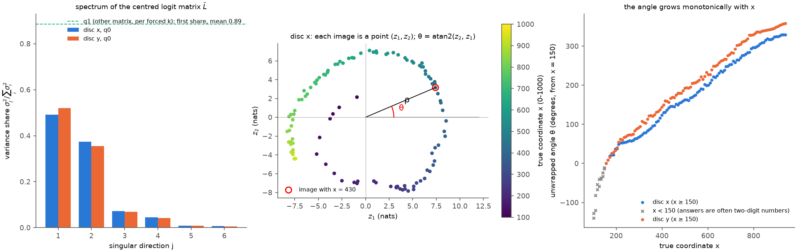

*图 2：$q_0$ 处数字 logit 轨迹的奇异值分解与角度（模型激活，非拟合）。左：$\tilde{L}$ 的方差份额 $\sigma_j^2 / \sum_i \sigma_i^2$（蓝 disc x，橙 disc y）；绿色虚线为 $q_1$ 处按强制首位 $k$ 分别构造的同类矩阵的第一方向份额（9 个 $k$ 与两轴的平均），说明 $q_1$ 的轨迹近似一维。中：disc x 每张图像的 $(z_1, z_2)$，颜色为真实坐标 $x$（viridis，100–1000），红圈标出一张图像及其 $\rho$ 与 $\theta$。右：展开后的角度对 $x$（以 $x = 150$ 处为零点）；灰色叉号为 $x < 150$ 的图像，模型在这一范围常写两位数，首位读出不在三位数的圆弧上。*

**首位读出是一段转不满一圈的圆弧。** 前二份额为 0.87（两轴），二维重建复现 0.66–0.83 的 arg-max，一维重建只复现 0.29–0.38，说明“读出只看到一个单调标量”的描述不准确，平面描述是必要的。在 $x \ge 150$ 的 101 张图像上，$\theta$ 与 $x$ 的 Spearman 相关为 0.9998，每 100 个单位转 43°（x）与 45°（y），在 150–940 内总共转 330° 与 358°；半径的变异系数为 0.16–0.23。数字 1–9 的相位 $\varphi_c$ 依次排列，相邻约 37°；数字 0 的读出长度只有其他数字的 4%–21%，几乎不参与。由第 2.2 节，曲线转不满一圈意味着每个数字只被经过一次。按坐标顺序排列的完整 arg-max 依次为 1、2、…、9，只在 5/6 与 6/7（x）、2/3 与 5/6（y）的边界处各有一次单张图像的来回。这就是首位分带的几何原因；第二位所需的“每 100 个单位转一圈”的分量在 $q_0$ 的读出中不存在。

在 residual 空间中，坐标引起的变化同样是低维的：参与比（participation ratio，$(\sum_j \lambda_j)^2 / \sum_j \lambda_j^2$，$\lambda_j$ 为主成分方差）在 $q_0$ 为 1.7–4.6、在 $q_1$ 为 3.8–7.0（第 8–32 层），达到 90% 方差需要 2–9 个主成分。unembedding 只读到这条低维弯曲流形的两个方向；两个读出方向 $W^{\top} v_1$ 与 $W^{\top} v_2$ 的夹角余弦为 −0.19 与 −0.18。

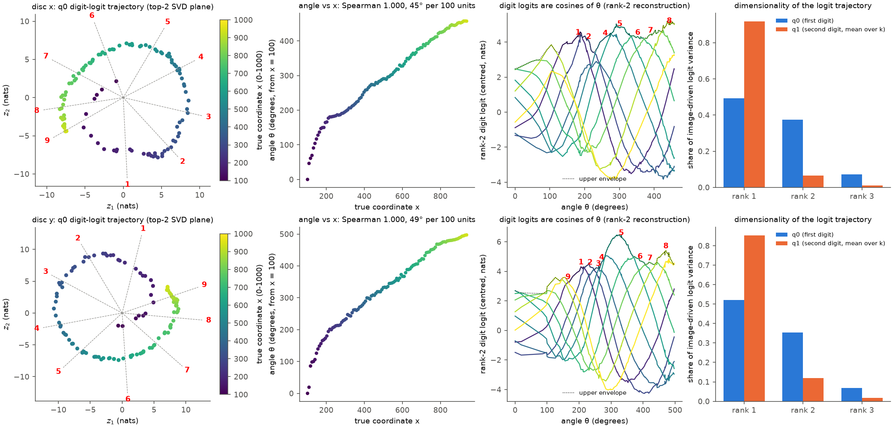

*图 3：$q_0$ 处数字 logit 轨迹的几何细节（模型激活，非拟合）。第一列：$(z_1, z_2)$，颜色为 $x$（viridis），灰色虚线与红色数字为各数字读出方向的相位 $\varphi_c$；第二列：$\theta$（以 $x = 100$ 为零点，含 $x < 150$ 的图像）对 $x$；第三列：二维重建的数字 logit 对 $\theta$（颜色为数字，viridis 0–9），黑色点线为上包络，红色数字为包络上各段的胜出数字；第四列：图像驱动的 logit 方差在前三个方向上的份额（蓝 $q_0$，橙 $q_1$ 的九个首位条件平均）。上行 disc x，下行 disc y。第二列标题中的“每 100 个单位转角”以包含 $x < 150$ 的全部图像拟合，正文采用 $x \ge 150$ 的值。*

**首位的图像信息主要在 $q_0$ 之前读入（H1b）。** $q_0$ 单步 patching（32 对，相邻百位区间的中部配对）与读取位置扫描的结果如下表与图 4。

| 编辑（把运行 $B$ 的状态复制到研究步） | 首位，$q_0$（32 对） | 第二位，$q_1$（64 对） |
| --- | --- | --- |
| 图像 key/value，8 个 full-attention 层 | 0.29 [0.26, 0.31] | 0.03 [0.03, 0.04] |
| 图像 key/value，只在层 20 | 0.17 [0.15, 0.20] | 0.01 [0.01, 0.02] |
| L20 H11 的输出（只经层 20 图像 key/value 的路径） | 0.12 [0.10, 0.14] | 0.01 [0.01, 0.02] |
| L20 H11 的输出（整体取自运行 $B$） | 0.12 [0.10, 0.14] | 0.01 [0.01, 0.02] |
| 图像之后的文本 key/value | 0.13 [0.11, 0.14] | 0.02 [0.01, 0.02] |
| $q_0$ 的 key/value（full attention） | — | 0.01 [0.01, 0.01] |
| DeltaNet recurrent state | 0.02 [0.00, 0.05] | 0.25 [0.22, 0.29] |
| 短卷积状态中前一位置的槽位，全部层 | 0.57 [0.52, 0.61] | 0.71 [0.67, 0.74] |
| 同上，只在层 25–31 | 0.57 [0.52, 0.61] | 0.70 [0.66, 0.73] |
| 同上，只在层 1–8、9–16 或 17–24 | 0.00 | 0.00–0.01 |
| 全部 DeltaNet 状态 | 0.59 [0.56, 0.61] | 0.95 [0.94, 0.95] |
| 图像 key/value 与全部 DeltaNet 状态 | 0.87 [0.86, 0.89] | 0.98 [0.97, 0.98] |

运行 $B$ 与 $A$ 的中心化数字 log 概率之差的平均范数为 7.4 nats（$q_0$）与 4.6 nats（$q_1$）。

在 $q_0$ 单步替换图像 key/value 只恢复 0.29，其中层 20 为 0.17、L20 H11 为 0.12；替换前一位置（$q_0 - 1$）的卷积槽位恢复 0.57，二者合计 0.87。读取位置扫描给出同一图景（图 4 右）：若只让 $q_0$ 看到运行 $B$ 的图像，首位恢复 0.34（x）与 0.25（y）；从 $q_0 - 1$ 起可见时为 0.53 与 0.82；从 $q_0 - 3$ 起达到 0.78 与 0.94，再往前基本不变。x 的前缀末尾三个 token 是 “d”“\":”“ [”，y 的是 “0”“,”“ ”。因此，**图像主要在首位数字之前的两三个 token 处被读取，结果经短卷积逐 token 传到 $q_0$**，H1a 只解释约三分之一。这与实验 3.11 一致：3.11 让图像对答案前缀的全部 token 可见，测得 L20 H11 单独恢复首位 logit 差的 0.40–0.59；本文把 3.11 的读取定位到 $q_0$ 之前的前缀 token 上。

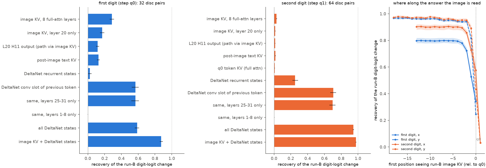

*图 4：首位与第二位数字的因果来源（模型激活上的 activation patching，协议见设计文档第 7.2、7.3 节）。左、中：恢复比例 $r$，条形为对配对求和的比值，误差线为配对层面的 bootstrap 95% 区间；点线为 $r = 1$。右：运行 $B$ 的图像 key/value 从答案位置 $s$（横轴，相对 $q_0$）起可见时的恢复比例（蓝：首位；橙：第二位；实线 x，虚线 y；阴影为 95% 区间）。y 的答案前缀更长（含 “500, ”），因此横轴向左延伸更远。*

### 4.2 第二位数字：来源、读取的量与通道

**第二位不重新读取图像（否定 H2a）。** 上表右列：在 $q_1$ 单步把 8 个 full-attention 层的图像 key/value 全部换成运行 $B$ 的，第二位分布只移动 3%；层 20 与 L20 H11 的路径各 1%。读取位置扫描中，从 $q_0$ 起让模型看到运行 $B$ 的图像，$q_1$ 恢复 0.58（x）与 0.43（y）；只让 $q_1$ 看到，恢复 0.03。第一轮观察到 $q_1$ 在层 12–20 有 46%–52% 的 attention 落在图像上（图 5），这些 attention 读到的内容不影响第二位。

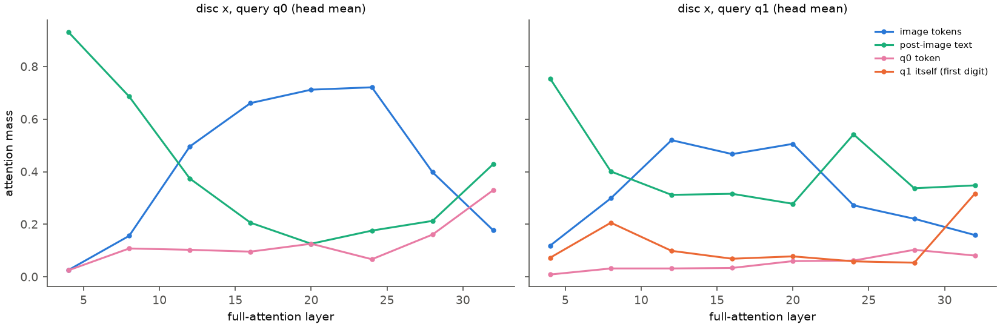

*图 5：disc x 上 full-attention 层在 $q_0$（左）与 $q_1$（右）的 attention 质量，按 token 组汇总（head 平均；由 hook 记录的层输入重算 softmax，重算误差不超过 1.9%）。蓝：图像 token；绿：图像之后的文本；粉：$q_0$；橙：$q_1$ 自身（首位数字 token）。attention 只是相关证据，因果作用见图 4。*

**第二位的信息来自 $q_0$ 的后层状态，经短卷积传入。** 只复制第 25–31 层卷积状态中 $q_0$ 的槽位（即 $q_0$ 在这些层的投影 $c_{q_0}$）就恢复 0.70，在第 1–24 层复制同一槽位没有作用；$q_0$ 的 full-attention key/value 只恢复 0.01；recurrent state 另外贡献 0.25，全部 DeltaNet 状态合计 0.95。第 25–31 层正是首位 logit 形成的层，因此 $q_1$ 读到的是首位读出过程中的状态。首位数字 $k$ 的 embedding 在配对的两次运行中相同，对 $B - A$ 的差异没有贡献；$k$ 的作用由第一轮析因中“交换 $k$”测量（JS 散度 0.145–0.235 bits，大于交换图像的 0.105–0.124）。

**期望第二位由首位 logit 的相邻差决定（支持 H2c）。** 在首位正确的条件下（强制 $k$ 等于真值首位，真值 200–899），把 $E[t]$ 分别回归到真实组内偏移 $o$、单变量相邻差 $m$ 与两个单侧差 $(\Delta^{+}, \Delta^{-})$ 上。

| 输入族 | $n$ | $R^2$：$o$ | $R^2$：$m$ | $R^2$：$(\Delta^{+}, \Delta^{-})$ | $R^2$：$o$ 与 $(\Delta^{+}, \Delta^{-})$ | 5 折交叉验证：$o$ / $(\Delta^{+}, \Delta^{-})$ |
| --- | --- | --- | --- | --- | --- | --- |
| disc x | 90 | 0.24 | 0.70 | 0.82 | 0.84 | 0.24 / 0.82 |
| disc y | 90 | 0.23 | 0.74 | 0.80 | 0.80 | 0.22 / 0.80 |
| RefCOCO x | 103 | 0.67 | 0.87 | 0.87 | 0.89 | 0.66 / 0.87 |
| 10×10 网格 x | 50 | 0.00 | 0.72 | 0.73 | 0.77 | −0.03 / 0.70 |
| 文本换算 | 45 | 0.99 | 0.61 | 0.62 | 0.99 | 0.99 / 0.55 |

相邻差解释 0.70–0.87 的方差，加入真实偏移几乎不再增加（0.00–0.04）；网格上真实偏移的解释力为零，相邻差仍有 0.72。文本换算相反，真实偏移解释 99%：同一模型在同一位置可以写出精确的第二位，只是图像坐标走的是相邻差这条路。

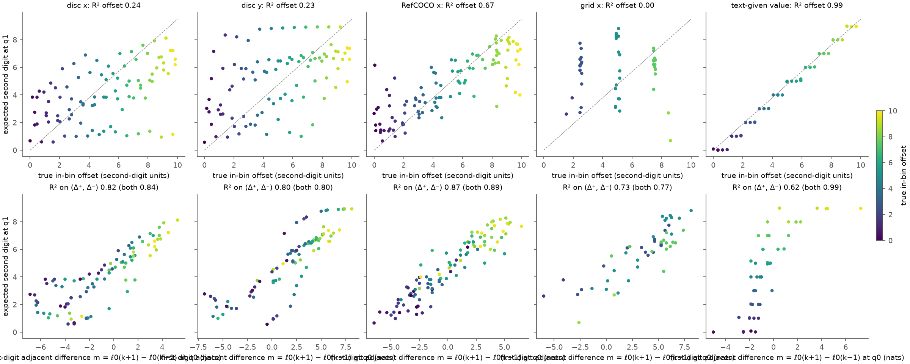

*图 6：第二位读的是什么（模型输出，非拟合；回归为最小二乘）。上行：首位正确条件下 $q_1$ 的 $E[t]$ 对真实组内偏移 $o$（灰色虚线为理想阶梯）；下行：同一 $E[t]$ 对首位 logit 的相邻差 $m$。颜色为真实组内偏移（viridis，0–10 个第二位单位）。下行标题中的 $R^2$ 为对 $(\Delta^{+}, \Delta^{-})$ 的二元回归。disc x 上行中 $E[t] \approx 1$ 的一列点为真值 500–599、强制首位 5 的样本，第 4.4 节解释其来源。*

**第二位的增益与分辨率由相邻差的质量决定。** 若 $E[t]$ 只通过 $m$ 依赖坐标，则实测增益（$E[t]$ 对 $o$ 的斜率）应当等于两段斜率之积：

$$
\frac{\mathrm{d} E[t]}{\mathrm{d} o} \approx \frac{\mathrm{d} E[t]}{\mathrm{d} m} \cdot \frac{\mathrm{d} m}{\mathrm{d} o} .
$$

同时，同一偏移下 $m$ 在不同图像之间的散布（$m$ 对 $o$ 线性回归的残差标准差 $s_m$）决定了一个只读 $m$ 的读出能达到的分辨率 $10\, s_m / (\mathrm{d} m / \mathrm{d} o)$（以坐标单位计；因子 10 把第二位单位换成坐标单位）。

| 输入族 | $\mathrm{d}m/\mathrm{d}o$（nats / 第二位单位） | $s_m$（nats） | $\mathrm{d}E/\mathrm{d}m$ | 两段之积 | 实测 $\mathrm{d}E/\mathrm{d}o$ | 分辨率（坐标单位） |
| --- | --- | --- | --- | --- | --- | --- |
| disc x | 0.72 | 2.4 | 0.53 | 0.39 | 0.35 | 33 |
| disc y | 0.73 | 3.1 | 0.54 | 0.40 | 0.38 | 42 |
| RefCOCO x | 0.80 | 2.0 | 0.62 | 0.49 | 0.55 | 25 |
| 10×10 网格 x | 0.40 | 3.1 | 0.49 | 0.20 | 0.02 | 77 |
| 文本换算 | 0.58 | 1.3 | 1.06 | 0.62 | 1.00 | 23 |

**图像坐标的第二位增益几乎完全由“经相邻差”这条路解释。** disc 与 RefCOCO 上两段之积与实测增益相差不超过 0.06，读出分辨率 25–42 个单位与第一轮以高斯证据模型拟合的第二位分辨率（disc 50、RefCOCO 31 个单位）同量级。这给出了精度丢失的位置：坐标表示的精度约 5 个单位，首位 logit 的相邻差平均而言随偏移线性增长，每 10 个单位增加 0.72–0.80 nats，但在同一偏移下的图像间散布达到 2.0–3.1 nats（图 7 左），第二位继承了这一散布。若只用圆弧平面的二维近似计算 $m$，斜率为 0.30–0.33、分辨率为 51–52 个单位；完整 logit 中的其余方向使 $m$ 更陡，但没有把散布降到第二位所需的 10 个单位以下。网格上 $m$ 与偏移几乎无关（$R^2$ 0.07），两段之积 0.20 高于实测的 0.02，说明网格的相邻差在单元边界附近随布局跳变，不是偏移的单调函数。文本换算的实测增益 1.00 远大于两段之积 0.62，说明文本数值走的是不经相邻差的精确路径。

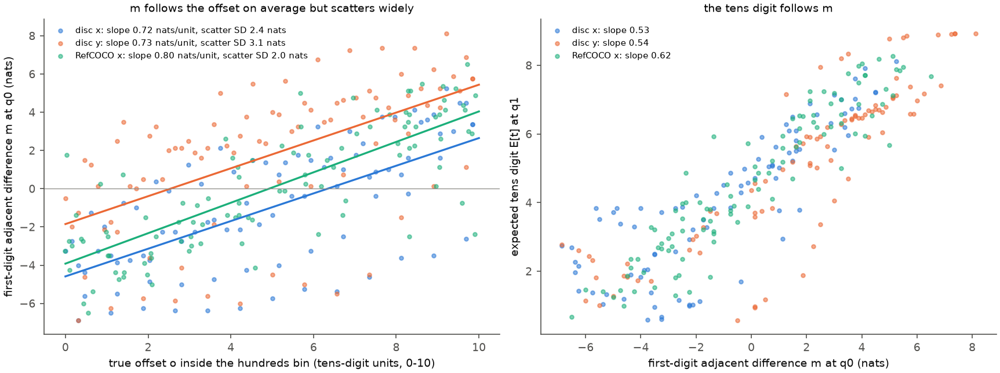

*图 7：相邻差的两段斜率（模型输出，非拟合；直线为最小二乘）。左：首位正确条件下 $q_0$ 的相邻差 $m$ 对真实组内偏移 $o$，图例给出斜率与残差标准差；右：$q_1$ 的 $E[t]$ 对 $m$。蓝 disc x，橙 disc y，绿 RefCOCO x。每点为一张图像。*

**沿相邻差方向推动 $q_0$，第二位按自然比例移动（区分 H2b 与 H2c）。** 回归不能排除“第二位读精确坐标、只是与相邻差相关”的可能。为此在 $q_0$ 的第 24 或 28 层输出上加入 $c\, \lVert h \rVert\, u_k$（$c \in \{\pm 0.05, \pm 0.1\}$），其中

$$
u_k = \frac{g \odot (w_{k+1} - w_{k-1})}{\lVert g \odot (w_{k+1} - w_{k-1}) \rVert} \in \mathbb{R}^{4096} .
$$

$u_k$ 是在 residual 空间中“提高数字 $k+1$、降低数字 $k-1$ 的首位 logit”的方向（$g$ 把最终 RMSNorm 的逐维增益折算进去）。实验 3.6 第二轮表明，坐标表示几乎不在数字 unembedding 张成的空间内，因此这一推动改变的是 $m$，基本不改变坐标表示。对照为与 $u_k$ 正交的随机单位向量。每轴 89 张图像（真值 150–849），首位强制为真值。

| 推动 | $q_0$ 处 $m$ 的平均绝对变化（nats） | $q_1$ 处 $E[t]$ 的平均绝对变化 | 斜率（$E[t]$ 变化 / $m$ 变化） |
| --- | --- | --- | --- |
| 相邻差方向，第 24 层 | 0.78 | 0.52 | 0.69 |
| 相邻差方向，第 28 层 | 0.90 | 0.50 | 0.58 |
| 随机方向，第 24 层 | 0.10 | 0.08 | — |
| 随机方向，第 28 层 | 0.07 | 0.04 | — |

**只改变相邻差，第二位就按自然数据中的比例改变。** 每 1 nat 的 $m$ 变化带来 0.58–0.69 的 $E[t]$ 变化，与自然数据中由图像变化得到的 $\mathrm{d}E/\mathrm{d}m$（0.53–0.62）一致；同等幅度的随机推动几乎不改变 $m$，也几乎不改变 $E[t]$。这说明第二位读取的是 $m$ 本身，而不只是与 $m$ 相关的坐标量。

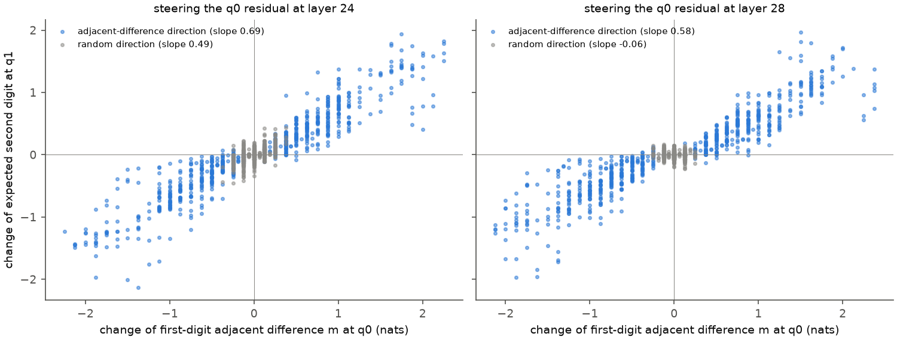

*图 8：沿相邻差方向推动 $q_0$ 的 residual（模型激活上的干预，协议见设计文档第 7.4 节）。横轴为 $q_0$ 处 $m$ 相对未推动时的变化，纵轴为 $q_1$ 处 $E[t]$ 的变化；每点为一张图像在一个推动幅度下的结果（disc x 与 y 合并，178 张图像 × 4 个幅度）。蓝：相邻差方向；灰：随机方向。图例中的斜率为最小二乘拟合。*

**相邻差信号 100% 经短卷积传递（第三轮，通道阻断）。** patching 只说明 $q_0$ 的卷积槽位携带坐标相关的信息，steering 只说明 $m$ 的改变会传到 $q_1$；二者合起来仍未直接证明“$m$ 是经短卷积传过去的”。第三轮在 $q_0$ 的第 24 层输出上以 $c = \pm 0.1$ 推动，然后在 $q_1$ 这一步之前把 steering 行中 $q_0$ 留下的一类状态换回未 steering 的状态（设计文档第 7.4 节）。第 24 层的推动只影响第 25 层及以后的计算，所以 $q_0$ 留下的被改变的状态只有三类：第 25–32 层 DeltaNet 卷积状态中 $q_0$ 的槽位、这些层的 recurrent state，以及第 28、32 层 full attention 中 $q_0$ 的 key/value。178 张图像，推动使 $m$ 平均改变 +1.05 与 −0.98 nats，使 $E[t]$ 平均改变 +0.70 与 −0.63。

| 操作 | $E[t]$ 变化中保留的比例 [95% 区间] |
| --- | --- |
| 推动，恢复第 25–32 层 $q_0$ 的卷积槽位 | −0.01 [−0.01, 0.00] |
| 推动，恢复 recurrent state | 1.01 [1.00, 1.02] |
| 推动，恢复 $q_0$ 的 key/value（第 28、32 层） | 0.99 [0.98, 1.00] |
| 推动，三者同时恢复 | 0.00 |
| 未推动，只放入推动后的卷积槽位 | 1.00 [1.00, 1.01] |
| 未推动，只放入推动后的 recurrent state | −0.01 [−0.02, 0.00] |
| 未推动，只放入推动后的 key/value | 0.01 [0.00, 0.01] |

**$q_0$ 首位读出的相邻差只经短卷积到达 $q_1$。** 恢复卷积槽位使推动的作用完全消失，只放入卷积槽位就完全复现；recurrent state 与 full-attention key/value 两条通道都不承载这一信号。“三者同时恢复”精确为 0，验证了只有这三类状态被推动改变。结合 patching 中 recurrent state 对图像差异贡献的 0.25，可以区分两种传递：$q_0$ 首位读出的相邻差走短卷积；recurrent state 携带的是更早 token 累积的、与相邻差无关的坐标信息。

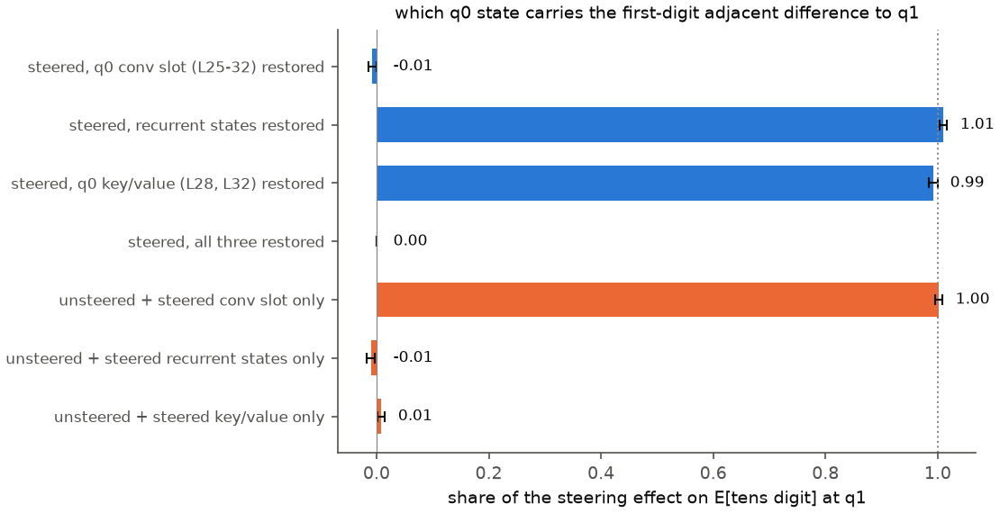

*图 9：相邻差信号的通道阻断（模型激活上的干预，178 张圆盘图像，推动幅度 $\pm 0.1$）。横轴为 $q_1$ 处 $E[t]$ 的推动效应中保留下来的比例（对图像与两个方向求和的投影比），误差线为以图像为单位的 bootstrap 95% 区间。蓝：在推动的运行中恢复一类状态；橙：在未推动的运行中只放入一类推动后的状态。点线为 1。*

**$k$ 提供“当前百位”的条件：平移检验。** H2c 中 $k$ 的作用是选出 $k$ 两侧的数字，相当于在圆弧上标出“当前百位”；这一作用的可观测后果是，第二位 logit 应当近似只依赖组内偏移 $x - 100k$。检验方法：把图像右移 100 个单位并把 $k$ 加 1，若第二位 logit 只依赖 $x - 100k$，则它不应改变。

| 平移（disc，组内偏移在 −50 到 150 之间，每轴 183 个组合） | x：logit 平方变化（nats²） | y |
| --- | --- | --- |
| 只移图像 +100 | 29.2 | 23.6 |
| 只改 $k$ +1 | 21.5 | 29.8 |
| 同时平移，$k$ 不涉及 3、4、5 | 8.7（比值 0.21） | 12.0（比值 0.41） |
| 同时平移，$k$ 为 3、4 或 5 | 15.1（比值 1.28） | 24.7（比值 1.52） |

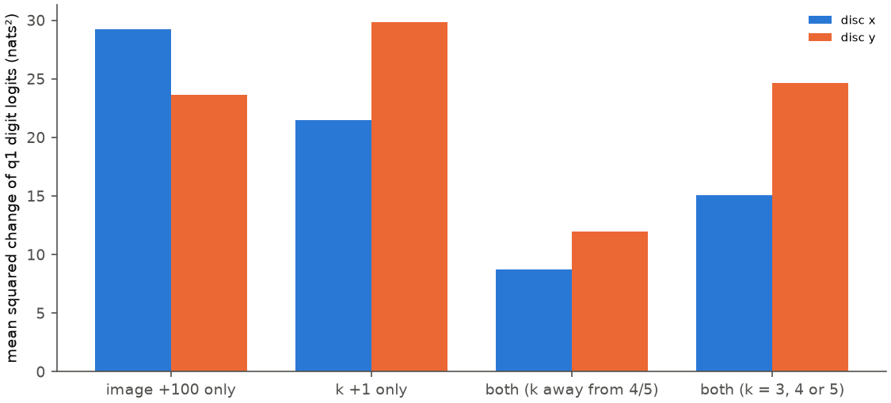

*图 10：平移检验（模型激活）。纵轴为第二位数字 logit（在数字上中心化）的平均平方变化；蓝 disc x，橙 disc y。比值为同时平移的变化除以只移图像的变化。*

远离 500 时，同时平移只留下单独移动图像的 21%–41%：第二位 logit 主要随组内偏移变化，$k$ 的条件作用确实存在，这是 H2b 中“减去 $100k$”成立的部分。在 H2c 下它有直接的实现：$m$ 的定义本身随 $k$ 改变所比较的两个数字。涉及 3、4、5 时比值超过 1，说明 500 附近另有依赖绝对数字的成分（第 4.4 节）。固定 $k$ 时，第二位 logit 随图像变化的第一奇异方向占 0.80–0.97（x）与 0.73–0.90（y），即在每个 $k$ 内 $q_1$ 的读出近似只看一个标量；图像驱动的总方差只有 1.3–11.6 nats²，$q_0$ 为 67–80 nats²。

### 4.3 个位数字（第三轮）

**个位在图像任务中完全均匀，文本任务中精确。** 对每个单元强制首位为真值、第二位依次为 0–9，读取 $q_2$ 的个位分布（数字 token 在 $q_2$ 的总概率为 0.99–1.00，模型在此处几乎总是写第三个数字）。真值按 $\operatorname{round}(x)$ 的三位数取各位；偏移取 $x - (100k + 10t)$。

| 输入族 | $n$ | 个位真值概率 | 熵（bits，均匀为 3.32） | 最大概率均值 | 期望个位对偏移的斜率 / $R^2$ | 数字 0 的平均概率 | greedy 写 0 的比例 |
| --- | --- | --- | --- | --- | --- | --- | --- |
| disc x | 108 | 0.105 | 3.28 | 0.14 | 0.01 / 0.003 | 0.125 | 0.69 |
| disc y | 108 | 0.110 | 3.20 | 0.17 | 0.01 / 0.000 | 0.126 | 0.43 |
| RefCOCO x | 60 | 0.102 | 3.29 | 0.13 | 0.02 / 0.023 | 0.111 | 0.45 |
| 文本换算 | 54 | 0.722 | 0.70 | 0.81 | 0.97 / 0.995 | 0.097 | 0.11 |

**图像坐标的个位不含坐标信息，文本数值的个位精确。** 图像任务中个位真值概率与机会水平 0.10 相同，期望个位与偏移无关；强制第二位偏离真值时（偏移落在 $[0, 10)$ 之外），期望个位也不向 0 或 9 收拢（图 11 左），与第二位在 clamp 测试中的反应不同。文本换算中个位按偏移精确变化（斜率 0.97），强制第二位偏小时个位升向 8，偏大时降向 1。**图像任务中“整十数”过多来自个位分布对 0 的轻微偏好。** 个位分布接近均匀，但 0 的概率（0.11–0.13）略高于其他数字（0.09–0.10），greedy 解码取 arg-max，于是在 43%–69% 的样本中写 0；这与实验 3.6 与 3.13 报告的整十比例 0.60 对应。

**个位的少量图像依赖来自 $q_1$ 的卷积槽位（H3b），与 $q_2$ 读图无关。** $q_2$ 单步 patching（96 对，$x_B - x_A$ 为 15–35 个单位，强制 $A$ 的首位与第二位）：

| 编辑（复制到 $q_2$ 这一步） | 恢复比例 [95% 区间] |
| --- | --- |
| 图像 key/value，8 个 full-attention 层 | 0.13 [0.09, 0.18] |
| 短卷积中 $q_1$ 的槽位，全部层 | 0.79 [0.73, 0.85] |
| 同上，只在层 25–32 | 0.77 [0.71, 0.83] |
| 短卷积中 $q_1$ 与 $q_0$ 两个槽位 | 0.80 [0.74, 0.87] |
| recurrent state | 0.17 [0.12, 0.22] |
| 全部 DeltaNet 状态 | 0.80 [0.74, 0.86] |
| 图像 key/value 与全部 DeltaNet 状态 | 0.78 [0.73, 0.84] |

需要注意分母：运行 $B$ 与 $A$ 在 $q_2$ 的中心化 log 概率之差平均只有 0.27 nats，期望个位只差 0.17（第二位在 $q_1$ 为 4.6 nats），即图像对个位几乎没有影响；上表说明这一微小影响的来源与第二位的结构相同，主要经 $q_1$ 的卷积槽位到达。

**推动 $q_1$ 的第二位相邻差，个位随之移动。** 在 $q_1$ 的第 24 层输出上沿 $u_t = g \odot (w_{t+1} - w_{t-1}) / \lVert \cdot \rVert$（$t$ 为真值第二位，$1 \le t \le 8$ 的 172 个单元）加入 $c\, \lVert h \rVert\, u_t$，$c \in \{\pm 0.05, \pm 0.1\}$；对照为正交随机方向（$c = \pm 0.1$）。期望个位对第二位相邻差 $\ell^{(1)}_{t+1} - \ell^{(1)}_{t-1}$ 变化的斜率为 0.64，随机方向为 0.07。自然数据中，期望个位对第二位相邻差的 $R^2$ 为 0.43（disc x）、0.46（disc y）与 0.80（RefCOCO），对偏移不超过 0.11。

**个位重复第二位的读法：读上一位置的相邻差。** 这一读法在第二位上还能带来一点坐标信息，因为首位读出的相邻差随偏移变化；到了个位，它读到的是第二位读出的相邻差，而第二位读出在一个十位区间内几乎不随坐标变化，个位因此完全失去坐标信息。H3c 的现象（无坐标信息）是 H3b 的机制作用在一个已经接近均匀的来源上的结果。$q_1$ 的推动幅度相对较小（第二位相邻差平均只改变 0.22 nats），斜率的估计依赖少数大变化的点，因此这一项是支持性证据。

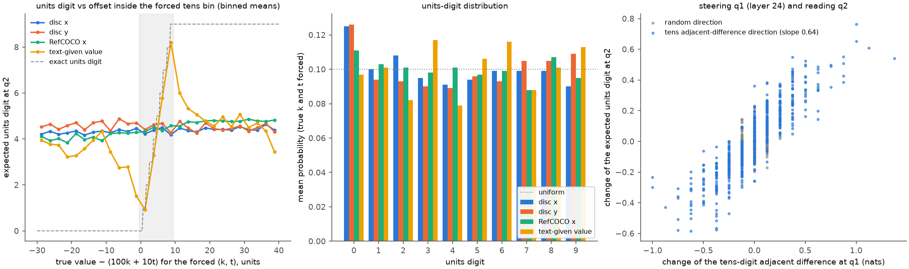

*图 11：个位数字（第三轮，模型输出与模型激活上的干预）。左：$q_2$ 的期望个位对 $x - (100k + 10t)$，其中 $t$ 为强制的第二位（取 0–9 的全部值），按 2.5 个单位分箱求均值；灰色区域为强制第二位正确的范围，灰色虚线为精确的个位。中：首位与第二位强制为真值时个位分布的平均（点线为均匀 0.1）。右：在 $q_1$ 的第 24 层沿第二位相邻差方向（蓝）或随机方向（灰）推动后，第二位相邻差的变化与期望个位的变化，每点为一个单元在一个幅度下的结果；logit 以 bfloat16 计算，变化量呈离散的条纹。颜色：蓝 disc x，橙 disc y，绿 RefCOCO x，黄 文本换算（左、中）。*

### 4.4 500 吸附：继承的犹豫与先验神经元

第一轮把 500 吸附归因于“以 500 为中心的数值先验”，证据是空白画布上强制首位为 4 时第二位为 9 的概率 $P(9 \mid 4) = 0.58$、强制为 5 时第二位为 0 的概率 $P(0 \mid 5) = 0.51$（y 为 0.91 与 0.97）。本节把它拆成可测量的机制成分。

**成分一：首位读出在 4 与 5 之间的犹豫，经相邻差传给第二位。** 首位读出在 400–600 区间内本身偏向 4 与 5：空白画布的首位分布在 x 上 4 与 5 各约 0.20，在 y 上 5 为 0.80；disc x 的 500 边界过渡宽度为 32 个单位，宽于其他边界（8–28 个单位）。强制首位为 4 时，$q_0$ 处 5 的 logit 高，$m$ 大，第二位写 9（498）；强制为 5 时 4 的 logit 高，$m$ 小，第二位写 0（500）。图 6 中 disc x 那一列 $E[t] \approx 1$ 的点正是这种样本，它们在 $E[t]$ 对 $m$ 的图上回到同一条曲线。空白画布在 $q_1$ 的行为最接近圆心位于 523（x）与 477（y）的圆盘图像（逐 $k$ 的 JS 散度平均 0.030 与 0.024，全部圆盘图像的中位数为 0.077 与 0.124）：没有图像证据时，首位读出停在中心附近，第二位照常读取它的相邻差。这也解释了第一轮中只校准首位的输出分布不能消除平台（0.89 → 0.81）：校准改变写出的首位分布，$q_1$ 读取的是 $q_0$ 的内部状态，后者没有被改变。

**成分二：按首位条件激活的 MLP 神经元。** 在 $q_1$，第 $l$ 层（$l \in \{27, \dots, 31\}$）MLP 的第 $j$ 个神经元对数字 logit 的直接贡献为

$$
\delta_{j} = \frac{a_j}{\operatorname{rms}(h)}\, P_{l,j}, \qquad P_l = W_{\mathrm{down}}^{\top}\, (g \odot W^{\top}) \in \mathbb{R}^{12288 \times 10} .
$$

其中 $a_j$ 为该神经元的中间激活（down_proj 的输入），$W_{\mathrm{down}} \in \mathbb{R}^{4096 \times 12288}$ 为该层 down_proj 的权重，$P_{l,j}$ 为 $P_l$ 的第 $j$ 行（在数字上中心化），$h$ 为该位置最后一层的 residual。先验得分取“首位正确且为 4 的样本”相对全部首位正确样本的平均激活差乘以 $P_{l,j}$ 在数字 9 上的分量，加上“首位为 5”在数字 0 上的同一量；它度量一个神经元在自然生成条件下为 498/500 贡献多少。以空白画布计算的同一得分与之相关 0.94，前 256 名中有 185 个重合。256 个神经元占 MLP 27–31 全部 61440 个神经元的 0.4%，各层 42–59 个。

**成分三：读取首位 token 的一对 head。** L32 H8 与 H10 在 $q_1$ 都把 0.84–0.95 的 attention 放在首位数字 token 本身，二者对先验数字的直接贡献方向相反：

| 输入族 | MLP 27–31 + L32 H8，“4 之后为 9”（nats，均值 ± 图像间 SD） | 其中 L32 H8 | L32 H10 |
| --- | --- | --- | --- |
| 空白画布 | 3.81 ± 0.66 | +0.39 | −2.31 |
| disc x | 1.81 ± 1.30 | +0.19 | −0.98 |
| disc y | 3.38 ± 1.48 | +0.32 | −1.73 |
| 10×10 网格 | 1.16 ± 1.45 | +0.19 | −0.53 |
| RefCOCO | 0.29 ± 0.86 | +0.06 | −0.11 |
| 文本换算 | 0.24 ± 1.04 | 0.00 | +0.01 |
| 计数 | 0.03 ± 0.50 | −0.10 | +0.11 |

“4 之后为 9”的贡献为“首位 4 时对数字 9 的直接贡献”减去“其他首位时的同一贡献”。**这一成分受输入调制。** 它在空白画布与单个圆盘上最强（1.8–3.8 nats），在网格上减半，在 RefCOCO、文本换算与计数上接近零：先验神经元是一组固定的参数，但它们的激活由输入决定，图像证据越单薄，激活越强。

**消融：去掉先验神经元消除约一半吸附，但不提高精度。** 在 $q_1$ 把选出的神经元替换为它们在全部首位正确样本上的平均激活（均值消融），并对 L32 H8、H10 做同样处理；解码按第一轮第 3.5 节的方法模拟（$q_0$ 不编辑，使用第一轮的首位分布）。

| 消融（$q_1$） | disc x 平台比例 | disc y 平台比例 | disc x 平均误差 | 空白 x $P(9 \mid 4)$ | 空白 y $P(9 \mid 4)$ | disc 第二位真值概率 x / y | 区间内斜率 x | 文本换算第二位真值概率 | RefCOCO 第二位真值概率 | 计数个位真值概率 |
| --- | --- | --- | --- | --- | --- | --- | --- | --- | --- | --- |
| 无 | 0.89 | 0.78 | 40.3 | 0.58 | 0.92 | 0.145 / 0.129 | 0.34 | 0.97 | 0.22 | 0.21 |
| L32 H8 | 0.89 | 0.78 | 40.4 | 0.55 | 0.88 | 0.143 / 0.128 | 0.32 | 0.96 | 0.22 | 0.20 |
| L32 H10 | 0.93 | 0.78 | 40.4 | 0.67 | 0.93 | 0.150 / 0.128 | 0.37 | 0.97 | 0.23 | 0.22 |
| 16 个神经元 | 0.81 | 0.70 | 38.8 | 0.41 | 0.85 | 0.143 / 0.125 | 0.33 | 0.97 | 0.22 | 0.20 |
| 64 个神经元 | 0.56 | 0.67 | 36.3 | 0.33 | 0.77 | 0.138 / 0.129 | 0.30 | 0.95 | 0.22 | 0.20 |
| 256 个神经元 | 0.44 | 0.59 | 35.0 | 0.23 | 0.54 | 0.135 / 0.129 | 0.27 | 0.90 | 0.22 | 0.19 |
| 256 个神经元 + H8 | 0.48 | 0.63 | 34.2 | 0.23 | 0.53 | 0.133 / 0.127 | 0.26 | 0.88 | 0.22 | 0.18 |
| 随机神经元（同层同数）+ H8 | 0.89 | 0.78 | 40.4 | 0.53 | 0.89 | 0.142 / 0.130 | 0.33 | 0.96 | 0.22 | 0.20 |

平台比例为真值 400–610 时模拟输出落在 480–520 的比例（disc 每轴 101 个可解码样本，其中真值在 400–610 的为 27 个），真值本身的比例为 0.19。

1. **先验神经元因果地产生了约一半的吸附。** 256 个神经元的消融把 disc x 的平台比例从 0.89 降到 0.44，空白画布上 $P(9 \mid 4)$ 由 0.58 降到 0.23；同数目的随机神经元没有效果。剩余的吸附归于成分一。
2. **去掉先验不提高精度。** 第二位真值概率与区间内斜率都没有上升（0.145 → 0.135，0.34 → 0.27）：先验与低分辨率是两个可分离的成分，低分辨率来自第 4.2 节的相邻差读法。
3. **H8 的正向贡献很小，H10 是更大的抑制项。** 单独消融 H8 几乎没有作用，消融 H10 使先验加强（空白画布 $P(9 \mid 4)$ 0.58 → 0.67，disc x 平台 0.89 → 0.93）。
4. **对其他输出的影响小但不为零。** 文本换算的第二位真值概率由 0.97 降到 0.90，RefCOCO 与计数基本不变。

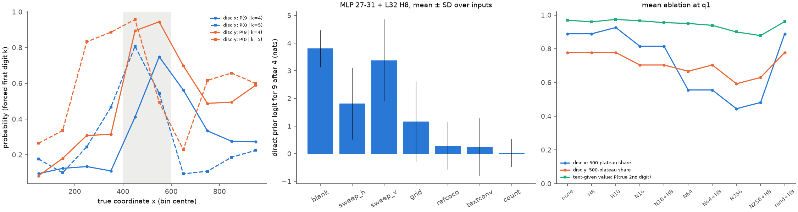

*图 12：500 吸附的三个侧面。左：圆盘 sweep 上强制首位为 4 时第二位为 9 的概率（实线圆点）与强制首位为 5 时第二位为 0 的概率（虚线方点），按真值的百位区间平均（模型输出）；灰色区域为 400–600。中：MLP 27–31 与 L32 H8 对“4 之后为 9”的直接 logit 贡献（第一轮 DLA，模型激活，均值 ± 输入间 SD）。右：$q_1$ 均值消融下的 500 平台比例（蓝 disc x，橙 disc y）与文本换算的第二位真值概率（绿），解码为以第一轮 $q_0$ 分布进行的模拟。*

## 5. 讨论

### 5.1 读出机制

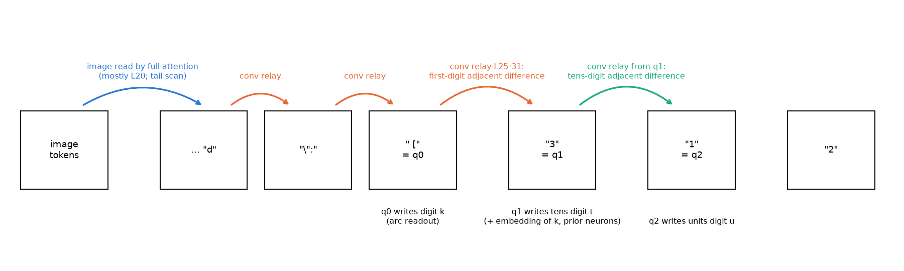

*图 13：坐标数字的逐位读出链（示意图，非数据；每个箭头对应正文中一项因果测量）。蓝：full attention 对图像的读取；橙与绿：Gated DeltaNet 短卷积在相邻 token 之间的传递。*

综合三轮实验，Qwen3.5 写出一个三位坐标的过程如下（图 13）。

1. 图像在答案前缀末尾的两三个 token 处由 full attention 读入（层 20 为主，L20 H11 是主要的读取 head），结果经短卷积逐 token 传到 $q_0$（第 4.1 节）。
2. $q_0$ 的后层把坐标转成首位 logit。logit 轨迹是转不满一圈的圆弧，首位因此分带（第 4.1 节）。
3. $q_1$ 以首位 token 的 embedding 为条件，经第 25–31 层的短卷积读取 $q_0$ 首位读出的相邻差 $m$，写出第二位；MLP 27–31 中的先验神经元在 500 附近叠加偏向（第 4.2、4.4 节）。
4. $q_2$ 经短卷积读取 $q_1$ 第二位读出的相邻差，写出个位（第 4.3 节）。

缺陷在这条链上的位置是：首位的边界偏移（第一轮的压缩）来自第 2 步；第二位分辨率低，是因为第 3 步读取的 $m$ 只有 25–42 个单位的精度；个位均匀，是因为第 4 步读取的来源已不含坐标信息；500 吸附来自第 2 步在 4 与 5 之间的犹豫经第 3 步传递，以及第 3 步的先验神经元。

**解释（非测量结论）。** “读上一位置的相邻差”可以看成模型实现第一轮理论中“以首位为条件读出组内偏移”的一种廉价方式：它不需要在 $q_1$ 重新计算 $x - 100k$，只需要把 $k$ 两侧数字的 logit 相减。代价是第二位的精度被首位读出的精度所限，个位的精度又被第二位读出所限，精度逐位递减。

### 5.2 参数还是结构

**缺陷属于参数（训练）问题，确定程度高。** 实验 3.13 以 3200 条精确坐标样本、LoRA 训练全部线性层 200 步后，单个红色圆的平均中心误差由 51.5 降到 1.7 个单位，第二位增益由 0.34 升到 0.99，逐位格式与短卷积都保持原样。3.13 按本文的定义重算回归：真实偏移对 $E[t]$ 的 $R^2$ 由 0.26 升到 1.00，相邻差的 $R^2$ 保持在 0.80（原模型 0.82）。这说明训练后第二位很可能仍沿相邻差接力，但首位读出的相邻差本身变得随偏移精确变化。

**结构决定失败的形式。** 第一，逐位 tokenization 把数值分布分解为 $P(k)\, P(t \mid k)\, P(u \mid k, t)$，任何以 500 为中心的偏向都只能表现为“4 之后偏向 9、5 之后偏向 0”，这是 498/500 双峰的形式来源。第二，短卷积提供了从上一 token 后层状态到当前 token 的低成本通道，使“读上一位置的相邻差”易于学到，并使精度逐位传递。这两点没有阻止精确读出：同一模型对文本数值写出精确的第二位与个位，训练后的模型对图像坐标也能做到。

**训练位置与机理位置。** 第二轮曾据机理预测，需要改变的参数位于第 25–32 层的 MLP 与 DeltaNet 输入投影。3.13 的结果表明，只训练第 28–32 层 MLP 几乎无效（误差 44.6），训练第 25–32 层 MLP 与 DeltaNet 输入投影也只降到 36.0，而训练参数量相同的第 10–14 层 MLP 降到 19.1。结合本文第 4.2 节：精度丢失在“坐标表示 → 首位 logit 相邻差”这一步，相邻差的散布可能源自上游送入读出电路的坐标编码；改变上游编码可以让后续二十余层共同提高相邻差的精度。这一解释与 3.13 的“训练后 $m$ 变精确”一致，但上游编码中哪一部分造成散布尚未测量。

### 5.3 与其他实验的一致与冲突

1. **与第一轮。** 一致：读出端是瓶颈，信息在 $q_1$ 可线性读出。修订：第一轮把第二位描述为“按组内偏移计算、增益约三分之一”，本文把增益分解为两段斜率之积，并指出 $q_1$ 读取的是相邻差而非坐标表示；第一轮所说的“中心先验”由两种成分组成（第 4.4 节）。第一轮第 3.8 节所列 $q_1$ 处的线性可读性，在本文中对应于“$q_1$ 的状态含有坐标信息，但读出不使用它”。
2. **与 3.11（坐标信息流）。** 一致：层 20 是图像读取的主要层，L20 H11 是主要 head。细化：读取发生在 $q_0$ 之前的两三个 token；第二位与个位步骤上图像读取的因果作用接近零，3.11 “每个数值都在层 20 重读图像”只适用于每个数值的首位。3.11 报告的 L32 H10 恒为负、H8 为正，在本文中对应为一对读取首位 token、作用相反的 head。
3. **与 3.10、3.14（DeltaNet 的作用）。** 一致：DeltaNet 层在 Qwen3.5 的位置计算中承担传递作用。3.10 的作用位于图像 token 内的 recurrent 计数，本文的作用位于答案 token 之间的短卷积；3.14 指出 Qwen3-VL（无 DeltaNet）没有行列载体的不对称，本文的相邻差接力同样依赖短卷积这一 Qwen3.5 特有的结构。
4. **与 3.6 第二轮。** 3.6 指出坐标方向几乎不在数字 unembedding 张成的空间内；本文表明 unembedding 读到的是坐标流形的一个二维投影（圆弧），并且 steering 沿数字 unembedding 方向推动时能改变相邻差而不触及坐标表示。
5. **与 3.13。** 一致：缺陷可由精确数据训练消除；训练后相邻差的解释力保持。冲突：第二轮关于训练位置的预测不成立（第 5.2 节）。
6. **与 1.7（思维链中的读图）。** 1.7 报告 think 提示下模型在思维链生成中重新读取图像 key/value；本文全部为 direct-answer 提示，数字之间不重读图像。两者不矛盾：重读发生在思维链的文本 token 上，本文研究的是连续写出的数字 token。

## 6. 限制

1. **patching、steering 与通道阻断只在单个红色圆盘上进行。** RefCOCO 的图像尺寸不同，无法按位置配对；RefCOCO 上的结论来自回归、个位分布与消融。
2. **相邻差散布的来源未定位。** 本文确定第二位的精度受 $m$ 的图像间散布所限，但没有分解这一散布来自哪些层或哪些上游编码。
3. **个位的 steering 幅度较小**（第二位相邻差平均只改变 0.22 nats），斜率 0.64 作为支持性证据。
4. **消融以单步模拟解码评估**，$q_0$ 不编辑；神经元按直接贡献选出，间接效应未计入。
5. **20×20 网格未分析。** 第一轮报告的 20×20 网格右偏一列，本文的实验没有覆盖。
6. **强制数字的输入不在训练分布内。** 强制第二位偏离真值的个位测量只说明计算类型。

## 7. 产物

第二轮产物位于 WORK_DIR 的 `analysis/position/2026-10-21_digit_failure_r2/`：`weights.npz`（数字 unembedding、最终 norm 增益与逐神经元、逐 head 的数字投影）、`patch.jsonl`、`tail.jsonl`、`attn.jsonl`、`capture.jsonl` 与 `features/capture/`（$q_1$ 激活）、`ablation_plan.npz`、`ablate.jsonl`、`steer.jsonl`、`round1_compact.npz`（从第一轮分片中抽取的数组）、`results.json`、`arrays.npz`、`experiment.json`。程序为 `analysis_tools/position/digit_failure_r2.py`（GPU 阶段）、`digit_failure_r2_analysis.py`（CPU 分析与神经元选择）与 `digit_failure_r2_figures.py`（作图），入口为 `scripts/analysis/position/digit_failure_r2.sh`，测试为 `tests/analysis/position/test_digit_failure_r2.py`。

第三轮产物位于 WORK_DIR 的 `analysis/position/2026-11-03_digit_failure_r3/`：`units.jsonl`（个位读出与 $q_1$ steering）、`relay.jsonl`（通道阻断）、`patch3.jsonl`（$q_2$ patching）、`results_r3.json`（含角度统计、相邻差两段斜率的分解与上述三项的汇总）、`arrays_r3.npz`、`experiment.json`。程序为 `analysis_tools/position/digit_failure_r3.py`（GPU 阶段）与 `digit_failure_r3_analysis.py`（CPU 分析与图 1、2、7、9、11、13），入口为 `scripts/analysis/position/digit_failure_r3.sh`（`STAGES=analysis` 运行 CPU 部分），测试为 `tests/analysis/position/test_digit_failure_r3.py`。
