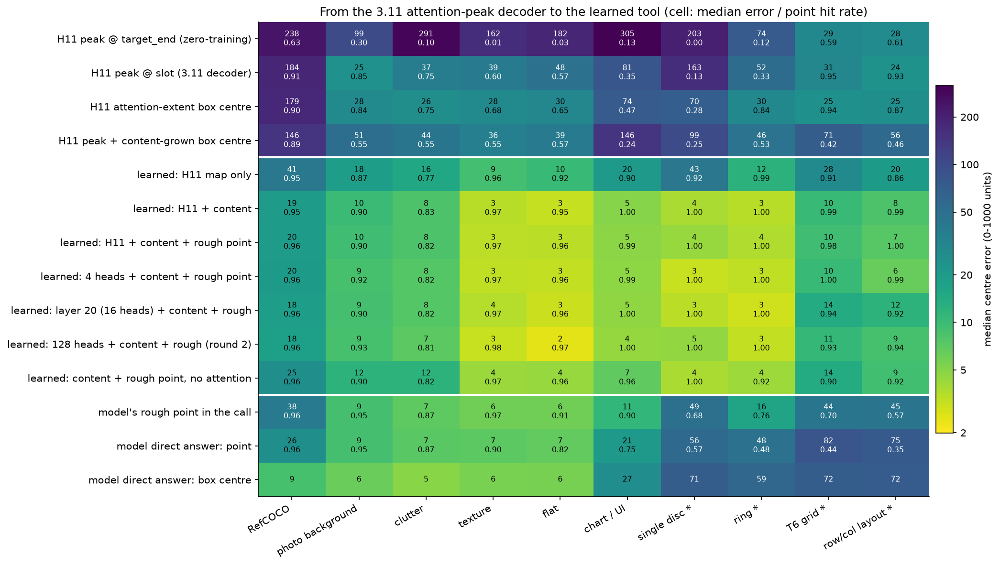
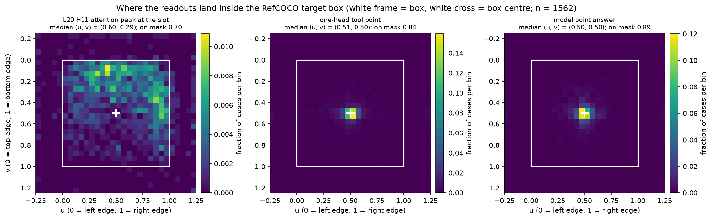
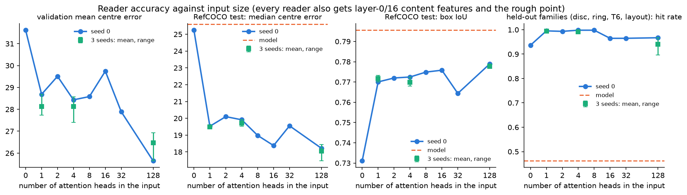
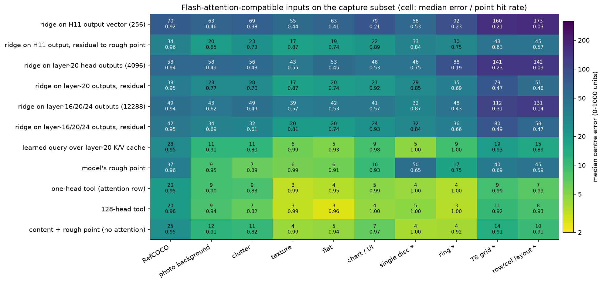
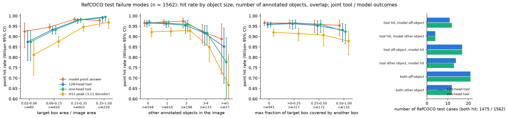
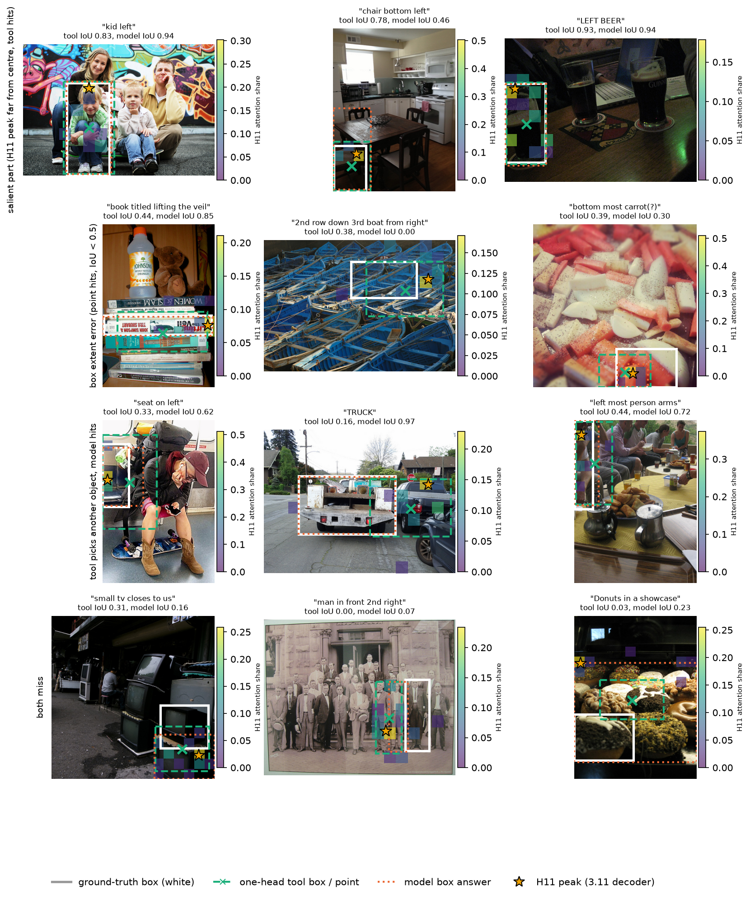
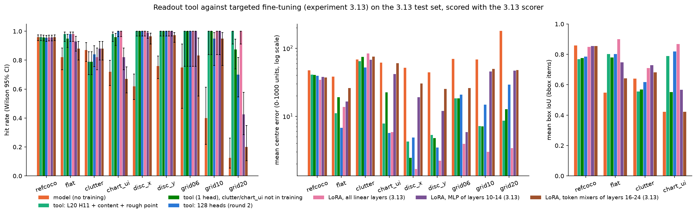

# 实验 3.9 第三轮：单 head 坐标读出工具、自然图像的失败模式与定向微调的比较

设计见[坐标读出工具设计文档第 11 节](design_readout_tool.md)，第二轮结果见[实验 3.9 第二轮结果](results_2026-10-20_readout_tool_r2.md)。相关实验为[实验 3.11 坐标读出的信息流](results_2026-10-20_coordinate_flow.md)、实验 3.11 第二轮（自然图像的读取 head，见共享记录）、实验 3.12 第二轮（数位读出）与实验 3.13（定向微调）。模型为 Qwen3.5-9B，bfloat16，thinking off，问题均为只输出答案或工具调用的格式。

## 通俗讲述

模型写坐标时，会在第 20 层用一个 attention head（L20 H11）“看向”目标。实验 3.11 直接取这个 head 注意力最强的位置当答案：在网格上它比模型自己写的坐标准得多，在自然照片上却差得多，因为它常常落在人的头部、物体的上沿或边缘，而题目要的是物体框的中心。第二轮的工具在同一时刻读取全部 128 个 head 的注意力，再用一个小卷积网络学习如何把这些注意力和图像 token 的内容特征合成点与框，在照片上与模型持平。两者看起来像是同一件事，本轮要回答它们到底差在哪里，以及工具能否只用工业上负担得起的输入。

我们把 3.11 的读法一步一步改成工具的读法，每改一步测一次误差（读出阶梯）。结果很清楚：读取时刻必须是“下一个 token 就是坐标数字”的那一刻，换成目标描述的末尾会全面失效；在这一时刻，单个 H11 已经指向了正确的物体（RefCOCO 上峰值落在目标框内的比例为 0.91），但它指的是物体的一个显著部位，峰值在框内的中位位置是水平 0.60、垂直 0.29，离框中心的中位距离为 184 个单位（0–1000 坐标）。从“指向一个部位”到“给出物体中心与边框”，缺的是物体的范围；范围来自图像 token 的内容特征，而且必须学习得到。用阈值或内容相似度生长区域这类不训练的规则只能把中位误差降到 146，框的 IoU 只有 0.32；让卷积读出器只看 H11 的注意力，中位误差降到 41；再给它内容特征，降到 19，与 128 个 head 的工具（18）几乎相同。也就是说，自然图像与合成图像需要的差别在“内容特征提供的范围”，与 head 的数量无关。

由此得到一个工业上可行的工具：只取一个 head 在一个位置上的注意力行（由 KV cache 中的 key 与该位置的 query 直接算出，不改变 flash attention 的计算），加上两层图像 token 的 64 维内容投影和模型自己写的粗略坐标。三个训练种子下，它在 RefCOCO 上的命中率为 0.957–0.960、中位误差 19.5，比 128 个 head 的工具只差约 1–2 个单位与 0.007 的 IoU；在训练中没有见过的四类合成图像（单个圆、圆环、T6 网格、行列布局）上，它反而更好（命中率 0.992–0.997 对 0.896–0.967）。输入越多，读出器越容易拟合训练图像族中其他 head 的特定模式，到了没见过的布局上就会出错。实验 3.11 第二轮发现自然图像上另有两组读取物体左上边缘与右下边缘的 head；把它们加入工具后，在只读 attention 时确有帮助（RefCOCO 中位误差 41 → 30），但在已有内容特征时不再改进，并且同样损害对没见过布局的泛化，所以单个 H11 仍是最合适的输入。我们还发现，在工具读取的这一时刻，这些边缘 head 只读出了物体的左右边，上下边要到模型写 y 坐标时才读出。

在自然图像上，工具的失败主要来自小物体、拥挤场景与选择错误。约一半的未命中样本模型自己也答错，属于从模型继承的选择错误；另一半是工具独有的错误，其中约一半是 H11 的注意力本身落在别的物体上，另一半是读出器把正确的峰值聚合到了相邻物体上。框的大小在命中样本中基本无偏（面积比的中位数为 1.00），过小一半或过大一倍的比例各约 2%。

最后，我们把工具放到实验 3.13 的测试集上，与同一批题目上的微调模型比较。结论是：用约 3,200 条精确坐标样本、约半小时 LoRA 微调全部线性层的模型（实验 3.13），在命中率上与工具持平或更好，在误差与框的 IoU 上普遍更好，而且推理时不需要任何额外计算；工具只在没有改动模型权重的约束下才有优势。两者的共同结论是，模型的坐标读出缺陷来自参数与训练数据，而非架构本身无法表达精确位置：同一时刻的 attention 已经指向了正确的位置，只要少量数据就能让模型自己把它写准。

## 1. 问题与结论

本轮回答四个问题，结论先列出，各节给出证据。

1. **工具与 3.11 读出的区别。** 两者读取同一个信号（坐标数字之前那一刻的 L20 H11 注意力），区别在于读出方式与输入：3.11 取峰值（零训练、只给点），工具学习聚合并使用内容特征（给出点与框）。在 RefCOCO 上，峰值 → 学习聚合把中位误差由 184 降到 41，加入内容特征再降到 19；在合成网格上峰值本身已接近目标（中位 24–31），学习聚合与内容特征把它降到 7–10（第 3 节，图 1、图 2）。
2. **输入规模。** 一个 head（L20 H11）加内容特征与粗略坐标即可达到 128 个 head 的精度，并且对训练中未见的图像族泛化更好；完全不用 attention 的读出器在 RefCOCO 上中位误差 25、框 IoU 0.73，差距主要在边框（第 4 节，图 3）。head 的输出向量（o_proj 输入）线性读出不到精确位置（RefCOCO 中位误差 70）；在层 20 K/V cache 上学习一个 query 可以接近一 head 工具（验证误差 30.6 对 28.1），但泛化不如直接借用 H11 的 query（第 4.3 节，图 6）。按实验 3.11 第二轮加入边缘读取 head（H11 + 4 个或 11 个边缘 head）在有内容特征时不再降低 RefCOCO 误差（19.3 与 18.5 对 19.5），且降低未见网格族的命中率（第 4.4 节）。
3. **失败模式。** RefCOCO 上的未命中集中于面积不足图像 6% 的小物体（命中率 0.88，模型 0.93）与含 5 个以上同类标注物体的图像（0.78，模型 0.89）；约一半未命中由模型继承，另一半是工具独有的选择或聚合错误；框范围误差少见。范围通道与一致性回退两项改进都没有带来收益（第 5 节，图 4、图 5）。
4. **与定向微调的比较。** 在 3.13 测试集（997 次调用，按 3.13 的评分器计分）上，一 head 工具与 LoRA 全部线性层微调的命中率在所有分组上无显著差异，但工具的平均误差在 RefCOCO（+6.8，$p = 0.009$）、单个圆（+2.6 与 +3.1）与网格（+4.2 至 +14.4）上更大，框 IoU 在 RefCOCO 上更低（0.77 对 0.85）；工具优于 3.13 中只调局部层的条件（MLP 10–14、token mixer 16–24、MLP 28–32），微调的训练墙钟时间为 12–65 分钟（3.13 训练日志，2 张 A800 切分加载）（第 7 节，图 7）。

**总体判断。** 若允许改动模型权重，定向微调是更好的方案：命中率不低于工具，误差与框更好，推理零额外开销，且在 POPE 与 TextVQA 上没有观察到通用能力下降（3.13 中间结果）。工具的价值在于两点：其一，它是一个诊断工具，证明 slot 时刻一个 head 的 attention 已携带精确的选择与位置信息，模型读出缺陷是参数与训练数据问题；其二，在不能改动权重的部署中，它以一次 KV cache 点积、两层 64 维内容投影与约 35 万参数的读出器，换来网格、图表与单个圆上的大幅改进。工具同样依赖训练数据的覆盖（nocc 变体），并不比微调更通用。

## 2. 设计与执行

1. **数据。** 读出器全部在第二轮采集的特征上训练与评估（训练 15,471、验证 1,378、测试 9,435 个样本，含 RefCOCO 测试 1,562 条），训练流程、损失、数据增广与按验证集选 epoch 的规则与第二轮相同。读出器之间只改变输入。
2. **读出器。** 共 20 个输入配置，k1、k4 与 128-head 配置各 3 个种子；另有去掉 clutter 与 chart_ui 训练场景的 3 个变体（nocc）。零训练读出 7 种（含第 4.4 节的边缘对解码）。
3. **RefCOCO 标注。** 从 RefCOCO parquet 中取得每条测试记录的分割多边形，并按 COCO 图像号收集同一图像中其他 RefCOCO 标注物体的框（中位数 1 个，最多 6 个）。
4. **新采集。** 实验 3.13 测试集 997 次工具调用的特征（第 7 节）；flash 兼容输入的子集采集（第 4.3 节）。
5. **GPU 用量。** 读出器训练约 6 GPU 小时（单进程 < 4 GB，共 25 个读出器）；子集 head 输出采集约 2.3 GPU 小时（含一次重启）；3.13 测试集特征采集约 0.2 GPU 小时；其余分析在 CPU 上完成。全部使用 GPU 2–7。

## 3. 工具与 3.11 读出的区别

### 3.1 读出阶梯

*图 1：从 3.11 的峰值解码到学习得到的工具。每个格子上行为测试集上的中位中心误差（0–1000 单位，颜色为其对数，黄色为低误差），下行为点命中率（点落在真值框内；网格为目标单元，单个圆为圆内）。前四行为零训练读出，由模型在 slot（或 target_end）处的 attention 权重与内容特征直接计算；中间七行为在同一训练集上拟合的卷积读出器（拟合方式见第 2 节）；最后三行为模型自己的输出。带星号的列为读出器训练中没有出现过的图像族。*

表 1 列出 RefCOCO 测试集（1,562 条）上的阶梯。

| 读出 | 读取位置 | head | 读出方式 | 命中 | 中位误差 | 平均误差 | 框 IoU |
| --- | --- | --- | --- | --- | --- | --- | --- |
| 峰值 3×3 中心 | target_end | H11 | 零训练 | 0.627 | 238 | 271 | — |
| 峰值 3×3 中心（3.11） | slot | H11 | 零训练 | 0.914 | 184 | 205 | — |
| attention 范围框中心 | slot | H11 | 零训练（阈值 0.05×峰值） | 0.905 | 179 | 196 | 0.18 |
| 内容生长框中心 | slot | H11 | 零训练（余弦阈值 0.3） | 0.888 | 146 | 166 | 0.32 |
| 卷积读出器 | slot | H11 | 学习，只用 attention | 0.953 | 41 | 63 | 0.66 |
| 卷积读出器 | slot | H11 | 学习，+ 内容 | 0.952 | 19 | 42 | 0.77 |
| 卷积读出器（一 head 工具） | slot | H11 | 学习，+ 内容 + 粗略坐标 | 0.958 | 20 | 42 | 0.77 |
| 卷积读出器（第二轮工具） | slot | 128 个 | 学习，+ 内容 + 粗略坐标 | 0.956 | 18 | 40 | 0.78 |
| 模型点答案 | — | — | — | 0.964 | 26 | 54 | — |
| 模型框答案 | — | — | — | — | 9（框中心） | — | 0.80 |

**读取位置决定 attention 是否处于“读坐标”的状态。** 解释：同一个 H11、同一种峰值解码，在 target_end 处 RefCOCO 命中率为 0.627，在合成图像族上为 0.00–0.61，在 slot 处升到 0.914（合成网格 0.93–0.95）。slot 是下一个 token 为坐标首位数字的位置，与 3.11 测量的位置功能相同；3.11 已测得这一时刻 L16–24 的数字 query 把 0.65–0.78 的 attention 放在图像上。工具与 3.11 的第一项共同点因此是读取位置，第二轮把读取位置从 target_end 移到 slot 也是当时最大的单项改进。

**在 slot 处，H11 指向正确的物体，但指向的是物体的显著部位。** 解释：峰值落在目标框内的比例为 0.914，落在目标分割 mask 上的比例为 0.70；但峰值离框中心的中位距离为 184 个单位。图 2 显示峰值在框内的分布集中在上部（垂直位置中位数 0.29）与右缘（水平位置的密度在 0.9–1.0 处形成一条带），在人物（RefCOCO testA）与物体（testB）上相同（垂直中位数 0.29 对 0.29）。这与 3.11 第二轮的结论一致：RefCOCO 上 H11 读取的横坐标靠近中心而纵坐标靠近上边（回归系数 0.92/0.10），另有一批 head 专门读取最小边或最大边。3.11 所称“峰值落在醒目部位”在这里得到量化：它是一个系统性的上沿与边缘偏置，而非随机误差。

*图 2：RefCOCO 测试集上三种读出在目标框内的归一化位置 $(u, v)$ 的二维直方图（色标为每个格子中的样本比例）。白框为目标框，白色十字为框中心。左：slot 处 L20 H11 attention 的峰值 3×3 中心（由模型 attention 权重直接计算）；中：一 head 工具（卷积读出器，按第 2 节拟合）的点；右：模型直接回答的点。“on mask”为点所在 token 单元被分割 mask 覆盖至少一半的比例。*

**从部位到中心与边框需要物体范围，而范围必须从内容特征中学习。** 解释：两种零训练的范围规则都不够。attention 阈值区域只覆盖物体的少数 token（框 IoU 0.18）；从峰值出发、按内容相似度生长的区域在自然图像上把 IoU 提高到 0.32，但在合成网格上反而把误差由 24–31 增大到 56–71，因为重复实例的内容彼此相似，区域会越过目标蔓延到邻居。学习得到的读出器只看 H11 的 attention 已把 RefCOCO 中位误差降到 41（它学到了“峰值偏上，中心应向下修正”这类统计规律），加入内容特征后降到 19、IoU 0.77；在合成图像族上，加入内容特征也把中位误差由 9–43 降到 3–10。解释性判断：H11 的 attention 回答“是哪个物体”，内容特征回答“这个物体占多大”，前者在两类图像上相同，后者只有在物体大于一个 token 时才重要，这就是 3.11 的峰值在网格上足够、在照片上不够的原因。

**3.11 第二轮的边缘读取 head 不能以零训练的方式给出框。** 解释：把最小边 head L24 H7 与最大边 head L24 H5 的峰值当作框的两个角，RefCOCO 框中心的中位误差为 91（优于 H11 峰值的 184），但 IoU 只有 0.17；在单个圆与圆环上它的命中率为 0.99 与 0.96，远高于 H11 峰值（0.13 与 0.33），在网格上则低于 H11（0.47–0.57）。在 slot 处这些 head 只精确读出横向边缘，纵向角点停在框的中部（第 4.4 节）；把它们作为读出器的输入（edge3：H11、L24 H7、L24 H5）与只用 H11 的精度相同（验证集平均误差 28.2 对 28.1）。

### 3.2 四个维度的归纳

| 维度 | 3.11 读出 | 第二轮工具 | 本轮结论 |
| --- | --- | --- | --- |
| 读取位置 | 首位数字之前（直接作答） | 首位数字之前（工具调用） | 功能相同；target_end 不可用 |
| head | L20 H11 | 128 个 | 1 个即可（第 4 节） |
| 读出方式 | 峰值，零训练 | 学习聚合 | 自然图像上贡献最大（184 → 41） |
| 输出与输入 | 点；只用 attention | 点与框；加内容特征 | 内容特征提供范围（41 → 19，IoU 0.66 → 0.77） |

## 4. 输入规模

### 4.1 head 数量

*图 3：读出器精度与输入 head 数量的关系，所有读出器都同时输入层 0/16 的内容特征与粗略坐标。蓝线为种子 0；绿色方块为 3 个训练种子的均值，误差棒为最小值到最大值；橙色虚线为模型直接回答。0 个 head 即只用内容与粗略坐标。四幅图依次为验证集平均中心误差、RefCOCO 测试中位误差、RefCOCO 框 IoU、训练中未见的四个图像族的平均命中率。数值均来自按第 2 节拟合的读出器在测试集上的预测。*

| 输入 | head 数 | 验证集平均误差 | RefCOCO 命中 / 中位 / IoU | 未见图像族命中（圆、圆环、T6、布局） | clutter 命中 | photo_bg 命中 |
| --- | --- | --- | --- | --- | --- | --- |
| 内容 + 粗略坐标 | 0 | 31.6 | 0.958 / 25.2 / 0.73 | 1.00 / 0.92 / 0.90 / 0.92 | 0.82 | 0.90 |
| L20 H11 | 1 | 28.1（27.7–28.7） | 0.958 / 19.5 / 0.77 | 1.00 / 1.00 / 0.98 / 1.00 | 0.82 | 0.90 |
| + L16 H0 | 2 | 29.5 | 0.957 / 20.1 / 0.77 | 1.00 / 1.00 / 0.99 / 0.98 | 0.80 | 0.91 |
| 因果作用最大的 4 个 | 4 | 28.1（27.4–28.6） | 0.958 / 19.9 / 0.77 | 1.00 / 1.00 / 1.00 / 0.99 | 0.82 | 0.92 |
| 中心与边缘 head（edge3） | 3 | 28.2 | 0.958 / 19.8 / 0.77 | 1.00 / 1.00 / 0.97 / 0.95 | 0.82 | 0.91 |
| 零训练误差最低的 4 个 | 4 | 28.3 | 0.960 / 18.2 / 0.78 | 1.00 / 1.00 / 0.97 / 0.93 | 0.82 | 0.92 |
| 8 个 | 8 | 28.6 | 0.958 / 19.0 / 0.77 | 1.00 / 1.00 / 1.00 / 0.99 | 0.82 | 0.90 |
| 层 20 全部 | 16 | 29.7 | 0.959 / 18.4 / 0.78 | 1.00 / 1.00 / 0.94 / 0.92 | 0.83 | 0.90 |
| 层 16 与 20 全部 | 32 | 27.9 | 0.954 / 19.6 / 0.76 | 1.00 / 1.00 / 0.95 / 0.91 | 0.82 | 0.92 |
| 全部 | 128 | 26.5（25.6–26.9） | 0.956 / 18.2 / 0.78 | 1.00 / 1.00 / 0.93 / 0.94 | 0.81 | 0.93 |
| 模型直接回答 | — | — | 0.964 / 25.6 / 0.80 | 0.57 / 0.48 / 0.44 / 0.35 | 0.87 | 0.95 |

括号内为 3 个种子的范围，其余为种子 0。

**一个 head 已经包含工具所需的 attention 信息。** 解释：从 0 个 head 到 1 个 head，验证集误差由 31.6 降到 28.1，RefCOCO 中位误差由 25 降到 19.5，框 IoU 由 0.73 升到 0.77；再增加到 128 个 head，验证集误差只再降 1.6，RefCOCO 中位误差降 1.3，IoU 升 0.007，而这些差异与种子之间的波动同一量级（128 head 的 3 个种子验证误差为 25.6–26.9）。与 3.11 的因果测量一致：合成图像上 H11 是唯一的主读 head；自然图像上读取虽然分散到层 20 与 24 的多个 head，但工具同时拥有内容特征与模型自己的粗略坐标，其余 head 的信息大部分已被这两项覆盖。

**head 越多，对未见图像族的泛化越差。** 解释：在 T6 网格与行列布局上，一 head 工具 3 个种子的命中率为 0.98–0.99 与 0.98–1.00，128 head 工具为 0.85–0.93 与 0.73–0.94，种子 0 上的配对差异显著（行列布局 McNemar $p = 10^{-23}$，平均误差差 −4.2 [−5.4, −3.0]）。层 20 全部 16 个 head 的配置在这两族上也已降到 0.94 与 0.92。这些图像族不在训练集中，读出器在训练族上学到的“其他 head 的 attention 模式与目标位置的关系”在新布局上不再成立；H11 的指向在各族之间稳定，因而是更通用的输入（解释性判断，依据 3.11 中 H11 在合成图像上近似唯一的读取作用与本表的种子重复）。

**完全不用 attention 时，点的精度只略有下降，框明显变差。** 解释：内容 + 粗略坐标的读出器在 RefCOCO 上命中率与一 head 工具相同，但中位误差 25 对 19.5、IoU 0.73 对 0.77，在 T6 网格上命中率 0.90 对 0.98。粗略坐标告诉读出器“大约在哪里”，内容特征可以据此找到物体，但在多个相似物体并列或物体范围模糊时，H11 的指向才能消除歧义。

### 4.2 部署成本

成本按一次调用、1024 个 visual token、序列长度 1300 计。

| 输入 | 需要接触的层 | attention 行的计算 | 内容投影 | 读出器 | 合计 | 额外存储（fp16） |
| --- | --- | --- | --- | --- | --- | --- |
| 内容 + 粗略坐标 | 层 0、16 的 visual token 状态 | 0 | 1.07 GFLOPs | 0.74 GFLOPs | 1.81 GFLOPs | 256 KB |
| 一 head 工具 | 同上 + 层 20 的一个 head | 0.67 MFLOPs | 1.07 GFLOPs | 0.71 GFLOPs | 1.78 GFLOPs | 258 KB |
| 4 个 head | 同上 + 层 20、24、32 | 2.7 MFLOPs | 1.07 GFLOPs | 0.71 GFLOPs | 1.79 GFLOPs | 264 KB |
| 128 个 head | 全部 8 个 full-attention 层 | 85 MFLOPs | 1.07 GFLOPs | 0.74 GFLOPs | 1.90 GFLOPs | 512 KB |
| 参照：生成一个 token | — | — | — | — | 约 18 GFLOPs | — |

**一 head 工具的工程代价是一次 256 维点积扫过 KV cache 中一个 KV head 的 key。** 解释：attention 行可以在模型写出 slot 之后，用 slot 在层 20 的 query 与 KV cache 中 H11 所属 KV head 的 key 单独计算，不需要修改或替换 flash attention 的前向 kernel，也不需要保存任何 attention 矩阵；128 head 的版本需要在 8 个层都做这件事。计算量上两者都远小于生成一个 token，部署上的差别在于需要钩住的层数。三项输入中真正的固定开销是内容投影：prefill 时要把层 0 与层 16 的 visual token 状态投影到 64 维并保存；只保留层 16 的投影（k4_c16 配置）会使验证误差由 28.0 升到 29.8。

### 4.3 与 flash attention 完全兼容的输入

第 4.2 节的 attention 行已经可以由 KV cache 与 slot 的 query 直接算出。本节进一步检验两类完全不需要 attention 权重的输入：一类是层 20 attention 的输出向量（o_proj 的输入），另一类是在层 20 的 K/V cache 上学习一个 query。两者都只使用 flash attention 前向计算中本来就存在的张量。

1. **采集。** 从第二轮的训练、验证与测试样本中抽取子集（训练 8,000、验证 600、测试每个图像族至多 150、RefCOCO 600，共 10,700 条），重跑一次与第二轮相同的 prefill，在 slot 处记录层 16、20、24 的 o_proj 输入 $o \in \mathbb{R}^{3 \times 4096}$（每层 16 个 head、每个 head 256 维），以及层 20 中 H11 所属 KV head 在全部 visual token 上的 pre-RoPE key 与 value $K, V \in \mathbb{R}^{N_v \times 256}$，其中 $N_v$ 为 visual token 数。
2. **head 输出向量的线性读出。** 以 ridge 回归把 $o$ 的一部分映射到点与框的 6 个坐标，正则系数在验证集上选择；"残差"版本回归的是真值与模型粗略坐标之差。
3. **K/V cache 上的学习 query。** 沿用第二轮的 query pointer：以 slot 在层 20 的 hidden state 经一个线性层生成 query，与每个 visual token 的 $[K; V]$ 投影做点积得到指针分布，再由指针加权的特征回归亚 token 偏移与框边，共约 39 万个参数，训练与选 epoch 的规则与卷积读出器相同。

表 4.3 列出子集测试样本上的结果（每格为点命中率 / 中位中心误差，0–1000 单位）。

| 读出 | 验证集平均误差 | RefCOCO | photo_bg | clutter | T6 | 行列布局 | 单个圆 |
| --- | --- | --- | --- | --- | --- | --- | --- |
| ridge：H11 输出（256 维） | 83.4 | 0.92 / 70 | 0.46 / 63 | 0.38 / 69 | 0.21 / 160 | 0.03 / 173 | 0.53 / 58 |
| ridge：H11 输出，残差 | 44.5 | 0.96 / 34 | 0.85 / 20 | 0.73 / 23 | 0.63 / 48 | 0.57 / 45 | 0.84 / 33 |
| ridge：层 20 全部输出（4096 维），残差 | 45.6 | 0.95 / 39 | 0.77 / 28 | 0.70 / 28 | 0.47 / 79 | 0.48 / 51 | 0.85 / 29 |
| ridge：层 16/20/24 输出（12288 维），残差 | 49.3 | 0.95 / 42 | 0.69 / 34 | 0.61 / 32 | 0.49 / 80 | 0.47 / 58 | 0.84 / 32 |
| 学习 query，层 20 K/V cache | 30.6 | 0.95 / 28 | 0.91 / 11 | 0.80 / 11 | 0.93 / 19 | 0.89 / 15 | 1.00 / 5 |
| 模型粗略坐标 | 41.0 | 0.96 / 37 | 0.95 / 9 | 0.89 / 7 | 0.69 / 40 | 0.59 / 45 | 0.65 / 50 |
| 一 head 工具（attention 行 + 内容 + 粗略坐标） | 28.1 | 0.95 / 20 | 0.90 / 9 | 0.83 / 9 | 0.99 / 9 | 0.99 / 7 | 1.00 / 4 |
| 内容 + 粗略坐标（无 attention） | 31.6 | 0.95 / 25 | 0.91 / 12 | 0.82 / 11 | 0.91 / 14 | 0.91 / 10 | 1.00 / 4 |

*图 6：flash attention 兼容输入在采集子集测试样本上的结果（格内上行为中位中心误差，下行为点命中率；颜色为误差的对数）。ridge 与学习 query 均在子集训练样本上拟合、按验证集选择正则系数或 epoch；最后三行为在全部第二轮训练集上拟合的卷积读出器在同一批样本上的预测。带星号的列为训练中未出现的图像族。*

**head 的输出向量不保存精确位置。** 解释：直接从 H11 的 256 维输出向量线性回归坐标，RefCOCO 中位误差为 70、行列布局命中率 0.03；把输入扩大到 3 层共 12,288 维也只有 42–49 的验证误差，残差版本最多比模型自己的粗略坐标（验证 41.0）差 3.5–8.3。attention 输出是 value 向量的加权和，位置只体现在“权重落在哪些 token 上”，加权和之后，token 的身份只能通过 value 中残留的位置编码间接恢复，线性读出得不到精确坐标（解释）。这与第二轮的结果一致：slot 处的 hidden state 读出也没有超过模型的粗略坐标。

**在 K/V cache 上学习一个 query，可以得到与一 head 工具接近的精度，但不如它通用。** 解释：学习 query 的验证误差为 30.6，介于一 head 工具（28.1）与无 attention 读出器（31.6）之间，RefCOCO 中位误差 28、T6 与行列布局命中率 0.93 与 0.89。学习 query 自己承担了“从 slot 状态决定看哪里”的工作，而一 head 工具直接借用模型的 H11 query，后者在未见图像族上更稳定（T6 0.99、布局 0.99）。由于 H11 的 attention 行同样可以由 KV cache 中的 key 与 slot 的 query 单独计算，两者在部署上都与 flash attention 兼容；一 head 工具的精度更高、参数相同量级，因此推荐使用一 head 工具。

**H11 在 slot 之前的 token 上已经指向目标。** 解释：同一子集上，H11 峰值在 slot 前一个 token（左方括号）处的 RefCOCO 命中率为 0.93、中位误差 169，与 slot 处（0.91、180）相当；再往前一个 token 降到 0.80、239，T6 网格在三个位置上为 0.93–0.97。这说明 H11 的指向在工具调用参数开始之前就已形成，slot 不是唯一可用的读取位置（数值来自模型 attention 权重的峰值 3×3 中心，描述性结果，未作为工具输入训练）。

### 4.4 边缘读取 head

实验 3.11 第二轮发现，RefCOCO 上的读取 head 分为两组：左上边缘组（L20 H0，L24 H1、H2、H7、H12）与右下边缘组（L20 H10，L24 H5、H6、H8、H9，L28 H0）；在直接作答的 x、y 首位数字 query 处，把两组 attention 分别平均、取峰值再取中点，零训练即可得到 RefCOCO 命中 0.94、中位误差 45。本节在工具的 slot 处检验这一读出，并把边缘 head 作为读出器输入。

1. **零训练边缘对解码。** 对第 $i$ 个样本，记两组 head 在 slot 处的平均 attention 分别为 $a^{\mathrm{tl}}_i, a^{\mathrm{br}}_i \in \mathbb{R}^{N_v}$，各取峰值 3×3 中心得到两个角点，框为两角点张成的矩形，中心为其中点。
2. **读出器。** edge5 为 H11 加每组最强的两个 head（L24 H7、L20 H0；L24 H5、L20 H10）；edge12 为 H11 加两组全部 11 个 head。两者各有只用 attention 与加内容特征、粗略坐标两个版本（edge12 只拟合后者），训练规则与第 2 节相同，种子 0。

表 4.4　RefCOCO 测试集（n = 1562）与未见图像族上的结果（命中 / 中位误差 / 框 IoU；未见图像族只列命中）。

| 读出 | 验证集平均误差 | RefCOCO | photo_bg | T6 | 行列布局 |
| --- | --- | --- | --- | --- | --- |
| 零训练：两组边缘对（slot） | — | 0.948 / 93 / 0.18 | 0.896 / 23 / 0.10 | 0.56 | 0.67 |
| 零训练：H11 峰值（slot） | — | 0.914 / 184 / — | — | 0.93 | 0.95 |
| 只用 attention：H11 | 42.9 | 0.953 / 41 / 0.66 | 0.871 / — / 0.50 | 0.91 | 0.86 |
| 只用 attention：edge5 | 36.3 | 0.949 / 30 / 0.71 | 0.875 / — / 0.53 | 0.66 | 0.61 |
| 一 head 工具（H11 + 内容 + 粗略坐标） | 28.7 | 0.958 / 19.5 / 0.77 | 0.900 / — / 0.64 | 0.98 | 1.00 |
| edge5 + 内容 + 粗略坐标 | 28.6 | 0.960 / 19.3 / 0.77 | 0.908 / — / 0.66 | 0.96 | 0.90 |
| edge12 + 内容 + 粗略坐标 | 27.9 | 0.957 / 18.5 / 0.77 | 0.925 / — / 0.66 | 0.94 | 0.95 |
| 128 head 工具 | 25.6 | 0.956 / 18.2 / 0.78 | 0.933 / — / 0.68 | 0.93 | 0.94 |

**在 slot 处，边缘 head 只精确读出横向边缘。** 解释：两组边缘对在 slot 处的 RefCOCO 中心误差中位数为 93，高于 3.11 在 x、y 两个 query 处测得的 45。把误差分解到两个坐标轴：横向中位误差 17、纵向 78；左上角与右下角在目标框内的横向位置中位数为 0.10 与 0.91，几乎停在左右两边，纵向位置却是 0.33 与 0.63，集中在框的中部。slot 是 x 坐标首位数字之前的位置，3.11 第二轮的纵向边缘读取发生在 y 首位数字的 query 处，两者合起来说明：在 x 的读取时刻，边缘 head 已经读出横向范围，纵向范围要到 y 的读取时刻才被读出（数值来自模型 attention 权重，解释性判断）。在验证集上把四个角点坐标线性校准到真值框，IoU 可升到 0.52，但命中率降到 0.91，零训练框仍不可用。

**有内容特征时，边缘 head 不再提供额外的范围信息，并降低对未见布局的泛化。** 解释：只用 attention 时，加入 4 个边缘 head 把 RefCOCO 中位误差由 41 降到 30、IoU 由 0.66 升到 0.71，说明边缘 head 确实携带物体范围；但同时 T6 与行列布局的命中率由 0.91 与 0.86 降到 0.66 与 0.61。加入内容特征与粗略坐标后，edge5 与 edge12 的 RefCOCO 中位误差为 19.3 与 18.5，与一 head 工具（19.5）的差距在种子波动范围内（一 head 工具 3 个种子的验证误差为 27.7–28.7），photo_bg 上命中率高 0.008–0.025（n = 240，区间重叠），行列布局命中率低 0.05–0.10。物体范围在内容特征中已经可以学到，边缘 head 提供的是同一信息的另一份拷贝，而它们在合成重复布局上的 attention 模式随布局变化，读出器学到的关系不能迁移（解释）。因此，3.11 建议的 3–5 head 精简输入在本工具的设定下没有优于单个 H11；在没有内容特征、只能读 attention 的部署中，edge5 是更好的选择。

## 5. 自然图像上的失败模式

### 5.1 按物体大小、杂乱程度与遮挡

*图 4：RefCOCO 测试集（n = 1562）的失败模式。前三幅为点命中率（误差棒为 Wilson 95% 区间）随目标框面积占比、同一图像中其他 RefCOCO 标注物体数量、目标框被其他物体框覆盖的最大比例的变化；橙色为模型点答案，蓝色为 128 head 工具，绿色为一 head 工具，黄色为 H11 峰值（零训练）。最后一幅为一 head 工具与 128 head 工具和模型点答案的联合结果（“other object”指点落在另一个标注物体的框内而不在目标框内，“off-object”指两者都不在）。工具的数值来自按第 2 节拟合的读出器。*

| 分组 | n | 模型 | 128 head 工具 | 一 head 工具 | H11 峰值 |
| --- | --- | --- | --- | --- | --- |
| 面积 2–6% | 80 | 0.925 | 0.875 | 0.875 | 0.812 |
| 面积 6–15% | 650 | 0.946 | 0.934 | 0.934 | 0.877 |
| 面积 15–35% | 603 | 0.983 | 0.978 | 0.982 | 0.947 |
| 面积 ≥ 35% | 229 | 0.978 | 0.991 | 0.996 | 0.969 |
| 其他物体 0 个 | 594 | 0.966 | 0.965 | 0.970 | 0.923 |
| 其他物体 3–4 个 | 133 | 0.925 | 0.917 | 0.917 | 0.850 |
| 其他物体 ≥ 5 个 | 27 | 0.889 | 0.852 | 0.778 | 0.667 |
| 覆盖 0 | 941 | 0.966 | 0.959 | 0.961 | 0.920 |
| 覆盖 ≥ 50% | 132 | 0.955 | 0.932 | 0.924 | 0.879 |

**工具相对模型的劣势集中在小物体与拥挤场景，遮挡的影响较小。** 解释：面积不足 6% 的物体上工具比模型低 0.05，面积超过 35% 的物体上工具反而高 0.01–0.02；含 5 个以上同类标注物体的图像上一 head 工具为 0.78，模型为 0.89（n = 27，区间重叠）。小物体只占少数几个 token，H11 峰值与内容范围都更粗，而模型的数字读出整合了多次读取（3.11 第二轮：RefCOCO 上读取分散到层 20 与 24 的多个 head；3.12 第二轮：坐标在数字之前 1–2 个 token 读入并经后层的卷积传递），这两点是工具只在一个位置读一个 head 时得不到的。被覆盖一半以上的目标上三者都只下降 0.01–0.04。

### 5.2 选择错误：继承与独有

一 head 工具在 RefCOCO 上有 65 条未命中。按联合结果分为两类：

1. **从模型继承（35 条）。** 模型也未命中；其中 12 条工具与模型都落在另一个标注物体上，21 条都落在背景上。在这些样本上，H11 峰值的命中率只有 0.11，模型写出的粗略坐标的命中率为 0.06，说明模型在选择阶段就选错了，任何读取模型内部状态的工具都无法纠正。
2. **工具独有（30 条）。** 模型命中而工具未命中，工具误差的中位数约 170 个单位，即落在另一个物体或远离目标的区域。其中 H11 峰值命中目标的占 0.50，粗略坐标命中的占 0.60。

**工具独有的错误一半来自 attention 本身，一半来自读出器的聚合。** 解释：H11 峰值命中而工具未命中的样本，是读出器把正确的峰值聚合到了相邻的同类物体上（图 5 第三行“top left container”一例）；H11 峰值也未命中的样本，模型的最终答案依赖 slot 之外的读取。clutter 与 photo_bg 上的情况相同：工具独有未命中的样本中，粗略坐标的命中率分别为 0.71 与 0.88，H11 峰值为 0.47 与 0.44。合成 clutter 上工具（0.82）低于模型（0.87）、photo_bg 上（0.90 对 0.95）低于模型，原因与此相同。

### 5.3 框的范围

**命中时工具的框大小基本无偏，框的劣势来自边界精度而非系统性偏大或偏小。** 解释：在点命中的 1,497 条中，工具框面积与真值面积之比的对数中位数为 −0.0007（比值 1.00），面积不足真值一半的占 2.1%，超过两倍的占 1.7%；模型框答案对应为 3.1% 与 1.7%。命中样本上工具框的平均 IoU 为 0.80，IoU 随物体面积增大而升高（面积 2–6% 时 0.64，≥ 35% 时 0.81）。图 5 第二行的范围错误样例显示，IoU 低于 0.5 的命中样本多为指代本身含糊或标注框包含背景的情形（“nearest bed”的真值框只覆盖床的一部分，“pioe”的真值框包含整个烤箱窗口）。模型自己的框在 RefCOCO 上 IoU 为 0.80，高于工具的 0.77，这一差距来自大量样本上的小幅边界差异。

*图 5：RefCOCO 失败样例，每行随机抽取 3 个。色块为 slot 处 L20 H11 的 attention 占比（由模型 attention 权重直接计算，低于最大值 10% 的 token 不着色，色标见各图右侧），白框为真值框，绿色虚线框与叉号为一 head 工具的框与点（按第 2 节拟合的读出器），橙色点线框为模型的框答案，黄色星号为 H11 峰值的 3×3 中心。第一行：H11 峰值远离中心（落在框的上部）而工具命中；第二行：点命中但框 IoU 低于 0.5；第三行：工具落在另一物体而模型命中；第四行：两者都未命中。*

### 5.4 据失败模式所做的改进

1. **范围通道。** 在输入中加入每个 token 的内容向量与 attention 最高的 3 个 token 原型的余弦相似度。验证集误差由 28.7 变为 28.3（一 head）、由 28.4 变为 28.0（4 head）、由 25.6 变为 25.2（128 head），RefCOCO 中位误差与 IoU 不变（19.8 与 0.77），未见图像族上略差。卷积读出器从内容特征中已经能学到这一相似度，显式加入没有收益。
2. **一致性回退。** 当工具点与粗略坐标相距超过阈值而 H11 峰值与粗略坐标一致时改用粗略坐标，阈值在验证集上选择；全部测试集上命中率的变化不超过 0.01。
3. **减少 head。** 第 4.1 节中，减少 head 是唯一同时改善泛化并降低部署成本的改动：RefCOCO 精度基本不变，未见图像族的命中率由 0.90–0.97 升到 0.99–1.00。

工具独有错误中由读出器聚合造成的那一半，原则上可以通过在第二个读取位置（y 坐标首位数字之前）再取一次 attention 来减少；本轮没有采集这一位置（第 8 节）。

## 6. 与实验 3.11 第二轮、3.12 第二轮的对照

1. **与 3.11 第二轮一致。** 3.11 第二轮报告 RefCOCO 上的读取 head 是边缘读取型，L20 H11 的纵坐标读在上边；本轮图 2 的上沿与右缘偏置正是这一现象在工具 slot 上的表现，并说明了它对零训练读出的后果（中位误差 184）。本轮补充两点：在工具 slot（x 的读取时刻）处，两组边缘 head 只把横向角点放在左右两边（框内位置 0.10 与 0.91），纵向角点停在 0.33 与 0.63，零训练框 IoU 只有 0.18；学习读出器在有内容特征时也不需要它们（第 4.4 节）。
2. **与 3.12 第二轮一致。** 3.12 第二轮表明首位数字在数字之前 1–2 个 token 读入。工具的 slot 正是首位数字之前的 token，其 attention 已经携带选择信息（RefCOCO 峰值命中 0.91）；工具独有错误中 H11 峰值未命中、而模型答对的样本，说明模型还使用了 slot 以外的读取。第 4.3 节的多位置描述进一步表明，H11 在 slot 前一个 token 已经指向目标（RefCOCO 峰值命中 0.93），而第 4.4 节表明边缘 head 在 slot 处只精确读出横向边缘；纵向边缘按 3.11 第二轮在 y 坐标首位数字的 query 处读取，这是工具第二个读取位置最可能的收益来源（推断）。

## 7. 与定向微调（实验 3.13）的比较

### 7.1 设置

1. **测试集。** 使用实验 3.13 的测试集：997 次（图像，目标）工具调用，对应 997 个点或框题目，分组为 RefCOCO（400）、flat、clutter、chart_ui（各 100）、单个圆的 x 与 y 扫描（113 与 112）以及 3.12 的 6×6、10×10、20×20 网格（12、20、40）。
2. **工具的特征。** 对每次调用重跑一次工具调用的 prefill，按第二轮协议在 slot 处记录 attention 与内容特征，使用第二轮的 PCA 投影；读出器不重新训练。
3. **计分。** 工具的点与框写成模型的 JSON 答案文本，交给 3.13 的评分器与分组统计函数，命中、误差与 IoU 的定义与 3.13 完全相同；工具与每个微调条件按题目配对，命中用 McNemar 精确检验，误差差用配对 bootstrap 区间与符号置换检验。
4. **训练分布的差异。** 3.13 的训练数据为 RefCOCO 训练集 1,400 条、flat 700 条、texture 500 条与 4–14 尺寸（不含 6、10、20）的网格，共 3,200 条，clutter 与 chart_ui 不在其中；工具的训练集含 clutter 与 chart_ui，不含 3.12 网格。nocc 变体从工具训练中去掉 clutter 与 chart_ui，使两者在这两族上同为未见。

### 7.2 结果

表 7　3.13 测试集上的命中率 / 平均中心误差（0–1000 单位）/ 框 IoU（只对框题目）。

| 条件 | RefCOCO | flat | clutter | chart_ui | 圆 x | 圆 y | 网格 6 | 网格 10 | 网格 20 |
| --- | --- | --- | --- | --- | --- | --- | --- | --- | --- |
| 模型（未训练） | 0.96 / 47.3 / 0.86 | 0.82 / 38.2 / 0.55 | 0.87 / 68.7 / 0.64 | 0.72 / 61.4 / 0.42 | 0.62 / 51.5 | 0.76 / 44.4 | 0.75 / 69.4 | 0.40 / 68.4 | 0.12 / 179.9 |
| LoRA 全部线性层 | 0.96 / 34.3 / 0.85 | 0.98 / 13.7 / 0.90 | 0.82 / 84.2 / 0.71 | 1.00 / 5.9 / 0.87 | 1.00 / 1.7 | 1.00 / 2.2 | 1.00 / 4.0 | 1.00 / 3.0 | 1.00 / 3.4 |
| LoRA MLP 10–14 | 0.96 / 37.9 / 0.86 | 0.93 / 16.4 / 0.75 | 0.88 / 67.9 / 0.73 | 0.82 / 41.9 / 0.57 | 0.99 / 19.1 | 1.00 / 11.9 | 1.00 / 5.9 | 1.00 / 45.4 | 0.42 / 47.0 |
| LoRA token mixer 16–24 | 0.96 / 37.3 / 0.86 | 0.88 / 25.9 / 0.64 | 0.88 / 75.1 / 0.68 | 0.67 / 60.2 / 0.42 | 0.96 / 30.4 | 0.97 / 25.3 | 0.83 / 25.9 | 0.95 / 49.9 | 0.20 / 48.0 |
| LoRA MLP+DeltaNet 输入 25–32 | 0.96 / 46.4 / 0.85 | 0.87 / 25.6 / 0.59 | 0.86 / 66.4 / 0.66 | 0.68 / 56.1 / 0.45 | 0.88 / 36.0 | 0.95 / 30.1 | 0.92 / 54.7 | 0.90 / 37.9 | 0.12 / 67.5 |
| LoRA MLP 28–32 | 0.95 / 46.4 / 0.85 | 0.83 / 34.5 / 0.58 | 0.84 / 69.0 / 0.64 | 0.68 / 61.1 / 0.43 | 0.71 / 44.6 | 0.80 / 38.8 | 0.67 / 86.2 | 0.40 / 62.2 | 0.12 / 125.4 |
| 一 head 工具 | 0.96 / 41.1 / 0.77 | 0.98 / 11.1 / 0.80 | 0.79 / 64.7 / 0.56 | 0.98 / 7.8 / 0.79 | 1.00 / 4.2 | 1.00 / 5.3 | 1.00 / 18.3 | 1.00 / 7.1 | 1.00 / 8.6 |
| 一 head 工具（nocc） | 0.96 / 40.6 / 0.78 | 0.95 / 19.0 / 0.78 | 0.79 / 75.0 / 0.57 | 0.96 / 22.4 / 0.55 | 1.00 / 2.4 | 1.00 / 4.8 | 1.00 / 18.4 | 1.00 / 7.1 | 0.88 / 12.7 |
| 128 head 工具 | 0.95 / 39.3 / 0.79 | 0.98 / 6.8 / 0.80 | 0.84 / 52.3 / 0.62 | 1.00 / 5.7 / 0.82 | 1.00 / 4.9 | 1.00 / 3.5 | 1.00 / 20.7 | 0.95 / 14.8 | 0.70 / 29.1 |
| H11 峰值（零训练） | 0.46 / 197.9 / — | 0.33 / 72.6 / — | 0.33 / 78.2 / — | 0.17 / 147.0 / — | 0.06 / 142.3 | 0.10 / 135.5 | 0.92 / 45.1 | 1.00 / 26.2 | 0.80 / 17.9 |

*图 7：3.13 测试集上工具与定向微调的比较。左：点命中率（误差棒为 Wilson 95% 区间）；中：平均中心误差（对数坐标）；右：框题目的平均 IoU。工具的数值来自按第 2 节拟合的读出器在新采集特征上的预测，微调条件的数值来自 3.13 的生成答案，两者都由 3.13 的评分器计分。图中只画出 3.13 的三个条件，全部条件见表 7。*

**命中率上，一 head 工具与全部线性层微调没有显著差异；误差与框上，微调更好。** 解释：九个分组的命中率配对差异都不显著（McNemar $p \geq 0.45$）。工具的平均误差在 RefCOCO 上大 6.8 [1.6, 11.6]（$p = 0.009$），在圆 x、圆 y 上大 2.6 与 3.1，在 6×6、10×10、20×20 网格上大 14.4、4.2 与 5.2（$p \leq 0.005$），在 chart_ui 上大 2.0（$p = 0.03$）；clutter 上工具小 19.5（区间 [−48.5, 7.8]，不显著）。RefCOCO 框 IoU 为 0.77 [0.74, 0.79] 对 0.85 [0.82, 0.88]。工具在网格上能命中单元，却只能给出单元内约 7–18 个单位的位置，这一精度受 visual token 尺寸与读出器的亚 token 回归限制；微调后的模型直接写出了 2–4 个单位精度的坐标。

**工具优于只调局部层的微调。** 解释：MLP 10–14、token mixer 16–24、MLP+DeltaNet 输入 25–32 与 MLP 28–32 四个条件在 20×20 网格上命中率为 0.12–0.42，在 chart_ui 上为 0.67–0.82，工具为 1.00 与 0.98；与 MLP 10–14 配对，工具在 chart_ui 上命中率高 0.16（$p = 3 \times 10^{-5}$）、误差小 34，在 clutter 上命中率低 0.09（$p = 0.012$）。精确坐标读出需要同时改动多处参数，单一局部的 LoRA 只修复了部分分组。

**两者都依赖训练数据覆盖。** 解释：全部线性层微调没有在 clutter 上训练，clutter 误差反而由 68.7 升到 84.2；去掉 clutter 与 chart_ui 训练场景的一 head 工具在 chart_ui 上误差由 7.8 升到 22.4、IoU 由 0.79 降到 0.55。在两者同为未见的 chart_ui 上，微调（误差 5.9、IoU 0.87）优于 nocc 工具（22.4、0.55）；在两者同为未见的 clutter 上，两者命中率都低于未训练的模型（0.82 与 0.79 对 0.87）。

**成本。** 全部线性层 LoRA 训练 200 步、3,200 条样本，墙钟时间 29 分钟（2 张 A800 切分加载），adapter 约 87 MB，推理无额外计算；3.13 的中间结果显示 POPE 由 0.85 升到 0.895、TextVQA 由 0.765 升到 0.775，没有观察到通用能力下降。工具需要第 2 节的特征采集与约 6 GPU 小时的读出器训练，推理时每次调用多出约 1.8 GFLOPs（约十分之一个生成 token）与 258 KB 存储，但不改变模型权重。

**判断。** 在本测试集上，定向微调在精度、框质量与推理成本上都优于工具。工具的价值是诊断性的：它说明 slot 时刻一个 head 的 attention 已经携带足以给出精确坐标的信息，模型写不准坐标的原因在于把这一信息转换为数字的参数，3.13 用约 3,000 条样本修正了这一转换。工具适用于不能改动权重的场合。

## 8. 限制

1. 读出器只在 slot 一个位置读取；y 坐标首位数字之前的位置与 slot 之前更早的位置没有作为工具输入评估（后者只在第 4.3 节的子集上作了描述性检验）。
2. 读出器的训练分布决定工具的适用范围：去掉 clutter 与 chart_ui 训练场景后，一 head 工具在 chart_ui 上的中位误差由 4.8 升到 14.2、IoU 由 0.83 降到 0.60（第 7 节的 nocc 变体），工具并不比微调更少依赖训练数据。
3. RefCOCO 的“其他标注物体”只包含 RefCOCO 标注过的物体，杂乱程度与遮挡都是代理量。
4. 种子重复只覆盖 k1、k4 与 128 head 三个配置。
5. 结论只针对 Qwen3.5-9B，thinking off。

## 9. 产物

1. 代码：`analysis_tools/position/readout_tool_r3.py`（零训练读出、范围特征、RefCOCO 标注）、`readout_tool_r3_analysis.py`（annotate、zeroshot、fit）、`readout_tool_r3_eval.py`（评估、成本、失败模式）、`readout_tool_r3_run.py`（GPU 采集与 flash 兼容读出器）、`readout_tool_r3_compare.py`（与 3.13 比较）、`readout_tool_r3_figures.py`；测试 `tests/analysis/position/test_readout_tool_r3.py`。
2. 运行入口：`scripts/analysis/position/readout_tool_r3.sh`。
3. 结果：`$WORK_DIR/analysis/position/2026-10-21_readout_tool_r3/`，其中 `results_r3.json` 汇总读出器、成本、种子与失败模式，`zeroshot.json` 为零训练读出，`refcoco_annotations.json` 为 RefCOCO 标注，`compare_tf.json` 与 `tf_eval/` 为与 3.13 的比较，`readers_*.json` 与 `predictions_*.npz` 为各读出器，`edges.json` 与 `edges_points.npz` 为边缘对解码，`readers_vec.json`、`vec_summary.json`、`sites_vec.json` 与 `predictions_vec.npz` 为 flash 兼容输入与多位置峰值。
4. 图：`docs/analysis/position/figures/readout_tool_r3/`。
