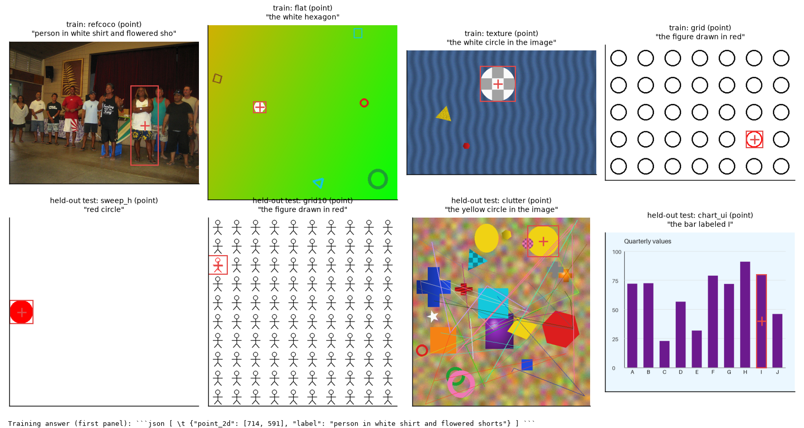
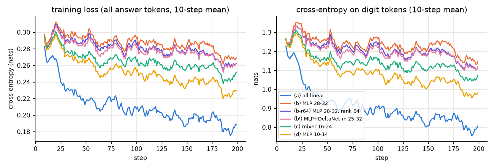
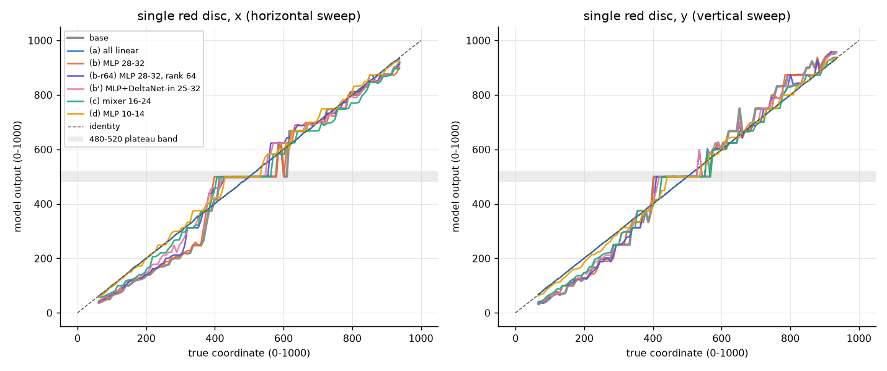
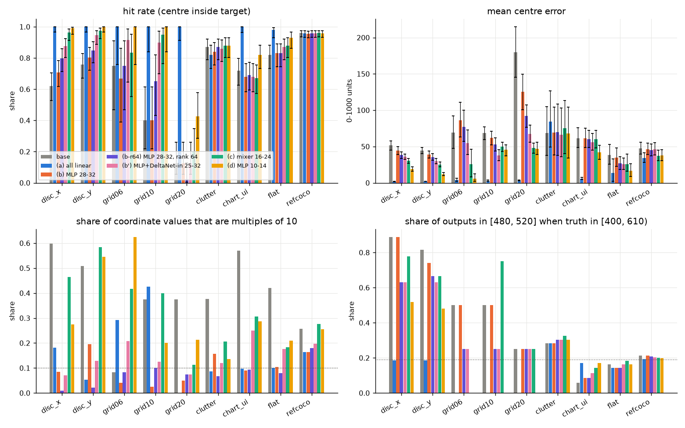
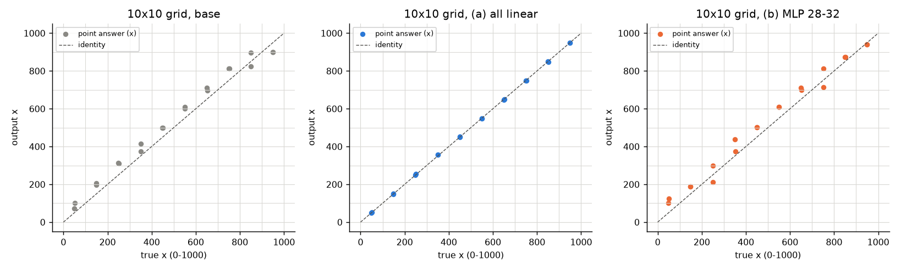
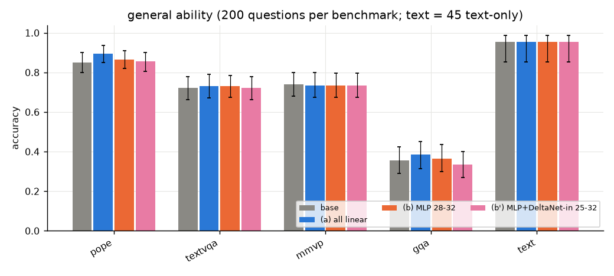
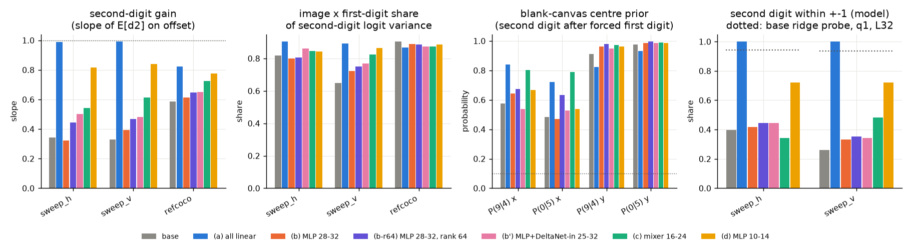
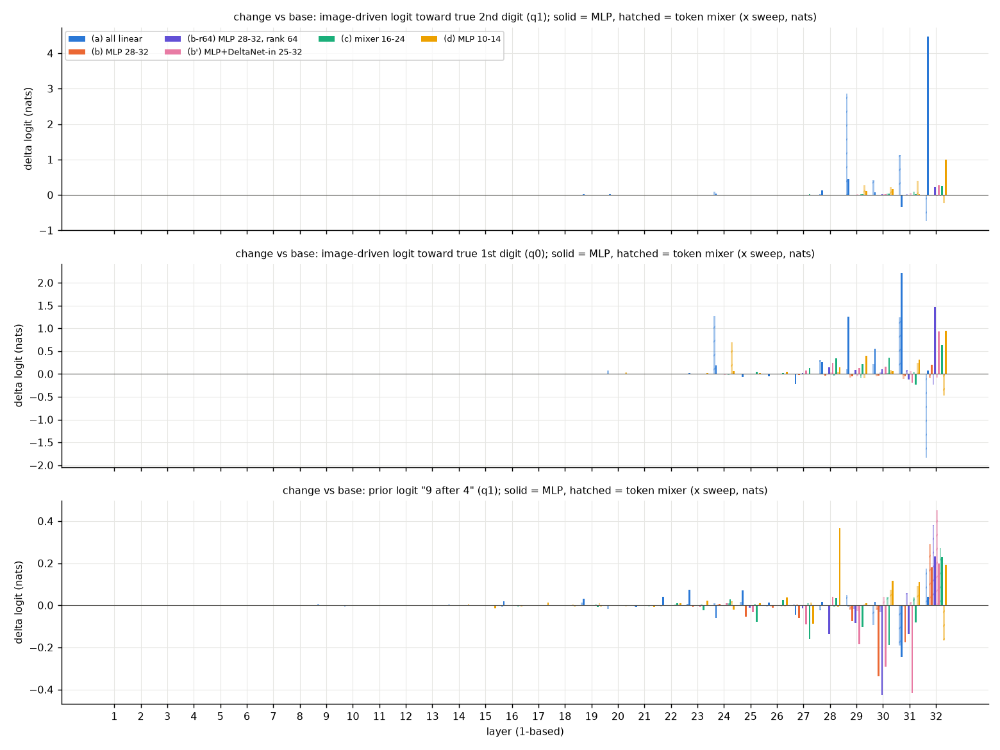
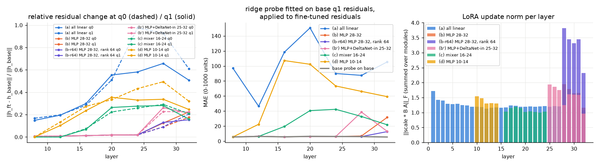

# 基于机理的定向微调（实验 3.13）

实验日期：2026-10-21 至 2026-10-22。本文属于[位置信息与坐标读取](plan.md)研究，执行[实验 3.13 设计](design_targeted_finetune.md)，检验[实验 3.12](results_2026-10-20_digit_failure.md)及其[第二轮](results_2026-10-21_digit_failure_r2.md)的机理结论。模型为 Qwen3.5-9B，bfloat16、SDPA、greedy decoding，thinking off，全部提示为 direct-answer 提示。

## 通俗讲述

实验 3.12 发现，Qwen3.5 写坐标时有四类系统性错误：向 500 吸附（真值在 400–610 之间时，输出大量落在 480–520，称为“500 平台”）、图像左侧整体偏小（真值 $x < 380$ 时输出系统性偏小，称为“左侧压缩”）、网格中落到右侧一列（答案落在单元边界而非单元中心，称为“边界吸附”）、第二位数字近乎随机。模型以逐个数字 token 的方式写出 0–1000 坐标，例如 537 依次写成 “5”“3”“7”；本文把写第一位数字之前的那个 token 记为 $q_0$，把第一位数字 token 本身记为 $q_1$（第二位数字在 $q_1$ 处预测）。3.12 的结论是，这四类错误都发生在“把内部位置表示写成数字”的读出环节：在 $q_1$ 处的 residual 上训练的线性 probe 能以约 5 个单位的精度恢复坐标，写出来的数字却粗糙得多。3.12 由此推测这是参数或数据问题，而不是结构限制，并把问题定位到第 28–32 层的 MLP；第二轮又补充了一条通路：第二位数字读取的是首位读出的“邻位 margin”，即 $q_0$ 处首位分布中相邻两个数字的 log 概率差（例如真值首位为 5 时，“6”与“5”、“4”与“5”的 log 概率差），这一信号经第 25–31 层 Gated DeltaNet 的短卷积从 $q_0$ 传到 $q_1$。本实验回答两个问题：少量精确标注的数据能否修好这些错误？如果能，训练改动的是不是机理所指的那些参数？

我们用 3200 条带精确坐标的 grounding 样本（RefCOCO 训练图像、合成几何场景与其他尺寸的网格，point 与 bbox 各半）做 LoRA 微调，全部条件使用相同的数据、步数与超参数，只改变可训练的参数位置：全部线性层（标准做法）；只训练第 28–32 层 MLP（3.12 所指的数字写入者）；只训练第 25–32 层的 MLP 与 DeltaNet 输入投影和短卷积（3.12 第二轮所指的通路）；只训练第 16–24 层的注意力模块（本文的“注意力模块”指每层中在 token 之间交换信息的部分：full attention 层的 softmax attention 与 Gated DeltaNet 层的线性注意力，与之相对的是逐 token 计算的 MLP；这些层是 3.11 所指的“回看图像”的读取层）；以及与第 28–32 层参数量相同、但位于读取之前的第 10–14 层 MLP（位置对照）。测试全部使用训练中没有出现的族或布局：3.6 的单个红色圆扫描、3.12 的 6×6、10×10、20×20 网格、图表与界面、遮挡杂物和 RefCOCO 测试集。

第一个问题的答案是肯定的，而且效果惊人。训练全部线性层约 30 分钟后，单个红色圆的平均中心误差从 51.5 降到 1.7 个单位，500 平台比例从 0.89 降到 0.19（等于真值本身的比例），左侧压缩消失（$x < 380$ 段斜率由 0.77 变为 1.01），网格的列号多计 1 从 0.60 降到 0，没有训练过的 20×20 网格命中率从 0.13 升到 1.00，图表与界面的误差从 61 降到 6。3.12 定义的“第二位增益”从 0.34 升到 0.99：把首位强制为真值后，计算第二位数字的期望值 $\mathbb{E}[s]$，它对组内偏移 $(x - 100k)/10$（$k$ 为真值首位）的最小二乘斜率即为第二位增益，理想读出的斜率为 1，0 表示第二位与图像无关。组内偏移对 $\mathbb{E}[s]$ 的解释力（$R^2$）从 26% 升到 100%，POPE、TextVQA、MMVP、GQA 与纯文本题没有下降。因此，这些缺陷是训练数据造成的参数问题，不是逐位输出或单次回看结构的限制。

第二个问题的答案出乎预料。只训练第 28–32 层 MLP 几乎没有用：误差只从 51.5 降到 44.6，500 平台不变，第二位增益仍是 0.32；它学到的只是“少写整十数”（输出坐标为 10 的倍数的比例，均匀分布时为 0.1，由 0.60 降到 0.08），也就是改变了数字的边际分布，没有提高读出的精度。加入 DeltaNet 通路的条件稍好（误差 36.0，增益 0.50）；把第 28–32 层 MLP 的 LoRA 秩提高到 64（参数量为原来的 8 倍）也只把误差降到 38.2，说明问题不在容量。效果最好的反而是位置对照：同样参数量的第 10–14 层 MLP 把误差降到 19.1、增益升到 0.82、平台降到 0.52。

训练后的机理测量给出了原因。我们想知道，每个模块在多大程度上会“随图像中目标位置的变化，把数字 logit 推向正确的数字”。为此使用直接 logit 归因（DLA）：把一个模块写入 residual 的输出直接投影到十个数字的 unembedding 上，得到它对十个数字 logit 的直接贡献；在所有圆扫描图像上平均的那部分贡献与图像无关（例如中心先验），把它减掉，剩下的才是随图像变化的部分；最后看这部分在真值数字上比十个数字的平均高出多少 nats。这个量越大，模块越会根据图像把 logit 推向正确数字，严格定义见第 3.5 节。在全部线性层的模型中，所有模块的这一贡献之和在第二位上从 0.46 升到 9.1 nats，增加的部分确实由第 29、31 层的 DeltaNet 与第 32 层 MLP 写入，也就是 3.12 与其第二轮所指的组件；但只训练这些组件本身不能产生这一增益。第 10–14 层的 LoRA 没有改动这些组件的任何权重，却让同样的组件随图像写出了更强的正确数字贡献。换言之，机理分析正确地指出了数字由谁写出，但“由谁写出”并不等于“改哪里最有效”：读出组件需要上游送来一种它能以高增益转换的坐标编码，而这种编码要在读取之前的层中形成。

全部线性层的模型还在第 32 层把第二位数字写成了类别式的编码：在 $q_1$ 第 32 层 residual 的前 8 个主成分上训练 softmax 分类器预测第二位数字，5 折准确率从 0.06 升到 0.76，也就是十个数字各占据可分的区域，而不是沿一条连续轴排列；3.12 中由文本给出的数值在第 32 层也是这种编码方式。这些编码变化的具体形式（读出之前出现周期为 100 的“时钟”编码）见[第二轮](results_2026-11-03_targeted_finetune_r2.md)。

## 1. 研究问题与主要结论

本实验回答：坐标读出的缺陷属于参数与数据问题还是结构限制（Q1）；按机理选择的参数子集能否达到全部参数训练的效果（Q2）；训练后 3.12 的机理测量如何变化，训练改变了哪些组件、改变的是表示还是读出（Q3）；训练是否损害通用能力（Q4）。主要结论如下，括号内为支持该结论的小节与图。

1. **坐标读出的四类缺陷是数据造成的参数问题，3200 条精确标注样本的 LoRA 训练就能在留出的族与布局上全部消除（第 3.1 节，图 1–3）。** 全部线性层 LoRA 使单个红色圆的误差由 51.5 / 44.4（x / y）降到 1.7 / 2.2，500 平台比例由 0.89 降到 0.19，网格边界吸附由 0.90 降到 0，20×20 网格命中率由 0.13 升到 1.00，chart_ui 误差由 61.4 降到 5.9。确定性：高。所有测试族都不在训练集中，配对检验 $p < 10^{-4}$。
2. **只训练机理所指的读出组件不能复现这一效果；更早的层反而更有效（第 3.2 节，表 2）。** 第 28–32 层 MLP 只把单个红色圆的误差降到 44.6，第 25–32 层 MLP + DeltaNet 通路降到 36.0，第 16–24 层注意力模块降到 30.4，参数量与第 28–32 层相同的第 10–14 层 MLP 降到 19.1；第 28–32 层 MLP 的秩提高到 64（15.7 M 参数）后误差为 38.2。事先登记的预测 (1)“(b) 接近 (a) 并好于 (d)”被否定。确定性：高（同一数据、同一步数、配对检验，且排除了容量解释）。
3. **训练后的模型按组内偏移精确写出第二位数字，邻位 margin 仍然预测第二位，但它本身变得精确（第 3.4 节，图 5）。** 全部线性层模型的第二位增益为 0.99（原模型 0.34），组内偏移对第二位期望值的 $R^2$ 由 0.26 升到 1.00，邻位 margin 的 $R^2$ 保持在 0.80（原模型 0.82），首位与第二位真值概率分别由 0.56 / 0.15 升到 0.99 / 0.82。3.12 第二轮预测的“偏移 $R^2$ 上升”成立，“margin $R^2$ 下降”不成立。
4. **增加的第二位 logit 由 3.12 所指的组件写入，但所需的参数改变在上游（第 3.5 节，图 6、7）。** 全部线性层模型中，第二位真值数字的图像驱动 logit（随图像变化、推向真值数字的直接 logit 贡献，定义见第 3.5 节）增加 8.6 nats，主要来自 MLP 32（+4.5）、第 29 层 DeltaNet（+2.9）与第 31 层 DeltaNet（+1.1）；第 10–14 层 LoRA 不改这些组件的权重，同样使它们的贡献上升（MLP 32 +1.0，第 31 层 DeltaNet +0.4）。只训练第 28–32 层 MLP 时这一贡献不升反降（0.46 → 0.41）。
5. **训练改变了读取之前的坐标编码，没有提高信息量的上限之外的任何东西（第 3.5 节，图 7）。** 全部线性层与第 10–14 层的条件使第 12–20 层 residual 发生 0.1–0.5 的相对变化，在原模型上拟合的 ridge probe 用于微调模型时误差升到 50–150 个单位，重新拟合的 probe 误差却不变或更低（全部线性层第 20 层 3.6 对原模型 6.4）。坐标信息仍在，但编码方式变了。只训练后期层的条件中，读取之前的 residual 不变（相对变化 ≤ 0.02，为 batch 组成造成的 bfloat16 噪声），probe 可以直接迁移。
6. **训练没有损害通用能力（第 3.3 节，图 4）。** 全部线性层模型在 POPE、TextVQA、MMVP、GQA（各 200 题）上的配对差值为 +0.045、+0.008、−0.005、+0.030（均不显著），45 道纯文本题的准确率不变（0.956），44/45 的输出与原模型逐字相同。RefCOCO 测试集误差由 47.3 降到 34.3，命中率不变（0.960 对 0.958）。遮挡杂物场景的中位误差由 9.2 降到 3.0，但选错目标的样本由 11 增至 17（命中率 0.87 → 0.82，McNemar $p = 0.27$）。

**解释（非测量结论）。** 原模型的读出电路（第 25–32 层的 DeltaNet 中继与 MLP）是一个固定的非线性转换，它把上游送来的坐标编码转为数字；原模型送来的编码虽然线性可读，却不是该电路能以高增益转换的格式，于是第二位只能借用首位的邻位 margin。训练最容易做的是改变上游编码，让既有的读出电路“读到”一个更易转换的量，而不是在末端几层用低秩更新重建一个新的高增益转换。这一解释与第 10–14 层 LoRA 的效果、与 probe 迁移失败而重新拟合成功的现象一致，但本实验没有直接刻画新的编码形式。[第二轮](results_2026-11-03_targeted_finetune_r2.md)用冻结读出阶段的控制、拼接与编码几何检验并修正了这一解释：读出阶段原权重足够，修复位于第 1–4 层的图像 token，新编码含有周期为 100 的时钟分量。

## 2. 实验设计与执行

### 2.1 输入

*图 0：训练与测试输入示例。上行为训练族（RefCOCO、flat、texture、grid），下行为留出的测试族（3.6 单个红色圆、3.12 10×10 网格、clutter、chart_ui）。红框与红色十字为真值框与框中心（训练答案中的 point 即为该中心，换算到 0–1000）。底部为第一幅图的训练答案全文，模板与原模型自身的输出模板相同，只有数值来自真值。*

训练集与测试集的构成见设计文档第 5 节：训练 3200 条（RefCOCO 1400、flat 700、texture 500、grid 600），测试 997 条（RefCOCO 400、flat 100、clutter 100、chart_ui 100、3.6 圆扫描 113 + 112、3.12 网格 12 + 20 + 40）。RefCOCO 训练图像与测试图像、3.12 的 RefCOCO 单元按图像划分，重叠为 0。

### 2.2 训练条件与过程

| 条件 | 可训练参数 | 可训练参数量 | 训练时间 |
| --- | --- | --- | --- |
| (a) all_linear | 第 1–32 层全部线性层的 LoRA | 21.6 M | 29 分钟 |
| (b) mlp28_32 | 第 28–32 层 MLP 的 LoRA | 2.0 M | 13 分钟 |
| (b′) late25_32 | 第 25–32 层 MLP 与 DeltaNet 输入投影的 LoRA，DeltaNet 短卷积的稠密增量 | 4.7 M | 12 分钟 |
| (c) mixer16_24 | 第 16–24 层注意力模块（full attention 与 DeltaNet 的全部投影）的 LoRA | 2.5 M | 50 分钟 |
| (d) mlp10_14 | 第 10–14 层 MLP 的 LoRA | 2.0 M | 65 分钟 |
| (b-r64) mlp28_32_r64 | 同 (b)，LoRA 秩 64（$\alpha = 256$，更新尺度 $\alpha / r$ 不变） | 15.7 M | 29 分钟 |

LoRA 秩 $r = 8$、$\alpha = 32$、学习率 $10^{-4}$、1 个 epoch（200 步，每步 16 条），全部条件的数据顺序相同。训练时间的差异来自共享 GPU 的占用程度与权重拆分方式，与条件本身无关。

*图 8：训练损失（左，全部答案 token）与数字 token 的交叉熵（右），10 步滑动平均，由训练日志直接绘制。颜色：灰为原模型（无训练），蓝 (a)，橙 (b)，紫 (b-r64)，绿 (c)，黄 (d)，粉 (b′)。*

数字 token 的交叉熵在最后 10 步为：(a) 0.81，(d) 0.98，(c) 1.07，(b-r64) 1.12，(b′) 1.12，(b) 1.15（训练开始时为 1.23–1.27）。只训练后期层的条件连训练集上的数字都没有拟合好，秩 64 也没有改变这一点，说明它们的效果差来自优化难度或可训练位置，而非过拟合或容量。

### 2.3 评估规模与统计

每个条件生成 997 个坐标答案（批量 greedy 解码，按图像尺寸分组，batch 中 padded token 上限 12000）；通用能力评估在原模型、(a)、(b)、(b′) 上运行（各 800 题与 45 道纯文本题）；3.12 析因在全部条件上重跑（288 个单元、2592 行强制首位的前向）。批量解码与参考 `generate` 的 20 例抽查中坐标完全一致的比例为：原模型 14/20、(a) 15/20、(b) 13/20、(b′) 12/20，其余差异多为 1–10 个单位，与 3.12 报告的 bfloat16 batch 差异同级。部分条件在网格上把提示复制进 label 字段而被截断（(b′) 17 例、(b) 8 例），坐标字段位于截断之前，均已解析。比例报告 Wilson 95% 区间，均值报告 bootstrap 95% 区间；与原模型的比较为配对检验（命中为精确 McNemar 检验，误差差值为 sign-flip 置换检验）。GPU 用量约 12 GPU 小时（多数运行为两卡拆分），全部在 GPU 2–7 上完成。

## 3. 结果

### 3.1 全部线性层 LoRA 消除全部四类缺陷

*图 1：3.6 单个红色圆扫描上模型输出对真值（左 x，右 y），每条曲线为一个条件的 greedy 答案（颜色同图 8），灰色虚线为恒等线，灰色带为 480–520 平台区间。数据为模型生成的答案，未经拟合。*

*图 2：各测试组的命中率（左上，误差线为 Wilson 95% 区间）、平均中心误差（右上，bootstrap 95% 区间）、整十坐标比例（左下，点线为均匀时的 0.1）与 500 平台比例（右下，点线为真值本身的比例 0.19）。颜色同图 8。全部由生成答案计算。*

**表 1：原模型与全部线性层 LoRA 的坐标指标。** 误差单位为 0–1000 坐标；“压缩”为 $x < 380$ 段的斜率；“边界”为网格答案更接近单元边界的比例。

| 测试组 | 命中率 | 平均误差 | 中位误差 | 整十比例 | 平台比例 | 其他 |
| --- | --- | --- | --- | --- | --- | --- |
| 圆 x | 0.62 → 1.00 | 51.5 → 1.7 | 46.3 → 1.4 | 0.60 → 0.18 | 0.89 → 0.19 | 压缩 0.77 → 1.01 |
| 圆 y | 0.76 → 1.00 | 44.4 → 2.2 | 46.0 → 2.1 | 0.51 → 0.05 | 0.81 → 0.19 | 压缩 1.05 → 1.00 |
| 网格 6×6 | 0.75 → 1.00 | 69.4 → 4.0 | 65.1 → 2.4 | — | — | 边界 0.58 → 0 |
| 网格 10×10 | 0.40 → 1.00 | 68.4 → 3.0 | 68.3 → 2.2 | — | — | 列号 +1：0.60 → 0 |
| 网格 20×20 | 0.13 → 1.00 | 179.9 → 3.4 | 152.3 → 3.4 | — | — | 列号 +1：0.38 → 0 |
| chart_ui | 0.72 → 1.00 | 61.4 → 5.9 | 31.5 → 2.8 | 0.57 → 0.10 | — | IoU 0.42 → 0.87 |
| flat（族内） | 0.82 → 0.98 | 38.2 → 13.7 | 13.9 → 1.6 | 0.42 → 0.10 | — | IoU 0.55 → 0.90 |
| clutter | 0.87 → 0.82 | 68.7 → 84.2 | 9.2 → 3.0 | 0.38 → 0.09 | — | IoU 0.64 → 0.71 |
| RefCOCO | 0.960 → 0.958 | 47.3 → 34.3 | 14.6 → 9.4 | 0.26 → 0.16 | 0.21 → 0.19 | IoU 0.858 → 0.850 |

1. **合成图像上的坐标误差降到 2–6 个单位，与 3.12 测得的表示精度（约 5 个单位）同级。** 训练后的输出精度达到了 $q_1$ 处线性 probe 的水平，说明 3.12 所说的“信息存在、读出丢失”可以通过训练完全弥合；输出不再受首位边界与中心先验的影响（图 1 中蓝线与恒等线重合）。
2. **网格的边界吸附与列号多计 1 完全消失，并推广到训练中没有的网格尺寸。** 训练网格的行列数为 4–14（不含 6 与 10），测试的 20×20 超出训练范围，命中率仍为 1.00。3.12 把列号多计 1 解释为“列序号 ÷ 列数”换算取到单元边界，训练后的答案直接落在单元中心（图 3），说明这一换算路线是可以由数据改写的读出习惯。
3. **自然图像上的提升较小，杂物场景出现目标选择的轻微退化。** RefCOCO 的误差降低 13 个单位（配对 $p = 0.0004$），命中率不变；RefCOCO 的标注框本身有数十个单位的不确定性，命中率主要由目标选择决定。clutter 的平均误差上升来自选错目标的样本（误差大于 150 的样本由 11 增至 17），选对目标时误差由 11.7 降到 3.5。

*图 3：10×10 网格（3.12 测试集）点答案的 x 输出对真值。浅灰线为单元边界，灰色虚线为恒等线，点为模型答案（灰：原模型，蓝：(a)，橙：(b)）。*

### 3.2 定向条件

**表 2：各条件在留出测试组上的平均中心误差（0–1000 单位）与关键指标。** 括号内为与原模型的配对误差差值的 $p$ 值；平台比例与增益分别见第 3.1 与 3.4 节的定义。

| 条件 | 圆 x 误差 | 圆 y 误差 | 圆 x 平台 | 网格 10×10 误差 | 网格 20×20 误差 | chart_ui 误差 | RefCOCO 误差 | 整十比例（圆 x） |
| --- | --- | --- | --- | --- | --- | --- | --- | --- |
| 原模型 | 51.5 | 44.4 | 0.89 | 68.4 | 179.9 | 61.4 | 47.3 | 0.60 |
| (a) all_linear | 1.7（< 0.001） | 2.2 | 0.19 | 3.0 | 3.4 | 5.9 | 34.3（< 0.001） | 0.18 |
| (b) mlp28_32 | 44.6（< 0.001） | 38.8 | 0.89 | 62.2（0.14） | 125.4 | 61.1（0.94） | 46.4（0.60） | 0.08 |
| (b-r64) mlp28_32_r64 | 38.2（< 0.001） | 35.5 | 0.63 | 53.2 | 92.3 | 60.0（0.71） | 45.3（0.34） | 0.01 |
| (b′) late25_32 | 36.0（< 0.001） | 30.1 | 0.63 | 37.9 | 67.5 | 56.1（0.16） | 46.4（0.67） | 0.07 |
| (c) mixer16_24 | 30.4（< 0.001） | 25.3 | 0.78 | 49.9 | 48.0 | 60.2（0.77） | 37.3（< 0.001） | 0.46 |
| (d) mlp10_14 | 19.1（< 0.001） | 11.9 | 0.52 | 45.4 | 47.0 | 41.9（0.002） | 37.9（< 0.001） | 0.27 |

1. **只训练第 28–32 层 MLP 改变了数字的边际分布，没有改变读出的精度。** 条件 (b) 把整十比例从 0.60 压到 0.08（低于均匀时的 0.1），误差却只降低 7 个单位，500 平台比例仍为 0.89。这意味着末端几层的低秩更新学到的是“避开整十数”的边际修正，与 3.12 用空白画布做 contextual calibration 的效果类似：去偏但不提高分辨率。秩 64 的 (b-r64) 把整十比例压到 0.01、平台比例降到 0.63，误差 38.2，仍远不及参数量只有其八分之一的 (d)。
2. **加入 DeltaNet 中继的条件略有改善，但远不及全部线性层。** (b′) 的误差为 36.0，平台比例 0.63；训练集上的数字交叉熵 1.12，与 (b) 的 1.15 相近。3.12 第二轮所指的通路确实参与了第二位的计算，但在这一通路上做低秩更新同样不足以形成高增益读出。
3. **读取之前的第 10–14 层 MLP 是最有效的单一位置。** (d) 与 (b) 的参数量与超参数完全相同，(d) 的误差（19.1 对 44.6）、平台比例（0.52 对 0.89）与 chart_ui 误差（41.9 对 61.1）都显著更好。网格上 (d) 的命中率为 1.00（6×6、10×10），20×20 为 0.43，弱于 (a)。
4. **读取层的注意力模块有中等效果，主要作用于首位。** (c) 的圆扫描误差为 30.4，左侧压缩消失（$x < 380$ 段平均有符号误差由 −67 变为 −24），但平台比例仍为 0.78，10×10 网格的边界吸附仍为 0.85。

### 3.3 通用能力

*图 4：POPE、TextVQA、MMVP、GQA（各 200 题，实验 5.2 的同一批题目）与 45 道纯文本题的准确率，误差线为 bootstrap（基准）或 Wilson（纯文本）95% 区间。颜色同图 8；(c) 与 (d) 未运行通用能力评估。*

| 条件 | POPE | TextVQA | MMVP | GQA | 纯文本 | 纯文本输出与原模型相同 |
| --- | --- | --- | --- | --- | --- | --- |
| 原模型 | 0.850 | 0.723 | 0.740 | 0.355 | 0.956 | — |
| (a) all_linear | 0.895（+0.045，p = 0.06） | 0.732 | 0.735 | 0.385（+0.03，p = 0.34） | 0.956 | 44/45 |
| (b) mlp28_32 | 0.865 | 0.732 | 0.735 | 0.365 | 0.956 | 45/45 |
| (b′) late25_32 | 0.855 | 0.723 | 0.735 | 0.335 | 0.956 | 45/45 |

**训练没有损害通用能力。** 全部差值的置换检验 $p \ge 0.06$。(a) 有一个行为变化：GQA 上不写 “Final answer:” 行而直接给出短答案的比例由 46/200 升到 93/200，评分按单行答案回退处理，准确率不受影响；这是训练数据只含短 JSON 答案造成的格式倾向，较大规模训练时需要混入常规指令数据。

### 3.4 训练后的机理测量

*图 5：在每个条件上重跑 3.12 首位析因得到的四项测量。从左至右：首位正确时期望第二位对组内偏移的斜率（点线为理想值 1）；第二位 logit 方差中图像 × 首位交互的份额；空白画布上强制首位后第二位为 9（首位 4）或 0（首位 5）的概率（点线为均匀时的 0.1）；首位正确时模型第二位与真值相差不超过 1 的比例（点线为原模型 $q_1$ 处第 32 层 5 折 ridge probe 换算的同一比例）。数据来自模型前向的数字分布；斜率为最小二乘拟合。*

**表 3：3.12 机理测量在各条件上的值（圆扫描 x / y）。**

| 条件 | 第二位增益 | 首位真值概率 | 第二位真值概率 | margin $R^2$ | 偏移 $R^2$ | 空白 $P(9 \mid 4)$ x / y | 空白 $P(0 \mid 5)$ x / y |
| --- | --- | --- | --- | --- | --- | --- | --- |
| 原模型 | 0.34 / 0.33 | 0.56 / 0.51 | 0.15 / 0.13 | 0.82 / 0.79 | 0.26 / 0.21 | 0.58 / 0.91 | 0.48 / 0.97 |
| (a) all_linear | 0.99 / 0.99 | 0.99 / 0.98 | 0.82 / 0.87 | 0.80 / 0.74 | 1.00 / 1.00 | 0.84 / 0.82 | 0.72 / 0.93 |
| (b) mlp28_32 | 0.32 / 0.39 | 0.54 / 0.56 | 0.14 / 0.14 | 0.67 / 0.71 | 0.25 / 0.28 | 0.64 / 0.96 | 0.47 / 0.99 |
| (b-r64) mlp28_32_r64 | 0.44 / 0.47 | 0.61 / 0.60 | 0.16 / 0.14 | 0.67 / 0.73 | 0.40 / 0.33 | 0.67 / 0.98 | 0.63 / 1.00 |
| (b′) late25_32 | 0.50 / 0.48 | 0.65 / 0.62 | 0.16 / 0.14 | 0.81 / 0.81 | 0.50 / 0.41 | 0.54 / 0.95 | 0.53 / 0.99 |
| (c) mixer16_24 | 0.54 / 0.61 | 0.66 / 0.72 | 0.16 / 0.19 | 0.78 / 0.85 | 0.47 / 0.54 | 0.80 / 0.97 | 0.79 / 0.99 |
| (d) mlp10_14 | 0.82 / 0.84 | 0.81 / 0.85 | 0.28 / 0.27 | 0.87 / 0.94 | 0.86 / 0.84 | 0.67 / 0.96 | 0.54 / 0.98 |

margin 与偏移 $R^2$ 按 3.12 第二轮的定义计算：首位强制为真值、真值 200–899（每轴 90 张），期望第二位分别对两个邻位 log 概率差与真实组内偏移做线性回归。原模型的值（0.82 / 0.26）与第二轮报告的 0.82 / 0.24 一致。

1. **全部线性层模型的第二位按组内偏移精确计算，增益达到理想值。** 斜率 0.99、偏移 $R^2$ 1.00、第二位真值概率 0.82–0.87，与 3.12 中文本给定数值的换算（斜率 0.99）相同。邻位 margin 的 $R^2$ 仍为 0.74–0.80：第二位很可能仍沿用“读首位邻位 margin”的通路，但训练后首位读出的 margin 本身随组内偏移精确变化（偏移与 margin 同时解释第二位），因此通路不变、通路中传递的量变精确了。这一点与第 3.5 节“写入者不变、输入编码改变”的结论一致。
2. **空白画布上的中心先验没有被训练消除，在 (a) 中甚至更强。** 空白画布 x 上 $P(9 \mid 4)$ 由 0.58 升到 0.84。训练数据中每张图都有目标，空白画布不在训练分布内；训练提高的是图像证据的增益，使先验在有图像时被压倒，先验本身保持原样。这说明 500 吸附的消除来自证据增强，而不是先验移除。
3. **交互份额在所有条件下都保持高位（0.72–0.90）。** 第二位依赖“图像 × 首位”的计算结构在训练前后不变，训练改变的是这一结构的增益。
4. **定向条件的机理指标与其坐标精度一致。** (b) 的全部指标与原模型相同；(d) 的增益 0.82、偏移 $R^2$ 0.84 介于原模型与 (a) 之间，与其误差排序一致。

### 3.5 训练改变了哪些组件

**随图像变化的正确数字贡献（图像驱动 logit）的定义。** 本节用它衡量一个模块在多大程度上根据图像把数字 logit 推向真值数字。记最终 RMSNorm 的权重为 $g \in \mathbb{R}^{D}$，十个数字 token 的 unembedding 行为 $W_U \in \mathbb{R}^{10 \times D}$，模块 $j$ 在输入 $i$（一张圆扫描图像，首位强制为某个数字）的读出位置写入 residual 的输出为 $o_j(i) \in \mathbb{R}^{D}$，该位置最终 residual 的 RMS 为 $\rho(i)$（标量，按 3.12 的做法视为常数）。模块 $j$ 对十个数字 logit 的直接贡献为

$$
c_j(i) = W_U \left( \frac{g \odot o_j(i)}{\rho(i)} \right) \in \mathbb{R}^{10},
$$

各模块的 $c_j(i)$ 之和加上 embedding 项就是十个数字的 logit（3.12 测得相对误差 0.3%）。先在十个数字上去均值（logit 整体平移不改变概率），再减去在全部图像（及全部强制首位）上的平均贡献 $\bar c_j$：

$$
\tilde c_j(i) = c_j(i) - \bar c_j .
$$

$\bar c_j$ 与图像无关，包含中心先验等常量；$\tilde c_j(i)$ 只含随图像变化的部分。最后取它在真值数字 $s_i$ 上高出十个数字平均的量，并在图像上平均：

$$
L_j = \frac{1}{N} \sum_{i=1}^{N} \Big( \tilde c_j(i)[s_i] - \frac{1}{10} \sum_{d=0}^{9} \tilde c_j(i)[d] \Big),
$$

单位为 nats，$N$ 为图像数。第二位在 $q_1$ 处计算（只取首位强制为真值的行），首位在 $q_0$ 处计算。$L_j > 0$ 表示模块 $j$ 随目标位置变化而把 logit 推向正确数字；$\sum_j L_j$ 衡量整个模型由图像驱动的数字证据。

*图 6：各条件相对原模型的直接 logit 归因变化（圆扫描 x）。上：$q_1$ 处第二位的图像驱动 logit $L_j$（定义见本节开头）；中：$q_0$ 处首位的同一量；下：“首位 4 之后写 9”的先验 logit。实心柱为 MLP，斜线柱为注意力模块，颜色同图 8，单位为 nats。数值由模型激活经最终 RMSNorm 尺度与数字 unembedding 精确分解得到（3.12 的 DLA 方法）。*

*图 7：左：同一输入、同一强制首位下，$q_0$（虚线）与 $q_1$（实线）处各层 residual 的相对变化 $\lVert h_\text{ft} - h_\text{base} \rVert / \lVert h_\text{base} \rVert$，由激活直接计算；中：在原模型 $q_1$ residual 上 5 折拟合的 ridge probe（坐标回归）用于各微调模型时的平均绝对误差，灰线为原模型自身的误差；右：每层 LoRA 更新 $\frac{\alpha}{r} BA$ 的 Frobenius 范数（同层各模块平方和开方），由 adapter 权重计算。*

1. **增加的第二位 logit 正是 3.12 及其第二轮所指的组件写入的。** (a) 中第二位真值数字的图像驱动 logit 合计由 0.46 升到 9.08 nats，增量的前三位是 MLP 32（+4.47）、第 29 层 DeltaNet（+2.87）与第 31 层 DeltaNet（+1.13）；首位的同一量由 4.50 升到 10.04，主要来自 MLP 31（+2.21）、MLP 29（+1.25）、第 24 层 full attention（+1.27）与第 31 层 DeltaNet（+1.24），第 32 层 full attention 为 −1.84。3.12 与其第二轮对“谁写数字”的定位因此得到训练实验的独立印证。
2. **这些组件的输出变化不需要改动它们自身的权重。** (d) 只改动第 10–14 层，第 32 层 MLP 对第二位的图像驱动贡献却上升 1.0 nats，第 31 层 DeltaNet 上升 0.39；(b) 直接训练第 28–32 层 MLP，第二位的这一贡献合计反而由 0.46 降到 0.41。组件写出什么由它的输入决定，后期组件的权重原本就能以较高增益转换数字，前提是上游送来合适的编码。
3. **有效的条件改变了读取之前的坐标编码，信息量没有减少。** (a) 与 (d) 在第 12–20 层的相对变化为 0.10–0.55；原模型的 probe 迁移到这些模型上误差达 46–151 个单位，在微调模型上重新拟合的 probe 误差为 2.0–5.6 个单位（(a) 第 20 层 3.6，原模型 6.4）。只训练后期层的 (b) 与 (b′) 在第 24 层及以前的变化不超过 0.02（与 batch 组成造成的 bfloat16 噪声同级），probe 迁移误差与原模型相同。
4. **(a) 在第 32 层把第二位写成类别式编码。** 在 $q_1$ 的第 32 层 residual 上，8 个主成分上的 softmax 分类器对第二位的 5 折准确率由 0.06 升到 0.76，坐标的 ridge 回归误差由 5.5 升到 10.2。3.12 第 3.8 节发现文本给定数值在第 32 层以类别方式编码、图像坐标以连续量编码；训练后图像坐标在最后一层也采用了与文本数值相同的类别式编码。
5. **中心先验的写入者被部分削弱，但先验总量变化有限。** “4 之后写 9”的先验 logit 在 (a) 中由 1.47 降到 1.33，在 (b) 中降到 1.17（主要来自 MLP 30 的 −0.34），在 (d) 中升到 2.24。先验的大小与坐标精度没有对应关系，再次说明精度的提升来自证据增益。

## 4. 讨论

### 4.1 参数与数据，还是结构

**坐标读出的缺陷属于参数与数据问题，确定性高。** 不改变结构、只用 3200 条精确标注样本训练 200 步，就在全部留出的合成族与布局上把误差降到表示精度的水平，第二位增益达到理想值。逐位输出、单次回看与 DeltaNet 中继都保持原样，因此它们不构成精度的结构上限。这与 3.12 由机理推出的判断一致，并把它从“解释”提升为经过训练检验的结论。仍有两点需要保留：自然图像上的提升受标注噪声限制，RefCOCO 的命中率不变；clutter 的目标选择略有退化，说明精确坐标数据并不改善“选哪个物体”。

### 4.2 机理定位与训练定位为什么不同

**3.12 定位的是信息丢失的位置，训练效率取决于上游编码能否被既有读出电路高增益地转换，两者不是同一个位置。** 本实验同时证实与否定了机理的两层含义。证实的是因果角色：训练后增加的数字 logit 正是由 MLP 31–32 与第 29、31 层 DeltaNet 写入的（第 3.5 节），第二位改为按组内偏移计算（第 3.4 节）。否定的是“改这些组件就够了”的推论：在这些组件上做秩 8 的更新只改变了数字的边际分布。

**解释（未直接检验）。** 有三种可能的原因。第一，可表达性：3.12 的理论表明，以首位为条件读出第二位需要大幅抵消的高增益映射（抵消项与 logit 差之比约 86），末端五层 MLP 的低秩更新难以实现，而在上游改变编码时，后续二十余层都可以参与放大。第二，优化路径：后期层的梯度直接作用于数字的边际分布，最省力的下降方向是“少写整十数”，与条件 (b) 的整十比例降到 0.08 一致。第三，编码格式：原模型送入读出电路的坐标虽然线性可读，但不是读出电路能以高增益转换的形式；训练改变的正是这一格式（probe 迁移失败、重新拟合成功）。条件 (b-r64) 把秩提高到 64 后误差仍为 38.2、增益 0.44，因此单纯的参数容量不是主因；可表达性中与“层位置”相关的部分（末端只剩少数层可以参与放大）与后两种原因仍无法区分。

对方法设计的含义：可解释性分析指出“谁写出了错误的数字”，但修复应当作用于“写入者看到的输入”。对于生产中的 grounding 训练，标准的全部线性层 LoRA 加精确标注数据就是有效且通用的方案；若要限制可训练参数，应当选择读取之前的中层 MLP，而不是输出端的数字写入层。

### 4.3 与其他实验的一致与冲突

1. **与 3.12 第一轮。** 一致：缺陷位于读出而非信息量，增益不足是参数问题；DLA 所指的写入者在训练后承担了增加的 logit。冲突：3.12 第 4.4 节建议“以精确标注数据提高第二位读出增益”，这一建议成立，但隐含的“只需改读出参数”不成立。另外，3.12 把 500 吸附归因于中心先验；本实验表明先验在训练后仍然存在，吸附的消失来自证据增益，因此 500 吸附更准确的描述是“证据弱时先验胜出”。
2. **与 3.12 第二轮。** 一致：训练后偏移依赖增强（偏移 $R^2$ 0.26 → 1.00）；增加的第二位 logit 部分经第 29、31 层 DeltaNet 写入；$q_0$、$q_1$ 处的 probe 精度在定向条件中保持约 5 个单位。冲突：第二轮预测“必须改变层 25–32 的 MLP 与 DeltaNet 输入投影”，并预测只在第 1–20 层加 adapter 不会提高第二位真值概率；实测第 10–14 层 MLP 把第二位真值概率由 0.15 提高到 0.28，增益由 0.34 提高到 0.82，而第 25–32 层条件只提高到 0.16 与 0.50。第二轮预测的“margin 依赖减弱”也不成立：margin $R^2$ 在 (a) 中保持 0.80，偏移 $R^2$ 升到 1.00，说明 margin 通路被保留，传递的量变精确了。
3. **与 3.11（坐标信息流）。** 一致：读取层的 attention 本身已经较准确，训练第 16–24 层注意力模块只带来中等改善。补充：(c) 主要修复了首位（压缩消失），对第二位与网格吸附作用小。
4. **与 3.9 第二轮（读出工具）。** 3.9 第二轮推测训练数据是可扩展的修复途径；本实验给出直接证据。训练后的模型在工具擅长的输入上优于工具（单个圆命中率 1.00，工具 0.93–1.00；chart_ui 误差 5.9），在 RefCOCO 上与工具相当（命中率 0.958，工具 0.956），且不需要额外的调用与 attention 读取。工具的价值因此主要在于诊断，以及在无法训练模型时的部署。
5. **与 1.5、3.10（网格计数）。** 网格的列号多计 1 在训练后消失，表明 3.10 所说的“+1 在读出阶段加入”属于可由数据改写的读出习惯，与行列计数累加器本身无关。

## 5. 限制

1. **只训练了一种数据配比与一组超参数。** 定向条件使用与全部线性层相同的学习率；秩 64 的补充条件排除了容量解释，但没有测试更大的学习率或更长的训练，后期层条件在更多步数下可能继续改善。
2. **测试族与训练族同属“单目标 grounding”。** 留出了族、布局、网格尺寸与提示措辞，但没有测试多目标、计数或 BabyVision 类任务上的坐标输出。
3. **空白画布不在训练分布内**，先验测量反映的是训练没有触及的输入。
4. **通用能力评估规模小**（每个基准 200 题），只能排除较大的退化；(c)、(d) 未做通用能力评估。
5. **每层 head 级 DLA 未使用 LoRA 更新后的 `o_proj`。** hook 式 LoRA 不修改 `o_proj.weight`，因此 (a)、(c) 的逐 head 归因只含原权重；逐模块（注意力模块与 MLP）的归因基于模块输出，是精确的。
6. **新编码的形式没有刻画。** 第 3.5 节只表明读取之前的编码改变而信息量不减，没有说明它变成了什么（例如是否出现周期分量）。

## 6. 产物

产物位于 WORK_DIR 的 `analysis/position/2026-10-21_targeted_finetune/`：`train.jsonl` 与 `test.jsonl`（样本与真值）、`images/`、`adapters/`（各条件的 LoRA 矩阵、短卷积增量与训练日志，不含完整 checkpoint）、`eval/<条件>/`（`coord.jsonl` 坐标答案、`general.jsonl` 与 `text.jsonl` 通用能力、`spotcheck.json` 解码抽查、`fact/` 3.12 析因的数字分布与 DLA，residual 分片链接到 DATA_DIR）、`results.json` 与 `analysis.npz`（全部统计）、`experiment.json`（运行参数与代码摘要）。程序为 `analysis_tools/position/targeted_finetune*.py`，入口为 `scripts/analysis/position/targeted_finetune.sh`，测试为 `tests/analysis/position/test_targeted_finetune.py`。
