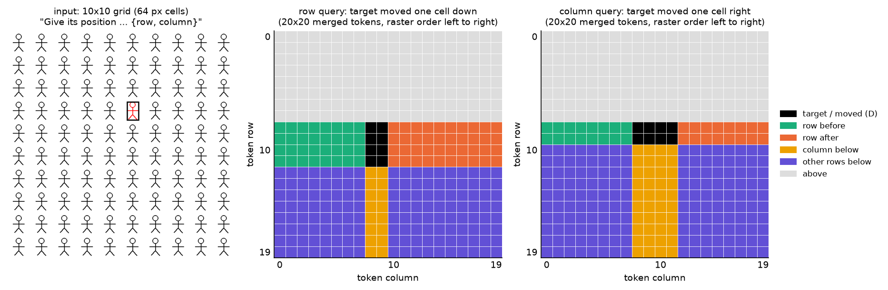
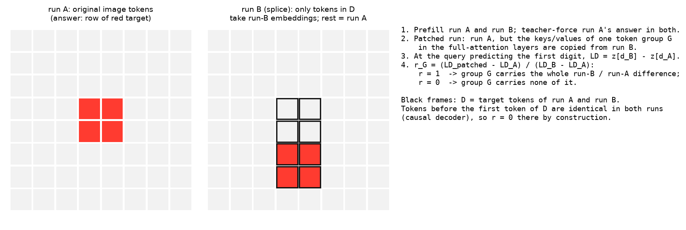
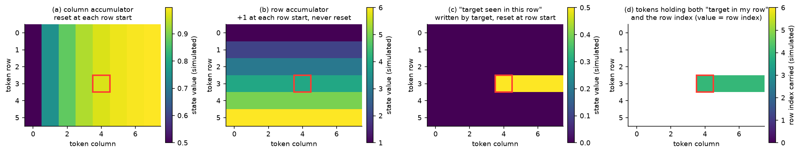
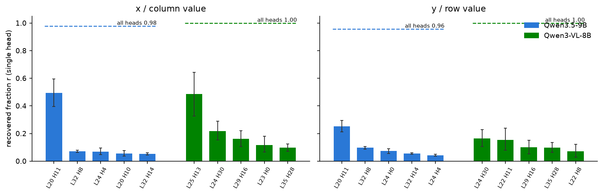
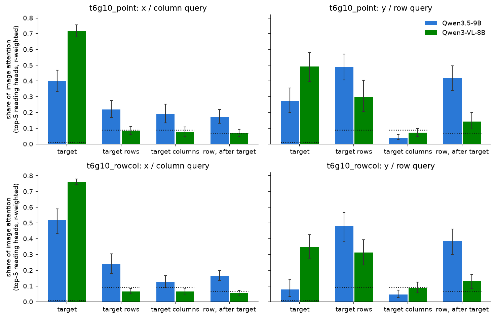
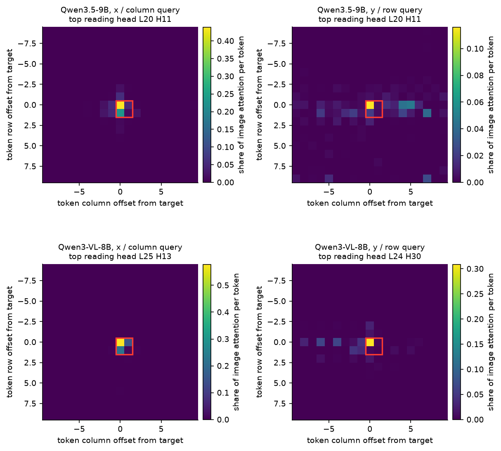
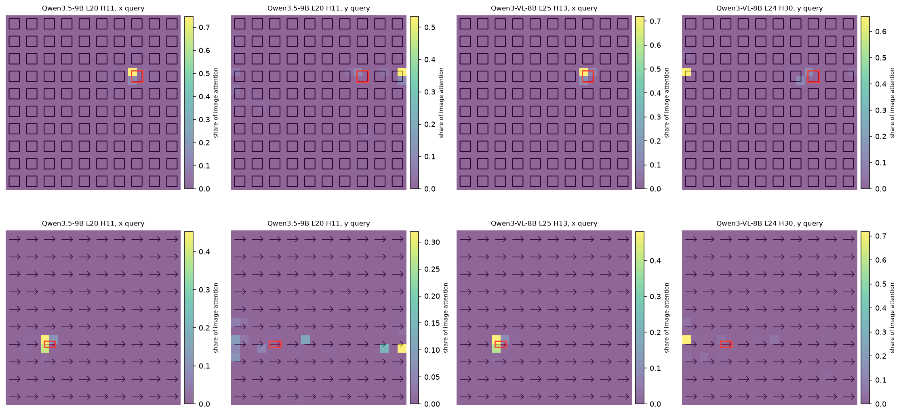

# 行列坐标载体的形成原理（第二轮）

实验日期：2026-11-03。本文属于[位置信息与坐标读取](plan.md)研究，编号为实验 3.14 第二轮，在[第一轮结果](results_2026-10-21_causal_vs_linear.md)（下称“第一轮”）与[实验设计](design_causal_vs_linear.md)的基础上，把“横纵坐标分别由哪些 token 携带”整理为从架构到机制再到证据的完整论证，并新增答案位置读取 head 的 attention 对照。比较对象为 Qwen3.5-9B（24 个 Gated DeltaNet 层与 8 个 full attention 层）与 Qwen3-VL-8B-Instruct（36 个 full attention 层，带 DeepStack），两者的 decoder 都是 causal 的。两个模型均使用 bfloat16、SDPA、greedy decoding 与 thinking off，问题为只输出答案的 direct-answer 格式。上游结果为[行列序号机制（3.10）](results_2026-10-20_rowcol_mechanism.md)、[坐标读出的信息流（3.11）](results_2026-10-20_coordinate_flow.md)与[序列顺序的位置作用第二轮（3.8）](results_2026-10-16_sequence_order_r2.md)。本文只比较两个模型的内部机制，不比较两者的任务正确率；两者的训练数据与架构都不同，正确率的差别不能归因于任何单一因素。

## 通俗讲述

本文回答的问题是：模型在网格图像上写出目标的行号（纵坐标）与列号（横坐标）时，这两个数字的信息分别存放在哪些图像 token 上，以及为什么存放在那里。图像经 ViT 编码与 2×2 合并后，变成一个 20×20 的 token 网格，再按“从左到右、从上到下”的光栅顺序排成一列送入 decoder。decoder 是 causal 的，每个 token 只能看到排在它前面的 token。下文把目标图形覆盖的 token 称为**目标 token**；把与目标处在同一 token 行、并且位于目标右侧的 token 称为**同行后续 token**，按光栅顺序它们都排在目标之后，第一轮文档中的“行后 token”指的就是这一组；与目标同一 token 行、位于目标左侧的 token 称为**同行前序 token**。

测量“信息存放在哪里”使用一种叫作拼接对照的 activation patching。做法是准备两份输入：run A 为原图；run B 只把目标图形所在的少数 token 换成“目标下移一格”（读纵坐标时）或“目标右移一格”（读横坐标时）后的 embedding，其余 token 与 run A 完全相同。模型对 run A 与 run B 写出的坐标首位数字不同，二者的 logit 之差就是本文所说的“差异”。随后在 run A 中只把某一组 token 在 full attention 层里被读取的 key 与 value 换成 run B 的版本，看首位数字的 logit 差移动了全部差异的几成，这个比例记为恢复比例 $r$。若只替换目标 token 就使 $r = 0.74$，意思是目标 token 携带了把答案从 A 推向 B 所需信息的 74%；若只替换同行后续 token 的 $r = 0.05$，说明它们几乎不携带这一信息。由于 decoder 是 causal 的，目标之前的 token 在两次运行中完全相同，它们的 $r$ 必然为 0，这也是检验实现是否正确的对照。

第一个模型 Qwen3-VL 只有 causal full attention。它的机制可以不借助任何递推来理解。ViT 内部使用二维旋转位置编码，并且在 attention 中混合了整幅图像，因此每个 token 的特征向量中已经含有该 token 在图像中的横纵位置。decoder 在写坐标时，读取 head 的 query 按内容（红色、形状）匹配目标 token 的 key，attention 集中到目标上，再把目标 token 的 value 搬到答案位置；只要目标 token 的 value 同时含有横纵两个位置分量，一次读取就能同时得到两个坐标。实测与此一致：Qwen3-VL 读纵坐标时目标 token 的 $r$ 为 0.74，读横坐标时为 1.00，同行后续 token 只有 0.05。DeepStack 把 ViT 中间层特征加到 decoder 前三层的图像 token 上，增强了每个 token 自身的位置信号；关闭它后纵坐标的目标份额降到 0.45，但目标仍是最大的单一载体，说明“读目标就能读到两个坐标”这一原理并不依赖 DeepStack。

第二个模型 Qwen3.5 的 decoder 中大部分层是 Gated DeltaNet。它的每个 head 只维护一个固定大小的状态矩阵，用来概括此前读过的全部 token，读到一个 token 时先把状态整体乘以衰减系数 $\alpha$（$\alpha$ 接近 0 时等于清空），再按写入强度 $\beta$ 写入当前 token 的内容。3.8 与 3.10 测得两类关键的 head。第一类在每个 token 行的行首把 $\alpha$ 降到接近 0，它的状态只记录“本行从行首到这里读过什么”，可以充当列方向的累加器：在目标处，它记录的恰好是目标左侧有几个图形，即目标的列号，所以横坐标留在目标 token 上。第二类 head 几乎不衰减，在每遇到新的一行图形时写入一次，状态跨行累积，充当行方向的累加器，同一行的所有 token 共享同一个行号状态。行号本身因此在整行 token 上都可读，包括目标之前的 token；但“目标就在我这一行”这一信息只能在目标之后产生，并且在下一行行首随着行内状态被清空而消失，所以同时拥有“本行行号”与“本行含有目标”的 token 正是同行后续 token。拼接对照只改变目标的位置，测到的差异恰好是这一合取信息，于是纵坐标的载体出现在同行后续 token 上；目标之前的 token 受因果性所限、目标正下方的 token 受行首清空所限，都不携带这一信息。

为什么读取不直接使用目标 token 自身？证据显示，目标 token 的 ViT 位置可以被线性 probe 读出，但把它换成相邻单元的位置不改变行列答案（3.8 E9）；只在目标 token 上禁止它写入 DeltaNet 状态，同行后续 token 的载体也不变（第一轮），说明“本行含有目标”可以经由 DeltaNet 的短卷积或 full attention 层到达后续 token，并不需要目标自身的状态写入。为什么 Qwen3.5 在网格上不读目标自身的纵向位置，目前只能给出解释：网格上的行号是靠计数得到的，计数结果天然由行累加器写在整行 token 上；在只有一个圆形目标的图像上，Qwen3.5 的纵坐标同样主要由目标 token 携带（$r = 0.83$），因此这是训练得到的读取策略，而非架构上读不到。

最后比较两个模型在写坐标时实际“看”哪里。对每个模型，先用逐 head 的输出 patching 找出对坐标贡献最大的读取 head，再测它们在答案位置的 attention 落在目标、目标所在 token 行与目标所在 token 列上的比例。横坐标上两个模型都看向目标，Qwen3-VL 更集中（加权后目标份额 0.76，对 Qwen3.5 的 0.52）。纵坐标上差别明显：Qwen3.5 的读取 head 把 attention 的 0.48 放在目标所在的两行上，其中 0.39 落在目标之后，目标本身只有 0.08；Qwen3-VL 把 0.35 放在目标上，同时仍有 0.31 落在目标所在行，其中行首 token 的份额远高于行尾 token。两个模型读纵坐标时都会看向目标所在行，但 Qwen3.5 看的是行中目标之后、恰好携带合取信息的 token，Qwen3-VL 看的是目标本身与行首。这一 attention 分布与前面的 KV 载体测量相互印证。

## 1. 主要结论

1. **Qwen3-VL 的两个坐标都由目标 token 携带，读取是一次按内容的选择与搬运。** 拼接对照中 Qwen3-VL 纵坐标的目标份额为 0.74 [0.62, 0.86]，横坐标为 1.00，同行后续 token 为 0.05（第一轮，第 3.1 节）。这说明在只有 causal full attention 的模型中，causal 顺序本身不迫使纵坐标离开目标；目标 token 的 value 同时携带横纵位置，读取 head 选中目标就能得到两个坐标。
2. **Qwen3.5 的横坐标在目标 token 上、纵坐标在同行后续 token 上，这一分工来自 Gated DeltaNet 的行内累加器与跨行累加器。** Qwen3.5 纵坐标的目标份额为 0.06、同行后续 token 为 0.21，目标上方各行恰为 0，目标正下方的列为 0.01（3.11）。第 2.3 节由递推公式推出：同时含有“本行行号”与“本行含有目标”的 token 只能是同行后续 token，这正是纵坐标在拼接对照下的载体。
3. **目标 token 自身的纵向位置在 Qwen3.5 的网格读取中不被使用，但这属于读取策略而非架构限制。** 目标 ViT 位置移植后行跟随比为 0.00–0.01（3.8 E9）；只禁止目标写入 DeltaNet 状态时答案（38/40）与载体（同行后续 0.23）都不变（第一轮）；单目标圆形图像上 Qwen3.5 的纵坐标目标份额为 0.83。Qwen3.5 有 8 个 full attention 层，结构上可以直接读目标，它在网格上选择了行累加器提供的行号。
4. **读取 head 的 attention 分布与载体位置一致：纵坐标上 Qwen3.5 看目标之后的同行 token，Qwen3-VL 看目标与行首。** 10×10 行列格式中，按单 head 恢复比例加权的前 5 个读取 head 在纵坐标 query 处的 attention 份额为：Qwen3.5 目标 0.08、目标所在行 0.48（其中目标之后 0.39、行尾 token 0.13）；Qwen3-VL 目标 0.35、目标所在行 0.31（其中目标之前 0.18、行首 token 0.18、行尾 0.02）。横坐标 query 处两者都集中在目标上（0.52 与 0.76，Qwen3-VL 的首位读取 head 单独为 0.96）。
5. **两个模型的纵坐标读取都分散在多个 head 上，横坐标各有一个主读取 head。** 横坐标的最大单 head 恢复比例为 Qwen3.5 L20 H11 0.49、Qwen3-VL L25 H13 0.49；纵坐标的最大值只有 0.25（L20 H11）与 0.16（L24 H30），前 5 个 head 之和为 0.52 与 0.58，而全部 head 一起为 0.96 与 1.00。纵坐标需要多个 head 共同完成，这与第一轮“纵坐标读取在多层间分散”一致。

## 2. 术语与测量方法

### 2.1 token 网格与 token 组

图像的 merged token 网格为 $H \times W$（本文的 10×10 网格为 $H = W = 20$，每个 token 对应 32×32 pixels），token 按光栅顺序编号，第 $i$ 行第 $j$ 列的 token 序号为

$$
n(i, j) = iW + j, \qquad 0 \le i < H,\; 0 \le j < W .
$$

目标图形覆盖的 token 集合记为 $T$，它在 10×10 网格中通常是 2×2 个 token；$T$ 占据的 token 行集合记为 $I_T$，token 列集合记为 $J_T$。拼接对照中 run A 与 run B 的目标 token 之并记为 $D = T_A \cup T_B$，第 2.2 节的 KV 分组都相对 $D$ 定义：

| 名称 | 定义 | 含义 |
| --- | --- | --- |
| 目标 token | $D$ 中的 token | 目标图形本身（run A 与 run B 两个位置） |
| 同行后续 token | 与 $D$ 处于同一 token 行、列号大于 $D$ 的最大列号 | 同一 token 行中按光栅顺序位于目标之后的 token（第一轮称“行后”） |
| 同行前序 token | 与 $D$ 处于同一 token 行、列号小于 $D$ 的最小列号 | 同一 token 行中位于目标左侧的 token；其中位于 $D$ 第一个 token 行的部分在光栅顺序上位于目标之前 |
| 目标列下方 token | 与 $D$ 处于同一 token 列、行号大于 $D$ 的最大行号 | 目标正下方的 token |
| 下方各行 | 行号大于 $D$ 最大行号的全部 token | 目标所在行之后的所有行 |
| 上方 | 行号小于 $D$ 最小行号的全部 token | 光栅顺序上位于目标之前的行 |

*图 1：输入示例与 token 组（取自第一轮）。左为一张 10×10 行列格式的输入图像，黑框为红色目标；中、右为 20×20 token 网格上的分组示意（示意位置，非实测）。黑色为 $D$，绿色为同行前序 token，橙色为同行后续 token，黄色为目标列下方 token，紫色为其余下方各行，灰色为上方。*

### 2.2 拼接对照与恢复比例

拼接对照（decoder-only splice）用于回答“答案中的坐标信息由哪些图像 token 携带”。协议如下：

1. **构造两份输入。** run A 为原图的 merged visual embedding。run B 先对目标移动一个单元后的图像做 ViT 编码，再只把 $D$ 中 token 的 embedding（Qwen3-VL 还包括这些 token 的 DeepStack 特征）拷贝进 run A，其余 token 保持 run A 的 embedding。由于只有 $D$ 不同，decoder 中两份输入的差别只能从 $D$ 出发、沿 decoder 的计算向后传播。
2. **teacher forcing。** 两份输入都接上 run A 生成的答案，取预测坐标首位数字的位置（下称首位数字 query）。
3. **替换。** 对 run A 重新运行，但在全部 full attention 层中，把某一 token 组 $G$ 的 key 与 value 换成 run B 中同一位置的值；Gated DeltaNet 的状态保持 run A 的值。这一操作只改变答案位置经由 softmax attention 从 $G$ 读到的内容。
4. **计算恢复比例。** 记首位数字 query 处的 logits 为 $z \in \mathbb{R}^{V}$（$V$ 为词表大小），$d_A$ 为 run A 的首位数字，$d_B$ 为 run B 在同一位置 logit 最大的数字，logit 差为

$$
\mathrm{LD} = z_{d_B} - z_{d_A}, \qquad r_G = \frac{\mathrm{LD}_G - \mathrm{LD}_A}{\mathrm{LD}_B - \mathrm{LD}_A} .
$$

其中 $\mathrm{LD}_A$、$\mathrm{LD}_B$、$\mathrm{LD}_G$ 分别为 run A、run B 与替换 $G$ 之后的 run A 的 logit 差。分母 $\mathrm{LD}_B - \mathrm{LD}_A$ 就是通俗讲述中的“差异”：它度量 run B 相对 run A 把答案推向 $d_B$ 的总量。$r_G = 1$ 表示只换 $G$ 就完整复现了这一推动，$r_G = 0$ 表示 $G$ 不携带任何相关信息。$d_A = d_B$ 或 $\lvert \mathrm{LD}_B - \mathrm{LD}_A \rvert < 2$ 的数值无定义，予以排除并在表中报告有效数值个数 $n$。

*图 2：拼接对照的示意图（示意，非数据）。左为 run A 的 token 网格，红色为目标；中为 run B，黑框为 $D$，只有这些 token 取 run B 的 embedding；右为计算 $r$ 的步骤。*

拼接对照有一个精确的内置对照：位于 $D$ 第一个 token 之前的 token 在两份输入中完全相同，因此“上方”组的 $r$ 必须为 0，实测在两个模型的全部条件下都是 0.00。与之对应的“真实移动”（run B 的全部 token 都来自重新编码的图像）还包含 ViT 把目标移动传播到周围 token 的效应，第一轮报告两种对照给出相同的分工。

### 2.3 读取 head 与 head 输出 patching

答案位置从图像读取坐标的 full attention head 称为**读取 head**。识别方法沿用 3.11 的 head 输出 patching：在同一对拼接输入中，只把某一个 head 在答案位置（最后一个 prompt token 及其后）的输出，即该层输出投影 $W_O$ 之前该 head 对应的切片，从 run B 拷贝到 run A，按第 2.2 节的公式计算该 head 的 $r$。一个 head 的 $r$ 越大，答案中由它带入的坐标信息越多；读取 head 定义为每个模型、每种格式、每个坐标轴上 $r$ 最大的 5 个 head。这一定义只依赖因果作用，不依赖 attention 图本身，因此随后测得的 attention 分布不会因为选择方式而偏向某一 token 组。

## 3. 假设与理论：从架构到载体

本节先给出两个模型共有的部分，再分别推导 causal full attention 与 Gated DeltaNet 各自允许的载体，最后列出可检验的预测。

### 3.1 两个模型共有的部分

1. **ViT 写入位置。** 两个模型的 ViT 都在每个 attention 层中对 patch 使用二维旋转位置编码（RoPE），并且每个 token 都 attend 整幅图像。RoPE 只作用在 query 与 key 上，但 attention 的输出会依赖位置，多层之后每个 token 的特征向量便含有自身的位置，以及它与周围图形的相对关系。实验 3.7 与 4.4 的 probe 都能从 merged token 线性读出 token 位置（Qwen3-VL main path $R^2 = 0.42$，ViT 第 9 个 block 0.96；Qwen3.5 0.63）。
2. **光栅顺序与 causal decoder。** merged token 按光栅顺序进入 decoder，decoder 中位置 $n$ 的计算只依赖位置 $m \le n$ 的输入。
3. **答案位置的读取。** 写每个坐标数值时，首位数字 query 在 full attention 层中重新读取图像 token（3.11）：Qwen3.5 主要在第 20 层，Qwen3-VL 主要在第 21–25 层（第一轮第 3.2 节与本文第 4.3 节）。

### 3.2 只有 causal full attention：按内容选择、按 value 读出

单个 attention head 在首位数字 query 位置 $t$ 处的输出为

$$
o_t = \sum_{m \le t} a_{tm}\, W_O v_m, \qquad a_{tm} = \frac{\exp\big(q_t^{\top} R_{t-m} k_m / \sqrt{d}\big)}{\sum_{m' \le t} \exp\big(q_t^{\top} R_{t-m'} k_{m'} / \sqrt{d}\big)} .
$$

其中 $q_t, k_m, v_m \in \mathbb{R}^{d}$ 为该 head 的 query、key 与 value，$d$ 为 head 维度，$R_{t-m} \in \mathbb{R}^{d \times d}$ 为 decoder 的 MRoPE 相对旋转，$W_O$ 为该 head 的输出投影，$a_{tm}$ 为 attention 权重。

这个式子把读取拆成两步，并说明了为什么不需要递推：

1. **选择由 $q_t^{\top} k_m$ 决定。** 若问题中描述了目标（“红色的图形”），query 中就含有对应的内容方向，key 中带有红色特征的目标 token 得分最高，attention 集中到 $T$ 上。这一步只看内容，与目标在序列中的距离无关。
2. **读出由 $v_m$ 决定。** 被选中 token 的 value 原样（经线性变换）进入答案位置。若目标 token 的 hidden state 中同时含有横向位置分量与纵向位置分量（来自 ViT 的 RoPE 与位置相关特征，第 3.1 节第 1 条），则一次读取就把两个分量都搬到了答案位置，后续层再把它们转换为数字。

causal mask 在这里只施加一条约束：$m \le t$。由于答案位于整幅图像之后，所有图像 token 都可读；在图像 token 之间，目标之前的 token 不可能含有目标信息。因此，**只有 causal full attention 时，causal 顺序只能决定载体不在目标之前，不能决定纵坐标与横坐标分居不同的 token**（设计文档第 2.2 节）。DeepStack 在 decoder 第 1–3 层把 ViT 中间层特征加到图像 token 上，4.4 显示其作用主要是逐 token 的绝对位置；它增强了第 2 步中目标 value 的位置分量，但不改变“选择加读出”的结构。

### 3.3 Gated DeltaNet：两个累加器与一个行内广播

**递推。** Gated DeltaNet 层中单个 head 在序列位置 $t$ 处维护状态 $S_t \in \mathbb{R}^{d_k \times d_v}$（Qwen3.5 中 $d_k = d_v = 128$），$S_0 = 0$，逐 token 更新：

$$
S_t = \alpha_t \big(I - \beta_t k_t k_t^{\top}\big) S_{t-1} + \beta_t\, k_t v_t^{\top}, \qquad o_t = S_t^{\top} q_t .
$$

其中 $k_t, q_t \in \mathbb{R}^{d_k}$ 为 L2 归一化的 key 与 query，$v_t \in \mathbb{R}^{d_v}$ 为 value，$o_t$ 为该 head 的输出；衰减系数 $\alpha_t \in (0, 1)$ 与写入强度 $\beta_t \in (0, 1)$ 都是标量，由当前 token 的输入 $x_t$ 计算，即

$$
\alpha_t = \exp\!\big(-e^{A}\operatorname{softplus}(w_a^{\top} x_t + b)\big), \qquad \beta_t = \sigma(w_b^{\top} x_t),
$$

$w_a, w_b$ 为该 head 的投影向量，$A, b$ 为标量参数，$\sigma$ 为 sigmoid。更新式的含义是：先把旧状态整体乘以 $\alpha_t$（遗忘；$\alpha_t$ 接近 0 时几乎清空），再把旧状态在 $k_t$ 方向上存储的内容按比例 $\beta_t$ 替换为新的 $v_t$（写入）。由于门控只取决于当前 token 的内容，模型可以让特定 token（例如行首 token）具有特殊的门控。DeltaNet 层不使用位置编码，序列顺序只能经由 $S_t$ 的递推进入输出（3.8 第 2.1 节）。

**短卷积。** $q_t, k_t, v_t$ 并不直接来自 $x_t$。对线性投影 $u_t = W_{in} x_t$ 的每个通道 $c$，先做宽度为 4 的 depthwise causal 卷积再经 SiLU：

$$
\tilde u_{t,c} = \operatorname{SiLU}\Big(\sum_{i=0}^{3} w_{c,i}\, u_{t-i,c}\Big),
$$

再把 $\tilde u_t$ 切分为 $q_t, k_t, v_t$。$w_{c,i}$ 为可学习的卷积权重。这意味着 token $t$ 写入状态的 key 与 value 已经混入了它之前 3 个 token 的特征：目标之后紧邻的 3 个 token 写入状态的内容中可以含有目标的特征，即使目标自身不写入。

**展开式。** 忽略 delta 修正项（假设相关 key 近似正交），输出可以展开为此前所有 value 的加权和：

$$
o_t \approx \sum_{s \le t} \Big(\beta_s \prod_{u=s+1}^{t} \alpha_u\Big) (q_t^{\top} k_s)\, v_s .
$$

token $s$ 的内容到达 token $t$ 时的权重是 $s$ 的写入强度乘以从 $s$ 到 $t$ 路径上所有衰减之积。若路径上有一个 $\alpha_u \approx 0$，$s$ 的内容就到不了 $t$。与第 3.2 节的 softmax attention 相比，这里的到达与否由路径上的门控决定，与 $t$ 的内容无关。

**三个理想化的 head。** 3.8 与 3.10 测得的门控模式可以概括为下面三种 head。图 3 用标量状态模拟了它们在 6×8 token 网格上的值。

1. **列累加器（行首清空）。** 3.8 测得 132 个 head 在每个 token 行的第一个 token 处把 $\alpha$ 降低 0.2 以上（例如层 9 head 4 由行内约 0.9 降到行首约 0.3）。设这种 head 在行首 $\alpha \approx 0$、行内 $\alpha \approx 1$，并在每个图形处写入同一方向，则它在某个 token 处的状态是“本行从行首到这里出现过几个图形”的单调函数（图 3a）。在目标处，这个量对应目标的列号；在目标之后的 token 处，它已经继续增加，对应的是那些 token 自己的列号。**横坐标因此只能从目标 token（及其紧邻 token）读出。** 3.10 进一步显示，这一累加器在“左侧为空白”的位置也会部分清空，这是列号“从空白之后重新计数”的来源。
2. **行累加器（跨行串联）。** 3.10 E4 显示，行号由两类 head 分工得到：带遗忘的 head 检测“新的一行图形开始”，长记忆 head（$\alpha \approx 1$，下称 integrator）在每个新行处写入并跨行累积；禁止层 9–16 的 105 个 integrator 写入使行号正确率由 0.99 降到 0.55，且全部为少计。3.8 E7 显示这一行号估计还被每行自身的 ViT 行位置校准，可写为 $\hat r_k = \lambda(\hat r_{k-1} + 1) + (1 - \lambda)\rho_k$，其中 $\hat r_k$ 为第 $k$ 个单元行的行号估计，$\rho_k$ 为该行 ViT 行位置给出的估计，$\lambda \in [0, 1]$ 为序列上下文的权重。这种 head 的状态只在新行开始时改变，**同一行的所有 token（包括目标之前的 token 与目标本身）共享同一个行号状态**（图 3b）。
3. **行内广播（“本行含有目标”）。** 行首清空的 head 若在目标处写入，或经由短卷积由目标之后紧邻的 token 写入目标特征，则写入的内容会被同一 token 行中其后的所有 token 读到，并在下一个行首被清空（图 3c）。**这一信息只存在于目标及同行后续 token 上**：目标之前的 token 由因果性所限得不到它，下一行及目标正下方的 token 由行首清空所限得不到它。

*图 3：三种理想化 Gated DeltaNet head 的标量模拟（模拟，非模型数据）。6×8 token 网格，红框为目标 token（第 3 行第 4 列）。(a) 列累加器：行首 $\alpha = 0$，每个 token 以 $\beta = 0.5$ 写入数值 1，颜色为状态值；(b) 行累加器：$\alpha = 1$，只在每个行首写入 1，颜色为已累积的行首个数；(c) 行内广播：行首 $\alpha = 0$，只有目标以 $\beta = 0.5$ 写入；(d) 同时满足“本行含有目标”（c 中非零）的 token 上行累加器的值，空白为不满足的 token。viridis 色标，单位为模拟状态值。真实 head 的状态为向量，这里只示意其结构。*

**从累加器到载体。** 把三个 head 组合起来，就得到纵坐标载体的位置：

1. **行号本身不是拼接对照测到的差异。** 拼接对照只改变 $D$ 的 embedding，其他 token 的行号状态在 run A 与 run B 中相同。把目标下移一个单元后，改变的是“哪一行含有目标”。
2. **差异落在“本行含有目标”与“本行行号”同时成立的 token 上。** 在 run B 中，目标新所在行的同行后续 token 获得了“本行含有目标”，它们的行号状态是新行的行号；run A 中原目标行的同行后续 token 失去了这一信息。图 3d 显示，同时拥有两种信息的 token 正是同行后续 token（若目标覆盖两个 token 行，还包括第二个 token 行中目标左侧、但在光栅顺序上位于目标第一个 token 之后的 token）。读取 head 只要找到“含有目标的那一行”并读出其行号，就会读到这些 token。
3. **不可能在目标之前。** 目标之前的 token 由 causal 递推所限不含任何目标信息，这对任意 $\alpha, \beta$ 都成立。
4. **不在目标正下方。** 目标正下方的 token 与目标相隔至少一整行，路径上必经行首，行首的 $\alpha \approx 0$ 切断了目标写入的内容；行累加器虽然跨行，但它只在新行处写入“新的一行”，不记录目标。

**为什么读取不使用目标自身。** 理论上，目标 token 也同时拥有行号状态与“本行含有目标”，读取 head 本可以只读目标。下列证据显示 Qwen3.5 在网格上依赖目标之后的 token，目标自身的贡献很小：

1. **目标 token 的 KV 只携带很少的纵坐标。** 拼接对照中纵坐标的目标份额为 0.06，横坐标为 0.58（3.11）。
2. **目标自身的 ViT 位置不被使用。** 把目标的 4 个 token 换成另一张图像中相邻单元的红色图形 token（ViT 位置相差一个单元），行跟随比为 0.00–0.01（3.8 E9）。
3. **决定行号的是目标之后同一单元行的 token。** 竖直块移动后，把目标之后同一单元行的 token 恢复为原顺序下的 mixer 输出，行跟随比由 0.89 降至 0.28；恢复目标之前的 token 不变（0.88），只恢复目标槽位后上移仍有 0.78（3.8 E8）。
4. **目标自身的状态写入不是必要的。** 只在目标 token 上令全部 DeltaNet 层 $\beta = 0$，答案（38/40）与同行后续 token 的份额（0.23）都不变（第一轮第 4 节）。“本行含有目标”可以经由短卷积进入目标之后紧邻 3 个 token 的 key 与 value，再由它们写入行内状态；也可以经由图像 token 之间的 full attention 层传播。远离目标的同行 token（3.11 中距离 5 个 token 以上的同行 token 份额 0.23）超出短卷积的范围，说明至少一部分传播经过状态或 full attention。两条通路各占多少尚未分离。

至于为什么目标 token 的 value 中纵向位置分量弱，现有证据只能给出解释：网格上的行号来自计数，计数结果由行累加器写在整行 token 上，答案阶段读取计数结果比读取目标自身的 ViT 位置更可靠（3.10 显示行列答案的误差模式服从计数规律）。这一解释与“单目标圆形图像上 Qwen3.5 的纵坐标目标份额为 0.83”一致：没有可计数的结构时，模型读目标自身。因此，**目标 token 在网格上不携带纵坐标属于训练得到的读取策略，架构本身允许读取目标**（确定程度中等）。

### 3.4 预测

由第 3.2 与 3.3 节可以推出以下预测，第 4 节逐条检验：

| 编号 | 预测 | 来源 |
| --- | --- | --- |
| P1 | 两个模型的“上方”恢复比例都恰为 0 | causal 顺序（两模型共有） |
| P2 | Qwen3-VL 的横纵坐标都主要由目标 token 携带 | 第 3.2 节：选择加读出 |
| P3 | Qwen3.5 的纵坐标由同行后续 token 携带，目标列下方接近 0 | 第 3.3 节：行内广播与行累加器的合取 |
| P4 | 冻结 Qwen3.5 层 9–16 的 DeltaNet 后，纵坐标载体离开同行后续 token | 行累加器位于层 9–16（3.8、3.10） |
| P5 | 读取 head 的 attention：横坐标两模型都集中在目标；纵坐标 Qwen3.5 分布在目标所在行且偏向目标之后，Qwen3-VL 偏向目标 | 载体位置决定读取位置 |

## 4. 证据

### 4.1 KV 载体（P1–P3）

下表汇总第一轮与 3.11 的拼接对照结果，方括号为按回答的 bootstrap 95% 区间。

| 条件 | 坐标 | Qwen3.5（3.11，n = 25） | Qwen3-VL，DeepStack 开（n = 16） | Qwen3-VL，DeepStack 关（n = 14–16） |
| --- | --- | --- | --- | --- |
| 10×10 行列 | 纵 | 目标 0.06 [0.03, 0.10]；同行后续 0.21 [0.15, 0.28]；同行前序 0.12；目标列下方 0.01 | 目标 0.74 [0.62, 0.86]；同行后续 0.05；同行前序 0.07；下方各行 0.05 | 目标 0.45 [0.35, 0.55]；同行后续 0.17；下方各行 0.16；目标列下方 0.02 |
| 10×10 行列 | 横 | 目标 0.58 [0.49, 0.68] | 目标 1.00 [0.94, 1.05] | 目标 0.86 |
| 10×10 point | 纵 | 目标 0.30；同行后续 0.25 | 目标 0.83；同行后续 0.05 | 目标 0.51；下方各行 0.24 |
| 单目标圆 point | 纵 / 横 | 目标 0.83 / 0.86 | 目标 0.98 / 0.83 | 目标 0.93 / 0.63 |

两个模型在全部条件下“上方”恢复都是 0.00，P1 成立。

**Qwen3-VL 的两个坐标都由目标 token 携带，P2 成立。** 纵坐标的目标份额 0.74 与 Qwen3.5 的 0.06 区间不重叠。两个模型共享光栅顺序、causal decoder 与相同的 ViT 合并方式，因此这一对照说明同行后续载体不是 causal 顺序的必然结果。关闭 DeepStack 后目标份额降至 0.45，剩余部分分散到同行后续 token 与下方各行（0.17 与 0.16），目标列下方只有 0.02；扩散不偏向同一行，这与 full attention 不依赖序列距离的性质相符（第 3.2 节）。

**Qwen3.5 的纵坐标载体位于同行后续 token，目标列下方几乎为 0，P3 成立。** 同行前序 token 的 0.12 来自目标第二个 token 行中位于目标左侧的部分，它们在光栅顺序上位于目标第一个 token 之后（第 3.3 节“从累加器到载体”第 2 条）。在单目标圆形图像上，Qwen3.5 的纵坐标回到目标 token（0.83），说明同行后续载体只出现在有行结构的图像上。

### 4.2 DeltaNet 编辑（P4）

| Qwen3.5 编辑 | 10×10 行列答案 | 纵坐标载体（行列，拼接） |
| --- | --- | --- |
| 无编辑 | 38/40 | 目标 0.06，同行后续 0.21（n = 25） |
| 只在目标 token 上令 $\beta = 0$（全部 DeltaNet 层） | 38/40 | 目标 0.08 [0.04, 0.14]，同行后续 0.23 [0.14, 0.34]（n = 16） |
| 层 9–16 冻结（图像 token 上 $\alpha = 1, \beta = 0$） | 0/40 | 目标 0.44 [0.33, 0.55]，同行后续 0.10（n = 5） |
| 全部层不衰减（$\alpha = 1$） | 4/40 | 目标 0.29，同行后续 0.09，下方各行 0.06（n = 10） |

**冻结行累加器所在的层 9–16 后，纵坐标载体由同行后续 token 移回目标，方向符合 P4。** 这一编辑同时破坏了行计数（答案 0/40），有效数值只有 5 个，因此只能作为方向性证据：失去行累加器后，模型剩下的纵坐标来源只有目标自身的位置信号。**只禁止目标写入状态不改变载体**，这是第 3.3 节“目标自身的状态写入不是必要的”的依据。取消全部衰减后载体没有扩散到下方各行（0.06），原因是该编辑同时让全部 token 的写入无限累积、行计数被破坏（4/40），它无法孤立“行首清空”这一个因素（第一轮第 4 节）。

### 4.3 读取 head 的 attention（P5）

**设计。** 对第一轮已生成答案的 10×10 行列格式与 10×10 point 格式各 16 个回答（与第一轮 KV 测量相同的回答），在首位数字 query 处做两项测量：

1. **head 输出 patching（第 2.3 节）。** 每个回答的纵向与横向拼接对各一对，只统计与移动方向同轴的坐标数值（每个模型、格式、坐标轴 16 个有效数值）。Qwen3.5 对全部 128 个 full attention head 逐个 patching；Qwen3-VL 共有 1152 个 head，逐个 patching 限于第一轮中首位数字 query 处图像 attention 份额最大的 192 个 head（份额不低于约 0.15；不看图像的 head 无法从图像读取目标），整层与全部 head 的 patching 仍覆盖全部 head。
2. **attention 份额。** 记录每个 head 在首位数字 query 处对图像 token 的 softmax attention。对 head $h$、token 组 $G$，attention 份额定义为

$$
s_h(G) = \frac{\sum_{m \in G} a_{tm}^{(h)}}{\sum_{m \in \mathcal{I}} a_{tm}^{(h)}},
$$

其中 $a_{tm}^{(h)}$ 为 head $h$ 从 query $t$ 到 token $m$ 的 attention 权重，$\mathcal{I}$ 为全部图像 token。份额只在图像 token 内归一化，用来比较 attention 在图像中的分布，与该 head 分给文本 token 的 attention 无关。读取 head 的汇总值为前 5 个读取 head 的加权平均 $\bar s(G) = \sum_h w_h s_h(G) / \sum_h w_h$，权重 $w_h = \max(r_h, 0)$ 为该 head 的平均恢复比例，使因果作用大的 head 占更大比重。token 组按 attention 的需要相对目标 $T$ 定义（与第 2.1 节的 KV 分组相对 $D$ 定义不同）：目标 $T$；目标所在 token 行（$I_T$ 中除 $T$ 以外的 token，共 36 个）；目标所在 token 列（$J_T$ 中除 $T$ 以外的 token，共 36 个）；目标所在行中光栅顺序位于 $T$ 第一个 token 之后、不属于 $T$ 的 token；目标所在行中位于其之前的 token；目标所在行的行首 token（第 0 列）与行尾 token（最后一列）。

**读取 head。**

*图 4：10×10 行列格式中前 5 个读取 head 的单 head 恢复比例 $r$（由模型激活经 head 输出 patching 测得，每个柱为 16 个数值的均值，误差线为 bootstrap 95% 区间）。左为横坐标，右为纵坐标；蓝色为 Qwen3.5，绿色为 Qwen3-VL；虚线为该模型全部 head 同时 patching 的 $r$。point 格式见 `figures/causal_vs_linear_r2/head_ranking_t6g10_point.png`。*

| 模型 | 格式 | 横坐标：前 5 个读取 head（$r$） | 纵坐标：前 5 个读取 head（$r$） | 全部 head（横 / 纵） |
| --- | --- | --- | --- | --- |
| Qwen3.5 | 行列 | L20 H11 0.49，L32 H8 0.07，L24 H4 0.07，L20 H10 0.05，L32 H14 0.05 | L20 H11 0.25，L32 H8 0.10，L24 H0 0.07，L32 H14 0.06，L24 H4 0.04 | 0.98 / 0.96 |
| Qwen3-VL | 行列 | L25 H13 0.49，L24 H30 0.22，L29 H16 0.16，L23 H0 0.12，L35 H28 0.10 | L24 H30 0.16，L22 H11 0.15，L29 H16 0.10，L35 H28 0.10，L22 H8 0.07 | 1.00 / 1.00 |
| Qwen3.5 | point | L20 H11 0.66，L32 H8 0.19，其余 ≤ 0.07 | L20 H11 0.73，L20 H10 0.15，L32 H8 0.13，L16 H1 0.12 | 0.96 / 1.00 |
| Qwen3-VL | point | L25 H13 0.21，L35 H28 0.18，其余 ≤ 0.08 | L27 H20 0.29，其余 ≤ 0.07 | 1.00 / 1.00 |

**横坐标在两个模型中各有一个主读取 head，纵坐标的读取分散在多个 head 上。** 行列格式中，Qwen3.5 的 L20 H11 与 Qwen3-VL 的 L25 H13 单独恢复横坐标的 0.49；纵坐标最大的单 head 只有 0.25 与 0.16，前 5 个之和为 0.52 与 0.58，但全部 head 一起为 0.96 与 1.00。纵坐标的信息由多个 head 分别读取后在残差流中合成。按整层 patching，Qwen3.5 两个坐标的主读取层都是第 20 层（横 0.60、纵 0.37），其次为第 24 层；Qwen3-VL 横坐标集中在第 25 层（0.58），纵坐标分布在第 22、24、27 层（0.25、0.22、0.13）。

**attention 份额。**

| 模型 | query | 目标 | 目标所在行 | 其中：目标之后 | 其中：目标之前 | 行首 / 行尾 | 目标所在列 |
| --- | --- | --- | --- | --- | --- | --- | --- |
| Qwen3.5 | 横坐标 | 0.52 [0.43, 0.59] | 0.24 | 0.17 | 0.07 | 0.00 / 0.00 | 0.13 |
| Qwen3-VL | 横坐标 | 0.76 [0.74, 0.78] | 0.07 | 0.05 | 0.01 | 0.00 / 0.00 | 0.07 |
| Qwen3.5 | 纵坐标 | 0.08 [0.03, 0.14] | 0.48 [0.38, 0.57] | 0.39 [0.30, 0.46] | 0.10 | 0.15 / 0.13 | 0.05 |
| Qwen3-VL | 纵坐标 | 0.35 [0.28, 0.43] | 0.31 [0.23, 0.39] | 0.13 | 0.18 | 0.18 / 0.02 | 0.09 |
| 均匀分布（token 比例） | — | 0.010 | 0.090 | 0.067 | 0.023 | 0.004 / 0.005 | 0.090 |

*表：10×10 行列格式中，前 5 个读取 head 的 $r$ 加权 attention 份额（由模型激活测得，16 个回答，方括号为按回答的 bootstrap 95% 区间）。“目标之后”“目标之前”与“行首 / 行尾”都是“目标所在行”的子集，行首与行尾在目标覆盖的两个 token 行中各取第 0 列与最后一列。最后一行为各组 token 占图像 token 的比例，即 attention 均匀分布时的份额。*

*图 5：前 5 个读取 head 的 $r$ 加权 attention 份额（由模型激活测得）。上行为 10×10 point 格式，下行为 10×10 行列格式；左列为横坐标 query，右列为纵坐标 query。蓝色为 Qwen3.5，绿色为 Qwen3-VL；误差线为按回答的 bootstrap 95% 区间；黑色点线为该组 token 的比例（均匀 attention 的份额）。*

**横坐标 query 处，两个模型的读取 head 都集中在目标上，Qwen3-VL 更集中。** 加权份额为 0.76 对 0.52，Qwen3-VL 的主读取 head L25 H13 单独把 0.96 的图像 attention 放在目标上，Qwen3.5 的 L20 H11 为 0.73。这与 KV 载体一致：两个模型的横坐标都由目标携带（1.00 与 0.58），Qwen3.5 的横坐标还有一部分由目标附近的 token 携带，其读取 head 相应地分出 0.24 给目标所在行。

**纵坐标 query 处，Qwen3.5 的读取 head 分布在目标所在行，并偏向目标之后；Qwen3-VL 的读取 head 更多地落在目标上。** Qwen3.5 只把 0.08 放在目标上，目标所在行占 0.48，其中 0.39 位于目标之后，富集约 6 倍，目标之前只有 0.10。这与第 3.3 节的推论一致：读取 head 看向同时拥有“本行含有目标”与行号的 token。Qwen3-VL 把 0.35 放在目标上（Qwen3.5 的 4 倍以上），与“两个坐标都由目标携带”一致。PI 的问题“Qwen3-VL 是否更精确地看向目标”的回答因此是：横坐标上是，纵坐标上更多地看向目标，但并不只看目标。

**两个模型读纵坐标时都把一部分 attention 放在行首，但 Qwen3.5 同时看行尾，Qwen3-VL 不看行尾。** 行首 token 只占图像 token 的 0.4%，却分别得到 0.15（Qwen3.5）与 0.18（Qwen3-VL）的份额；行尾 token 在 Qwen3.5 中得到 0.13，在 Qwen3-VL 中只有 0.02。Qwen3-VL 的纵坐标首位读取 head L24 H30 把 0.44 放在行首、0.41 放在目标之前，目标只有 0.32（图 6、图 7）。目标之前的 token 由于因果性不可能含有目标信息，拼接对照中它们的 KV 也不携带差异（第一轮第 3.3 节，Qwen3-VL 同行前序与同行后续合计不超过 0.12）。解释（未经检验）：在 Qwen3-VL 中，query 本身已经含有目标所在行（例如来自更早的层或 head 对目标的读取），行首 attention 读取的是该行的行位置，作为对目标读数的补充或校验；在 Qwen3.5 中，行尾 token 位于整行的末尾，行内状态在那里累积了整行的信息，行首 token 中目标第二个 token 行的行首在光栅顺序上位于目标之后，两者都可能携带“本行含有目标”。行首与行尾的这一差别是本轮新观察到的现象，其因果作用尚未单独测量。

*图 6：以目标为中心对齐后的平均 attention 图（由模型激活测得）。每个子图为首位读取 head 在首位数字 query 处的图像 attention，先在图像内归一化为和为 1，再以目标左上角 token 为原点平移，对 16 个回答取平均；红框为目标的 2×2 token，图像外的位置不参与平均。横轴为相对目标的 token 列偏移，纵轴为 token 行偏移，viridis 色标，单位为每个 token 的图像 attention 份额。上行为 Qwen3.5 L20 H11，下行为 Qwen3-VL（横坐标 L25 H13，纵坐标 L24 H30）；左列为横坐标 query，右列为纵坐标 query。只显示目标周围 ±9 个 token，离目标较远的行首或行尾 token 可能落在窗口外。前 5 个读取 head 的加权版本见 `figures/causal_vs_linear_r2/centred_maps_t6g10_rowcol_weighted.png`。*

*图 7：两张 10×10 行列格式输入上首位读取 head 的 attention 叠加图（由模型激活测得）。每行为一张图像，从左到右依次为 Qwen3.5 L20 H11 的横坐标与纵坐标 query、Qwen3-VL L25 H13 的横坐标 query 与 L24 H30 的纵坐标 query；红框为目标的像素边界框，viridis 色标为图像 attention 份额。两张图中 Qwen3.5 读纵坐标时的峰值位于目标所在行的行尾，Qwen3-VL 读纵坐标时的峰值位于行首。*

point 格式给出相同的方向：横坐标的加权目标份额为 Qwen3.5 0.40、Qwen3-VL 0.72；纵坐标处 Qwen3.5 的目标所在行为 0.49（其中目标之后 0.42），目标 0.27，Qwen3-VL 的目标为 0.49，目标所在行 0.30。Qwen3.5 在 point 格式中纵坐标的目标份额高于行列格式（0.27 对 0.08），与 KV 载体中 point 格式的目标份额更高（0.30 对 0.06）相符。

### 4.4 受控小模型

第一轮第 5 节在合成光栅网格上从头训练了小模型，只改变 token 混合层的类型：线性注意力（causal 或正反两次扫描）在 32 次训练中从未把横坐标放在目标列上，softmax attention 在 14/32 次训练中这样做；纵坐标放在目标所在行的解对两类结构都可学（causal 线性注意力 5/16，causal softmax 10/16）。这支持第 3.3 节的结构性推论：光栅顺序的线性递推使目标列在结构上不可达，而行载体是 softmax 也能学到、但不被强制的解。

## 5. 综合解释

把第 3 节的推导与第 4 节的证据串联，得到如下解释，括号内为支持它的证据。

1. **ViT 写入位置，两个模型相同。** 每个 merged token 的特征含有自身位置与相对周围图形的关系（3.7、4.4）。
2. **Qwen3-VL：答案阶段按内容选中目标、从目标的 value 读出两个坐标。** 只有 causal full attention 的 decoder 不需要也没有在图像 token 之间建立行列计数；causal 顺序只保证目标之前的 token 不含目标信息（第 4.1 节；P1、P2）。读取 head 在横坐标上几乎只看目标，在纵坐标上看目标与行首（第 4.3 节）。DeepStack 增强目标 token 的位置分量，但不是这一机制的前提（DeepStack 关时目标仍是最大载体，0.45）。
3. **Qwen3.5：prefill 中 Gated DeltaNet 在图像 token 上运行列累加器与行累加器。** 列累加器在行首清空，把目标的列号留在目标处；行累加器跨行串联，把行号写在整行 token 上；行内状态把“本行含有目标”广播到同行后续 token，并在下一行行首清空（3.8、3.10；第 3.3 节）。
4. **Qwen3.5 的纵坐标载体由此位于同行后续 token。** 这些 token 是唯一同时拥有行号与“本行含有目标”的位置；目标之前由因果性排除，目标正下方由行首清空排除（第 4.1 节；P3）。冻结层 9–16 时载体移回目标（第 4.2 节；P4），读取 head 的 attention 相应地落在目标所在行、目标之后与行尾（第 4.3 节；P5）。
5. **架构限制与训练策略的区分。** “目标列下方的 token 收不到目标信息”是光栅顺序线性递推的架构性质，与参数无关（确定程度高：递推公式与 32 个线性小模型一致）。“Qwen3.5 在网格上从同行后续 token 读纵坐标、不读目标自身”是训练得到的读取策略，因为 Qwen3.5 有 full attention 层且在单目标圆形图像上读目标（确定程度中）。Qwen3-VL 读纵坐标时看行首的功能尚未确定。

对方向二的含义：若读取窗口只包含目标 token，Qwen3.5 在网格类图像上得不到 prefill 中由行累加器给出的行号；窗口需要包含目标之后的同行 token，或者显式携带原图坐标。这一要求来自 Qwen3.5 的读取策略，对只有 full attention 的模型不一定成立。

## 6. 与其他实验的一致与冲突

- **3.11。** 一致：本文的载体数值直接取自 3.11 与第一轮。3.11 观察到“读纵坐标时 attention 偏向行首 token”；本文显示 Qwen3.5 的读取 head 同时偏向行尾（0.13），而 Qwen3-VL 只偏向行首，行首偏好不能作为 DeltaNet 机制的标志，行尾偏好可能是。3.11 的主读取 head L20 H11 在本文的拼接对照下同样排名第一。
- **3.10 与 3.8。** 一致：第 3.3 节的列累加器、行累加器与“目标自身 ViT 位置不被使用”全部取自这两项实验。本文补充了一个机制性的连接：行累加器给出的行号与行内广播的合取解释了为什么纵坐标载体位于同行后续 token 上。
- **第一轮。** 本文更正了第一轮第 4 节对“只禁止目标写入不改变载体”的第三种解释。拼接对照中目标以外的 token 的 embedding 不变，它们的行号状态在 run A 与 run B 中相同，因此载体反映的是“哪一行含有目标”的变化，即目标信息沿序列的传播；传播可经由短卷积、行内状态或 full attention 完成。第一轮中关于两个模型正确率的比较不再作为结论使用。
- **1.7 与 2.6。** 一致：1.7 显示思维链生成时模型重新读取图像 KV，2.6 显示找不同按光栅顺序比较，二者都只依赖 causal 顺序与答案阶段的读取，与本文的读取模型相容。

## 7. 限制

1. **Qwen3-VL 的单 head patching 只覆盖 192/1152 个 head。** 选取依据是第一轮中首位数字 query 处的图像 attention 份额；整层与全部 head 的 patching 覆盖全部 head，全部 head 的 $r$ 为 1.00，但前 5 个 head 之和只有 0.58（纵坐标），未覆盖的 head 中可能有贡献较小的读取 head。
2. **读取 head 的选择与 attention 测量使用同一批回答。** 两者测量的量不同（因果作用与 attention 分布），选择不直接偏向某一 token 组，但未在独立样本上复核。
3. **样本量。** 每个模型、格式、坐标轴 16 个有效数值；主要对比（纵坐标的目标份额 0.08 对 0.35、目标之后 0.39 对 0.13）区间不重叠，行首与行尾的差别区间也不重叠，但未做按图像配对的检验。
4. **行首与行尾 attention 的因果作用未测。** 第 4.3 节对行首与行尾的解释未经检验；精确检验需要只替换行首或行尾 token 的 KV。
5. **行内广播的通路未分离。** 短卷积、行内状态与 full attention 层各自的贡献需要分别屏蔽，本轮未做。
6. **只使用 10×10 网格与单目标圆。** 自然图像上没有可计数的行结构，结论不外推到 RefCOCO。

## 8. 实际执行与产物

- **GPU 用量。** 一次运行约 0.5 GPU 小时（A800，经 claim 工具申请的空闲 GPU）：Qwen3.5 32 个回答约 12 分钟，Qwen3-VL 32 个回答约 17 分钟。Qwen3.5 使用 FLA kernel。
- **代码。** `analysis_tools/position/causal_vs_linear_heads.py`（GPU：逐 head attention 图与 head 输出 patching，两种模型通用），`analysis_tools/position/causal_vs_linear_heads_analysis.py`（CPU：读取 head 选择、attention 份额、全部图与累加器模拟）；复用第一轮的 `causal_vs_linear.py` 与 `causal_vs_linear_run.py`，未修改共享模块。测试为 `tests/analysis/position/test_causal_vs_linear_r2.py`。
- **运行入口。** `scripts/analysis/position/causal_vs_linear_r2.sh`，参数 `JOB` 取 heads 或 analyze。
- **结果。** `WORK_DIR/analysis/position/2026-11-03_causal_vs_linear_r2/`：`heads_<tag>.jsonl`（逐回答的 head 输出 patching 的 logit 差），`maps_<tag>/`（逐回答的全部 full attention head 在首位数字 query 处的图像 attention，float16），`summary.json`（全部统计），`run_log.jsonl`（运行参数与模型版本）。
- **图。** `docs/analysis/position/figures/causal_vs_linear_r2/`。
