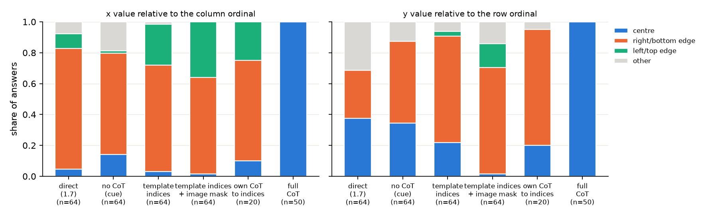
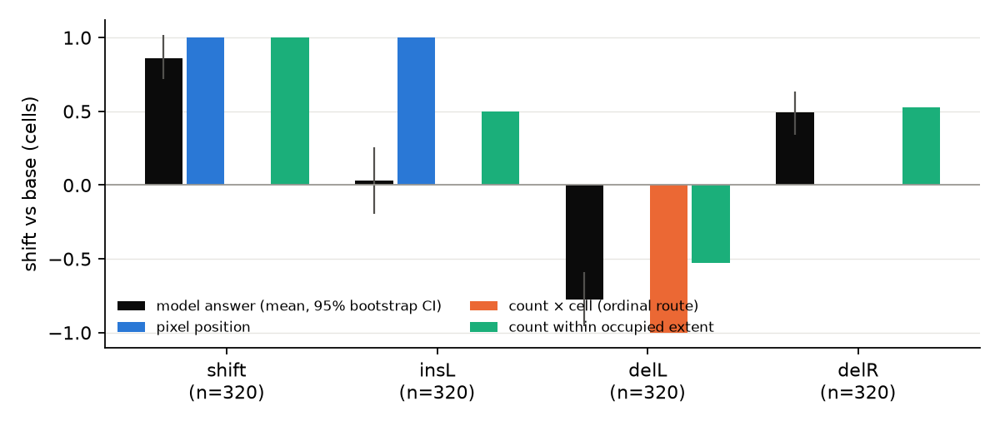
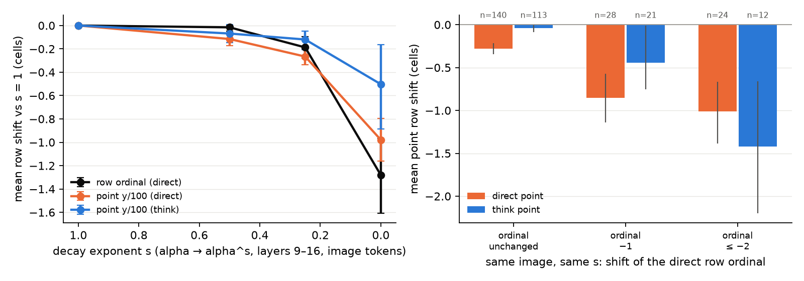
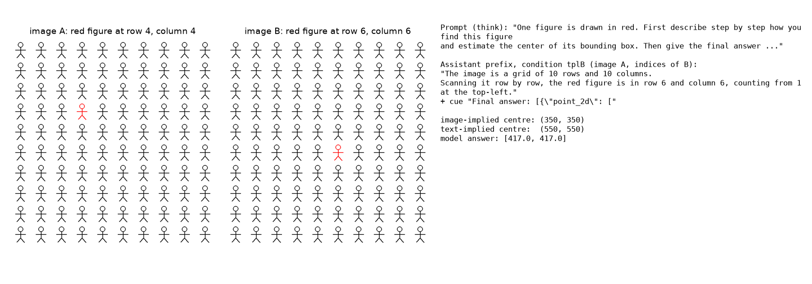
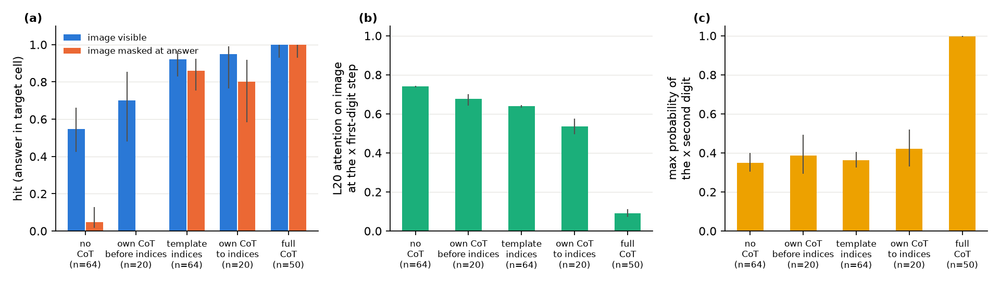
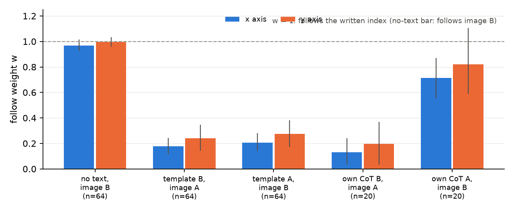
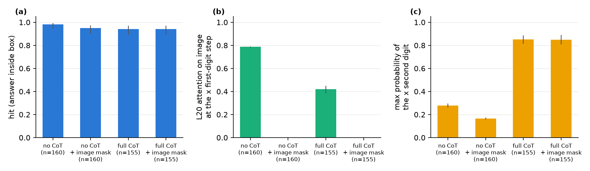
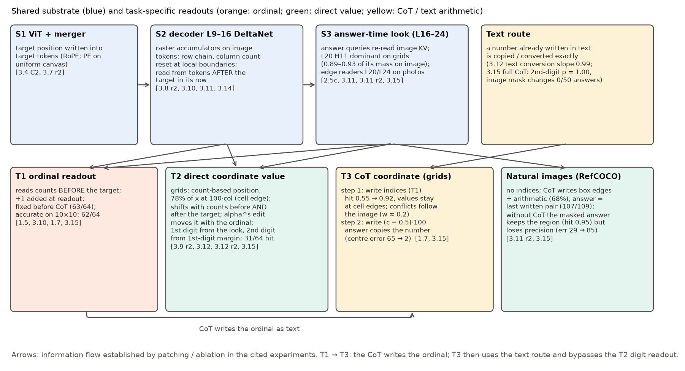

# 行列序号与坐标数值：共享与差异

实验日期：2026-11-03。本文属于[位置读取](plan.md)研究，编号为实验 3.15。本文综合已有记录并补充新实验，回答两个问题：行列序号（ordinal）与 0–1000 坐标数值在 Qwen3.5-9B 中共用哪些计算、在哪里分叉；思维链（chain-of-thought, CoT）把坐标准确率从 0.56 提高到 1.00 时，“坐标计算”具体发生在哪里。模型为 Qwen3.5-9B，bfloat16、SDPA、greedy decoding，thinking off。前置结果：[CoT 的行为与机理](../behavior/results_2026-10-21_cot_mechanism.md)（1.7）、[行列序号机制](results_2026-10-20_rowcol_mechanism.md)（3.10）、[坐标信息流](results_2026-10-20_coordinate_flow.md)（3.11）与其[自然图像部分](results_2026-10-21_coordinate_flow_natural.md)（3.11 r2）、[数字读出失败](results_2026-10-20_digit_failure.md)（3.12）与[第二轮](results_2026-10-21_digit_failure_r2.md)（3.12 r2）、[读出工具第二轮](results_2026-10-20_readout_tool_r2.md)（3.9 r2）、[行列序号的机理](../behavior/results_2026-10-16_ordinal_mechanism.md)（1.5）、[坐标读取路径](results_2026-10-14_coordinate_readout.md)（3.4/3.5）、[causal 与线性递推](results_2026-10-21_causal_vs_linear.md)（3.14）。

## 0. 通俗讲述

让模型在一张 10×10 的小人网格里找红色小人，可以问两种问题：“它在第几行第几列”，或者“它的中心坐标是多少（0–1000）”。人会觉得第二个问题只是第一个问题再乘一个格宽，但模型未必这样做。已有实验分别研究过两个问题，留下了两个看似矛盾的印象：一方面，坐标在 decoder 中层的 residual 里可以被线性 probe 以 5–7 个单位的误差读出，作答时由第 20 层的一个 head 回看图像直接读出，似乎不需要“先数第几列、再换算成坐标”；另一方面，1.7 发现网格坐标靠 CoT 完成“第 r 行第 c 列 → 坐标”的换算，3.9 r2 又发现网格上的坐标会随实例计数移动。本实验把这两条线放到同一个框架里。

我们的工作假设是：两个问题共享同一套视觉底座，在“读出”这一步分叉。底座有三层：ViT 把目标位置写进目标 token；decoder 第 9–16 层的 Gated DeltaNet 沿光栅顺序对图形行与图形列计数，计数状态留在图像 token 上；回答时第 16–24 层（主要是第 20 层）再回看一次图像。分叉在于读出：序号读出只读目标之前的计数，并在写数字前加入 +1 偏差；坐标读出把读到的位置交给逐位数字读出，首位来自图像，第二位来自首位读出的犹豫程度。由此可以推出两个可检验的预言。第一，在重复排列的网格上，直接作答的坐标应当带有计数的印记：取值落在格子边界上、随目标前后的实例数移动、随 DeltaNet 计数状态被破坏而移动。第二，CoT 的作用应当是绕开坐标数字读出：它先用更准的序号读出写下行列号，再用文本算术写下坐标数值，最后的答案只是抄写文本中的数字。

实验结果支持这两条预言，并纠正了一个直观看法。直接作答时，10×10 网格上 78% 的横坐标落在“列号 × 100”附近，即目标格子的右边界，而不是格子中心；在 1.5 的删减实例刺激上，坐标的平均移动与“目标在已占据范围内按计数排第几”这一预测一致；把 DeltaNet 在图像 token 上的衰减从 $\alpha$ 逐级改成 $\alpha^{s}$，坐标的行与序号的行一起下移（$s = 0$ 时分别为 −0.98 与 −1.28 行）。这说明网格上的直接坐标实际上是计数信号的另一种读法，不是对像素位置的精确测量。CoT 的“坐标计算”也并不隐秘：64 条推理文本中 62 条含有等号，58 条写出了半格修正（如 $(c - 0.5) \times 100$）。我们把 CoT 拆成两步来检验：只写行列号而不写算术时，命中率由 0.55 升到 0.92，但取值仍停在格子边界上；写出算术之后，答案逐字抄写文本中的数值，此时把图像对答案完全遮住，50 条答案一条都不变，第二位数字的最大概率由 0.36 升到 1.00，中心误差由 65 降到 2。所以 0.56 → 1.00 并不来自“多写了文字、多做了几次前向”，而来自文本中写下的两样东西：一个由更准确的序号读出给出的行列号，以及一个由文本算术给出、随后被精确抄写的坐标值。这与 3.12 的发现一致：文本中给出的数字走另一条精确的转换路径。

改写行列号的实验还给出一个意外：如果只把模板句中的行列号改成另一个格子并立即要求作答，答案仍主要跟随图像（跟随文本的权重只有 0.18–0.28），也就是说，单独一个写下的行列号不足以决定坐标，回答时的回看图像仍然起主导作用；如果允许模型接着写下去，它会按改写后的行列号写出算术，给出答案的回答中 80/92 抄写了这个算术结果。决定性的一步是把数值写进文本。自然图像（RefCOCO）上没有行列号可写，CoT 写的是目标框的上下左右边缘估计和求中心的算术（68%），答案同样抄写最后写下的坐标（107/109）；与网格不同，不写 CoT 时即使在回答时遮住图像，答案仍有 0.95 落在目标框内，但中位误差由 30 升到 85，说明自然图像上“哪个物体、大致在哪”的信息已由文本侧状态携带，回看图像负责精度。

## 1. 假设与主要结论

本文按“假设 → 证据”组织。第 2 节先给出组件与操作的定义；第 3 节梳理已有记录，回答“序号是否在 prefill 中得到”与“坐标读出中是否存在序号到数值的换算”；第 4 节检验假设 H1（网格上的直接坐标是计数信号的另一种读法）；第 5 节检验假设 H2（CoT 通过写出序号与算术绕开坐标数字读出）；第 6 节讨论自然图像；第 7 节给出统一图景与证据表。

1. **序号的计数在 prefill 中完成，序号数字在回答时读出；CoT 对序号不增加信息。** 1.7 的截断实验中，行列答案在不保留任何推理文本时已与完整 CoT 一致（63/64），推理阶段读到的是 prefill 写在图像 token 上的计数（第 3.1 节）。
2. **“坐标读出中不存在序号到数值的换算”只对自然图像与单目标画布成立。** 在重复排列的网格上，直接作答的坐标取值、对实例增删的响应和对计数状态干预的响应都显示，坐标由计数信号读出（第 3.2 节、第 4 节）。
3. **网格上直接作答的坐标是计数信号的另一种读法。** 78% 的横坐标落在 $100c$（目标格的右边界）附近；1.5 刺激上的平均移动符合“已占据范围内的计数位置”；$\alpha \to \alpha^{s}$ 使坐标的行与序号的行一起移动，且序号不变时坐标也移动 −0.28 行（第 4 节）。
4. **CoT 的坐标计算由两步文本构成：写出行列号与写出算术结果；答案抄写文本中的数值。** 只写行列号：命中 0.55 → 0.92，取值仍在格子边界；写出算术：中心误差 65 → 2，回答时遮蔽图像 0/50 答案改变，第二位数字最大概率 1.00（第 5.1–5.3 节）。
5. **单独写下的行列号不能覆盖图像，写下的算术可以。** 模板句中的行列号与图像冲突、立即作答时，答案跟随文本的权重为 0.18–0.28；回答时遮蔽图像后为 0.87–0.94；允许续写时，给出答案的回答中 80/92 按写下的行列号写出算术并抄写结果（第 5.2、5.4 节）。
6. **自然图像上 CoT 写的是目标框边缘与求中心的算术，答案同样抄写文本；不写 CoT 时，目标区域由文本侧状态携带，回看图像提供精度。**（第 6 节）

## 2. 组件、操作与符号

### 2.1 符号

| 符号 | 含义与形状 |
| --- | --- |
| $N$ | 网格每个轴上的格子数，本实验的网格为 $N = 10$ |
| $r, c$ | 目标的行号与列号，从 1 开始的整数 |
| $x, y$ | 模型输出的 0–1000 归一化坐标（标量） |
| $u$ | 沿某一轴的坐标，单位为格（cell），$u = x N / 1000$ |
| $\hat x_{\mathrm{img}}, \hat x_{\mathrm{txt}}$ | 由图像中目标格子的中心、由文本中写下的列号所推出的横坐标 |
| $w$ | 跟随权重（第 2.4 节） |
| $s$ | DeltaNet 衰减的指数缩放系数，$s \in \{1, 0.5, 0.25, 0\}$ |

格子 $c$ 的中心与右边界分别为

$$
x^{\mathrm{cen}}(c) = \frac{1000\,(c - 0.5)}{N}, \qquad x^{\mathrm{edge}}(c) = \frac{1000\,c}{N}.
$$

两者相差半个格子。如果模型把列号 $c$ 直接映射为“第 $c$ 个十分之一”，就会写出 $x^{\mathrm{edge}}(c)$；只有加入半格修正才会写出中心 $x^{\mathrm{cen}}(c)$。这一区分是第 4、5 节判断坐标由哪条路径产生的主要依据。

### 2.2 Gated DeltaNet 与短卷积

Qwen3.5-9B 的 32 层中，第 4、8、…、32 层为全注意力层，其余 24 层为 Gated DeltaNet 层。DeltaNet 层为每个 head 维护一个矩阵状态 $S_t$（形状为 $d_v \times d_k$），在第 $t$ 个 token 处按下式更新并输出：

$$
S_t = \alpha_t\, S_{t-1}\left(I - \beta_t k_t k_t^{\top}\right) + \beta_t v_t k_t^{\top}, \qquad o_t = S_t q_t .
$$

其中 $q_t, k_t$（长度 $d_k$）与 $v_t$（长度 $d_v$）由当前 token 的 hidden state 投影得到；$\beta_t \in (0, 1)$ 控制写入强度；衰减 $\alpha_t \in (0, 1)$ 控制旧状态保留多少，由

$$
\alpha_t = \exp(g_t), \qquad g_t = -\exp(A)\,\operatorname{softplus}(a_t + b)
$$

给出，$a_t$ 是 in_proj_a 的输出（每个 head 一个标量），$A, b$ 是每个 head 的参数。$\alpha_t$ 越接近 1，状态越像一个只累加不遗忘的计数器；3.8 r2 与 3.10 表明，第 9–16 层中部分 head 在每个图形行的起点降低 $\alpha_t$ 来“换行”，另一部分 head 以接近 1 的 $\alpha_t$ 累积行增量，构成行号的计数器。$q_t, k_t, v_t$ 在进入递推前先经过一个长度为 4 的因果短卷积，

$$
\tilde z_t = \sum_{j=0}^{3} w_j \odot z_{t-j},
$$

其中 $z$ 代表 $q$、$k$ 或 $v$ 的投影，$w_j$ 为逐通道权重。3.12 r2 表明，坐标的第二位数字经由第 25–31 层的这一短卷积读取首位数字所在位置的状态。

### 2.3 衰减的逐级削弱

3.8 r2 与 3.10 的干预令 $\alpha_t = 1$，属于全有或全无。为了检验坐标是否“按比例”跟随计数状态，本实验在第 9–16 层的 DeltaNet 层、全部 head、全部图像 token 处，把衰减改为 $\alpha_t^{s}$。实现方式是改写 in_proj_a 的输出：令

$$
a'_t = \operatorname{softplus}^{-1}\!\left(s \cdot \operatorname{softplus}(a_t + b)\right) - b ,
$$

则 $g'_t = s\, g_t$，从而 $\alpha'_t = \alpha_t^{s}$。$s = 1$ 为原模型，$s = 0$ 等价于 3.10 的 $\alpha_t = 1$。干预只作用于 prefill，生成阶段不改动。

### 2.4 强制作答、前缀与回答时遮蔽图像

强制作答沿用 1.7 的协议：在用户问题之后，以 assistant 身份写入一段前缀，再接答案提示 “Final answer: [{"point_2d": [”，由模型 greedy 解码出坐标。本实验使用以下前缀（问题均为 1.7 的 think 问法，图像为 1.7 的 64 张 10×10 红色目标网格；每张图像 A 配一张模板、网格相同而目标在行列上都至少相差 2 格的图像 B）：

1. **无 CoT（f0）**：前缀为空。
2. **模板行列号（tplA / tplB）**：一句固定的话，“The image is a grid of 10 rows and 10 columns. Scanning it row by row, the red figure is in row $r$ and column $c$, counting from 1 at the top-left.”，其中 $(r, c)$ 取 A 的真值（tplA）或 B 的真值（tplB）。这句话只含行列号与网格规模，不含任何算术或坐标值。
3. **模型自己的 CoT 截至行列号（own）**：取 1.7 中该图像的 think 回答，截到首次同时写出行与列的那一行末尾；若此前已出现等号、百分号、三位数或从 0 开始的编号，则不使用该条（64 条中可用 20 条）。ownB 把其中全部行列号改为 B 的值，own_imgB 保持文本不变而把图像换成 B。
4. **自己的 CoT 截至行列号之前（pre）**：同一 CoT 截到首个行列号所在行的开头。
5. **完整 CoT（full）**：1.7 中以 eos 结束的 50 条 think 回答，去掉最后的答案对象。

**回答时遮蔽图像（mask）**：从前缀的最后一个 token 起（包括答案提示与生成的数字），在全部 8 个全注意力层中对图像 token 的 key 加上 $-\infty$，使这些位置无法读取图像；prefill 中前缀本身对图像的读取与 DeltaNet 状态不改动。这一操作回答“回答时是否还需要回看图像”。同时记录生成横坐标首位数字的那一步中，第 20 层各 head 落在图像 token 上的 attention 份额（由与 SDPA 相同的 $q, k$ 计算 softmax 得到，见 1.7 的 probe），以及首位与第二位数字的概率分布。

**跟随权重**：对冲突条件（文本与图像指向不同格子），沿每个轴定义

$$
w = \frac{x - \hat x_{\mathrm{img}}}{\hat x_{\mathrm{txt}} - \hat x_{\mathrm{img}}},
$$

$\hat x_{\mathrm{img}}$ 与 $\hat x_{\mathrm{txt}}$ 取两个格子的中心。$w = 0$ 表示答案停在图像所示的位置，$w = 1$ 表示答案移到文本所写的位置；两个假设相距不足 50 个单位时不计入。这与 3.4 中“位移权重”的定义相同，选用投影而非“落在哪一格”的分类，是因为网格答案经常落在格子边界上，分类会把边界答案任意划入一侧。

## 3. 已有记录：序号与坐标各自在哪里形成

### 3.1 序号：计数在 prefill 中完成，数字在回答时读出

1.7 的截断实验显示，行列答案在保留 0 个推理 token 时已与完整 CoT 一致（63/64），准确率 0.98 与完整 CoT 相同；CoT 生成时重新读取图像 cache，但读到的是 prefill 写进图像 token 的计数：把 3.10 的 prefill 编辑只施加到图像 cache 上，行号正确率与完整编辑相同（14/32）。因此，**对序号而言，CoT 不提供新的信息，也不能纠正 prefill 中形成的计数错误。** 需要补充的细节是，“在 prefill 中得到”指的是计数状态，而不是序号数字本身：1.5 表明精确序号只在预测序号数字的位置、第 16–28 层逐渐形成，3.10 表明 +1 偏差加在读出阶段，3.11 表明回答时第 20 层的 head 在目标所在的 token 行上回看图像。合起来，序号由“prefill 中写在图像 token 上的计数状态”与“回答时的一次读出”组成，两者都在 CoT 开始之前完成。

### 3.2 坐标：已有记录实际说明了什么

PI 记得的结论是“模型在 prefill 时已有坐标信息，坐标读出中不存在‘行列号 → 坐标值’的换算”。逐条核对已有记录，这一结论由三个不同的命题混合而成，它们的适用范围不同：

| 命题 | 证据 | 适用范围 |
| --- | --- | --- |
| 序号不由坐标（像素位置或工具坐标）换算得到 | 3.4 C5：插入空白带只改变少数行号（6×6 5/48）；1.5：平移画布序号不变的比例 0.88–0.97；3.9 r2：shift 中坐标右移 0.69–1.21 格而序号不变 0.59–0.84；3.9：工具坐标写入上下文不改善序号 | 网格，确定性高 |
| 坐标信息在 decoder 中层以精确形式存在 | 3.4 probe：RefCOCO 第 15 层 MLP probe 误差 20 单位；3.6：首位数字位置的线性 probe 误差 5–7 单位 | 所有图像，确定性高 |
| 坐标在回答时由回看图像读出，不依赖问题文本上的 prefill 摘要 | 2.5c：只允许信息经 prompt 传递时恢复比例 0.00–0.13；3.11：第 20 层的单层图像 KV 恢复 0.11–0.96；1.7：问题文本 cache 不携带位置 | 合成图像，确定性高；自然图像见第 6 节 |

这三个命题都不涉及“坐标是否由计数得到”。恰恰相反，有两项已有结果指向网格坐标由计数得到：3.9 r2 在 1.5 的刺激上发现，目标像素不动而删去其前方一个实例时，点答案平均前移 0.57–1.17 格，删去其后方一个实例时后移 0.14–0.95 格，并且 $\alpha = 1$ 的计数消融同时使序号的行下移 1.59、点答案的行下移 1.23（逐图相关 0.63）；3.12 发现 10×10 网格上 90% 的点答案落在单元边界 $n/10$ 上，并推测这是“列序号 ÷ 列数”的计数路线，但没有直接检验。**因此，“坐标读出不需要序号到数值的换算”对单目标画布与自然图像成立（3.4 C2：单目标画布上交换 ViT RoPE 的位移权重 0.71；3.11：RefCOCO 两个轴都在目标 token 上），对重复排列的网格不成立。** 第 4 节补充直接检验。

## 4. 假设 H1：网格上的直接坐标是计数信号的另一种读法

**动机。** 如果网格坐标由像素位置直接读出，它应当在格子内连续分布，并且只随目标的像素位置移动；如果它是计数信号的另一种读法，取值应当带有“第几个”的离散结构，并随计数及计数状态移动。以下三项证据分别检验取值、刺激操纵与内部状态。

### 4.1 取值：落在格子边界上

*图 1：10×10 网格点答案相对序号的位置（模型输出，非拟合）。纵轴为份额；每根柱按 $u - c$（横坐标，左）或 $u - r$（纵坐标，右）分为四类：蓝色为格子中心（$-0.5$），橙色为右或下边界（$0$），绿色为左或上边界（$-1$），灰色为其余；归类容差为 0.2 格（20 个单位）。“direct (1.7)”为 1.7 的直接作答；其余柱为本实验的强制作答（第 2.4 节），“template indices + image mask”为模板行列号且回答时遮蔽图像。*

| 条件 | $n$ | $x$：中心 / 右边界 / 左边界 | $y$：中心 / 下边界 / 上边界 |
| --- | --- | --- | --- |
| 直接作答（1.7） | 64 | 0.05 / 0.78 / 0.09 | 0.38 / 0.31 / 0.00 |
| 无 CoT 强制作答 | 64 | 0.14 / 0.66 / 0.02 | 0.34 / 0.53 / 0.00 |
| 模板行列号 | 64 | 0.03 / 0.69 / 0.27 | 0.22 / 0.69 / 0.03 |
| 模板行列号 + 遮蔽图像 | 64 | 0.02 / 0.62 / 0.36 | 0.02 / 0.69 / 0.16 |
| 完整 CoT | 50 | 1.00 / 0 / 0 | 1.00 / 0 / 0 |

**直接作答的横坐标集中在目标格的右边界 $100c$ 附近（78%），只有 5% 落在中心。** 这正是“把列号 $c$ 映射为第 $c$ 个十分之一”所产生的值，与 3.12 的单元边界吸附一致。值得注意的是，模板行列号在回答时遮蔽图像后，模型仅凭文本中的列号写出的坐标同样落在边界上（$x$ 右边界 0.62、左边界 0.36，中心 0.02）。这说明模型由文本序号到数值的隐式映射本身就缺少半格修正，直接作答的取值与这一映射的取值相同（解释：直接作答的坐标与“隐式序号 → 数值”映射共享同一套取值，见第 7 节）。完整 CoT 的答案全部在中心，因为算术中写出了半格修正（第 5.3 节）。

### 4.2 刺激操纵：坐标随目标前后的实例数移动

*图 2：1.5 的单轴网格（21 个槽位、20 个实例）上点答案沿长轴的平均移动（相对同一 base 图像，单位为格；模型输出来自 3.9 r2 的 ordcoord 生成，本实验重新分析）。黑色为模型，误差线为 bootstrap 95% 区间；蓝色为像素位置的预测，橙色为“计数 × 格宽”的预测，绿色为“已占据范围内的计数位置”的预测。shift 把整行实例右移一格，insL 在目标前插入一个空槽，delL 删去目标前的一个实例，delR 删去目标后的一个实例。*

三种预测的定义如下。设目标是已占据槽位中的第 $k$ 个（从左数，含目标），共有 $n$ 个实例，第一个与最后一个实例的中心为 $u_{\mathrm{first}}$ 与 $u_{\mathrm{last}}$（单位为格）。像素预测为目标格中心；计数预测为 $u = k$；范围内计数位置为

$$
\hat u = u_{\mathrm{first}} + \frac{k - 1}{n - 1}\left(u_{\mathrm{last}} - u_{\mathrm{first}}\right).
$$

$\hat u$ 的含义是：模型数出目标排第 $k$、共 $n$ 个，再把这个比例放到实例实际占据的范围内。它同时依赖目标之前的实例数（$k$）、之后的实例数（经由 $n$）与整行的位置（经由 $u_{\mathrm{first}}, u_{\mathrm{last}}$）。

| 操纵 | $n$ | 模型均值 [95% 区间] | 中位 | 像素 | 计数 | 范围内计数位置 |
| --- | --- | --- | --- | --- | --- | --- |
| shift | 320 | +0.86 [0.72, 1.02] | +0.46 | +1.00 | 0 | +1.00 |
| insL | 320 | +0.03 [−0.19, 0.25] | +0.12 | +1.00 | 0 | +0.50 |
| delL | 320 | −0.78 [−0.96, −0.59] | −0.42 | 0 | −1.00 | −0.53 |
| delR | 320 | +0.49 [0.34, 0.63] | +0.16 | 0 | 0 | +0.53 |

**三种操纵中，只有“范围内计数位置”同时预测了 shift、delL 与 delR 的方向与大致幅度。** 像素预测无法解释 delL 与 delR（像素不动，坐标却移动），计数预测无法解释 shift 与 delR。insL 是唯一明显偏离的条件（模型 +0.03，预测 +0.50）：插入的空槽在 3.10 中会引起列计数从空槽之后重新开始，这一局部复位不在 $\hat u$ 中。逐样本的中位移动小于均值，说明答案中有相当比例不动，均值由一部分大幅移动的答案组成，这与 3.12 所述坐标数字读出的粗分辨率相符。

### 4.3 内部状态：削弱计数状态时坐标与序号一起移动

*图 3：在第 9–16 层 DeltaNet 的图像 token 上把衰减改为 $\alpha^{s}$（第 2.3 节，模型激活上的干预）后，相对 $s = 1$ 的平均行移动。左：黑色为直接作答的行序号，橙色为直接作答的点答案行（$y/100$），蓝色为 think 作答的点答案行（只含以 eos 结束的回答）；误差线为 bootstrap 95% 区间。右：按同一图像、同一 $s$ 下行序号的变化分层，点答案行的平均移动（$s < 1$ 的三档合并）；柱上标注样本数。64 张 10×10 网格，批量 16。*

| $s$ | 行序号（直接） | 点答案行（直接） | 点答案行（think） | 点答案列（直接） |
| --- | --- | --- | --- | --- |
| 0.5 | −0.02 | −0.12 | −0.07 | 0.00 |
| 0.25 | −0.19 | −0.27 | −0.12 | 0.00 |
| 0 | −1.28 | −0.98 | −0.50 | −0.18 |

**坐标的行随计数状态的削弱单调下移，幅度与序号同量级。** 在 $s = 0$ 时，点答案行下移 0.98 格，为序号下移量的 0.77 倍；列方向基本不动，与 3.10 中该干预只破坏行计数一致。按图像分层后可以看到两种读出的差别：序号不变的图像上，直接作答的点答案行仍平均下移 0.28 格 [−0.34, −0.22]（$n = 140$）；序号减 1 时下移 0.85 格（$n = 28$）；序号减 2 及以上时下移 1.01 格（$n = 24$）。解释：坐标读出对计数状态的变化连续响应，序号读出要等变化累积到足以越过一个整数才改变；坐标对大幅计数变化的响应趋于饱和，说明坐标并不等于“序号 × 格宽”，它读取同一计数状态，但另有像素位置等来源（3.9 r2 的 shift 条件）。think 作答时，点答案行在序号不变的图像上几乎不动（−0.04），只随序号的变化移动，这与第 5 节的结论一致：think 的坐标由写下的序号经文本算术得到。

**小结。** 取值、刺激操纵与内部状态三方面的证据都支持 H1：在重复排列的网格上，直接作答的坐标是 DeltaNet 计数信号的另一种读法，它与序号读出共享计数状态，取值带有“第 $c$ 个十分之一”的边界结构，并按“已占据范围内的计数位置”随实例增删移动。这一结论的范围限于重复排列的网格；单目标画布与自然图像上没有可数的实例，坐标来自目标 token 上的 ViT 位置（3.4 C2、3.11）。

## 5. 假设 H2：CoT 写出序号与算术，答案抄写文本中的数值

**动机。** 1.7 测得 CoT 使坐标准确率由 0.56 升到 1.00，但推理文本是自然语言。“坐标计算”可能有三种来源：(a) 更多的文本 token 带来更多的前向计算；(b) 文本中写下的中间量（行列号、网格规模）改变了回答时的读出；(c) 文本中写下了最终数值，答案只是抄写。三种来源对回答时遮蔽图像的反应不同：(a) 与 (b) 下答案仍需回看图像，(c) 下遮蔽图像不改变答案。下文先看 CoT 写了什么，再用强制作答把 (b) 与 (c) 分开。

*图 4：强制作答的输入示例。左两幅为配对图像 A 与 B；右侧为 tplB 条件的前缀（图像 A，模板句中写 B 的行列号）与该条的模型答案。*

### 5.1 CoT 写了什么

1.7 的 64 条 think 回答中，64 条写出网格规模（“10x10 grid”），60 条写出目标的行与列，62 条含等号，58 条含半格修正（“0.5”“+50”或“half”），37 条含“Wait / Actually”式的自我修正；首次写出的行列号与真值一致的有 45 条，最终答案正确的有 50 条，部分错误在后续核对中被改正。**因此 CoT 的坐标计算是显式的：它写下行列号与网格规模，再写出形如 $(c - 0.5) \times 100$ 或 $c \times 100 + 50$ 的算术与结果。** 推理文本可能写错，但写错时最终答案随文本出错（1.7：1254/1262 条答案与文本一致）。

### 5.2 只写行列号：命中率提高，取值仍是边界，冲突时图像占优

*图 5：10×10 网格强制作答（模型输出与 attention，非拟合）。(a) 答案落在目标格内的比例（含边界，与 1.7 相同），蓝色为图像可见，橙色为回答时遮蔽图像，误差线为 Wilson 95% 区间；“own CoT before indices”没有遮蔽条件。(b) 生成横坐标首位数字那一步，第 20 层 16 个 head 的平均图像 attention 份额。(c) 横坐标第二位数字的最大概率（在 10 个数字上归一化）。(b)(c) 的误差线为 bootstrap 95% 区间。*

| 前缀 | $n$ | 命中 [95% 区间] | 中心误差 | 遮蔽图像后命中 | L20 图像 attention | L20 H11 图像份额 | 第二位最大概率 |
| --- | --- | --- | --- | --- | --- | --- | --- |
| 无 CoT | 64 | 0.55 [0.43, 0.66] | 72 | 0.05 | 0.74 | 0.93 | 0.35 |
| CoT 截至行列号之前 | 20 | 0.70 [0.48, 0.85] | 84 | — | 0.68 | 0.93 | 0.39 |
| 模板行列号 | 64 | 0.92 [0.83, 0.97] | 65 | 0.86 | 0.64 | 0.89 | 0.36 |
| 自己的 CoT 截至行列号 | 20 | 0.95 [0.76, 0.99] | 63 | 0.80 | 0.54 | 0.77 | 0.42 |
| 完整 CoT | 50 | 1.00 [0.93, 1.00] | 2 | 1.00 | 0.09 | 0.04 | 1.00 |

**写下行列号使命中率由 0.55 升到 0.92，但中心误差几乎不变（72 → 65）。** 命中率的提高来自答案被约束到正确的格子：同一批图像上，直接回答行列号的准确率为 62/64，而直接回答坐标只有 31/64，所以写下的行列号带入了更准确的序号读出。但答案的取值仍停在格子边界上（图 1），因为“行列号 → 数值”的隐式映射缺少半格修正。此时回答仍在回看图像：第 20 层有 0.64 的 attention 落在图像上，其中 L20 H11 的 0.89 落在图像上，第二位数字的分布与无 CoT 时一样分散（最大概率 0.36），说明数字仍由 3.12 所述的图像数字读出产生。遮蔽图像后命中率只降到 0.86（McNemar $p = 0.39$，$n = 64$），说明文本中的行列号本身已足以确定格子。

| 冲突条件 | $n$ | 跟随权重 $w_x$ [95% 区间] | $w_y$ [95% 区间] |
| --- | --- | --- | --- |
| 无文本，图像换为 B（对照） | 64 | 0.97 [0.92, 1.01] | 1.00 [0.96, 1.03] |
| 模板写 B，图像 A | 64 | 0.18 [0.12, 0.24] | 0.24 [0.14, 0.35] |
| 模板写 A，图像 B | 64 | 0.21 [0.14, 0.28] | 0.28 [0.17, 0.38] |
| 模板写 B，图像 A，遮蔽图像 | 64 | 0.87 [0.80, 0.93] | 0.94 [0.85, 1.01] |
| 自己的 CoT 改写为 B，图像 A | 20 | 0.13 [0.03, 0.24] | 0.20 [0.03, 0.37] |
| 自己的 CoT（写 A），图像 B | 20 | 0.72 [0.55, 0.87] | 0.82 [0.59, 1.11] |

*图 6：冲突条件下的跟随权重（第 2.4 节定义，由模型答案计算）。蓝色为 $x$，橙色为 $y$；误差线为 bootstrap 95% 区间。第一组为对照：没有文本时把图像换为 B，$w = 1$ 表示答案完全跟随图像 B。*

**一句写下的行列号与图像冲突时，答案主要跟随图像（$w$ 为 0.18–0.28）。** 遮蔽图像后答案转而跟随文本（0.87–0.94），说明文本中的行列号确实被读取并换算，只是在两者都可用时，回答时的回看图像权重更大。“自己的 CoT 写 A、图像换为 B”是一个例外，答案跟随文本 0.72–0.82：这条 CoT 除行列号外还写下了与 A 一致的逐行描述（如“Rows 1–6: all black, Row 7: the last figure is red”），而改写版本只改了行列号、其余描述仍指向 A，文本内部不一致。解释（$n = 20$，区间宽）：文本对答案的约束随文本中与位置一致的线索数量增加，一个孤立的行列号不足以压过图像。

### 5.3 写出算术：答案抄写文本中的数值

**完整 CoT 之后，答案不再读取图像：遮蔽图像使 50 条答案中 0 条改变，第 20 层图像 attention 由 0.64 降到 0.09，第二位数字的最大概率为 1.00，中心误差为 2 个单位。** 这三项共同表明答案在抄写文本中已经写出的数值（1.7 的时间线也显示 CoT 后半段几乎不看图）。这与 3.12 的“文本换算”条件一致：提示中给出像素坐标、要求换算到 0–1000 时，第二位数字随组内偏移的斜率为 0.99，由真实偏移解释 99% 的方差，而图像坐标的斜率只有 0.34。**同一个模型同时具有两条数值路径：数字已在文本中时精确转换或抄写，数字只在图像中时经由粗分辨率的逐位读出。** CoT 的作用就是把坐标从后一条路径搬到前一条路径上。

由此可以把 1.7 的 0.56 → 1.00 分解为两步：写下行列号把格子定对（命中 0.55 → 0.92，依赖更准确的序号读出），写下半格修正的算术把数值定准（中心误差 65 → 2，依赖文本数值路径）。“更多 token、更多前向计算”不能解释这一结果：模板句只比无 CoT 多 45 个 token，命中率即达 0.92；CoT 截至行列号之前的前缀平均多 65 个 token，命中率只有 0.70，中心误差 84，与无 CoT 时相当；起作用的是前缀中写了什么，而不是前缀有多长。

### 5.4 续写：改写行列号之后，CoT 用哪个值计算

第 5.2 节的冲突条件在写下行列号后立即强制作答。为了检验 PI 提出的“改写写下的行号，坐标是否按算术跟随”，本节在同样的前缀之后不加答案提示，让模型自由续写（greedy，至多 400 个 token，批量 16），再按最终答案离哪个格子中心更近（距离不超过 50 个单位）归类。

| 前缀 | $n$ | 跟随文本 | 跟随图像 | 其他 | 无答案（截断） | 含自我修正用语 |
| --- | --- | --- | --- | --- | --- | --- |
| 模板写 A，图像 A（一致） | 64 | 58（两者一致） | — | 3 | 3 | 4 |
| 模板写 B，图像 A | 64 | 39 | 2 | 4 | 19 | 22 |
| 模板写 A，图像 B | 64 | 41 | 0 | 6 | 17 | 22 |
| 自己的 CoT 改写为 B，图像 A | 20 | 1 | 0 | 2 | 17 | 16 |
| 自己的 CoT（写 A），图像 B | 20 | 4 | 0 | 0 | 16 | 14 |

**允许续写时，给出答案的回答几乎都按写下的行列号计算坐标（模板条件 80/92），与立即强制作答时答案主要跟随图像（$w \approx 0.2$）相反。** 一条典型的续写是“Row 6 (from top) → y ≈ 550 (since 6 * 100 = 600, but centered in the cell: 550)”，随后答案抄写 550。这说明决定性的步骤是“把数值写进文本”：只要模型先写出算术，答案就走文本数值路径，而图像只在答案直接由数字读出产生时才占优。另一方面，约三分之一的续写写出“Wait — I made an error in initial scan”一类的话并重新逐行扫描，其中大多数在 400 个 token 内没有给出答案；这与 1.7 的观察一致：模型会用图像核对文本，但核对通常表现为重新枚举，而不是直接修正数值。自己的 CoT 条件中 16–17/20 被截断，无法得出结论。

### 5.5 计数状态被削弱时，think 的坐标跟随自己写下的算术

在第 4.3 节的逐级削弱下，think 回答写下的行号与网格规模都会改变：$s = 0$ 时 41 条以 eos 结束的回答中，声明网格为 10 行的只有 20 条，其余声明 9、8、7 或 6 行，即 DeltaNet 计数同时决定了 CoT 中的“目标行”与“总行数”。按每条回答自己写下的最后一个行号 $r'$ 与声明的行数 $R'$ 计算 $1000(r' - 0.5)/R'$，答案纵坐标与之相差不超过 6 个单位的比例在四档 $s$ 下为 0.70、0.71、0.84 与 0.66（$n$ 为 57、51、50、38），其余多为文本中先写 1-based、算术中改用 0-based 编号的回答（规则编码未区分）。**因此 think 的坐标是写下的计数结果的算术函数，计数状态的错误经由写下的序号与总数传到坐标。** 这也解释了图 3 中 think 的点答案行只在序号改变时移动。

## 6. 自然图像：没有序号，文本侧状态携带区域

RefCOCO 测试集随机抽取 160 条（3.9 r2 的 test split，phrasing 0），分别以直接问法与 think 问法作答（think 问法：“First describe step by step how you find this object and estimate the center of its bounding box. Then give the final answer ...”），再对 think 回答做与第 5 节相同的强制作答。命中定义为答案落在目标框内。

| 条件 | $n$ | 命中 [95% 区间] | 中心误差（中位 / 均值） | L20 图像 attention | 第二位最大概率 |
| --- | --- | --- | --- | --- | --- |
| 直接作答 | 160 | 0.98 [0.95, 0.99] | 25 / — | — | — |
| think 作答 | 160 | 0.92 [0.87, 0.95] | 22 / — | — | — |
| 强制作答：无 CoT | 160 | 0.98 [0.95, 0.99] | 30 / 54 | 0.79 | 0.28 |
| 强制作答：无 CoT，遮蔽图像 | 160 | 0.95 [0.90, 0.97] | 85 / 106 | 0 | 0.16 |
| 强制作答：完整 CoT | 155 | 0.94 [0.89, 0.97] | 22 / 63 | 0.42 | 0.85 |
| 强制作答：完整 CoT，遮蔽图像 | 155 | 0.94 [0.89, 0.97] | 23 / 65 | 0 | 0.85 |

*图 7：RefCOCO 强制作答（模型输出与 attention）。(a) 命中率，Wilson 95% 区间；(b) 横坐标首位数字处第 20 层的图像 attention；(c) 横坐标第二位数字的最大概率；(b)(c) 为 bootstrap 95% 区间。*

1. **自然图像上的 CoT 写的是目标框边缘与求中心的算术，答案抄写最后写下的坐标。** 160 条推理文本全部含方位词，88% 写出 10–1000 之间的数，71% 写出坐标对或框，68% 含算术；有坐标对的 109 条中，107 条的答案与最后写下的坐标对完全相同。遮蔽图像后 86% 的答案完全不变，第二位数字的最大概率为 0.85。这与网格上的第 5.3 节是同一机制：数值一旦写进文本，答案走文本数值路径。区别在于自然图像上没有可写的序号，CoT 写下的边缘值本身由写这些数字时的图像读出得到。
2. **think 作答比直接作答略差（0.92 对 0.98，McNemar 11 对 1，$p = 0.006$），中位误差相近（22 对 25）。** 其中 5 条 think 回答没有给出可解析的答案（2 条截断）。解释：在自然图像上，直接作答的坐标数字读出本已准确（3.11 r2：边缘读取 head 的组合），CoT 把读出拆成四个边缘值逐一写下，每一步都可能引入误差，没有可以纠正的系统偏差（如网格的半格偏差）。
3. **不写 CoT 时，遮蔽图像只使命中率由 0.98 降到 0.95，但中位误差由 30 升到 85。** 网格上同一操作使命中率由 0.55 降到 0.05。**自然图像上，“哪个物体、大致在哪一区域”已由问题文本与答案提示上的状态携带，回答时的回看图像负责把位置定准；网格上所有实例外观相同，目标与其位置都只能在回答时从图像读出。** 这与 3.11 r2 的“what 经由 DeltaNet 状态、where 经由全注意力 head”一致，也与 3.4 中“横坐标在生成开始前已由图像之后的文本位置读取”一致。

## 7. 统一图景

*图 8：序号与坐标的共享底座与分叉（示意图，由本文与所引实验的结果汇总，非模型输出）。蓝色为共享底座，橙色为序号读出，绿色为直接作答的坐标读出（网格与自然图像），黄色为文本数值路径与 CoT。箭头为所引实验中由 patching、消融或强制作答确立的信息流；每个方框标注其证据所在的实验。*

**共享部分。** (S1) ViT 把目标位置写进目标 token，单目标画布上由 ViT RoPE 决定（3.4 C2：位移权重 0.71），均匀背景上还写进周围 token（2.5e、3.7 r2）。(S2) decoder 第 9–16 层的 Gated DeltaNet 沿光栅顺序在图像 token 上计数：行号由跨行的链式计数给出，列计数在局部视觉边界处复位，网格纵向信息位于目标所在 token 行中位于目标之后的 token 上（3.8 r2、3.10、3.11、3.14）。序号与网格坐标都读取这一计数状态（第 4.3 节；3.9 r2）。(S3) 回答时第 16–24 层回看一次图像，第 20 层为主，网格上 L20 H11 的图像份额为 0.89–0.93（本实验；3.11）。

**分叉部分。** (T1) 序号读出只读目标之前的计数，在读出阶段加入 +1，答案在 CoT 之前确定（1.5、3.10、1.7）。(T2) 直接作答的坐标读出：网格上读出计数信号，取值为“第 $c$ 个十分之一”的边界、随“已占据范围内的计数位置”移动；自然图像上读出目标 token 的位置与目标框边缘（3.11 r2）；两者都经由逐位数字读出，首位来自回看图像，第二位来自首位读出的相邻边际（3.12 r2）。(T3) CoT：写下由 T1 得到的行列号，再写下带半格修正的算术，答案经文本数值路径抄写（本实验）。

| 结论 | 证据 | 实验 | 确定性 |
| --- | --- | --- | --- |
| 序号的计数在 prefill 中写在图像 token 上，CoT 读这一状态而不独立计数 | 截断 63/64 一致；图像 cache 编辑 14/32 = 完整编辑 | 1.7、3.10 | 高 |
| 序号不由坐标换算 | shift 中坐标移动而序号不变；工具坐标不改善序号 | 3.4、1.5、3.9 r2 | 高 |
| 网格上直接作答的坐标读取 DeltaNet 计数状态 | $\alpha^{s}$ 使坐标行随序号行移动（$s = 0$：−0.98 对 −1.28），序号不变时也移动 −0.28 | 3.9 r2、3.15 第 4.3 节 | 高 |
| 网格坐标的取值是“第 $c$ 个十分之一”的边界 | 直接作答 78% 的 $x$ 在 $100c$ 附近；文本序号的隐式映射给出同样的边界 | 3.12、3.15 第 4.1 节 | 高 |
| 网格坐标按已占据范围内的计数位置随实例增删移动 | shift/delL/delR 的均值符合 $\hat u$；insL 不符 | 3.9 r2 数据、3.15 第 4.2 节 | 中（逐样本噪声大，只在均值层面成立） |
| CoT 写出行列号使答案落入正确格子 | 命中 0.55 → 0.92；序号 62/64 对坐标 31/64 | 3.15 第 5.2 节 | 高 |
| 单独写下的行列号不能覆盖图像 | 冲突时 $w$ = 0.18–0.28；遮蔽图像后 0.87–0.94 | 3.15 第 5.2 节 | 高 |
| 改写行列号后续写，CoT 按改写值计算坐标 | 模板冲突条件中给出答案的 80/92 跟随文本；约 1/3 续写重新扫描后截断 | 3.15 第 5.4 节 | 中（截断 36/128） |
| CoT 写出算术后，答案抄写文本数值，不再读图像 | 遮蔽后 0/50 改变；L20 attention 0.09；第二位概率 1.00 | 1.7、3.15 第 5.3 节 | 高 |
| 文本中的数字走精确转换路径，图像中的数字走粗分辨率读出 | 文本换算斜率 0.99 对图像 0.34；本实验第二位概率 1.00 对 0.36 | 3.12、3.12 r2、3.15 | 高 |
| think 的坐标是写下的行号与行数的算术函数 | $\alpha^{s}$ 下声明的行数改变，答案与 $1000(r' - 0.5)/R'$ 一致 0.66–0.84 | 3.15 第 5.5 节 | 中（规则编码不区分 0/1-based） |
| 自然图像上目标区域由文本侧状态携带，回看图像提供精度 | 遮蔽后命中 0.98 → 0.95，中位误差 30 → 85；网格 0.55 → 0.05 | 3.11 r2、3.15 第 6 节 | 中（单一数据集，160 条） |
| 自然图像上 CoT 抄写写下的框边缘与中心 | 107/109 答案等于最后写下的坐标；遮蔽后 86% 不变 | 3.15 第 6 节 | 高 |

## 8. 讨论

### 8.1 参数问题还是架构限制

1. **网格坐标的边界取值属于参数（训练数据）问题，确定性较高。** 同一模型在文本中写出 $(c - 0.5) \times 100$ 时完全正确，说明架构不阻止它表示中心；隐式映射缺少半格修正，是训练中“序号 → 坐标”的对应关系没有学好。3.13 用 3200 条精确坐标样本微调后，10×10 网格列号多计 1 由 0.60 降至 0，与此相符。
2. **网格坐标依赖计数，是“信息在哪里”的架构事实与“读哪里”的参数选择共同造成的，确定性中等。** 3.14 表明网格的纵向信息位于目标之后的 token 上，这是 Gated DeltaNet 光栅递推的结构性质；坐标读出选择读取这一计数状态，而不读取目标 token 上的 ViT 位置（3.7 r2：只互换目标 token 时输出只移动 0.02–0.20），则可能随训练改变。
3. **CoT 的增益不来自额外计算量，来自文本数值路径。** 这对方法设计的含义是：让坐标经过“先写序号、再写算术”的文本步骤，可以在不改动权重的情况下绕开逐位数字读出的低分辨率；但它依赖序号读出本身正确，不能纠正 prefill 中的计数错误（第 5.5 节），在自然图像上也没有收益（第 6 节）。

### 8.2 与其他实验的一致与冲突

1. **1.7：** 一致，并细化了“CoT 完成换算”的含义。1.7 观察到截断到 20% 的 CoT 时准确率已达 0.90，本实验表明这一阶段对应写下行列号；剩余的精度来自算术。
2. **3.9 r2：** 一致。3.9 r2 的“坐标与序号共享上游计数、读出不同”在本实验中得到逐级干预与取值结构的支持，并由“已占据范围内的计数位置”给出定量形式；3.9 r2 的点答案对计数消融的逐图相关 0.63 与本实验的分层结果相容。
3. **3.12 / 3.12 r2：** 一致。3.12 推测网格单元边界吸附来自“列序号 ÷ 列数”，本实验以文本序号的隐式映射复现了同样的边界取值；3.12 r2 的“第二位数字读首位读出的相邻边际”解释了只写行列号时第二位数字仍然分散。
4. **3.11 / 3.11 r2：** 一致。只写行列号时 L20 H11 仍把 0.77–0.89 的 attention 放在图像上，说明第 20 层的回看在有文本线索时仍被执行；自然图像上遮蔽回看后区域仍保留，与 what/where 的通路分离相符。
5. **3.4 结论 8 与 2.5c：** 部分冲突。2.5c 发现只允许信息经 prompt 文本传递时恢复比例为 0.00–0.13，与本实验网格上的结果一致；但本实验在 RefCOCO 上发现遮蔽回看后命中率仍为 0.95。两者的差别在于图像类型，2.5c 只用了合成网格，3.4 已观察到横坐标可由图像之后的文本位置读取，本实验把这一现象推广到自然图像的两个轴（精度下降）。

## 9. 限制

1. 网格实验只用了 10×10、64 px 单元、红色目标这一种条件，序号读出接近天花板；20×20 等序号本身出错的网格上，CoT 的两步分解是否成立没有检验。
2. 自己的 CoT 前缀只有 20 条可用（其余在写下行列号之前已出现算术、坐标或 0-based 编号），相关结论的置信区间较宽；改写只替换了行列号，CoT 中其余与位置有关的描述没有改写。
3. 回答时遮蔽图像只作用于全注意力层，DeltaNet 状态中仍可能含有图像信息；网格上遮蔽后命中率降到 0.05，说明这部分信息在网格上很少，但在自然图像上的作用无法与问题文本 token 的 key/value 区分。
4. 第 4.2 节使用 3.9 r2 已有的点答案，“已占据范围内的计数位置”是事后提出的预测，只在均值层面成立，逐样本的解释力低；insL 与预测不符。
5. 逐级削弱与 RefCOCO 生成使用批量解码（批量 16）。批量与单条解码的 20 例抽查中，坐标完全相同 10/20，相差不超过 13 个单位 17/20，最大相差 28 个单位；差异来自第二位数字，所有比较都在相同批量设置的条件之间进行。强制作答全部以批量 1 运行。
6. 规则编码（行列号、网格规模、坐标对）未经人工核对，think 回答中 1-based 与 0-based 编号的混用会使第 5.5 节的一致率偏低。

## 10. 产物

1. 代码：`analysis_tools/position/ordinal_vs_coordinate.py`（前缀定位与改写、跟随权重、逐级削弱、自然图像 CoT 编码），`ordinal_vs_coordinate_run.py`（GPU 阶段：spotcheck、answer、cont、gate、refcoco），`ordinal_vs_coordinate_analysis.py`（统计与作图）；入口 `scripts/analysis/position/ordinal_vs_coordinate.sh`；测试 `tests/analysis/position/test_ordinal_vs_coordinate.py`。强制作答复用 1.7 的 `cot_mechanism_engine`（Probe、build_batch、continue_batch），共享模块未改动。
2. 结果：WORK_DIR 下 `analysis/position/2026-11-03_ordinal_vs_coordinate/`，包括 `answer.jsonl`（网格强制作答，含数字分布与 attention）、`cont.jsonl`（续写）、`gate.jsonl`（逐级削弱）、`refcoco_gen.jsonl` 与 `refcoco_answer.jsonl`、`spotcheck.json`、`summary.json`（全部统计）与 `run_*.json`（运行参数、模型版本与代码摘要）。
3. 图：`docs/analysis/position/figures/ordinal_vs_coordinate/`。
4. GPU 用量：一张空闲 A40（经 claim 脚本申请，运行结束即释放），约 1.1 GPU 小时（强制作答 17 分钟、逐级削弱 16 分钟、RefCOCO 生成与强制作答 14 分钟、续写 13 分钟、抽查与加载约 5 分钟）。
