# 读出缺陷的定位与上游编码变化（实验 3.13 第二轮）

实验日期：2026-11-03 至 2026-11-04。本文属于[位置信息与坐标读取](plan.md)研究，是[实验 3.13 第一轮](results_2026-10-21_targeted_finetune.md)的续篇，并与[实验 3.12](results_2026-10-20_digit_failure.md)及其[第二轮](results_2026-10-21_digit_failure_r2.md)、[实验 3.11](results_2026-10-20_coordinate_flow.md)的结论相互检验。模型为 Qwen3.5-9B，bfloat16、SDPA、greedy decoding，thinking off，全部提示为 direct-answer 提示。

## 通俗讲述

Qwen3.5 写坐标时，内部表示能以约 5 个单位（0–1000 归一化坐标）的精度知道目标在哪里，写出来的数字却粗糙得多：输出向 500 吸附，第二位数字接近随机，平均误差约 50 个单位。第一轮发现，3200 条精确标注样本的 LoRA 训练就能把误差降到 2 个单位左右，但只训练“写数字”的后期层（第 28–32 层 MLP）几乎无效，训练更早的第 10–14 层反而有效。当时的解释是“浅层有信息、深层读不出、深层的低秩更新又学不会，所以浅层必须改变”。这一解释有三处没有检验：后期层失败是否只是学习率不够；冻结整个读出阶段、只训练上游能否完全复现效果；上游的编码究竟变成了什么、为什么变了之后就容易读。本轮逐一回答这三个问题。

第一组实验是控制条件。把后期层 LoRA 的学习率提高十倍，误差仍为 46.6，说明失败不是优化不足；反过来，在全部线性层训练的同时冻结第 28–32 层 MLP，或者冻结整个第 25–32 层（读出阶段），误差分别为 1.6 与 1.8，与不冻结时的 1.7 相同。因此读出阶段的原有权重完全够用，问题不在读出模块本身。再按组件类型拆分：只训练全部 MLP、只训练 DeltaNet 投影、只训练 8 个 full attention 层的 q/k/v/o，误差都在 2–3.5 之间。是 MLP 还是 attention 并不要紧，要紧的是可训练参数位于读出阶段之前。

第二组实验回答“修复究竟在哪里”。做法是把训练好的 LoRA 只在一部分层或一部分 token 上启用，其余部分保持原模型，这相当于把微调模型的 residual 在某一层接到原模型上继续计算。结果非常集中：LoRA 只在第 1–4 层启用、其余 28 层全部用原权重时，第二位数字的增益（把首位强制为真值后，第二位数字的期望值随“坐标在当前百位内的偏移”变化的斜率；理想读出为 1，与图像无关时为 0，原模型为 0.34）为 0.98，坐标误差 2.5，几乎等于整个微调模型；LoRA 只作用在图像 token 上、文本 token 完全不变时，增益为 0.99。反过来，只在第 9 层以后启用的任何组合都与原模型无异。也就是说，修复发生在解码器最前面几层对图像 token 的处理，而第 5–32 层的原有计算（包括第 20 层回看图像的 attention 和第 25–32 层的数字写入）原样保留就能写出精确数字。据此我们训练了一个“定位版”LoRA：只有第 1–4 层、只作用于图像 token、参数量 2.7 M（全部线性层的八分之一），它在全部留出测试族上与全部线性层 LoRA 相当，而纯文本输入的输出与原模型逐字相同。

第三组实验刻画编码怎样改变。把同一个红色圆在画面中水平扫过，记录每个位置的 residual，再用主成分分析投到三维。原模型中，这些点在每一层都排成一条平滑的曲线，坐标沿曲线单调变化，相当于一把“直尺”。微调后，从第 15 层开始，目标所在的图像 token 上出现了一个新的二维分量：坐标每增加 100 个单位，这个分量就绕圆周转一整圈，像钟面一样；第 20 层回看图像之后，写第一位数字之前的那个 token 也带上了同一个“时钟”，旋转角度与坐标的线性相关系数达到 0.99998。周期恰好是 100，意味着钟面上的角度直接等于“坐标的后两位”：第二位数字只需要判断指针落在十个 36° 扇区中的哪一个，这是一个线性读出，不再需要先算出首位、再做减法。原模型只有直尺，第二位数字只能借用首位读出“偏向哪个相邻数字”的程度，分辨率只有 25–42 个单位。值得注意的是，只训练第 1–4 层时，时钟同样在第 15 层出现，说明构造时钟的计算在原模型的第 5–24 层中本来就存在，前四层的修改只是让它对图像坐标起作用。

时钟是否就是全部原因？把二维时钟平面从微调模型的 residual 中投影掉，第二位真值概率从 0.85 降到 0.64，但增益保持 1.00；把微调模型的时钟加到原模型上，第二位真值概率只从 0.14 升到 0.25。因此二维时钟是新编码最清晰的可见特征，但信息并不只存放在这一个平面里。同样，前四层带来的改变大部分是一个与坐标几乎无关的常量偏移，只加这个常量能把增益从 0.34 推到 0.57–0.77，却达不到 0.98。这两点都提醒我们：新编码是一种分布在多个方向上的非线性重编码，时钟是它最可解释的投影。

综合起来，三个候选解释中最符合事实的是：原模型的上游并不缺信息，读出阶段也不缺能力，缺的是早期图像 token 表示中的一个小改动，它让原模型已有的中层计算把位置从“直尺”格式重编码成“数字”格式（周期为 100 的时钟是其可见部分），后续读出阶段就能以理想增益写出数字。这属于参数问题，而不是结构限制。最后，在扩大的数据上（增加自然图像 grounding 与自蒸馏的指令数据）训练全部线性层与定位版 LoRA，两者在合成测试上都保持 2–3 个单位的误差，通用能力没有下降；但杂物场景的目标选择、RefCOCO 误差与 GQA 上省略“Final answer”行的格式倾向都没有被扩大的数据改善。

## 1. 研究问题与主要结论

本轮回答四个问题：读出缺陷位于 MLP 还是 attention、位于读出阶段还是上游（Q1）；修复具体位于哪些层与哪些 token（Q2）；上游编码从什么变成了什么，为什么新编码更容易读出（Q3）；扩大数据与指令混合后的训练能否保持效果并修复第一轮的副作用（Q4）。主要结论如下，括号内为支持该结论的小节与图。

1. **读出阶段（第 25–32 层）的原有权重足以写出精确坐标，缺陷不在读出模块（第 4.1 节，图 1）。** 全部线性层 LoRA 冻结 MLP 28–32 后误差 1.6，冻结第 25–32 层全部模块后误差 1.8（不冻结 1.7）；而只训练 MLP 28–32 时即使学习率提高十倍误差仍为 46.6。确定性：高。
2. **组件类型不重要，位置重要（第 4.1 节，图 1）。** 只训练全部 MLP、只训练 DeltaNet 投影、只训练 full attention q/k/v/o、或 full attention + MLP，单个红色圆的误差为 2.4、2.0、3.5、2.3，第二位增益 0.97–0.99。确定性：高。
3. **修复位于第 1–4 层的图像 token（第 4.2 节，图 2、3）。** 全部线性层 LoRA 只在第 1–4 层启用时第二位增益 0.98、P(真值第二位) 0.74；只在图像 token 上启用时 0.99 / 0.75；只在第 9 层以后任一区段启用时与原模型相同。扩大数据训练的 LoRA 重复了这一结果（0.98 / 0.71 与 0.98 / 0.75）。确定性：高。
4. **定位版 LoRA（第 1–4 层、只作用于图像 token、2.7 M 参数）达到全部线性层的坐标精度，并保持纯文本行为不变（第 4.7 节，图 9、10）。** 单个红色圆误差 2.4，20×20 网格命中率 1.00，第二位增益 0.98；纯文本题 45/45 输出与原模型相同。确定性：高。
5. **微调后，上游出现周期为 100 的时钟编码；它由原模型第 5–24 层的计算生成（第 4.3 节，图 4–6、S1–S4）。** 目标图像 token 上，cos/sin(2πx/100) 的交叉验证 $R^2$ 在第 14 层为 −0.06，第 15 层跃升到 0.67，第 20 层 0.93（原模型各层 ≤ 0.11）；$q_0$ 在第 20 层由 0.1 跃升到 0.93。只在第 1–4 层启用 LoRA 时曲线与全模型重合。确定性：高（测量）；时钟由哪些中层组件生成尚未定位。
6. **二维时钟是新编码的可见特征，不是唯一载体（第 4.4 节，图 7）。** 投影掉时钟平面使 P(真值第二位) 由 0.85 降到 0.64、增益不变；向原模型注入时钟使其由 0.14 升到 0.25。前四层的改变主要是常量偏移，单独加入常量偏移只恢复部分增益（0.57–0.77）。确定性：中。
7. **训练使首位 logit 差 $m$ 的分辨率提高约 2–3 倍，但精确输出主要来自新编码（第 4.5、4.6 节，图 8、S5）。** $m$ 的分辨率由 33 / 42 个单位（x / y）降到 14 / 16（全部线性层）与 10 / 11（前四层拼接）；坐标误差则降低 30 倍。确定性：中。
8. **扩大数据训练保持精度与通用能力，但没有修复目标选择与 GQA 格式倾向（第 4.7 节，图 9、10）。** 详见表 4。确定性：中（通用能力每个基准 200 题）。

## 2. 问题、假设与理论分析

### 2.1 已有事实与待解释的矛盾

1. **信息量足够。** 原模型 $q_1$ 处（第一位数字 token，第二位数字在此预测）的 residual 上训练的线性 ridge probe 能以约 5 个单位的平均误差恢复坐标（[3.12](results_2026-10-20_digit_failure.md) 第 3.6 节）。
2. **数字由后期组件写出。** 第二位数字的 logit 主要由 MLP 27–32 与第 25–31 层 DeltaNet 写入；第二位读取的是 $q_0$（第一位数字之前的 token）处首位分布的相邻 logit 差 $m = \ell_0(k+1) - \ell_0(k-1)$（$k$ 为真值首位，$\ell_0$ 为 $q_0$ 处首位的 logit），经第 25–32 层 DeltaNet 短卷积传到 $q_1$（[3.12 第二轮](results_2026-10-21_digit_failure_r2.md)）。3.12 第三轮测得 $m$ 的均值随组内偏移线性变化，但同一偏移下散布 2.0–3.1 nats，对应 25–42 个单位的分辨率（plan.md 发现 42）。
3. **只训练写入者无效。** 第一轮中只训练 MLP 28–32（含秩 64）误差 38–45，参数量相同的 MLP 10–14 误差 19.1，全部线性层 1.7。

第一轮的叙述没有检验三点：后期层失败是否来自优化不足；冻结读出阶段、只训练上游能否完全复现效果；上游编码的具体形式。

### 2.2 三个候选解释

记读出阶段为第 25–32 层（3.12 第二轮所指的 DeltaNet 中继与数字写入 MLP 所在的层），上游为第 1–24 层。

- **(i) 上游表示有缺陷。** 上游送给读出阶段的坐标表示在几何上有缺陷（被压缩、局部失真或与其他变量纠缠），训练修复这些缺陷。
- **(ii) 上游正常，读出能力有限。** 上游表示完整，但读出阶段只能高增益地转换某一种格式的输入，训练让上游改送这种格式。
- **(iii) 其他**，例如纯粹的优化问题：读出阶段可以学会精确读出，但在相同学习率与步数下后期层的更新幅度不足。

对应的预测：(iii) 预测提高读出阶段的学习率即可；(ii) 预测冻结读出阶段、只训练上游就能达到全部线性层的效果，且原读出能直接转换微调模型的上游 residual；(i) 预测原模型上游表示在几何上可以看到缺陷，训练后缺陷消失。

### 2.3 读出需要什么样的编码：位置编码与时钟编码

记坐标为 $x \in [0, 1000)$，首位与第二位数字为

$$
k = \lfloor x / 100 \rfloor, \qquad s = \lfloor x / 10 \rfloor \bmod 10 .
$$

模型在 $q_1$ 处已经写出首位 $k$，需要输出十个数字的 logit $\ell_0, \dots, \ell_9$，使 $\arg\max_d \ell_d = s$。

**情形 A：单调的位置编码。** 设读出阶段的输入 residual $h \in \mathbb{R}^{D}$（$D = 4096$）沿一条近似直线随 $x$ 变化：

$$
h(x) \approx h_0 + x\, u + \varepsilon ,
$$

其中 $h_0 \in \mathbb{R}^D$ 是与坐标无关的部分，$u \in \mathbb{R}^D$ 是坐标方向，$\varepsilon$ 是与坐标无关的扰动。线性 probe 能从这种编码以高精度读出 $x$。但 $s$ 是 $x$ 的锯齿函数，在 $[0, 1000)$ 上有 100 段，每 10 个单位跳变一次。若只沿 $u$ 读取，读出必须先算出组内偏移 $x - 100k$（连续量与离散首位的乘积型交互），再在每 10 个单位处做一次陡峭跳变；用 SwiGLU MLP 实现需要大量阈值神经元，每个阈值的过渡宽度远小于 10 个单位，相应的权重增益很大。原模型实际使用的近似路线是读取 $m$（首位分布向相邻数字倾斜的程度），其分辨率受 $m$ 的散布限制。

**情形 B：周期为 100 的时钟编码。** 设 residual 中另有一个二维分量把坐标表示为钟面上的角度：

$$
h(x) \approx h_0 + x\, u + r \left[ \cos\theta(x)\, a + \sin\theta(x)\, b \right] + \varepsilon, \qquad \theta(x) = \frac{2\pi x}{100},
$$

其中 $a, b \in \mathbb{R}^D$ 是张成“时钟平面”的两个正交单位向量，$r > 0$ 是时钟半径。$x$ 每增加 100，角度转一整圈；每增加 10，角度转 36°，正好对应第二位数字加 1。此时取第 $d$ 个数字的读出向量

$$
w_d = \cos\phi_d\, a + \sin\phi_d\, b, \qquad \phi_d = \frac{2\pi (d + 0.5)}{10},
$$

得到

$$
\ell_d = w_d^\top h = r \cos\big(\theta(x) - \phi_d\big) + c ,
$$

其中 $c$ 是与 $d$ 无关的项。$\ell_d$ 在角度 $\theta$ 最接近 $\phi_d$ 的数字处最大，而 $\theta$ 落在第 $d$ 个 36° 扇区内当且仅当 $s = d$，所以线性读出 $\arg\max_d \ell_d = s$ 对任意 $x$ 成立。这一读出不需要知道首位 $k$（$x$ 与 $x + 100$ 在钟面上处于同一角度），分辨率由半径与噪声之比决定：若时钟平面内噪声的标准差为 $\sigma$，角度噪声约为 $\sigma / r$ 弧度，对应的坐标误差约为

$$
\Delta x \approx \frac{100}{2\pi} \cdot \frac{\sigma}{r}.
$$

直观地说，情形 A 要求读出电路在一把直尺上每隔 10 个单位刻一道线，情形 B 把直尺卷成周长为 100 的圆环，十个数字只是把圆环等分成十个扇区。语言模型中文本数字常以周期为 2、5、10、100 的傅里叶特征表示（Zhou et al., 2024, *Pre-trained Large Language Models Use Fourier Features to Compute Addition*；Kantamneni & Tegmark, 2025, *Language Models Use Trigonometry to Do Addition*），这是我们检验时钟编码的理论动机。

## 3. 实验设计

### 3.1 训练条件

全部条件使用第一轮的训练集（3200 条精确坐标样本）、步数（200 步，每步 16 条）、LoRA 秩 8、$\alpha = 32$、学习率 $10^{-4}$（另有说明者除外），只改变可训练参数的位置。LoRA 的定义与实现见第一轮第 2.2 节。

**表 1：本轮新增的训练条件。**

| 条件 | 可训练参数 | 参数量 | 检验的问题 |
| --- | --- | --- | --- |
| all_but_mlp28_32 | 全部线性层，冻结 MLP 28–32 | 19.7 M | 数字写入 MLP 是否必须改变 |
| all_but_25_32 | 第 1–24 层全部线性层（读出阶段全部冻结） | 16.2 M | 读出阶段是否必须改变 |
| mlp28_32_lr1e3 | MLP 28–32，学习率 $10^{-3}$ | 2.0 M | 后期层失败是否来自优化不足 |
| mlp_all | 全部 32 层的 MLP | 12.6 M | MLP 对注意力模块 |
| fa_attn | 8 个 full attention 层的 q/k/v/o | 2.0 M | 同上 |
| dn_proj | 24 个 Gated DeltaNet 层的输入与输出投影 | 7.1 M | 同上 |
| fa_mlp | full attention q/k/v/o + 全部 MLP | 14.5 M | attention + MLP |
| all_linear_img | 全部线性层，LoRA 更新只作用于图像 token | 21.6 M | 定位版（位置） |
| early1_4_img | 第 1–4 层全部线性层，只作用于图像 token | 2.7 M | 定位版（层与位置） |

“只作用于图像 token”的含义：LoRA 的输出增量 $\frac{\alpha}{r} B A x_t$ 乘以掩码 $\mathbb{1}[t \text{ 为图像 token}]$，文本 token 与生成的答案 token 只经过原权重，因此纯文本输入的计算与原模型完全相同。

### 3.2 拼接（splice）协议

对一个训练好的 LoRA，记其全部被适配的模块为集合 $\mathcal{M}$。一个拼接配置由模块子集 $\mathcal{S} \subseteq \mathcal{M}$ 与 token 位置集合 $\mathcal{T}$ 组成：前向时 $\mathcal{S}$ 中的模块在 $\mathcal{T}$ 中的位置加上 LoRA 增量，其余模块与位置使用原权重。由于 decoder 逐层顺序计算，“$\mathcal{S}$ = 第 1 至 $k$ 层、$\mathcal{T}$ = 全部位置”严格等价于把微调模型第 $k$ 层输出的全部 residual 接入原模型第 $k+1$–32 层（正向拼接 fwd$k$）；“$\mathcal{S}$ = 第 $k+1$ 至 32 层”等价于把原模型第 $k$ 层的 residual 接入微调模型的后续层（反向拼接 rev$k$）。本轮测试的配置为：正向与反向拼接（$k = 4, 8, \dots, 28$）、4 层区段、组件类型（MLP / full attention / DeltaNet / 两种注意力模块，以及以第 24 层为界的拆分）、token 位置（图像 token、问题文本、答案前缀、全部文本）。

**测量。** 输入为 3.6 的单个红色圆水平与竖直扫描（每隔一步取一张，真值 100–999，共 208 张），答案前缀为原模型自身的 JSON 模板，首位强制为真值。由 $q_0$ 处的首位分布与 $q_1$ 处的第二位分布计算：首位真值概率 $P_0$；第二位真值概率 $P_1$；第二位增益（$\mathbb{E}[s]$ 对组内偏移 $(x - 100k)/10$ 的最小二乘斜率，理想值 1）；teacher-forced 数值误差 $|100\hat k + 10\,\mathbb{E}[s] + 5 - x|$（$\hat k$ 为首位分布的 argmax）。“恢复比例”定义为（配置值 − 原模型值）/（完整微调值 − 原模型值）。增益的 95% 区间由 1000 次按图像 bootstrap 得到。

### 3.3 编码几何的测量

在原模型、各微调模型与两个拼接配置上，记录每一层（0–32）在三个位置的 residual：$q_0$、$q_1$、目标图像 token 的平均（与圆的外接框重叠的 token）。输入为密集扫描（x、y 各 215 张）、3.12 的文本给定坐标（textconv，108 张）与 RefCOCO 测试集的 point 问题（198 张）。

1. **PCA 流形图。** 每层 residual 的前三个主成分，按真值 $x$ 着色（参考 `tmp/manifold.png` 的样式）。
2. **周期谱。** 把 residual 降到前 32 个主成分 $Y$，先对 $x$ 的三次 Legendre 多项式回归得到 $R^2_\text{smooth}$，再加入 $\cos(2\pi x / T)$、$\sin(2\pi x / T)$ 两列，$R^2$ 的增量称为“周期 $T$ 的额外 $R^2$”。单调的直尺编码在所有 $T$ 上的额外 $R^2$ 接近 0（随机水平约 $2/N$）。
3. **时钟的交叉验证可解码性。** 用 5 折 ridge 回归从 residual（前 32 个主成分）预测 $\cos(2\pi x/100)$ 与 $\sin(2\pi x/100)$，报告留出折的平均 $R^2$。这一测量不依赖无监督主成分是否捕获时钟，适用于内容变化很大的自然图像。
4. **时钟角度。** 在时钟平面（上一步回归中 cos、sin 系数张成的平面）上的投影角度 $\operatorname{atan2}(p_2, p_1)$ 对 $x$ 的展开斜率与线性相关；$\operatorname{atan2}$ 返回二维点 $(p_1, p_2)$ 相对于第一坐标轴的方向角。

### 3.4 因果检验

1. **时钟平面消融与注入。** 平面基 $P \in \mathbb{R}^{2 \times D}$ 由微调模型的 capture 估计（每个轴分别估计）。消融：$h \leftarrow h - (h - \mu) P^\top P$（$\mu$ 为该位置 residual 的均值），作用于 $q_0$ 第 24 层输出、全部图像 token 第 20 / 22 / 24 层输出或两者；对照为同维随机平面。注入：向原模型加入微调模型拟合的时钟 $c_\text{cos}\cos(2\pi x/100) + c_\text{sin}\sin(2\pi x/100)$。
2. **常量偏移。** $v$ 为第 1–4 层拼接模型与原模型在第 4 层输出、全部图像 token 上的平均差（分别由 40 张圆图、40 张 RefCOCO 图或只由目标 token 估计），以 0.5、1、2 倍加到原模型每个图像 token 的第 4 层输出；对照为同范数随机向量。

### 3.5 扩大数据训练

训练集 8071 条：第一轮 3200 条 + 1600 条未用过的 RefCOCO（3.9 的图像级训练划分）+ 1600 条 GQA 场景图生成的指代表达（训练图像，排除 GQA 评估子集的图像；一半为“类别唯一”的表达如 “the cat”，一半为“同类多个、以属性区分”的表达如 “the white dog”，后者提供同类干扰物）+ 1671 条自蒸馏指令样本（TextVQA 训练集问题 500、GQA 训练集问题 500、简短描述 300、物体存在判断 400，答案为原模型自己的 greedy 输出，截断的 29 条剔除）。自蒸馏的目的是让指令部分保持原模型的行为，包括答案格式。训练 504 步，其余超参数不变。条件为 scaled_all_linear、scaled_early1_4_img（定位版）与 scaled_all_but_25_32（冻结读出阶段）。

### 3.6 评估与统计

坐标测试集与第一轮相同（997 条，全部为留出的族、布局或网格尺寸），批量 greedy 解码。批量与参考 `generate` 的 20 例抽查中坐标完全一致的比例：early1_4_img 13/20、scaled_all_linear 17/20、scaled_all_but_25_32 16/20，其余差异为 1–3 个单位。比例报告 Wilson 95% 区间，均值报告 bootstrap 95% 区间，与原模型的比较为配对检验。GPU 用量约 14 GPU 小时（单卡 A800 或 A40，经 claim 工具申领空闲卡）。

## 4. 结果

### 4.1 控制条件：读出模块不是问题

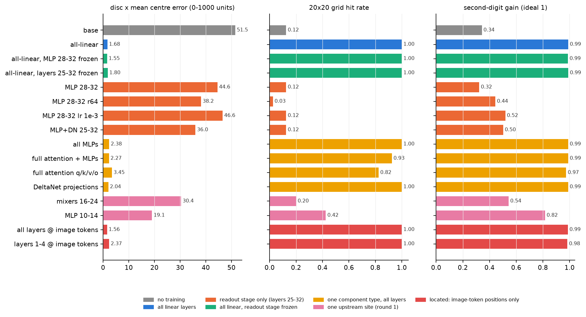

*图 1：各训练条件的单个红色圆 x 平均中心误差（左）、20×20 网格命中率（中）与第二位增益（右）。误差与命中率来自 997 条测试题的 greedy 答案；增益来自 3.12 首位析因（首位强制为真值时 $\mathbb{E}[s]$ 对组内偏移的最小二乘斜率）。颜色表示条件族：灰为原模型，蓝为全部线性层，绿为“全部线性层但冻结读出阶段”，橙为“只训练读出阶段”，黄为“只训练一种组件类型”，粉为第一轮的单一上游位置，红为只作用于图像 token 的定位版。*

**表 2：控制条件的坐标指标（误差单位为 0–1000 坐标）。**

| 条件 | 圆 x 误差 | 圆 y 误差 | 圆 x 平台 | 10×10 误差 | 20×20 命中 | chart_ui 误差 | 第二位增益 |
| --- | --- | --- | --- | --- | --- | --- | --- |
| 原模型 | 51.5 | 44.4 | 0.89 | 68.4 | 0.12 | 61.4 | 0.34 |
| all_linear | 1.7 | 2.2 | 0.19 | 3.0 | 1.00 | 5.9 | 0.99 |
| all_but_mlp28_32 | 1.6 | 2.2 | 0.19 | 2.9 | 1.00 | 5.8 | 0.99 |
| all_but_25_32 | 1.8 | 2.2 | 0.19 | 3.3 | 1.00 | 6.3 | 0.99 |
| mlp28_32 | 44.6 | 38.8 | 0.89 | 62.2 | 0.12 | 61.1 | 0.32 |
| mlp28_32_lr1e3 | 46.6 | 38.4 | 0.70 | 56.7 | 0.12 | 52.8 | 0.52 |
| late25_32 | 36.0 | 30.1 | 0.63 | 37.9 | 0.12 | 56.1 | 0.50 |
| mlp_all | 2.4 | 2.3 | 0.19 | 2.3 | 1.00 | 9.1 | 0.99 |
| fa_mlp | 2.3 | 1.7 | 0.19 | 3.1 | 0.93 | 9.6 | 0.99 |
| fa_attn | 3.5 | 3.6 | 0.15 | 7.0 | 0.82 | 23.3 | 0.97 |
| dn_proj | 2.0 | 2.1 | 0.19 | 2.0 | 1.00 | 6.3 | 0.99 |
| all_linear_img | 1.6 | 1.4 | 0.19 | 3.0 | 1.00 | 7.3 | 0.99 |
| early1_4_img | 2.4 | 2.4 | 0.19 | 2.1 | 1.00 | 7.8 | 0.98 |

“平台”为真值 400–610 时输出落在 480–520 的比例（真值本身的比例为 0.19）。

1. **冻结读出阶段不影响效果。** all_but_25_32 冻结了 3.12 所指的全部写入组件（MLP 27–32、DeltaNet 25–31 与第 32 层 attention），误差 1.8、增益 0.99，与 all_linear 无差别。这直接否定了“读出模块能力不足、必须改变”的说法：原有的读出权重在收到合适的输入时就能写出精确数字。
2. **后期层失败不是优化问题。** 学习率提高十倍后 MLP 28–32 的误差为 46.6，训练集上数字交叉熵 1.10（全部线性层 0.81）；它只是进一步压低了整十数的比例。结合第一轮秩 64 的结果（误差 38.2），容量与学习率都不是原因，(iii) 被排除。
3. **MLP 与 attention 都可以完成修复。** 只训练全部 MLP、只训练 DeltaNet 投影、只训练 full attention 的 2.0 M 参数，都使误差降到 2–3.5。决定性的因素是可训练参数位于读出阶段之前；在上游，哪一类组件被修改并不重要。

### 4.2 拼接：修复位于第 1–4 层的图像 token

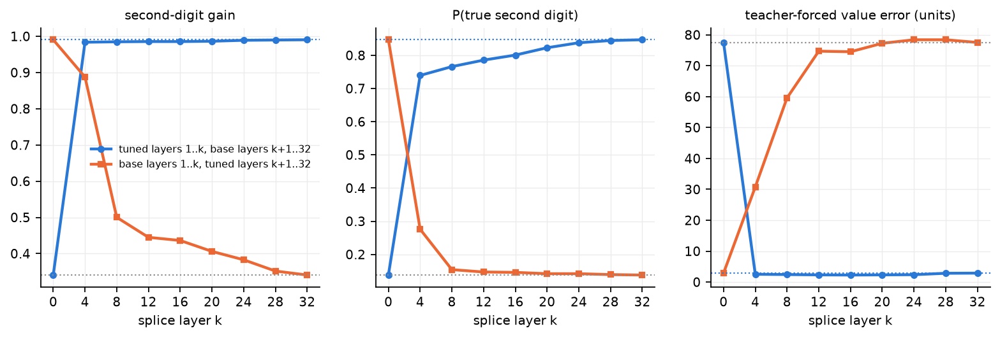

*图 2：全部线性层 LoRA 的深度拼接（teacher-forced，208 张圆图）。蓝线：LoRA 在第 1–$k$ 层启用、第 $k+1$–32 层为原模型（等价于把微调模型第 $k$ 层 residual 接入原模型）；橙线：LoRA 只在第 $k+1$–32 层启用。点线为原模型（灰）与完整微调模型（蓝）的值。数值由模型前向的数字分布计算。*

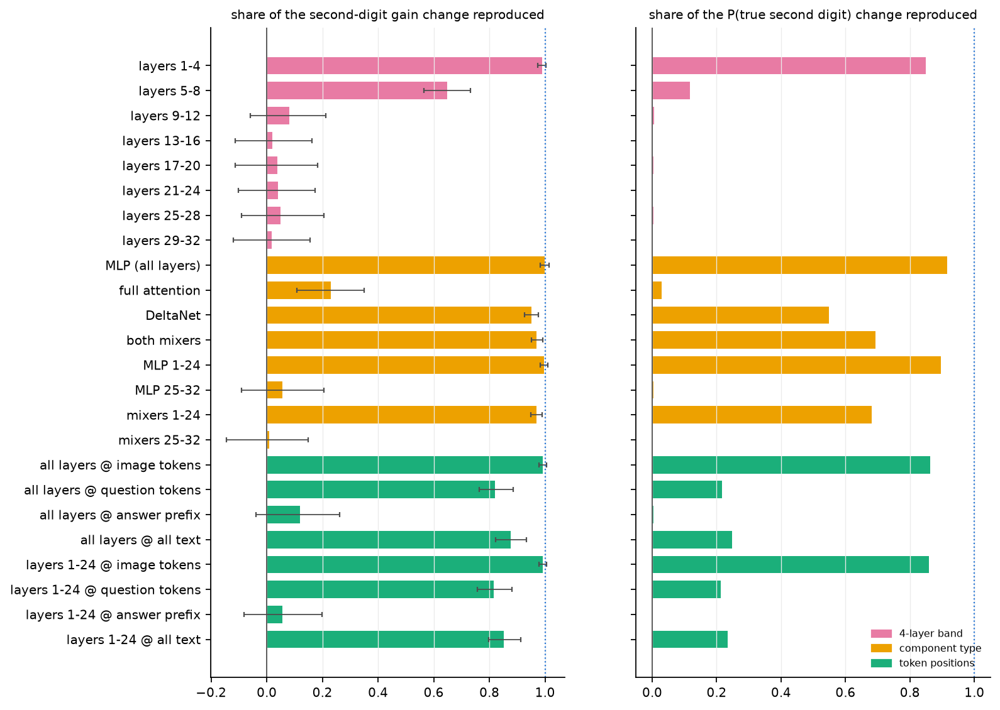

*图 3：各拼接配置复现的变化比例（0 = 原模型，1 = 完整微调模型），左为第二位增益（误差线为 bootstrap 95% 区间），右为 P(真值第二位)。粉：4 层区段；黄：组件类型；绿：token 位置。*

**表 3：关键拼接配置（全部线性层 LoRA；scaled 列为扩大数据训练的 LoRA）。**

| 配置 | 增益 | $P_1$ | $P_0$ | 数值误差 | scaled：增益 / $P_1$ |
| --- | --- | --- | --- | --- | --- |
| 原模型 | 0.34 | 0.14 | 0.53 | 77.5 | 0.34 / 0.14 |
| 完整 LoRA | 0.99 | 0.85 | 0.98 | 2.9 | 0.99 / 0.85 |
| 第 1–4 层 | 0.98 | 0.74 | 0.97 | 2.5 | 0.98 / 0.71 |
| 第 5–8 层 | 0.76 | 0.22 | 0.79 | 44.5 | 0.57 / 0.17 |
| 第 9–12 层（及其后任一区段） | 0.35–0.39 | 0.14 | 0.54–0.58 | 72–79 | — |
| 第 5–32 层（rev4） | 0.89 | 0.28 | 0.84 | 30.8 | 0.66 / 0.17 |
| 只 MLP（全部层） | 0.99 | 0.79 | 0.97 | 2.9 | 0.99 / 0.79 |
| 只 full attention | 0.49 | 0.16 | 0.65 | 65.4 | 0.39 / 0.14 |
| 只 DeltaNet | 0.96 | 0.53 | 0.94 | 15.1 | 0.81 / 0.24 |
| 全部层 @ 图像 token | 0.99 | 0.75 | 0.97 | 2.3 | 0.98 / 0.75 |
| 全部层 @ 问题文本 | 0.87 | 0.29 | 0.86 | 32.5 | 0.48 / 0.15 |
| 全部层 @ 答案前缀 | 0.42 | 0.14 | 0.56 | 75.9 | — |

1. **第 1–4 层的 LoRA 单独就复现了几乎全部效果。** 正向拼接在 $k = 4$ 时已达到增益 0.98、数值误差 2.5；反向拼接在 $k = 4$ 时增益降到 0.89、$P_1$ 降到 0.28，$k \ge 8$ 后与原模型相同。这说明原模型的第 5–32 层——包括 3.11 所指的第 20 层回看图像的 attention 与 3.12 所指的第 25–32 层写入组件——在收到前四层修改后的表示时，原样就能完成精确读出。
2. **修复作用在图像 token 上。** LoRA 只作用于图像 token 时复现 99% 的增益变化与 86% 的 $P_1$ 变化；只作用于问题文本时只改善首位（$P_0$ 0.86），只作用于答案前缀时无效。因此被修复的是图像 token 的表示，而非回答时的查询方式或答案格式。
3. **定位结论可以复现。** 用扩大数据从头训练的 LoRA 给出相同的模式（第 1–4 层 0.98 / 0.71，图像 token 0.98 / 0.75）。第一轮的 MLP 10–14 LoRA 也是如此：只作用于图像 token 时增益 0.82，与完整的 0.83 相同，作用于文本时为 0.39。
4. **补充观察。** 定位版 LoRA 在评估时若漏掉第一个图像 token 的更新（本轮一次实现错误造成，已修正并重跑），$P_1$ 由 0.78 降到 0.23、增益由 0.98 降到 0.82。第一个图像 token 为何对这一修复如此重要、是否与 [2.2](../representation/results_2026-10-16_high_norm.md) 研究的高范数 token 有关，尚待单独检验。

### 4.3 编码怎样改变：从直尺到时钟

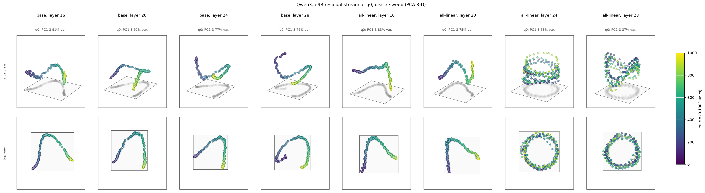

*图 4：$q_0$ 处 residual 的三维 PCA（单个红色圆水平扫描，215 张图），上行为斜侧视图，下行为俯视图，灰色为在底面上的投影。左四列为原模型第 16、20、24、28 层，右四列为全部线性层 LoRA 的同一层。颜色为真值 $x$（viridis，0–1000）。坐标为每层独立的主成分得分，由激活直接计算。*

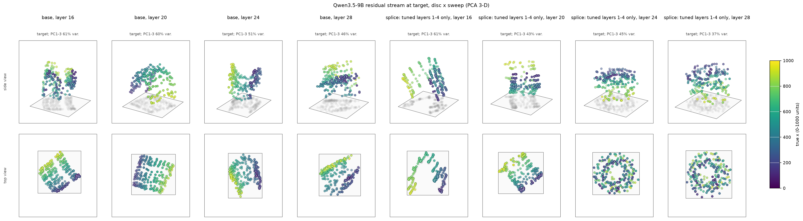

*图 5：目标图像 token（与圆重叠的 token 的平均）处 residual 的三维 PCA。左四列为原模型，右四列为只在第 1–4 层启用 LoRA 的拼接模型。样式同图 4。*

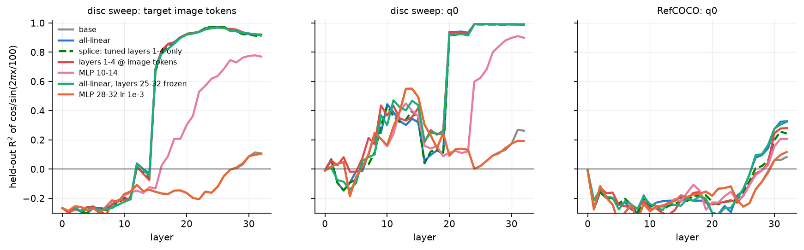

*图 6：$\cos(2\pi x/100)$ 与 $\sin(2\pi x/100)$ 的 5 折交叉验证 $R^2$（ridge 回归，residual 前 32 个主成分）随层数的变化。左：目标图像 token（圆扫描）；中：$q_0$（圆扫描）；右：$q_0$（RefCOCO 198 张）。灰：原模型（被与之重合的橙线遮住）；蓝：全部线性层；绿虚线：只在第 1–4 层启用 LoRA 的拼接模型；红：early1_4_img；粉：MLP 10–14；绿实线：冻结读出阶段；橙：MLP 28–32（学习率 $10^{-3}$）。$R^2 < 0$ 表示留出预测比常数还差，即不存在可线性读出的时钟。*

1. **原模型在每一层都只有直尺编码。** 图 4 左四列中，点沿一条平滑曲线按颜色顺序排列；周期谱中所有周期的额外 $R^2$ ≤ 0.03（第 3.3 节方法 2，图 S3 左），时钟可解码性在目标 token 上始终 ≤ 0.11（图 6 灰线，被橙线遮住）。这是情形 A：坐标信息完整，但只以单调方式存放。
2. **微调后出现周期为 100 的时钟。** 图 4 右侧第 24、28 层的点排成圆环，俯视图中颜色沿圆周循环九次以上；$q_0$ 第 24 层时钟平面上的角度每 100 个单位转 −358°，与 $x$ 的线性相关 $|r| = 0.99998$。周期 100 恰好对应第二位数字：钟面上的角度就是坐标的后两位（第 2.3 节情形 B）。图 S1 直接展示了这一点：微调模型与冻结读出阶段的模型在时钟平面上的点构成半径约 40 的圆环，角度对 $x \bmod 100$ 呈一条直线；原模型与 MLP 10–14 的点没有这种结构。

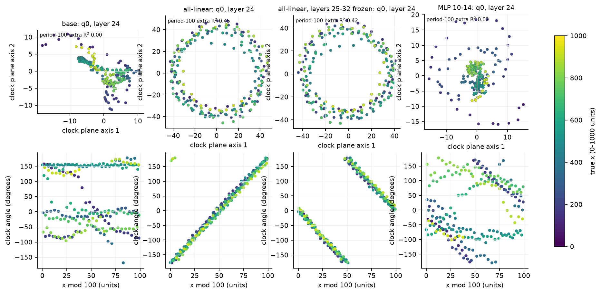

*图 S1：$q_0$ 第 24 层 residual 在时钟平面上的投影（单个红色圆水平扫描）。时钟平面由第 3.3 节方法 3 中预测 $\cos(2\pi x/100)$ 与 $\sin(2\pi x/100)$ 的两个回归系数向量张成（正交化后作为两条坐标轴）；上行为投影坐标，下行为投影角度 $\operatorname{atan2}(p_2, p_1)$ 对 $x \bmod 100$ 的散点。四列依次为原模型、全部线性层、全部线性层但冻结第 25–32 层、MLP 10–14。颜色为真值 $x$（viridis，0–1000 坐标单位），左上角标注周期 100 的额外 $R^2$。平面轴的符号不唯一，所以第三列角度随 $x$ 递减，与第二列等价。数值由激活直接计算，平面由 ridge 回归拟合。*

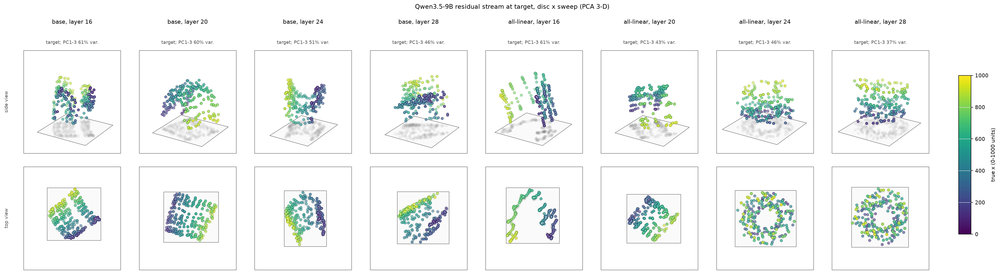

*图 S2：目标图像 token 处 residual 的三维 PCA，左四列为原模型，右四列为全部线性层 LoRA，层与样式同图 4。微调模型第 24、28 层俯视图中的圆环即目标 token 上的时钟；与图 5 比较可见，只在第 1–4 层启用 LoRA 的拼接模型形成相同的几何。*
3. **时钟先在图像 token 上形成，再被读到 $q_0$。** 目标 token 的时钟可解码性在第 14 层为 −0.06，第 15 层跃升到 0.67，第 20 层 0.93；$q_0$ 的时钟在第 16–19 层为 0.0–0.1，在第 20 层跃升到 0.93。第 20 层正是 3.11 测得的回看图像的层（L20 H11 为主要读取 head）。因此回答时的 attention 读取机制不变，被读取的内容从直尺变成了时钟。
4. **时钟由原模型自己的中层生成。** 只在第 1–4 层启用 LoRA 时，目标 token 与 $q_0$ 的时钟曲线与完整微调模型逐层重合（图 6 绿虚线），第 15 层的跃升也相同。第 5–24 层此时全部是原权重，所以构造时钟的计算原本就存在于原模型中，前四层的修改只是让它作用于图像坐标。冻结读出阶段、只训练前四层图像 token、只训练 DeltaNet 或 MLP 的条件都形成相同的时钟（$q_0$ 第 24 层额外 $R^2$ 0.42–0.49）；只训练后期层的条件没有时钟。MLP 10–14 在目标 token 上形成较弱、较晚的时钟（第 32 层 0.78），其增益也只有 0.82。
5. **自然图像上时钟较弱。** RefCOCO 的 $q_0$ 在第 30 层的时钟可解码性为 0.25–0.33（原模型 0.06–0.08），目标 token 上不可解码（目标 token 平均覆盖整个物体，物体中心不对应单个 token）。这与第一轮“RefCOCO 误差只降低 13 个单位”一致：自然图像的瓶颈主要在目标选择与标注噪声，而非数字读出。
6. **文本给定坐标的对照。** 原模型在 textconv（坐标以像素数值在文本中给出，模型换算成 0–1000）中，$q_0$ 的周期 100 额外 $R^2$ 只有 0.06–0.08；因此“文本数字以时钟编码”在这一任务中只得到弱支持，时钟与文本数字表示的关系仍是推测。

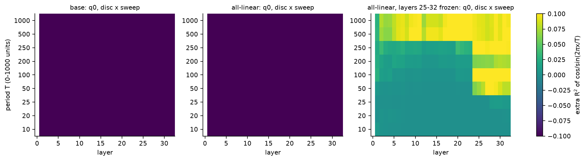

*图 S3：$q_0$ 处周期谱（圆扫描 x），纵轴为周期 $T$，横轴为层，颜色为加入 $\cos/\sin(2\pi x/T)$ 后的额外 $R^2$（第 3.3 节方法 2，由激活拟合）。左为原模型，其余为微调模型。周期 100 一行在第 24 层附近最亮，周期 50 次之（时钟的二次谐波）。*

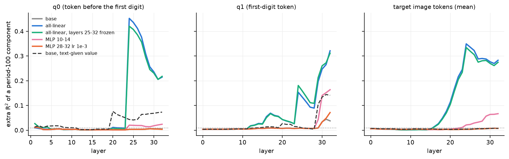

*图 S4：周期 100 的额外 $R^2$（第 3.3 节方法 2，残差前 32 个主成分，由激活拟合）随层数的变化，左为 $q_0$，中为 $q_1$，右为目标图像 token 的平均。灰：原模型（被橙线遮住）；蓝：全部线性层；绿：冻结第 25–32 层；粉：MLP 10–14；橙：MLP 28–32（学习率 $10^{-3}$）；黑虚线：原模型在 textconv（文本给定坐标）上的同一量；点线为随机水平 $2/N$。目标 token 上的周期分量从第 16 层开始增长，$q_0$ 在第 24 层跃升；冻结读出阶段的曲线与全部线性层重合。*

### 4.4 时钟是否就是全部原因

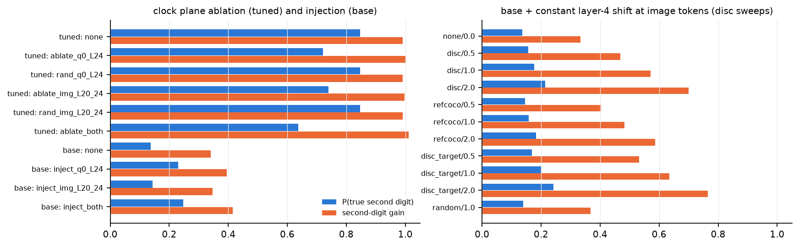

*图 7：左：时钟平面消融（微调模型）与注入（原模型）后的 P(真值第二位)（蓝）与第二位增益（橙）；右：向原模型第 4 层图像 token 加入常量偏移（向量来源 / 倍数）后的同两项指标。teacher-forced，圆扫描 208 张；“random” 为同范数随机向量。*

1. **二维时钟平面承载了一部分但不是全部信息。** 同时消融 $q_0$ 与图像 token 上的时钟平面，$P_1$ 由 0.85 降到 0.64，增益仍为 1.01；随机平面无影响（0.85）。注入时钟使原模型的 $P_1$ 由 0.14 升到 0.25、增益由 0.34 升到 0.42。因此时钟是新编码最清晰的可见特征，但周期信息还以其他方式存放（例如图 S3 中周期 50 的谐波与多个平面的叠加），读出电路并不只依赖这两个方向。
2. **前四层的改变主要是常量偏移，但常量偏移不足以解释效果。** 在目标 token 第 4 层，拼接模型与原模型之差的平均向量范数 3.7，随 $x$ 变化部分的标准差只有 0.5（坐标多项式只解释其 22%）；到第 8 层，原模型的第 5–8 层把它放大为随坐标变化的部分（范数 4.6，$R^2(x) = 0.77$）。单独加入平均偏移（目标 token 估计，2 倍）使增益升到 0.77、$P_1$ 升到 0.24，随机向量无效（0.37 / 0.14）；由 RefCOCO 估计的偏移效果较弱，且对 RefCOCO 本身无效（增益 0.52 → 0.53）。前四层修改中与图像内容有关的部分仍然必要。

### 4.5 首位 logit 差的散布（与 3.12 第三轮对照）

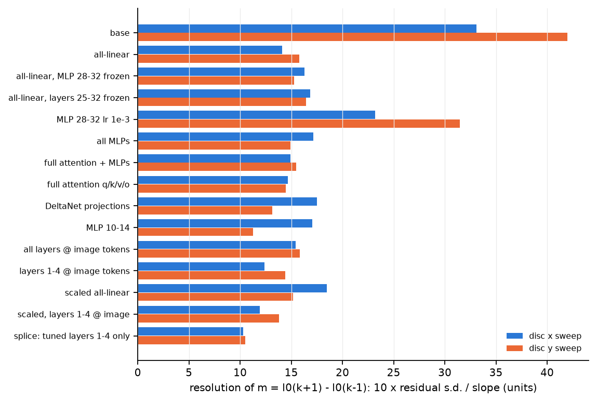

*图 8：$m = \ell_0(k+1) - \ell_0(k-1)$（$q_0$ 处首位 log 概率，$k$ 为真值首位，真值 200–899）对组内偏移回归后的残差标准差换算成的分辨率（10 × 残差标准差 / 斜率，单位为坐标单位），蓝为 x 扫描，橙为 y 扫描。数值由 capture 的数字分布拟合。*

原模型的 $m$ 斜率 0.73 nats / 10 单位、散布 2.42 nats，分辨率 33（x）与 42（y）个单位，与 3.12 第三轮一致。全部线性层为 14 / 16，前四层拼接为 10 / 11，early1_4_img 为 12 / 14；只训练后期层的条件为 23–38。**训练减小了 $m$ 的散布，但幅度（2–3 倍）远小于输出误差的改善（30 倍）。** 这说明微调模型的第二位数字不再只依赖 $m$ 这条中继：时钟直接提供了组内偏移。3.12 第三轮建议的“在哪一层产生散布”的问题因此有了回答：散布的减小与时钟同时出现，均由前四层的图像 token 修改引起（拼接模型的分辨率最好）。

### 4.6 线性对齐分析

为回应“上游编码子空间与读出权重行空间的夹角”这一问题，计算了两种对齐。（a）基于 Jacobian：在第 20、24、27 层对 $q_0$ / $q_1$ 处 residual 求十个数字 logit（去均值）的梯度，取前 9 个右奇异向量为读出输入子空间，与坐标编码子空间（residual 中可由 $x$ 的平滑 + 周期函数解释部分的前 3 个主方向）求主夹角。主夹角 $\theta_i$ 满足 $\cos\theta_i$ 等于两组正交基内积矩阵的奇异值，0° 表示共享方向，90° 表示正交。（b）基于权重：MLP 28–32 中写数字最强的 64 个神经元（down_proj 列在去均值数字 unembedding 上的投影范数最大）的 gate / up 输入行张成的 16 维子空间。

结果：在两个模型中，编码子空间与读出子空间都接近正交（第一主夹角 59–84°，随机子空间为 85°）。微调模型的 $q_0$ 第 24 层编码与其自身第二位读出的第一主夹角为 59°（原模型 72°），权重分析中第 32 层 $q_1$ 为 55–60°（原模型 76–79°），冻结读出阶段的模型与 early1_4_img 给出相同数值（55–61°）。**对齐只有中等程度的改善，不足以解释 30 倍的精度变化。** 这符合第 2.3 节的理论：时钟编码的作用是让读出变成“按扇区分类”的问题，其关键是编码的周期形状，而局部线性化（Jacobian 与输入权重行）不能刻画这种非线性的格式变化。图 S5 给出沿编码导数方向的线性读出增益，它同样表明，微调模型的高精度不能由局部线性增益的增大来解释。

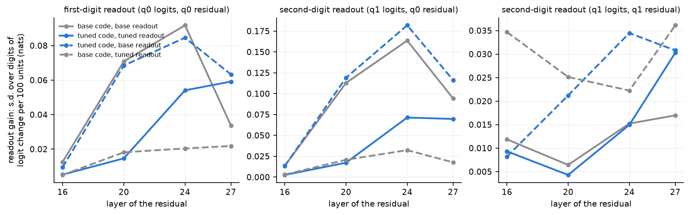

*图 S5：线性读出增益随 residual 所在层的变化。对给定层的 residual，沿坐标编码对 $x$ 的导数方向移动相当于 100 个坐标单位的距离，用该层到数字 logit 的 Jacobian 计算十个数字 logit（去均值）的一阶变化，纵轴为该变化在十个数字上的标准差（nats），数值越大表示局部线性读出对坐标越敏感。左：首位读出（$q_0$ 的 logit 对 $q_0$ 的 residual）；中：第二位读出（$q_1$ 的 logit 对 $q_0$ 的 residual）；右：第二位读出（$q_1$ 的 logit 对 $q_1$ 的 residual）。实线为模型自身的编码与读出（灰：原模型；蓝：全部线性层），虚线为交叉组合（蓝虚线：微调模型的编码方向配原模型的 Jacobian；灰虚线：原模型的编码方向配微调模型的 Jacobian）。Jacobian 与编码方向均由激活计算。微调模型自身的线性增益（蓝实线）在多数层低于原模型（灰实线），说明精度提升来自编码的周期形状，而非局部线性增益。*

### 4.7 定位版与扩大数据训练

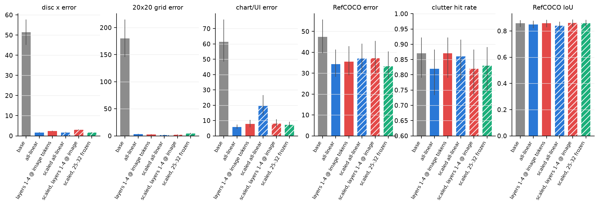

*图 9：原模型、全部线性层、定位版（early1_4_img）、它们的扩大数据版本与冻结读出阶段的扩大数据版本（scaled_all_but_25_32）在各测试组上的指标。颜色表示可训练参数的位置（灰：原模型；蓝：全部线性层；红：第 1–4 层、只作用于图像 token；绿：第 1–24 层、冻结读出阶段），斜线填充表示扩大数据训练。误差单位为 0–1000 坐标。误差线：误差为 bootstrap 95% 区间，命中率为 Wilson 95% 区间。数值由 greedy 答案计算。*

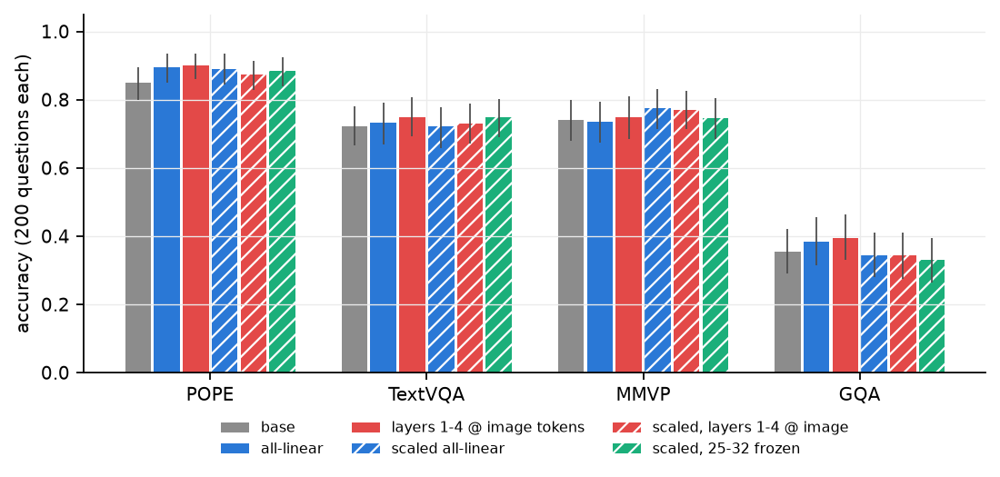

*图 10：POPE、TextVQA、MMVP、GQA（各 200 题，实验 5.2 的同一批题目）准确率，误差线为 bootstrap 95% 区间，颜色与斜线填充同图 9。数值由 greedy 答案计算。*

**表 4：定位版与扩大数据训练（与原模型的配对差值括号内为 $p$ 值）。**

| 条件 | 圆 x 误差 | chart_ui 误差 | RefCOCO 误差 / IoU | clutter 命中 | POPE | TextVQA | MMVP | GQA | 纯文本输出同原模型 | GQA 无 “Final answer” 行 |
| --- | --- | --- | --- | --- | --- | --- | --- | --- | --- | --- |
| 原模型 | 51.5 | 61.4 | 47.3 / 0.858 | 0.87 | 0.850 | 0.723 | 0.740 | 0.355 | — | 46/200 |
| all_linear | 1.7 | 5.9 | 34.3 / 0.850 | 0.82 | 0.895 (0.06) | 0.732 | 0.735 | 0.385 | 44/45 | 93/200 |
| early1_4_img | 2.4 | 7.8 | 35.5 / 0.858 | 0.87 | 0.900 (0.01) | 0.750 (0.23) | 0.750 | 0.395 (0.12) | 45/45 | 83/200 |
| scaled_all_linear | 1.7 | 19.4 | 37.0 / 0.840 | 0.86 | 0.890 (0.01) | 0.722 | 0.775 (0.15) | 0.345 | 44/45 | 114/200 |
| scaled_early1_4_img | 3.0 | 8.1 | 37.1 / 0.861 | 0.82 | 0.875 (0.18) | 0.730 | 0.770 (0.20) | 0.345 | 45/45 | 102/200 |
| scaled_all_but_25_32 | 1.6 | 7.2 | 33.4 / 0.859 | 0.83 | 0.885 (0.04) | 0.748 (0.18) | 0.745 | 0.330 (0.38) | 44/45 | 107/200 |

1. **定位版 LoRA 是精度与副作用之间更好的折中。** early1_4_img 只修改第 1–4 层对图像 token 的计算，参数量为全部线性层的 12.5%，合成测试的误差与全部线性层相差不到 1 个单位，clutter 命中率保持原模型的 0.87（all_linear 0.82），POPE 提高 0.05（$p = 0.01$）。由于文本 token 只经过原权重，纯文本行为在构造上保持不变（45/45 逐字相同）。
2. **扩大数据没有带来额外收益。** 冻结读出阶段的扩大数据版本（scaled_all_but_25_32）与其他条件同样精确（圆 x 误差 1.6，RefCOCO 误差 33.4），再次说明读出阶段无需改变。scaled_all_linear 的 clutter 命中率为 0.86（95% 区间 0.78–0.91，与原模型 0.87 无差别），RefCOCO 误差 37.0 与第一轮 34.3 相当；chart_ui 平均误差反而升到 19.4（中位误差 4.4，误差大于 100 的样本由 0 增至 4，命中率 1.00 → 0.93），即少数样本选错了界面元素；冻结读出阶段的扩大数据版本没有这一现象（chart_ui 误差 7.2、命中率 1.00），因此它更可能是单次训练的波动，而非扩大数据的系统效应。100 题的 clutter 与 200 题的通用基准只能排除大的变化。
3. **自蒸馏指令数据没有消除 GQA 的格式倾向。** 微调模型在 GQA 上更常只写短答案而省略 “Final answer:” 行（原模型 46/200，各微调模型 83–114/200），评分按单行答案回退处理，准确率不受影响。原模型自身在 GQA 训练问题上就有 36%（180/500）的答案省略该行，自蒸馏数据把这一不稳定性原样传给了训练；只作用于图像 token 的 early1_4_img 也出现这一倾向（83/200），说明它由图像表示的变化引起，而非文本权重的变化。TextVQA 上的同类倾向则被消除（all_linear 32/200 → scaled 9/200）。

## 5. 讨论

### 5.1 三个候选解释的裁决

**事实支持的描述介于 (i) 与 (ii) 之间，且需要修正两者的说法。** 与 (ii) 一致的是：上游信息完整（probe 精度 5 个单位），读出阶段的原权重在收到合适格式时能以理想增益写出数字（冻结读出阶段的条件与完整微调相同，第 4.1 节）；正向拼接也表明原模型的第 5–32 层能直接转换修改后的表示（第 4.2 节）。与 (ii) 的字面说法不同的是，读出阶段并非“能力有限”，而是只消费一种格式；而这种格式（周期编码）的生成计算也已经存在于原模型的中层（第 4.3 节第 4 条），缺的只是早期图像 token 表示中的一个小改动。与 (i) 一致的是：需要改变的确实是上游表示，而且是最早几层的图像 token 表示；但原模型的上游表示没有可见的几何缺陷（直尺编码平滑、单调、精确），所以“缺陷”只相对于读出所需的格式而言。用一句话概括：**原模型的图像坐标停留在“直尺”格式，没有进入其已有的“数字”通路；前四层对图像 token 的少量修改即可接通这条通路。** 这是参数与数据问题，不是结构限制（确定性高）；时钟是新格式的可见部分（确定性中）。

### 5.2 对第一轮叙述的修正

第一轮的“浅层有信息、深层读不出、深层低秩更新学不会、所以浅层必须改变”应当替换为：后期层训练失败不是低秩或学习率问题，而是因为数字通路需要的周期格式要在第 15–20 层之前在图像 token 上形成，后期层无法在读取之后补出这种格式（第 4.1 节第 2 条、第 4.3 节第 3 条）；第一轮观察到的“读取之前 residual 改变、probe 迁移失败”正是时钟编码的出现（第一轮 probe 只做线性回归 $x$，周期分量改变了 residual 的几何）。

### 5.3 与其他实验的一致与冲突

1. **3.12 与 3.12 第二、三轮。** 一致：原模型第二位数字依赖 $m$ 中继，分辨率 33–42 个单位（第 4.5 节复现）；写入组件位于第 25–32 层。补充：微调后写入组件不变，输入格式改变；$m$ 的散布减小 2–3 倍，但精确输出主要来自时钟。冲突：第二轮预测“修复必须改变第 25–32 层”，被冻结读出阶段的条件否定。
2. **3.11（坐标信息流）。** 一致：第 20 层是回答时回看图像的层；时钟在 $q_0$ 第 20 层出现，说明读取机制不变、被读内容改变。
3. **3.15（序数与坐标）。** 3.15 发现原模型网格坐标是计数读出（78% 落在单元边界 $100 \times$ 列号）；微调后边界吸附消失（第一轮），与“原模型使用直尺型计数编码、微调后使用数字型编码”的描述一致。
4. **2.2（高范数 token）。** 第一个图像 token 的更新对定位版 LoRA 很重要（第 4.2 节第 4 条），与高范数 token 的关系有待检验。
5. **7.1（可解释性引导的优化）。** 7.1 研究的是找不同任务中的光栅顺序约束，没有使用本轮的定位版 LoRA；两者共同的经验是，修复点往往位于早期图像 token 表示，而不是错误显现的位置。

### 5.4 对方法的含义

对坐标输出而言，“只在早期层、只对图像 token 加 LoRA”是一个通用、轻量、对文本能力无影响的方案：它不引入任何任务专用结构，参数量 2.7 M，推理时只在 prefill 的图像 token 上增加计算。它是否同样适用于其他依赖精细视觉读出的任务（计数、BabyVision 定位）尚未测试。

## 6. 限制

1. **时钟的生成组件没有定位。** 第 15 层（Gated DeltaNet 层）出现跃升，但第 5–15 层中哪些组件、通过何种计算产生周期分量，本轮没有分解。
2. **时钟不是唯一载体。** 二维平面消融只部分降低 $P_1$；完整的新编码可能由多个谐波平面或非线性特征组成，本轮没有完整刻画。
3. **自然图像证据较弱。** 时钟主要在合成圆扫描上测得；RefCOCO 上只有 $q_0$ 后期层的弱信号。
4. **扩大数据的规模仍小**（8071 条，504 步），GQA 格式倾向未解决；通用能力评估每个基准 200 题。
5. **未测试 BabyVision 类定位任务的迁移。**
6. **文本数字的表示只用 textconv 一种任务对照**，“读出阶段服务于文本数字格式”的推测没有得到直接检验。

## 7. 产物

产物位于 WORK_DIR 的 `analysis/position/2026-11-03_targeted_finetune_r2/`：`adapters/`（新条件的 LoRA 与训练日志，第一轮条件为链接）、`eval/<条件>/`（坐标答案、通用能力、3.12 析因；`fact_maskbug/` 为修正前的定位版析因，保留以便追溯）、`splice/`（拼接、拼接后 greedy 答案、时钟消融与注入、常量偏移）、`capture/` 与 `jacobian/`（链接到 DATA_DIR 的 residual 与 Jacobian）、`train_scaled.jsonl`、`scaledprep.json`、`instruct_answers.jsonl`、`results_r2.json` 与 `analysis_r2.npz`。程序为 `analysis_tools/position/targeted_finetune_r2*.py`（并对 `targeted_finetune.py` / `targeted_finetune_run.py` 做了不改变原有条件行为的扩展），入口为 `scripts/analysis/position/targeted_finetune_r2.sh`，测试为 `tests/analysis/position/test_targeted_finetune_r2.py`，图在 `docs/analysis/position/figures/targeted_finetune_r2/`。
