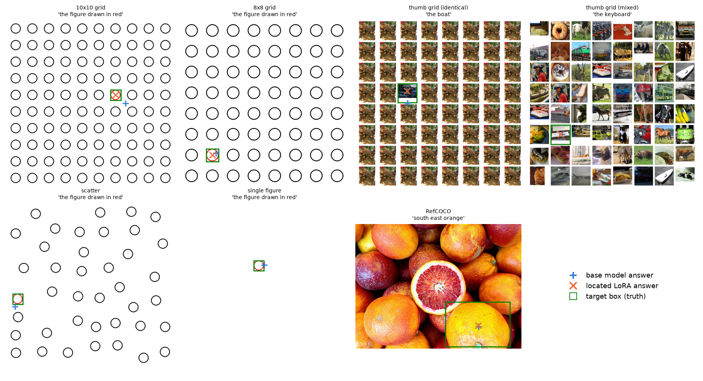
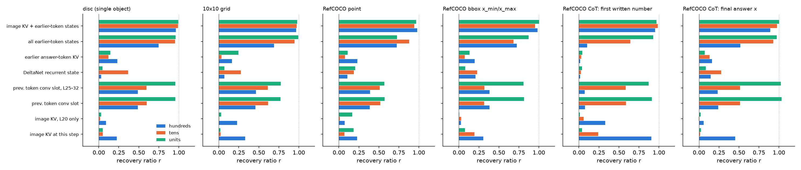
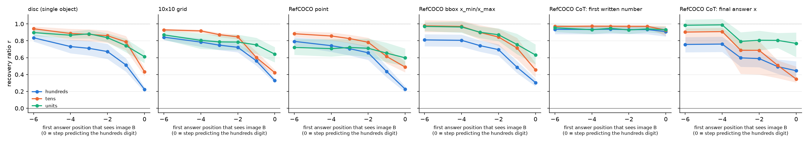
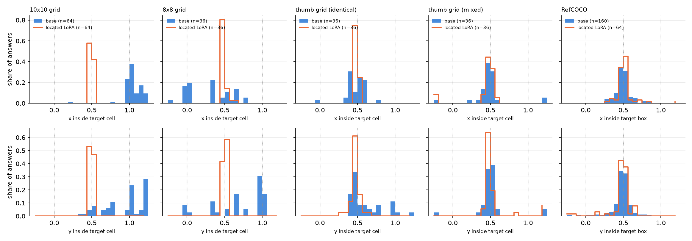
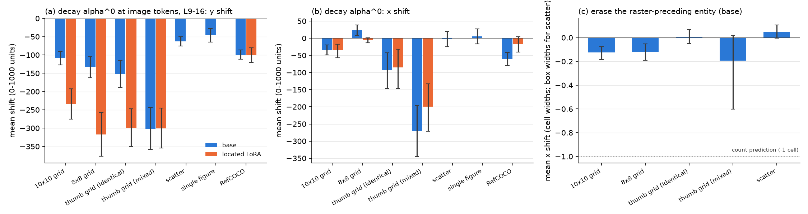
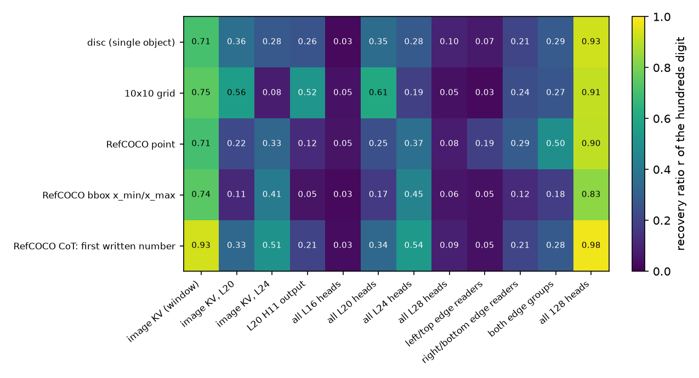
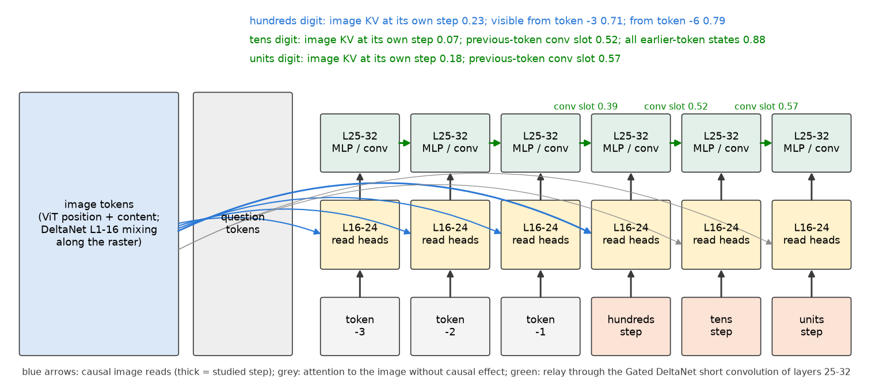
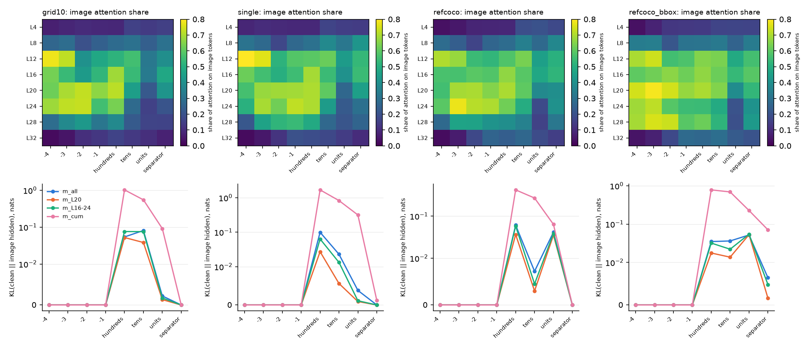

# 坐标数值的读出机理：自然图像与合成图像

实验日期：2026-11-05 至 2026-11-06。本文属于[位置读取](plan.md)研究，编号为实验 3.15 第二轮。模型为 Qwen3.5-9B，bfloat16、SDPA、greedy decoding，thinking off。前置结果：[行列序号与坐标数值](results_2026-11-03_ordinal_vs_coordinate.md)（3.15 第一轮）、[坐标数字的逐位读出](results_2026-10-21_digit_failure_r2.md)（3.12 第二、三轮）、[边缘读取 head](results_2026-11-03_edge_heads.md)（3.11 第三轮）、[坐标信息流](results_2026-10-20_coordinate_flow.md)（3.11）及其[自然图像部分](results_2026-10-21_coordinate_flow_natural.md)（3.11 第二轮）、[行列序号机制](results_2026-10-20_rowcol_mechanism.md)（3.10）、[读出缺陷的定位](results_2026-11-03_targeted_finetune_r2.md)（3.13 第二轮）、[CoT 的行为与机理](../behavior/results_2026-10-21_cot_mechanism.md)（1.7）。

## 0. 通俗讲述

让模型给出“苹果的中心点坐标”时，它最终写出三个数字 token，例如“5”“1”“2”。本文要回答三个问题：这三个数字的信息从图像的哪里来、经过哪些位置和层到达答案；自然照片与人工合成的网格图在这一过程上有何异同；第一轮观察到的“10×10 网格上 78% 的横坐标落在格子右边界”究竟源于模型结构还是训练。

我们的工作假设分两部分。第一部分是“读取方式共享”：无论是照片还是网格，模型都在写出数值之前，由第 16–24 层的少数 attention head 回看一次图像，读到的结果沿答案 token 向后传递，后面的数位不再看图，而是通过 Gated DeltaNet 层中只覆盖最近几个 token 的短卷积，读取前一个 token 的状态。第二部分是“被读的内容不同”：照片中被读到的是物体边缘的几何位置，读数精确；在由许多相同小图形组成的规则网格中，被读到的位置编码粗糙，答案被拉向 token 网格上的离散位置，并受一个在纯文本中也存在的“第 c 列对应 100c”的数值习惯影响。与之竞争的假设是第一轮的假设 H1：网格上直接作答的坐标是 DeltaNet 计数状态的读出。本轮设计了能区分两种说法的检验。

检验分三类。第一类是七种刺激：10×10 与 8×8 的相同图形网格、由自然物体缩略图排成的网格（相同缩略图重复与互不相同两种）、无行列排列的散点图形、空白画布上的单个图形，以及 RefCOCO 照片，用来找出是哪一种输入性质改变了读出结果。第二类是两种干预：把第 9–16 层 DeltaNet 在图像 token 上的遗忘关掉（第一轮用来破坏计数的操作），以及擦掉光栅顺序上紧挨目标之前的那个实体；若坐标真由计数给出，后者应使网格坐标左移一整格。第三类是逐个数位的 activation patching：用目标位置不同、其余完全相同的一对输入，在某一个生成步上只替换一类状态（图像的 key/value、前一个 token 的短卷积状态、某些 head 的输出），测量这一类状态携带了多少位置差异。

结果如下。第一，两类图像的读取时序和传递通道相同，读取图像的 head 不同。百位数字的图像信息约有三分之二在百位之前的 2–3 个 token 处读入，约四分之一在百位这一步读入；十位与个位这两步几乎不看图（替换图像 key/value 只恢复 0.02–0.07），它们的信息 40%–96% 来自前一个 token 在第 25–32 层的短卷积状态，第 1–24 层的短卷积不起作用。差别在于读图的 head：照片上主要是第 24 层的边缘读取 head（只交换两组共 12 个边缘 head 的输出即可转移 0.50 的百位差异），网格上主要是 L20 H11（0.52）。第二，“关掉遗忘”在所有刺激上都使纵坐标上移，包括空白画布上的单个图形（−47 个单位）与 RefCOCO 照片（−100 个单位，命中率 0.98 → 0.77），因此这一干预破坏的是一般的纵向位置编码，不能作为“坐标依赖计数”的证据；擦掉目标前的实体只使网格横坐标平均左移 0.12 格，远小于计数所预言的 1 格。第三，“落在右边界”只出现在 10×10 网格（92%），8×8 网格不出现（中心 56%），自然物体缩略图网格的答案落在中心（89%–94%，框误差约 5 个单位）。同一个“第 c 列 → 100c”的习惯在不给图像的纯文本问题中也出现（10 列时 19/50 个答案写成右边界，中心只有 2/50；8 列时中心 17/32），而 3.13 第二轮只改第 1–4 层图像 token 的 LoRA 在同一结构下使网格答案 100% 落在格子中心。因此右边界吸附属于参数与训练数据问题，不是 DeltaNet 结构造成的根本缺陷。第四，先推理后作答时，自然图像的推理文本多数先写出框的边缘再求平均，推理文本中写出的第一个数的百位几乎完全在它自己的生成步上从图像读出（0.91），答案再复制推理文本中写好的数值。

## 1. 问题、假设与主要结论

### 1.1 问题

1. **Q1**：自然图像上坐标数值如何读出？与“合成网格上依赖行列计数”的说法如何统一？哪一种输入性质决定了两者的差别？
2. **Q2**：10×10 网格上横坐标集中在 $100c$ 附近，是模型结构（DeltaNet 计数机制）造成的根本缺陷，还是参数与训练数据的问题？
3. **Q3**：输出三位数坐标时，信息由图像传到答案的完整路径是什么？回看图像发生在哪些生成步、哪些层与 head？百位、十位、个位各自依赖“本步回看图像”与“前一个 token 的 hidden states”到什么程度？

### 1.2 假设

- **H1（读取时序与通道共享）**：在所有图像类型上，坐标数值的图像信息在百位之前的少数 token 与百位这一步由第 16–24 层读入，经第 25–32 层的 DeltaNet 短卷积逐 token 传递；十位与个位不再读图。
- **H2（读取的 head 与被读的编码随图像而变）**：自然图像上由边缘读取 head 读取物体边缘的几何位置；由相同小图形组成的规则网格上，读到的位置编码粗糙，取值被拉向 token 网格上的离散位置。
- **H3（计数假设，第一轮的假设 H1）**：网格上直接作答的坐标是 DeltaNet 行列计数状态的读出。H3 预言：擦掉目标前一个实体时坐标移动约一格；破坏计数的干预只影响含重复实体的图像。
- **H4（右边界吸附的来源）**：若 $100c$ 吸附来自参数与训练数据，则它应当随网格规模改变、在纯文本中出现、且可由不改结构的微调消除；若来自结构，则在任何网格规模和微调后都应保留。

### 1.3 主要结论

1. **H1 成立：两类图像的读取时序与传递通道相同。** 百位：本步图像 key/value 恢复 0.23（照片）与 0.33（网格），把图像在百位之前 3 个 token 起开放则恢复 0.71 与 0.75；十位：本步图像 0.07 与 0.02，前一 token 的短卷积槽位 0.52 与 0.61；第 1–24 层的短卷积槽位 0.00–0.04（第 3 节，图 4–6）。
2. **H2 中“head 不同”成立。** 照片上交换 12 个边缘读取 head 的输出转移 0.50，L20 H11 只有 0.12；网格上 L20 H11 单独 0.52，边缘 head 0.27（第 3.4 节，图 6）。
3. **H3 不成立：网格坐标对计数的依赖很弱，DeltaNet 遗忘干预不是计数特异的。** 擦掉目标前一个实体：10×10 网格横坐标平均移动 −0.12 格 [−0.19, −0.08]，散点 +0.05 个框宽；关掉第 9–16 层图像 token 的遗忘使单个图形上移 47 个单位、照片上移 100 个单位（第 4.3 节，图 3）。
4. **网格的失败来自“相同小图形的重复”，与“行列排列”无关。** 同样 8×8 排列，相同图形网格的中位误差 65 个单位、命中 27/36；自然缩略图网格 8–15 个单位、命中 33–35/36；网格答案 70%–90% 落在半 token 格点上（随机水平 28%–34%），照片 17%（随机 15%）（第 4.1–4.2 节，图 2）。
5. **H4：右边界吸附是参数与训练数据问题，确定性高。** 只在 10×10 出现，纯文本中同样出现，定位版 LoRA 在相同结构下消除（中心 100%，中位误差 1.7）（第 6 节）。
6. **先推理后作答时，推理文本中写出的数值同样由一次图像读取产生，读取集中在该数值百位的生成步本身（0.91）；答案复制推理文本中的数值。** 自然图像的推理文本 55%–58% 先写边缘再求平均（第 5 节）。

## 2. 作答方式、术语与操作

### 2.1 两种作答方式

本文只考虑两种作答方式，二者都在 thinking off 下进行。

1. **直接作答**：提示要求只输出 JSON（3.11 第二轮的问法：“Locate the object described as: … Give the center of its bounding box. Return only [{"point_2d": [x, y]}] … Output only the JSON”；框问法把格式换成 bbox_2d），模型的第一个生成 token 起就是答案。
2. **先推理后作答（CoT）**：提示要求“先逐步说明如何找到该物体并估计其框的中心，再在最后一行给出答案”。模型先生成一段自然语言推理文本，再生成答案。推理文本中模型自己写下的数（例如“Its left edge is around x=210”中的 210）称为**推理文本中写出的数值**，答案中的数称为**答案数值**。

第一轮第 5.4 节的“续写”指一种实验操作：在人为构造的推理文本前缀之后不给答案提示，让模型继续生成直到给出答案。它是一种干预操作，不属于两种作答方式。第一轮“最终坐标依赖算术”一句的准确含义是：先推理后作答时，推理文本中写出了算术等式及其结果（如“(210 + 1000) / 2 = 605”），答案数值逐字复制这一结果。

### 2.2 生成步与数位

Qwen 的分词器把每个十进制数字切成一个 token，三位数 512 由“5”“1”“2”三个 token 组成。设提示长度为 $P$，生成序列为 $y_0, y_1, \dots$。生成 $y_g$ 的那次前向计算以位置 $P - 1 + g$ 上的 token 为输入（$g = 0$ 时为提示的最后一个 token，否则为 $y_{g-1}$），称为**预测 $y_g$ 的生成步**，其 query 位于位置 $P - 1 + g$。对一个三位数，记其百位、十位、个位 token 为 $y_s, y_{s+1}, y_{s+2}$，定义

- **百位步** $\tau_0$：输入为数值之前的那个 token（例如“ [”或逗号后的空格），输出百位数字；
- **十位步** $\tau_1 = \tau_0 + 1$：输入为百位数字，输出十位数字；
- **个位步** $\tau_2 = \tau_0 + 2$：输入为十位数字，输出个位数字；
- **前置 token** $\tau_0 - k$（$k = 1, 2, 3$）：百位步之前的第 $k$ 个生成步，它们输出数值之前的格式字符（如“":”“ [”）。

“回看图像”指某一生成步的 query 在 full attention 层中把 attention 分配到图像 token 上；它是否有因果作用由第 2.5 节的 patching 判断。

### 2.3 Gated DeltaNet 与短卷积

Qwen3.5-9B 的第 4、8、…、32 层为 full attention 层，其余 24 层为 Gated DeltaNet 层。DeltaNet 层为每个 head 维护矩阵状态 $S_t$（形状 $d_v \times d_k$），在位置 $t$ 处更新：

$$
S_t = \alpha_t\, S_{t-1}\left(I - \beta_t k_t k_t^{\top}\right) + \beta_t v_t k_t^{\top}, \qquad o_t = S_t q_t .
$$

其中 $q_t, k_t$（长度 $d_k$）、$v_t$（长度 $d_v$）由当前 hidden state 投影得到，$\beta_t \in (0, 1)$ 为写入强度，$\alpha_t \in (0, 1)$ 为遗忘（衰减）系数，$\alpha_t = \exp(g_t)$，$g_t = -\exp(A)\operatorname{softplus}(a_t + b)$。本文称 $S_t$ 为**递推状态**（recurrent state）。$q, k, v$ 在进入递推前先经过长度为 4 的因果短卷积：

$$
\tilde z_t = \sum_{j=0}^{3} w_j \odot z_{t-j},
$$

其中 $z$ 为 $q$、$k$ 或 $v$ 的投影，$w_j$ 为逐通道权重。解码时缓存中保存最近 3 个位置的投影 $z_{t-1}, z_{t-2}, z_{t-3}$，称为**短卷积状态**，其中 $z_{t-1}$ 称为**前一 token 的卷积槽位**。它是前一个 token 的 hidden state 进入当前步的一条直接通道，与递推状态（汇总了全部历史）和 full attention 的 key/value 并列。

### 2.4 刺激族

| 刺激族 | 内容 | 画布与 token 网格 | 目标描述 | $n$ |
| --- | --- | --- | --- | --- |
| 10×10 网格 | 10×10 相同黑色图形（person/ring/square/arrow），一个红色 | 640 px，20×20 token，格宽 2 token | the figure drawn in red | 64 |
| 8×8 网格 | 同上，8×8，格宽 96 px | 768 px，24×24 token，格宽 3 token | 同上 | 36 |
| 缩略图网格（相同） | 8×8 格，63 格为同一张 GQA 物体裁剪，目标为另一类物体 | 768 px | the {类别}（如 the boat） | 36 |
| 缩略图网格（混合） | 8×8 格，63 格为与目标不同大类的 GQA 物体裁剪，互不相同 | 768 px | 同上 | 36 |
| 散点 | 40 个相同黑色图形随机不重叠放置，一个红色，无行列 | 640 px | the figure drawn in red | 64 |
| 单个图形 | 空白画布上一个红色图形，位置随机 | 640 px | 同上 | 64 |
| RefCOCO | test split 160 条（第一轮的抽样） | 512 px 长边 | 指代表达 | 160 |

缩略图类别分为动物、交通工具、食物、家居四个大类，目标与所有干扰格属于不同大类，以保证目标唯一。网格目标不放在边界行列，便于擦除左邻与构造相邻配对。图 1 给出每一族的一张输入与模型答案。

*图 1：七种刺激族的输入示例（模型输出）。绿色框为目标框（真值），蓝色加号为原模型的直接作答点，橙色叉号为 3.13 第二轮定位版 LoRA 的直接作答点（只在网格、缩略图网格与 RefCOCO 上运行）。*

**坐标约定。** 单个图形上有 35/64 个答案使用了像素坐标而非 0–1000 坐标（例如目标中心为 830 时写 538 ≈ 830 × 640/1000），其余族不超过 1/160。按 plan.md 第 6 节第 9 条的诊断约定，当把答案按像素解释后的误差小于按 0–1000 解释误差的一半时，按像素换算；本文的单个图形数值均经此换算。

### 2.5 操作

**(a) 遗忘置 1（$\alpha \to \alpha^{0}$）。** 沿用第一轮第 2.3 节：在第 9–16 层的 DeltaNet 层（第 9–11、13–15 层）、全部 head、全部图像 token 处改写 in_proj_a 的输出，使 $\alpha_t' = \alpha_t^{s}$，本文只用 $s = 0$，即 $\alpha_t' = 1$（不遗忘），只作用于 prefill。

**(b) 擦除前一实体（delL）。** 网格族把目标左邻格涂白；散点把光栅顺序（先按 token 行、再按横坐标）上紧挨目标之前的图形删去。目标像素不变。若坐标由“目标前有几个实体”给出，答案应左移约一格；若由目标像素位置给出，答案不变。

**(c) 逐数位 activation patching。** 运行 $A$ 与 $B$ 的输入 token 序列等长，只有目标位置不同；两者都 teacher-force 运行 $A$ 的贪心答案文本。配对的构造：单目标圆盘把圆心沿一个轴移动 45 px（约 70 个单位）；10×10 网格把目标移到同行右邻格或同列下邻格（100 个单位）；RefCOCO 取同一张图像的两个等大裁剪窗口，窗口尺寸为原图沿该轴缩短 64 px（保持 32 px 的 token 网格），两窗口的偏移相差 28 px（物体与内容相同，绝对位置相差 62–97 个单位），点问法按 x、y 交替，框问法取 x 方向，CoT 问法两轴同时平移。在研究步 $\tau$ 把运行 $B$ 的某一类状态复制进运行 $A$，以恢复比例度量这类状态携带了多少“$B$ 相对 $A$ 的变化”：

$$
r = \frac{\sum_{\text{pairs}} \langle \tilde\ell_X - \tilde\ell_A,\ \tilde\ell_B - \tilde\ell_A \rangle}{\sum_{\text{pairs}} \lVert \tilde\ell_B - \tilde\ell_A \rVert^{2}} .
$$

其中 $\tilde\ell \in \mathbb{R}^{10}$ 为研究步十个数字的 log 概率减去其均值，下标 $X$ 为编辑后的运行。$r = 1$ 表示被复制的状态足以复现 $B$ 的全部变化，$r = 0$ 表示没有作用；区间为配对 bootstrap 95% 区间。编辑分三组：

1. **单步编辑**（只重算研究步 $\tau$）：图像 key/value（8 个 full attention 层，或单层 16/20/24/28）；前一 token 的卷积槽位（全部 DeltaNet 层，或第 25–32 层、第 1–24 层）；递推状态；全部 DeltaNet 状态；之前全部答案 token 的 key/value；“之前全部 token 的状态”（之前答案 token 的 key/value 与全部 DeltaNet 状态）；以及它与本步图像 key/value 的组合。
2. **窗口编辑**（重算 $\tau_0 - 3$ 到 $\tau$）：图像 key/value 对窗口内各步可见；或在窗口内各步把若干 head 的输出（o_proj 输入中该 head 的 256 维切片）换成运行 $B$ 的值。head 组：L20 H11；第 16、20、24、28 层各层全部 16 个 head；读左/上边缘的 L24 H7/H1/H2/H12 与 L20 H0；读右/下边缘的 L24 H5/H6/H8/H9、L20 H10/H13 与 L28 H0（3.11 第二轮与第四轮）；全部 128 个 head。
3. **读取位置扫描**：运行 $B$ 的图像 key/value 从生成步 $\tau_0 + o$（$o \in \{-6, -4, -3, -2, -1, 0\}$）起可见，此前各步保持运行 $A$ 的状态。

**(d) 逐步遮蔽与 attention 记录。** 对 teacher-forced 的答案逐步解码，同时运行 5 行：原样；只在本步对 8 个 full attention 层遮蔽图像 key（加 $-\infty$）；只在本步遮蔽第 20 层；只在本步遮蔽第 16、20、24 层；从答案开始每一步都遮蔽。前 4 行在每步结束后恢复为原样状态，第 5 行保留自己的历史。记录原样行每个 head 落在图像上的 attention 份额，以及每行相对原样行的 KL 散度。每族 24 张图像，RefCOCO 另加 24 个框问法与 24 条 CoT。

## 3. 假设 H1：读取时序与传递通道

**动机。** 3.12 第二轮在单目标圆盘的横坐标上发现：百位主要在其前 1–3 个 token 处读图并经短卷积传到百位步，十位不再读图。本节检验这一结构是否在网格、照片、框问法与纵坐标上同样成立，并把“前一个 token 的 hidden states”拆成短卷积、递推状态与 key/value 三条通道。

### 3.1 每一数位依赖什么

*图 4：单步编辑的恢复比例（模型激活上的 activation patching，第 2.5(c) 节）。蓝、橙、绿分别为百位、十位、个位步；每列一种配对。点线为 $r = 1$。CoT 两列分别为推理文本中写出的第一个三位数与答案中的横坐标。*

| 配对（数值数） | 数位 | 本步图像 KV | 本步 L20 图像 KV | 前一 token 卷积槽位（L25–32） | 卷积槽位（L1–24） | 递推状态 | 之前答案 token 的 KV | 之前全部 token 的状态 | 本步图像 KV + 之前全部状态 |
| --- | --- | --- | --- | --- | --- | --- | --- | --- | --- |
| 圆盘 x/y（96） | 百位 | 0.23 | 0.09 | 0.49 | 0.00 | 0.03 | 0.23 | 0.75 | 0.96 |
| | 十位 | 0.05 | 0.01 | 0.60 | 0.01 | 0.37 | 0.12 | 0.95 | 0.99 |
| | 个位 | 0.05 | 0.03 | 0.96 | 0.03 | 0.05 | 0.14 | 0.96 | 1.00 |
| 10×10 网格 x/y（96） | 百位 | 0.33 | 0.23 | 0.46 | −0.01 | 0.07 | 0.17 | 0.69 | 0.97 |
| | 十位 | 0.02 | 0.01 | 0.61 | 0.00 | 0.27 | 0.03 | 0.95 | 0.97 |
| | 个位 | 0.02 | 0.03 | 0.77 | 0.04 | 0.07 | 0.25 | 0.99 | 0.98 |
| RefCOCO 点 x/y（96） | 百位 | 0.23 | 0.07 | 0.39 | 0.00 | 0.11 | 0.23 | 0.72 | 0.98 |
| | 十位 | 0.07 | 0.01 | 0.51 | 0.01 | 0.19 | 0.08 | 0.88 | 0.94 |
| | 个位 | 0.18 | 0.17 | 0.57 | 0.04 | 0.20 | 0.11 | 0.73 | 0.97 |
| RefCOCO 框 x_min/x_max（47） | 百位 | 0.30 | 0.03 | 0.38 | 0.01 | 0.13 | 0.15 | 0.60 | 0.98 |
| | 十位 | 0.20 | 0.02 | 0.32 | 0.01 | 0.14 | 0.10 | 0.66 | 0.96 |
| | 个位 | 0.07 | 0.01 | 0.80 | 0.02 | 0.03 | 0.11 | 0.87 | 0.96 |

个位步上运行 $B$ 与 $A$ 的数字分布差别很小（中心化 log 概率差的平均范数 0.4–0.9 nats，百位与十位为 2.9–8.7 nats），个位一行的比例不稳定，只作参考；3.12 第三轮已说明个位在图像任务中接近均匀分布。

1. **百位的信息大部分来自之前 token 已经读到的状态，约四分之一在百位步本身读图。** 四种配对中本步图像 key/value 恢复 0.23–0.33，而“之前全部 token 的状态”恢复 0.60–0.75，二者合计 0.96–0.98。这说明写百位时模型确实回看图像，但这只是读取的一部分；更多的图像信息在百位之前的答案 token 上已被读入，再传到百位步。
2. **十位不再回看图像，它读取前一个 token（百位所在位置）的状态。** 本步图像 key/value 在圆盘、网格与照片点问法上只恢复 0.02–0.07，前一 token 的卷积槽位恢复 0.51–0.61，之前全部状态恢复 0.88–0.95。框问法的十位在本步还有 0.20 的图像读取，是唯一的例外，原因可能是框的四个数值依次读四条边，第 3.4 节的窗口结果显示框问法的读取更多集中在第 24 层。
3. **前一 token 的信息几乎全部经第 25–32 层的短卷积传递。** 只复制第 25–32 层的卷积槽位与复制全部层的卷积槽位恢复相同，第 1–24 层的卷积槽位恢复 0.00–0.04。这与 3.12 第三轮在圆盘上的结论一致，并推广到网格、照片与纵坐标：后段 DeltaNet 层的短卷积是数位之间唯一的高带宽接力通道。递推状态在十位上另有 0.19–0.37 的作用，key/value 通道只有 0.03–0.12。

### 3.2 百位的图像在哪些 token 被读入

*图 5：读取位置扫描（第 2.5(c) 节第 3 组）。横轴为运行 $B$ 的图像 key/value 开始可见的生成步（0 为百位步，负数为其前的前置 token），纵轴为恢复比例；阴影为 bootstrap 95% 区间。蓝、橙、绿分别为在百位、十位、个位步测量。*

| 配对 | 从百位步起可见 | 从前 1 个 token 起 | 从前 3 个 token 起 | 从前 6 个 token 起 |
| --- | --- | --- | --- | --- |
| 圆盘（百位） | 0.22 | 0.51 | 0.71 | 0.84 |
| 10×10 网格（百位） | 0.33 | 0.56 | 0.75 | 0.84 |
| RefCOCO 点（百位） | 0.23 | 0.44 | 0.71 | 0.79 |
| RefCOCO 框（百位） | 0.29 | 0.49 | 0.66 | 0.71 |
| RefCOCO CoT 写出的第一个数（百位） | 0.91 | 0.93 | 0.94 | 0.94 |

**直接作答时，百位的图像主要在百位之前的 1–3 个前置 token 上读入。** 让 $B$ 的图像只对百位步可见时恢复 0.22–0.33，从前 1 个 token 起可见升到 0.44–0.56，从前 3 个 token 起升到 0.66–0.75，再往前增益很小。这些前置 token 是 JSON 格式字符（横坐标前为“":”“ [”，纵坐标前为“,”“ ”），它们的内容可以预测，模型在写它们的同时已经开始读取下一个数值的位置。**先推理后作答时情况不同：推理文本中写出的第一个数，其百位几乎完全在百位步本身读入（0.91）。** 这类数前面的 token 是“around”“x=”之类的自然语言，模型直到写出等号才确定要写一个数，读取因而推迟到最后一步（解释）。

## 4. 假设 H2 与 H3：被读的是什么

### 4.1 取值结构

*图 2：直接作答点在目标格（网格族）或目标框（RefCOCO）内的相对位置（模型输出）。横轴 0 为左/上边，0.5 为中心，1 为右/下边；蓝色柱为原模型，橙色阶梯线为定位版 LoRA。上行横坐标，下行纵坐标。*

| 刺激族 | $n$ | 命中 [Wilson 95%] | 中位误差（单位） | 横坐标：中心 / 右边界 / 左边界 | 半 token 格点份额（随机） |
| --- | --- | --- | --- | --- | --- |
| 10×10 网格 | 64 | 31 [0.37, 0.60] | 71 | 0.00 / 0.92 / 0.02 | 0.70（0.28） |
| 8×8 网格 | 36 | 27 [0.59, 0.86] | 65 | 0.56 / 0.00 / 0.36 | 0.90（0.34） |
| 缩略图网格（相同） | 36 | 35 [0.86, 1.00] | 15 | 0.94 / 0.00 / 0.03 | 0.39（0.34） |
| 缩略图网格（混合） | 36 | 33 [0.78, 0.97] | 8 | 0.89 / 0.00 / 0.00 | 0.51（0.34） |
| 散点 | 64 | 34 [0.41, 0.65] | 33 | — | 0.32（0.28） |
| 单个图形 | 64 | 35 [0.43, 0.66] | 31 | — | 0.18（0.28） |
| RefCOCO | 160 | 157 [0.95, 0.99] | 26 | 0.91 / 0.02 / 0.01（相对框） | 0.17（0.15） |

命中定义为答案落在目标格内（网格族，含边界）或目标框内（其余族）。中心 / 右边界 / 左边界按相对位置与 0.5、1、0 的距离不超过 0.2 归类。半 token 格点份额为答案数值距 $1000k / (2N)$（$N$ 为该轴的 token 数，$k$ 为整数）不超过 3 个单位的比例，括号内为数值均匀分布时的期望 $7 / (1000 / 2N)$。

1. **自然内容即使排成网格也被精确定位，相同小图形的网格才失败。** 同为 8×8 排列、同样的格宽，缩略图网格的中位误差为 8–15 个单位、命中 33–35/36，相同图形网格为 65 个单位、命中 27/36。散点图形没有行列排列，中位误差仍有 33 个单位。决定精度的因素是“每个实体都是同一个简单图形”，与是否排成行列无关。
2. **相同图形网格的答案被拉到 token 网格上的离散位置。** 10×10 与 8×8 网格分别有 70% 与 90% 的数值落在半 token 格点上，随机水平只有 28%–34%；照片、单个图形与散点与随机水平相当。8×8 网格中每格宽 3 个 token，答案集中在格中心（第 2 个 token 的中心）与格左边界（token 边界），并不集中在右边界。因此 10×10 的右边界吸附是“取值落在 token 格点”与第 6 节所述数值习惯叠加的结果，并非网格的普遍性质（解释）。
3. **照片上的读数既无边缘偏好，也无格点吸附。** RefCOCO 点答案在框内的中位相对位置为 (0.497, 0.495)，91% 在中心附近；3.11 第三轮的 872 张自然图像上为 (0.495, 0.497)，落在右边界附近的只有 1.4%（本轮对已有数据的重新分析）。

### 4.2 框问法：读边缘的精度

| 刺激族 | 框四边中位绝对误差（单位） | 点答案减自身框中心（中位，x / y） |
| --- | --- | --- |
| RefCOCO（159） | 4.8 / 4.6 / 4.4 / 7.7 | −0.5 / −1.0 |
| 缩略图网格（混合，36） | 3.0 / 5.0 / 3.2 / 6.8 | −2.0 / 1.0 |
| 缩略图网格（相同，36） | 5.2 / 5.2 / 4.5 / 10.8 | 1.0 / −0.8 |
| 散点（64） | 29.4 / 15.9 / 17.5 / 18.6 | 0.0 / 10.0 |
| 8×8 网格（36） | 25.0 / 19.6 / 29.2 / 25.4 | −19.5 / 30.2 |
| 10×10 网格（64） | 45.5 / 17.2 / 65.0 / 54.8 | 0.0 / 12.0 |

**照片与缩略图上，模型能以约 5 个单位的误差写出物体的四条边，点答案等于它自己写出的框的中心。** 这与 3.11 第三、四轮的边缘读取机制一致：写框的每个数值时读对应的一条边，写点时两组 head 分别读两条对边、在 residual 中相加。**10×10 网格上框整体向右偏移约半格**（x_min 偏 +46，x_max 偏 +65 个单位），点答案仍等于框中心，说明网格的误差在读到的位置本身，而不在“边缘 → 中心”的组合步骤。单个图形的框问法同样混用像素与 0–1000 两种约定，换算后的误差不可靠，不列入表中。

### 4.3 计数检验

*图 3：(a)(b) 第 9–16 层 DeltaNet 在图像 token 上不遗忘（$\alpha \to \alpha^{0}$）后点答案的纵、横坐标平均移动（模型激活上的干预，0–1000 单位），蓝色为原模型，橙色为定位版 LoRA；(c) 擦除光栅顺序上紧挨目标之前的实体后横坐标的平均移动（格宽，散点为框宽），点线为计数假设的预言 −1 格。误差线为 bootstrap 95% 区间。*

| 刺激族 | 不遗忘：$\Delta y$（单位） | 不遗忘：$\Delta x$ | 不遗忘后命中（原命中） | 擦除前一实体：$\Delta x$（格） |
| --- | --- | --- | --- | --- |
| 10×10 网格 | −109 [−127, −90] | −34 | 24/64（31/64） | −0.12 [−0.19, −0.08] |
| 8×8 网格 | −132 [−162, −105] | +24 | 8/36（27/36） | −0.12 [−0.19, −0.05] |
| 缩略图网格（相同） | −152 [−189, −114] | −93 | 11/36（35/36） | +0.01 [−0.05, 0.07] |
| 缩略图网格（混合） | −302 [−358, −243] | −271 | 0/36（33/36） | −0.19 [−0.60, 0.02] |
| 散点 | −63 [−76, −50] | −2 | 2/64（34/64） | +0.05 [0.00, 0.11]（框宽） |
| 单个图形 | −47 [−65, −28] | +6 | 8/64（35/64） | — |
| RefCOCO | −100 [−112, −86] | −60 | 123/160（157/160） | — |

1. **擦除目标前一个实体几乎不移动网格坐标。** 计数假设预言左移一整格，实测 10×10 与 8×8 只有 −0.12 格，相同缩略图网格为 +0.01 格，散点为 +0.05 个框宽。第一轮引用的 1.5 刺激（21 个槽位的单行网格）上，删去目标前的实例使点答案左移 0.78 格，但以 0–1000 单位计只有 27–56 个单位：该刺激每格只占长轴的 1/21（47.6 个单位），base 答案与目标格中心的平均偏差已达 1.1–3.5 格，且删去目标后的实例（目标序号不变）也使答案移动 7–45 个单位。两类刺激上的删减都保持目标像素与已占据范围的两端不变，操作本身相同；差别在于格宽。合起来，删减实例引起的是幅度为几十个单位、随版面变化的版面效应，在格宽很小的单行刺激上接近一格，在二维网格上只有 0.12 格，两者都不支持离散计数的读出（解释）。
2. **不遗忘干预使所有刺激的纵坐标上移，包括没有任何重复实体的单个图形与照片。** 单个图形上移 47 个单位，RefCOCO 上移 100 个单位且命中率由 0.98 降至 0.77。这一干预改变的是第 9–16 层 DeltaNet 在全部图像 token 上的状态，它对纵坐标的作用不依赖可数的实体，因此它不能作为“网格坐标读取计数状态”的特异证据。它所揭示的是：第 9–16 层 DeltaNet 沿光栅顺序的递推参与形成所有图像的纵向位置编码，这与 3.14 第一、二轮“纵坐标由目标所在行中位于目标之后的 token 携带”一致（解释）。行列序号确实读取计数状态（3.10；本轮行号在此干预下由 64/64 降至 16/64），坐标数值与序号共享的是这一般的纵向编码，坐标对它作连续读出，不经过离散的计数结果。
3. **自然图像上不存在独立的“计数”读出路径。** 擦除检验无法用于照片，但照片上读取坐标的是读物体边缘的 head（第 3.4 节），且取值无格点吸附、框边精确；因此照片的坐标数值由边缘的几何位置给出，与行列计数无关（确定性高）。

### 4.4 读取 head 的差别

*图 6：窗口编辑（第 2.5(c) 节第 2 组）对百位的恢复比例，颜色为恢复比例（viridis，0–1），格内为数值。行为配对，列为在百位前 3 个 token 到百位步的窗口内交换的状态。*

| 配对 | 图像 KV（窗口） | L20 H11 | 第 20 层 16 个 head | 第 24 层 16 个 head | 左/上边缘组（5） | 右/下边缘组（7） | 两组边缘（12） | 全部 128 个 head |
| --- | --- | --- | --- | --- | --- | --- | --- | --- |
| 圆盘 | 0.71 | 0.26 | 0.35 | 0.28 | 0.07 | 0.21 | 0.29 | 0.93 |
| 10×10 网格 | 0.75 | 0.52 | 0.61 | 0.19 | 0.03 | 0.24 | 0.27 | 0.91 |
| RefCOCO 点 | 0.71 | 0.12 | 0.25 | 0.37 | 0.19 | 0.29 | 0.50 | 0.90 |
| RefCOCO 框 | 0.74 | 0.05 | 0.17 | 0.45 | 0.05 | 0.12 | 0.18 | 0.83 |
| RefCOCO CoT 第一个数 | 0.93 | 0.21 | 0.34 | 0.54 | 0.05 | 0.21 | 0.28 | 0.98 |

**网格上由第 20 层的 L20 H11 单独完成大部分读取，照片上由第 24 层的边缘读取 head 共同完成。** 10×10 网格中 L20 H11 一个 head 转移 0.52，接近第 20 层全部 head（0.61），第 24 层只有 0.19；RefCOCO 点问法中 L20 H11 只有 0.12，12 个边缘读取 head 合计 0.50，第 24 层全部 head 0.37。框问法读取更集中在第 24 层（0.45），但这里的边缘组是按写点答案时的分工选出的，写框的每个数值时读对应边的 head 更多（3.11 第四轮：47–59 个），因此 12 个 head 的组合只有 0.18。圆盘介于两者之间。这一差别与第 4.1 节的取值结构对应：H11 在网格上读取目标所在的 token，读数是离散的 token 位置；边缘 head 在照片上读两条对边，两者在 residual 中相加（3.11 第四轮），读数是连续的几何位置（解释）。

## 5. 先推理后作答：写了什么、数值从哪里来

**写了什么。** 对第一轮的 160 条 RefCOCO 推理文本与本轮 24 条裁剪图推理文本做规则编码（边缘词与数值共现、出现形如 $(a + b) / 2$ 的算术）：

| 推理文本类型 | 第一轮 160 条 | 本轮 24 条 |
| --- | --- | --- |
| 先写四条边的数值，再写求平均的算术 | 76 | 14 |
| 写了边的数值但没有求平均的算术 | 12 | 2 |
| 直接写出中心的估计值 | 52 | 6 |
| 推理文本中没有坐标数值 | 20 | 2 |

含有坐标对的推理文本中，答案等于最后写下的坐标对的比例为 104/106（第一轮）与 11/11（本轮）。“先写边缘估计再求中心”是最常见的类型（55%–58%），约三分之一的推理文本直接写出中心估计。

**推理文本中写出的数值同样由一次图像读取产生。** 图 4 第五列与图 5 最后一行：推理文本中写出的第一个三位数（14/22 为一条边的值，其余为中心估计），其百位在百位步本身替换图像 key/value 即恢复 0.91 [0.85, 0.95]，前一 token 的卷积槽位只有 0.08，第 20、24 层图像 key/value 分别为 0.32 与 0.53。十位与直接作答相同：本步图像 0.24，前一 token 卷积槽位 0.59。因此，估计边缘时虽然没有“计数”，但有与直接作答相同的“回看图像并读取位置”的操作，只是读取集中在数字前的最后一步；参与的 head 与照片直接作答相似，以第 24 层为主（窗口内第 24 层全部 head 0.54，L20 H11 0.21）。

**答案主要复制推理文本中的数值。** 在 $A$ 的推理文本保持不变、只把图像换成 $B$ 时，答案横坐标百位上 $B$ 与 $A$ 的差别（中心化 log 概率差的平均范数 2.6 nats）只有推理文本中第一个数（5.4 nats）的一半左右，说明答案的大部分由文本决定；剩余差别中，本步图像 key/value 恢复 0.45。这与第一轮“回答时遮蔽图像后 86% 的答案不变”一致：答案时仍有一次小幅回看，但数值主要来自复制。

## 6. 10×10 网格的右边界吸附：参数还是结构

本节回答 Q2。“结构”指 Gated DeltaNet 的光栅递推与计数机制本身；“参数”指在该结构下学到的读取方式与数值习惯，可通过数据与微调改变。

| 证据 | 结果 | 指向 |
| --- | --- | --- |
| 网格规模 | 10×10：右边界 92%、中心 0%；8×8（格宽 3 token）：中心 56%、左边界 36%、右边界 0% | 吸附依赖网格规模，非网格普遍性质 |
| 纯文本问题（无图像） | “10 列网格第 r 行第 c 列格子的中心”：19/50 写成右边界 $100c$，2/50 写成中心；8 列：17/32 写成中心 | 数值习惯 $c \to 100c$ 存在于文本，与图像无关 |
| 自然内容网格 | 缩略图网格中心 89%–94%，框误差约 5 个单位 | DeltaNet 处理同样的排列时可以精确定位 |
| 计数依赖 | 擦除前一实体只移动 −0.12 格 | 坐标不由计数给出 |
| 同一结构下微调 | 3.13 第二轮定位版 LoRA（第 1–4 层，只作用于图像 token，270 万参数）：10×10 中心 100%、中位误差 1.7、命中 64/64；8×8 中心 100%；擦除前一实体移动 −0.005 格 | 不改结构即可消除 |
| 自然图像 | 872 张图像点答案中位相对位置 (0.495, 0.497)，右边界 1.4% | 读出本身无边缘偏好 |

**右边界吸附是参数与训练数据问题，确定性高。** 六项证据中没有一项需要结构限制来解释：它只出现在一种网格规模上，在没有图像的纯文本中以相同形式出现，定位版 LoRA 在完全相同的 DeltaNet 结构下把它消除。一个合理的解释（推断，未直接检验训练数据）是：训练数据中“第 c 个十分之一”常以 $100c$ 表示，这一数值习惯在格宽恰为 100 个单位的 10×10 网格上与“读到的位置落在 token 格点”叠加，使答案落在右边界；8×8 网格的格宽为 125 个单位，不与这一习惯重合。

**定位版 LoRA 没有改变 DeltaNet 对纵坐标的贡献。** 不遗忘干预使微调后模型的纵坐标上移更多（10×10：−234 个单位，原模型 −109），行号也同样下移（−2.5 行）。微调改变的是第 1–4 层图像 token 的表示，第 9–16 层的 DeltaNet 递推仍是纵向位置编码的一部分；改变后的上游表示使读出精确（3.13 第二轮：目标图像 token 上在第 15 层形成周期为 100 的编码），但没有让坐标脱离 DeltaNet（解释）。微调后模型的直接行号作答正确率由 64/64 降到 22/64（平均误差 0.02 行），说明只用坐标数据训练会损害序号读出，这是方法设计时需要注意的副作用。

## 7. 坐标数值的信息传递流程

本节单独汇总 Q3 的回答。图 7 为示意图，箭头上的数值取自 RefCOCO 点问法的 patching 结果。

*图 7：输出一个三位数坐标时的信息传递（示意图，由第 3 节与 3.11、3.12 的测量结果汇总，非模型输出；箭头标注的恢复比例为 RefCOCO 点问法的实测值）。蓝色箭头为有因果作用的图像读取，粗箭头为百位步本身的读取；灰色箭头为有 attention 而无因果作用的回看；绿色箭头为第 25–32 层 Gated DeltaNet 短卷积的逐 token 接力。*

*图 8：teacher-forced 答案中各生成步的图像 attention 份额与遮蔽 KL（均为实测值）。上行为 8 个 full attention 层上图像 token 获得的 attention 份额（每层 16 个 head 的平均，viridis，单位为份额）与只在该步遮蔽图像后的 KL 散度（下行，对数刻度；蓝：8 个 full attention 层，橙：第 20 层，绿：第 16、20、24 层，粉：从答案开始每步都遮蔽）。横轴为相对数值百位步的位置：−4 到 −1 为前置 token，hundreds/tens/units 为三个数位步，separator 为数值之后的分隔符。*

表 7.1 汇总图 8 中三类代表性问法的数值（实测值，各条件 24–48 个数值；份额为第 16、20、24 层的平均；单步 KL 为只在该步遮蔽全部 8 个 full attention 层的图像 key/value 后，该步输出分布相对未遮蔽时的 KL 散度；累积 KL 为从答案第一个 token 起每步都遮蔽时的 KL 散度，单位均为 nats）。

| 生成步 | 10×10 网格：份额 / 单步 KL / 累积 KL | RefCOCO 点：份额 / 单步 KL / 累积 KL | RefCOCO CoT 中的数值：份额 / 单步 KL / 累积 KL |
| --- | --- | --- | --- |
| 非数值 token | 0.07 / 0.000 / 0.00 | 0.11 / 0.001 / 0.00 | 0.16 / 0.034 / 0.10 |
| 前置 token（−2、−1） | 0.58–0.63 / 0.000 / 0.00 | 0.65–0.67 / 0.000 / 0.00 | 0.06–0.13 / 0.000 / 0.00 |
| 百位步 | 0.68 / 0.054 / 1.02 | 0.66 / 0.061 / 0.42 | 0.30 / 0.107 / 0.28 |
| 十位步 | 0.42 / 0.081 / 0.55 | 0.56 / 0.007 / 0.27 | 0.21 / 0.015 / 0.25 |
| 个位步 | 0.24 / 0.002 / 0.09 | 0.34 / 0.042 / 0.06 | 0.07 / 0.004 / 0.05 |
| 分隔符 | 0.37 / 0.000 / 0.00 | 0.44 / 0.000 / 0.00 | 0.05 / 0.001 / 0.01 |

结合图 7、图 8 与第 3 节的 patching 结果，直接作答时一个三位数坐标的信息传递可以按时间顺序分为四个阶段。

1. **回看从数值之前的前置 token 开始。** 在直接作答中，前置 token（例如左括号、逗号与空格）位置上第 12–24 层的图像 attention 份额已达 0.55–0.78，约为非数值 token（0.04–0.24）的 3–10 倍。这些位置只遮蔽一步时 KL 为 0，原因是前置 token 本身预测的是格式符号，与图像无关；但第 3 节的尾部扫描显示，让图像从前置 token −6 起可见时百位的恢复比例为 0.79–0.84，只在百位步本身可见时仅为 0.22–0.33。因此前置 token 上的图像读取不服务于当前步的输出，而是写入这些位置的 hidden states，再经后续 token 的计算传给百位。
2. **百位在自身步读取图像，并汇合前置 token 的结果。** 百位步的图像份额仍为最高（0.66–0.70），单步遮蔽 KL 为 0.05–0.10，是所有数位中唯一稳定为正的一步。百位所需的位置信息约四分之一来自本步读图（恢复比例 0.23–0.33），其余来自前置 token 的 hidden states；第 25–32 层短卷积中前一 token 的槽位单独可恢复 0.39–0.49。
3. **十位与个位主要依赖前一 token 的状态。** 十位步的图像份额仍有 0.42–0.56，但只在该步替换图像 key/value 的恢复比例只有 0.02–0.07，替换前一 token 短卷积槽位为 0.51–0.61，替换全部先前 token 的状态为 0.88–0.95。个位步的差异本身很小（成对差 0.4–0.9 nats），短卷积槽位恢复 0.96。由此可得：**十位与个位步对图像的 attention 不代表对图像的使用。** 这两个数位步上的 attention 份额与单步 KL 的数量级都不低，但 patching 表明，把这些步的图像 key/value 换成另一张图像几乎不改变输出的数位；KL 衡量的是整个输出分布的变化，包括非目标数位的概率重排，而恢复比例只衡量两幅图像之间对应数位的差异。RefCOCO 点问法的个位单步 KL（0.042）高于十位，与个位本步读图恢复 0.18 一致，说明自然图像上个位仍有少量逐步的细化读取，但个位只决定 0–9 个单位的差别，对定位误差的影响很小。
4. **数值之后不再读图。** 分隔符步的 attention 份额回落到 0.37–0.44，单步与累积 KL 均为 0。

**CoT 中写下的第一个数值是例外。** 在 CoT 推理文本中，数值之前的前置 token 几乎不看图像（份额 0.06–0.13，单步 KL 为 0），读图集中在百位步本身：份额 0.30（在 CoT 文本中为最高），单步 KL 0.107，第 3 节中本步图像 key/value 的恢复比例达 0.91。这一差别的原因（解释）是 CoT 中的数值前通常是自然语言词汇（例如“左边缘约为”），这些 token 的计算服务于语言而非位置；直接作答时前置 token 是固定的格式符号，模型可以把它们当作读图的预备步。十位在 CoT 中同样转向短卷积槽位（恢复 0.59）。CoT 最终答案则基本复制文中最后写下的数值（第 5 节），本步读图恢复只有 0.45。

**网格与自然图像上读图 head 关注的区域不同。** 在百位步统计 3.11 第四轮的边缘 head 落在目标框内的 attention 份额（实测）：RefCOCO 上全部边缘 head 与 H11 都为 0.87–0.95，缩略图网格约为 0.54–0.88；10×10 合成网格上只有 H11 为 0.48，第 24 层的边缘 head 仅 0.02–0.04。这说明在合成网格上，边缘 head 并不读取目标图形本身，网格坐标主要来自 H11 与上游 DeltaNet 写入图像 token 的纵向位置编码；在自然图像上，坐标由边缘 head 直接读取目标的边界区域得到，与第 4 节“自然图像上读出无边缘偏好”的结果一致。

## 8. 与其他实验的一致与冲突

1. **3.15 第一轮：一致，两轮合并得到统一结论。** 第一轮测得的三项现象（10×10 网格 78% 的横坐标在右边界、$\alpha^{s}$ 使坐标行与序号行一起移动、1.5 单行刺激上删减实例使坐标移动 0.57–1.17 格）在本轮均可复现或由本轮数据解释：衰减干预在 $s = 0$ 时使 10×10 网格纵坐标上移 109 个单位，与第一轮的 0.98 行相符，同时也作用于单个图形与照片；单行刺激上的移动以单位计为 27–56 个单位，二维网格上为 12–15 个单位（第 4.3 节）；右边界取值只在 10×10 出现并在纯文本中复现。两轮共同支持的结论是：网格坐标与行号共享第 9–16 层 DeltaNet 形成的纵向位置编码，坐标数值由对该编码与目标位置的连续读出给出，不由离散计数换算。第一轮文档已按此结论表述；其关于 CoT 的结论（写下行列号与算术，答案复制文本数值）与本轮第 5 节一致。
2. **3.12 第二、三轮：一致并推广。** 百位在其前的 token 读图并经第 25–32 层短卷积传递、十位与个位读取前一 token 的卷积槽位，这一结构在网格、照片、纵坐标与框问法上都成立。
3. **3.11 第三、四轮：一致。** 照片上读取由边缘 head 完成，边缘选择在数值之前的 token 已经确定、在第一个数位最强（3.11 第四轮），与本文“读取发生在前置 token 与百位步、十位不再读图”相互印证；3.11 第四轮发现两条边的读数在 residual 中相加、由 MLP 24–30 转成数字，本文没有重复检验。L32 H8/H13 在 3.11 第四轮中被识别为不读图的中继 head，与本文“第 28–32 层的图像 key/value 无作用”（单步第 28 层 0.00–0.03）一致。
4. **3.14 第三轮：一致。** Qwen3-VL 读纵坐标时使用行首锚点 token，这一现象在 RefCOCO 上不存在；本文发现照片与网格的读取 head 不同，同样说明网格上的读取方式不能推广到自然图像。
5. **3.13 第二轮：一致。** 修复位于第 1–4 层图像 token，本文进一步说明修复后右边界吸附与计数依赖都消失，但 DeltaNet 的纵向贡献仍在。

## 9. 限制

1. 缩略图网格只有 36 张，缩略图为 88 px，部分类别（如 refrigerator、keyboard）在缩略图中较难辨认；缩略图网格在不遗忘干预下几乎全部失败，说明该干预在 768 px 画布上破坏了识别，第 4.3 节对该族的纵向移动不作解释。
2. 单个图形的点答案有一半使用像素坐标，按诊断约定换算；框问法同样混用两种约定，未纳入框误差统计。
3. RefCOCO 配对由裁剪构造，两窗口的边界内容不同（各有 28 px 宽的条带只在一个窗口中出现），这部分差异混入恢复比例的分母；CoT 配对只有 22–23 个数值，区间较宽。
4. 个位步上 $B$ 与 $A$ 的差别很小，个位的恢复比例不稳定。
5. 推理文本类型由规则编码，未经人工核对。
6. 批量解码与逐条解码的 20 例抽查中，答案完全相同 11/20，相差不超过 5 个单位 17/20，最大相差 29 个单位；所有比较都在同一批量设置的条件之间进行。patching 与逐步遮蔽以批量 1 运行。
7. “右边界吸附源于训练数据中的 $100c$ 习惯”是推断，未检查训练数据。

## 10. 实验产物

全部路径相对于 `$WORK_DIR`。代码：`analysis_tools/position/coordinate_mechanism_natural.py`（刺激、裁剪配对、解析与统计）、`coordinate_mechanism_natural_run.py`（GPU 阶段）、`coordinate_mechanism_natural_analysis.py`（统计与作图）；入口 `scripts/analysis/position/coordinate_mechanism_natural.sh`；测试 `tests/analysis/position/test_coordinate_mechanism_natural.py`。共享模块未修改。

| 内容 | 路径（相对 `$WORK_DIR`） | 生成阶段 |
| --- | --- | --- |
| 第 4、6 节全部生成结果（七族点/框问法、不遗忘、擦除、行号、纯文本、定位版 LoRA） | `analysis/position/2026-11-05_coordinate_mechanism_natural/gen.jsonl` | gen |
| 第 5 节 CoT 推理文本（裁剪配对窗口 A） | 同目录 `think.jsonl` | think |
| 第 3、4.4、5 节 patching 结果（第 3.1、3.2、4.4 节的表格，图 4–6） | 同目录 `flow.jsonl` | flow |
| 第 7 节逐步 attention 与遮蔽（图 8） | 同目录 `timeline.jsonl` | timeline |
| 全部统计数值 | 同目录 `summary.json` | analyze |
| 批量与逐条解码抽查 | 同目录 `spotcheck.json` | spot |
| 运行参数与代码摘要 | 同目录 `run_*.json` | 各阶段 |
| 定位版 LoRA checkpoint（3.13 第二轮） | `analysis/position/2026-11-03_targeted_finetune_r2/adapters/early1_4_img.pt` | 3.13 第二轮 |
| 第一轮 RefCOCO 推理文本 | `analysis/position/2026-11-03_ordinal_vs_coordinate/refcoco_gen.jsonl` | 3.15 第一轮 |
| 872 张自然图像的点/框答案（第 4.1 节第 3 条） | `analysis/position/2026-11-03_edge_heads/gen.jsonl`、`cases.json` | 3.11 第三轮 |

图位于 `docs/analysis/position/figures/coordinate_mechanism_natural/`。GPU 用量：一张空闲 A40，约 2.3 GPU 小时（生成 20 分钟、CoT 5 分钟、patching 68 分钟、逐步遮蔽约 40 分钟、冒烟测试与加载约 10 分钟）。
