# 边缘读取 head 的读取位置、两条边的组合与 L20 H11 的功能

实验日期：2026-11-05。本文属于[位置信息与坐标读取](plan.md)研究，是[坐标读出的信息流](results_2026-10-20_coordinate_flow.md)（3.11）的第四轮，承接[自然图像上的坐标读出](results_2026-10-21_coordinate_flow_natural.md)（第二轮）与[边缘读取 head 的作用](results_2026-11-03_edge_heads.md)（第三轮）。模型为 Qwen3.5-9B（bfloat16、SDPA、greedy decoding、thinking off），全部问题为只输出答案的 direct-answer 格式。

## 通俗讲述

Qwen3.5 写一个坐标数值之前，第 20、24、28 层的一批 attention head 会重新看一次图像。前两轮的结果给人留下两种互相冲突的印象：第二轮把这些 head 分成“读左上的一组”和“读右下的一组”，第三轮又发现它们读哪条边取决于正在写哪个数值。本轮先把这件事说清楚。我们为每个 token 规定了它在目标框中的位置类别：框内靠左的两列 token 是左边缘带，靠右的两列是右边缘带，上、下同理，两条带相交处是角，其余是框内部或框外。然后对每个 head、每个正在写出的数值，统计 attention 落在哪一类 token 上，并且用因果实验确认哪些 head 真正影响了坐标。

结论很简单。写框坐标时，所有参与读取的 head 都读同一条边：写 x_min 时读左边缘，写 y_max 时读下边缘，没有一个 head 读对边。写点坐标（框中心）时，读取 head 才分成两组：第一组（L20 H0、L24 H2、L24 H7 等）写 x 时读左边缘、写 y 时读上边缘；第二组（L20 H10、L24 H5、L24 H9、L28 H0 等）写 x 时读右边缘、写 y 时读下边缘。因此，“左上组”和“右下组”中的每个 head 在一个时刻只读一条边，读竖边还是横边由正在写 x 还是 y 决定；它们既不读角，也不是一部分读右边、另一部分读上边。高亮落在角附近的图像只是边缘带与物体极值点重合的个例，在边缘带内部，角上的 attention 并不比边的中段多（角富集比 0.74–1.08，1 表示没有偏好）。读哪条边也与物体在图像中的位置无关。

第二个问题是模型是否真的把左右两条边“相加取平均”。我们做了三类实验。第一类只看行为：保持物体左边缘不动、把右边缘向右移 Δ 像素，模型给出的中心 x 移动 0.50 Δ，给出的 x_max 移动 0.90 Δ，x_min 不动；左边缘、上边缘、下边缘同理，合成矩形与自然图像一致。第二类在模型内部替换组件：右边缘移动时，只把读右边缘的那组 head 的输出换成移动后图像中的值，就能传递 0.67 的变化，换读左边缘的那组只传递 0.10；两组的作用近似相加；把右边缘组输出的变化量放大或缩小一半，传递的变化也近似按比例变化。第三类寻找“负责求平均”的下游组件：冻结第 24–32 层其余 attention head 不会削弱这种传递，冻结第 21–32 层的 Gated DeltaNet 只削弱一点，而冻结第 21–27 层或第 28–32 层的 MLP 会把传递降到 0.13–0.30。把每个边缘 head 写入 residual 的向量投影到坐标的线性读出方向上，读左边的 head 的贡献随左边缘线性变化，读右边的 head 的贡献随右边缘线性变化。这些结果说明，模型中没有一个专门做平均的 head：两组 head 把各自读到的边缘位置写进同一个 residual，相加发生在 residual 的加法中，之后由第 24–30 层的多个 MLP（第 28 层贡献最大）把这一和转换成数字；读取 head 写入的是各自那条边的完整读数，0.5 由 residual 之后的读出把“左边缘读数 + 右边缘读数”解码为中点产生，这一点由[第五轮](results_2026-11-11_edge_heads_r3.md)第 3 节的解码时移植实验确定。

第三个问题是 L20 H11 的真正功能。我们设计了一组合成与自然之间的过渡图像：几何形状或从照片中抠出的自然物体，贴在白底或照片背景上，大小从 32 像素到 160 像素，带 0 个或 2 个干扰物。H11 的作用由坐标轴与背景决定，几乎与大小无关：在白底几何形状上，H11 单独可以传递纵坐标变化的 0.57–0.73、横坐标变化的 0.14–0.21；换成照片背景或自然物体后，纵坐标降到 0.10–0.33，横坐标降到 0.03–0.11；均值消融 H11 也只在白底几何形状上降低命中率（0.64 → 0.52）。H11 的 query 只编码“要找哪个物体”：把它的 query 换成另一个指代表达的 query，它就转去看另一个物体；把它的 query 换成目标被移动后图像中的 query，它仍然看原来的位置，说明位置信息来自图像 token 的 key 与 value。在白底图像上，H11 有 20–28% 的 attention 落在目标周围一圈的背景 token 上，另有 12–25% 落在目标所在的 token 行上；照片上它几乎全部看目标本身。综合合成与自然图像，H11 可以定义为：一个由指代表达选择目标、读取目标（白底上连同目标邻域）的读取 head，它主要提供纵坐标（自然物体上读上部或上边缘）。在白底几何形状上，它是纵坐标几乎唯一的单个读取者；当目标自身的纹理与轮廓足以让许多边缘 head 读出位置（照片、自然物体），它只是众多读取者之一。白底上其他 head 为何不能补足它，本轮还没有确定。第三轮观察到的“去掉 H11 只伤害小物体”与这一定义一致，但“小物体检测器”这一定义与本轮数据不符：在固定背景与物体类型时，H11 的作用随大小几乎不变。

## 1. 研究问题与主要结论

研究问题如下：

- **Q1（读取位置）**：对 bbox 与 point 两种答案，每个对坐标有因果作用的 head 在写每个数值（以及每个数位）时，attention 落在目标框的哪个区域？“左上组 / 右下组”应当如何准确表述？
- **Q2（两条边的组合）**：写中心时，模型是否把两条边的读数相加并取平均？若是，相加与取平均由哪个结构完成？
- **Q3（L20 H11 的功能）**：综合合成图像与自然图像，H11 的功能是什么？它是否是“小物体识别 head”？

主要结论（实测与解释分开标注）：

1. **写框坐标时，所有参与读取的 head 都读与该数值对应的那条边，没有 head 读对边。** 实测：第 16–32 层 80 个 head 中，在写 x_min、y_min、x_max、y_max 时分别有 47、38、57、59 个 head 把至少一半的框内 attention 放在该数值对应的边缘带上（且至少为均匀分布时的 2 倍），读对边的 head 数为 0；因果相关的 30 个 head 全部遵守这一规律（第 4.1 节，表 2、表 3，图 head_value_table、gallery）。
2. **写点坐标时，读取 head 分成两组，每组在一个时刻只读一条边：一组写 x 时读左边、写 y 时读上边；另一组写 x 时读右边、写 y 时读下边。** 实测：L20 H0、L24 H2、L24 H7 写 x 时左边缘带份额 0.59–0.81、写 y 时上边缘带份额 0.55–0.61；L20 H10、L24 H5、L24 H9、L28 H0 写 x 时右边缘带份额 0.79–0.83、写 y 时下边缘带份额 0.80–0.82；角富集比 0.74–1.08；读哪一侧与物体中心位置的相关 $\lvert r \rvert \leq 0.29$（第 4.1 节）。
3. **边缘的选择在数值的前一个 token 已经出现，在首位数字处最强，在第三位数字处消失。** 实测：L24 H7 写点 x 时左边缘带份额在前一个 token、首位、第二位、第三位数字的 query 上为 0.60、0.84、0.42、0.36，框内 attention 在第三位数字处降到 0.24（第 4.2 节，图 digit_slots、digits_point、digits_bbox）。
4. **两条边对中心的贡献在行为上各为 0.5，并且在 head 输出层面近似线性、可相加。** 实测：自然图像上单边移动时中心的斜率为 0.46–0.54，框的移动边斜率为 0.90–0.96，其余数值的斜率在 $\pm 0.03$ 内；右边缘移动时右边缘组单独传递 $r = 0.67$，左边缘组 0.10，两组一起 0.75；左边缘移动时为 0.09、0.59、0.70；右边缘组输出变化量乘以 0.5 时传递 0.35（第 4.3 节，图 behaviour、groups）。
5. **没有专门求平均的 attention head，两条边在 residual 中相加后由 MLP 读出。** 实测：在两组边缘 head 从 run B 替换的同时把第 24–32 层其余 head 冻结为 run A，传递不降反升（0.92–0.98）；冻结第 21–32 层 DeltaNet 只降到 0.61–0.73；冻结第 21–27 层 MLP 降到 0.13–0.26，冻结第 28–32 层 MLP 降到 0.15–0.20；逐层冻结时第 28 层 MLP 是最大的单个节点（0.69 → 0.30），第 20–23 层无作用，没有一层单独足够（只留一层时 ≤ 0.23）；边缘 head 写入 residual 的向量在坐标读出方向上的投影，读左边的 head 随左边缘变化（L24 H12：$b_{\min} = 0.0147$，$b_{\max} = -0.0005$），读右边的 head 随右边缘变化（L28 H0：$-0.0001$、$0.0419$）（第 4.3 节，表 6）。
6. **L20 H11 的作用由坐标轴与背景决定，几乎与目标大小无关。** 实测：where 配对中 H11 单独传递纵坐标变化的比例在白底几何形状上为 0.57–0.73，照片背景几何形状 0.24–0.33，白底自然物体 0.10–0.25，照片背景自然物体 0.14–0.20；横坐标在四种组合中为 0.03–0.21；自然图像（nat）上纵坐标 0.25、横坐标 0.08，大小两半之间差别不超过 0.013（第 4.4 节，图 comp_h11、scan_comp）。
7. **H11 的 query 编码所指物体，位置来自图像 key/value；在白底图像上它读取目标的邻域。** 实测：what 配对中把 H11 的 query 换成另一表达的 query，它在另一物体上的 attention 由约 0 升到 0.24–0.72；where 配对中换成目标移动后图像的 query，它在新位置上的 attention 为 0.00–0.05（目标不重叠的尺寸）；白底图像上 H11 的 attention 有 0.20–0.28 落在目标外一圈的 token、0.12–0.25 落在目标所在的 token 行（第 4.4 节，图 qswap）。

## 2. 背景、假设与理论

### 2.1 模型组件

Qwen3.5-9B 的 decoder 有 32 层，第 4、8、…、32 层为 full attention 层（每层 16 个 head，head 维度 $d = 256$），其余 24 层为 Gated DeltaNet 层；每层都有一个 MLP。记 L$\ell$ H$k$ 为第 $\ell$ 层（1 起计）的第 $k$ 个 head（0 起计）。在答案位置 $t$，第 $\ell$ 层的 residual $x_\ell(t) \in \mathbb{R}^{D}$（$D = 4096$）按如下方式更新：

$$
x_\ell(t) = x_{\ell-1}(t) + \sum_{k} W_O^{(\ell,k)} \, o_{\ell,k}(t) + \mathrm{MLP}_\ell\big(\cdot\big),
\qquad
o_{\ell,k}(t) = g_{\ell,k}(t) \odot \sum_{j} a_{\ell,k}(t, j) \, v_{\ell,k}(j).
$$

其中 $a_{\ell,k}(t, j)$ 是 head 在 query 位置 $t$ 对 key 位置 $j$ 的 attention 权重（由 $q_{\ell,k}(t)^\top k_{\ell,k}(j)$ 经 softmax 得到），$v_{\ell,k}(j) \in \mathbb{R}^{d}$ 是位置 $j$ 的 value，$g_{\ell,k}(t) \in (0, 1)^{d}$ 是 Qwen3.5 的输出门，$W_O^{(\ell,k)} \in \mathbb{R}^{D \times d}$ 是 output projection 中属于该 head 的列块，MLP 的输入是加上 attention 输出并归一化后的 residual。这一公式说明两件事：第一，每个 head 对 residual 的贡献是一个独立的加项 $W_O^{(\ell,k)} o_{\ell,k}(t)$，多个 head 的读数在 residual 中天然相加；第二，图像 token 位于提示词之前，答案阶段图像 token 的 key 与 value 固定不变，一个 head 看向图像的哪里，只取决于答案位置的 query。

### 2.2 假设

记答案中第 $m$ 个坐标数值为 $c_m$，预测其首位数字的位置记为 $t_m$。本文把“模型写数值 $c_m$ 的时刻”称为数值步 $m$。

- **H1（读取位置由数值步决定）**：第三轮的回归结果表明 head 读哪条边随数值变化。若这一结论成立，bbox 的每个数值步上所有相关 head 都应读同一条边；point 的 x 与 y 数值步上，读取 head 才需要分成读两条对边的两组。H1 还给出可检验的反面：若 head 读的是角，attention 应在边缘带的两端（角）富集。
- **H2（相加在 residual 中完成）**：中心坐标等于两条边坐标的平均，$c = (e_{\min} + e_{\max}) / 2$。若读左边的 head 写入 $f(e_{\min})$、读右边的 head 写入 $f(e_{\max})$，且下游对 residual 的读出在这一范围内近似线性，那么无需专门的组件，residual 的加法本身就完成了相加，读出时的比例系数决定“除以 2”。H2 的可检验预测有四条：（1）只移动一条边时，中心移动该边位移的一半；（2）只替换读移动边的那组 head，就能传递大部分变化，替换读固定边的那组几乎没有作用；（3）两组的作用可加，单组输出变化量按比例缩放时传递按比例变化；（4）冻结下游的 attention head 不应阻断传递。与之对立的假设 H2′ 是存在一个专门的下游 head 或 MLP，先读取两组的输出再计算平均；在 H2′ 下，冻结这一组件会阻断传递，并且该组件之外的路径无法传递。
- **H3（H11 的候选功能）**：候选定义有三种：（a）小物体检测：H11 的作用随目标变小而增大；（b）所指物体的中继：H11 把“选中哪个物体”传给后续读取 head，去掉 H11 后后续 head 的注视会偏离目标；（c）读取者的作用依赖于位置信息存放在哪里：当目标自身的 token 携带的位置信息不足、位置只存在于目标邻域的背景 token 中时，H11 作为读取目标邻域的 head 变得不可替代。三种定义对“大小 × 背景 × 物体类型”的设计给出不同预测：（a）预测作用随大小单调变化；（b）预测消融 H11 后后续读取 head 的目标 attention 下降；（c）预测作用由背景决定，并且 H11 在白底图像上把相当一部分 attention 放在目标邻域。

## 3. 方法

### 3.1 图像与配对

全部自然图像来自第三轮的 872 个物体（RefCOCO、PACO-LVIS、Pascal-Part、COCO-Stuff，按长边缩放到 512 像素），合成图像为 512×512 画布。每个 merged token 覆盖 32×32 像素。实验使用四组图像（表 1）。

表 1　图像组。“配对”指用于组件替换的 run A / run B 两张图像或两个提示词。

| 组 | 内容 | 数量 | 配对 | 用途 |
| --- | --- | --- | --- | --- |
| nat | 第三轮自然图像中两轴都跨越至少 5 个 token 的目标（每个来源最多 30 个） | 115 张，point 与 bbox 各一问 | run B 为整张图像平移 3 个 token（96 像素，朝图像中心方向，空出的部分填图像平均色），所有坐标数值都改变 | Q1 的因果 head 扫描 |
| str | 第三轮自然图像，目标可向至少一侧扩展 96 像素 | 60 张 | 行为：一条边移动 $\Delta \in \{-64, -32, 32, 64, 96\}$ 像素、对边不动；配对：一条边向外移动 96 像素 | Q2 |
| rect | 白底单个纯色矩形（宽高 112–224 像素） | 24 张 | 同 str | Q2 的合成对照 |
| comp | 物体类型（彩色几何形状 / 从照片中抠出的动物与车辆）× 背景（白底 / 室内或食物照片）× 大小（最长边 32、64、128、160 像素）× 干扰物（0 / 2 个），每格 16 张 | 512 张 | where 配对：目标平移 3 个 token；what 配对（有干扰物时）：同一图像，表达换成某个干扰物 | Q3 |

**单边移动的构造。** 记目标框横向为 $[e_{\min}, e_{\max}]$。右边缘移动 $\Delta$ 时，图像中 $x < e_{\min}$ 的像素不变，$[e_{\min}, e_{\max}]$ 内的内容线性重采样到 $[e_{\min}, e_{\max} + \Delta]$，$x > e_{\max}$ 的内容整体平移 $\Delta$；左边缘与纵向同理。这样物体只在一侧伸长或缩短，对边的像素与位置完全不变。

**comp 的干扰物。** 几何形状的两个干扰物分别与目标同色异形、同形异色，指代表达为“the 颜色 形状”，只有目标同时满足两个属性；抠图物体的干扰物是另外两个类别，指代表达为“the 类别名”。

提示词与第三轮相同（“Locate the object described as: … Give the center of its bounding box / Give its tight bounding box …”）。模型的 greedy 答案作为 run A 的 teacher forcing 序列；run B 以同一答案 teacher forcing。生成按提示词长度分批（batch size ≤ 16）；与逐条 `generate` 抽查的 20 个答案中，60 个数值的首位数字全部一致，非首位数字最大相差 10 个单位。答案命中率（点在框内 / IoU ≥ 0.5，按 0–1000 约定）为 nat 0.97 / 0.95、str 1.00 / 0.95、comp 0.74 / 0.80；rect 的答案全部使用像素约定（例如 [160, 105, 332, 301] 正好是像素框），按像素约定评分全部命中，本文对 rect 与 comp 的行为分析按“任一约定”换算到像素（plan.md §6 第 9 项）。

### 3.2 区域划分

对一个与目标框相交的 token 网格，记目标框左边缘所在的 token 列为 $c_L$，右边缘所在列为 $c_R$，上、下边缘所在行为 $r_T$、$r_B$。定义：

- **边缘带**：框内从边缘所在 token 向内数 2 列（或 2 行）。左边缘带为列 $c_L$ 与 $c_L + 1$，右边缘带为列 $c_R - 1$ 与 $c_R$，上、下同理。
- **角**：同时属于一条竖直边缘带与一条水平边缘带的 token（每个角 2×2 个 token）。
- **边（不含角）**、**框内部**：只属于一条边缘带的 token、不属于任何边缘带的框内 token。
- **框外**：框外一圈 token（ring）、图像第一列 token（每行最左端，第三轮发现第 24、28 层 head 写 y 时会读它）、其余。

边缘带的宽度依据第三轮数据确定：写 x_min 时，读取 head 的 attention 主要落在边缘所在 token（54%）及其向内第一个 token（23%），向外的 token 只有 5%（L24 H7；其余 head 相同）。为保证对边的边缘带不重叠，区域统计只使用两轴都跨越至少 5 个 token 的目标（第三轮 454 张图像 × 2 种答案，nat 全部 115 张）。图 protocol 给出一个例子。

在这一划分下定义两个度量：

1. **横穿份额**：写 x 类数值时，把框内 attention 按“左边缘带 / 中间 / 右边缘带”三段求和并除以框内总量，得到 $(p_L, p_M, p_R)$；写 y 类数值时按“上 / 中 / 下”三段。均匀 attention 下三段的份额等于 token 数之比，平均为 $(0.27, 0.47, 0.27)$。一个 head 在某数值步被标为“读左（上）边”当且仅当 $p_L \geq 0.5$ 且 $p_L$ 至少是其 token 份额的 2 倍；“读右（下）边”同理；中间份额 $\geq 0.5$ 时标为“读中间”；其余为“混合”；框内 attention 不足 0.3 时标为“框外”。
2. **角富集比**：在该 head 份额最高的边缘带内，把 attention 按沿边方向分成两端（角）和中段，角富集比为角上的 attention 份额除以角上 token 的份额。读角的 head 应远大于 1，只读一条边的 head 应接近 1。

### 3.3 因果度量

**组件替换（activation patching）。** 在 run A 的 teacher-forced 前向中，从提示词最后一个 token 起的全部答案位置上，把选定组件的输出替换为 run B 在同一位置的值：full attention head 取输出门之后、output projection 之前的 256 维向量 $o_{\ell,k}$；Gated DeltaNet 取整层输出；MLP 取整层输出。度量为 3.11 第一轮定义的首位数字 logit 恢复：

$$
r = \frac{\mathrm{LD}_{e} - \mathrm{LD}_{A}}{\mathrm{LD}_{B} - \mathrm{LD}_{A}}, \qquad \mathrm{LD} = z_{d_B} - z_{d_A},
$$

其中 $z$ 为预测该数值首位数字时的 logits，$d_A$、$d_B$ 为两次运行的首位数字，$\mathrm{LD}_e$ 为替换后的值。$r = 1$ 表示被替换的组件携带了两次运行在该数值首位上的全部差异。只统计 $d_A \neq d_B$ 且 $\lvert \mathrm{LD}_B - \mathrm{LD}_A \rvert \geq 2$ 的数值；单边移动配对中只统计移动轴上的数值（中心移动 48 像素，约 94 个 0–1000 单位，因此只有一部分配对的首位数字改变，样本数见各表）。置信区间由对配对的 bootstrap 得到。

**条件。** 除单 head 扫描（128 个 head 逐个替换）外，配对实验包括：

| 条件 | 操作 | 回答的问题 |
| --- | --- | --- |
| min 组 / max 组 / 中间组 | 第三轮 point 答案上读左（上）边、读右（下）边、读中间的 head 组（第 16 层以上，回归 $R^2 \geq 0.5$；H11 单列）从 B 替换 | 两条边由哪组 head 传递 |
| min+max 组 | 两组同时替换 | 可加性 |
| max 组 × 0.5 / × 2 | max 组输出取 $o_A + \alpha (o_B - o_A)$，$\alpha = 0.5, 2$ | 线性 |
| min+max 组，冻结 X | 两组从 B 替换，同时把 X 固定为 run A 的值；X 为第 24–32 层其余 head、第 21–32 层 DeltaNet、第 21–27 层 MLP 或第 28–32 层 MLP | 下游是否存在必经的组合组件 |
| 只换 query | 只把 head 的 query 向量（q_proj 输出中 query 的一半）换成 run B 的值，key、value、输出门不变 | head 的注视由 query 中的什么决定 |
| H11 均值消融 | H11 输出换成同一图像组答案位置的平均输出 | 后续读取 head 是否依赖 H11 |

**均值消融的生成实验。** comp 的每张图像在答案位置分别均值消融 H11、第二轮的左上 5 个 head、右下 6 个 head、6 个对照 head、L16 H1+H2、H11+L16 H1+H2，重新 greedy 生成点答案，命中率差异用配对的精确 McNemar 检验。

**直接写入。** 用 nat 的 115 个点答案，在第 28 层输出的 residual（x 或 y 的首位数字 query）上用 ridge 回归拟合中心坐标的线性读出方向 $w$（5 折交叉验证 $R^2$：x 0.92，y 0.78）。每个 head 对 residual 的直接写入 $W_O^{(\ell,k)} o_{\ell,k}$ 在 $w$ 上的投影记为 $s_{\ell,k}$，跨图像回归 $s_{\ell,k} = b_{\min} e_{\min} + b_{\max} e_{\max} + c$（边缘以画布大小归一化）。这是一个由激活拟合的测量工具，用于说明每个 head 写入的量沿“模型读取坐标的方向”随哪条边变化。

## 4. 结果

### 4.1 每个 head 在每个数值步读哪里

**因果相关的 head。** 在 nat 的平移配对上逐个替换 128 个 head，平均 $r \geq 0.02$ 且 95% CI 下限大于 0 的 head 在六个数值步上共 30 个（图 scan_nat）。单 head 的作用都不大（最大为 L20 H11 写 y 时的 0.25），全部 128 个 head 一起替换则恢复 0.90–1.00，说明读取由许多 head 冗余地完成。L32 H8、L32 H13 在每个数值步都有 0.09–0.19 的作用，但它们只有 0.40–0.59 的图像 attention 落在框内，3.11 第一轮已表明第 32 层的图像 KV 不被使用；它们传递的是已经写入答案位置的坐标，不读图像。表 2 列出因果相关、主要读图像的 head。

表 2　head × 数值步的读取区域（第三轮 454 张图像，首位数字 query）与因果作用（nat，单 head 替换的 $r$）。每格为“读取标签 主带份额；$r$”；“混”给出三段份额（左或上 / 中 / 右或下）。均匀 attention 下边缘带份额约 0.27。

| head | 点 x | 点 y | 框 x_min | 框 y_min | 框 x_max | 框 y_max |
| --- | --- | --- | --- | --- | --- | --- |
| L16H1 | 混 0.32/0.48/0.20；0.00 | 混 0.11/0.41/0.48；0.06 | 左 0.57；0.02 | 上 0.54；0.11 | 右 0.55；0.13 | 下 0.86；0.19 |
| L20H0 | 左 0.59；0.00 | 上 0.60；0.02 | 左 0.81；0.00 | 上 0.86；0.02 | 右 0.82；0.02 | 下 0.85；0.02 |
| L20H2 | 左 0.56；0.03 | 混 0.14/0.54/0.32；0.10 | 左 0.62；0.02 | 上 0.77；0.07 | 右 0.74；0.06 | 下 0.86；0.06 |
| L20H10 | 右 0.81；0.04 | 下 0.81；0.14 | 左 0.71；0.01 | 上 0.80；0.06 | 右 0.87；0.04 | 下 0.94；0.06 |
| L20H11 | 混 0.22/0.41/0.38；0.08 | 混 0.45/0.41/0.14；0.25 | 左 0.74；0.07 | 上 0.87；0.23 | 右 0.84；0.17 | 下 0.92；0.19 |
| L20H15 | 左 0.66；0.01 | 混 0.28/0.41/0.30；0.01 | 左 0.86；0.02 | 混 0.51/0.37/0.12；0.00 | 右 0.91；0.01 | 下 0.67；0.00 |
| L24H0 | 混 0.32/0.38/0.30；0.01 | 混 0.15/0.36/0.49；0.01 | 左 0.81；0.12 | 上 0.75；0.05 | 右 0.88；0.08 | 下 0.88；0.08 |
| L24H2 | 左 0.79；0.04 | 上 0.55；0.06 | 混 0.45/0.39/0.15；0.00 | 上 0.68；0.00 | 右 0.63；0.01 | 下 0.82；0.01 |
| L24H4 | 左 0.56；0.02 | 混 0.36/0.44/0.20；0.05 | 左 0.72；0.05 | 上 0.71；0.04 | 右 0.82；0.06 | 下 0.89；0.07 |
| L24H5 | 右 0.83；0.06 | 下 0.82；0.08 | 左 0.65；0.03 | 上 0.59；0.04 | 右 0.76；0.02 | 下 0.83；0.02 |
| L24H7 | 左 0.81；0.03 | 上 0.61；0.05 | 左 0.77；0.00 | 上 0.71；0.01 | 右 0.73；0.00 | 下 0.88；0.00 |
| L24H9 | 右 0.79；0.00 | 下 0.80；0.01 | 左 0.78；0.03 | 上 0.69；0.02 | 右 0.89；0.02 | 下 0.89；0.03 |
| L24H12 | 左 0.75；0.04 | 混 0.50/0.29/0.22；0.05 | 左 0.78；0.01 | 上 0.71；0.00 | 右 0.87；0.03 | 下 0.89；0.03 |
| L28H0 | 右 0.83；0.07 | 下 0.80；0.07 | 混 0.41/0.37/0.23；0.01 | 混 0.24/0.56/0.21；0.02 | 右 0.73；0.02 | 框外；0.02 |
| L28H3 | 混 0.28/0.37/0.36；0.01 | 混 0.12/0.38/0.51；0.04 | 左 0.67；0.10 | 混 0.51/0.40/0.09；0.08 | 右 0.66；0.05 | 下 0.73；0.04 |

表 3　第 16–32 层 80 个 head 的读取标签计数（第三轮 454 张图像）。

| 数值步 | 读左（上）边 | 读右（下）边 | 混合 | 框外 |
| --- | --- | --- | --- | --- |
| 点 x | 9 | 8 | 62 | 1 |
| 点 y | 3 | 13 | 60 | 4 |
| 框 x_min | 47 | 0 | 32 | 1 |
| 框 y_min | 38 | 0 | 39 | 3 |
| 框 x_max | 0 | 57 | 22 | 1 |
| 框 y_max | 0 | 59 | 10 | 11 |

**Bbox：所有读取 head 读同一条边。** 表 3 中写框的四个数值时，读对边的 head 数全部为 0；表 2 中的因果相关 head 在 x_min、y_min、x_max、y_max 上几乎都被标为对应的那条边（份额 0.54–0.94）。第二轮所说的“右下组”成员 L20 H10、L24 H5、L24 H9 在写 x_min 时读左边缘（0.65–0.78），“左上组”成员 L24 H7、L24 H12 在写 x_max 时读右边缘（0.73、0.87）（实测，图 head_value_table、gallery_0–3）。这回答了 PI 的第一个问题：在 bbox 中，负责读取的 head 在读 x_min 时，高亮区域都在框的左边那条边上（只读到 attention 主要在框内的 head；L28 H0 写 y 类数值时有一半以上的 attention 落在图像第一列，第三轮第 4.3 节）。

**Point：每个 head 在写 x 时读一条竖边、在写 y 时读一条横边。** 写点坐标时，表 3 中只有少数 head 能被标为读单条边，因为写中心需要两条边，读取在 head 之间分工。分工如下（实测，表 2）：

- 读左边与上边的组：L20 H0（写 x 时左带 0.59，写 y 时上带 0.60）、L24 H7（0.81、0.61）、L24 H2（0.79、0.55）；L24 H12、L24 H4、L20 H2 写 x 时读左边，写 y 时为混合。
- 读右边与下边的组：L20 H10（右 0.81、下 0.81）、L24 H5（0.83、0.82）、L24 H9（0.79、0.80）、L28 H0（0.83、0.80）。
- L20 H11 写 x 时在中间与右侧之间（0.22/0.41/0.38），写 y 时在上半部（上带 0.45，下带 0.14），不是单条边的读取者（第 4.4 节）。

因此，PI 列出的两种解释都与数据不符。（1）“一部分读右下角、另一部分读左上角”：没有 head 读角。在 head 份额最高的边缘带内，角富集比在读边的 head 中为 0.74–1.08（点 x 的中位数 0.83，点 y 0.97），即角上的 attention 不比边的中段多；第三轮的 L24 H5 写点 x 时峰值落在右下角的比例 0.14，等于纵向位置均匀分布时的期望。（2）“读右下的组里又有一部分读右边、一部分读上边”：同一组的 head 在同一数值步读同一条边。准确的表述是：读取 head 在写点 x 时分成读左边和读右边两组，在写点 y 时分成读上边和读下边两组，并且写 x 时读左边的 head 写 y 时读上边，写 x 时读右边的 head 写 y 时读下边。在写 y 时，读下边的 head（13 个）远多于读上边的（3 个），上边主要由这 3 个 head 与 H11 读取。

**读哪一侧与物体位置无关。** 一个可能的混淆是，head 也许读“离图像中心较近的那条边”，因而左右组的划分随物体位置而变。对每个 head 在点 x 步的侧向指数 $(p_R - p_L) / (p_R + p_L)$ 与物体中心横坐标做相关，读边的 head 均为 $\lvert r \rvert \leq 0.29$（L24 H7 为 0.21，L24 H5 为 0.05），侧向由 head 本身与数值步决定（实测）。

**这一分工在因果上成立。** 单边移动配对给出直接证据（图 scan_edges）：右边缘移动时，单 head 作用最大的读图像 head 是 L24 H5（0.15）、L28 H0（0.15）、L20 H10（0.13）；左边缘移动时是 L24 H7（0.09）、L24 H2（0.09）、L24 H12（0.08）；下边缘移动时是 L20 H10（0.22）、L24 H5（0.18）、L28 H0（0.17）；上边缘移动时是 L20 H11（0.28）、L24 H2（0.11）、L24 H7（0.10）。左边移动时读右边的 head 作用为 0.00–0.02，反之亦然（实测）。这与 attention 区域的划分逐一对应，说明区域划分描述的就是因果上起作用的读取。

### 4.2 逐位数字上的读取

**边缘的选择在数值的前一个 token 已经形成，在首位数字的 query 上最强，到第三位数字时 attention 离开目标。** 图 digit_slots 给出 nat 上关键 head 在每个数值的四个 query 上的横穿份额：数值前一个 token（JSON 中的“[”或“, ”）、预测首位、第二位、第三位数字的位置。以 L24 H7 写点 x 为例，左带份额依次为 0.60、0.84、0.42、0.36，框内 attention 为 0.89、0.92、0.85、0.24；L20 H10 写框 x_max 时右带份额为 0.77、0.89、0.91、0.50（实测）。在框坐标上，第二位数字的 query 仍读同一条边（x_min 的第二位：L20 H0 左带 0.84，L24 H5 0.79）；在点坐标上，第二位数字的边缘偏好已经减弱。3.12 第二轮发现首位数字的坐标在数字前 1–2 个 token 读入，第二位数字不再读图像，而由后段 DeltaNet 的短卷积接力。本节的 attention 与之一致：前一个 token 已经指向正确的边，第三位数字处 attention 离开目标（解释）。第二位数字处仍指向同一条边的 attention 是否有因果作用，本轮没有检验。图 digits_point、digits_bbox 给出一张图像上逐个数位的 attention。

### 4.3 两条边如何组合成中心

本节依次检验 H2 的四条预测。

**行为：一条边对中心的贡献是 0.5。** 图 behaviour 与表 4 给出单边移动时答案的变化（以像素计，过原点的最小二乘斜率）。自然图像上，中心对移动边的斜率为 0.46–0.54，框的移动边为 0.90–0.96，不动的数值斜率在 $\pm 0.03$ 内；中位数逐点为 $\Delta / 2$（例如右边缘 +96 时中心中位移动 49.7 像素）。合成矩形上中心斜率为 0.50（中位数精确等于 $\Delta / 2$），框的移动边 0.99–1.00（实测）。因此，模型的中心在行为上确实等于两条边的平均，且这一关系在 $\pm 96$ 像素内是线性的。

表 4　单边移动时答案对移动边位移的斜率（95% bootstrap CI，按图像重采样）。

| 图像 | 移动的边 | 点 x 或 y（移动轴） | 框：移动边 | 框：对边 |
| --- | --- | --- | --- | --- |
| 自然（60 张） | 右 | 0.50 [0.47, 0.54] | x_max 0.90 [0.85, 0.95] | x_min 0.00 |
| 自然 | 左 | 0.46 [0.38, 0.52] | x_min 0.96 [0.90, 1.02] | x_max 0.01 |
| 自然 | 下 | 0.54 [0.49, 0.60] | y_max 0.90 [0.84, 0.96] | y_min 0.02 |
| 自然 | 上 | 0.47 [0.43, 0.52] | y_min 0.96 [0.93, 0.98] | y_max 0.00 |
| 矩形（24 张） | 左 / 上 / 下 | 0.50 / 0.50 / 0.50 | 1.00 / 1.00 / 0.99 | 0.05 / 0.00 / 0.00 |
| 矩形 | 右 | 0.61 [0.50, 0.78]（中位移动 $\Delta/2$） | 1.24（中位移动 $\Delta$） | 0.00 |

**组件：只有读移动边的那组 head 传递变化。** 表 5 给出单边移动配对中各条件的 $r$（图 groups）。右边缘移动时，max 组（读右边）单独传递 0.67，min 组 0.10；左边缘移动时，min 组 0.59，max 组 0.09；下边缘移动时，max 组 0.81，min 组 0.06。上边缘的 min 组只有 3 个 head（L20 H0、L24 H2、L24 H7），传递 0.28，H11 单独再传递 0.28（实测）。这证实了 H2 的第二条预测：中心的变化由读移动边的 head 传递，读固定边的 head 几乎不参与。

**可加与线性。** 两组 head 的作用近似可加：右边缘移动时 $0.67 + 0.10 = 0.77$，两组同时替换为 0.75；左边缘 $0.59 + 0.09 = 0.68$ 对 0.70；整图平移（两条边都移动）时 $0.30 + 0.31 = 0.61$ 对 0.69。把 max 组的输出变化量乘以 0.5，右边缘与下边缘配对中的传递分别为 0.35 与 0.37，约为 $\alpha = 1$ 时（0.67、0.81）的一半；乘以 2 时为 0.84 与 1.08（$r$ 的上限约为 1）（实测）。在 head 输出与首位数字 logit 之间，映射在这一范围内近似线性，两组的贡献近似相加。

表 5　单边移动与整图平移配对中的组件替换（首位数字 logit 恢复 $r$，均值与 95% CI）。“边缘组”为 min 组与 max 组；冻结指在两组从 B 替换的同时把所列组件固定为 run A。

| 条件 | 右边 +96（n=32） | 左边 −96（n=27） | 下边 +96（n=14） | 矩形右边 +96（n=11） | 整图平移 x（n=113） |
| --- | --- | --- | --- | --- | --- |
| H11 | 0.11 | 0.08 | 0.09 | 0.08 | 0.08 |
| min 组 | 0.10 [0.05, 0.14] | 0.59 [0.51, 0.66] | 0.06 | 0.04 | 0.30 |
| max 组 | 0.67 [0.61, 0.72] | 0.09 [0.04, 0.14] | 0.81 [0.74, 0.87] | 0.78 | 0.31 |
| 中间组 | 0.01 | 0.04 | 0.08 | 0.00 | 0.01 |
| 边缘组 | 0.75 [0.72, 0.79] | 0.70 [0.65, 0.75] | 0.85 | 0.84 | 0.69 |
| max 组 × 0.5 | 0.35 | 0.03 | 0.37 | 0.42 | 0.11 |
| max 组 × 2 | 0.84 | 0.20 | 1.08 | 0.93 | 0.62 |
| 全部 128 个 head | 0.94 | 0.93 | 0.99 | 0.98 | 0.90 |
| 全部 DeltaNet | 0.15 | 0.17 | 0.27 | 0.21 | 0.20 |
| 边缘组，冻结 L24–32 其余 head | 0.98 | 0.97 | 0.94 | 1.01 | 0.92 |
| 边缘组，冻结 DeltaNet 21–32 | 0.73 | 0.63 | 0.73 | 0.83 | 0.61 |
| 边缘组，冻结 MLP 21–27 | 0.25 | 0.13 | 0.41 | 0.30 | 0.26 |
| 边缘组，冻结 MLP 28–32 | 0.16 | 0.15 | 0.21 | 0.16 | 0.20 |
| 边缘组只换 query | 0.04 | 0.02 | 0.12 | 0.02 | 0.05 |

**没有专门求平均的 attention head。** 若存在一个读取两组边缘 head 输出、再计算平均的下游 head（H2′），把下游 head 冻结为 run A 应当阻断传递。实际上冻结第 24–32 层除边缘组以外的全部 head 后，传递反而升高（0.75 → 0.98，0.70 → 0.97），升高来自去掉了 L32 H10 等稳定的负作用 head（图 scan_nat 中 L32 H10 在每个数值步上为负）。冻结第 21–32 层 DeltaNet 只使传递下降 0.02–0.12（实测）。因此，从边缘 head 到首位数字不存在必经的 attention 组件。

**MLP 是必经的读出。** 冻结第 21–27 层 MLP 把传递降到 0.13–0.41，冻结第 28–32 层 MLP 降到 0.15–0.21（实测）。3.6 第二轮已表明第 28–30 层 MLP 写出首位数字；本节表明第 21–27 层 MLP 也在路径上。两段都必经，说明边缘 head 写入的信号要经过多层 MLP 才变成数字。逐层冻结的结果见第 4.3 节末尾。

**直接写入：每组 head 沿坐标读出方向写入自己那条边。** 表 6 给出边缘 head 的直接写入在第 28 层坐标读出方向上的投影对两条边的回归（nat，115 个点答案）。写 x 时，读右边的 head 的投影只随右边缘变化（L28 H0：$b_{\max} = 0.0419$，$b_{\min} = -0.0001$；L24 H5：0.0273、−0.0042），读左边的 head 只随左边缘变化（L24 H12：0.0147、−0.0005；L24 H4：0.0081、−0.0006）（实测）。第 16–28 层全部 head 的直接写入之和与中心的相关为 0.90，对两条边的系数为 $(b_{\min}, b_{\max}) = (0.052, 0.119)$；同一方向上整个 residual 对中心的斜率为 0.96。也就是说，head 的直接写入沿读出方向只提供了中心信号的约 17%，且对右边缘的权重大于左边缘；其余部分与两条边的平衡由 MLP 完成（解释，依据为上一段的冻结实验）。写 y 时，head 之和的系数为 $(0.087, 0.075)$，两条边的权重接近。

表 6　边缘 head 的直接写入在坐标读出方向上的投影对两条边的回归（$s = b_{\min} e_{\min} + b_{\max} e_{\max} + c$，边缘以画布大小归一化，nat 115 个点答案）。

| head | 写 x：$b_{\min}$ / $b_{\max}$ / $R^2$ | 写 y：$b_{\min}$ / $b_{\max}$ / $R^2$ |
| --- | --- | --- |
| L24 H12（读左） | 0.0147 / −0.0005 / 0.48 | 0.0070 / −0.0011 / 0.07 |
| L24 H4（读左） | 0.0081 / −0.0006 / 0.28 | 0.0033 / 0.0033 / 0.25 |
| L24 H2（读左、上） | 0.0068 / 0.0017 / 0.22 | 0.0155 / 0.0031 / 0.27 |
| L24 H7（读左、上） | 0.0069 / 0.0090 / 0.32 | 0.0071 / −0.0004 / 0.19 |
| L20 H10（读右、下） | −0.0019 / 0.0063 / 0.57 | −0.0022 / 0.0098 / 0.46 |
| L24 H5（读右、下） | −0.0042 / 0.0273 / 0.46 | 0.0116 / 0.0111 / 0.18 |
| L24 H9（读右、下） | −0.0016 / 0.0073 / 0.36 | 0.0033 / 0.0077 / 0.31 |
| L28 H0（读右、下） | −0.0001 / 0.0419 / 0.60 | 0.0124 / 0.0256 / 0.67 |
| L20 H11 | 0.0046 / 0.0075 / 0.64 | 0.0060 / 0.0007 / 0.59 |
| 第 16–28 层全部 head 之和 | 0.052 / 0.119（与中心 $r = 0.90$） | 0.087 / 0.075（$r = 0.88$） |

**组合机制的结论。** H2 的四条预测都成立：一条边对中心的行为贡献为 0.5（表 4）；只有读移动边的那组 head 传递变化（表 5）；两组的作用可加、对输出变化量近似线性（表 5）；冻结下游 attention head 不阻断传递（表 5）。因此，**模型中“两条边相加”这一步由 residual 的加法完成，没有专门的 head 或 circuit 计算平均；0.5 来自 residual 之后的读出（以第 24–30 层 MLP 为主）对两份边缘读数的解码，读取 head 写入的是各自那条边的完整读数（第五轮第 3 节）。** 这一表述忠实于模型实际执行的运算：每个边缘 head 的输出经 $W_O$ 加入 residual（第 2.1 节的公式），读左边的 head 加入随左边缘变化的项，读右边的 head 加入随右边缘变化的项；随后的 MLP 是这一和到数字的必经变换。需要说明的是，head 的直接写入在两条边上的权重并不相等（写 x 时约 0.05 对 0.12），行为上的精确 0.5 / 0.5 由 MLP 的读出实现；下文的逐层冻结表明这一读出分布在第 24–30 层 MLP 上。

**逐层冻结：读出分布在第 24–30 层 MLP，第 28 层 MLP 是最大的单个节点，没有一层单独足够。** 图 mediation 与表 6b 给出两组边缘 head 从 B 替换时，逐个冻结第 20–32 层的单层 MLP，以及冻结第 20–32 层全部 MLP 而只保留一层的结果。冻结第 20–23 层的任何一层都不改变传递；冻结第 28 层 MLP 使传递下降最多（nat x 0.69 → 0.30，y 0.76 → 0.39；自然右边 0.75 → 0.33，左边 0.68 → 0.25），第 27、29 层次之，第 24–26 层各下降 0.03–0.20（实测）。反过来，冻结第 20–32 层全部 MLP 后传递只剩 0.01–0.13，在此基础上只放开任意一层，最多回到 0.06–0.23（第 28 层最高）（实测）。因此，residual 中的边缘和需要经过第 24–30 层的多个 MLP 逐步变成首位数字，第 28 层贡献最大，但不存在一个单独完成“取平均”的 MLP 层（解释）。这与第 21–27 层合并冻结时的大幅下降（0.13–0.41）一致：单层的作用小，合并后累积。

表 6b　逐层 MLP 冻结（首位数字 logit 恢复 $r$）。“冻结 $\ell$”：两组边缘 head 从 B 替换，同时第 $\ell$ 层 MLP 固定为 run A；“只留 $\ell$”：第 20–32 层除 $\ell$ 外的 MLP 全部固定为 run A。

| 配对 | 不冻结 | 冻结 24 | 冻结 27 | 冻结 28 | 冻结 29 | 冻结 20–32 全部 | 只留 28 |
| --- | --- | --- | --- | --- | --- | --- | --- |
| 自然，右边 +96（n=32） | 0.75 | 0.62 | 0.57 | 0.33 | 0.45 | 0.04 | 0.11 |
| 自然，左边 −96（n=28） | 0.68 | 0.52 | 0.42 | 0.25 | 0.38 | 0.02 | 0.06 |
| 自然，下边 +96（n=13） | 0.84 | 0.73 | 0.63 | 0.41 | 0.53 | 0.08 | 0.15 |
| 自然，上边 −96（n=24） | 0.48 | 0.35 | 0.32 | 0.20 | 0.29 | 0.01 | 0.06 |
| 矩形，右边 +96（n=11） | 0.84 | 0.74 | 0.53 | 0.53 | 0.45 | 0.07 | 0.15 |
| 整图平移 x（n=113） | 0.69 | 0.61 | 0.57 | 0.30 | 0.53 | 0.07 | 0.15 |
| 整图平移 y（n=111） | 0.76 | 0.70 | 0.64 | 0.39 | 0.62 | 0.13 | 0.23 |

### 4.4 L20 H11 的功能

**作用由坐标轴与背景决定，几乎与大小无关。** 图 comp_h11 与表 7 给出 comp 上 H11 的四个度量。where 配对中，H11 单独传递纵坐标变化的比例在白底几何形状上为 0.57（32 px）、0.64、0.66、0.73（160 px），在照片背景几何形状上为 0.24–0.33，在白底抠图物体上为 0.10–0.25，在照片背景抠图物体上为 0.14–0.20；横坐标在四种组合中只有 0.03–0.21（实测）。在固定物体类型与背景时，作用随大小的变化不超过 0.16，且方向不一致（白底几何形状随大小增大，白底抠图物体随大小减小）。nat 上 H11 的单 head 作用为纵坐标 0.25、横坐标 0.08，按面积分成两半后两半相差不超过 0.013（实测）。均值消融的生成实验给出同样的分界：只有白底几何形状的命中率显著下降（0.64 → 0.52，22 张变错、6 张变对，$p = 0.004$），照片背景几何形状 0.97 → 0.97，白底抠图物体 0.83 → 0.83，照片背景抠图物体 0.84 → 0.83（每组 128 张）（实测）。这些结果否定了 H3(a)：在大小连续变化而背景与物体类型固定时，H11 并不随目标变小而变得更重要。

表 7　comp 上 L20 H11 的作用（where 配对，按物体类型与背景合并四种大小与两种干扰物数；单 head 扫描只在 160 px 上进行）。

| 物体 / 背景 | H11 替换 $r$（y / x） | 单 head 扫描中 H11 的 $r$（y / x） | H11 框内 attention | 消融后命中率（无消融） |
| --- | --- | --- | --- | --- |
| 几何形状 / 白底 | 0.57–0.73 / 0.14–0.21 | 0.73 / 0.20 | 0.22–0.57 | 0.52（0.64） |
| 几何形状 / 照片 | 0.24–0.33 / 0.08–0.11 | 0.27 / 0.10 | 0.94–0.99 | 0.97（0.97） |
| 抠图物体 / 白底 | 0.10–0.25 / 0.03–0.09 | 0.10 / 0.04 | 0.27–0.77 | 0.83（0.83） |
| 抠图物体 / 照片 | 0.14–0.20 / 0.05–0.08 | 0.16 / 0.06 | 0.46–0.95 | 0.83（0.84） |

**后续读取 head 不依赖 H11 来找到目标。** 若 H11 是所指物体的中继（H3(b)），均值消融 H11 应使后续读取 head 的目标 attention 下降。在 comp 的全部 32 个格中，消融 H11 后 L24 H7、L24 H5、L24 H9、L24 H2、L28 H0 的目标 attention 变化的绝对值不超过 0.05，白底几何形状也不例外（实测，图 comp_h11 第四列）。第三轮在 RefCOCO 上看到 H11 从 B 替换时 L24 读取 head 会转向另一物体（$s = 0.20$），说明 H11 的输出可以携带所指物体；本轮说明后续 head 并不需要它，所指物体另有来源（第三轮的 DeltaNet 通道与 L16 H1、H2）。L16 H1+H2 的消融使 comp 全部 512 张图像的命中率从 0.82 降到 0.50（168 张变错、5 张变对，下降几乎全部来自有干扰物的格），远大于 H11（0.82 → 0.79）（解释：选择所指物体的主要承担者是 L16 H1、H2）。

**QK：query 编码“要找哪个物体”，位置来自 key 与 value。** 图 qswap 给出只替换 H11 query 的结果。what 配对中把 query 换成另一表达的 query，H11 在另一物体上的 attention 由未替换时的 0.00–0.04（照片背景上 32、64 px 抠图物体为 0.25、0.11）升到 0.24–0.72，物体越大越高；where 配对中把 query 换成目标移动后图像中的 query，H11 在新位置上的 attention 在 32、64 px 目标上为 0.00–0.05，仍停留在原目标上（128、160 px 目标的新旧位置有重叠，新位置份额 0.10–0.27 中的大部分来自重叠部分）（实测）。只替换 query 对首位数字的作用在 where 配对中也接近 0（nat 0.02–0.07，str 0.01–0.02）。因此，H11 的 query 中携带的是所指物体的身份，不携带它的位置；位置由被注视 token 的 key 与 value 提供。同一结论对边缘读取 head 也成立：只替换边缘组的 query，传递 0.02–0.14（表 5）。几何形状中同色干扰物与同形干扰物上的 H11 attention 都只有 0.00–0.06（目标 0.41–0.99），H11 匹配的是颜色与形状的组合（实测）。

**白底图像上 H11 读取目标的邻域。** 表 8 把 H11 的 attention 按目标框、框外一圈、目标所在 token 行（框外）、目标所在 token 列（框外）、图像第一列与其余分开。白底几何形状上，H11 写 y 时只有 0.31 的 attention 在框内，0.28 在框外一圈，0.25 在目标所在 token 行（其中 0.10 在目标右侧，即光栅顺序之后）；照片背景上框内为 0.97（实测）。3.11 第一轮在白底网格上发现纵坐标主要存放在目标所在 token 行中位于目标之后的 token 上（Gated DeltaNet 按光栅顺序向后传播），3.7 第二轮发现白底图像上位置经由背景 token 进入 decoder。H11 在白底图像上读取的正是这类 token。但邻域读取并非 H11 独有：L24 H5 写 y 时在每种背景上都把 0.18–0.29 的 attention 放在目标所在行的右侧、在白底上另有 0.20 放在图像第一列。因此，邻域读取可以解释 H11 在白底图像上为何携带大量纵坐标信息，却不能单独解释为何其他 head 无法替代它；后者在本轮仍是开放问题（解释，确定性低）。照片背景上，H11 几乎只看目标本身（0.97），许多边缘 head 读取同一目标，H11 的作用随之被稀释（实测与解释）。

表 8　comp 上 attention 的位置分布（where 配对，点答案首位数字 query，合并大小与干扰物数）。

| 物体 / 背景 | head | 数值 | 框内 | 框外一圈 | 目标行（右侧 / 左侧） | 目标列 | 第一列 | 其余 |
| --- | --- | --- | --- | --- | --- | --- | --- | --- |
| 几何 / 白底 | L20 H11 | y | 0.31 | 0.28 | 0.10 / 0.15 | 0.06 | 0.02 | 0.10 |
| 几何 / 白底 | L20 H11 | x | 0.51 | 0.25 | 0.03 / 0.09 | 0.06 | 0.00 | 0.06 |
| 几何 / 白底 | L24 H5 | x | 0.81 | 0.13 | 0.00 / 0.00 | 0.03 | 0.00 | 0.02 |
| 几何 / 白底 | L24 H5 | y | 0.27 | 0.16 | 0.18 / 0.06 | 0.04 | 0.20 | 0.10 |
| 几何 / 照片 | L24 H5 | y | 0.37 | 0.12 | 0.27 / 0.06 | 0.01 | 0.07 | 0.11 |
| 几何 / 照片 | L20 H11 | y | 0.97 | 0.01 | 0.00 / 0.00 | 0.01 | 0.00 | 0.01 |
| 抠图 / 白底 | L20 H11 | y | 0.46 | 0.23 | 0.06 / 0.07 | 0.08 | 0.01 | 0.09 |
| 抠图 / 照片 | L20 H11 | y | 0.80 | 0.04 | 0.03 / 0.01 | 0.03 | 0.01 | 0.09 |

**OV：H11 写入的内容。** 从 H11 在 x、y 首位数字 query 上的输出解码目标属性（5 折交叉验证 ridge），comp 上中心、边缘与大小的 $R^2$ 为 0.81–0.87，形状分类准确率 0.996，颜色 0.70；对照 head（L20 H10、L20 H0、L16 H1、L16 H2）的同一指标为 0.77–0.88 与 0.41–0.61（实测）。答案位置的 head 输出普遍可以解码这些量，这一测量不能区分 H11 与其他 head，本文不据此下结论。H11 的 value 向量可以线性解码图像 token 自身的行号（$R^2$ 0.70–0.73）多于列号（0.43–0.62），与“H11 主要提供纵坐标”一致（实测，解释需谨慎）。

**H11 的定义（解释，确定性中等）。** 综合以上结果，L20 H11 可以定义为：**一个由指代表达选择目标、读取目标（白底上连同目标邻域）、主要提供纵坐标的读取 head。** 这一定义包含三部分，各自有证据：

1. 选择由 query 中的所指物体身份决定（what 配对的 query 替换），位置由被注视 token 的 key/value 提供（where 配对的 query 替换）。
2. 它读取的区域随背景变化：白底图像上约一半的 attention 在目标外一圈与目标所在 token 行，照片上几乎全部在目标上；在自然物体上，写点 y 时读上半部（第三轮表 5，人的头部为极端情形），写框坐标时与其他 head 一样读当前数值对应的边。
3. 它的输出主要携带纵坐标：自然图像上 $r$ 为 y 0.25、x 0.08；上边缘移动时它是作用最大的单个 head（0.28）；白底几何形状上 y 0.73、x 0.20。

这一定义统一了合成与自然图像上的观察：H11 在任何图像上都是纵坐标的主要单个读取者之一，它在白底几何形状上传递纵坐标变化的 0.57–0.73，在照片与自然物体上降到 0.10–0.33，差别来自其他读取者能否从目标自身读出同一信息。白底几何形状上 H11 不可替代的直接原因（为何其他 head 不补足）本轮没有确定。第三轮观察到的“自然图像上去掉 H11 只伤害面积小于 2.5% 的物体”与这一定义相容：只占一两个 token 的物体没有可区分的两条边，边缘 head 的分工失效，读数集中在目标及其邻域的单个位置上，H11 的邻域读取变得关键（推断，本轮没有直接检验）。“小物体识别 head”这一说法与本轮数据不符：在背景与物体类型固定时，H11 的作用随大小几乎不变，并且在白底大物体（160 px）上作用最大。

## 5. 讨论

- **对第二、三轮的修正与统一。** 第二轮的“左上组 / 右下组”是写点坐标时的分工，第三轮的“读哪条边由数值决定”是写框坐标时的情形，二者在本轮的区域划分下统一为一句话：每个读取 head 在一个数值步只读一条边，写框坐标时所有 head 读同一条边，写中心时 head 分成读两条对边的两组，并且同一个 head 写 x 与写 y 时分别读同侧的竖边与横边（左与上、右与下）。
- **与 3.12、3.13 的一致。** 3.12 第二轮发现首位数字的坐标在前 1–2 个 token 读入，再由后段 DeltaNet 接力；第 4.2 节中边缘选择在数值前一个 token 已经形成，与此一致。冻结第 21–32 层 DeltaNet 只使边缘信号的传递下降 0.02–0.12，说明接力并不是边缘信号到数字的唯一通道。3.13 第二轮表明读出阶段（第 25–32 层）不需要修改即可产生精确坐标；本轮的 MLP 必经性说明读出阶段确实在做“把 residual 中的边缘和转换成数字”这一步，它在基座模型中已能正确执行加权（行为斜率 0.5）。
- **与 3.15 第二轮的接口。** 自然图像上的坐标数值机制可以以本文的区域表为起点：框的每个数值读一条边；中心由两组 head 分别读两条边，在 residual 中相加，再经第 21–32 层 MLP 读出。
- **参数问题还是架构限制。** 边缘读取随数值切换、两组 head 的分工、H11 对邻域的读取，都是 attention 与 MLP 在训练后的读取策略（参数）；“相加由 residual 完成”是 Transformer 结构的直接结果（每个 head 的输出相加进入 residual）。H11 在白底图像上的不可替代性来自 Gated DeltaNet 把纵坐标沿光栅顺序存放在目标之后的 token 上（3.11 第一轮、3.14），这一存放方式与架构相关，但读取它的 head 只有一个属于参数问题（确定性中等）。

## 6. 限制

- 逐层 MLP 冻结只区分了 MLP 层，没有进一步定位到神经元；“MLP 把边缘和转换成数字”是层级的因果结论，MLP 内部如何实现 0.5 的加权本轮没有分析。
- 单边移动配对的样本数较小（右 32、左 27、下 14、上 23、矩形 11），因为中心只移动 48 像素，只有首位数字改变的配对进入 $r$ 的统计；行为斜率使用了全部 60 张自然图像与 24 张矩形。
- 区域统计只使用两轴跨越至少 5 个 token 的目标；更小目标上的边缘带无法区分。
- 组件替换的组（min / max / 中间组）由第三轮的 attention 回归定义，单 head 扫描独立给出了因果相关集合，二者一致但不完全相同（例如 L24 H0、L28 H3 在框坐标上有因果作用，但不在 point 的组中）。
- comp 的背景照片可能包含与抠图物体同类的物体；单实例的判定没有人工检查。白底几何形状上模型的命中率较低（0.64），部分源于坐标约定（像素约定的答案）与第 3.12 节研究的数位问题。
- 直接写入分析中的读出方向由 ridge 回归在 115 张图像上拟合，属于测量工具；结论只依赖各 head 投影对哪条边敏感，不依赖投影的绝对大小。

## 7. 运行与产物

- 入口：`scripts/analysis/position/edge_heads_r2.sh`（`STAGE=cases|gpu|analyze|figures`，参数集中在脚本顶部；gpu 阶段通过共享的 GPU 申请脚本获得空闲 GPU，结束或失败时释放）。
- 代码：`analysis_tools/position/edge_heads_r2.py`（图像组与配对的构造、GPU 阶段 gen、spotcheck、means、ablate、behav、probe、mediate）、`edge_heads_r2_analysis.py`（CPU 分析，输出 `summary.json`）、`edge_heads_r2_figures.py`（作图）；测试 `tests/analysis/position/test_edge_heads_r2.py`。
- 计算量：约 2.7 GPU 小时（一块空闲 A40 上 gen、spotcheck、means、ablate、behav、probe 连续运行约 2.5 小时；mediate 在一块空闲 A800 上约 10 分钟）。

## 图

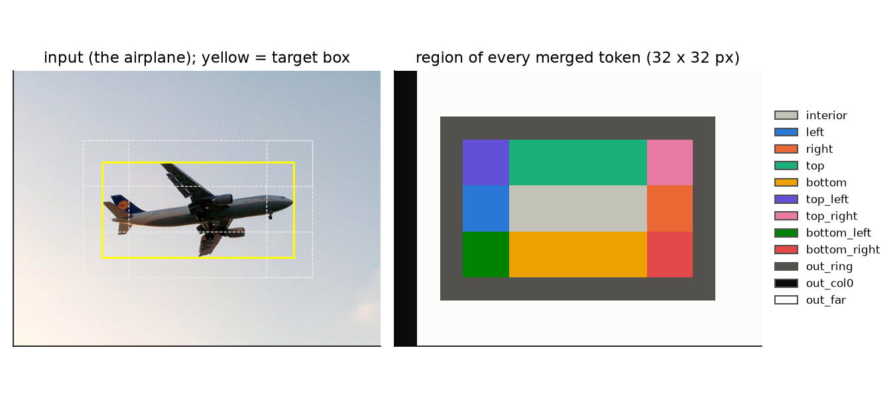

图 protocol：区域划分的例子（第 3.2 节）。左为输入图像与目标框（黄色），右为每个 merged token 的区域类别，颜色见图例；边缘带为框内从边缘 token 向内的 2 列或 2 行，角为两条边缘带的交集，框外分为一圈、第一列与其余。区域由目标框坐标计算。

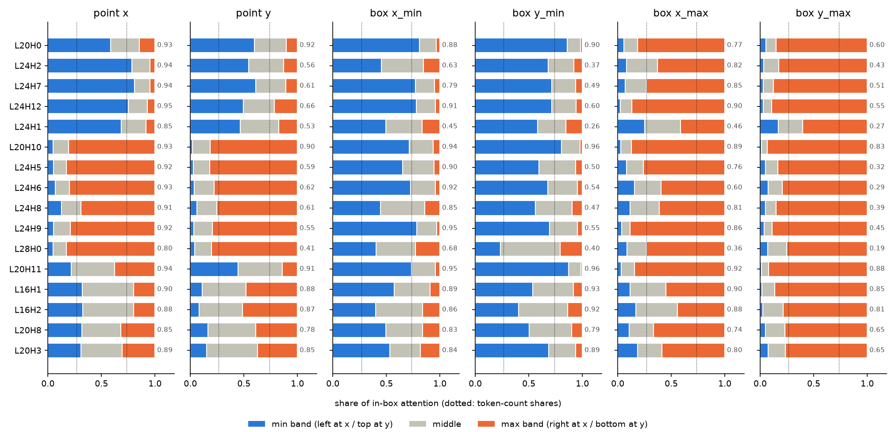

图 head_value_table：16 个 head（行）在六个数值步（列）上的横穿份额（第 3.2 节第 1 项，由模型 attention 计算，第三轮 454 张图像的平均）。蓝色为最小边带（写 x 类数值时为左边、写 y 类数值时为上边），浅灰为中间，橙色为最大边带（右或下）；黑色点线为均匀 attention 时的 token 份额；条右侧的数字为框内 attention 占图像 attention 的比例。

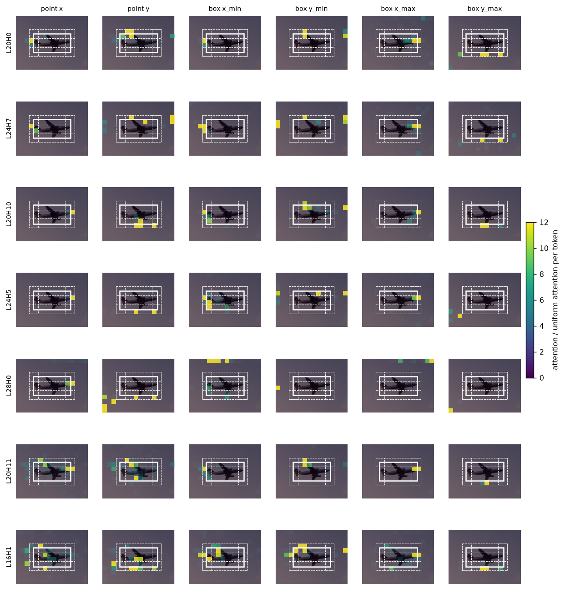
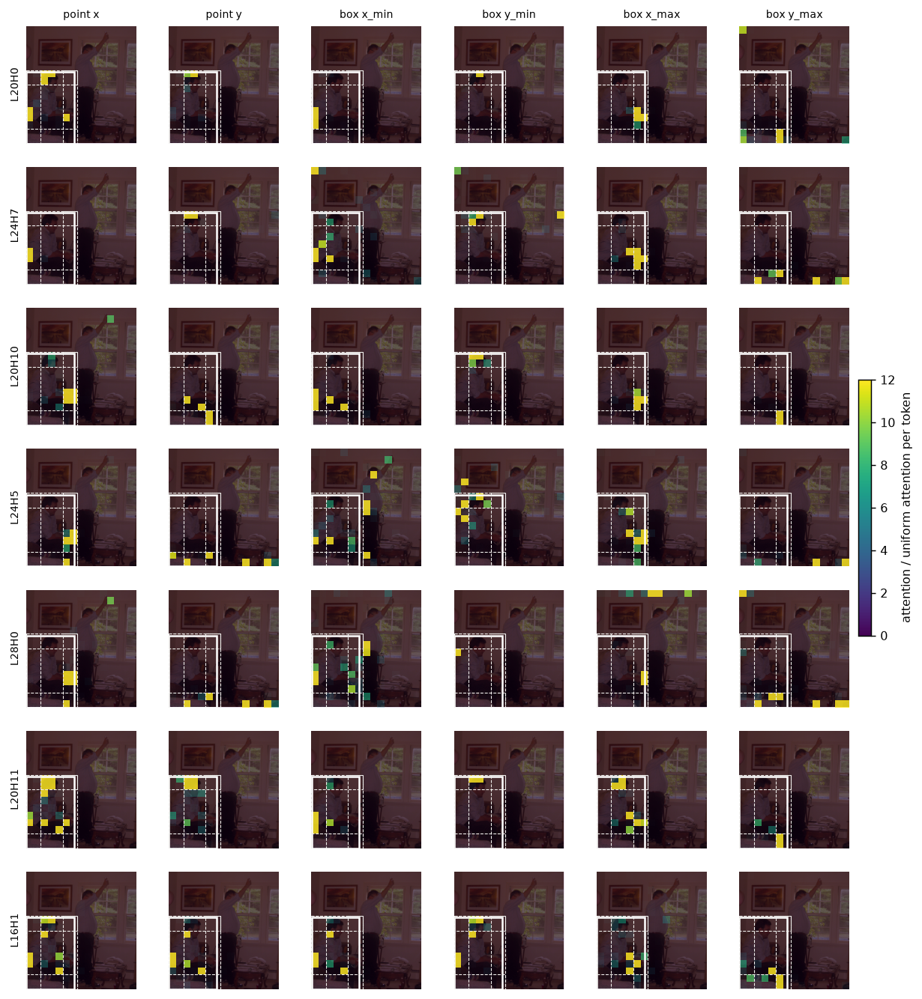
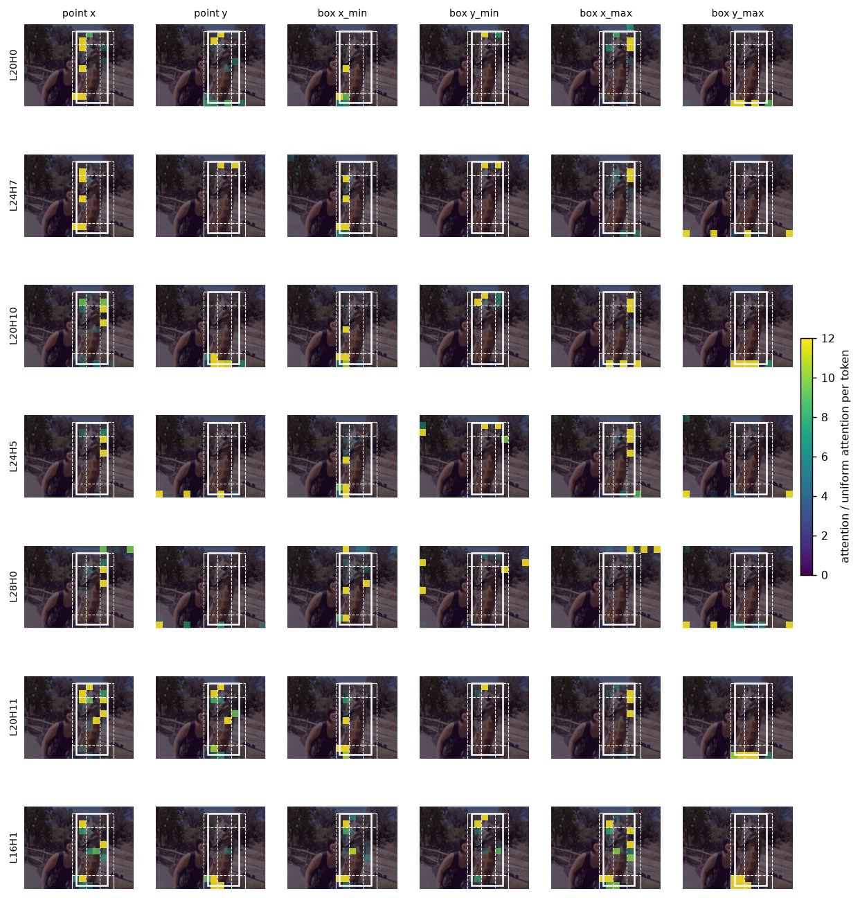
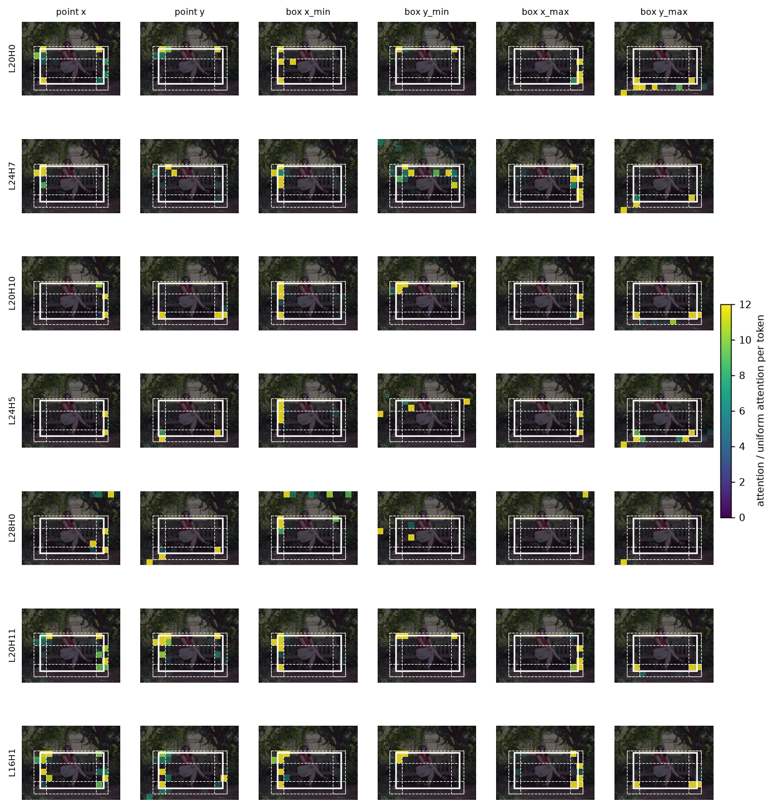

图 gallery_0–3：四张自然图像上 7 个 head（行）在六个数值步（列）的 attention（由模型 attention 计算，首位数字 query）。底图为调暗的原图，白色实线为目标框，白色虚线为四条边缘带；颜色为 attention 除以均匀 attention（$1/N_v$），viridis 色标，色条单位为“相对均匀分布的倍数”，低值透明。

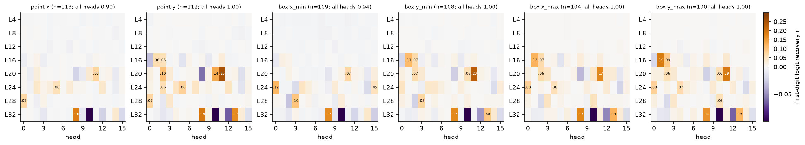

图 scan_nat：nat 平移配对中逐个替换 128 个 head 的首位数字 logit 恢复 $r$（第 3.3 节，由激活替换实验计算，图像平均）。行为层，列为 head；发散色标中橙色为正、紫色为负、浅灰为 0；$r \geq 0.05$ 的格标出数值；标题给出样本数与全部 head 同时替换时的 $r$。

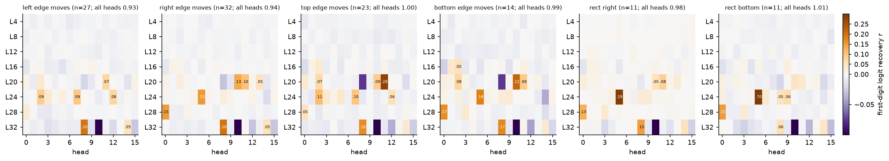

图 scan_edges：同图 scan_nat，配对为单边移动（自然图像的左、右、上、下边各移动 96 像素，矩形的右、下边）；只统计移动轴上的数值。

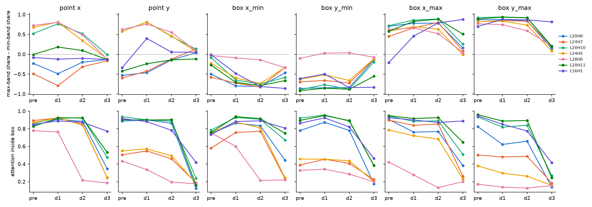

图 digit_slots：7 个 head 在每个数值的四个 query 上的 attention（nat，由模型 attention 计算）。横轴为数值前一个 token（pre）与预测第 1、2、3 位数字的 query（d1、d2、d3）。上行为最大边带份额减最小边带份额（正值表示读右或下边，负值表示读左或上边），下行为框内 attention 占图像 attention 的比例。颜色区分 head（图例）。

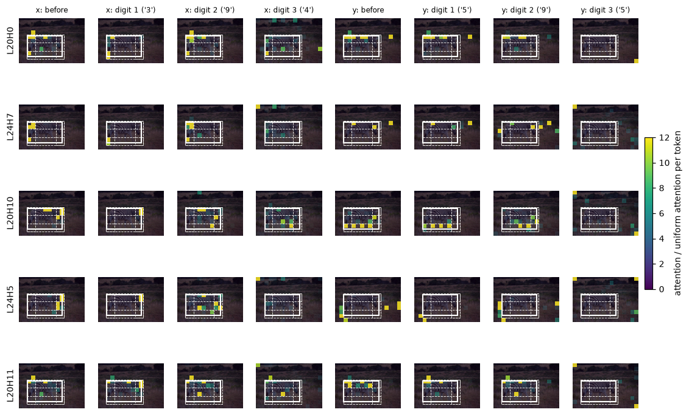
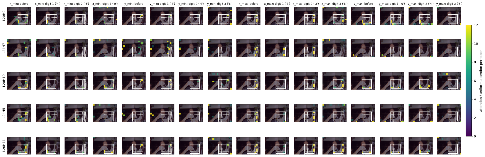

图 digits_point、digits_bbox：一张自然图像上 5 个 head（行）在每个数值的每个 query（列）上的 attention；列标题给出数值与所预测的数字。色标与图 gallery 相同。

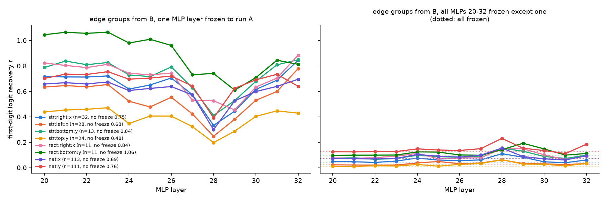

图 mediation：逐层 MLP 冻结（第 3.3 节，激活替换实验）。左：两组边缘 head 从 run B 替换、同时把单层 MLP 固定为 run A 时的首位数字 logit 恢复 $r$；右：第 20–32 层 MLP 除横轴所示一层外全部固定为 run A，彩色点线为全部固定时的值。颜色区分配对类型（图例，含样本数与不冻结时的 $r$）。

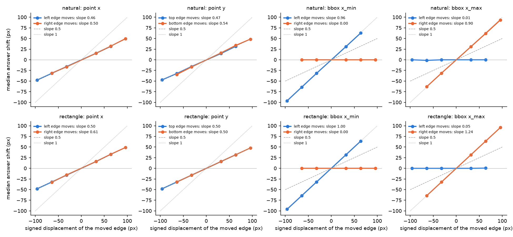

图 behaviour：单边移动时模型答案的变化（模型 greedy 输出，按像素换算）。横轴为移动边的位移（正值为向坐标增大方向），纵轴为答案变化的中位数；颜色区分移动的边（图例，含过原点最小二乘斜率），灰色虚线为斜率 0.5，灰色点线为斜率 1。上行为自然图像（60 张），下行为矩形（24 张）；列依次为点 x、点 y、框 x_min、框 x_max。

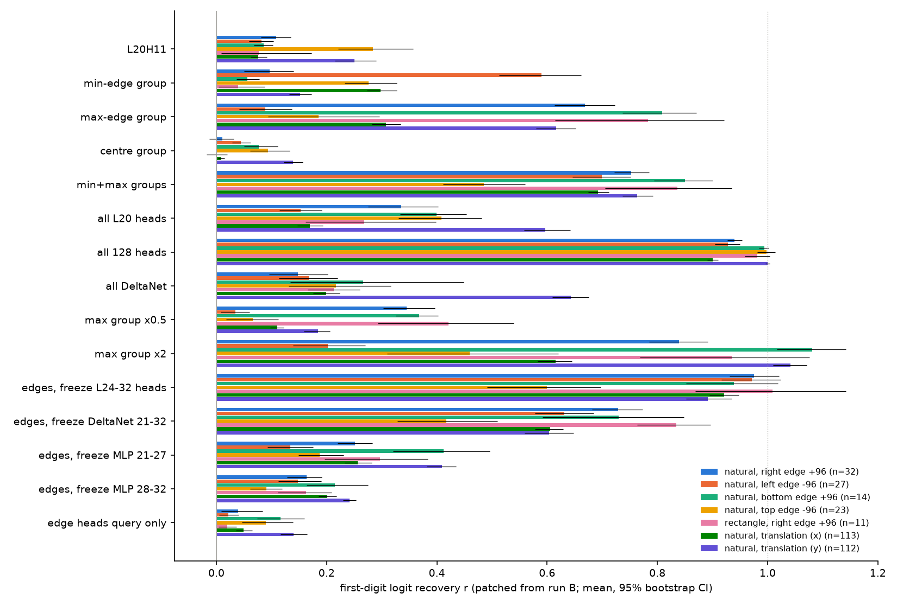

图 groups：组件替换条件（纵轴）的首位数字 logit 恢复 $r$（第 3.3 节，均值与 95% bootstrap CI）。颜色区分配对类型（图例，含样本数）；灰色点线为 $r = 1$。

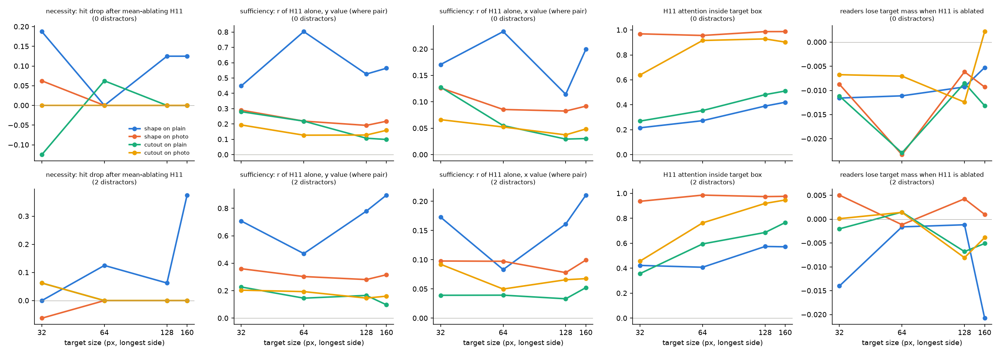

图 comp_h11：comp 上 L20 H11 的作用随目标大小的变化（横轴为目标最长边，对数刻度）。列依次为：均值消融 H11 后命中率的下降（模型 greedy 输出，每点 16 张图像）；where 配对中 H11 单独替换的 $r$（纵坐标、横坐标，激活替换）；H11 在目标框内的 attention（模型 attention）；均值消融 H11 后第 24、28 层读取 head 的目标 attention 下降（模型 attention）。上行无干扰物，下行有 2 个干扰物；颜色区分物体类型与背景（图例）。

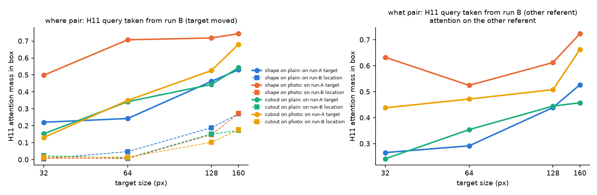

图 qswap：只替换 L20 H11 query 的结果（由模型 attention 计算，2 个干扰物的格）。左：where 配对，实线为替换后在 run A 目标上的 attention，虚线为在 run B 目标位置（run A 图像中该处为背景或与原目标重叠）上的 attention；右：what 配对，替换后在另一表达所指物体上的 attention。颜色区分物体类型与背景。

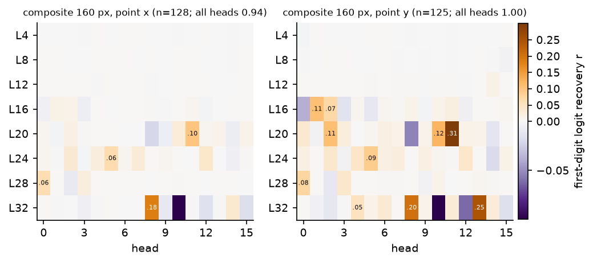

图 scan_comp：同图 scan_nat，配对为 comp 中 160 px 目标的 where 配对，按点 x 与点 y 分列（四种物体类型与背景合并）。

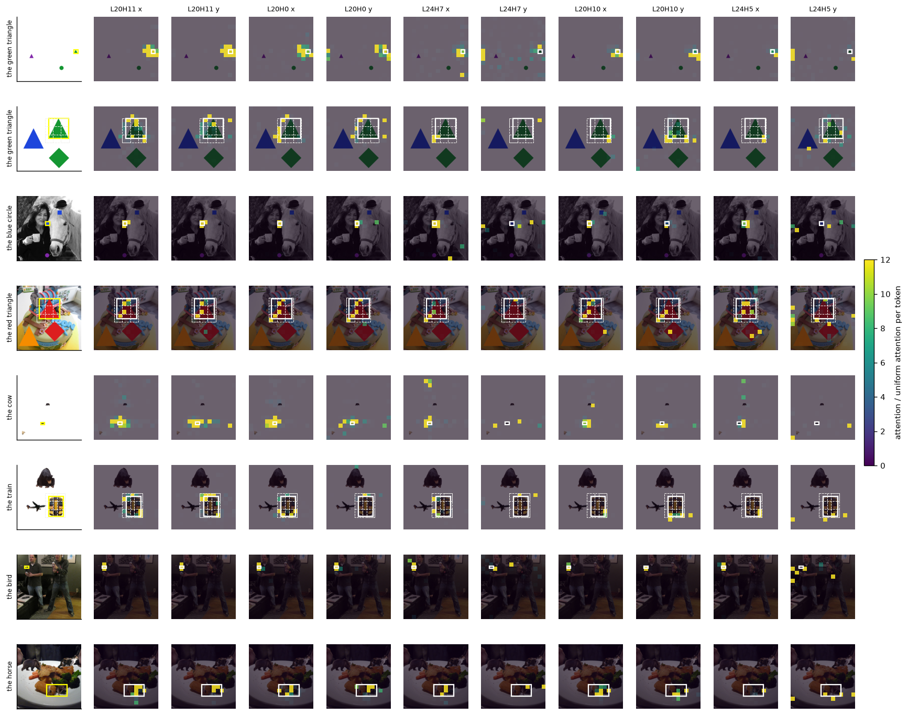

图 overlay_comp：comp 的 8 个例子（行：几何形状与抠图物体、白底与照片、32 与 160 px，均有 2 个干扰物）。第一列为输入图像与目标框（黄色），其余列为 5 个 head 在点 x 与点 y 首位数字 query 上的 attention，色标与图 gallery 相同。

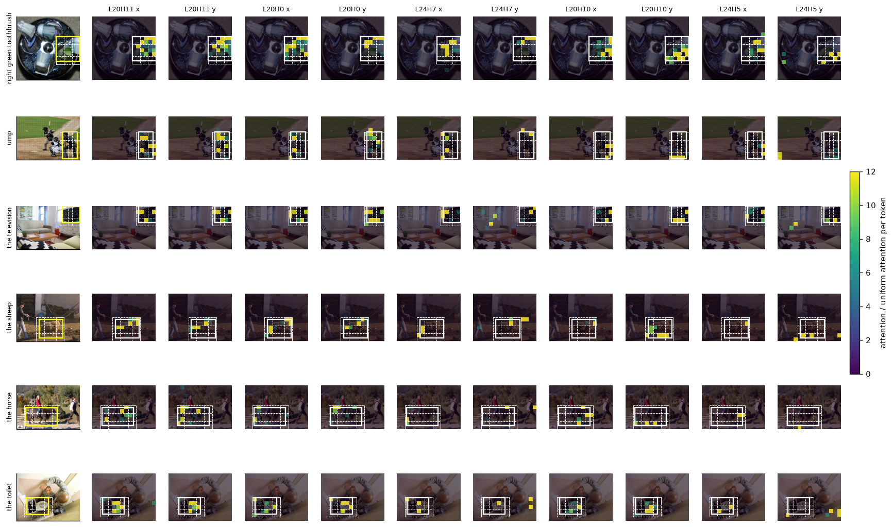

图 overlay_nat：同图 overlay_comp，图像为 nat 中的 6 张自然图像。

## 实验产物

以下路径相对于 `$WORK_DIR/analysis/position/2026-11-05_edge_heads_r2/`，由 `scripts/analysis/position/edge_heads_r2.sh` 生成。

| 内容 | 路径 | 生成阶段 |
| --- | --- | --- |
| 图像组与配对的定义（表 1） | `cases.json` | cases |
| run A 答案、命中率、抽查（第 3.1 节） | `gen.jsonl`、`spotcheck.jsonl`；`summary.json` 的 `gen` | gpu（gen、spotcheck） |
| 表 2、表 3、图 head_value_table、gallery、protocol 的区域统计 | `summary.json` 的 `r3_regions`；`r3_profiles.npz`；原始 attention 为第三轮的 `2026-11-03_edge_heads/attn/` | analyze |
| 单 head 扫描（表 2 的 $r$、图 scan_nat、scan_edges、scan_comp） | `summary.json` 的 `scan`；`probe.jsonl` 的 `scan_lds` | gpu（probe）+ analyze |
| 逐位数字的区域统计（第 4.2 节、图 digit_slots、digits_*） | `summary.json` 的 `profiles`；`probe/*.npz` 的 `att_a` | gpu（probe）+ analyze |
| 表 4、图 behaviour | `behav.jsonl`；`summary.json` 的 `behaviour` | gpu（behav）+ analyze |
| 表 5、图 groups | `probe.jsonl` 的 `lds`；`summary.json` 的 `conditions` | gpu（probe）+ analyze |
| 表 6 | `summary.json` 的 `direct`；`probe/*.npz` 的 `heads`、`resid` | analyze |
| 表 6b、图 mediation（逐层 MLP 冻结） | `mediate.jsonl`；`summary.json` 的 `mediation`；日志 `gpu_run_mediate.log` | gpu（mediate）+ analyze |
| 表 7、图 comp_h11、qswap（comp 的组件替换与 attention） | `summary.json` 的 `comp_probe`（条件行的 attention 数组 `cond_att` 与 run B 的 `att_b` 在汇总后已从 `probe/*.npz` 删除以节省空间，重算需重跑 probe 阶段） | gpu（probe）+ analyze |
| 表 7 的消融命中率 | `ablate.jsonl`；`summary.json` 的 `comp_ablation`；均值输出 `means.npz` | gpu（means、ablate）+ analyze |
| 表 8 | `summary.json` 的 `neighbourhood`；`probe/*.npz` 的 `att_a` | analyze |
| OV 解码 | `summary.json` 的 `ov`；`probe/*.npz` 的 `heads`、`v11`、`k11` | analyze |
| 运行日志 | `gpu_run.log`、`run_log.jsonl` | gpu |

## 修改记录

- 2026-11-12：通俗讲述第三段与第 4.3 节“组合机制的结论”中关于 0.5 来源的表述。原表述把 0.5 写成“相加加上 MLP 读出的结果”，可被理解为“取平均”本身也需要一次相加，含义有歧义；第五轮（results_2026-11-11_edge_heads_r3.md 第 3 节）的解码时 head 移植表明，读取 head 写入完整的边缘读数，0.5 由 residual 之后的读出产生，正文改为这一表述。
