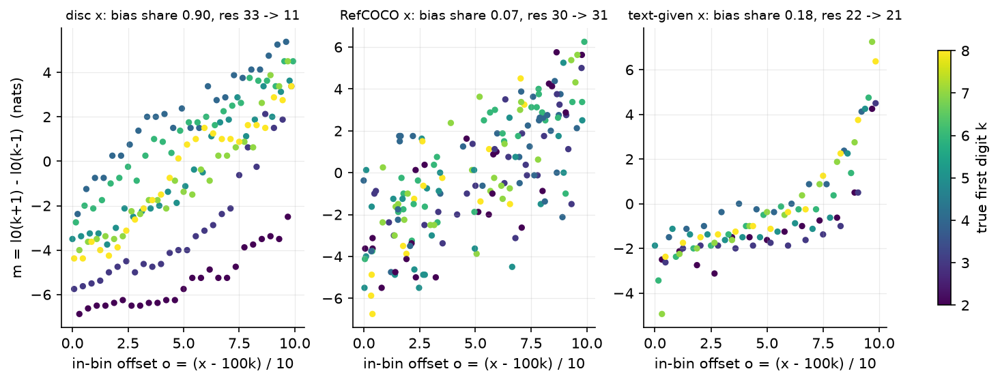
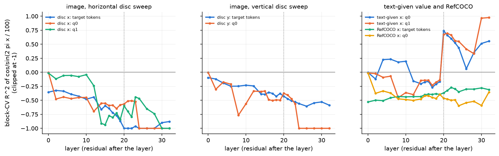
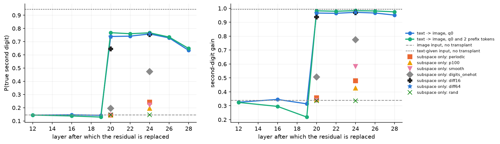
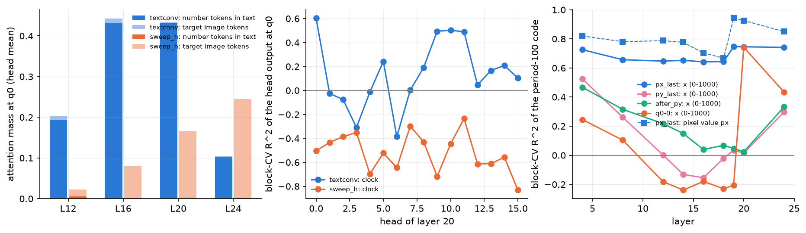
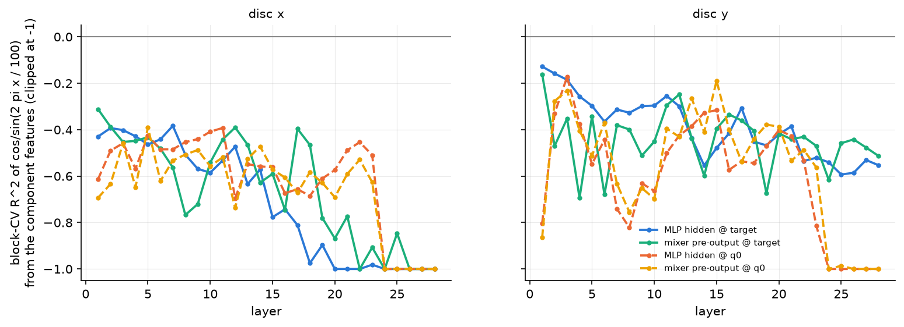
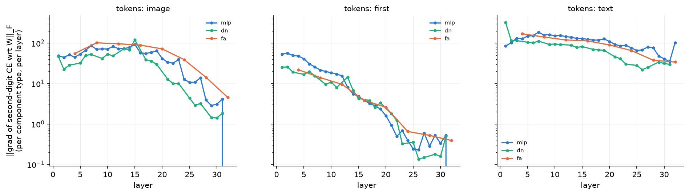
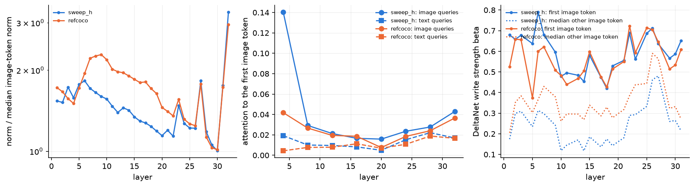

# 坐标读出缺陷的先验定位（实验 3.16）

实验日期：2026-11-05 至 2026-11-06。本文属于[位置信息与坐标读取](plan.md)研究，只使用原模型（Qwen3.5-9B，bfloat16、SDPA，thinking off，direct-answer 提示），不包含任何训练。本文第 6 节记录的预测在开始实验 7.2 的训练之前写定，此后不再修改；7.2 的结果与预测的比较见[定位微调](../application/results_2026-11-05_located_finetune.md)。

## 通俗讲述

Qwen3.5 写坐标时只有首位数字可靠，第二位数字接近随机。前几轮实验已经弄清读出的过程：答案前缀末尾的 token（记为 $q_0$）在第 20 层回看图像，读出首位数字；写第二位数字时，模型并不重新看图，而是经 Gated DeltaNet 的短卷积读取首位分布在相邻两个数字之间的倾斜程度（记为 $m$）。实验 3.13 第二轮又发现，微调只需改动前四层对图像 token 的处理就能修好第二位数字，但这一结论是在训练之后才得到的。本文要回答的问题是：只看原模型，能否事先判断读出电路需要上游提供什么样的表示、原模型在哪里没有提供、应当改动哪些组件。

我们先从读出机制推出两条要求。第一条针对 $m$ 这条通道：$m$ 必须随组内偏移线性增长，而且在不同的百位之间截距一致，否则第二位数字会系统性地偏向某一侧。原模型在单目标画布上恰好违反了这一条：$m$ 的散布有 90% 来自“每个百位各自的偏置”，也就是首位读出的扇区没有对齐真实的百位边界；即使去掉偏置，$m$ 也只能提供约 11 个单位的分辨率，不足以区分宽度为 10 的十位数字。第二条要求来自文本数值：当坐标以文本形式给出时，同一个原模型能以 0.94 的概率写对第二位数字，此时 $q_0$ 在第 20 层突然带上一个周期为 100 的编码，一个对所有百位通用的线性读出就能从中解出坐标的后两位。图像任务中，$q_0$、目标图像 token 与 $q_1$ 在任何一层都没有这样的编码。

接下来要确认读出电路本身是否够用。做法是把文本数值输入在 $q_0$ 处第 20 层之后的 residual 整体移植到同一坐标的图像输入中，其余计算保持原样。移植后第二位数字的真值概率由 0.15 升到 0.74，增益（期望第二位数字对组内偏移的斜率，理想值为 1）由 0.34 升到 0.97。这说明原模型的第 21–32 层只要收到文本通路那种格式的 $q_0$ 状态，就能写出精确的第二位数字，读出阶段无需改动。移植在第 19 层及以前不起作用，因为第 20 层会重新从图像中读取坐标并覆盖 $q_0$ 的内容；因此所需的格式必须出现在第 20 层读取的对象中，即图像 token 上。所需的改变也并不复杂：只移植文本与图像状态之差的前 16 个主方向就恢复 0.65，前 64 个主方向恢复全部效果；而按周期函数拟合的二维或十二维“时钟”子空间几乎无效，说明读出所需的格式是一个约 16 维的结构，而非单一的钟面。

文本通路的来源进一步表明，读取图像与读取文本数值共用同一组 head。文本数值输入中，$q_0$ 在第 20 层把 0.40 的 attention 放在像素数值的数字 token 上，L20 的 H0、H9、H10、H11 的输出带有周期为 100 的编码；而这些 head 正是图像任务中读取目标的 head（H11 为 3.11 所指的主读 head），在图像任务中它们的输出只有单调的长周期编码（只在周期 ≥ 500 处可线性解码的坐标表示）。数字 token 自第 4 层起就携带其数值的周期编码，这是数字以逐位 token 输入的直接结果；图像目标从不经过这一步。于是缺陷被定位为：第 20 层读取的源 token 在文本中带有周期 100 编码，在图像中只有长周期编码；修复应当作用于图像 token，并且必须发生在第 20 层之前。

最后要决定改动哪些层与组件。我们用原模型的参数梯度做一阶归因：对第二位数字交叉熵，求每个线性层权重在不同 token 组上的梯度范数，它度量“只在这些 token 上改动这一权重时损失下降最快的速率”。图像 token 上的梯度集中在第 1–19 层，第 24 层以后下降一个数量级以上，这与“必须在第 20 层读取之前”的推断一致。一个意外的发现是第一个图像 token：这一个 token 在第 1–4 层 MLP 上的梯度范数（48–57）与其余 255 个图像 token 合计（44–52）相当。原因在于它在序列中的位置：它是图像片段在 Gated DeltaNet 递推中的第一次写入，写入强度 $\beta$ 为 0.6–0.8，是其余图像 token 的 2–4 倍；在第 4 层 full attention 中，图像 token 平均把 0.14 的 attention 给它（均匀分配时为 0.004）。另一方面，任何现有组件的内部特征（MLP 隐藏激活与 token mixer 的输出前特征）都不包含跨百位通用的周期成分，所以单靠改写某一层的输出投影写不出所需格式，必须改变非线性组件的输入，并让后续层的非线性计算完成重编码，这一要求偏向尽可能早的层。据此，第 6 节预注册的方案是：只训练第 1–4 层的 MLP，且更新只作用于图像 token（157 万参数，是 3.13 第二轮定位版的 58%、全部线性层 LoRA 的 7%），并给出了位置、层与 token 的对照预测。

## 1. 研究问题与主要结论

本文回答四个问题：读出机制对上游表示提出哪些可以测量的要求（Q1）；原模型的上游表示是否满足这些要求，不满足之处位于哪些 token 与层（Q2）；读出阶段本身是否足够（Q3）；据此应当训练哪些组件，预期得到什么（Q4）。

1. **首位 logit 差 $m$ 的散布主要是每个百位各自的偏置，而非噪声（第 4.1 节，图 1）。** 单目标画布上，$m$ 对组内偏移回归后的残差方差有 90%（x）与 91%（y）由百位的类别解释；去掉偏置后的分辨率为 10.6 与 12.6 个单位（3.12 定义为 33 与 42）。RefCOCO 上偏置只占 7%，散布 2.0 nats 来自图像内容的差异。确定性：高。
2. **文本数值通路在第 20 层把周期为 100 的编码带入 $q_0$，图像通路在任何位置与层都没有这种编码（第 4.2 节，图 2）。** 以整百为留出折的交叉验证（定义见第 3.2 节）中，文本数值输入的 $q_0$ 在第 19 层为 −0.17，第 20 层为 0.74，$q_1$ 在第 30–32 层达到 0.96–0.98；图像输入的目标 token、$q_0$、$q_1$ 在第 0–32 层全部为负值。确定性：高。
3. **读出阶段足够（第 4.3 节，图 3）。** 把文本数值输入的 $q_0$ residual 在第 20–26 层之后移植到图像输入，第二位真值概率 0.73–0.76（未移植 0.15，文本输入自身 0.94），增益 0.96–0.98；在第 12–19 层移植无效（0.13–0.15）。确定性：高。
4. **所需格式约为 16 维，不是二维时钟（第 4.3 节，图 3）。** 只移植文本减图像之差的前 16 / 64 个主方向，第二位真值概率为 0.65 / 0.74；按周期函数拟合的十二维子空间、周期 100 平面、以及十位数字独热编码子空间在第 20 层均无效（0.14–0.15），在第 24 层只部分有效（0.20–0.47）。确定性：中。
5. **文本与图像共用 L20 的读取 head（第 4.4 节，图 4）。** 文本输入中 $q_0$ 第 20 层把 0.40 的 attention 放在像素数值的数字 token 上，H0、H9、H10、H11 的输出携带周期编码（0.49–0.60）；图像输入中同一批 head 读取目标 token，输出只有长周期编码（周期编码为负，长周期编码 0.97）。数字 token 自第 4 层起即携带其数值的周期编码（0.82）。确定性：高。
6. **原模型的组件特征中不存在可直接改写成周期编码的成分（第 4.5 节，图 5）。** 第 1–28 层 MLP 隐藏激活与 token mixer 输出前特征在目标 token 与 $q_0$ 上的周期编码可解码性全部为负。确定性：高（对线性改写而言）。
7. **图像 token 上的梯度杠杆集中在第 1–19 层，第一个图像 token 的单 token 杠杆比普通图像 token 高两个数量级（第 4.6、4.7 节，图 6、7）。** 第一个图像 token 在第 1–4 层的高杠杆来自 DeltaNet 的强写入（$\beta$ 0.60–0.79，其余 0.17–0.31）与第 4 层的 attention 汇聚（0.14）。确定性：中（一阶归因）。
8. **把文本源 token 的状态或其周期部分直接写入目标图像 token 不能修复读出（第 4.4 节）。** 这一“理想化上游”检验为阴性：周期部分注入无效，整体替换使目标失去被选中的内容特征。确定性：中，它限制了“图像 token 上需要什么”只能在第 20 层的读取结果中刻画。

## 2. 读出机制对上游表示的要求

### 2.1 符号

坐标记为 $x \in [0, 1000)$，首位与第二位数字为

$$
k = \lfloor x / 100 \rfloor, \qquad s = \lfloor x / 10 \rfloor \bmod 10, \qquad o = \frac{x - 100k}{10} \in [0, 10).
$$

其中 $o$ 称为组内偏移，以十位为单位，$s = \lfloor o \rfloor$。位置记号沿用 3.12：$q_0$ 是第一个坐标数字之前的 token，首位数字在此预测；$q_1$ 是首位数字所在的 token，第二位数字在此预测。$h_t^{(\ell)} \in \mathbb{R}^{4096}$ 是第 $\ell$ 层输出在位置 $t$ 的 residual（$\ell = 0$ 为输入 embedding），$\ell_0(d)$ 是 $q_0$ 处数字 $d$ 的 log 概率。首位 logit 差定义为

$$
m = \ell_0(k+1) - \ell_0(k-1).
$$

3.12 第二、三轮表明，第二位数字经第 25–32 层 Gated DeltaNet 的短卷积读取 $m$。Gated DeltaNet 的短卷积是一个深度可分离的一维卷积，核长为 4：

$$
u_t = \sum_{j=0}^{3} w_j \odot z_{t-j},
$$

其中 $z_t$ 是该层输入投影在位置 $t$ 的输出，$w_j$ 是逐通道权重，$\odot$ 为逐元素乘积。它让 $q_1$ 直接看到 $q_0$ 的投影，是一条“上一位置到当前位置”的通道。

### 2.2 要求一：经 $m$ 读出时 $m$ 必须校准且低噪声

若第二位数字由 $m$ 单调决定，正确读出要求 $m$ 是 $o$ 的同一个线性函数，与百位无关。把 $m$ 写成

$$
m_i = a + b\, o_i + c_{k_i} + e_i ,
$$

其中 $b$ 是斜率，$c_k$ 是第 $k$ 个百位的偏置（和为零），$e_i$ 是百位内的残差。偏置 $c_k \neq 0$ 意味着同一个 $m$ 值在不同百位对应不同的组内偏移，第二位数字会系统性地偏向一侧；残差 $e_i$ 决定分辨率 $10\,\mathrm{sd}(e)/b$（坐标单位）。十位数字的宽度为 10，要以多数概率写对第二位，分辨率需要明显小于 5。这一分解把 3.12 第三轮所说的“$m$ 的散布”拆成两部分，后文分别测量。

### 2.3 要求二：直接通道需要跨百位通用的周期编码

文本数值输入的第二位真值概率为 0.94，而其 $m$ 的分辨率只有 22 个单位（第 4.1 节），所以读出阶段还有一条不依赖 $m$ 的通道。由于数字 logit 是归一化 residual 的线性函数，

$$
\ell_d = w_d^\top \operatorname{RMSNorm}(h),
$$

每个数字胜出的区域是 residual 空间中的一个凸锥（3.12 第二轮第 2.2 节）。坐标 $x$ 从 0 增加到 1000 时，第二位数字需要经过十个数字各十次，因此 residual 中必须存在一个随 $x$ 每 100 个单位转一圈的成分，并且这个成分在不同百位上处于相同的方向，读出权重才能对所有百位通用。我们把这一性质称为“跨百位通用的周期编码”，用第 3.2 节的整百留出交叉验证测量；这一测量正是“同一组读出权重在没见过的百位上也给出正确相位”的可操作定义。实验 3.13 第二轮在训练后观察到的时钟编码是这种编码的一个特例。

### 2.4 要求三：编码必须出现在第 20 层读取的源 token 上

3.11 表明 $q_0$ 在第 16–24 层回看图像，因果读取集中在第 20 层。若 $q_0$ 在第 20 层之后的内容只由第 20 层的读取决定，那么无论第 20 层之前 $q_0$ 携带什么，所需编码都必须由第 20 层读取的源 token 提供。第 4.3 节的移植实验直接检验这一点。

## 3. 实验设计

### 3.1 刺激

1. **单目标画布扫描。** 3.6 的红色圆（直径 64 pixels，画布 512×512，即 16×16 个视觉 token）水平与竖直扫描，真值 100–999，步长 3.9 个单位；$x$ 轴 215 张、$y$ 轴 215 张。移植与注入使用水平扫描每隔一张取一张（108 张）。
2. **文本数值输入（textconv）。** 与水平扫描同一圆心，提示中以像素给出圆心（“Its center is at pixel (px, py) of this 512x512 image. Convert this point to 0-1000 normalization.”），图像同时给出，108 张。
3. **RefCOCO。** 3.13 测试集的 point 问题，198 张（x 轴）。

所有读出测量都把首位数字强制为真值（3.12 的析因协议），由 $q_0$ 与 $q_1$ 的数字分布计算首位真值概率 $P_0$、第二位真值概率 $P_1$、第二位增益（$\mathbb{E}[s]$ 对 $o$ 的最小二乘斜率）。

### 3.2 跨百位通用的周期编码：整百留出交叉验证

对一组特征 $X \in \mathbb{R}^{N \times F}$（$N$ 个输入，$F$ 维）与坐标 $x$，以 ridge 回归预测 $[\cos(2\pi x/100), \sin(2\pi x/100)]$，留出折为整百（$\lfloor x/100 \rfloor$ 相同的输入构成一折），报告留出折上的合并 $R^2$。特征在训练折上中心化并按平均行范数缩放，罚项 $\alpha = 0.1$。若特征只含长周期编码或局部的分段线性特征，留出的百位上无法预测相位，$R^2 \le 0$；只有在不同百位上方向一致的周期成分才能得到正值。这一测量比 3.13 第二轮的交错折更严格：交错折只检验插值，局部的样条型特征也能得到正值。同样的留出方式预测 $x$ 本身，称为长周期编码可解码性。

### 3.3 移植（transplant）协议

对每张水平扫描图与其文本数值孪生输入（同一圆心）：

1. 先分别运行两种输入，记录第 $\ell$ 层输出在 $q_0$（及其前两个答案前缀 token）的 residual。
2. 再运行图像输入，在第 $\ell$ 层输出处把 $q_0$ 的 residual 替换为文本输入的 residual（full_q0），或连同前两个前缀 token 一起替换（full_pre3），其余位置与后续计算保持原样，读出 $P_0$、$P_1$ 与增益。
3. 子空间移植只替换投影：$h \leftarrow h + (h_{\text{text}} - h) P^\top P$，$P \in \mathbb{R}^{r \times 4096}$ 为正交基。子空间包括：在 108 个文本输入上把 residual 对 $[\text{Legendre}(x), \cos/\sin(2\pi x/T)]$ 回归得到的全部周期系数（$T = 100, 50, 33.3, 25, 20, 10$，12 维）、只含周期 100 的二维平面、Legendre 系数（5 维，长周期部分）、十位数字独热指示变量的系数（9 维）、十位与首位独热（18 维）、文本减图像之差的前 16 与前 64 个主方向，以及与周期子空间同维的随机子空间。
4. 反向移植（rev）把图像 residual 写入文本输入。

### 3.4 文本通路的来源

在文本数值输入与水平扫描图像上，重算 full attention 第 12、16、20、24 层在 $q_0$ 的 attention 行与每个 head 的输出贡献（gated head 输出经该 head 在 o_proj 中对应的列块），并记录文本输入中图像之后每个位置在第 4–24 层的 residual。对每个 head 的输出与每个文本位置的 residual 计算第 3.2 节的周期编码可解码性。

### 3.5 理想化上游注入

在水平扫描图像的全部目标 token（与圆外接框重叠的 token）上，于第 $\ell \in \{4, 8, 12, 16, 19\}$ 层输出处：（a）加入文本源 token（像素数值的末位数字、py 的末位数字）在同一层 residual 的周期部分（第 3.3 节的 12 维回归分量，1 倍与 2 倍）；（b）整体替换为该源 token 的 residual。对照为把 $x$ 随机打乱后的同一操作。

### 3.6 组件特征的可改写性

在每层的目标 token 平均与 $q_0$ 上记录 MLP 隐藏激活（down_proj 的输入，12288 维）与 token mixer 的输出前特征（DeltaNet out_proj 或 full attention o_proj 的输入，4096 维）。组件输出是这些特征的线性函数，所以若这些特征的周期编码可解码性为正，只改写输出投影（例如 down_proj 的低秩更新）就能写出周期编码；若为负，则必须改变非线性组件的输入。

### 3.7 参数梯度杠杆

以第二位数字（及首位数字）的交叉熵为损失，在 72 个输入（x、y 扫描与 RefCOCO 各 24 个，每批 6 个、共 12 批）上求每个线性层权重的梯度。对输入 $x_t$、输出梯度 $\delta_t$ 的线性层，限制在 token 组 $G$ 上的权重梯度为

$$
G_W = \sum_{t \in G} \delta_t\, x_t^\top .
$$

$\lVert G_W \rVert_F$ 是“只在 $G$ 中的 token 上施加单位 Frobenius 范数的权重改变时，损失一阶下降的最大速率”；其最佳秩 8 近似的范数对应 LoRA 型改变。token 组为第一个图像 token、其余图像 token、全部文本 token（含答案前缀）。按组件类型与层把平方和开方汇总。

### 3.8 第一个图像 token 的刻画

在 28 张扫描图与 25 张 RefCOCO 图上，记录第一个图像 token 的 residual 范数与图像 token 中位范数之比、full attention 各层图像 query 与文本 query 给它的 attention（head 平均）、以及 Gated DeltaNet 的写入强度 $\beta = \sigma(b_t)$（head 平均）。Gated DeltaNet 的状态更新为

$$
S_t = \alpha_t\, S_{t-1}\left(I - \beta_t k_t k_t^\top\right) + \beta_t\, v_t k_t^\top ,
$$

其中 $S_t$ 是递推状态矩阵，$\alpha_t \in (0, 1)$ 为衰减门，$\beta_t \in (0, 1)$ 决定当前 token 的 key $k_t$ 与 value $v_t$ 以多大强度写入状态。

GPU 用量：全部 GPU 阶段约 0.5 GPU 小时（A40 / A800 各一段，均经 claim 工具申领空闲卡）。

## 4. 结果

### 4.1 $m$ 的散布是百位偏置

*图 1：首位 logit 差 $m$（$q_0$ 处 log 概率之差，原模型前向计算）对组内偏移 $o$ 的散点，颜色为真值首位 $k$（viridis，2–8），真值 200–899。左：单目标画布 x（179 张）；中：RefCOCO x（180 张）；右：文本数值输入（90 张）。标题中“bias share”为百位类别解释的残差方差比例，“res”为 3.12 定义的分辨率与去除百位偏置后的分辨率（第 2.2 节模型的最小二乘拟合）。*

**表 1：$m$ 的分解（原模型）。**

| 输入 | 斜率 $b$（nats / 十位） | 残差 s.d. | 百位偏置占比 | 去偏置后残差 s.d. | 分辨率 | 去偏置分辨率 | $P_1$ |
| --- | --- | --- | --- | --- | --- | --- | --- |
| 画布 x | 0.73 | 2.42 | 0.90 | 0.77 | 33.1 | 10.6 | 0.14 |
| 画布 y | 0.74 | 3.11 | 0.91 | 0.94 | 42.0 | 12.6 | 0.13 |
| RefCOCO x | 0.67 | 2.03 | 0.07 | 2.00 | 30.1 | 30.6 | 0.21 |
| 文本数值 x | 0.58 | 1.31 | 0.18 | 1.23 | 22.4 | 21.0 | 0.94 |

1. **合成图像上的散布几乎全是百位偏置。** 画布 x 的偏置在 $k = 2$ 时为 −4.4 nats，$k = 4$ 时为 +3.0 nats，也就是说首位读出的扇区边界与真实的百位边界错位，错位方向随百位改变；同一百位内部 $m$ 随偏移平滑变化（相邻样本残差的自相关 0.96）。在单目标画布上，3.12 第三轮所测得的同一偏移下不同图像之间 2.0–3.1 nats 的散布主要来自首位读出的系统性错位。
2. **即使校准，$m$ 通道也不够精确。** 去偏置后分辨率仍为 10.6–12.6 个单位，大于十位宽度的一半，所以只修正首位读出的校准不足以写对第二位数字。
3. **文本数值使用另一条通道。** 文本输入的 $m$ 分辨率为 22 个单位，第二位真值概率却达到 0.94，说明读出阶段在文本中不依赖 $m$。

### 4.2 文本通路有周期编码，图像通路没有

*图 2：residual 中周期为 100 的编码的整百留出交叉验证 $R^2$（第 3.2 节，原模型 residual 拟合；低于 −1 的值截为 −1）。左：画布 x 扫描的目标 token 平均（蓝）、$q_0$（橙）、$q_1$（绿）；中：画布 y 扫描的目标 token 与 $q_0$；右：文本数值输入的 $q_0$ 与 $q_1$、RefCOCO 的目标 token 与 $q_0$。点线标出第 20 层。*

**文本数值通路的 $q_0$ 在第 20 层获得跨百位通用的周期编码，图像通路在任何位置都没有。** 文本输入的 $q_0$ 在第 4–10 层有弱的正值（0.18–0.24），第 12–19 层为负，第 20 层跃升到 0.74；$q_1$ 在第 20 层为 0.68，第 30–32 层为 0.96–0.98。图像输入的目标 token、$q_0$ 与 $q_1$ 在第 0–32 层全部为负，RefCOCO 也是如此。这意味着读出阶段在文本中接收到的是一种对所有百位通用的周期 100 编码，在图像中接收到的只是长周期编码；第 20 层是两种通路的分界点，也是 3.11 所测的回看图像的层。

### 4.3 读出阶段足够，所需格式约为 16 维

*图 3：把文本数值输入的 residual 移植到同一坐标的图像输入后的 $P_1$（左）与第二位增益（右），横轴为移植所在层。蓝：只替换 $q_0$；绿：替换 $q_0$ 与前两个答案前缀 token；灰虚线：未移植的图像输入；黑点线：文本输入自身；散点：只替换某一子空间（第 3.3 节第 3 条）。数值由原模型前向的数字分布计算，108 张图。*

**表 2：移植结果（$P_1$ 括号内为 bootstrap 95% 区间）。**

| 条件 | $P_1$ | 增益 | 首位正确率 | 数值误差 |
| --- | --- | --- | --- | --- |
| 图像输入（未移植） | 0.15 [0.12, 0.17] | 0.34 | 0.69 | 69.2 |
| 文本输入（未移植） | 0.94 [0.92, 0.97] | 0.99 | 0.97 | 4.9 |
| full_q0，第 12 / 16 / 19 层 | 0.14 / 0.15 / 0.14 | 0.33 / 0.35 / 0.31 | — | 57–70 |
| full_q0，第 20 层 | 0.74 [0.70, 0.77] | 0.97 | 0.97 | 4.6 |
| full_q0，第 24 层 | 0.76 [0.73, 0.79] | 0.97 | 0.98 | 3.4 |
| full_q0，第 28 层 | 0.63 | 0.95 | — | 4.1 |
| 文本减图像之差前 16 方向，第 20 层 | 0.65 [0.59, 0.69] | 0.94 | 0.97 | 6.8 |
| 文本减图像之差前 64 方向，第 20 层 | 0.74 [0.70, 0.77] | 0.97 | 0.97 | 4.6 |
| 周期子空间（12 维），第 20 / 24 层 | 0.14 / 0.24 | 0.36 / 0.48 | — | 68 / 57 |
| 周期 100 平面，第 20 / 24 层 | 0.15 / 0.20 | 0.34 / 0.43 | — | 68 / 65 |
| 十位与首位独热子空间，第 20 / 24 层 | 0.19 / 0.47 | 0.51 / 0.77 | — / 0.94 | — / 14.9 |
| 随机 12 维子空间，第 20 / 24 层 | 0.15 / 0.15 | 0.34 / 0.34 | — | 67–69 |
| 反向（图像写入文本），第 20 / 24 层 | 0.72 / 0.77 | 0.87 / 0.87 | 0.78 / 0.77 | 8.5 |

1. **原模型的读出阶段能把正确格式的输入转换成精确数字。** 第 20–26 层之后移植文本 $q_0$，第二位增益 0.96–0.98，数值误差 3.4–4.6，图像输入的其余部分（包括图像 token 与答案前缀的其他位置）保持原样。这是在训练之前对“读出阶段足够”的直接检验，与 3.13 第二轮冻结读出阶段的训练结果一致。$P_1$ 未达到文本输入自身的 0.94，差额来自 $q_0$ 之外仍保留图像信息的位置（短卷积同时覆盖前几个 token），连同两个前缀 token 一起替换时为 0.77。
2. **第 20 层之前的 $q_0$ 内容不起作用。** 在第 12–19 层移植，增益保持原值，说明第 20 层的读取覆盖了 $q_0$ 此前的内容。因此所需格式必须出现在第 20 层读取的源 token 上（第 2.4 节要求三），在图像任务中这些源 token 是目标图像 token（3.11）。
3. **所需格式是一个约 16 维的结构，不是二维或十二维的周期子空间。** 文本减图像之差的前 16 个主方向已恢复 85% 的 $P_1$ 变化，而按 $\cos/\sin$ 回归得到的周期子空间与独热子空间在第 20 层完全无效。差值子空间是按样本的实际差值估计的，所以它包含了以非正弦方式随 $x$ 变化的成分；这解释了 3.13 第二轮“把二维时钟注入原模型只把 $P_1$ 由 0.14 提高到 0.25”的现象：时钟平面只是新格式的一个低维投影。
4. **文本通路是冗余的。** 反向移植使文本输入的 $P_1$ 只由 0.94 降到 0.72–0.77，说明文本中的数值信息还经其他位置到达读出。

### 4.4 文本通路的源 token 与读取 head

*图 4：左：$q_0$ 的 attention 质量（head 平均，原模型 attention 重算），深色为文本中的数字 token（px 与 py），浅色为目标图像 token；蓝为文本数值输入，橙为图像输入。中：第 20 层每个 head 在 $q_0$ 的输出贡献的周期编码可解码性（第 3.2 节，低于 −1 截断）。右：文本数值输入中若干位置 residual 的周期编码可解码性随层的变化（px_last 为像素横坐标的末位数字 token，py_last 为纵坐标末位，after_py 为其后一个 token，q0-0 即 $q_0$）；虚线为以像素值 px 本身为目标的同一量。*

1. **文本与图像由同一组 L20 head 读取。** 文本输入中，$q_0$ 在第 20 层给像素横坐标数字 token 的 attention 为 0.40（head 平均；第 16 层 0.31），给图像目标只有 0.001；图像输入中，同一层给目标 token 0.17。第 20 层输出带有周期编码的 head 是 H0（0.60）、H9（0.49）、H10（0.50）、H11（0.49）；图像输入中这些 head 的输出周期编码全部为负，而长周期编码很强（H11 为 0.97）。H11 是 3.11 的主读 head，H10 是 3.11 第二、三轮的边缘读取 head。因此同一条 OV 通道在文本中运送周期 100 编码，在图像中运送长周期编码；差别在于被读取的源 token。
2. **数字 token 天然携带数值的周期编码。** 像素横坐标末位数字 token 的 residual 对像素值 px 的周期编码在第 4 层即为 0.82，第 19–20 层为 0.93–0.94；对换算后的 $x$ 为 0.73。数字以逐位 token 输入，末位与十位数字的身份本身就给出了跨百位通用的周期结构；图像目标的坐标来自 ViT 的位置表示，只有长周期编码，从不经过这一步。
3. **把文本源 token 的状态写入图像目标不能修复读出。** 在第 4–19 层把 px 或 py 末位数字 token 的周期部分加到目标 token 上，1 倍与 2 倍均无变化（增益 0.33–0.34，$P_1$ 0.14–0.15）；整体替换使增益降到 0.22–0.33，打乱 $x$ 的对照相同。整体替换移除了目标的颜色与形状内容，L20 的读取 head 依内容选择目标（3.7 第二轮），目标因此不再被读取；周期部分注入失败与第 4.3 节第 3 条一致。这一阴性结果说明，图像 token 上需要的改变不能由文本 token 的低维成分直接构造，只能通过它在第 20 层读取后的效果来刻画。

### 4.5 现有组件特征中没有可改写的周期成分

*图 5：第 1–28 层组件内部特征的周期编码可解码性（第 3.2 节、第 3.6 节，原模型激活拟合；低于 −1 截断）。蓝：目标 token 上的 MLP 隐藏激活；绿：目标 token 上的 token mixer 输出前特征；橙、黄虚线：$q_0$ 上的同两类特征。左为画布 x，右为画布 y。*

**任何一层的 MLP 隐藏激活与 token mixer 输出前特征都不含跨百位通用的周期成分。** 画布 x 的目标 token 上，MLP 隐藏激活的可解码性在第 1–28 层为 −0.38 至 −1.28，$q_0$ 上为 −0.39 至 −2.4；画布 y 与 RefCOCO 同样为负（详见实验产物中的 summary.json）。由于组件输出是这些特征的线性函数，只改写某层的输出投影（例如 down_proj 的低秩更新）不能写出所需格式；必须改变非线性组件的输入，让后续层的非线性计算完成重编码。这一结论偏向尽可能早的层：越早的改动，留给第 20 层之前的非线性层数越多。

### 4.6 梯度杠杆：图像 token 集中于第 20 层之前

*图 6：第二位数字交叉熵对每个线性层权重的梯度 Frobenius 范数（第 3.7 节，原模型反向传播计算；同一层同一类型组件的平方和开方，72 个输入、12 批平均），对数纵轴。左：其余图像 token；中：第一个图像 token；右：文本 token。蓝：MLP；绿：Gated DeltaNet 投影；橙：full attention q/k/v/o。*

**表 3：图像 token 与第一个图像 token 上的梯度杠杆（第二位数字交叉熵）。**

| 层 | 其余图像 token：MLP / DeltaNet / FA | 第一个图像 token：MLP / DeltaNet / FA |
| --- | --- | --- |
| 1–4 | 44–52 / 23–47 / 56（L4） | 48–57 / 19–26 / 22（L4） |
| 5–12 | 54–87 / 32–53 / 96–100（L8、L12） | 16–41 / 8–20 / 10–14 |
| 13–19 | 56–92 / 30–120 / 89（L16） | 2.4–8.1 / 2.6–15 / 3.9 |
| 20–24 | 13–42 / 10–13 / 39–72 | 0.4–1.6 / 0.3–1.8 / 0.7–2.6 |
| 25–32 | 3–14 / 1.4–4.4 / 4.5–14 | 0.2–0.6 / 0.1–0.5 / 0.4–0.5 |

1. **图像 token 上的杠杆截止于第 20–24 层的读取。** 第 25–32 层图像 token 上的杠杆比第 5–19 层小一个数量级，与“图像 token 的改变必须在被读取之前”一致；文本 token 的杠杆在全部层都大，因为 $q_0$、$q_1$ 等读出位置就在文本中，但第 4.3 节表明读出阶段无需改变。
2. **第一个图像 token 的单 token 杠杆极高，且集中在最早几层。** 一个 token 在第 1–4 层 MLP 上的杠杆与其余 255 个图像 token 合计相当，到第 13 层以后降至 1/10 以下。这是一阶量，只说明改动这些参数的边际效果大，并不说明线性化路径就是实际的修复路径（解释）。
3. **一阶杠杆最大的图像 token 层是第 7–16 层。** 若只按图像 token 的梯度杠杆选择，会选中第 13–16 层的 MLP 或第 8–16 层的 full attention；第 4.5 节的论证则偏向更早的层。第 6 节以等参数对照检验两者。

### 4.7 第一个图像 token 是 DeltaNet 递推的强初始写入

*图 7：第一个图像 token 的刻画（原模型前向，第 3.8 节）。左：其 residual 范数与图像 token 中位范数之比（对数纵轴）；中：full attention 各层中图像 query（实线）与文本 query（虚线）给它的平均 attention；右：Gated DeltaNet 写入强度 $\beta$，实线为第一个图像 token，点线为其余图像 token 的中位数。蓝为画布扫描（28 张），橙为 RefCOCO（25 张）。*

**第一个图像 token 不是高范数 token，它的特殊性在于递推中的位置。** 它的范数只是中位数的 1.4–2.3 倍，远低于 2.2 中高范数 token 的判据（3 倍以上），且 2.2 已表明 ViT 的高范数 token 在 decoder 中不是 attention sink。它的特殊性有两点：在第 1–9 个 DeltaNet 层中，它的写入强度 $\beta$ 为 0.60–0.79（RefCOCO 0.37–0.66），其余图像 token 为 0.17–0.31；在第 4 层 full attention 中，图像 query 平均把 0.14 的 attention 给它（RefCOCO 0.04），均匀分配时只有 $1/256 \approx 0.004$。按第 3.8 节的更新式，$\beta$ 接近 1 意味着该 token 几乎覆盖式地写入状态，后续所有图像 token 都在这一初始状态上递推。这为 3.13 第二轮“漏掉第一个图像 token 的更新使 $P_1$ 由 0.78 降到 0.23”提供了先验解释：改动第一个图像 token 等于改动整个图像片段的递推初值（解释）。这与 2.7 发现的 decoder 序列起点效应（均匀图像中前两个实体显得异常）出自同一结构位置：图像片段的开头在 DeltaNet 递推中承担初始化角色。

## 5. 缺陷定位：综合

把第 4 节的测量按“要求 → 满足与否 → 位置”串起来：

1. **读出阶段（第 21–32 层，含短卷积中继与数字写入 MLP）满足要求。** 收到文本通路格式的 $q_0$ 状态即可写出精确数字（表 2）。修复不应改动读出阶段，也不应改动文本 token（文本通路在原模型中已正确工作，改动文本权重只会带来格式漂移风险）。
2. **缺陷位于第 20 层读取的源 token：图像目标 token 只有长周期编码。** $q_0$ 的格式由第 20 层的读取决定（表 2 第 12–19 层无效）；读取 head 在文本中运送周期 100 编码，在图像中运送长周期编码（第 4.4 节）。因此修复只作用于图像 token。
3. **修复需要改变非线性组件的输入，并发生在尽可能早的层。** 现有组件特征不含可线性改写的周期成分（第 4.5 节），所需格式约 16 维（第 4.3 节），必须由多层非线性计算从长周期编码重编码得到；第 1–4 层的改动留给第 5–19 层最多的计算深度，同时覆盖第一个图像 token 的高杠杆区间（第 4.6、4.7 节）。
4. **MLP 是首选组件类型。** 在第 1–4 层，第一个图像 token 的杠杆中 MLP 占主导（48–57，DeltaNet 19–26，full attention 22），其余图像 token 上 MLP 与 full attention 相当；MLP 是逐 token 的非线性变换，正好提供第 3 条所需的“改变非线性组件的输入”，且不改变 token 之间的信息路由（attention 与 DeltaNet 的读取对象保持原样）。

## 6. 预注册预测（写于 7.2 训练开始之前，此后不修改）

训练设置沿用 3.13：3200 条精确坐标样本，200 步、每步 16 条，LoRA 秩 8、$\alpha = 32$、学习率 $10^{-4}$，余弦退火；评测沿用 3.13 的 997 条留出测试题、四个通用基准各 200 题与 45 条纯文本题，另加 BabyVision 的找不同评测（见 7.2）。

**表 4：预注册条件与预测。** 参数量按秩 8 计算。

| 条件 | 可训练参数 | 参数量 | 预测 |
| --- | --- | --- | --- |
| mlp1_4_img（主方案） | 第 1–4 层 MLP 的 gate/up/down，更新只作用于图像 token | 1.57 M | 画布 x 误差 ≤ 4，第二位增益 ≥ 0.95，$P_1$ ≥ 0.70，20×20 网格命中率 ≥ 0.95；纯文本输出与原模型 45/45 相同（构造保证）；通用基准无显著下降；坐标精度与全部线性层 LoRA（21.6 M）及 3.13 定位版 early1_4_img（2.7 M）相差不超过 2 个单位 |
| mlp1_4_nofirst | 同上，但不更新第一个图像 token | 1.57 M | 明显劣于主方案：增益 ≤ 0.90 或画布误差 ≥ 8 |
| mlp1_4_first | 同上，只更新第一个图像 token | 1.57 M | 部分有效：增益介于 0.40 与 0.90 之间，误差显著低于原模型但高于主方案 |
| mlp1_4_text | 同上，只更新文本 token | 1.57 M | 无效或基本无效：画布误差 ≥ 30，增益 ≤ 0.6 |
| mlp13_16_img | 第 13–16 层 MLP，图像 token（等参数，一阶杠杆最大） | 1.57 M | 部分有效：画布误差 8–30，劣于主方案 |
| mlp25_28_img | 第 25–28 层 MLP，图像 token（等参数，位于读取之后） | 1.57 M | 无效：误差与增益与原模型无显著差别（误差 ≥ 40） |
| 数据效率 | 主方案、全部线性层、early1_4_img 在 202 / 800 / 3200 条样本上（固定 200 步） | — | 主方案在 202 与 800 条上的画布误差不高于全部线性层 |

**表 5：预期的表示变化（主方案，第 3.2 节的测量）。**

| 测量 | 原模型 | 预测 |
| --- | --- | --- |
| $q_0$ 第 20 层周期编码可解码性（画布 x） | < 0 | ≥ 0.5，并在第 20 层出现跃升（与文本通路相同的层） |
| 目标 token 周期编码可解码性（画布 x，第 16–20 层） | < 0 | 由负转正，最大值 ≥ 0.5 |
| $q_0$ 第 24 层周期编码可解码性（画布 y） | < 0 | ≥ 0.5 |
| $m$ 的百位偏置占比（画布 x / y） | 0.90 / 0.91 | ≤ 0.3 |
| 第 1–4 层以外的权重 | — | 不变（构造保证）；读出阶段的计算原样使用 |

预测失败的判据：主方案画布误差 > 8 或增益 < 0.90，视为“第 1–4 层 MLP 足以完成重编码”的推断不成立；mlp13_16_img 与主方案无显著差别，视为“偏向早层”的论证不成立；mlp1_4_text 有效，视为“只需改动图像 token”的推断不成立。

## 7. 讨论

### 7.1 与已有结论的关系

1. **3.12 第二、三轮。** 一致：第二位数字读取 $m$；补充：单目标画布上 $m$ 的散布 90% 是百位偏置，去偏置后分辨率约 11 个单位，仍不足以写对第二位数字；读出阶段另有一条服务于文本数值的直接通道。
2. **3.13 第二轮。** 3.13 第二轮在训练之后发现“修复位于第 1–4 层的图像 token、读出阶段无需改变、出现周期为 100 的时钟”。本文在训练之前得到了对应的先验依据：读出阶段足够（移植）、缺陷在第 20 层读取的源 token（第 4.3、4.4 节）、修复必须在早层改变非线性组件的输入（第 4.5 节）、第一个图像 token 的特殊地位（第 4.6、4.7 节）。本文同时表明时钟平面只是约 16 维新格式的投影，与 3.13 第二轮第 4.4 节的因果检验一致。第 1–4 层这一层段并非由本文首次提出，本文的预测在此基础上细化到组件类型（只用 MLP）与 token（图像 token、第一个图像 token），并给出对照。
3. **3.11 与边缘 head。** 第 20 层的读取 head（H11、H10 等）在文本中同样读取数字 token，说明它们是一种通用的“读取数值”通道，不是图像专用的 head。
4. **2.2 与 2.7。** 第一个图像 token 不是 2.2 意义上的高范数 token；它与 2.7 的序列起点效应都源于图像片段开头在 DeltaNet 递推中的初始化角色（解释，待 2.7 第三轮的直接检验）。

### 7.2 “参数问题”还是“结构限制”

本文的证据支持参数问题：读出阶段、读取 head 与周期 100 编码都已存在于原模型，缺少的是把图像坐标送入周期 100 编码的上游计算。这一判断的确定性为中到高；它的直接检验是第 6 节的训练预测。

## 8. 限制

1. **所需格式只在 $q_0$ 第 20 层之后被刻画为约 16 维的差值子空间**，图像 token 上应当出现什么样的表示没有直接构造出来；理想化注入是阴性结果。
2. **梯度杠杆是一阶量**，不能代替训练；第 6 节的对照正是为了检验它与机制论证的差别。
3. **文本通路只用 textconv 一种任务**（像素到 0–1000 的换算），而且只有 x 轴。
4. **主要测量在合成单目标画布上**；RefCOCO 上 $m$ 的散布来自内容噪声，本文对自然图像只给出周期编码缺失这一项。

## 实验产物

路径相对于 `$WORK_DIR`，程序为 `analysis_tools/position/readout_prior.py`、`readout_prior_run.py`、`readout_prior_analysis.py`，入口为 `scripts/analysis/position/readout_prior.sh`，测试为 `tests/analysis/position/test_readout_prior.py`。

| 内容 | 路径 | 产生阶段 |
| --- | --- | --- |
| 表 1、图 1（$m$ 的分解） | `analysis/position/2026-11-05_readout_prior/summary.json` 的 `margin`；原始 residual 与数字分布来自 3.13 第二轮的原模型 capture（`DATA_DIR` 下 `scratch/analysis/position/2026-11-03_targeted_finetune_r2/features/capture/base.npz`） | analysis（margin） |
| 图 2（周期编码可解码性） | 同一 summary.json 的 `clock_residual` | analysis（clock） |
| 表 2、图 3（移植） | `analysis/position/2026-11-05_readout_prior/transplant/transplant.jsonl`，汇总于 summary.json 的 `transplant`，子空间维数在 `transplant/subspaces.json` | transplant |
| 图 4、第 4.4 节（attention、head 输出、文本位置） | summary.json 的 `textsrc`；原始数据（`DATA_DIR` 下 `scratch/analysis/position/2026-11-05_readout_prior/textsrc.npz`）在汇总完成后已删除，可由 textsrc 阶段重新生成 | textsrc |
| 第 4.4 节第 3 条（理想化注入） | `analysis/position/2026-11-05_readout_prior/transplant/inject.jsonl` | inject |
| 图 5（组件可改写性） | summary.json 的 `reachability`；原始特征（`DATA_DIR` 下 `scratch/analysis/position/2026-11-05_readout_prior/features_base.npz`）在汇总完成后已删除，可由 features 阶段重新生成 | features |
| 表 3、图 6（梯度杠杆） | `analysis/position/2026-11-05_readout_prior/grad/grad.jsonl`，汇总于 summary.json 的 `grad` | grad |
| 图 7（第一个图像 token） | `analysis/position/2026-11-05_readout_prior/firsttok/firsttok.npz`，汇总于 summary.json 的 `firsttok` | firsttok |
| 运行记录 | `analysis/position/2026-11-05_readout_prior/experiment.json`、`run.log` | 全部 |

## 修改记录

- 2026-11-12：按 PI 意见，把“数字格式”“标尺格式”“标尺编码”等未定义的说法统一替换为第二轮（[results_2026-11-11_readout_prior_r2.md](results_2026-11-11_readout_prior_r2.md)）第 3.1 节以傅里叶谱定义的“周期 100 编码”与“长周期编码”。第二轮第 4 节同时表明，文本输入任务只能作为读出能力的阳性对照，读出对 $q_0$ 的局部敏感方向在文本与图像输入之间不共用；本文第 4.3、4.4 节关于“所需格式”的表述应按此理解。第一个图像 token 在第 1–4 层的梯度比值的逐层数值见第二轮表 2。

