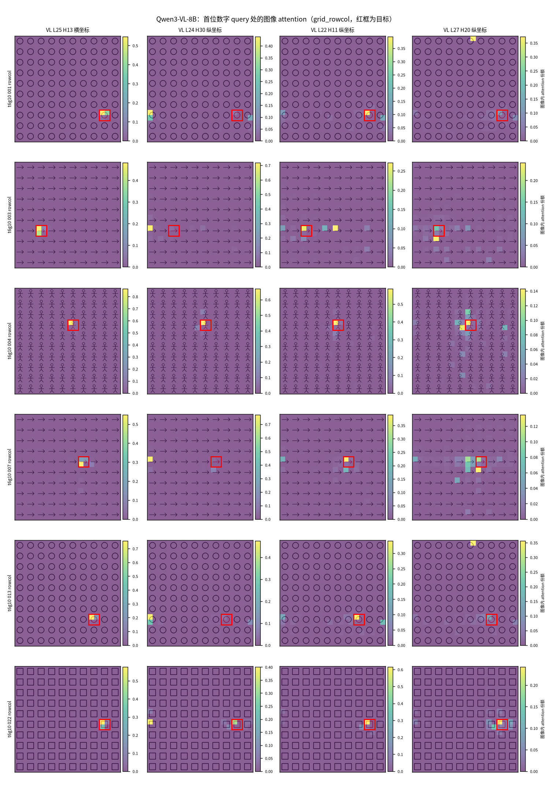
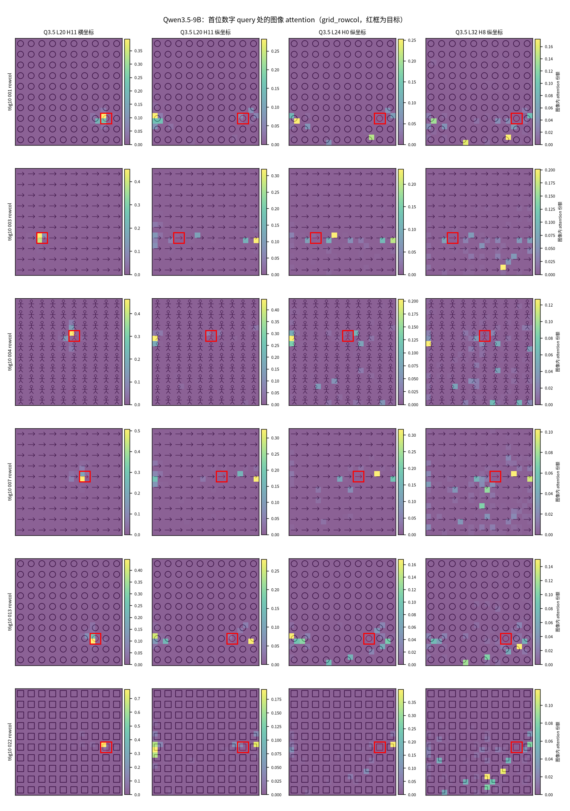
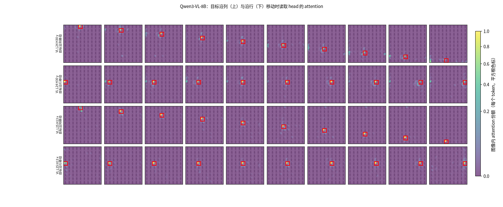
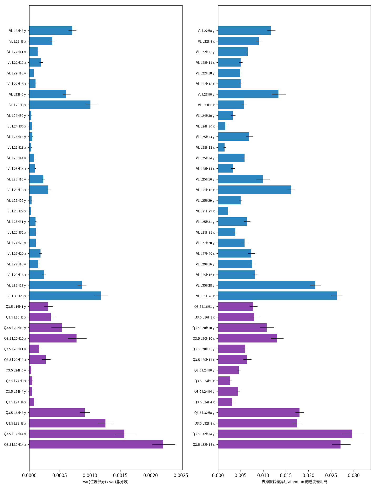
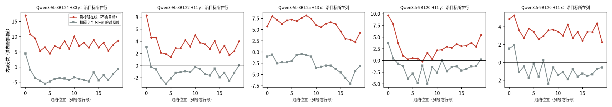
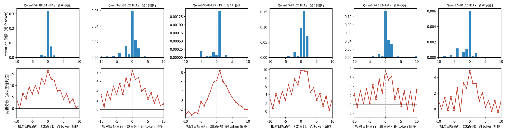
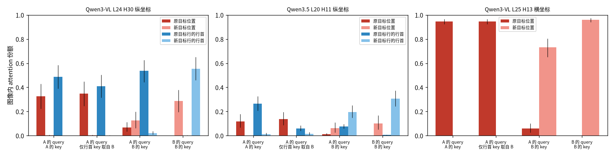
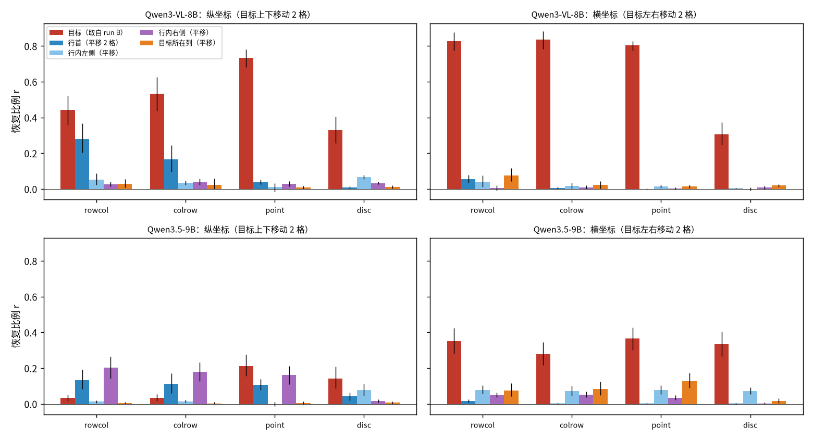
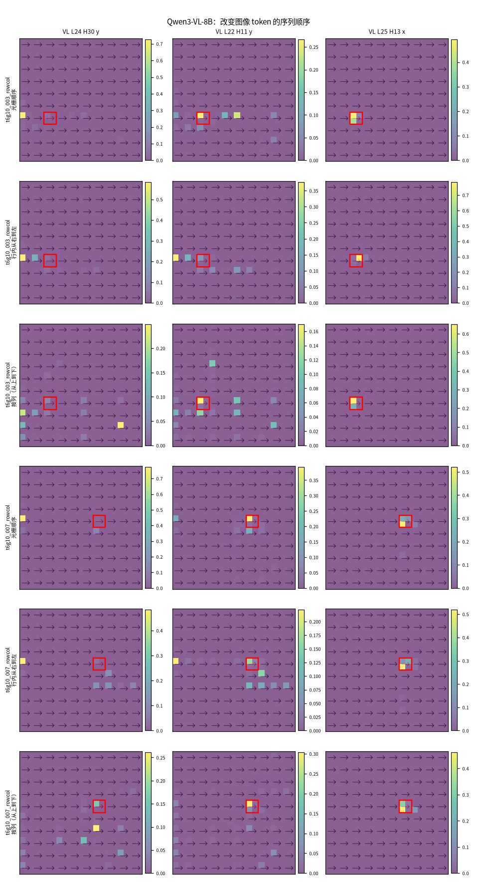
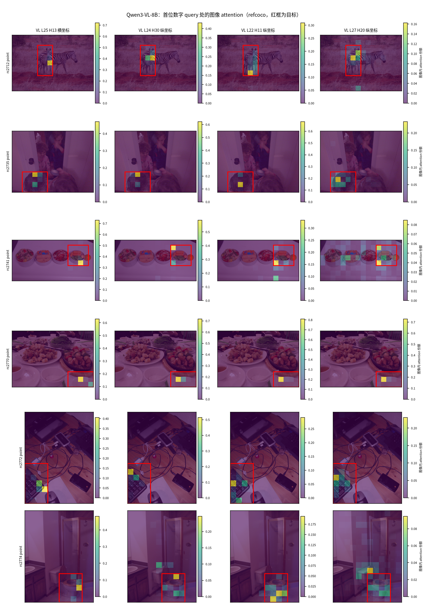

# 读纵坐标时 attention 落在目标所在行的原因（3.14 第三轮）

实验日期：2026-11-05。本文属于[位置信息与坐标读取](plan.md)研究，编号为实验 3.14 第三轮，直接承接[第二轮](results_2026-11-03_causal_vs_linear_r2.md)（下称“第二轮”）第 4.3 节的读取 head attention 测量与[第一轮](results_2026-10-21_causal_vs_linear.md)的拼接对照。模型为 Qwen3-VL-8B-Instruct（36 个 full attention 层，DeepStack 开）与 Qwen3.5-9B（24 个 Gated DeltaNet 层与 8 个 full attention 层），均使用 bfloat16、SDPA、teacher forcing 与 thinking off，问题为只输出答案的 direct-answer 格式。本文只比较两个模型的内部机制，不比较任务正确率。

## 通俗讲述

第二轮发现，Qwen3-VL 写目标的行号（纵坐标）时，最重要的几个读取 head 只把约 0.35 的图像 attention 放在目标上，另有约 0.31 落在目标所在的 token 行中；写列号（横坐标）时却几乎只看目标。Qwen3.5 也有类似现象，可以用 Gated DeltaNet 的行累加器解释；但 Qwen3-VL 只有 full attention，decoder 的位置编码 MRoPE 对高度方向与宽度方向的处理又是对称的，按直觉两种坐标的读取应当同样集中在目标上。本文回答四个问题：这 0.31 的 attention 落在行中哪些 token 上；模型凭什么选中它们；它们是否真的参与了纵坐标的计算；为什么横坐标没有对应的现象。

先看 attention 落在哪里。逐张图像画出读取 head 的 attention 后可以看到，行上的 attention 集中在目标所在 token 行的第一个 token 上，即图像最左侧那一列，下文称为**行首 token**。目标覆盖两个 token 行，因此只有两个行首 token，它们只占图像 token 的 0.5%，却分到了加权份额 0.19；纵坐标的首位读取 head L24 H30 单独把 0.43 放在目标第一个 token 行的行首上，目标本身只有 0.32。目标越靠下，这一偏好越强：目标在第 7–10 行时，L24 H30 在行首上的份额为 0.61，在目标上只有 0.20。因此，PI 看到的“落在目标所在行的 0.31”实质上是“落在目标所在行的行首”。

再看选择是怎样完成的。attention 分数是 query 与 key 的内积，而 MRoPE 会按 token 的二维位置旋转 query 与 key，所以有两种可能：一是旋转本身让同一行的 token 得分更高，即位置匹配；二是 key 向量的内容里写着“我在第几行”，query 的内容里写着“目标在第几行”，即内容匹配。我们把每个分数精确地拆成两部分：保持每个 key 的内容不变、只把它的旋转换成目标所在位置的旋转，得到内容部分，原分数减去内容部分就是旋转带来的位置部分。结果很明确：在两个模型的全部读取 head 上，位置部分只占图像 token 之间分数差异的 0.22% 以下，把它去掉以后 attention 最多移动 3%。MRoPE 的旋转几乎不参与“看哪个图像 token”的决定，高度与宽度两个分量频率是否对称也就无关紧要。内容分数沿行画出来，可以分成两项相加：目标所在行的所有 token 都比别的行高出约 11 分（行匹配），第 0 列的 token 再额外高出约 10 分（左边缘加分）。横坐标 query 同样有“列匹配”，目标所在列的 token 比别的列高出约 9 分，但列的顶端没有任何加分，于是目标始终胜出。也就是说，行与列的读取在“匹配同一条线”这一点上确实是对称的，不对称只来自纵坐标 query 对左边缘 token 的额外偏好。

query 是否事先就知道目标在哪一行？目标第一个 token 行的行首在光栅顺序上位于目标之前，causal decoder 中它的 key 看不到目标，因此它被选中只能是因为 query 已经知道目标所在行。我们用跨图像的方式直接检验：用原图答案位置的 query 去读“目标下移两格后的图像”的 key。若 query 只是在找红色目标，attention 应跟着目标走；若 query 携带的是“第几行”，attention 应留在原来那一行的行首。Qwen3-VL 的 L24 H30 把 0.54 留在原行的行首上，新位置的行首只有 0.02；只把两个行首的 key 换成目标已经离开该行时的版本，份额也只从 0.49 降到 0.41。Qwen3.5 的 L20 H11 恰好相反：同样的操作下它的 attention 跟着目标移到新行的行首（0.20 对原行 0.08），只换行首 key 就让原行行首的份额从 0.27 跌到 0.06。这说明两个模型看行首的原因不同：Qwen3-VL 的行首 key 只写着“我在第几行”，由已经知道答案行的 query 去寻址；Qwen3.5 的行首 key 写着“我这一行有目标”，与第二轮推出的 DeltaNet 行内广播一致。

最后检验这份 attention 是否有用。做法是在答案位置读取图像 key/value 时，只把两个行首 token 的 value 换成正下方两格处行首 token 的 value，key 保持不变，于是 attention 仍落在原处，读到的内容却变成了“下方两格那一行”的内容。若行首 value 中的行位置被用来写纵坐标，答案就会向下移动。实测在 Qwen3-VL 的行列格式中，这一编辑复现了目标真实下移两格所引起变化的 0.28，目标所在行的其余 34 个 token 合计不到 0.08，目标本身的 value 复现 0.44。因此 Qwen3-VL 写行号时，一部分信息来自目标自身，另一部分来自目标所在行的行首；目标越靠下，后者越重要（第 7–10 行为 0.33，第 1–3 行为 0.12）。这一行首读取只出现在网格图像上，在单个圆盘和 RefCOCO 照片上行首份额只有 0.01，编辑效果为 0。打乱图像 token 的序列顺序还显示，左边缘偏好主要附着在图像的左边缘上：把每行改为从右往左排列后，第 0 列（此时是每行在序列中的最后一个 token）仍得到 0.27，新的行首（第 19 列）并没有接替它；而按列排列时，横坐标 query 也没有出现“列首”锚点。这说明行首锚点是训练得到的、与“行从左边开始”这一图像布局绑定的读取习惯，而非 MRoPE 或 causal 顺序的结构必然。

## 1. 主要结论

1. **第二轮中纵坐标 query 落在目标所在行的 attention，主要落在行首 token 上。** 实测：10×10 行列格式中，Qwen3-VL 前 5 个读取 head 的加权份额为目标 0.34、行首 0.19（2 个 token）、行内其余 0.14；首位读取 head L24 H30 为目标 0.32、行首 0.49，其中目标第一个 token 行的行首为 0.43（第 4.1 节，表 1，图 1、图 3）。行首 token 占图像 token 的 0.5%，其份额是均匀分布的约 40 倍，所以“行上的 attention”实质上是一个两 token 的锚点。
2. **MRoPE 的旋转几乎不参与读取 head 在图像 token 之间的选择，两种坐标的不对称来自 key 与 query 的内容。** 实测：两个模型共 40 个（head，坐标轴）组合中，位置部分的方差占比不超过 0.0022，去掉位置部分后 attention 的总变差距离不超过 0.030（第 4.2 节，图 4）。假设 H4（频率分配不对称）因此不成立；行首被选中只能来自内容匹配。
3. **内容分数由“线匹配”与“左边缘加分”两项组成，前者对行与列对称，后者只出现在纵坐标 query。** 实测：Qwen3-VL L24 H30 在目标所在行内部 token 的内容分数比对照行高约 11，第 0 列再高约 10；L25 H13 在目标所在列比对照列高约 9，但第 0 行没有加分（第 4.3 节，图 5）。这意味着两种坐标的读取都会“沿目标所在的线”给 token 加分，横坐标只是因为没有端点加分而由目标胜出。
4. **Qwen3-VL 的纵坐标 query 已经携带目标所在行，行首 key 只提供“我在第几行”。** 实测：原图 query 读目标下移两格后图像的 key 时，L24 H30 仍把 0.54 放在原行行首，新行行首 0.02；只把行首 key 换成目标不在该行时的版本，份额由 0.49 降到 0.41。Qwen3.5 L20 H11 在同一操作下跟随目标（新行行首 0.20，原行 0.08），只换行首 key 时份额由 0.27 降到 0.06（第 4.4 节，图 7）。假设 H2（“本行含有目标”的信号）适用于 Qwen3.5，不适用于 Qwen3-VL。
5. **Qwen3-VL 的行首 value 因果地参与纵坐标的写出，行内其余 token 几乎不参与。** 实测：行列格式中只平移两个行首 token 的 value，恢复比例为 0.28 [0.20, 0.37]，目标 value 为 0.44 [0.36, 0.52]，行内左侧、右侧与目标所在列分别为 0.05、0.03、0.03；横坐标上目标为 0.83，目标所在列为 0.07（第 4.5 节，表 3，图 8）。这一作用随目标行号增大（第 1–3 行 0.12，第 7–10 行 0.33），在 point 格式中只有 0.04，在圆盘上为 0。
6. **左边缘偏好主要绑定在图像左边缘，部分依赖光栅顺序；列方向没有对应的锚点。** 实测：每行改为从右到左排列后，L24 H30 在第 0 列的份额由 0.49 降到 0.27，第 19 列只有 0.03；按列排列时降到 0.11，且横坐标 query 在列首上始终为 0.00（第 4.6 节，图 9）。Qwen3.5 的行尾 attention 在从右到左排列后由 0.19 降到 0.03，属于序列顺序效应，行首 attention 不变（0.27），属于图像布局效应。

## 2. 问题与假设

### 2.1 问题

第二轮第 4.3 节在 10×10 行列格式中测得：Qwen3-VL 纵坐标的前 5 个读取 head 按恢复比例加权后，把 0.35 的图像 attention 放在目标上，0.31 放在目标所在 token 行的其他 token 上；横坐标的对应数值为 0.76 与 0.07。Qwen3-VL 的 decoder 全部是 causal full attention，没有按行累加的递推，因此需要解释三件事：

1. 行上的 attention 落在哪些 token 上，这些 token 是如何被选中的；
2. 它们的 value 是否参与纵坐标的计算；
3. 为什么横坐标没有沿列的对应现象。

### 2.2 候选假设

| 编号 | 假设 | 可检验的预测 |
| --- | --- | --- |
| H1 | 同行 token 的 value 携带与目标相同的纵向位置，读它们与读目标同样有用；选择由“纵向位置相同”的 query–key 匹配完成 | 同行 token 的 value 平移后纵坐标随之移动；query 在目标移走后仍指向原行 |
| H2 | query 匹配的是类似 Qwen3.5 的“本行含有目标”信号 | 被选中的 token 位于目标之后；把目标移出该行后，该行 token 不再被选中 |
| H3 | ViT 的二维 RoPE 与 merger 使同行 token 的 key 相似 | 同行 token 普遍得到较高的内容分数 |
| H4 | MRoPE 中高度分量与宽度分量的频率分配不同，使行方向的旋转匹配更宽 | 分数的位置部分在纵坐标 query 上明显大于横坐标 query |

第 4 节的证据给出的回答是：H4 不成立；H1 与 H3 的“沿线匹配”部分成立，并且对行与列同样成立；H2 对 Qwen3.5 成立、对 Qwen3-VL 不成立；而第二轮所见的不对称来自一个四个假设都未预料到的成分，即纵坐标 query 对行首 token 的额外偏好。

## 3. 测量方法

### 3.1 数据、query 与读取 head

1. **图像与回答。** 网格图像为 3.11 的 40 张 10×10 网格（每个单元 64×64 像素，对应 2×2 个 merged token，token 网格为 20×20，模板为 person、ring、arrow、square，目标为红色），每张图像有行列（rowcol，先行后列）、列行（colrow，先列后行）与 point（0–1000 坐标）三种格式；单目标圆盘（disc，point 格式）与 RefCOCO（point 格式）各 40 张。Qwen3-VL 使用第一轮生成的回答，Qwen3.5 使用 3.11 生成的回答，均为模型自己的 greedy 回答（无论对错），只使用解析有效的回答，每种条件 40 个。
2. **扫描图像。** 另以 person 与 ring 模板生成 10×10 网格，目标依次位于第 5 列的第 1–10 行与第 5 行的第 1–10 列（19 个位置），teacher forcing 使用真实答案；person 模板另有 point 格式。
3. **query。** 全部测量都在预测某个坐标数值首位数字的位置进行，下称纵坐标 query 与横坐标 query。
4. **读取 head。** 沿用第二轮按单 head 输出 patching 选出的读取 head：每个模型、格式（行列、point）与坐标轴的前 5 个，取并集，Qwen3-VL 13 个，Qwen3.5 7 个。加权汇总的权重为第二轮的单 head 恢复比例。

### 3.2 token 组

记目标覆盖的 token 集合为 $T$，它占据的 token 行集合为 $I_T$，token 列集合为 $J_T$，token 网格宽度为 $W$。以下各组互不相交：

| 名称 | 定义 | 10×10 网格中的大小 |
| --- | --- | --- |
| 目标 | $T$ | 4 |
| 行首 token | $I_T$ 中各行的第 0 列，不含 $T$ | 2（目标在第 1 列时为 0） |
| 行内左侧 | $I_T$ 中位于 $T$ 左侧、不含行首的 token | 0–34 |
| 行内右侧 | $I_T$ 中位于 $T$ 右侧、不含行尾的 token | 0–34 |
| 行尾 token | $I_T$ 中各行的第 $W-1$ 列，不含 $T$ | 2 |
| 目标所在列 | $J_T$ 中不在 $I_T$ 内的 token | 36 |
| 其余 | 其他全部图像 token | 324 |

attention 份额 $s(G)$ 为某个 head 在 query 处落在组 $G$ 上的 attention 除以落在全部图像 token 上的 attention，与第二轮的定义相同。

### 3.3 attention 分数的 MRoPE 分解

**MRoPE。** 两个模型的 decoder 都使用交错式 MRoPE。每个 token 有三维位置编号 $(p^{t}, p^{h}, p^{w})$：图像 token 第 $i$ 行第 $j$ 列为 $(s, s+i, s+j)$，$s$ 为图像起始编号；文本 token 三个分量相同。head 维度中参与旋转的部分被分为 $F$ 个二维频率对，第 $f$ 个频率对的角频率为

$$
\omega_f = \theta^{-2f/r}, \qquad f = 0, 1, \dots, F-1,
$$

其中 $r = 2F$ 为参与旋转的维数，$\theta$ 为 RoPE 底数。Qwen3-VL 的 $r = 128$、$\theta = 5 \times 10^{6}$；Qwen3.5 的 $r = 64$、$\theta = 10^{7}$，head 维度 256 中其余 192 维不旋转。交错式 MRoPE 把频率对按 $f \bmod 3$ 轮流分给高度（H）与宽度（W）分量，其余分给时间（T）分量：Qwen3-VL 中 H 取 $f = 1, 4, \dots, 58$，W 取 $f = 2, 5, \dots, 59$，各 20 个；Qwen3.5 中 H 为 11 个，W 为 10 个。两个分量的频率逐个交替，频谱基本对称。第 $f$ 个频率对使用分量 $c(f) \in \{t, h, w\}$ 的位置编号，旋转角为 $\omega_f\, p^{c(f)}$。由于 query 与 key 的旋转角相减后只剩相对位置，图像 token 之间 T 分量的位置编号相同，T 分量不区分图像 token 的位置。

**分数的精确分解。** 记某个 head 在 query 位置 $t$ 处旋转后的 query 为 $\tilde q_t \in \mathbb{R}^{d}$，图像 token $m$ 旋转后的 key 为 $\tilde k_m \in \mathbb{R}^{d}$，$d$ 为 head 维度。pre-softmax 分数可以按维度精确拆成四个分量之和：

$$
\ell_{tm} = \frac{1}{\sqrt d} \sum_{u=1}^{d} \tilde q_{t,u}\, \tilde k_{m,u} = \ell^{T}_{tm} + \ell^{H}_{tm} + \ell^{W}_{tm} + \ell^{N}_{tm},
$$

其中 $\ell^{X}_{tm}$ 只对属于分量 $X$ 的维度求和，$N$ 为不旋转的维度（Qwen3-VL 没有）。

**内容部分与位置部分。** 设 $k_m$ 为旋转前的 key，$m^{*}$ 为目标的第一个 token。把 $k_m$ 按 $m^{*}$ 的位置旋转得到 $\hat k_m$，即假设每个 key 都位于目标处，用 $\hat k_m$ 代替 $\tilde k_m$ 计算的分数记为 $c_{tm}$。定义

$$
p_{tm} = \ell_{tm} - c_{tm} .
$$

$c_{tm}$ 称为内容部分，它只随 key 向量本身变化，因此 key 中由 ViT、DeepStack 或 decoder 写入的位置特征也属于内容部分；$p_{tm}$ 称为位置部分，它度量“token $m$ 不在目标位置”这一旋转差异对分数的影响。两个汇总量为：

1. 位置方差比 $\operatorname{Var}_m(p_{tm}) / \operatorname{Var}_m(\ell_{tm})$，方差在图像 token 上计算，表示分数在图像 token 之间的差异有多大比例来自旋转；
2. 去掉位置部分后 attention 的总变差距离 $\frac{1}{2}\sum_m \lvert \operatorname{softmax}(\ell_t)_m - \operatorname{softmax}(c_t)_m \rvert$，softmax 在图像 token 上计算，表示若图像 token 之间没有旋转差异，attention 会移动多少质量。

这一分解只是对同一次前向计算中分数的代数拆分，不修改模型。

### 3.4 跨图像的 query–key 组合

这一协议回答“选择由 query 中的什么信息决定”。run A 为原图；run B 为目标沿所测坐标轴移动两个单元（4 个 token）后重新绘制的图像，其余图形不变，两者都 teacher forcing 在 run A 的回答上，序列长度与位置编号完全相同，因此 run B 的 key 可以不经重新旋转直接与 run A 的 query 组合。四种组合为：

| 名称 | query | 图像 token 的 key |
| --- | --- | --- |
| A·A | run A | run A（原生） |
| A·锚B | run A | run A，但两个行首 token 的 key 取自 run B（目标已不在该行） |
| A·B | run A | 全部取自 run B |
| B·B | run B | run B（原生） |

文本 token 的 key 始终取自 query 所在的运行。若 query 携带“目标所在行”，A·B 中 attention 应留在原行；若 query 只匹配目标的外观，attention 应跟随目标到新位置。

### 3.5 答案阶段的 value 编辑

这一协议回答“某组 token 的 value 是否被用来写坐标”。

1. **只编辑答案阶段的读取。** 先对 prompt（不含最后一个 token）做一次未编辑的 prefill，得到全部 full attention 层的 key/value cache；再只修改 cache 中某组图像 token 的 value，key 不变；最后运行最后一个 prompt token 与答案。图像 token 自身的计算不受影响，只有答案位置经 softmax attention 读到的内容改变；由于 key 不变，attention 分布也不变。
2. **三种替换。** 平移替换：组 $G$ 中位于 $(i, j)$ 的 token 的 value 取 run A 中 $(i + \Delta i, j + \Delta j)$ 处 token 的 value，$(\Delta i, \Delta j)$ 与 run B 的目标位移相同，源位置越界的 token 不替换；平移替换使被替换的 token 读起来像“位于目标移动方向两格处的同类 token”。目标替换：$T$ 的 value 取 run B 中移动后目标 token 的 value。均值替换：value 换成全部图像 token 的均值。
3. **恢复比例。** 沿用 3.11 的定义。记首位数字 query 处 run A 的回答数字为 $d_A$，run B 的 argmax 数字为 $d_B$，logit 差 $\mathrm{LD} = z_{d_B} - z_{d_A}$，则

$$
r_G = \frac{\mathrm{LD}_G - \mathrm{LD}_A}{\mathrm{LD}_B - \mathrm{LD}_A},
$$

其中 $\mathrm{LD}_A$、$\mathrm{LD}_B$、$\mathrm{LD}_G$ 分别为 run A、run B 与编辑组 $G$ 后的 run A 的 logit 差。$r_G = 1$ 表示只编辑组 $G$ 就复现了目标真实移动带来的全部变化。$d_A = d_B$ 或 $\lvert \mathrm{LD}_B - \mathrm{LD}_A \rvert < 2$ 的数值无定义，本轮两个模型共 640 个同轴数值全部有定义。只统计与移动同轴的坐标数值。

与第一轮拼接对照的区别：拼接对照把 run B 的差异注入 run A，行首 token 位于目标之前，在两份输入中完全相同，因此拼接对照在结构上测不到行首的作用（第一轮把行首 attention 判为“不具因果作用”即源于此）。平移替换直接改变行首 value 中的行位置，可以测到。

### 3.6 序列顺序置换

这一协议回答“行首偏好绑定在图像左边缘，还是绑定在每行在序列中的第一个位置”。保持每个图像 token 的 embedding、DeepStack 特征与 MRoPE 位置编号不变，只改变它们在序列中的排列：

1. **光栅顺序**：原生顺序，逐行从左到右；
2. **行内从右到左**：行仍从上到下，每行内部从第 19 列排到第 0 列，于是第 0 列成为每行在序列中的最后一个 token；
3. **按列**：逐列从上到下，列从左到右。

teacher forcing 仍使用光栅顺序下的回答，attention 按原图位置还原后统计。置换后的输入偏离训练分布，答案首位数字与光栅顺序一致的比例为 0.23–0.88（第 4.6 节），因此这一协议只用于判断偏好附着在哪里，不用于解释答案。

## 4. 证据

### 4.1 行上的 attention 集中在行首 token

*图 1：Qwen3-VL 在六张 10×10 行列格式输入上的图像 attention（由模型激活测得，teacher forcing 在模型自己的回答上）。每行为一张图像，从左到右为横坐标首位读取 head L25 H13 的横坐标 query，以及纵坐标读取 head L24 H30、L22 H11、L27 H20 的纵坐标 query。viridis 色标为每个 token 在图像内的 attention 份额（每个子图单独的色标），红框为目标覆盖的 token。L24 H30 的峰值位于目标所在行的第 0 列。*

*图 2：同一组图像上 Qwen3.5 的读取 head（由模型激活测得）。从左到右为 L20 H11 的横坐标 query，以及 L20 H11、L24 H0、L32 H8 的纵坐标 query；色标与红框同图 1。L20 H11 读纵坐标时同时看目标所在行的行首与行尾。*

*图 3：目标沿第 5 列从第 1 行移到第 10 行（第 1、3 行子图）与沿第 5 行从第 1 列移到第 10 列（第 2、4 行子图）时，Qwen3-VL L24 H30 的纵坐标 query 与 L25 H13 的横坐标 query 的 attention（由模型激活测得，teacher forcing 在真实答案上）。色标为平方根刻度，以便看清较小的份额。目标靠下时 L24 H30 的 attention 移到目标所在行的第 0 列；L25 H13 在所有位置都只看目标。Qwen3.5 的对应图见 `figures/row_attention/sweep_rowcol_q35.png`，point 格式见 `sweep_point_vl.png` 与 `sweep_point_q35.png`。*

表 1 给出 40 个回答上的平均份额。行首 token 只占图像 token 的 0.5%，均匀 attention 下的份额约为 0.005。

| 模型 | 格式 | query | 目标 | 行首 | 行内左侧 | 行内右侧 | 行尾 | 目标所在列 | 其余 |
| --- | --- | --- | --- | --- | --- | --- | --- | --- | --- |
| Qwen3-VL | 行列 | 纵 | 0.34 [0.29, 0.39] | 0.19 [0.15, 0.22] | 0.09 | 0.03 | 0.02 | 0.08 | 0.26 |
| Qwen3-VL | 行列 | 横 | 0.74 [0.73, 0.76] | 0.00 | 0.05 | 0.01 | 0.00 | 0.07 | 0.12 |
| Qwen3-VL | 列行 | 纵 | 0.43 [0.38, 0.48] | 0.13 [0.09, 0.16] | 0.08 | 0.03 | 0.02 | 0.08 | 0.23 |
| Qwen3-VL | point | 纵 | 0.52 [0.47, 0.57] | 0.07 [0.04, 0.10] | 0.14 | 0.05 | 0.02 | 0.07 | 0.13 |
| Qwen3-VL | point | 横 | 0.70 [0.68, 0.72] | 0.00 | 0.07 | 0.01 | 0.00 | 0.07 | 0.15 |
| Qwen3-VL | 圆盘 | 纵 | 0.45 [0.40, 0.49] | 0.01 [0.00, 0.02] | 0.21 | 0.09 | 0.00 | 0.13 | 0.11 |
| Qwen3-VL | RefCOCO | 纵 | 0.69 [0.60, 0.77] | 0.01 [0.00, 0.02] | 0.07 | 0.06 | 0.00 | 0.09 | 0.07 |
| Qwen3.5 | 行列 | 纵 | 0.06 [0.04, 0.09] | 0.17 [0.13, 0.21] | 0.09 | 0.10 | 0.14 | 0.05 | 0.40 |
| Qwen3.5 | 行列 | 横 | 0.49 [0.43, 0.54] | 0.00 | 0.18 | 0.05 | 0.01 | 0.16 | 0.12 |
| Qwen3.5 | point | 纵 | 0.26 [0.21, 0.31] | 0.13 [0.10, 0.16] | 0.10 | 0.13 | 0.15 | 0.04 | 0.20 |
| Qwen3.5 | 圆盘 | 纵 | 0.35 [0.30, 0.40] | 0.09 [0.07, 0.12] | 0.26 | 0.06 | 0.01 | 0.07 | 0.16 |
| Qwen3.5 | RefCOCO | 纵 | 0.74 [0.67, 0.80] | 0.03 [0.01, 0.05] | 0.05 | 0.05 | 0.01 | 0.08 | 0.05 |

*表 1：前 5 个读取 head 按第二轮恢复比例加权的 attention 份额（由模型激活测得，每格 40 个回答，方括号为按回答的 bootstrap 95% 区间）。其余格式与坐标轴见 summary.json；图 `figures/row_attention/group_shares.png` 为全部条件的堆叠条形图。*

单个 head 的份额（行列格式，纵坐标 query）更能看出行首的集中程度：

| head | 目标 | 行首 | 行内左侧 | 行内右侧 | 行尾 | 目标所在列 | 其余 |
| --- | --- | --- | --- | --- | --- | --- | --- |
| Qwen3-VL L24 H30 | 0.32 | 0.49 | 0.10 | 0.01 | 0.02 | 0.04 | 0.07 |
| Qwen3-VL L22 H11 | 0.57 | 0.08 | 0.07 | 0.04 | 0.03 | 0.10 | 0.12 |
| Qwen3-VL L29 H16 | 0.02 | 0.17 | 0.10 | 0.04 | 0.02 | 0.09 | 0.58 |
| Qwen3.5 L20 H11 | 0.12 | 0.26 | 0.09 | 0.11 | 0.19 | 0.02 | 0.26 |
| Qwen3.5 L24 H0 | 0.02 | 0.17 | 0.12 | 0.18 | 0.15 | 0.05 | 0.37 |

*表 2：单个读取 head 在纵坐标 query 处的份额（由模型激活测得，40 个回答的均值）。*

**行上的 attention 主要由行首 token 构成。** Qwen3-VL 加权后落在目标所在行的 0.33 中有 0.19 落在两个行首 token 上；L24 H30 的 0.49 行首份额中，0.43 落在目标第一个 token 行的行首，第二个 token 行的行首只有 0.06，其他各行的第 0 列合计 0.06。第一个 token 行的行首在光栅顺序上位于目标之前，这一事实是第 4.4 节论证的出发点。**行首偏好随目标行号增大。** 按目标所在单元行分组，L24 H30 的行首份额在第 1–3 行为 0.15，第 4–6 行为 0.32，第 7–10 行为 0.61，目标份额相应地由 0.61 降到 0.20；Qwen3.5 L20 H11 为 0.14、0.26、0.28。**行首读取只出现在网格图像上。** 圆盘与 RefCOCO 上 Qwen3-VL 的行首份额只有 0.01，纵坐标读取集中在目标上（0.45 与 0.69）；圆盘上“行内左侧”的 0.21 来自圆盘边缘覆盖的相邻 token。更多叠加图见 `overlay_grid_point_*.png`、`overlay_disc_*.png` 与 `overlay_refcoco_*.png`（图 10）。

### 4.2 MRoPE 的旋转几乎不参与选择

*图 4：读取 head 分数的 MRoPE 分解（由模型激活计算，第 3.3 节的代数拆分，网格三种格式、圆盘与 RefCOCO 共 200 个回答）。左：位置部分在图像 token 之间的方差占总分数方差的比例；右：去掉位置部分后图像内 attention 的总变差距离。蓝色为 Qwen3-VL，紫色为 Qwen3.5；误差线为 bootstrap 95% 区间；y 为纵坐标 query，x 为横坐标 query。*

**位置部分的方差占比不超过 0.0022，attention 最多移动 0.030。** 这一结果对两个模型、两种坐标、全部 20 个读取 head 都成立：Qwen3-VL 的最大值为 0.0012 与 0.026，Qwen3.5 为 0.0022 与 0.030。原因可以从分数的形式理解：答案 query 与图像 token 的相对距离约为 60–80 个位置，高频频率对在这一距离上的旋转近似随机相位，有效的 query–key 匹配只能由低频频率对承担；而低频频率对在 20 个 token 的图像范围内几乎不转动，因此不同图像 token 之间的旋转差异对分数没有贡献。这意味着假设 H4 不成立：H 与 W 分量的频率分配本来就几乎对称，更重要的是旋转本身不参与图像 token 之间的选择。行首被选中、目标被选中，都是 key 向量内容与 query 向量内容匹配的结果；key 内容中的位置特征来自 ViT（二维 RoPE 与插值的绝对位置编码）、DeepStack 与 decoder 的计算。

### 4.3 内容分数：沿线匹配与左边缘加分

*图 5：沿目标所在线的内容分数 $c_{tm}$（由模型激活计算，减去该回答全部图像 token 的均值，行列与列行格式共 80 个回答的均值）。纵坐标 head 沿目标第一个 token 行（红色，目标所在列以外），横坐标 head 沿目标第一个 token 列；灰色为相隔 8 个 token 的对照线。横轴为沿线位置（列号或行号）。*

*图 6：第 0 列各行（纵坐标 head）或第 0 行各列（横坐标 head）的 attention 份额（上）与内容分数（下），横轴为该 token 所在行（列）相对目标第一个 token 行（列）的偏移（由模型激活测得，行列、列行与扫描行列图像共 118 个回答的均值）。*

**内容分数沿目标所在的线整体抬高，这一“线匹配”对行与列对称。** Qwen3-VL L24 H30 在目标所在行内部（第 4–15 列）的平均内容分数为 7.1，对照行为 −4.0，差约 11；L25 H13 在目标所在列内部为 6.6，对照列为 −2.4，差约 9；Qwen3.5 L20 H11 的对应差值为 4.0（行）与 4.5（列）。这说明 query 中含有目标所在行与列的信息，key 中含有自身所在行与列的信息，两者按内容匹配，这部分与假设 H1、H3 的预期一致，并且行与列的程度相当。

**纵坐标 query 另有一项左边缘加分，横坐标 query 没有对应的端点加分。** 在 L24 H30 中，目标所在行第 0 列的内容分数为 17.0，比同行内部高约 10；对照行第 0 列也比该行内部高约 8，因此加分对所有行的第 0 列都存在，与目标无关。行匹配与左边缘加分相加，使目标所在行的行首得到全图最高的内容分数（图 6 下：偏移 0 处为峰），超过目标本身（目标比“其余”组高 12.5，行首高 16.0）。L25 H13 沿目标所在列没有类似的端点：第 0 行的内容分数低于列内部（5.7 对 6.6），第 0 行各列的 attention 份额不超过 0.0015。Qwen3.5 L20 H11 的纵坐标 query 同样有左边缘加分（第 0 列 9.6，行内部 1.6），横坐标 query 没有。**因此两种坐标读取的不对称只来自左边缘加分这一项。** 横坐标读取同样“沿目标所在的线”加分，但没有端点能超过目标，于是 attention 集中在目标上。

### 4.4 query 携带目标所在行

*图 7：跨图像组合下的图像 attention 份额（由模型激活计算，第 3.4 节协议，行列格式 40 个回答，误差线为 bootstrap 95% 区间）。深红为 run A 的目标位置，浅红为 run B 的目标位置；深蓝为 run A 目标所在行的行首，浅蓝为 run B 目标所在行的行首。左：Qwen3-VL L24 H30 纵坐标（目标下移或上移两格）；中：Qwen3.5 L20 H11 纵坐标；右：Qwen3-VL L25 H13 横坐标（目标左移或右移两格）。*

| head | 组合 | 原目标 | 新目标 | 原行行首 | 新行行首 |
| --- | --- | --- | --- | --- | --- |
| Qwen3-VL L24 H30（纵） | A·A | 0.33 | 0.00 | 0.49 [0.39, 0.58] | 0.00 |
| | A·锚B | 0.35 | 0.00 | 0.41 [0.32, 0.50] | 0.00 |
| | A·B | 0.07 | 0.12 | 0.54 [0.44, 0.63] | 0.02 |
| | B·B | 0.00 | 0.29 | 0.00 | 0.55 |
| Qwen3.5 L20 H11（纵） | A·A | 0.12 | 0.00 | 0.27 [0.21, 0.33] | 0.01 |
| | A·锚B | 0.14 | 0.00 | 0.06 [0.04, 0.08] | 0.01 |
| | A·B | 0.01 | 0.06 | 0.08 [0.06, 0.10] | 0.20 [0.15, 0.25] |
| | B·B | 0.00 | 0.10 | 0.01 | 0.31 |
| Qwen3-VL L25 H13（横） | A·A | 0.95 | 0.00 | — | — |
| | A·B | 0.06 | 0.73 [0.65, 0.81] | — | — |

*表 3：跨图像组合下的 attention 份额（由模型激活计算，40 个回答，方括号为 bootstrap 95% 区间）。*

**Qwen3-VL 的纵坐标 query 指向“原来那一行”，目标移走后仍然如此。** 在 A·B 中，目标已移到两格之外，L24 H30 却把 0.54 留在原行行首，新行行首只有 0.02。原行行首在 run B 中只是普通的左边缘 token，它被选中只能是因为 run A 的 query 携带了“目标在第几行”。只把两个行首 key 换成 run B 的版本时份额由 0.49 降到 0.41，说明行首 key 中与“本行有目标”相关的成分很小，主体是行号本身。这支持 H1 的选择方式（按行号寻址），排除 H2。由于 Qwen3-VL 的 decoder 是 causal 的，第一个 token 行的行首看不到目标；行首 key 中剩余的 0.08 只能来自 ViT 中双向 attention 对整幅图像的混合（解释，未单独检验）。

**Qwen3.5 的纵坐标读取跟随目标，行首 key 携带“本行含有目标”。** 同样的 A·B 组合中，Qwen3.5 L20 H11 的 attention 移到新行行首（0.20），原行行首降到 0.08；只换行首 key 就使原行份额由 0.27 跌到 0.06。Qwen3.5 的行首 key 依赖“本行是否有目标”，这与第二轮第 3.3 节推出的 DeltaNet 行内广播一致：目标第二个 token 行的行首在光栅顺序上位于目标第一行之后，可以从行内状态得到这一信息。两个模型都看行首，但看的理由不同。

**Qwen3-VL 的横坐标 query 按外观选中目标。** A·B 中 L25 H13 的 attention 跟随目标到新位置（0.73），原位置只剩 0.06。横坐标读取直接找到红色目标再读出它的位置，不经过按“第几列”的寻址。

### 4.5 行首 value 的因果作用

*图 8：答案阶段 value 编辑的恢复比例 $r$（由模型激活测得，第 3.5 节协议，每格 40 个数值，误差线为 bootstrap 95% 区间）。上行为 Qwen3-VL，下行为 Qwen3.5；左列为纵坐标（目标上下移动两格），右列为横坐标（目标左右移动两格）。红色为目标 value 取自 run B，深蓝为两个行首 token 的平移替换，浅蓝与紫色为行内左侧与右侧的平移替换，橙色为目标所在列的平移替换。*

| 模型 | 格式 | 坐标 | $n$ | 目标 | 行首 | 行内左侧 | 行内右侧 | 目标所在列 |
| --- | --- | --- | --- | --- | --- | --- | --- | --- |
| Qwen3-VL | 行列 | 纵 | 40 | 0.44 [0.36, 0.52] | 0.28 [0.20, 0.37] | 0.05 | 0.03 | 0.03 |
| Qwen3-VL | 行列 | 横 | 40 | 0.83 [0.78, 0.88] | 0.05 [0.03, 0.08] | 0.04 | 0.01 | 0.07 |
| Qwen3-VL | 列行 | 纵 | 40 | 0.53 [0.44, 0.63] | 0.16 [0.10, 0.24] | 0.03 | 0.04 | 0.02 |
| Qwen3-VL | point | 纵 | 40 | 0.73 [0.68, 0.78] | 0.04 [0.02, 0.05] | 0.01 | 0.03 | 0.01 |
| Qwen3-VL | point | 横 | 40 | 0.80 [0.77, 0.83] | 0.00 | 0.01 | 0.00 | 0.01 |
| Qwen3-VL | 圆盘 | 纵 | 40 | 0.33 [0.26, 0.40] | 0.01 [0.00, 0.01] | 0.07 | 0.03 | 0.01 |
| Qwen3.5 | 行列 | 纵 | 40 | 0.03 [0.02, 0.05] | 0.13 [0.08, 0.19] | 0.01 | 0.20 | 0.01 |
| Qwen3.5 | 行列 | 横 | 40 | 0.35 [0.28, 0.42] | 0.02 [0.01, 0.03] | 0.08 | 0.05 | 0.08 |
| Qwen3.5 | point | 纵 | 40 | 0.21 [0.16, 0.27] | 0.11 [0.08, 0.14] | 0.00 | 0.16 | 0.00 |
| Qwen3.5 | 圆盘 | 纵 | 40 | 0.14 [0.09, 0.21] | 0.04 [0.02, 0.06] | 0.08 | 0.02 | 0.01 |

*表 4：value 编辑的恢复比例（由模型激活测得，方括号为 bootstrap 95% 区间；“行内右侧”不含行尾 token）。完整表格（含均值替换后答案数字对数概率的变化）见 summary.json。*

**Qwen3-VL 写行号时，两个行首 token 的 value 提供了约三成的位置信息。** 行列格式中，只把行首 value 换成下方两格处的行首 value，就复现了目标真实移动所引起变化的 0.28；行内其余 34 个 token 合计不到 0.08，目标所在列为 0.03。行首得到的 attention（0.19）小于目标（0.34），因果作用却达到目标的六成以上，说明行首 value 中的行位置被读取 head 直接使用。第二轮所见的“行上的 0.31”中，起作用的是这两个 token。**这一作用随行号增大。** 按目标所在单元行分组，行首编辑的恢复比例在第 1–3 行为 0.12，第 4–6 行为 0.15，第 7–10 行为 0.33，目标编辑相应地由 0.56 降到 0.42，与第 4.1 节的 attention 变化方向一致。解释（未经检验）：目标 token 自身的纵向位置特征在图像下部可能不够精确，模型因此更多地借助行首 token 的行号。**横坐标没有对应的列锚点。** Qwen3-VL 横坐标的目标编辑为 0.80–0.83，目标所在列的平移编辑不超过 0.07。

**Qwen3.5 的纵坐标载体为行内右侧与行首。** 行列格式中行内右侧（目标之后、行尾之前）为 0.20，行首为 0.13，目标只有 0.03，与第一轮“同行后续 token”的载体结论一致；本文新增的发现是行首 token 也携带一部分。

### 4.6 左边缘偏好附着在哪里

*图 9：Qwen3-VL 在三种图像 token 序列顺序下的 attention（由模型激活测得，第 3.6 节协议，attention 已还原到原图位置）。每两张图像各占三行：光栅顺序、行内从右到左、按列从上到下；列为 L24 H30 与 L22 H11 的纵坐标 query、L25 H13 的横坐标 query。色标与红框同图 1。Qwen3.5 的对应图见 `figures/row_attention/order_q35.png`。*

| head | 光栅：第 0 列 | 光栅：第 19 列 | 行内从右到左：第 0 列 | 行内从右到左：第 19 列 | 按列：第 0 列 | 按列：列首 |
| --- | --- | --- | --- | --- | --- | --- |
| Qwen3-VL L24 H30（纵） | 0.49 [0.39, 0.58] | 0.02 | 0.27 [0.19, 0.35] | 0.03 | 0.11 [0.03, 0.20] | 0.00 |
| Qwen3-VL L25 H13（横） | 0.00 | 0.00 | 0.00 | 0.00 | 0.00 | 0.00 |
| Qwen3.5 L20 H11（纵） | 0.27 [0.21, 0.33] | 0.19 [0.13, 0.25] | 0.27 [0.22, 0.33] | 0.03 | 0.03 | 0.00 |
| Qwen3.5 L24 H0（纵） | 0.17 | 0.14 | 0.17 | 0.03 | 0.04 | 0.00 |

*表 5：目标所在行第 0 列与第 19 列（不含目标）的 attention 份额，以及目标所在列第 0 行（列首）的份额（由模型激活测得，行列格式 40 个回答）。答案首位数字与光栅顺序一致的比例：Qwen3-VL 纵坐标行内从右到左 0.78、按列 0.25；Qwen3.5 为 0.53 与 0.23。*

**左边缘偏好主要附着在图像的左边缘上，部分依赖“每行在序列中的第一个位置”。** 把每行改为从右到左排列后，第 0 列在序列中成为每行的最后一个 token，Qwen3-VL L24 H30 仍把 0.27 放在它上面，而成为每行第一个 token 的第 19 列只有 0.03；若偏好只由序列位置决定，两者应当互换。按列排列时第 0 列份额降到 0.11，说明光栅顺序也有贡献。**列方向在任何顺序下都没有锚点。** 即使按列排列使每一列在序列中连续，横坐标 query 在列首上的份额仍为 0.00。**Qwen3.5 的行尾 attention 是序列顺序效应，行首 attention 是图像布局效应。** 行内从右到左时 Qwen3.5 L20 H11 的行首份额不变（0.27），行尾份额由 0.19 降到 0.03；行尾在光栅顺序中是每行的最后一个 token，行内状态在那里累积了整行的信息，这与第二轮的解释一致。置换后答案经常改变（一致比例 0.23–0.88），这些份额只说明偏好附着的位置。

### 4.7 自然图像与单目标圆盘

*图 10：Qwen3-VL 在六张 RefCOCO 图像上的读取 head attention（由模型激活测得，point 格式，teacher forcing 在模型自己的回答上）。列同图 1，红框为目标框覆盖的 token。Qwen3.5 的对应图见 `overlay_refcoco_q35.png`，圆盘见 `overlay_disc_vl.png` 与 `overlay_disc_q35.png`，网格 point 格式见 `overlay_grid_point_vl.png` 与 `overlay_grid_point_q35.png`。*

**自然图像上两个模型的纵坐标读取都集中在目标上。** RefCOCO 的加权目标份额为 Qwen3-VL 0.69、Qwen3.5 0.74，行首份额为 0.01 与 0.03；圆盘上 Qwen3-VL 行首为 0.01，行首编辑的恢复比例为 0.01。行首锚点是网格图像特有的读取方式，与 3.11 第三轮在 RefCOCO 上观察到 Qwen3.5 第 24、28 层读取 head 写 y 时看第一列 token（0.15–0.45）相比，本文所选的 Qwen3.5 读取 head 在 RefCOCO 上的第一列份额较小，两者使用的 head 与图像集不同，尚未在同一组 head 上对照。

## 5. 综合解释

把第 4 节的证据串联，Qwen3-VL 写纵坐标首位数字时的读取过程如下，括号内为支持它的证据。

1. **query 已含目标所在行与所在列。** 在答案位置到达第 22–25 层时，query 的内容中已有目标所在的行与列（第 4.3 节线匹配；第 4.4 节 A·B 中 query 留在原行）。这一信息可能来自更早的读取 head，例如第 22 层的 L22 H11、L22 H8 以 0.57–0.76 的份额看目标（表 2 与 summary.json 中 `shares`），其来源本文未追溯。
2. **读取 head 按内容匹配选择图像 token，旋转不参与。** 位置部分的方差占比不超过 0.0022（第 4.2 节）。被选中的 token 由三项内容分数相加决定：目标外观（红色）、所在线与 query 中行或列的匹配、以及纵坐标 query 特有的左边缘加分（第 4.3 节）。
3. **纵坐标 head 因此在两个来源之间分配 attention。** 一部分由外观匹配落在目标上，一部分由“行匹配加左边缘加分”落在目标所在行的行首上；目标越靠下，后者越多（第 4.1 节）。行首 value 中的行位置被因果地用于写行号（行列格式 0.28，第 4.5 节）。
4. **横坐标 head 只有外观匹配与列匹配，没有端点加分，目标始终胜出。** 横坐标 query 跟随目标外观（第 4.4 节），列首没有加分（第 4.3 节），列方向的 value 编辑不超过 0.07（第 4.5 节）。

因此，Qwen3-VL 读纵坐标时没有精确聚焦在目标上，原因不在于 full attention 或 MRoPE 对行与列的处理不同：这两者在本文的测量中都是对称的，线匹配也是对称的。原因在于模型学到了一个只在纵坐标上使用的辅助来源，即“到目标所在行的左边缘去读行号”。这一辅助来源有三个性质：它由已经知道答案行的 query 按行号寻址（不是由目标信息传播出来的）；它绑定在图像的左边缘而非序列位置；它只在规则网格上出现。解释（未经检验）：在文档、表格与网格类训练数据中，行通常从左边缘开始，左边缘 token 是读行号最稳定的位置；列没有类似的普遍起点。按 PI 关于“参数或数据问题”与“架构限制”的区分，这是训练得到的读取策略，确定程度为中：结构上没有任何部件强制它出现，置换顺序后它基本保留，而它在自然图像上消失。

与 Qwen3.5 对照，两个模型都会看行首，但机制不同：Qwen3.5 的行首 key 携带“本行含有目标”，attention 跟随目标所在行移动（第 4.4 节），行尾 attention 随序列顺序改变（第 4.6 节），两者都符合 DeltaNet 行内状态的解释；Qwen3-VL 的行首 key 只携带行号，attention 由 query 中的行号决定。

对方向二的含义：若推理时只把目标附近的窗口送回模型，Qwen3-VL 在网格图像上会失去行首这一行号来源；窗口应包含目标所在行的左边缘，或显式携带原图坐标。这与第二轮对 Qwen3.5 的要求（包含目标之后的同行 token）不同，两者共同指向“显式携带原图坐标”这一更通用的做法。

## 6. 与其他实验的一致与冲突

- **第二轮。** 一致：加权份额的复测（目标 0.34、目标所在行 0.33）与第二轮的 0.35、0.31 相符。补充：第二轮把 Qwen3-VL 行首 attention 的功能列为未确定，本文给出其因果作用（0.28）与选择方式（按行号寻址）。第二轮第 4.3 节对此的解释“query 本身已经含有目标所在行，行首 attention 读取的是该行的行位置”得到第 4.4、4.5 节的直接支持。
- **第一轮。** 修正：第一轮依据拼接对照把 Qwen3-VL 的行首 attention 判为“不具因果作用”。拼接对照只注入目标处的差异，位于目标之前的行首在两份输入中相同，因此该对照在结构上测不到行首的作用（第 3.5 节）；平移替换测得 0.28。第一轮“Qwen3-VL 纵坐标的最大载体是目标”这一结论不变（目标 0.44）。
- **3.11 第三轮（边缘读取 head）。** 一致：3.11 第三轮在 RefCOCO 上观察到 Qwen3.5 第 24、28 层读取 head 写 y 类数值时看第一列 token，且所在行就是被读边缘的行。本文在网格上显示同类读取在 Qwen3-VL 中也存在，并且由 query 中的行号寻址。冲突：本文所选 head 在 RefCOCO 上的第一列份额较小（第 4.7 节），需要在同一组 head 上对照。
- **3.11 第一轮。** 一致：3.11 报告第 20 层 head 在 y query 处把 0.35–0.42 的 attention 放在第 0 列、并以目标行为中心，与本文的 Qwen3.5 结果相符。

## 7. 限制

1. **query 中行号的来源未追溯。** 第 4.4 节证明 query 已含目标所在行，但没有定位写入这一信息的层与 head。
2. **左边缘加分的来源未定位。** 第 4.6 节只说明它附着在图像左边缘而非序列位置；它是在 ViT、DeepStack 还是 decoder 的哪一层形成，需要对图像 token 的 hidden states 逐层测量，本轮未做。
3. **序列置换偏离训练分布。** 置换后答案首位数字与光栅顺序一致的比例只有 0.23–0.88，表 5 只用于判断偏好附着的位置。
4. **只测了网格、圆盘与 RefCOCO。** 文档、表格等行结构明显的自然图像上是否存在行首锚点未测。
5. **value 编辑覆盖全部 full attention 层。** 没有区分是哪些层的行首读取起作用；第二轮的单 head 结果表明纵坐标读取分散在第 22–29 层。
6. **样本量。** 每个条件 40 个回答，主要对比的区间不重叠；未做按图像配对的检验。

## 8. 实际执行

- **GPU 用量。** 两次运行共约 0.35 GPU 小时，均经 claim 工具申请：A800 一张约 14 分钟（attention 图、MRoPE 分解与 value 编辑，两个模型），A40 一张约 7 分钟（序列置换与跨图像组合，两个模型；Qwen3.5 使用 torch 实现的 DeltaNet）。第二次运行启动约 1 分钟后另一位用户在同一张 A40 上启动了进程，本运行约 6 分钟后结束并释放。
- **代码。** `analysis_tools/position/row_attention.py`（GPU：maps、order、cross、edits 四个阶段），`analysis_tools/position/row_attention_analysis.py`（CPU：统计与全部图），测试为 `tests/analysis/position/test_row_attention.py`，运行入口为 `scripts/analysis/position/row_attention.sh`（参数 `JOB` 取 gpu 或 analyze）。未修改共享模块。

## 实验产物

以下路径均相对于 `$WORK_DIR/analysis/position/2026-11-05_row_attention/`，由 `scripts/analysis/position/row_attention.sh` 产生（`JOB=gpu` 调用 `row_attention.py`，`JOB=analyze` 调用 `row_attention_analysis.py`）。

| 内容 | 路径 |
| --- | --- |
| 表 1、表 2、图 1–3、图 10 的 attention 与 MRoPE 分解（每个回答一个 npz：`att`、`comp`、`q`、`kmean`） | `maps_vl/`、`maps_q35/` |
| 扫描图像 | `sweep_images/` |
| 表 1（`weighted`）、表 2（`shares`）、第 4.1 节的分行统计（`by_row`） | `summary.json` |
| 图 4 与第 4.2 节数值 | `summary.json` 中 `decomposition` |
| 图 5、图 6 与第 4.3 节数值 | `summary.json` 中 `profiles`、`tuning` |
| 表 3、图 7（跨图像组合的 attention） | `cross_vl/`、`cross_q35/`；`summary.json` 中 `cross` |
| 表 4、图 8、第 4.5 节分行统计 | `edits_vl.jsonl`、`edits_q35.jsonl`；`summary.json` 中 `edits`、`by_row` |
| 表 5、图 9（序列置换） | `order_vl/`、`order_q35/`；`summary.json` 中 `order` |
| 运行参数、模型版本与读取 head 列表 | `run_log.jsonl` |
| 全部图 | 仓库 `docs/analysis/position/figures/row_attention/` |
