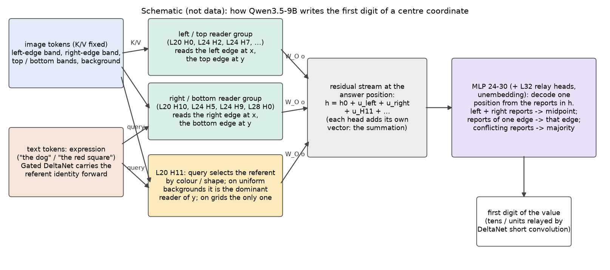
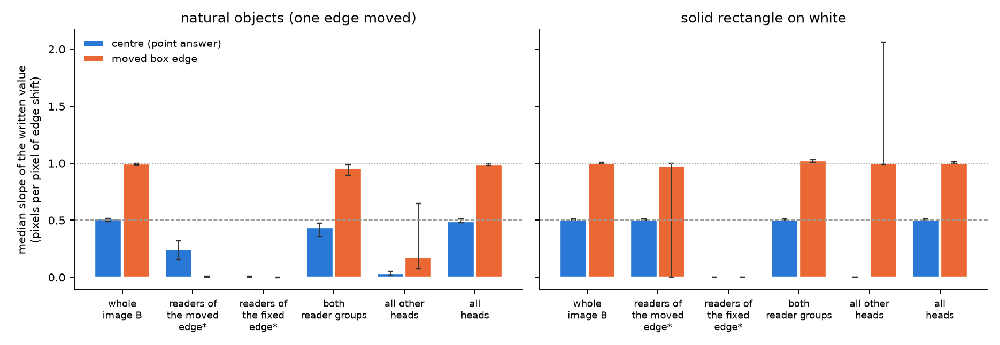
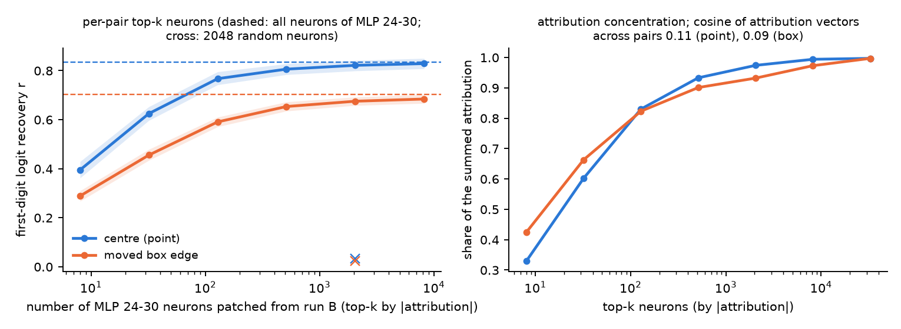
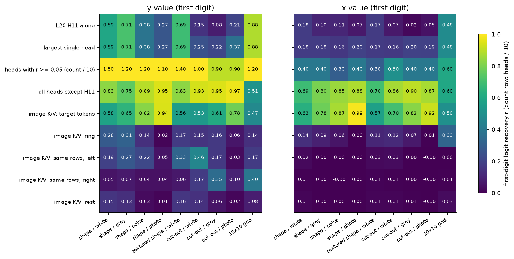
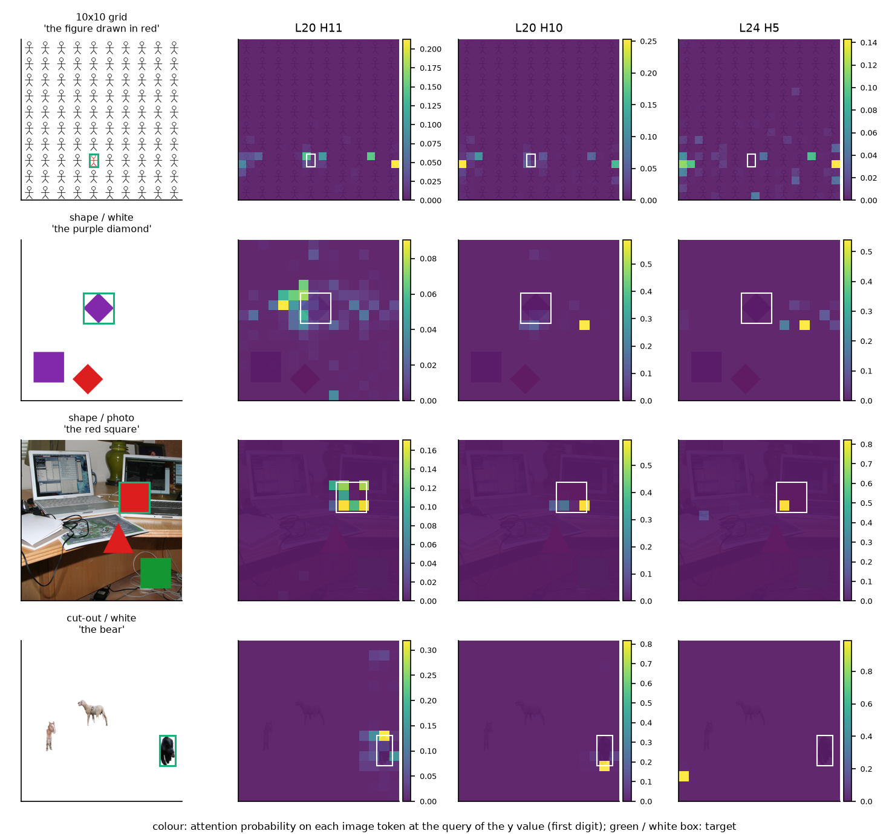
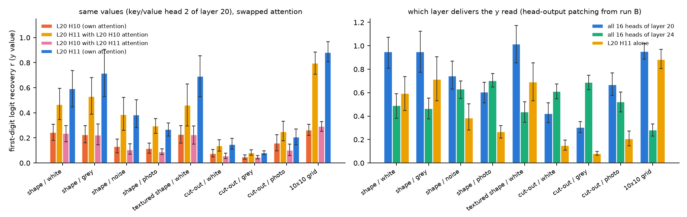
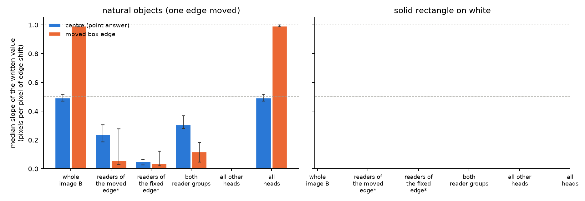
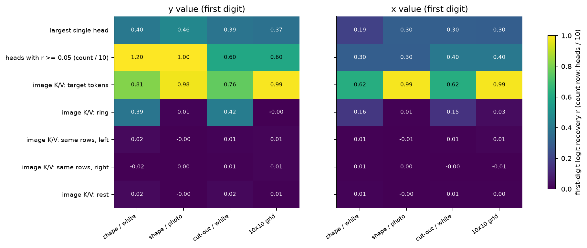

# 两条边读数合成中心的方式与 L20 H11 在合成图像上的特殊性（3.11 第五轮）

实验日期：2026-11-11 至 2026-11-12。本文属于[位置信息与坐标读取](plan.md)研究，是 3.11 的第五轮，直接承接[第四轮](results_2026-11-05_edge_heads_r2.md)（下称“第四轮”）与[第三轮](results_2026-11-03_edge_heads.md)，并与[自然图像与合成图像的坐标读出机理](results_2026-11-05_coordinate_mechanism_natural.md)（3.15 第二轮）、[读纵坐标时的行 attention](results_2026-11-05_row_attention.md)（3.14 第三轮）相互对照。主要模型为 Qwen3.5-9B，机制对照模型为 Qwen3-VL-8B-Instruct（两者都使用 bfloat16、SDPA、greedy decoding、thinking off，问题只要求输出答案）。本文只比较两个模型的机制，不比较能力。

## 通俗讲述

Qwen3.5 写一个坐标数值之前，会在答案位置上让第 20、24、28 层的一批 attention head 回看一次图像。图像 token 排在问题之前，它们的 key 与 value 在答案阶段已经固定，所以每个 head 看哪里只取决于答案位置上的 query，而 query 中带着由 Gated DeltaNet 从指代表达一路传来的“要找哪个物体”。写框中心的 x 时，这批 head 分成两组：一组把 attention 放在目标左边缘那两列 token 上，另一组放在右边缘那两列上（写 y 时换成上边缘与下边缘）。每个 head 把读到的 value 经输出门与 output projection 变成一个 4096 维的写入向量，加到答案位置的 residual stream 上。于是 residual 里同时有“左边缘在哪里”和“右边缘在哪里”两份读数，这就是“相加”：Transformer 中每个 head 的输出本来就以加法进入 residual，不需要专门的组件。随后，第 24–30 层的 MLP（以及第 32 层不看图像的中继 head 和 unembedding）把这个 residual 变成首位数字，十位与个位再由后段 Gated DeltaNet 的短卷积接力写出。

本轮首先回答“取平均”的 0.5 发生在哪里。如果读右边缘的 head 只写入一半的变化，那么只让这组 head 看到“右边缘右移了 96 像素”的图像，中心应只移动约四分之一。实测相反：矩形上只移植这组 head，中心正好移动半个位移，和把整张图换掉一样；它们写入 residual 的变化也不比写框的右边时小。所以读取 head 写进 residual 的是完整的“右边缘移动了多少”，0.5 来自 residual 之后的读出：读出面对“左边缘读数 + 右边缘读数”这一和，给出的是两条边的中点。同一个读出在写框的一条边时，面对的读数全部来自这一条边，给出的就是这条边。这个读出也没有把和乘以一个固定的 0.5：写框的边时，如果只让一部分读取 head 看到移动后的边，答案要么不动、要么跳到新位置，取决于报告新位置的 head 是否占多数。继续向下追到 MLP 神经元时，每张图像大约一百个神经元就承担了大部分读出，但不同图像用到的神经元几乎不重叠，反复出现的那些神经元只是按“数值偏大还是偏小”推动数字 logits。因此 0.5 是第 24–30 层 MLP 依数值变化的整体读出给出的结果，无法落到某一个或某一小组神经元上。

第二个问题是 L20 H11 为什么在合成图像上几乎单独承担读取。我们构造了从合成到自然的九种图像：几何形状、带纹理的几何形状与抠图自然物体，放在白底、灰底、噪声或照片背景上，再加上 10×10 的相同图形网格。H11 在均匀背景上的几何形状与网格上占主导，在噪声与照片背景上减弱，在自然物体上无论什么背景都不占主导；形状内部有没有纹理无关紧要。关键的观察来自 Qwen3.5 的结构细节：每层 16 个 query head 中每 4 个共用一组 key 与 value，H11 与 L20 H10 读的是完全相同的 value。把 attention 概率在两个 head 之间互换后发现，同样的 value、同样的 attention，经过 H11 的输出门与 output projection 后对纵坐标的作用是 L20 H10 的 2–3 倍，而把 H11 的 attention 交给其他边缘读取 head，它们的作用并不增加。也就是说，H11 的特殊之处主要在于“把看到的纵坐标以多大的增益写进 residual”，“看哪里”的差别是次要的。这一增益优势在所有图像上都存在；图像类型决定的是纵坐标由哪一层送达：简单形状放在均匀背景上时，第 20 层几乎独自送达纵坐标，H11 作为其中增益最大的 head 就成了主导；自然物体的纹理与轮廓让第 24 层的边缘读取 head 也能读出纵坐标，H11 便只是众多读数之一。网格是一个额外的情形：99 个相同图形中只有颜色不同，边缘读取 head 的 attention 根本不落在目标上，只有 H11 等少数 head 能按颜色选中目标；给边缘读取 head 换上 H11 的 attention 后，它们就能传递几乎全部纵坐标变化。

在 Qwen3-VL-8B 上做同样的实验得到的机制对照如下。Qwen3-VL 的读取 head 遵守同样的规律：写框的一条边时都读这条边，写中心时分成读两条对边的两组，它们集中在第 22–27 层（以第 25 层为主）。两条边的读数同样在 residual 中相加，但读出的组合方式不同：在 Qwen3-VL 中只让一部分读取 head 看到移动后的边，框的边会移动一个中间的距离，大致与这部分 head 的份额成正比，读出更像按份额加权的平均；Qwen3.5 则给出全有或全无。Qwen3-VL 中也没有对应 H11 的 head：它没有 Gated DeltaNet，纵坐标信息留在目标 token 本身，合成图像与自然图像上都由同一批第 25 层的边缘读取 head 读出，最大的单 head 在各种图像上作用相当。

## 1. 问题与主要结论

研究问题：

- **Q1（中心的合成）**：第四轮确认，写中心坐标时一组 attention head 读左（上）边缘、另一组读右（下）边缘，两组的输出在 residual stream 中相加。行为上一条边对中心的贡献是 0.5。这个 0.5 在哪一步产生：是读取 head 本身只写入一半的变化，还是 residual 到数字的读出把两条边的读数变成中点？能否把它定位到 MLP 24–30 中的具体神经元？
- **Q2（L20 H11 的特殊性）**：自然图像上 L20 H11 只是众多读取 head 之一，在合成图像上它几乎单独承担读取。它与其他读取 head 的差别在 query/key（看哪里）、value/output（读到什么、写入多少），还是在被读的图像内容本身？
- **Q3（Qwen3-VL）**：以上两点在只有 full attention、带 DeepStack 的 Qwen3-VL-8B 中是否以同样的方式实现？

主要结论（实测与解释分开标注）：

1. **读取 head 写入的是各自那条边的完整读数，写中心时的 0.5 不发生在 head 中。** 实测：解码时只移植读被移动边的 head 组，矩形上中心移动 0.50–0.51 $\Delta$（整图 run B 为 0.50–0.52），自然物体右、左、下边为 0.38、0.31、0.30，加上固定边组为 0.48、0.48、0.44；固定边组单独为 0.00–0.01；该组写入向量变化的范数在 point 中（28.8 / 28.3）大于 box 中（17.5 / 13.4）（第 3.3 节，表 1，图 avg_slopes）。
2. **0.5 由 residual 之后的读出产生：读出把左、右两份边缘读数解码为中点，把同一条边的读数解码为这条边，读数矛盾时给出多数一方。** 实测：写 box 的被移动边时只移植任一组，斜率中位数为 0.00–0.01，两组一起为 0.99–1.01，落在 0.35–0.65 的配对不到 10%；logit 恢复为单组 0.29 / 0.28、两组 0.62、全部 head 0.99（第 3.3 节）。解释：“相加”是 residual 的加法，0.5 是读出对两份不同位置读数的解码结果。
3. **读出无法定位到固定的 MLP 神经元。** 实测：每对图像归因最大的 128 个 MLP 24–30 神经元恢复 0.77（point）/ 0.59（box），全部神经元 0.84 / 0.70，随机 2048 个 0.03 / 0.02；但不同图像对的归因向量余弦只有 0.11 / 0.09，同一图像 point 与 box 之间 0.05；反复出现的神经元按数字大小单调推动 logits（第 3.3 节，图 avg_neurons）。
4. **H11 在均匀背景的几何形状与网格上占主导，在纹理背景上减弱，在自然物体上从不占主导。** 实测：H11 单独传递纵坐标变化，网格 0.88、灰底 / 白底几何形状 0.71 / 0.59、带纹理形状白底 0.69、噪声 / 照片背景 0.38 / 0.27、抠图物体 0.08–0.21（第 4.3 节，表 2，图 mix_recovery）。
5. **H11 的特殊之处主要在 OV：它与 L20 H10 共用 value，同样的 value 与 attention 经过 H11 的输出门与 $W_O$ 后作用大 2–3 倍；其他边缘读取 head 换上 H11 的 attention 并不变强。** 实测：白底几何形状上 L20 H10 自身 0.24、换上 H11 的 attention 0.24、H11 换上 L20 H10 的 attention 0.47、H11 自身 0.59；九种图像上比例一致（网格 0.26 → 0.80，白底抠图物体 0.07 → 0.14）（第 4.3 节，表 3，图 mix_transplant）。
6. **图像类型决定纵坐标由哪一层送达，这决定 H11 能否占主导；网格上另有选择失败。** 实测：均匀背景几何形状与网格上第 20 层整体传递 0.95–1.02、第 24 层 0.28–0.49；抠图物体上第 20 层 0.30–0.67、第 24 层 0.52–0.69。网格上边缘读取 head 在目标上的 attention 为 0.01–0.04，换上 H11 的 attention 后十个边缘 head 一起传递 0.98（第 4.3 节）。被读内容的位置（目标外的纵坐标信息）不能解释 H11 的主导：白底抠图物体上同行 K/V 也传递 0.46，H11 却只有 0.15。
7. **Qwen3-VL-8B 的读取规律相同，读出的组合方式不同，且没有对应 H11 的 head。** 实测：box 的 x_min / x_max 步骤上因果 head 的框内 attention 有 0.83–0.98 / 0.87–0.96 落在对应边缘带；写中心 x 时 L25 H29、L25 H14、L24 H30 读左边、L25 H13、L22 H18 读右边。box 的 x_max 上单组移植给出中间值（0.39、0.40，62–65% 的配对在 0.35–0.65），两组 0.93；四种图像上最大的单 head 都是第 25 层的边缘读取 head（0.37–0.46），纵坐标信息在目标 token 中（0.76–0.99）（第 5 节，表 4、表 5，图 avg_slopes_vl、mix_recovery_vl）。

## 2. 模型组件、符号与度量

### 2.1 答案位置上的 residual stream

Qwen3.5-9B 的 decoder 有 32 层，第 4、8、…、32 层为 full attention 层（每层 16 个 head，head 维度 $d_h = 256$），其余为 Gated DeltaNet 层，每层之后有一个 MLP。记答案中某个坐标数值的首位数字由位置 $t$ 预测（下称该数值的**首位 query**），第 $\ell$ 层输出的 residual 为 $h_\ell(t) \in \mathbb{R}^{D}$，$D = 4096$。full attention 层的更新为

$$
h_\ell(t) = h_{\ell-1}(t) + \sum_{k=0}^{15} W_O^{(\ell,k)}\, o_{\ell,k}(t) + m_\ell(t),
\qquad
o_{\ell,k}(t) = \sigma\big(g_{\ell,k}(t)\big) \odot \sum_{j \le t} a_{\ell,k}(t,j)\, v_{\ell,k}(j).
$$

其中 $a_{\ell,k}(t,j)$ 是第 $k$ 个 head 在 query 位置 $t$ 对 key 位置 $j$ 的 attention 概率（由 query 与 key 的内积经 softmax 得到，query 与 key 的线性变换合称 QK），$v_{\ell,k}(j) \in \mathbb{R}^{d_h}$ 是位置 $j$ 的 value，$\sigma(g_{\ell,k}(t)) \in (0,1)^{d_h}$ 是 Qwen3.5 的输出门，$W_O^{(\ell,k)} \in \mathbb{R}^{D \times d_h}$ 是 output projection 中属于该 head 的列块（value 变换与 $W_O$ 合称 OV），$m_\ell(t)$ 是 MLP 的输出。本文把 $u_{\ell,k}(t) = W_O^{(\ell,k)} o_{\ell,k}(t)$ 称为该 head 在位置 $t$ 的**写入向量**。这个式子说明：每个 head 的写入向量是 residual 中一个独立的加项，所以多个 head 的读数在 residual 中天然相加；图像 token 位于提示词之前，答案阶段图像 token 的 key 与 value 固定，一个 head 看向图像的哪里只由答案位置的 query 决定。

MLP 的计算为

$$
m_\ell(t) = W_{\text{down}}^{(\ell)}\, \alpha_\ell(t), \qquad \alpha_\ell(t) = \operatorname{SiLU}\big(W_{\text{gate}}^{(\ell)} x\big) \odot \big(W_{\text{up}}^{(\ell)} x\big),
$$

其中 $x$ 是 RMSNorm 之后的 residual，$\alpha_\ell(t) \in \mathbb{R}^{12288}$ 是第 $\ell$ 层 MLP 的**神经元激活**，第 $n$ 个神经元对 residual 的贡献是 $\alpha_{\ell,n}(t)$ 乘以 $W_{\text{down}}^{(\ell)}$ 的第 $n$ 列。最后一层 residual 经 RMSNorm 与 unembedding 得到数字 token 的 logits。

Qwen3-VL-8B 的 decoder 有 36 层，全部是 full attention（每层 32 个 head，$d_h = 128$，没有输出门），前 3 层在图像 token 上加入 DeepStack 特征；其余公式相同。

### 2.2 记号

- **读取 head 组**：沿用第四轮在 point 答案上定义的四组。写 x 时读左边缘的组（L20 H0、L20 H2、L20 H15、L24 H1、L24 H2、L24 H4、L24 H7、L24 H12、L24 H13，共 9 个）与读右边缘的组（16 个，含 L20 H10、L24 H5、L24 H9、L28 H0）；写 y 时读上边缘的组（L20 H0、L24 H2、L24 H7）与读下边缘的组（27 个，含 L20 H10、L24 H5、L24 H9、L28 H0）。单边移动配对中，读被移动边的组称为**移动边组**，读另一条边的组称为**固定边组**。
- **单边移动配对**：run A 为原图，run B 只把目标的一条边向外移动 96 像素、对边不动（第四轮第 3.1 节的构造；自然物体 60 张，白底纯色矩形 24 张）。记被移动边的位移为 $\Delta$（像素）。
- **where 配对**：run B 把目标平移 3 个 token（96 像素，网格为一格）、其余不变。

### 2.3 三种因果操作

1. **解码时 head 移植**。把 run A、run B 与若干“run A + 某组 head 来自 run B”的副本放在同一个 batch 中 greedy 解码（各行长度相同，不需要 padding）。在每一个解码步，被移植 head 的输出 $o_{\ell,k}$ 被替换为 run B 那一行在同一步的值，其余计算照常进行，MLP 与其他层根据替换后的 residual 重新计算。度量为被移动数值（point 的 x 或 y，box 的被移动边）的**斜率**：

$$
s = \frac{c_{\text{edit}} - c_A}{\Delta},
$$

其中 $c_A$ 与 $c_{\text{edit}}$ 是 run A 与移植后答案中该数值换算成的像素坐标（坐标约定按 run A 答案与真值的距离选择 0–1000 或像素，plan.md §6 第 9 项）。$s$ 直接以像素为单位告诉我们这组 head 的读数能把答案移动多少：中心的行为斜率为 0.5，box 被移动边的行为斜率为 1。

2. **teacher forcing 下的输出替换**。以 run A 的答案 teacher forcing，在提示词最后一个 token 起的全部答案位置上把选定 head 的输出（或选定 MLP 神经元的激活、或图像 token 的 key/value）替换为 run B 的值，度量 3.11 第一轮定义的首位数字 logit 恢复：

$$
r = \frac{\mathrm{LD}_{\text{edit}} - \mathrm{LD}_A}{\mathrm{LD}_B - \mathrm{LD}_A}, \qquad \mathrm{LD} = z_{d_B} - z_{d_A},
$$

$z$ 为首位 query 上的 logits，$d_A$、$d_B$ 为两次运行的首位数字。只统计 $d_A \neq d_B$ 且 $\lvert \mathrm{LD}_B - \mathrm{LD}_A \rvert \geq 2$ 的数值。$r$ 是 logit 尺度上的比例，适合比较组件，但不能直接换算成像素；需要像素尺度时使用操作 1。

3. **attention 模式移植**（只用于 Qwen3.5）。在 head $k$ 的计算中保留它自己的 value 与输出门，把 attention 概率换成另一个 head $k'$ 在同一位置的 attention 概率：

$$
\tilde{o}_{k}(t) = \sigma\big(g_{k}(t)\big) \odot \sum_{j} a_{k'}(t,j)\, v_{k}(j).
$$

对 run A 与 run B 分别算出 $\tilde{o}_k$，再把两者各自写入 run A，以两行之差相对 $\mathrm{LD}_B - \mathrm{LD}_A$ 的比例作为恢复 $r$。这一操作把一个 head 拆成“看哪里”（attention 概率，由 QK 决定）和“读到什么、写入什么”（由 value、输出门与 $W_O$ 决定）两部分：若 head $k$ 换上 $k'$ 的 attention 后 $r$ 接近 $k'$ 自己的 $r$，两者的差别在 QK；若仍然很小，差别在 OV。重算的 head 输出与模型自身输出的最大相对误差为 0.006。

## 3. 两条边如何合成中心

### 3.1 假设与推导

把第 2.1 节的公式写到写中心 x 的首位 query 上。读左边缘的组与读右边缘的组的写入向量之和分别记为 $U_L = \sum_{k \in \text{左组}} u_k$ 与 $U_R = \sum_{k \in \text{右组}} u_k$，其余加项合记为 $h_0$：

$$
h(t) = h_0 + U_L + U_R .
$$

答案的首位数字由读出函数 $F$（第 24–30 层 MLP、第 32 层的中继 head 与 unembedding）作用于 $h(t)$ 得到，记 $c = F(h)$。行为上只移动右边缘 $\Delta$ 时 $c$ 移动 $\Delta/2$。在这个式子中，“0.5”只有三种来处：

- **(i) 写入减半**：读右边缘的 head 只写入一半的变化，即右边缘移动 $\Delta$ 时 $U_R$ 的变化只相当于“$\Delta/2$”的位置变化，$F$ 照常读出。预测：只移植右组时中心移动 $\Delta/2$，box 被移动边只移动 $\Delta/2$ 左右；右组在 point 中的写入变化量明显小于 box 中。
- **(ii) 读出取中点**：右组写入完整的变化，$F$ 把同时含有左边缘读数与右边缘读数的 residual 映射到两者的中点。预测：只移植右组时中心移动 $\Delta/2$；右组在 point 中的写入变化量不小于 box 中；box 步骤中所有读取 head 都读被移动边（第四轮表 2），$F$ 映射到这条边。
- **(iii) 分组份额**：$F$ 是线性的、增益固定，右组与左组各占读取总增益的一半。它是 (ii) 的特殊情形，附加预测是每组的移植效果在 point 与 box 中按增益线性叠加：box 中单独移植任一组应使被移动边移动约 $\Delta$ 乘以该组的份额，两组之和接近 box 中全部 head 的效果。

(i) 与 (ii)/(iii) 由“只移植右组时 box 的被移动边移动多少”与“写入变化量的大小”区分；(ii) 与 (iii) 由 box 中单组移植是否给出中间值区分。

### 3.2 实验

对 115 个自然物体单边移动配对（右 37、左 31、下 17、上 30）与 48 个矩形配对（右、下各 24），在 point 与 box 两种答案上各做：

1. 解码时 head 移植，条件为 run B 整图、移动边组、固定边组、两组、两组以外的全部 head、全部 128 个 head、L20 H11；
2. teacher forcing 下同样各组的 $r$，以及第 24–30 层全部 MLP 神经元的 $r$；
3. 在首位 query 上记录全部 full attention head 在 run A、run B 中的输出，计算每组写入向量的变化 $\delta U = \sum_k W_O^{(\ell,k)} (o_{k,B} - o_{k,A})$；
4. MLP 24–30 的神经元归因（attribution patching）：在 run A 中对首位 logit 差 $\mathrm{LD}$ 求关于每个神经元激活的梯度 $\partial \mathrm{LD} / \partial \alpha_{\ell,n}$，乘以该神经元在 run B 与 run A 中的激活差，并对从提示词末尾到首位 query 的各位置求和，得到神经元 $n$ 的归因 $A_{\ell,n}$。$A_{\ell,n}$ 是“把这个神经元从 A 换成 B 会使 LD 改变多少”的一阶近似。随后把每对图像中 $\lvert A \rvert$ 最大的 $k$ 个神经元的激活从 run B 移植进 run A 检验这一近似（$k = 8, 32, \ldots, 8192$），并以随机 2048 个神经元作对照。

批量解码与逐条 `generate` 的抽查：20 个答案中 12 个逐字一致，其余 8 个的全部首位数字一致，末位相差 2–27 个单位（中位 3），来自 inputs_embeds 路径与批量计算的数值差异。

### 3.3 结果

**移动边组单独就能把中心移动完整的半个位移，读取 head 没有把变化减半。** 图 avg_slopes 与表 1 给出解码时移植的斜率（中位数与 bootstrap 95% CI）。矩形上只移植移动边组，中心移动 0.50 $\Delta$，与整图换成 run B 完全相同；自然物体上，右边缘与下边缘移动时移动边组的中位斜率为 0.38 与 0.30，加上固定边组后为 0.48 与 0.44，全部 head 为 0.50 与 0.51（实测）。固定边组单独移植时斜率为 0.00（各边 0.00–0.01），全部 head 以外的其余 head 为 0.00–0.03（右、左、下）。上边缘的读取组只有 3 个 head，其余 head 另外贡献 0.28，说明上边缘还有第四轮读取组以外的读者。逐对看，自然物体右边缘移动时，62% 的配对在只移植移动边组后落在 0.35–0.65 之间（实测）。这意味着在写中心时，右边缘的全部变化只经过读右边缘的那组 head，并且它们写入的是完整的“右边缘移动了 $\Delta$”这一读数：如果 head 本身只写入一半，移植它们后中心应只移动约 $\Delta/4$。

表 1　解码时 head 移植的斜率（被移动数值的像素变化 / 被移动边的像素位移，中位数）。“其余 head”为两组以外的全部 full attention head。

| 图像 | 答案 | 被移动边 | n | 整图 run B | 移动边组 | 固定边组 | 两组 | 其余 head | 全部 head |
| --- | --- | --- | --- | --- | --- | --- | --- | --- | --- |
| 自然 | point | 右 | 37 | 0.52 | 0.38 | 0.00 | 0.48 | 0.00 | 0.50 |
| 自然 | point | 左 | 31 | 0.50 | 0.31 | 0.00 | 0.48 | 0.02 | 0.50 |
| 自然 | point | 下 | 17 | 0.51 | 0.30 | 0.01 | 0.44 | 0.03 | 0.51 |
| 自然 | point | 上 | 30 | 0.50 | 0.09 | 0.01 | 0.14 | 0.28 | 0.47 |
| 自然 | box | 右 | 37 | 0.98 | 0.01 | −0.01 | 1.01 | 0.03 | 0.98 |
| 自然 | box | 左 | 31 | 1.00 | 0.01 | −0.01 | 0.99 | 0.06 | 1.00 |
| 自然 | box | 下 | 17 | 0.99 | 0.46 | 0.00 | 0.84 | 0.34 | 0.99 |
| 自然 | box | 上 | 30 | 0.99 | 0.00 | 0.94 | 0.94 | 0.64 | 0.98 |
| 矩形 | point | 右 / 下 | 24 / 24 | 0.52 / 0.50 | 0.51 / 0.50 | 0.00 / 0.00 | 0.51 / 0.50 | 0.00 / 0.00 | 0.52 / 0.50 |
| 矩形 | box | 右 / 下 | 24 / 24 | 1.00 / 1.00 | 0.00 / 1.01 | 0.00 / 0.00 | 1.04 / 1.01 | 1.00 / 0.05 | 1.00 / 1.00 |

**写入向量的变化在 point 中不比 box 中小。** 首位 query 上，自然物体右边缘移动时，移动边组写入向量变化的范数在 point 中平均为 28.8，在 box 中为 17.5；左边缘为 28.3 与 13.4；固定边组则相反，point 中 9.2 与 13.7，box 中 20.8 与 22.7（实测，单位为 residual 的 L2 范数）。两组合计的范数在两种答案中相近（右 30.8 对 28.2，左 31.9 对 27.2），但方向不同（余弦 0.17–0.24）。这与第四轮的区域测量一致：写 box 的被移动边时两组 head 都读这条边，写中心时只有移动边组读它。(i) 预测 point 中的写入变化应约为 box 中的一半，实测相反，因此 (i) 不成立。

**box 中单组移植的结果是全有或全无，读出的效果随读数的组合而变。** 写 box 的被移动边时，只移植任一组，斜率的中位数为 0.00–0.01（右、左），而两组一起移植为 0.99–1.01；逐对统计，右边缘的 37 个配对中，只移植移动边组时 84% 的斜率小于 0.15、3% 大于 0.85，两组一起时 27% 小于 0.15、70% 大于 0.85，落在 0.35–0.65 之间的不到 10%（实测）。矩形上也是如此：右边缘只移植 16 个 head 的移动边组斜率为 0，只移植其余 head（不含两组）为 1.00；下边缘只移植 27 个 head 的移动边组就达到 1.01。也就是说，box 中被移动边的答案要么停在旧位置，要么跳到新位置，取决于报告新位置的 head 是否占多数；(iii) 预测的“按份额给出中间值”没有出现。teacher forcing 下的 logit 恢复给出同样的图景：box 中移动边组与固定边组各为 0.29 与 0.28，两组一起为 0.62，其余 head 为 0.44，全部 head 为 0.99；point 中移动边组为 0.63，固定边组 0.09，两组 0.73，全部 head 0.96（实测）。

**读出把“左边缘读数 + 右边缘读数”映射到中点（解释）。** 综合三项结果，(ii) 是与数据相容的说法：写中心时，residual 中同时含有左组写入的左边缘读数与右组写入的右边缘读数，二者在 residual 中相加；读出 $F$ 从这一和中解码出一个位置，结果是两条边的中点；写 box 的一条边时，residual 中的读数都来自同一条边，$F$ 解码出这条边；当报告同一条边的 head 互相矛盾时，$F$ 给出多数一方的位置。因此“取平均”不是在“相加”之后再执行的一次乘 0.5 的运算：相加是 residual 的加法，0.5 是读出 $F$ 面对两个不同位置读数时的解码结果。$F$ 为何对两条不同边给出中点、对同一条边的矛盾读数给出多数，本轮没有直接检验；一个可能的原因是左组与右组的写入向量在两种答案中方向不同（余弦 0.17–0.24），$F$ 可以据此区分“两条边各一个读数”与“同一条边的两个读数”（推断，确定性低）。

**0.5 不能定位到 MLP 中的固定神经元。** 图 avg_neurons 给出神经元归因的结果。每对图像中归因绝对值最大的 128 个神经元（占 MLP 24–30 全部 86016 个神经元的 0.15%）占归因总和的 0.83，把它们的激活从 run B 移植进 run A 恢复 point 的 0.77、box 的 0.59，接近移植全部 MLP 24–30 神经元的 0.84 与 0.70；随机 2048 个神经元只恢复 0.03 与 0.02（实测）。可见对单个图像而言，读出集中在约一百个神经元上。然而这些神经元随数值而变：不同图像对的归因向量之间的平均余弦为 0.11（point）与 0.09（box），同一图像的 point 与 box 之间只有 0.05（120 对）（实测）。出现最频繁的神经元（L28 N1148 在 156 个 box 配对中的 82 个、point 配对中的 53 个进入前 32；L27 N6243、L28 N10821、L28 N8794）都是按数字大小单调地推动 logits 的神经元：以 L27 N6243 为例，它的输出列经 unembedding 后对数字 0–3 为正、对 6–9 为负，首位数字变大时它的激活平均下降 2.2，变小时上升 2.6（实测）。这类神经元编码“数值偏大还是偏小”，在 point 与 box 中都工作，它们执行的是“位置 → 数字”的映射，没有一个神经元或小集合专门实现“乘 0.5”。因此，0.5 由 MLP 24–30 中依数值而变的神经元共同实现的读出决定，本轮不再继续向下分解。

### 3.4 合成中心的表述

把本节的结果写成一句话：**写中心时，两组读取 head 分别读两条边，它们的写入向量在答案位置的 residual 中相加（“相加”）；第 24–30 层 MLP 及其后的读出从这一和中解码出一个位置，对左右两条边的读数给出中点（“取平均”的 0.5 来自这一步）；读取 head 写入的是各自那条边的完整读数，没有减半。** 同一读出在写 box 的边时把全部报告同一条边的读数解码为这条边，在读数矛盾时给出多数一方。第四轮“0.5 权重是这一相加加上 MLP 读出的结果”这一表述，准确的含义是：相加由 residual 的加法完成，0.5 由读出的解码完成，读出本身分布在依数值而变的 MLP 神经元上。

## 4. L20 H11 在合成图像上的特殊性

### 4.1 假设

第四轮发现 H11 单独传递纵坐标变化的比例在白底几何形状上为 0.57–0.73、照片背景上为 0.10–0.33；3.15 第二轮发现 10×10 网格上 H11 单独 0.52，而边缘读取 head 在网格目标上只有 0.02–0.04 的 attention。可能的原因有三类：

- **H-a（选择）**：H11 的 query 能按颜色、形状等属性在相同或相似的物体中选出目标，边缘读取 head 不能。预测：在由相同图形组成的网格中，边缘读取 head 的 attention 不在目标上；给它们换上 H11 的 attention 模式后，它们就能传递坐标。
- **H-b（被读内容的位置）**：在均匀背景上，纵坐标信息存放在目标周围与目标所在 token 行的背景 token 中（3.11 第一轮、3.7 第二轮），只有 H11 读这些 token。预测：均匀背景上，只拼接目标 token 的 key/value 传递的纵坐标比例低，拼接目标邻域与目标所在行传递的比例高；H11 在这些 token 上的 attention 明显多于边缘读取 head。
- **H-c（读出的内容与写入增益）**：H11 与边缘读取 head 看同样的位置，但 H11 的 value 与 $W_O$ 把纵坐标写得更强。预测：两者 attention 分布相近；给边缘读取 head 换上 H11 的 attention 模式后它们仍然传递很少，给 H11 换上边缘读取 head 的 attention 模式后它仍然传递很多。

### 4.2 设计

在合成图像与自然图像之间设计九种图像（每种 32 对 where 配对，目标最长边 96 像素即 3 个 token，一半带 2 个干扰物；网格为 10×10 相同黑色图形中的一个红色图形，目标移动一格）。九种图像按“物体类型 × 背景”排列：几何形状（指代表达为“the 颜色 形状”，干扰物与目标同色异形或同形异色）放在白底、灰底（RGB 150）、平滑噪声背景（灰色加高斯噪声后模糊，有纹理但没有物体）或照片背景上；带纹理的几何形状（填充色被平滑随机纹理调制）放在白底上；从照片中抠出的自然物体（指代表达为类别名，干扰物为其他类别）放在白底、灰底或照片背景上；以及 10×10 网格。每对图像测量：

1. 单 head 输出替换（128 个 head 逐个）与 head 组替换的 $r$；
2. 图像 key/value 的分区拼接：在全部 8 个 full attention 层中，只把一个区域内图像 token 的 key 与 value 换成 run B 的值。区域为目标（与 run A 或 run B 目标框相交的 token）、目标外一圈、目标所在 token 行中位于目标右侧（光栅顺序之后）与左侧的 token、目标所在 token 列中的其余 token、其余全部、全部图像 token；
3. run A 中每个 head 在首位 query 上的 attention 落在各区域的份额；
4. attention 模式移植（第 2.3 节）：十个因果边缘读取 head（L20 H0、L20 H2、L20 H10、L24 H2、L24 H4、L24 H5、L24 H7、L24 H9、L24 H12、L28 H0）一起换上 H11 的 attention，H11 换上这十个 head 的平均 attention；以及八个边缘读取 head 逐个与 H11 互换 attention。

### 4.3 结果

**H11 的主导地位由物体类型与背景共同决定：均匀背景上的几何形状与网格上它占主导，自然物体上从不占主导。** 图 mix_recovery 与表 2 给出九种图像上 H11 单独替换的 $r$。纵坐标上，网格为 0.88，灰底与白底几何形状为 0.71 与 0.59，带纹理的几何形状放在白底上为 0.69；同样的几何形状放在噪声背景与照片背景上降到 0.38 与 0.27；抠图自然物体无论放在白底、灰底还是照片上都只有 0.08–0.21（实测）。横坐标只有网格达到 0.48，其余不超过 0.18。H11 是否占主导因此不取决于“合成还是自然”这一笼统区分：物体内部有没有纹理不重要（带纹理的形状仍为 0.69），背景是否均匀与物体是否为简单几何形状才重要。这些图像上模型的命中率也随之变化：H11 占主导的四种图像命中率为 0/32（网格，按图形紧框计）、14/32、19/32、24/32，其余五种为 31–32/32（实测），H11 主导的场合正是模型定位不准的场合。

表 2　九种图像上的纵坐标（y）读取（where 配对，首位数字 logit 恢复 $r$ 的均值）。“边缘 head 组”为第四轮写 y 时的两组；“L20 / L24 全部”为该层 16 个 head 一起替换；“目标 K/V”为只拼接目标 token 的图像 key/value。

| 图像 | n | H11 | 最大的其他单 head | 边缘 head 组 | 除 H11 外全部 head | L20 全部 | L24 全部 | 目标 K/V | 目标外一圈 K/V | 同行左 / 右 K/V | 命中 |
| --- | --- | --- | --- | --- | --- | --- | --- | --- | --- | --- | --- |
| 10×10 网格 | 32 | 0.88 | L20 H10 0.25 | 0.46 | 0.51 | 0.95 | 0.28 | 0.47 | 0.14 | 0.17 / 0.40 | 0/32 |
| 几何形状 / 灰底 | 32 | 0.71 | L32 H13 0.25 | 0.69 | 0.75 | 0.95 | 0.47 | 0.65 | 0.31 | 0.27 / 0.07 | 14/32 |
| 带纹理形状 / 白底 | 32 | 0.69 | L32 H13 0.36 | 0.64 | 0.83 | 1.02 | 0.44 | 0.56 | 0.17 | 0.33 / 0.06 | 24/32 |
| 几何形状 / 白底 | 32 | 0.59 | L32 H13 0.29 | 0.73 | 0.83 | 0.95 | 0.49 | 0.58 | 0.28 | 0.19 / 0.05 | 19/32 |
| 几何形状 / 噪声 | 32 | 0.38 | L32 H13 0.28 | 0.81 | 0.89 | 0.74 | 0.63 | 0.82 | 0.14 | 0.22 / 0.04 | 32/32 |
| 几何形状 / 照片 | 32 | 0.27 | L32 H13 0.26 | 0.84 | 0.95 | 0.60 | 0.70 | 0.94 | 0.02 | 0.05 / 0.04 | 31/32 |
| 抠图物体 / 照片 | 32 | 0.21 | L16 H1 0.37 | 0.84 | 0.97 | 0.67 | 0.52 | 0.78 | 0.06 | 0.03 / 0.10 | 32/32 |
| 抠图物体 / 白底 | 32 | 0.15 | L32 H13 0.25 | 0.79 | 0.93 | 0.42 | 0.61 | 0.53 | 0.15 | 0.46 / 0.17 | 31/32 |
| 抠图物体 / 灰底 | 32 | 0.08 | L32 H13 0.22 | 0.82 | 0.95 | 0.30 | 0.69 | 0.61 | 0.16 | 0.17 / 0.35 | 32/32 |

表中有两点需要说明。第一，除 H11 以外的全部 head 一起替换时，在所有图像上都能传递 0.51–0.97，所以“只有 H11 负责”的准确含义是“只有 H11 单独就能移动答案”，其他 head 只能共同移动答案；第 3 节发现读出对互相矛盾的读数取多数，在这种读出下，单个 head 的 $r$ 衡量的是它的写入能否单独压过其余读数。第二，L32 H8 与 L32 H13 在每种图像上都有 0.12–0.36，它们不看图像，是第四轮确认的中继 head。

**H-b（被读内容的位置）不能解释 H11 的主导。** 均匀背景上纵坐标信息确实有一部分存放在目标之外：白底几何形状上只拼接目标 token 的 key/value 传递 0.58，目标外一圈 0.28，同行左侧 0.19；照片背景上目标 token 单独传递 0.94，其余区域不超过 0.05（实测，表 2）。但白底抠图物体同样有大量目标外的信息（目标 0.53，同行左侧 0.46），H11 在那里却只有 0.15；并且 H11 在白底几何形状上的 attention 分布与 L20 H10、L20 H0 相近（目标 0.29 / 0.39 / 0.40，目标外一圈 0.30 / 0.27 / 0.27，同行 0.24 / 0.19 / 0.22，图 mix_examples），读取目标邻域并不是 H11 独有的行为（实测）。

**H-a（选择）只在网格上成立。** 在由 99 个相同黑色图形组成的网格上，L24 H5、L24 H7、L20 H0 在纵坐标 query 上放在目标上的 attention 只有 0.01–0.04，H11 为 0.26，L16 H1 为 0.34（实测，图 mix_examples 第一行）。这与 3.15 第二轮在网格上的观察一致：边缘读取 head 找不到唯一的红色目标。十个因果边缘读取 head 一起换上 H11 的 attention 后，在网格上传递纵坐标变化的 0.98，高于它们用自己 attention 时的 0.71（实测）。在只有一个目标或两个干扰物的几何形状图像上则不同：边缘读取 head 的 attention 与 H11 一样落在目标上，几乎不落在同色或同形的干扰物上（L24 H5 写 x 时目标 0.90、两个干扰物 0.00；H11 为 0.63 与 0.01），说明它们的 query 同样能按“颜色 + 形状”选出目标。因此选择能力的差别只在“许多完全相同的图形中只有颜色不同”的网格上起作用。

**H-c（OV）成立：H11 与 L20 H10 共用同一组 value，H11 的输出门与 $W_O$ 把同样的读数写得强 2–3 倍。** Qwen3.5 每个 full attention 层只有 4 个 key/value head，16 个 query head 每 4 个共用一组 key 与 value；L20 H8–H11 共用第 20 层的第 2 个 key/value head。L20 H10 与 H11 读到的 value 向量完全相同，两者只在 attention 概率（由各自的 query 决定）、输出门与 $W_O$ 上不同。attention 模式移植正好可以把这两部分分开（图 mix_transplant 左）。白底几何形状上，L20 H10 用自己的 attention 传递 0.24，换上 H11 的 attention 后仍为 0.24；H11 换上 L20 H10 的 attention 后传递 0.47，用自己的 attention 为 0.59（实测）。这组数字的含义是：在 value 与 attention 都相同时（“H11 用 H10 的 attention”对“H10 自己”），只因输出门与 $W_O$ 不同，纵坐标的作用就从 0.24 增加到 0.47；attention 的差别只再增加 0.12。九种图像上这一比例都成立：网格 0.26 → 0.80，灰底 0.23 → 0.53，照片背景几何形状 0.12 → 0.29，白底抠图物体 0.07 → 0.14，抠图物体照片 0.16 → 0.25；L20 H10 换上 H11 的 attention 在每种图像上都不增加（0.05–0.29，与自身相差不超过 0.03）（实测）。对其余边缘读取 head 也一样：L24 H5、L24 H7、L24 H2、L28 H0、L20 H0 换上 H11 的 attention 后纵坐标作用在全部图像上不超过 0.10，而 H11 换上它们任何一个的 attention 都比它们自身大（例如白底几何形状上 H11 用 L20 H0 的 attention 为 0.52，L20 H0 自身为 0.07）（实测，表 3）。因此 H11 的特殊之处主要在于它的输出门与 output projection：它把共享 value 中的纵坐标成分以更大的增益写进 residual 中读出所用的方向。

表 3　逐 head 的 attention 模式移植（纵坐标，$r$ 均值）。每格三个数为：该 head 用自己的 attention / 该 head 用 H11 的 attention / H11 用该 head 的 attention。

| 图像 | L20 H10 | L20 H0 | L24 H5 | L24 H7 | L24 H2 | L28 H0 |
| --- | --- | --- | --- | --- | --- | --- |
| 10×10 网格 | 0.26 / 0.29 / 0.80 | 0.09 / 0.10 / 0.64 | 0.03 / 0.07 / 0.37 | −0.01 / −0.04 / 0.40 | 0.00 / −0.06 / 0.35 | 0.06 / −0.10 / 0.11 |
| 几何形状 / 白底 | 0.24 / 0.24 / 0.47 | 0.07 / 0.06 / 0.52 | 0.12 / 0.02 / 0.25 | 0.03 / 0.00 / 0.37 | 0.07 / 0.01 / 0.43 | 0.10 / 0.00 / 0.17 |
| 几何形状 / 照片 | 0.12 / 0.09 / 0.29 | 0.05 / 0.05 / 0.27 | 0.08 / 0.01 / 0.20 | 0.00 / −0.00 / 0.18 | 0.03 / −0.00 / 0.24 | 0.05 / −0.00 / 0.11 |
| 抠图物体 / 白底 | 0.07 / 0.06 / 0.14 | 0.02 / 0.02 / 0.14 | 0.08 / −0.01 / 0.11 | −0.00 / −0.00 / 0.12 | 0.04 / 0.01 / 0.15 | 0.06 / −0.00 / 0.04 |
| 抠图物体 / 照片 | 0.16 / 0.10 / 0.25 | 0.07 / 0.06 / 0.19 | 0.07 / 0.01 / 0.15 | 0.00 / 0.00 / 0.11 | 0.04 / 0.00 / 0.15 | 0.06 / 0.02 / 0.15 |

**H11 的增益优势在各种图像上都存在，图像类型决定的是纵坐标由哪一层送达。** 既然 H11 的 OV 优势在自然物体上也存在（0.07 → 0.14），它为何在自然物体上不占主导？图 mix_transplant 右给出整层替换的结果：几何形状放在均匀背景上与网格上，第 20 层 16 个 head 一起传递纵坐标变化的 0.95–1.02，第 24 层只有 0.28–0.49；抠图自然物体上第 20 层降到 0.30–0.67，第 24 层升到 0.52–0.69；照片背景几何形状两层相当（0.60 / 0.70）（实测）。H11 是第 20 层中增益最大的读取者，第 20 层承担纵坐标时它占主导；当自然物体的纹理与轮廓让第 24 层的边缘读取 head 也能读出纵坐标时，读出要综合两层的大量读数，H11 的单 head 作用随之降低。为什么简单几何形状与均匀背景上纵坐标主要由第 20 层送达，本轮只确定了现象，没有找到原因（开放问题）。

**H11 的定义（解释，确定性中等）。** 综合第四轮与本轮：L20 H11 的 query 按指代表达选择目标（第四轮的 query 替换），在许多相同图形中也能按颜色选出目标（本轮的网格）；它与 L20 H8–H10 共用 value，但其输出门与 $W_O$ 把 value 中的纵坐标成分以约 2–3 倍的增益写入 residual。这两点在所有图像上都成立；它在合成图像上几乎单独承担读取，是因为这些图像上纵坐标主要由第 20 层送达（简单形状、均匀背景），或者其他读取 head 根本找不到目标（网格）。在自然图像上第 24 层的边缘读取 head 也送达纵坐标，H11 只是众多读数之一。

## 5. Qwen3-VL-8B 的对照

Qwen3-VL-8B-Instruct 的 decoder 全部是 causal full attention（36 层 × 32 个 head，$d_h = 128$，每 4 个 query head 共用一个 key/value head，没有输出门），图像 token 在前 3 层加入 DeepStack 特征。本节只比较两个模型实现坐标读取的方式，不比较能力。所用操作与 Qwen3.5 相同，规模较小：第四轮 nat 平移配对中的 64 张图像（RefCOCO 30、PACO 30、Pascal-Part 4），每张做 point 与 box 两种答案；Qwen3-VL 有 1152 个 head，单 head 输出替换只对 64 张图像上图像 attention 份额最大的 128 个 head 进行。单边移动配对取 str 中的前 80 对（右 26、左 19、上 23、下 12）。九种图像只取四种（白底几何形状、照片背景几何形状、白底抠图物体、10×10 网格），前三种各 16 对、网格 8 对。批量解码抽查 20 个答案，9 个逐字一致，其余首位数字全部一致，末位相差不超过 8 个单位。

**读哪条边：与 Qwen3.5 相同的规律，读取 head 集中在第 22–27 层。** 表 4 给出 Qwen3-VL 的因果读取 head（单 head 替换 $r \geq 0.02$ 且 CI 下界大于 0）及其在目标框内的 attention 分布。写 box 的 x_min 时，8 个因果 head 的框内 attention 有 0.83–0.98 落在左边缘带；写 x_max 时 0.87–0.96 落在右边缘带，没有 head 读对边（实测）。写中心 x 时才分成两组：L25 H29、L25 H14、L24 H30 读左边缘（左边缘带份额 0.76–0.83），L25 H13、L22 H18 读右边缘（0.81、0.71）；写中心 y 时 L25 H16 读上边缘（0.80）、L25 H19 读下边缘（0.73）。这与第四轮在 Qwen3.5 上的规律一致：同一个 head 读哪条边由正在写的数值决定。差别在于读取 head 的层与数量：Qwen3.5 的读取 head 分布在第 20、24、28 层（full attention 层只有 8 个），Qwen3-VL 集中在第 22–27 层，写中心 x 时的因果 head 只有 8 个，最大的 L25 H13 单独 $r = 0.26$。写 y 时 L25 H13、L25 H14、L25 H29 的框内 attention 只有 0.01–0.05，它们读的是目标框外的 token，与 3.14 第三轮在 Qwen3-VL 上发现的“行首 token”读取相符。

表 4　Qwen3-VL 写中心坐标时的因果读取 head（nat 64 张；$r$ 为单 head 输出替换的首位数字恢复；框内份额与左（上）/ 右（下）边缘带占框内 attention 的比例由 run A 的 attention 计算）。

| 数值 | head | $r$ | 框内份额 | 左（上）带 / 右（下）带 |
| --- | --- | --- | --- | --- |
| 中心 x | L25 H13 | 0.26 | 0.88 | 0.03 / 0.81 |
| 中心 x | L25 H29 | 0.13 | 0.91 | 0.76 / 0.05 |
| 中心 x | L25 H14 | 0.13 | 0.81 | 0.83 / 0.03 |
| 中心 x | L22 H18 | 0.03 | 0.93 | 0.07 / 0.71 |
| 中心 x | L24 H30 | 0.02 | 0.88 | 0.78 / 0.05 |
| 中心 y | L25 H16 | 0.20 | 0.96 | 0.80 / 0.01 |
| 中心 y | L25 H19 | 0.11 | 0.96 | 0.01 / 0.73 |
| 中心 y | L25 H13 | 0.21 | 0.05 | （读框外） |

**两条边的合成：同样在 residual 中相加，但 Qwen3-VL 的读出按读数份额连续地组合。** 以上述两组为移动边组与固定边组（第 2.2 节的定义），解码时移植的结果见图 avg_slopes_vl 与表 5。写中心时，整图 run B 的斜率为 0.45–0.53；只移植读被移动竖边的组（2–3 个 head），中心移动 0.33（右）与 0.36（左），固定边组 0.05（实测）。与 Qwen3.5 的关键差别出现在 box：Qwen3-VL 写 x_max 时只移植移动边组，被移动边移动 0.39 $\Delta$，只移植固定边组 0.40，两组一起 0.93；右边缘的 26 对中，单组移植有 62–65% 落在 0.35–0.65 之间（实测）。Qwen3.5 在同样的操作下是全有或全无（单组中位 0.00，中间值不到 10%）。也就是说，Qwen3-VL 的读出更接近第 3.1 节的假设 (iii)：每组读取 head 按其份额线性地贡献位置，写 box 的边时所有读者读同一条边，份额相加为 1；写中心时两条边各得约一半。teacher forcing 下的 logit 恢复给出同样的方向：point 中移动边组 0.57、固定边组 0.12，box 中两组各 0.22 与 0.23、合计 0.48（实测）。纵坐标上两组只包含 L25 H16、L25 H19 等少数 head，box 的 y_min / y_max 主要由不在组内的 L27 H20 读取（表 4 之外，box 步骤的单 head $r$ 为 0.12 与 0.25），所以纵向移植的斜率很小，不能用于比较。

表 5　Qwen3-VL 解码时 head 移植的斜率（中位数，自然物体单边移动）。

| 答案 | 被移动边 | n | 整图 run B | 移动边组 | 固定边组 | 两组 | 全部 head |
| --- | --- | --- | --- | --- | --- | --- | --- |
| point | 右 | 26 | 0.47 | 0.33 | 0.05 | 0.37 | 0.47 |
| point | 左 | 19 | 0.50 | 0.36 | 0.05 | 0.40 | 0.50 |
| box | 右 | 26 | 0.99 | 0.39 | 0.40 | 0.93 | 0.99 |
| box | 左 | 19 | 1.00 | 0.35 | 0.17 | 0.90 | 1.00 |

**Qwen3-VL 中没有只在合成图像上主导的读取 head。** 图 mix_recovery_vl 给出四种图像上的结果。最大的单 head 在四种图像上都是第 25 层的边缘读取 head（纵坐标 L25 H13 为 0.40、0.46、0.39，网格上 L27 H20 为 0.37），在白底与照片背景上作用相当；$r \geq 0.05$ 的 head 数为 6–12（实测）。图像 key/value 的分区拼接显示纵坐标信息主要在目标 token 中（白底几何形状 0.81、照片背景 0.98、白底抠图物体 0.76、网格 0.99），白底图像上另有目标外一圈的 0.39–0.42，同行 token 不超过 0.02（实测）。网格上 Qwen3-VL 的读取 head 能找到红色目标（只拼接目标 token 即传递 0.99）。这与 3.14 第一、三轮一致：Qwen3-VL 没有 Gated DeltaNet，纵坐标不会沿光栅顺序存放到目标之后的 token 中。Qwen3.5 中 H11 的主导依赖“第 20 层几乎独自送达纵坐标”这一条件，而 Qwen3-VL 在合成与自然图像上都由同一批第 25 层读取 head 送达，因此不存在对应 H11 的 head。

## 6. 从输入到输出的过程

图 flow 是本节叙述的示意图（不是数据）。以“给出 the dog 的框中心”为例，Qwen3.5-9B 写出中心 x 的首位数字的过程如下。

1. **图像 token 与指代表达。** 图像经 ViT 与 merger 变成 token，进入 decoder 后在每层得到 key 与 value；它们排在问题之前，答案阶段不再改变。问题中的指代表达经 Gated DeltaNet 的递推状态向后传递，答案位置的 hidden state 因而带有“要找的是狗”这一信息（第三轮的 what 配对：DeltaNet 携带指代对象 0.94–0.99）。
2. **读取 head 回看图像。** 到了首位 query（以及它之前 1–3 个 token），第 20、24、28 层的读取 head 以答案位置的 query 与图像 token 的 key 计算 attention。query 中的指代信息让 attention 落在狗上；数值类型决定落在哪条边：写中心 x 时，左组（L20 H0、L24 H2、L24 H7 等）落在狗的左边缘那两列 token 上，右组（L20 H10、L24 H5、L24 H9、L28 H0 等）落在右边缘那两列上（第四轮）。写框的 x_max 时两组都落在右边缘。
3. **写入 residual。** 每个读取 head 把被注视 token 的 value 加权求和，经输出门与 $W_O$ 得到写入向量，加到答案位置的 residual 上。左组写入随左边缘位置变化的分量，右组写入随右边缘位置变化的分量，两者在 residual 中相加。读取 head 写入的是各自那条边的完整读数，没有在这一步减半（第 3.3 节）。L20 H11 也在这一步写入：它与 L20 H10 读同样的 value，但以更大的增益写入纵坐标（第 4.3 节）；在自然图像上它是众多读数之一。
4. **读出为数字。** 第 24–30 层的 MLP 从 residual 中的读数解码出一个位置并推动数字 logits：左右两份读数给出中点，一条边的一致读数给出这条边，矛盾读数给出多数一方。对一张具体的图像，这一步主要由约一百个神经元完成，具体是哪些神经元随数值而变（第 3.3 节）。第 32 层的 L32 H8、L32 H13 不看图像，把答案位置的信息中继到预测位置。
5. **后续数位。** 十位与个位不再看图，由后段 Gated DeltaNet 的短卷积把前一个 token 的状态接力过来（3.12 第二轮、3.15 第二轮）。

合成图像上的差别发生在第 2–3 步。均匀背景上的简单几何形状，纵坐标几乎全部由第 20 层送达，第 20 层中增益最大的 H11 因而单独就能决定纵坐标；10×10 网格上，99 个相同图形让边缘读取 head 的 attention 无法落在目标上，只剩 H11 等少数 head 按颜色找到目标。

## 7. 讨论

- **与第四轮的关系。** 第四轮确立了两组 head 的分工、相加与 MLP 的必经性；本轮把 0.5 的来源确定在 residual 之后的读出（第 3 节），并把第四轮中有歧义的表述改正（第四轮文末的修改记录）。第四轮“H11 在白底图像上读取目标邻域”的观察成立，但本轮表明邻域读取不是 H11 主导的原因（L20 H10、L20 H0 的 attention 分布相近）。
- **与 3.15 第二轮的一致。** 3.15 第二轮发现网格上边缘读取 head 在目标内只有 0.02–0.04 的 attention、网格依赖 H11（0.52），照片依赖 12 个边缘 head；本轮在网格上得到同样的 attention 测量，并用 attention 模式移植说明网格上的差别来自选择，而单个几何形状上的差别来自 H11 的输出增益。3.15 第二轮“网格的失败来自相同小图形的重复”与本轮“H11 主导的场合命中率低”相互印证：当只有一个高增益读者时，读出缺少其他读数的校正。
- **与 3.13 第二轮的一致。** 3.13 第二轮表明冻结第 25–32 层不妨碍微调得到精确坐标，读出阶段不是缺陷所在。本轮的读出在基座模型中已经能把两条边解码为中点（行为斜率 0.50），与之相容。
- **与 3.14 第三轮的关系。** 3.14 第三轮测得 Qwen3-VL 纵坐标读取 head 的选择由 key/query 的内容决定、MRoPE 旋转几乎不参与；本轮在 Qwen3.5 上把读取 head 的作用拆成 attention 与 OV 两部分，发现 H11 的主导主要来自 OV，两者从不同侧面说明“读哪里”与“写多少”是可分离的。
- **两个模型的读出差别（解释，确定性中等）。** Qwen3-VL 的读出对同一条边的部分读数给出中间位置，Qwen3.5 给出全有或全无；两者写中心时都得到 0.5。这说明“相加后解码为中点”在两个模型中都成立，但解码对矛盾读数的处理是各自训练出的参数，与“residual 相加”这一结构无关。Qwen3.5 中 H11 的特殊性依赖 Gated DeltaNet 造成的纵坐标存放方式与第 20 层的送达，Qwen3-VL 中纵坐标留在目标 token 中，没有对应的 head。
- **参数问题还是架构限制。** “相加”由 Transformer 的 residual 结构决定；0.5 的解码、H11 的输出增益、纵坐标由哪一层送达都是训练得到的参数（确定性中等到高）。GQA 让 H8–H11 共用 value 是架构选择，但 H11 的优势来自它自己的输出门与 $W_O$，属于参数。

## 8. 限制

- 解码时 head 移植在每一步复制 run B 那一行在同一步的 head 输出；run B 的答案在被移动数值处与 run A 不同，被移动数值之后的步骤中两行的上下文不再对齐。本文只读取被移动的那个数值，它之前的 token 两行相同，因此不受影响。
- box 中“读数矛盾时给出多数一方”是对全有或全无现象的描述，本轮没有构造读数比例连续变化的实验来检验“多数”的阈值；读出为何对两条不同边给出中点而对同一条边的矛盾读数给出多数，只给出了低确定性的推断。
- 神经元归因是一阶近似，在 point 上被 top-k 移植验证（top-128 恢复 0.77，归因份额 0.83），在 box 上近似较差（top-128 恢复 0.59，全部 MLP 24–30 为 0.70）。
- 第 4 节的单 head $r$ 在读出非线性（多数）的条件下不能相加；“主导”指单个 head 的作用，不表示其他 head 不携带信息。
- 九种图像的目标大小固定为 96 像素，每种 32 对；网格的命中率按图形紧框计算，与 3.15 第二轮按格子计算的命中率不可直接比较。
- 纵坐标在简单形状上主要由第 20 层送达、在自然物体上由第 24 层也送达的原因没有确定。
- Qwen3-VL 的样本较小（nat 64 张、单边移动 80 对、四种图像 56 对），单 head 扫描只覆盖图像 attention 份额最大的 128 个 head；纵坐标的读取组太小，box 的纵向移植不能用于比较。

## 图

*图 flow：第 6 节过程叙述的示意图（不是数据）。方框为模型组件，箭头为信息的去向；“W_O o”表示 head 的写入向量进入 residual。*

*图 avg_slopes：解码时 head 移植的斜率（被移动数值的像素变化除以被移动边的像素位移，模型生成答案后计算；柱高为中位数，误差线为 1000 次 bootstrap 的中位数 95% CI）。蓝色为中心（point 答案），橙色为 box 的被移动边；灰色虚线为 0.5，点线为 1。左：自然物体单边移动（115 对），右：白底矩形（48 对）。带星号的两组按 point 答案定义（第 2.2 节）。*

*图 avg_neurons：左，每对图像中归因绝对值最大的 k 个 MLP 24–30 神经元的激活从 run B 移植进 run A 后的首位数字 logit 恢复 $r$（模型激活，阴影为 bootstrap 95% CI）；虚线为移植全部 MLP 24–30 神经元，叉号为随机 2048 个神经元。右，前 k 个神经元占归因总和的份额（归因 = 激活差 × 梯度，由激活与梯度计算）。蓝色 point，橙色 box。*

*图 mix_recovery：九种图像上的首位数字 logit 恢复 $r$（模型的 teacher-forced 前向，每格为 32 对的均值）。行依次为 H11 单独替换、最大的单 head、$r \geq 0.05$ 的 head 数除以 10、除 H11 外全部 head、以及只拼接某区域图像 key/value（全部 8 个 full attention 层）。颜色为 viridis，0 到 1。左为纵坐标，右为横坐标。*

*图 mix_examples：run A 在纵坐标首位 query 上的 attention 概率（模型激活，在图像 token 上重新归一化，每格一个 token，色条为概率）。左列为输入与目标框（绿色），右三列为 L20 H11、L20 H10、L24 H5，白框为目标。白底几何形状一例模型以像素约定作答。网格一例中边缘读取 head 的 attention 不在目标上。*

*图 mix_transplant：左，attention 模式移植（第 2.3 节操作 3，由模型的 value、输出门与 attention 重算后写入前向）：橙色 L20 H10 自身，黄色 H11 用 L20 H10 的 attention，粉色 L20 H10 用 H11 的 attention，蓝色 H11 自身；两者共用第 20 层第 2 个 key/value head 的 value。右，整层 16 个 head 一起替换（蓝第 20 层，绿第 24 层）与 H11 单独（黄）。纵坐标首位数字 $r$，误差线为 bootstrap 95% CI。*

*图 avg_slopes_vl：Qwen3-VL 的解码时 head 移植斜率（与图 avg_slopes 相同的计算与配色；只有自然物体，右侧矩形面板为空；读取组见第 5 节）。*

*图 mix_recovery_vl：Qwen3-VL 在四种图像上的首位数字 logit 恢复（与图 mix_recovery 相同的计算与配色；没有 H11 对应行）。*

## 9. 运行

- 入口：`scripts/analysis/position/edge_heads_r3.sh`（`STAGE=cases|gpu|analyze|figures`，参数集中在脚本顶部；`MODEL` 选择 Qwen3.5-9B 或 Qwen3-VL-8B；gpu 阶段通过共享的 GPU 申请脚本获得空闲 GPU，结束或失败时释放）。
- 代码：`analysis_tools/position/edge_heads_r3.py`（图像构造与 GPU 阶段 avg、spot、mix、mix2、vlscan）、`edge_heads_r3_analysis.py`（CPU 分析，输出 `summary.json`）、`edge_heads_r3_figures.py`（作图）；测试 `tests/analysis/position/test_edge_heads_r3.py`。

- 计算量：约 1.9 GPU 小时。Qwen3.5：一块空闲 A800 上 avg、spot、mix 约 50 分钟，一块空闲 A40 上 mix2 约 30 分钟；Qwen3-VL（`MODEL=Qwen3-VL-8B-Instruct`）：一块空闲 A40 上 vlscan 约 17 分钟（`LIMIT=64`），avg 与 spot 约 8 分钟（`LIMIT=160`），mix 约 10 分钟（`MIX_KINDS=shape_white,shape_photo,cutout_white,grid10`，`MIX_PER_KIND=8`）。Qwen3-VL 的读取 head 组由 `edge_heads_r3_analysis --vl-groups` 根据 vlscan 结果生成（因果且框内份额 ≥ 0.3、单侧边缘带份额 ≥ 0.5），即 VL_MINX=25.29,25.14,24.30，VL_MAXX=25.13,22.18，VL_MINY=25.16,24.30，VL_MAXY=25.19,24.10,21.15,29.18。批量解码每个配对 7–8 行（同长度，无 padding）。

## 实验产物

路径相对于 `$WORK_DIR/analysis/position/2026-11-11_edge_heads_r3/`；“analyze”指 `STAGE=analyze`（`edge_heads_r3_analysis.py`），“figures”指 `STAGE=figures`（`edge_heads_r3_figures.py`）。

| 内容 | 路径 | 产生方式 |
| --- | --- | --- |
| 九种图像的规格（含网格） | `mix_cases.json` | `STAGE=cases` |
| 表 1、图 avg_slopes（解码时移植斜率） | `avg_q35.jsonl`（每条记录的 `gen`）；`summary.json` 的 `q35.slopes` | gpu（avg）+ analyze |
| 第 3.3 节 logit 恢复、top-k 神经元移植 | `avg_q35.jsonl` 的 `ld`、`topk_ld`；`summary.json` 的 `q35.recovery` | gpu（avg）+ analyze |
| 写入向量变化的范数与余弦 | `avg_q35/*.npz` 的 `heads_a`、`heads_b`；`summary.json` 的 `q35.writes` | gpu（avg）+ analyze |
| 神经元归因、图 avg_neurons | `avg_q35/*.npz` 的 `attr`、`grad_q`、`dact_q`；`summary.json` 的 `q35.neurons` | gpu（avg）+ analyze + figures |
| 批量解码抽查 | `spot_q35.jsonl` | gpu（spot） |
| 表 2、图 mix_recovery（九种图像的组件替换与 K/V 分区拼接） | `mix_q35.jsonl`；`summary.json` 的 `q35.mix` | gpu（mix）+ analyze |
| attention 区域份额、图 mix_examples | `mix_q35/*.npz` 的 `att_a`、`att_b`；`summary.json` 的 `q35.mix.attention` | gpu（mix）+ analyze + figures |
| 表 4（Qwen3-VL 因果读取 head 与边缘带） | `nat_gen_vl.jsonl`、`scan_vl_regions/*.npz`（区域份额）、`scan_vl.jsonl`（单 head 替换）、`scan_vl_subset.json`（扫描的 128 个 head）；`summary.json` 的 `vl.vlscan` | gpu（vlscan）+ analyze |
| 表 5、图 avg_slopes_vl | `avg_vl.jsonl`、`avg_vl/*.npz`；`summary.json` 的 `vl.slopes`、`vl.recovery`；抽查 `spot_vl.jsonl` | gpu（avg、spot）+ analyze |
| 图 mix_recovery_vl | `mix_vl.jsonl`、`mix_vl/*.npz`；`summary.json` 的 `vl.mix` | gpu（mix）+ analyze |
| 表 3、图 mix_transplant（attention 模式移植） | `mix2_q35.jsonl`；`summary.json` 的 `q35.mix2`；整组移植在 `q35.mix` 的 `edges_h11pat`、`h11_edgepat` | gpu（mix2）+ analyze |
| 运行日志 | `run_log.jsonl` | gpu |
